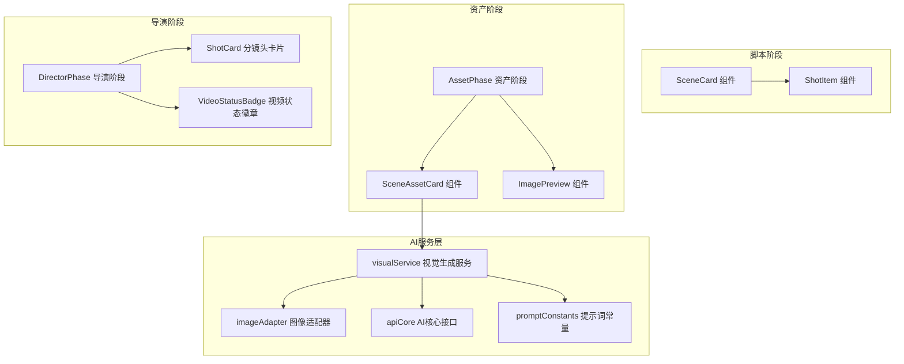
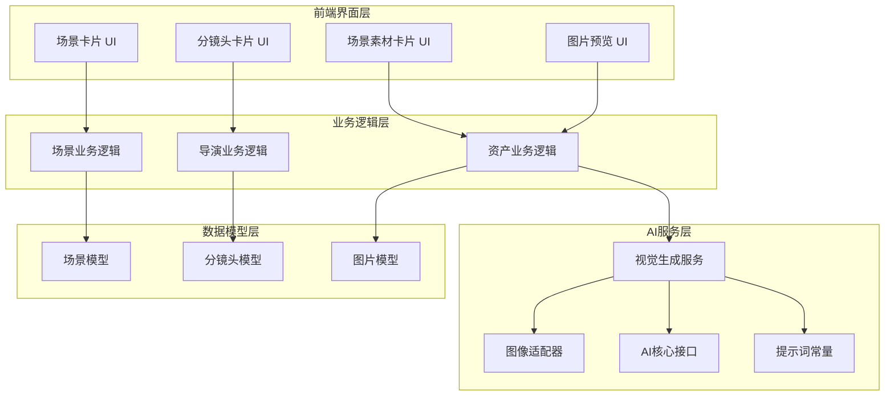
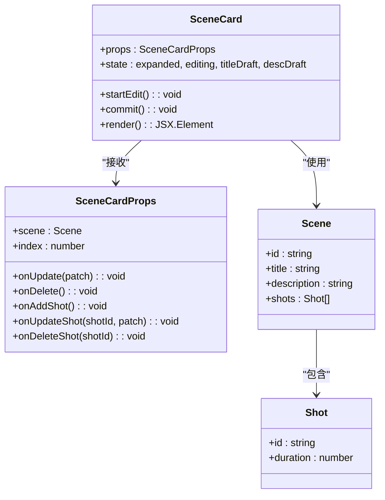
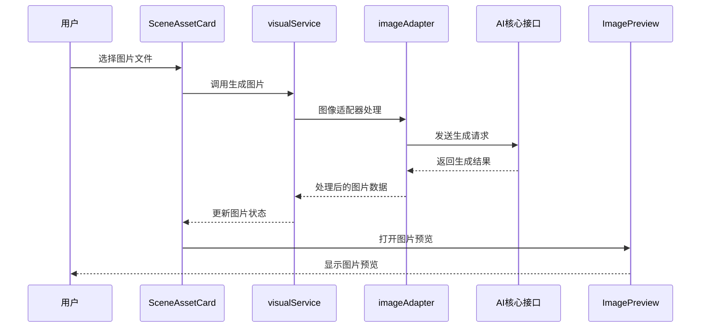
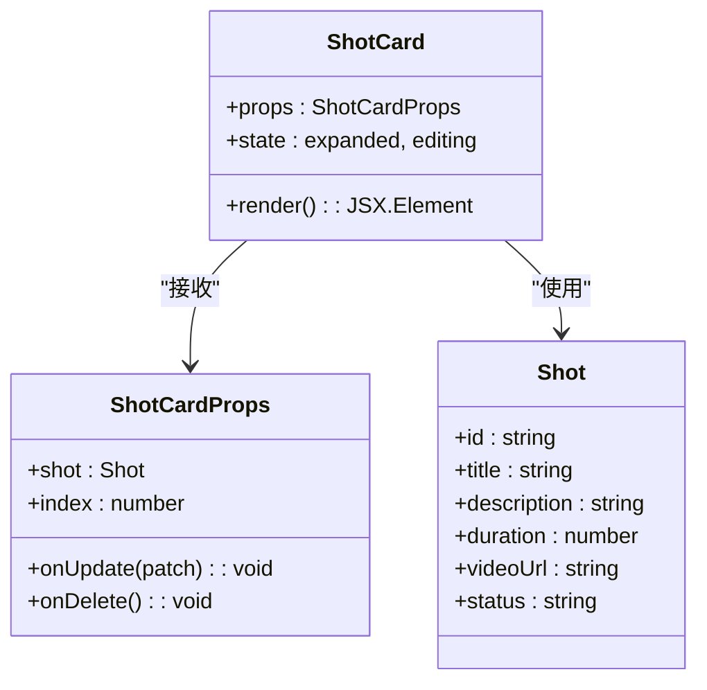
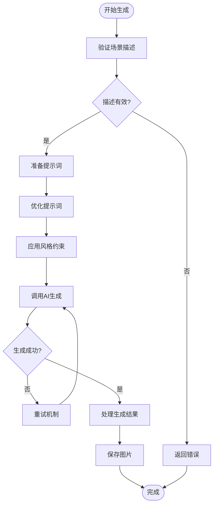
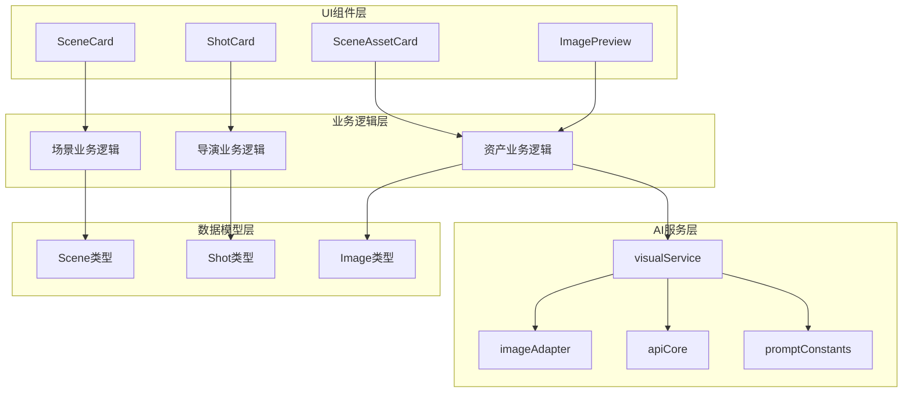
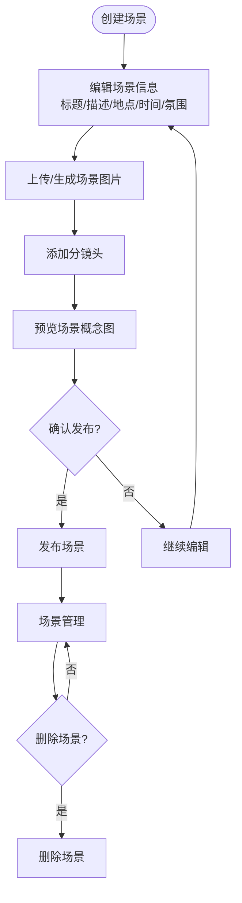

# 场景概念图管理

<cite>
**本文档引用的文件**
- [SceneCard.tsx](file://src/phases/script/components/SceneCard.tsx)
- [ShotItem.tsx](file://src/phases/script/components/ShotItem.tsx)
- [SceneAssetCard.tsx](file://src/phases/assets/components/SceneAssetCard.tsx)
- [ImagePreview.tsx](file://src/phases/assets/components/ImagePreview.tsx)
- [AssetPhase.tsx](file://src/phases/assets/AssetPhase.tsx)
- [DirectorPhase.tsx](file://src/phases/director/DirectorPhase.tsx)
- [ShotCard.tsx](file://src/phases/director/components/ShotCard.tsx)
- [VideoStatusBadge.tsx](file://src/phases/director/components/VideoStatusBadge.tsx)
- [visualService.ts](file://services/ai/visualService.ts)
- [imageAdapter.ts](file://services/adapters/imageAdapter.ts)
- [apiCore.ts](file://services/ai/apiCore.ts)
- [promptConstants.ts](file://services/ai/promptConstants.ts)
- [types.ts](file://types.ts)
</cite>

## 目录
1. [简介](#简介)
2. [项目结构](#项目结构)
3. [核心组件](#核心组件)
4. [架构概览](#架构概览)
5. [详细组件分析](#详细组件分析)
6. [依赖分析](#依赖分析)
7. [性能考虑](#性能考虑)
8. [故障排除指南](#故障排除指南)
9. [结论](#结论)
10. [附录](#附录)

## 简介
本文件详细阐述场景概念图管理功能的设计与实现，涵盖场景卡片组件的功能特性、场景信息编辑（地点、时间、氛围）、视觉提示词编辑器的使用方法、场景图片上传和预览机制。文档还深入说明场景状态管理、批量生成和重新生成功能、场景与分镜头的关联关系，以及场景概念图的生成流程、AI提示词优化策略和场景风格一致性控制。最后提供完整的场景创建、编辑、删除工作流程，以及与AI生成服务的集成方式和最佳实践指导。

## 项目结构
场景概念图管理功能分布在多个阶段组件中，主要包括脚本阶段的场景卡片、资产阶段的场景素材卡片与图片预览、导演阶段的分镜头卡片与视频状态展示，以及AI服务层的视觉生成能力。

**图表来源**
- [SceneCard.tsx:1-216](file://src/phases/script/components/SceneCard.tsx#L1-L216)
- [SceneAssetCard.tsx](file://src/phases/assets/components/SceneAssetCard.tsx)
- [ImagePreview.tsx](file://src/phases/assets/components/ImagePreview.tsx)
- [AssetPhase.tsx](file://src/phases/assets/AssetPhase.tsx)
- [DirectorPhase.tsx](file://src/phases/director/DirectorPhase.tsx)
- [ShotCard.tsx](file://src/phases/director/components/ShotCard.tsx)
- [VideoStatusBadge.tsx](file://src/phases/director/components/VideoStatusBadge.tsx)
- [visualService.ts](file://services/ai/visualService.ts)
- [imageAdapter.ts](file://services/adapters/imageAdapter.ts)
- [apiCore.ts](file://services/ai/apiCore.ts)
- [promptConstants.ts](file://services/ai/promptConstants.ts)

**章节来源**
- [SceneCard.tsx:1-216](file://src/phases/script/components/SceneCard.tsx#L1-L216)
- [SceneAssetCard.tsx](file://src/phases/assets/components/SceneAssetCard.tsx)
- [ImagePreview.tsx](file://src/phases/assets/components/ImagePreview.tsx)
- [AssetPhase.tsx](file://src/phases/assets/AssetPhase.tsx)
- [DirectorPhase.tsx](file://src/phases/director/DirectorPhase.tsx)
- [ShotCard.tsx](file://src/phases/director/components/ShotCard.tsx)
- [VideoStatusBadge.tsx](file://src/phases/director/components/VideoStatusBadge.tsx)
- [visualService.ts](file://services/ai/visualService.ts)
- [imageAdapter.ts](file://services/adapters/imageAdapter.ts)
- [apiCore.ts](file://services/ai/apiCore.ts)
- [promptConstants.ts](file://services/ai/promptConstants.ts)

## 核心组件
场景概念图管理的核心由以下组件构成：
- 场景卡片组件：支持场景标题与描述的编辑、场景元信息展示、展开/收起控制、删除操作，以及与分镜头列表的交互。
- 场景素材卡片组件：负责场景图片的上传、预览、替换与删除，支持与视觉生成服务的集成。
- 图片预览组件：提供场景图片的全屏预览与下载功能。
- 分镜头卡片组件：展示每个分镜头的详细信息，支持与导演阶段的视频生成状态联动。
- AI视觉生成服务：封装图像生成的API调用、参数配置与结果处理。

这些组件通过清晰的职责划分和事件回调机制协同工作，形成完整的场景概念图管理闭环。

**章节来源**
- [SceneCard.tsx:12-30](file://src/phases/script/components/SceneCard.tsx#L12-L30)
- [SceneAssetCard.tsx](file://src/phases/assets/components/SceneAssetCard.tsx)
- [ImagePreview.tsx](file://src/phases/assets/components/ImagePreview.tsx)
- [ShotCard.tsx](file://src/phases/director/components/ShotCard.tsx)
- [visualService.ts](file://services/ai/visualService.ts)

## 架构概览
场景概念图管理采用分层架构，前端组件负责用户交互与状态管理，后端AI服务负责图像生成与优化，数据模型贯穿整个流程以确保一致性。

**图表来源**
- [SceneCard.tsx:22-30](file://src/phases/script/components/SceneCard.tsx#L22-L30)
- [SceneAssetCard.tsx](file://src/phases/assets/components/SceneAssetCard.tsx)
- [ImagePreview.tsx](file://src/phases/assets/components/ImagePreview.tsx)
- [ShotCard.tsx](file://src/phases/director/components/ShotCard.tsx)
- [visualService.ts](file://services/ai/visualService.ts)
- [imageAdapter.ts](file://services/adapters/imageAdapter.ts)
- [apiCore.ts](file://services/ai/apiCore.ts)
- [promptConstants.ts](file://services/ai/promptConstants.ts)
- [types.ts](file://types.ts)

## 详细组件分析

### 场景卡片组件（SceneCard）
场景卡片是场景概念图管理的核心UI组件，提供场景信息的编辑、展示与交互功能。

**图表来源**
- [SceneCard.tsx:12-30](file://src/phases/script/components/SceneCard.tsx#L12-L30)
- [types.ts](file://types.ts)

场景卡片的关键特性：
- 编辑模式：支持场景标题与描述的实时编辑，提供取消与保存操作
- 展开/收起：控制场景详情与分镜头列表的显示状态
- 元信息展示：显示场景编号、分镜头数量、总时长、场景ID等信息
- 删除功能：提供场景删除的安全确认
- 分镜头管理：与分镜头列表进行双向数据同步

**章节来源**
- [SceneCard.tsx:36-48](file://src/phases/script/components/SceneCard.tsx#L36-L48)
- [SceneCard.tsx:107-136](file://src/phases/script/components/SceneCard.tsx#L107-L136)
- [SceneCard.tsx:179-212](file://src/phases/script/components/SceneCard.tsx#L179-L212)

### 场景素材卡片组件（SceneAssetCard）
场景素材卡片负责场景图片的上传、预览与管理，是场景概念图可视化的重要组成部分。

**图表来源**
- [SceneAssetCard.tsx](file://src/phases/assets/components/SceneAssetCard.tsx)
- [visualService.ts](file://services/ai/visualService.ts)
- [imageAdapter.ts](file://services/adapters/imageAdapter.ts)
- [apiCore.ts](file://services/ai/apiCore.ts)
- [ImagePreview.tsx](file://src/phases/assets/components/ImagePreview.tsx)

场景素材卡片的核心功能：
- 图片上传：支持本地文件选择与拖拽上传
- 实时预览：上传后立即显示图片缩略图
- AI生成：集成AI视觉生成服务，自动生成符合场景描述的图片
- 替换与删除：支持图片的替换与删除操作
- 预览模式：提供全屏图片预览与下载功能

**章节来源**
- [SceneAssetCard.tsx](file://src/phases/assets/components/SceneAssetCard.tsx)
- [ImagePreview.tsx](file://src/phases/assets/components/ImagePreview.tsx)

### 分镜头卡片组件（ShotCard）
分镜头卡片展示场景中的具体镜头信息，并与导演阶段的视频生成状态进行联动。

**图表来源**
- [ShotCard.tsx](file://src/phases/director/components/ShotCard.tsx)
- [types.ts](file://types.ts)

分镜头卡片的关键特性：
- 详细信息展示：显示镜头标题、描述、时长等信息
- 状态指示：通过视频状态徽章显示生成进度与结果
- 编辑功能：支持镜头信息的编辑与更新
- 删除功能：提供镜头删除操作

**章节来源**
- [ShotCard.tsx](file://src/phases/director/components/ShotCard.tsx)
- [VideoStatusBadge.tsx](file://src/phases/director/components/VideoStatusBadge.tsx)

### AI视觉生成服务
AI视觉生成服务是场景概念图生成的核心技术支撑，负责将文本描述转换为视觉图像。

**图表来源**
- [visualService.ts](file://services/ai/visualService.ts)
- [promptConstants.ts](file://services/ai/promptConstants.ts)
- [apiCore.ts](file://services/ai/apiCore.ts)

AI生成服务的关键特性：
- 提示词优化：基于场景描述自动优化提示词质量
- 风格控制：应用统一的视觉风格约束，确保场景一致性
- 批量处理：支持多个场景的批量生成与重新生成
- 错误处理：提供完善的错误处理与重试机制

**章节来源**
- [visualService.ts](file://services/ai/visualService.ts)
- [promptConstants.ts](file://services/ai/promptConstants.ts)
- [apiCore.ts](file://services/ai/apiCore.ts)

## 依赖分析
场景概念图管理功能涉及多层依赖关系，从UI组件到AI服务，再到数据模型。

**图表来源**
- [SceneCard.tsx:4-10](file://src/phases/script/components/SceneCard.tsx#L4-L10)
- [SceneAssetCard.tsx](file://src/phases/assets/components/SceneAssetCard.tsx)
- [ShotCard.tsx](file://src/phases/director/components/ShotCard.tsx)
- [ImagePreview.tsx](file://src/phases/assets/components/ImagePreview.tsx)
- [visualService.ts](file://services/ai/visualService.ts)
- [imageAdapter.ts](file://services/adapters/imageAdapter.ts)
- [apiCore.ts](file://services/ai/apiCore.ts)
- [promptConstants.ts](file://services/ai/promptConstants.ts)
- [types.ts](file://types.ts)

依赖关系特点：
- 单向数据流：UI组件通过回调函数向上层传递状态变更
- 服务解耦：AI服务通过适配器模式与具体实现解耦
- 类型安全：所有数据结构通过TypeScript类型定义确保类型安全

**章节来源**
- [SceneCard.tsx:1-216](file://src/phases/script/components/SceneCard.tsx#L1-L216)
- [SceneAssetCard.tsx](file://src/phases/assets/components/SceneAssetCard.tsx)
- [ShotCard.tsx](file://src/phases/director/components/ShotCard.tsx)
- [visualService.ts](file://services/ai/visualService.ts)

## 性能考虑
场景概念图管理在性能方面需要关注以下几个关键点：

### 渲染性能
- 虚拟化列表：对于大量场景和分镜头，建议实现虚拟化渲染以减少DOM节点数量
- 懒加载：图片资源采用懒加载策略，仅在需要时才进行加载
- 状态最小化：合理分割组件状态，避免不必要的重渲染

### AI生成性能
- 并发控制：限制同时进行的AI生成请求数量，避免系统过载
- 缓存机制：对已生成的图片进行缓存，减少重复生成
- 进度反馈：提供实时的生成进度反馈，改善用户体验

### 数据存储
- 增量更新：使用增量更新策略，只更新发生变化的数据
- 内存管理：及时清理不再使用的图片缓存和临时数据

## 故障排除指南
常见问题及解决方案：

### 场景编辑问题
- 症状：场景标题无法编辑
- 解决方案：检查编辑模式的状态切换逻辑，确保startEdit和commit函数正确执行

### 图片上传失败
- 症状：图片上传后无法显示
- 解决方案：检查文件格式验证、网络连接状态和服务器响应

### AI生成异常
- 症状：AI生成服务调用失败
- 解决方案：检查API密钥配置、网络连接和错误重试机制

### 状态同步问题
- 症状：场景与分镜头状态不一致
- 解决方案：检查事件回调函数的参数传递和状态更新逻辑

**章节来源**
- [SceneCard.tsx:36-48](file://src/phases/script/components/SceneCard.tsx#L36-L48)
- [visualService.ts](file://services/ai/visualService.ts)

## 结论
场景概念图管理功能通过精心设计的组件架构和AI服务集成，为用户提供了一个完整的场景创作与管理平台。场景卡片组件提供了直观的编辑体验，场景素材卡片实现了高效的图片管理，分镜头卡片确保了创作流程的连贯性。AI视觉生成服务的深度集成使得场景概念图的生成更加智能化和自动化。整体架构具有良好的扩展性和维护性，为后续功能增强奠定了坚实基础。

## 附录

### 工作流程总结
场景创建、编辑、删除的完整工作流程如下：

### 最佳实践建议
- **提示词优化**：使用具体的场景描述词汇，避免模糊表达
- **风格一致性**：建立统一的视觉风格规范，确保场景间的一致性
- **版本管理**：为场景概念图建立版本控制系统，便于回溯和比较
- **团队协作**：建立场景审核流程，确保创意方向的准确性
- **性能监控**：持续监控AI生成性能，优化用户体验

### 创意指导
- **场景层次**：从宏观场景到微观细节逐步构建
- **情感表达**：通过色彩、光影、构图传达场景情感
- **故事连贯**：确保场景间的叙事连贯性和视觉延续性
- **技术实现**：结合AI生成能力探索新的创意表现形式