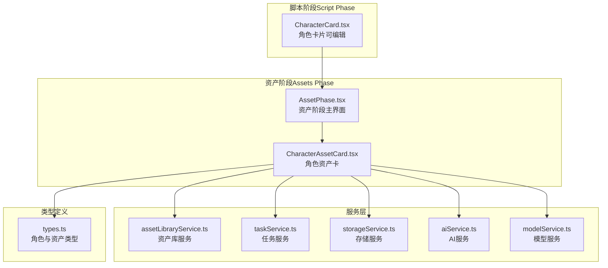
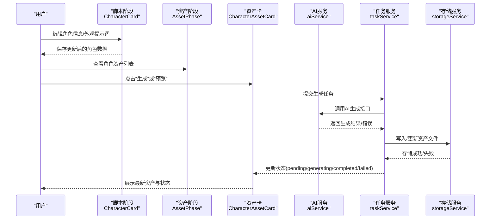
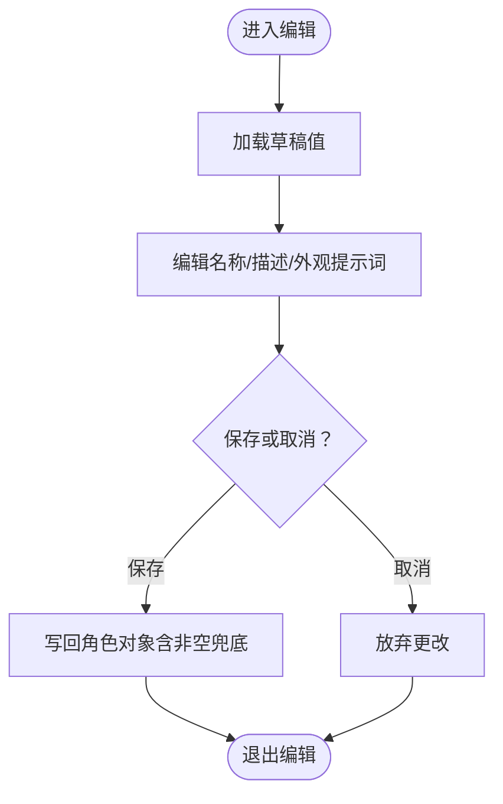
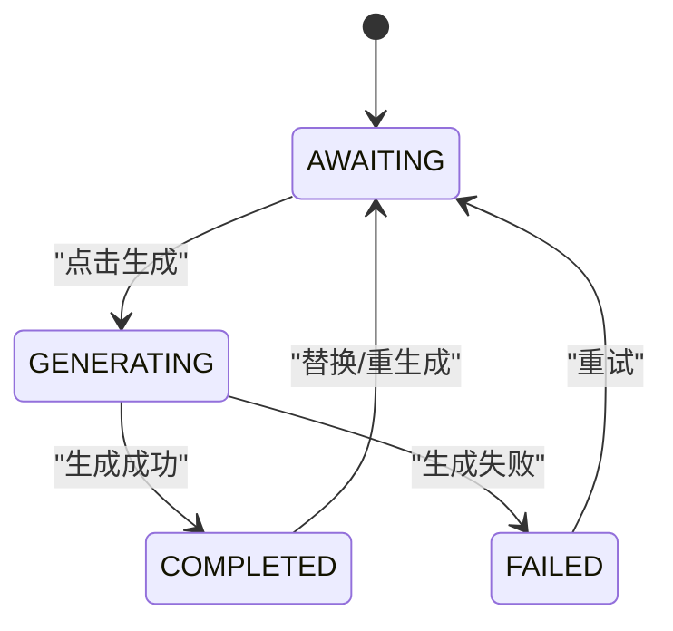
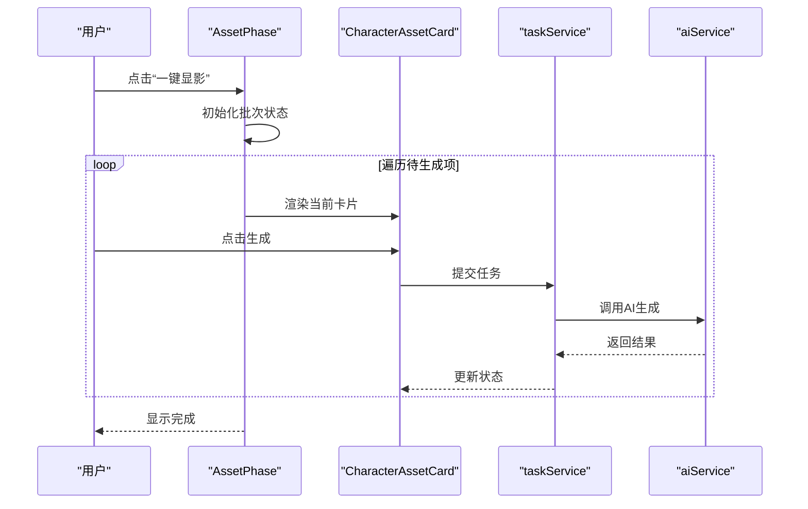
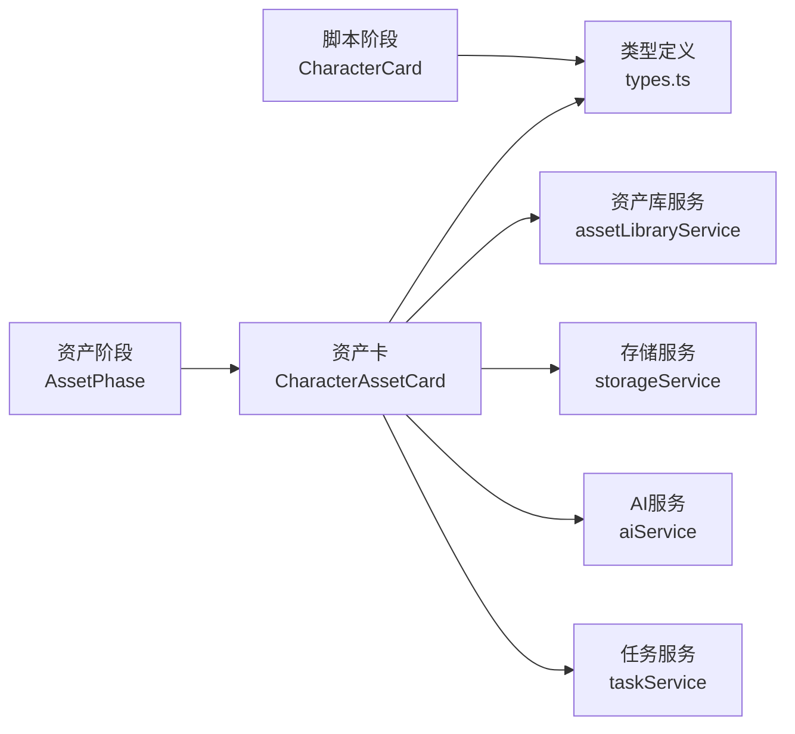

# 角色资产管理

<cite>
**本文引用的文件**
- [src/phases/script/components/CharacterCard.tsx](file://src/phases/script/components/CharacterCard.tsx)
- [src/phases/assets/components/CharacterAssetCard.tsx](file://src/phases/assets/components/CharacterAssetCard.tsx)
- [src/phases/assets/AssetPhase.tsx](file://src/phases/assets/AssetPhase.tsx)
- [src/services/assetLibraryService.ts](file://src/services/assetLibraryService.ts)
- [src/services/taskService.ts](file://src/services/taskService.ts)
- [src/services/storageService.ts](file://src/services/storageService.ts)
- [src/services/aiService.ts](file://src/services/aiService.ts)
- [src/services/modelService.ts](file://src/services/modelService.ts)
- [src/types.ts](file://src/types.ts)
- [src/shared/components/LoadingSpinner.tsx](file://src/shared/components/LoadingSpinner.tsx)
</cite>

## 目录
1. [简介](#简介)
2. [项目结构](#项目结构)
3. [核心组件](#核心组件)
4. [架构总览](#架构总览)
5. [详细组件分析](#详细组件分析)
6. [依赖分析](#依赖分析)
7. [性能考虑](#性能考虑)
8. [故障排查指南](#故障排查指南)
9. [结论](#结论)
10. [附录](#附录)

## 简介
本文件围绕“角色资产管理”主题，系统化梳理角色卡片组件的设计与交互、角色资产生成与状态管理、批量处理与版本控制、以及与AI生成服务的集成方式。重点覆盖以下方面：
- 角色信息编辑与视觉提示词管理
- 角色变体与全身像生成（Turnaround）能力
- 服装库（Wardrobe）管理与角色外观切换
- 角色与分镜头的关联关系与一致性保障
- 角色状态管理（pending/generating/completed/failed）
- 批量操作与中断控制
- 版本控制与历史回溯
- 最佳实践与性能优化建议

## 项目结构
角色资产管理涉及前端脚本阶段（角色信息编辑）与资产阶段（角色资产生成与预览）。整体结构如下：

图表来源
- [src/phases/script/components/CharacterCard.tsx:1-201](file://src/phases/script/components/CharacterCard.tsx#L1-L201)
- [src/phases/assets/components/CharacterAssetCard.tsx:1-31](file://src/phases/assets/components/CharacterAssetCard.tsx#L1-L31)
- [src/phases/assets/AssetPhase.tsx:141-462](file://src/phases/assets/AssetPhase.tsx#L141-L462)
- [src/services/assetLibraryService.ts](file://src/services/assetLibraryService.ts)
- [src/services/taskService.ts](file://src/services/taskService.ts)
- [src/services/storageService.ts](file://src/services/storageService.ts)
- [src/services/aiService.ts](file://src/services/aiService.ts)
- [src/services/modelService.ts](file://src/services/modelService.ts)
- [src/types.ts](file://src/types.ts)

章节来源
- [src/phases/script/components/CharacterCard.tsx:1-201](file://src/phases/script/components/CharacterCard.tsx#L1-L201)
- [src/phases/assets/components/CharacterAssetCard.tsx:1-31](file://src/phases/assets/components/CharacterAssetCard.tsx#L1-L31)
- [src/phases/assets/AssetPhase.tsx:141-462](file://src/phases/assets/AssetPhase.tsx#L141-L462)

## 核心组件
- 角色卡片（脚本阶段）：支持角色名称、描述、外观提示词的在线编辑与保存，提供删除入口。
- 角色资产卡（资产阶段）：展示角色参考图、生成按钮、预览弹窗、错误提示与忙态指示。
- 资产阶段主界面：汇总角色与场景资产，提供一键批量生成、进度条与取消控制。

章节来源
- [src/phases/script/components/CharacterCard.tsx:8-37](file://src/phases/script/components/CharacterCard.tsx#L8-L37)
- [src/phases/assets/components/CharacterAssetCard.tsx:9-31](file://src/phases/assets/components/CharacterAssetCard.tsx#L9-L31)
- [src/phases/assets/AssetPhase.tsx:141-198](file://src/phases/assets/AssetPhase.tsx#L141-L198)

## 架构总览
角色资产管理采用“阶段化工作流”设计：
- 脚本阶段负责角色基础信息与外观提示词的输入与校验；
- 资产阶段负责调用AI服务生成角色参考图，并进行状态管理与批量处理；
- 服务层封装任务调度、存储与AI接口适配；
- 类型定义统一角色与资产的数据结构。

图表来源
- [src/phases/script/components/CharacterCard.tsx:23-37](file://src/phases/script/components/CharacterCard.tsx#L23-L37)
- [src/phases/assets/AssetPhase.tsx:141-198](file://src/phases/assets/AssetPhase.tsx#L141-L198)
- [src/phases/assets/components/CharacterAssetCard.tsx:20-31](file://src/phases/assets/components/CharacterAssetCard.tsx#L20-L31)
- [src/services/aiService.ts](file://src/services/aiService.ts)
- [src/services/taskService.ts](file://src/services/taskService.ts)
- [src/services/storageService.ts](file://src/services/storageService.ts)

## 详细组件分析

### 角色卡片（脚本阶段）
- 设计要点
  - 使用受控表单字段维护草稿值，提交时统一写回角色对象；
  - 支持删除入口，便于清理无效角色；
  - 外观提示词区域用于生成图像的提示词输入。
- 交互流程
  - 点击进入编辑模式，修改后保存或取消；
  - 保存时对名称进行非空兜底，确保显示一致性。

图表来源
- [src/phases/script/components/CharacterCard.tsx:18-37](file://src/phases/script/components/CharacterCard.tsx#L18-L37)

章节来源
- [src/phases/script/components/CharacterCard.tsx:8-37](file://src/phases/script/components/CharacterCard.tsx#L8-L37)

### 角色资产卡（资产阶段）
- 设计要点
  - 展示角色参考图占位与实际图片；
  - 生成按钮触发任务提交；
  - 预览弹窗支持查看大图与说明；
  - 错误状态与忙态指示提升可用性。
- 状态映射
  - 无图：AWAITING（等待显影）；
  - 生成中：GENERATING（显影中）；
  - 成功：COMPLETED（已显影）；
  - 失败：FAILED（显影失败）。

图表来源
- [src/phases/assets/components/CharacterAssetCard.tsx:20-31](file://src/phases/assets/components/CharacterAssetCard.tsx#L20-L31)
- [src/phases/assets/AssetPhase.tsx:430-433](file://src/phases/assets/AssetPhase.tsx#L430-L433)

章节来源
- [src/phases/assets/components/CharacterAssetCard.tsx:9-31](file://src/phases/assets/components/CharacterAssetCard.tsx#L9-L31)
- [src/phases/assets/AssetPhase.tsx:430-433](file://src/phases/assets/AssetPhase.tsx#L430-L433)

### 资产阶段主界面（批量与进度）
- 批量生成
  - 遍历待生成列表，逐项执行生成；
  - 支持中途取消，停止当前批次；
  - 单个失败不影响整体继续。
- 进度与控制
  - 总进度条与当前任务标签；
  - 并发限制：同一时间仅允许一个任务活跃；
  - 卡片禁用策略：批量运行期间禁用其他交互。

图表来源
- [src/phases/assets/AssetPhase.tsx:141-198](file://src/phases/assets/AssetPhase.tsx#L141-L198)
- [src/phases/assets/AssetPhase.tsx:216-233](file://src/phases/assets/AssetPhase.tsx#L216-L233)

章节来源
- [src/phases/assets/AssetPhase.tsx:141-198](file://src/phases/assets/AssetPhase.tsx#L141-L198)
- [src/phases/assets/AssetPhase.tsx:216-233](file://src/phases/assets/AssetPhase.tsx#L216-L233)

### 角色上传与替换机制
- 上传入口
  - 资产卡提供“预览”能力，结合存储服务实现文件上传与回写；
  - 脚本阶段的参考图占位区支持图片渲染，便于对比与确认。
- 替换流程
  - 用户选择新图片后，通过存储服务写入并更新角色资产；
  - 状态回到 AWAITING，可再次发起生成以应用新素材。

章节来源
- [src/phases/assets/components/CharacterAssetCard.tsx:16-29](file://src/phases/assets/components/CharacterAssetCard.tsx#L16-L29)
- [src/services/storageService.ts](file://src/services/storageService.ts)

### 全身像生成（Turnaround）功能
- 功能定位
  - 基于角色外观提示词与现有参考图，生成多角度全身像；
  - 作为角色变体的基础资源，提升镜头一致性与丰富度。
- 实现路径
  - 由资产阶段的生成流程统一接入AI服务；
  - 生成结果写入资产库，供后续镜头引用。

章节来源
- [src/phases/assets/AssetPhase.tsx:141-198](file://src/phases/assets/AssetPhase.tsx#L141-L198)
- [src/services/aiService.ts](file://src/services/aiService.ts)

### 服装库（Wardrobe）管理
- 管理目标
  - 维护角色可选外观集合（如不同服装、配饰），支持快速切换；
  - 与外观提示词联动，动态拼接生成提示词。
- 实施建议
  - 将服装条目持久化到角色对象的外观变体字段；
  - 在生成前合并当前选中的服装描述到外观提示词。

章节来源
- [src/phases/script/components/CharacterCard.tsx:104-117](file://src/phases/script/components/CharacterCard.tsx#L104-L117)

### 角色与分镜头的关联关系
- 关联方式
  - 分镜头编辑器通过角色ID引用角色资产；
  - 资产阶段保证角色参考图稳定，降低镜头间不一致风险。
- 一致性保障
  - 优先使用角色资产而非临时上传图；
  - 批量生成完成后统一检查缺失项。

章节来源
- [src/phases/assets/AssetPhase.tsx:216-233](file://src/phases/assets/AssetPhase.tsx#L216-L233)

### 角色状态管理（pending/generating/completed/failed）
- 状态驱动
  - 任务服务根据AI返回结果推进状态；
  - UI层依据状态渲染不同图标与文案。
- 错误处理
  - 单个卡片失败不影响批次继续；
  - 错误信息记录在卡片级错误集合中，便于定位。

章节来源
- [src/phases/assets/components/CharacterAssetCard.tsx:20-31](file://src/phases/assets/components/CharacterAssetCard.tsx#L20-L31)
- [src/phases/assets/AssetPhase.tsx:430-433](file://src/phases/assets/AssetPhase.tsx#L430-L433)

### 批量操作功能
- 启动与取消
  - “一键显影”启动批次循环；
  - “取消”设置中断标志，等待当前任务收尾。
- 并发与稳定性
  - 串行执行避免资源竞争；
  - 单任务忙态时禁用其他卡片交互。

章节来源
- [src/phases/assets/AssetPhase.tsx:141-198](file://src/phases/assets/AssetPhase.tsx#L141-L198)

### 角色版本控制机制
- 版本策略
  - 以资产文件哈希或时间戳作为版本标识；
  - 保留历史版本以便回滚与对比。
- 工作流建议
  - 生成前备份旧资产；
  - 生成后比较差异并更新版本元数据。

章节来源
- [src/services/storageService.ts](file://src/services/storageService.ts)

## 依赖分析
- 组件耦合
  - 脚本阶段与资产阶段通过角色对象ID解耦；
  - 资产卡依赖任务服务与AI服务，保持UI与业务逻辑分离。
- 外部依赖
  - AI服务：统一接入多种生成模型；
  - 存储服务：负责资产文件的读写与归档；
  - 任务服务：编排生成流程与状态同步。

图表来源
- [src/phases/script/components/CharacterCard.tsx:1-201](file://src/phases/script/components/CharacterCard.tsx#L1-L201)
- [src/phases/assets/AssetPhase.tsx:141-462](file://src/phases/assets/AssetPhase.tsx#L141-L462)
- [src/phases/assets/components/CharacterAssetCard.tsx:1-31](file://src/phases/assets/components/CharacterAssetCard.tsx#L1-L31)
- [src/services/taskService.ts](file://src/services/taskService.ts)
- [src/services/aiService.ts](file://src/services/aiService.ts)
- [src/services/storageService.ts](file://src/services/storageService.ts)
- [src/services/assetLibraryService.ts](file://src/services/assetLibraryService.ts)
- [src/types.ts](file://src/types.ts)

章节来源
- [src/phases/assets/AssetPhase.tsx:141-462](file://src/phases/assets/AssetPhase.tsx#L141-L462)

## 性能考虑
- 生成队列化
  - 串行执行减少并发开销，避免GPU/CPU争用；
  - 对长耗时任务提供“取消”能力，缩短等待时间。
- 图像缓存
  - 优先复用已生成资产，避免重复请求；
  - 对预览图采用懒加载与缩略图策略。
- 网络与存储
  - 分块上传与断点续传，提升大文件稳定性；
  - 本地缓存与远端同步双通道，降低网络抖动影响。
- UI响应
  - 忙态指示与骨架屏提升感知速度；
  - 批处理期间禁用交互，防止重复提交。

## 故障排查指南
- 常见问题
  - 生成失败：检查AI服务可用性与配额，查看任务日志；
  - 图片不显示：确认存储服务路径与权限，核对文件是否存在；
  - 批处理中断：使用“取消”后重启批次，关注当前索引。
- 排查步骤
  - 定位失败卡片：查看错误集合与状态面板；
  - 重试策略：针对失败项单独重试，避免整批阻塞；
  - 回滚版本：基于版本元数据回退到上一稳定资产。

章节来源
- [src/phases/assets/AssetPhase.tsx:141-198](file://src/phases/assets/AssetPhase.tsx#L141-L198)
- [src/phases/assets/components/CharacterAssetCard.tsx:20-31](file://src/phases/assets/components/CharacterAssetCard.tsx#L20-L31)

## 结论
角色资产管理通过“脚本阶段+资产阶段”的协同，实现了从角色信息编辑到资产生成与管理的闭环。借助统一的任务与存储服务，系统具备良好的可扩展性与稳定性。建议在实际落地中强化版本控制与错误追踪，并持续优化生成队列与缓存策略，以获得更佳的用户体验。

## 附录
- 数据模型（角色与资产）
  - 角色对象包含基础信息与外观提示词；
  - 资产对象包含URL、状态、版本与元数据。
- 最佳实践
  - 优先使用角色资产而非临时上传图；
  - 为每个角色维护稳定的外观提示词；
  - 利用批量生成与取消机制高效推进工作流。

章节来源
- [src/types.ts](file://src/types.ts)
- [src/phases/assets/components/CharacterAssetCard.tsx:20-31](file://src/phases/assets/components/CharacterAssetCard.tsx#L20-L31)