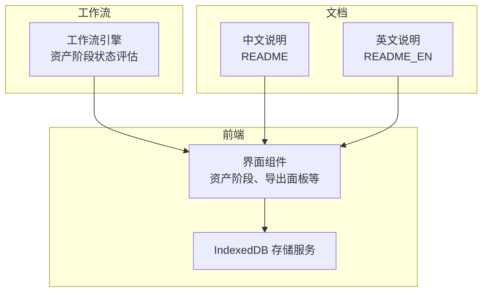
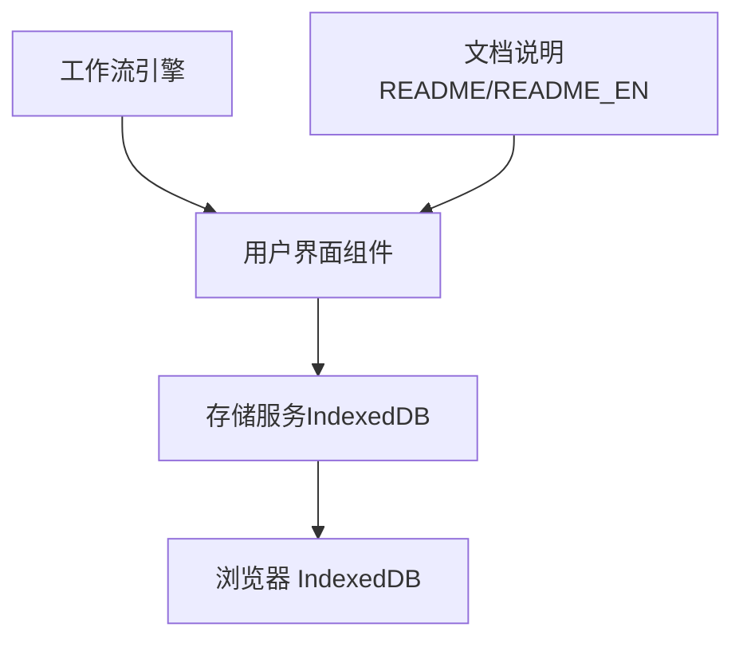
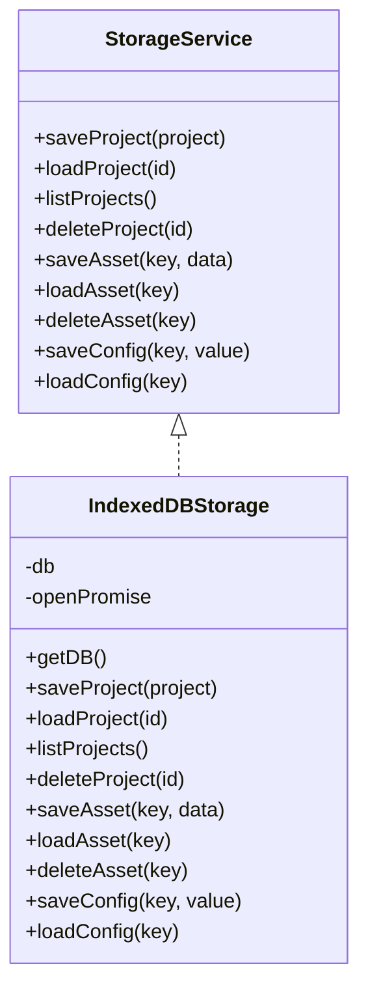
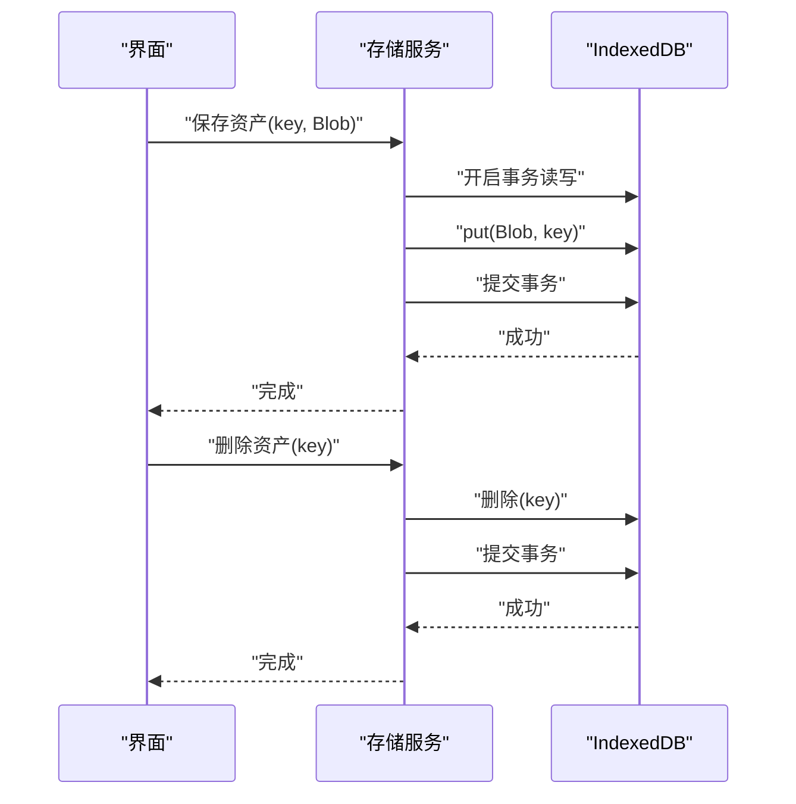
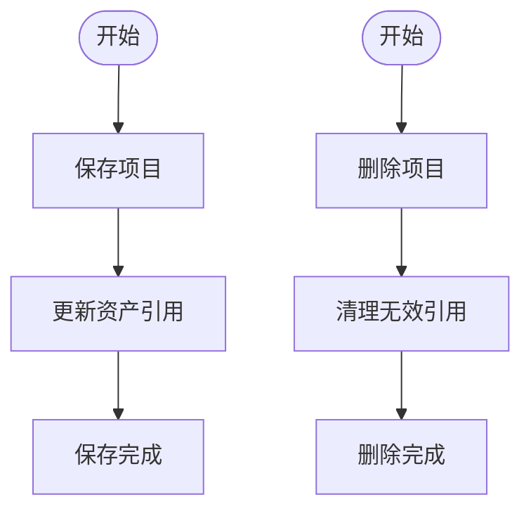
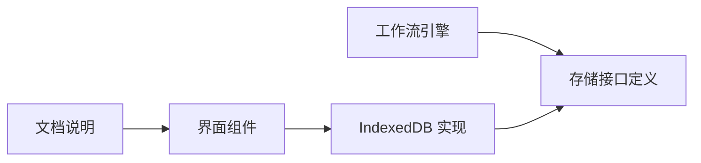

# 资产库系统

<cite>
**本文引用的文件**
- [README.md](file://README.md)
- [README_EN.md](file://README_EN.md)
- [indexeddb.ts](file://src/services/storage/indexeddb.ts)
- [types.ts](file://src/services/storage/types.ts)
- [engine.ts](file://src/services/workflow/engine.ts)
</cite>

## 目录
1. [简介](#简介)
2. [项目结构](#项目结构)
3. [核心组件](#核心组件)
4. [架构总览](#架构总览)
5. [详细组件分析](#详细组件分析)
6. [依赖分析](#依赖分析)
7. [性能考虑](#性能考虑)
8. [故障排查指南](#故障排查指南)
9. [结论](#结论)
10. [附录](#附录)

## 简介
本文件面向“资产库系统”的使用者与维护者，系统性阐述资产库的组织架构、管理机制与数据流。重点覆盖以下方面：
- 资产库的浏览、搜索、筛选能力（基于现有实现的可扩展性说明）
- 资产的导入与导出流程（含跨项目共享与版本控制策略建议）
- 资产库的数据结构设计、分页加载机制（含实现现状与扩展建议）、权限控制体系（含实现现状与扩展建议）
- 资产保存、删除、替换的完整工作流程
- 与项目数据的同步机制
- 最佳实践、存储优化策略与效率提升方法

说明：当前仓库中未发现专门的“资产库”页面组件与后端路由实现；资产库能力主要通过本地 IndexedDB 存储与项目工作流中的“资产阶段”进行支撑。本文在不臆测不存在的功能前提下，基于现有代码给出可落地的架构建议与实施路径。

## 项目结构
资产库系统在当前代码库中的定位如下：
- 前端存储层：以 IndexedDB 为核心，提供项目、资产、配置三类数据的本地持久化能力
- 工作流阶段：在“资产阶段”中对角色与场景等资产完成度进行统计与状态评估
- 文档与说明：README 中明确了“右侧资源库”的存在与用途，但未给出具体实现细节

图表来源
- [indexeddb.ts:1-190](file://src/services/storage/indexeddb.ts#L1-L190)
- [engine.ts:35-72](file://src/services/workflow/engine.ts#L35-L72)
- [README.md:87-110](file://README.md#L87-L110)
- [README_EN.md:56-80](file://README_EN.md#L56-L80)

章节来源
- [indexeddb.ts:1-190](file://src/services/storage/indexeddb.ts#L1-L190)
- [engine.ts:35-72](file://src/services/workflow/engine.ts#L35-L72)
- [README.md:87-110](file://README.md#L87-L110)
- [README_EN.md:56-80](file://README_EN.md#L56-L80)

## 核心组件
- 存储服务接口与实现
  - 接口定义：统一的存储服务接口，涵盖项目、资产、配置三类操作
  - 实现：IndexedDB 存储实现，包含数据库初始化、事务封装、错误处理等
- 工作流引擎
  - 在“资产阶段”对角色参考图与镜头生成情况进行状态评估，为资产库使用提供进度指标
- 文档与说明
  - README 明确了“右侧资源库”的存在与用途，为资产库的可视化与交互提供了上下文

章节来源
- [types.ts:1-31](file://src/services/storage/types.ts#L1-L31)
- [indexeddb.ts:1-190](file://src/services/storage/indexeddb.ts#L1-L190)
- [engine.ts:35-72](file://src/services/workflow/engine.ts#L35-L72)
- [README.md:87-110](file://README.md#L87-L110)

## 架构总览
资产库系统的运行时架构由“前端存储层 + 工作流引擎 + 用户界面 + 文档说明”构成。数据在本地 IndexedDB 中持久化，工作流引擎根据项目内容计算资产完成度，界面组件负责展示与交互。

图表来源
- [indexeddb.ts:1-190](file://src/services/storage/indexeddb.ts#L1-L190)
- [engine.ts:35-72](file://src/services/workflow/engine.ts#L35-L72)
- [README.md:87-110](file://README.md#L87-L110)
- [README_EN.md:56-80](file://README_EN.md#L56-L80)

## 详细组件分析

### 存储服务与数据结构
- 数据库与对象存储
  - 数据库名称与版本：数据库名与版本号固定，便于跨会话一致性
  - 对象存储：
    - projects：项目数据（JSON），主键为 id
    - assets：二进制资产（Blob），外部键
    - config：应用配置（key-value）
- 事务与错误处理
  - 统一封装 IDBRequest 与 IDBTransaction，提供 Promise 化调用与错误回调
  - 版本变更时主动关闭数据库，避免锁库冲突
- 操作接口
  - 项目：保存、加载、列出（仅摘要字段）、删除
  - 资产：保存、加载、删除
  - 配置：保存、加载

图表来源
- [types.ts:15-30](file://src/services/storage/types.ts#L15-L30)
- [indexeddb.ts:23-189](file://src/services/storage/indexeddb.ts#L23-L189)

章节来源
- [indexeddb.ts:1-190](file://src/services/storage/indexeddb.ts#L1-L190)
- [types.ts:1-31](file://src/services/storage/types.ts#L1-L31)

### 资产库浏览、搜索与筛选（基于现有能力的扩展建议）
- 浏览
  - 当前实现：通过存储服务读取资产集合（如项目内资产），并以界面组件展示
  - 扩展建议：引入分页加载（见“分页加载机制”章节）与类型/标签索引，提升大体量资产的浏览体验
- 搜索
  - 当前实现：未见专用搜索逻辑
  - 扩展建议：在前端构建轻量索引（如基于文件名、标签、类型），或在后端提供检索接口（见“后端扩展建议”）
- 筛选
  - 当前实现：未见专用筛选逻辑
  - 扩展建议：按类型（角色、场景、道具）、时间范围、标签等维度进行筛选

说明：以上为基于现有存储能力的扩展建议，非当前实现。

章节来源
- [indexeddb.ts:143-167](file://src/services/storage/indexeddb.ts#L143-L167)

### 资产导入与导出流程
- 导入
  - 当前实现：README 描述了系统级数据导入/导出流程（打包用户全部数据与媒体文件）
  - 适用场景：跨服务器/实例迁移、备份与恢复
- 导出
  - 当前实现：README 描述了系统级数据导出流程
  - 适用场景：离线备份、审计与迁移
- 跨项目资产共享与版本控制
  - 当前实现：未见跨项目共享与版本控制逻辑
  - 建议：
    - 引入“资产包”概念：以命名空间+版本标识进行管理
    - 提供“发布/归档”流程：标记版本、变更日志、依赖关系
    - 在界面提供“导入资产包”与“版本切换”能力

章节来源
- [README.md:103-107](file://README.md#L103-L107)

### 分页加载机制（实现现状与扩展建议）
- 实现现状
  - 项目列表采用 getAll() 获取全量数据，并仅返回摘要字段，避免传输完整项目对象
- 扩展建议
  - 采用游标遍历或分批查询（如按时间分段）减少一次性内存占用
  - 在资产层面引入分页参数（起始偏移、每页数量），结合类型/标签索引提升性能

章节来源
- [indexeddb.ts:119-133](file://src/services/storage/indexeddb.ts#L119-L133)

### 权限控制体系（实现现状与扩展建议）
- 实现现状
  - 未见用户权限与资源访问控制逻辑
- 扩展建议
  - 引入用户域隔离：每个用户独立的 IndexedDB 或命名空间
  - 引入资源级权限：资产元数据中记录所有者与可见性（公开/私有/团队）
  - 在导入/导出流程中校验权限与合规性

章节来源
- [indexeddb.ts:1-190](file://src/services/storage/indexeddb.ts#L1-190)

### 资产保存、删除、替换工作流程
- 保存
  - 步骤：生成唯一键 → 将 Blob 写入 assets 对象存储 → 事务提交
- 删除
  - 步骤：定位键 → 删除对象存储中的资产 → 事务提交
- 替换
  - 步骤：使用相同键保存新 Blob → 自动覆盖旧值
- 同步机制
  - 与项目数据同步：在项目更新时，确保资产键与项目引用一致；删除项目时清理关联资产

图表来源
- [indexeddb.ts:145-167](file://src/services/storage/indexeddb.ts#L145-L167)

章节来源
- [indexeddb.ts:143-167](file://src/services/storage/indexeddb.ts#L143-L167)

### 与项目数据的同步机制
- 资产与项目的关系
  - 项目中可能包含对资产的引用（如角色参考图、场景概念图等）
  - 工作流引擎在“资产阶段”对这些引用的完整性进行评估
- 同步策略
  - 保存项目时，同时校验并更新资产引用
  - 删除项目时，清理不再被引用的资产（或延迟回收）

图表来源
- [engine.ts:35-72](file://src/services/workflow/engine.ts#L35-L72)
- [indexeddb.ts:103-141](file://src/services/storage/indexeddb.ts#L103-L141)

章节来源
- [engine.ts:35-72](file://src/services/workflow/engine.ts#L35-L72)
- [indexeddb.ts:101-141](file://src/services/storage/indexeddb.ts#L101-L141)

## 依赖分析
- 组件耦合
  - 存储服务与工作流引擎解耦：前者专注数据持久化，后者专注业务状态评估
  - 文档与界面组件解耦：文档提供使用说明，界面负责交互
- 外部依赖
  - 浏览器 IndexedDB API
  - 工作流引擎依赖项目数据结构

图表来源
- [types.ts:15-30](file://src/services/storage/types.ts#L15-L30)
- [indexeddb.ts:23-189](file://src/services/storage/indexeddb.ts#L23-L189)
- [engine.ts:35-72](file://src/services/workflow/engine.ts#L35-L72)

章节来源
- [types.ts:1-31](file://src/services/storage/types.ts#L1-L31)
- [indexeddb.ts:1-190](file://src/services/storage/indexeddb.ts#L1-L190)
- [engine.ts:35-72](file://src/services/workflow/engine.ts#L35-L72)

## 性能考虑
- 存储层
  - 使用事务批量写入，减少锁竞争
  - 仅在必要时传输完整对象，列表场景返回摘要字段
- 查询与索引
  - 为常用查询字段建立索引（如资产类型、创建时间、标签）
  - 分页加载与游标遍历，避免一次性加载过多数据
- 缓存与去重
  - 对热点资产进行缓存，避免重复读取
  - 去重：同一内容的资产只保留一份引用
- 导入/导出
  - 导出时按用户域隔离，避免无关数据参与打包
  - 导入时进行完整性校验与冲突处理

## 故障排查指南
- 打不开 IndexedDB
  - 可能原因：数据库版本变更导致阻塞、其他标签页持有锁
  - 处理：监听版本变更事件并主动关闭数据库，确保单实例访问
- 事务失败
  - 可能原因：并发写入、存储空间不足
  - 处理：重试机制、降级策略（分批写入）、清理无用资产
- 资产缺失
  - 可能原因：键错误、删除误操作
  - 处理：检查键是否一致、回滚或重新导入

章节来源
- [indexeddb.ts:31-78](file://src/services/storage/indexeddb.ts#L31-L78)
- [indexeddb.ts:93-99](file://src/services/storage/indexeddb.ts#L93-L99)

## 结论
当前资产库系统以 IndexedDB 为基础，实现了项目、资产、配置的本地持久化能力，并在工作流引擎中对资产完成度进行评估。对于浏览、搜索、筛选、跨项目共享与版本控制等高级能力，可在现有存储层之上进行扩展。建议优先完善分页加载、权限控制与资产包版本管理，以满足规模化使用场景。

## 附录
- 使用建议
  - 在保存资产前生成稳定键（如哈希或命名规范），避免重复与冲突
  - 定期清理不再使用的资产，释放存储空间
  - 在导入/导出前后进行完整性校验
- 存储优化
  - 采用压缩与去重策略，降低存储体积
  - 对超大文件采用分块存储与增量更新
- 效率提升
  - 前端构建轻量索引，提升搜索与筛选性能
  - 后端提供检索接口与版本管理，支持跨项目共享