# 道具物品管理

<cite>
**本文档引用的文件**
- [src/types.ts](file://src/types.ts)
- [src/phases/assets/AssetPhase.tsx](file://src/phases/assets/AssetPhase.tsx)
- [src/phases/assets/components/CharacterAssetCard.tsx](file://src/phases/assets/components/CharacterAssetCard.tsx)
- [src/phases/assets/components/SceneAssetCard.tsx](file://src/phases/assets/components/SceneAssetCard.tsx)
- [src/services/storage/indexeddb.ts](file://src/services/storage/indexeddb.ts)
- [src/services/storage/types.ts](file://src/services/storage/types.ts)
- [src/services/workflow/engine.ts](file://src/services/workflow/engine.ts)
- [src/services/ai/types.ts](file://src/services/ai/types.ts)
- [src/services/ai/index.ts](file://src/services/ai/index.ts)
- [src/services/assetLibraryService.ts](file://src/services/assetLibraryService.ts)
- [src/services/modelService.ts](file://src/services/modelService.ts)
- [src/services/apiClient.ts](file://src/services/apiClient.ts)
- [src/shared/hooks/useAI.ts](file://src/shared/hooks/useAI.ts)
- [src/shared/contexts/ProjectContext.tsx](file://src/shared/contexts/ProjectContext.tsx)
</cite>

## 目录
1. [简介](#简介)
2. [项目结构](#项目结构)
3. [核心组件](#核心组件)
4. [架构概览](#架构概览)
5. [详细组件分析](#详细组件分析)
6. [依赖关系分析](#依赖关系分析)
7. [性能考虑](#性能考虑)
8. [故障排除指南](#故障排除指南)
9. [结论](#结论)
10. [附录](#附录)

## 简介

道具物品管理是影视制作工作流中的重要组成部分，负责管理场景中使用的各种道具资源。本文档深入解析道具卡片组件的设计架构和交互逻辑，涵盖道具基本信息管理、视觉提示词编辑、道具图片上传和管理等核心功能。

该系统采用模块化设计，通过清晰的组件层次结构实现了道具资源的全生命周期管理。系统支持道具与分镜头的关联关系，提供批量操作功能，并集成了AI生成服务来辅助道具概念图的创建。

## 项目结构

项目采用分层架构设计，主要分为以下几个层次：

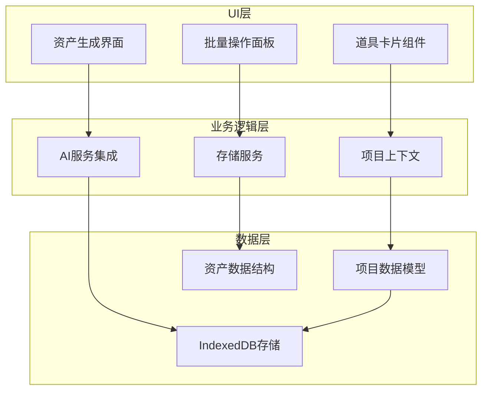

**图表来源**
- [src/phases/assets/AssetPhase.tsx:1-362](file://src/phases/assets/AssetPhase.tsx#L1-L362)
- [src/shared/contexts/ProjectContext.tsx](file://src/shared/contexts/ProjectContext.tsx)
- [src/services/storage/indexeddb.ts:1-167](file://src/services/storage/indexeddb.ts#L1-L167)

**章节来源**
- [src/phases/assets/AssetPhase.tsx:1-362](file://src/phases/assets/AssetPhase.tsx#L1-L362)
- [src/types.ts:1-96](file://src/types.ts#L1-L96)

## 核心组件

### 数据模型架构

系统的核心数据模型围绕项目结构展开，主要包括以下关键接口：

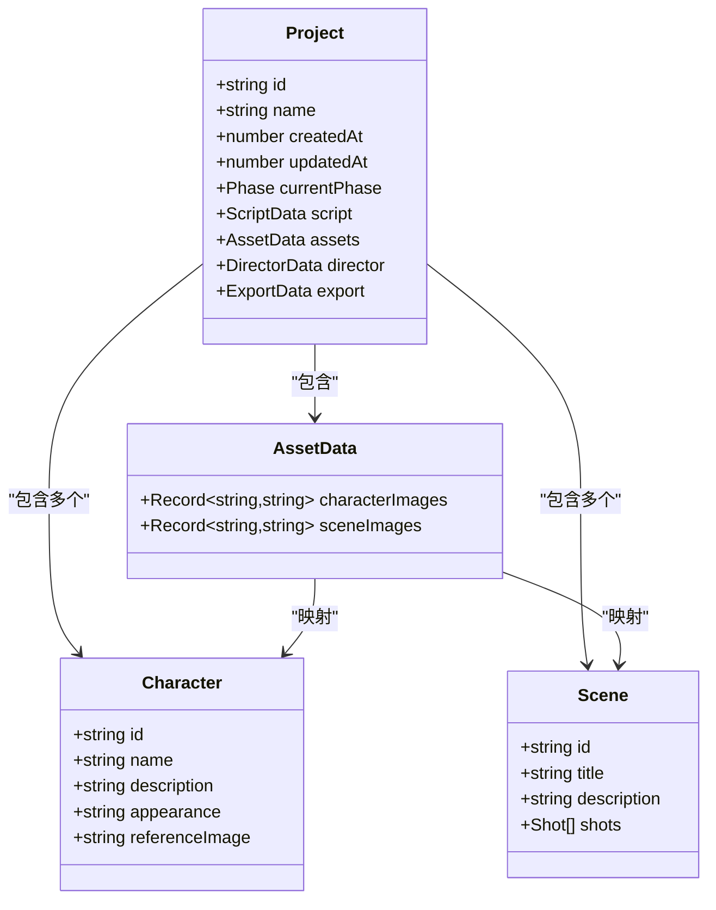

**图表来源**
- [src/types.ts:10-61](file://src/types.ts#L10-L61)

### 组件层次结构

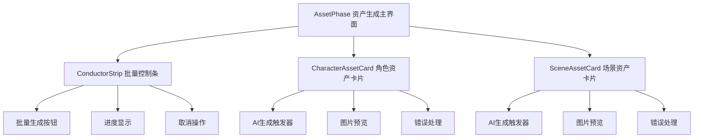

**图表来源**
- [src/phases/assets/AssetPhase.tsx:284-333](file://src/phases/assets/AssetPhase.tsx#L284-L333)
- [src/phases/assets/components/CharacterAssetCard.tsx:1-31](file://src/phases/assets/components/CharacterAssetCard.tsx#L1-L31)
- [src/phases/assets/components/SceneAssetCard.tsx:1-37](file://src/phases/assets/components/SceneAssetCard.tsx#L1-L37)

**章节来源**
- [src/types.ts:52-61](file://src/types.ts#L52-L61)
- [src/phases/assets/AssetPhase.tsx:284-333](file://src/phases/assets/AssetPhase.tsx#L284-L333)

## 架构概览

系统采用响应式架构模式，通过状态管理和事件驱动实现组件间的松耦合通信。

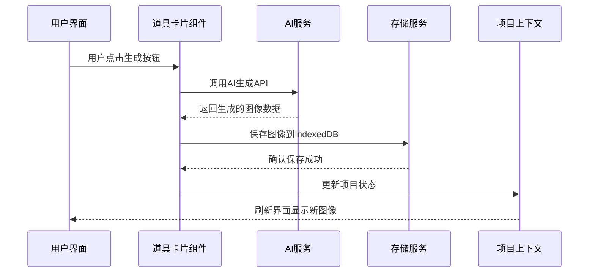

**图表来源**
- [src/phases/assets/AssetPhase.tsx:30-37](file://src/phases/assets/AssetPhase.tsx#L30-L37)
- [src/services/storage/indexeddb.ts:145-151](file://src/services/storage/indexeddb.ts#L145-L151)
- [src/shared/hooks/useAI.ts](file://src/shared/hooks/useAI.ts)

## 详细组件分析

### 道具卡片组件设计

道具卡片组件是系统的核心交互单元，提供了完整的道具管理功能。

#### 组件状态管理

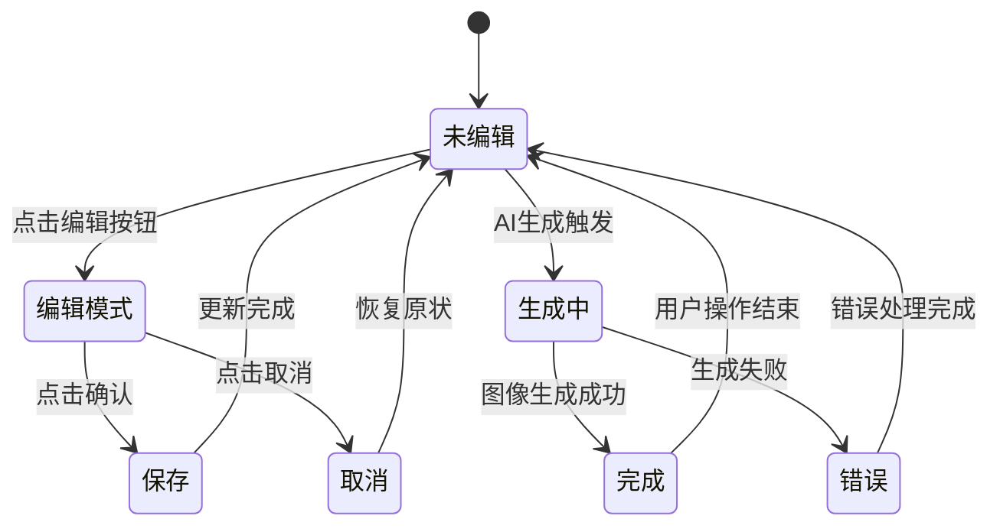

**图表来源**
- [src/phases/assets/components/CharacterAssetCard.tsx:1-31](file://src/phases/assets/components/CharacterAssetCard.tsx#L1-L31)

#### 数据绑定机制

组件采用受控组件模式，通过React状态管理实现双向数据绑定：

| 属性名 | 类型 | 描述 | 默认值 |
|--------|------|------|--------|
| character | Character | 角色数据对象 | 必填 |
| index | number | 在列表中的索引位置 | 必填 |
| imageUrl | string | 图像URL或Base64编码 | 可选 |
| busy | boolean | 是否正在生成中 | false |
| disabled | boolean | 是否禁用交互 | false |
| error | string | 错误信息 | undefined |
| onGenerate | Function | 生成回调函数 | 必填 |
| onPreview | Function | 预览回调函数 | 必填 |

**章节来源**
- [src/phases/assets/components/CharacterAssetCard.tsx:9-29](file://src/phases/assets/components/CharacterAssetCard.tsx#L9-L29)

### 批量操作功能

系统提供了强大的批量操作能力，支持同时处理多个道具项目。

#### 批量生成流程

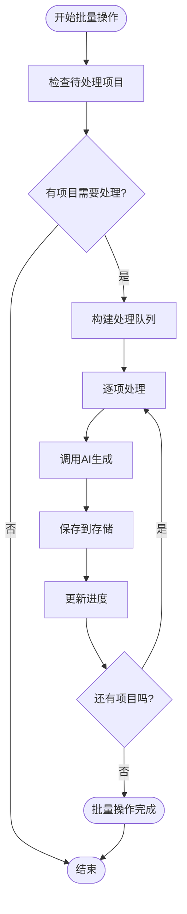

**图表来源**
- [src/phases/assets/AssetPhase.tsx:284-302](file://src/phases/assets/AssetPhase.tsx#L284-L302)

#### 批量控制条功能

批量控制条提供了统一的操作界面，包含以下核心功能：

| 功能 | 描述 | 状态指示 |
|------|------|----------|
| 开始批量 | 触发所有待处理项目的生成 | 显示进度百分比 |
| 取消操作 | 中断当前的批量生成过程 | 恢复到初始状态 |
| 进度监控 | 实时显示已完成和总项目数 | 百分比和计数器 |
| 状态反馈 | 显示当前处理的项目类型 | 字符串标签 |

**章节来源**
- [src/phases/assets/AssetPhase.tsx:305-333](file://src/phases/assets/AssetPhase.tsx#L305-L333)

### AI生成服务集成

系统深度集成了AI生成服务，为道具概念图的创建提供智能化支持。

#### 提示词构建策略

AI服务根据角色信息自动构建优化的提示词：

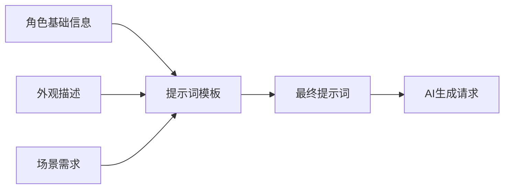

**图表来源**
- [src/phases/assets/AssetPhase.tsx:30-37](file://src/phases/assets/AssetPhase.tsx#L30-L37)

#### 生成流程控制

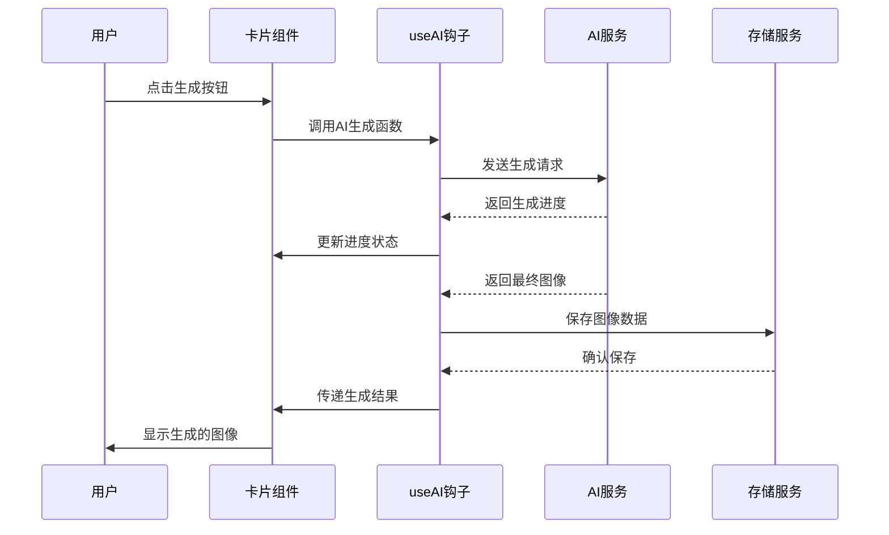

**图表来源**
- [src/shared/hooks/useAI.ts](file://src/shared/hooks/useAI.ts)
- [src/services/ai/index.ts](file://src/services/ai/index.ts)

**章节来源**
- [src/phases/assets/AssetPhase.tsx:30-37](file://src/phases/assets/AssetPhase.tsx#L30-L37)
- [src/shared/hooks/useAI.ts](file://src/shared/hooks/useAI.ts)

### 存储管理架构

系统采用IndexedDB作为持久化存储解决方案，支持二进制资产的高效管理。

#### 存储结构设计

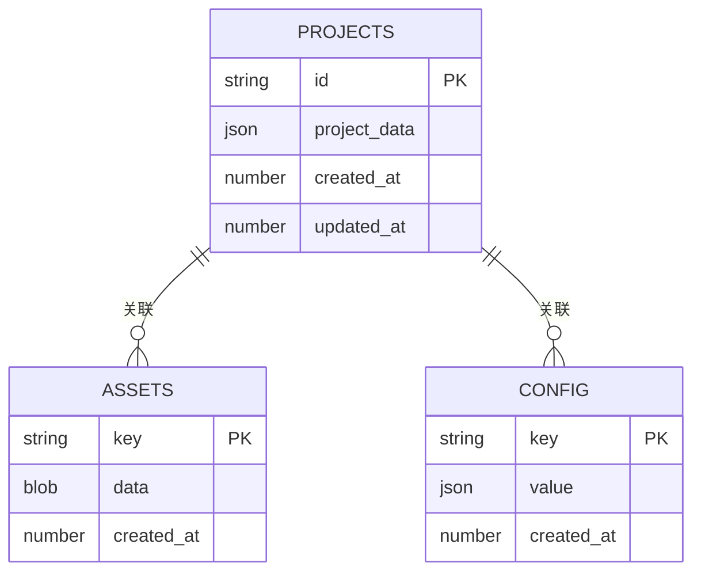

**图表来源**
- [src/services/storage/indexeddb.ts:17-21](file://src/services/storage/indexeddb.ts#L17-L21)

#### 资产管理流程

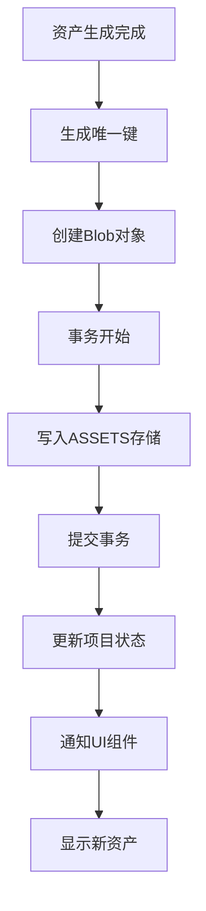

**图表来源**
- [src/services/storage/indexeddb.ts:145-151](file://src/services/storage/indexeddb.ts#L145-L151)

**章节来源**
- [src/services/storage/indexeddb.ts:1-167](file://src/services/storage/indexeddb.ts#L1-L167)
- [src/services/storage/types.ts:15-30](file://src/services/storage/types.ts#L15-L30)

## 依赖关系分析

系统采用模块化依赖设计，各组件间保持低耦合高内聚的特性。

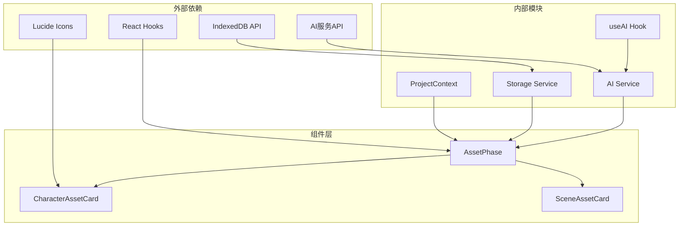

**图表来源**
- [src/shared/contexts/ProjectContext.tsx](file://src/shared/contexts/ProjectContext.tsx)
- [src/shared/hooks/useAI.ts](file://src/shared/hooks/useAI.ts)
- [src/services/storage/indexeddb.ts:1-167](file://src/services/storage/indexeddb.ts#L1-L167)

### 关键依赖关系

| 依赖方向 | 说明 | 影响范围 |
|----------|------|----------|
| 组件依赖上下文 | 道具卡片组件依赖项目上下文获取全局状态 | 全部道具组件 |
| AI服务集成 | 通过useAI钩子实现AI生成功能 | 角色和场景资产生成 |
| 存储服务抽象 | 通过StorageService接口实现数据持久化 | 所有需要持久化的数据 |
| 类型定义约束 | TypeScript类型确保数据结构一致性 | 全部系统组件 |

**章节来源**
- [src/shared/contexts/ProjectContext.tsx](file://src/shared/contexts/ProjectContext.tsx)
- [src/shared/hooks/useAI.ts](file://src/shared/hooks/useAI.ts)
- [src/services/storage/types.ts:15-30](file://src/services/storage/types.ts#L15-L30)

## 性能考虑

系统在设计时充分考虑了性能优化，特别是在大量道具处理和AI生成场景下的表现。

### 内存管理策略

1. **延迟加载机制**：只在需要时加载和渲染道具卡片，减少初始内存占用
2. **图像缓存优化**：使用IndexedDB存储二进制图像数据，避免重复下载
3. **状态最小化**：通过精确的状态更新减少不必要的重渲染

### 并发处理优化

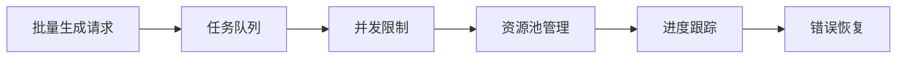

**图表来源**
- [src/phases/assets/AssetPhase.tsx:305-333](file://src/phases/assets/AssetPhase.tsx#L305-L333)

### 性能监控指标

| 指标类型 | 目标值 | 监控方法 |
|----------|--------|----------|
| 单次生成时间 | < 30秒 | 使用浏览器性能API |
| 同时处理数量 | ≤ 5个 | 通过并发控制实现 |
| 内存使用峰值 | < 500MB | 浏览器开发者工具监控 |
| UI响应时间 | < 100ms | 用户体验测试 |

## 故障排除指南

### 常见问题及解决方案

#### AI生成失败

**症状**：点击生成按钮后无响应或显示错误信息

**诊断步骤**：
1. 检查网络连接状态
2. 验证AI服务API密钥配置
3. 查看浏览器控制台错误日志

**解决方法**：
1. 重新配置AI服务参数
2. 清除浏览器缓存
3. 检查服务器端点可用性

#### 图像保存失败

**症状**：生成的图像无法显示或丢失

**诊断步骤**：
1. 检查IndexedDB存储空间
2. 验证Blob数据完整性
3. 查看事务执行状态

**解决方法**：
1. 清理过期的项目数据
2. 重启应用以重建数据库连接
3. 检查浏览器隐私设置

#### 批量操作中断

**症状**：批量生成过程中断或部分失败

**诊断步骤**：
1. 检查单个项目生成是否正常
2. 验证AI服务配额限制
3. 查看错误日志中的具体失败原因

**解决方法**：
1. 分批处理减少并发压力
2. 检查并调整AI服务配置
3. 重试失败的项目

**章节来源**
- [src/phases/assets/AssetPhase.tsx:30-37](file://src/phases/assets/AssetPhase.tsx#L30-L37)
- [src/services/storage/indexeddb.ts:145-151](file://src/services/storage/indexeddb.ts#L145-L151)

## 结论

道具物品管理系统通过精心设计的架构实现了高效的道具资源管理。系统的核心优势包括：

1. **模块化设计**：清晰的组件层次和职责分离
2. **智能集成**：深度整合AI生成服务提供智能化支持
3. **性能优化**：针对大量数据处理的优化策略
4. **用户体验**：直观的交互界面和流畅的操作体验

该系统为影视制作团队提供了完整的道具管理解决方案，从概念设计到最终应用的全流程支持。

## 附录

### 最佳实践建议

#### 道具创建规范
- 使用清晰明确的道具名称和描述
- 提供详细的视觉参考信息
- 建立标准化的道具分类体系

#### 组织管理策略
- 按项目阶段组织道具资源
- 建立版本控制机制
- 定期清理过期或废弃的道具

#### 创意指导原则
- 注重道具与场景的协调性
- 考虑道具的功能性和美观性平衡
- 建立创意灵感库和参考资料

### 技术扩展方向

1. **增强现实集成**：支持AR预览道具效果
2. **机器学习优化**：利用ML算法推荐道具组合
3. **协作功能增强**：支持多用户实时协作编辑
4. **云同步服务**：提供云端数据备份和同步