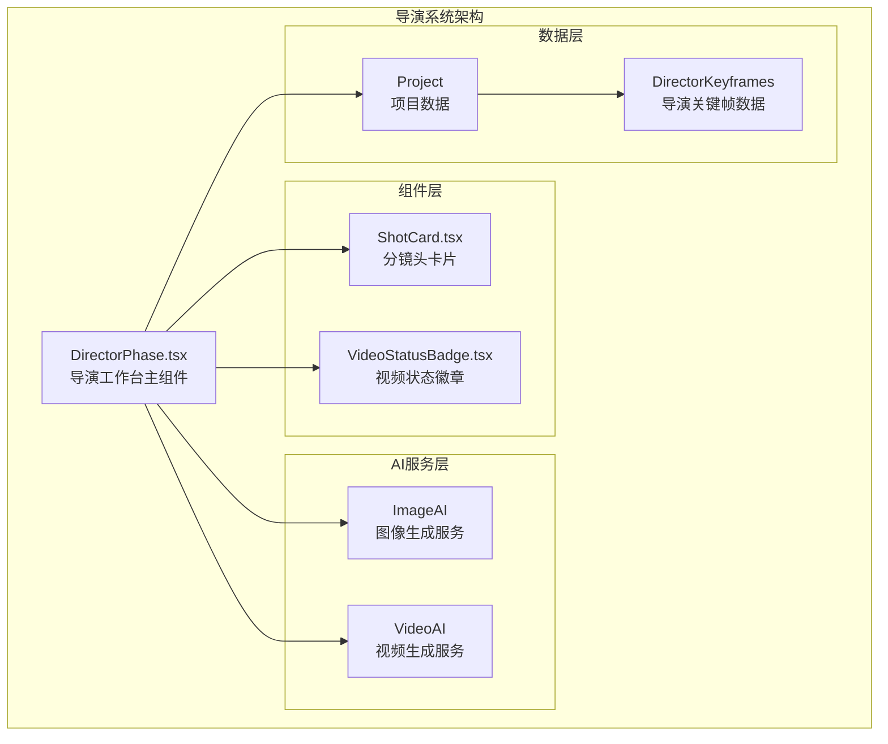
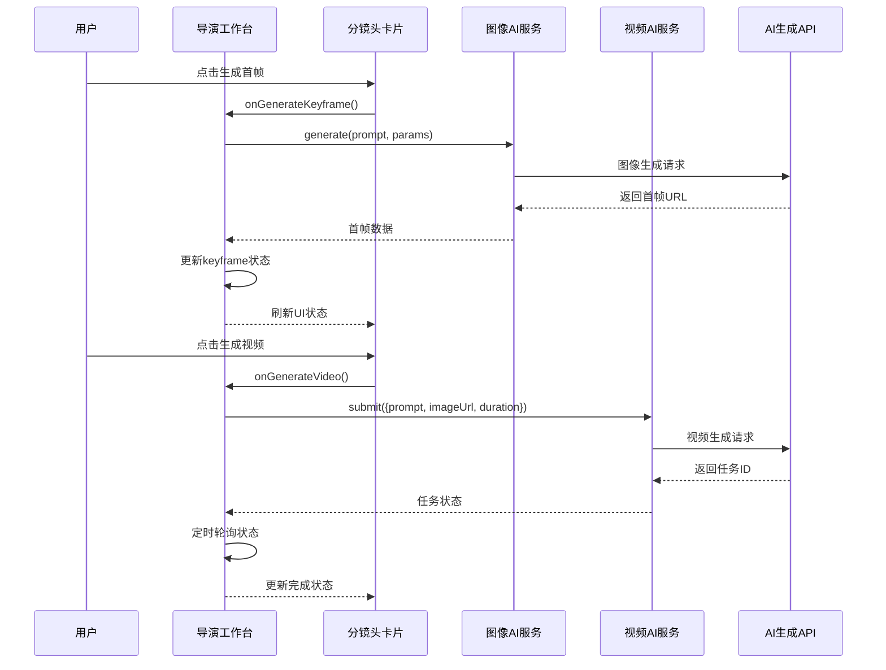
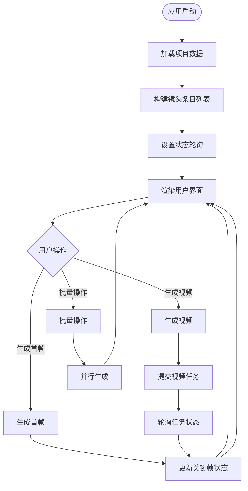
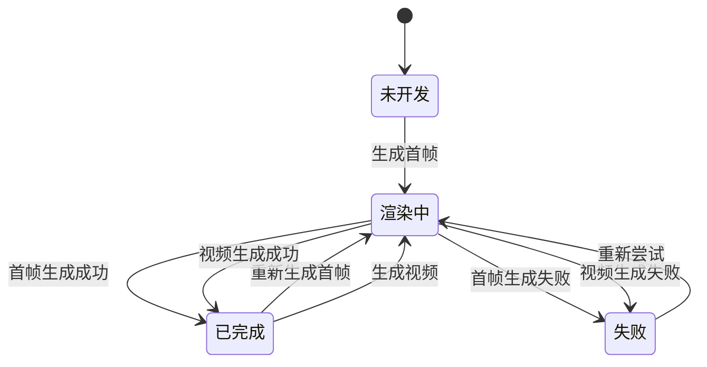
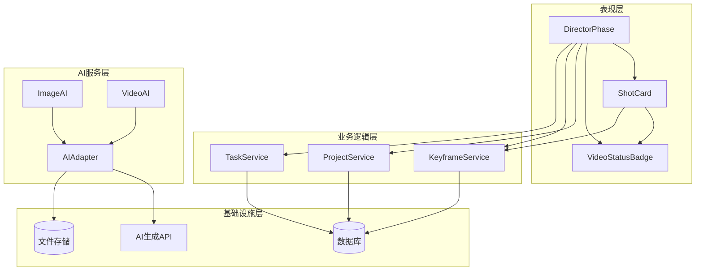

# StageDirector导演系统

<cite>
**本文档引用的文件**
- [DirectorPhase.tsx](file://src/phases/director/DirectorPhase.tsx)
- [ShotCard.tsx](file://src/phases/director/components/ShotCard.tsx)
- [VideoStatusBadge.tsx](file://src/phases/director/components/VideoStatusBadge.tsx)
- [README.md](file://README.md)
</cite>

## 目录
1. [简介](#简介)
2. [项目结构](#项目结构)
3. [核心组件](#核心组件)
4. [架构概览](#架构概览)
5. [详细组件分析](#详细组件分析)
6. [依赖关系分析](#依赖关系分析)
7. [性能考虑](#性能考虑)
8. [故障排除指南](#故障排除指南)
9. [结论](#结论)
10. [附录](#附录)

## 简介
StageDirector导演系统是一个基于AI驱动的视频创作工作台，专注于分镜头编辑、关键帧生成、九宫格预览和视频合成的全流程创作体验。该系统采用"信息-反馈律"控制论设计，通过异步任务管理和定时轮询机制，实现了从剧本结构到最终视频输出的自动化工作流。

系统的核心设计理念是"先静态后动态"的创作模式：首先使用图像AI生成高质量的关键帧作为画面基调，然后通过视频AI让静态画面产生运动和生命力。整个过程通过状态反馈循环确保创作者能够实时掌握每个镜头的制作进度。

## 项目结构
导演系统位于项目的`src/phases/director`目录下，采用模块化设计，主要包含以下核心文件：

**图表来源**
- [DirectorPhase.tsx:1-624](file://src/phases/director/DirectorPhase.tsx#L1-L624)
- [ShotCard.tsx:1-308](file://src/phases/director/components/ShotCard.tsx#L1-L308)
- [VideoStatusBadge.tsx:1-81](file://src/phases/director/components/VideoStatusBadge.tsx#L1-L81)

**章节来源**
- [DirectorPhase.tsx:1-624](file://src/phases/director/DirectorPhase.tsx#L1-L624)

## 核心组件
导演系统由三个核心组件构成，每个组件都有明确的职责分工：

### 导演工作台 (DirectorPhase)
导演工作台是整个系统的中枢控制器，负责协调所有子组件的工作。它实现了完整的分镜头管理、批量操作和状态监控功能。

### 分镜头卡片 (ShotCard)
分镜头卡片是用户界面的基本交互单元，提供了直观的镜头编辑和预览功能。每个卡片都包含了镜头的编号、场景信息、状态显示和操作按钮。

### 视频状态徽章 (VideoStatusBadge)
视频状态徽章负责将复杂的任务状态转换为直观的视觉元素，通过颜色、图标和动画效果传达当前的处理状态。

**章节来源**
- [DirectorPhase.tsx:62-495](file://src/phases/director/DirectorPhase.tsx#L62-L495)
- [ShotCard.tsx:22-295](file://src/phases/director/components/ShotCard.tsx#L22-L295)
- [VideoStatusBadge.tsx:52-81](file://src/phases/director/components/VideoStatusBadge.tsx#L52-L81)

## 架构概览
导演系统采用分层架构设计，通过清晰的职责分离实现了高度的模块化和可维护性：

**图表来源**
- [DirectorPhase.tsx:111-159](file://src/phases/director/DirectorPhase.tsx#L111-L159)
- [ShotCard.tsx:43-69](file://src/phases/director/components/ShotCard.tsx#L43-L69)

系统的核心特性包括：
- **异步任务管理**：通过定时轮询机制监控视频生成进度
- **乐观更新**：在任务提交后立即更新UI状态，提升用户体验
- **批量操作支持**：支持一次性生成多个镜头的首帧
- **状态持久化**：所有状态变更都会同步到项目数据中

**章节来源**
- [DirectorPhase.tsx:191-247](file://src/phases/director/DirectorPhase.tsx#L191-L247)

## 详细组件分析

### 导演工作台组件分析

导演工作台是系统的核心控制器，实现了完整的分镜头管理和AI服务协调功能。

#### 数据流架构

**图表来源**
- [DirectorPhase.tsx:71-88](file://src/phases/director/DirectorPhase.tsx#L71-L88)
- [DirectorPhase.tsx:161-189](file://src/phases/director/DirectorPhase.tsx#L161-L189)

#### Prompt增强策略
导演工作台实现了智能的Prompt增强机制，通过组合多个信息源来生成高质量的AI提示词：

| 组成要素 | 来源 | 作用 |
|---------|------|------|
| 镜头描述 | shot.description | 描述画面内容和动作 |
| 镜头角度 | shot.cameraAngle | 指定拍摄视角和距离 |
| 画面风格 | 固定模板 | 确保视觉一致性 |
| 角色特征 | project.script.characters | 提升角色识别度 |
| 场景环境 | scene.description | 增强场景氛围 |

**章节来源**
- [DirectorPhase.tsx:39-60](file://src/phases/director/DirectorPhase.tsx#L39-L60)

### 分镜头卡片组件分析

分镜头卡片是用户直接交互的主要界面元素，设计了完整的状态管理和操作反馈机制。

#### 状态管理系统

**图表来源**
- [ShotCard.tsx:37-42](file://src/phases/director/components/ShotCard.tsx#L37-L42)
- [VideoStatusBadge.tsx:11-44](file://src/phases/director/components/VideoStatusBadge.tsx#L11-L44)

#### 交互设计原则
分镜头卡片遵循了以下设计原则：

1. **状态可视化**：通过颜色、图标和动画清晰表达当前状态
2. **操作反馈**：所有用户操作都有即时的视觉反馈
3. **无障碍设计**：支持键盘导航和屏幕阅读器
4. **响应式布局**：适配不同屏幕尺寸和设备类型

**章节来源**
- [ShotCard.tsx:71-295](file://src/phases/director/components/ShotCard.tsx#L71-L295)

### 视频状态徽章组件分析

视频状态徽章是状态可视化的重要组件，通过统一的视觉语言传达复杂的状态信息。

#### 状态编码系统
| 状态 | 颜色方案 | 图标 | 动画效果 | 含义 |
|------|----------|------|----------|------|
| pending | 灰色背景 | 小时表 | 静止 | 排队等待 |
| processing | 红色背景 | 加载器 | 脉冲动画 | 正在渲染 |
| completed | 金色背景 | 对勾 | 静止 | 生成完成 |
| failed | 红色背景 | 警告 | 静止 | 生成失败 |

**章节来源**
- [VideoStatusBadge.tsx:11-44](file://src/phases/director/components/VideoStatusBadge.tsx#L11-L44)

## 依赖关系分析

导演系统的依赖关系体现了清晰的分层架构：

**图表来源**
- [DirectorPhase.tsx:13-26](file://src/phases/director/DirectorPhase.tsx#L13-L26)
- [ShotCard.tsx:5-8](file://src/phases/director/components/ShotCard.tsx#L5-L8)

系统的关键依赖包括：
- **React Hooks**：useState、useEffect、useMemo等用于状态管理
- **AI服务接口**：抽象化的图像和视频生成服务
- **项目上下文**：全局项目状态管理
- **类型定义**：完整的TypeScript类型系统

**章节来源**
- [DirectorPhase.tsx:13-26](file://src/phases/director/DirectorPhase.tsx#L13-L26)

## 性能考虑

导演系统在性能优化方面采用了多项策略：

### 并发控制
- **批量生成限制**：避免同时发起过多AI请求
- **轮询频率优化**：5秒间隔平衡响应速度和服务器负载
- **内存管理**：及时清理已完成任务的状态缓存

### 网络优化
- **乐观更新**：减少用户等待时间
- **错误恢复**：单个请求失败不影响整体流程
- **资源复用**：重用已完成的首帧图像

### 用户体验优化
- **渐进式渲染**：分镜头按场景分组显示
- **状态指示**：清晰的进度反馈
- **离线容错**：网络异常时的降级处理

## 故障排除指南

### 常见问题及解决方案

#### API密钥配置问题
**症状**：无法生成首帧或视频
**原因**：AI服务密钥未正确配置
**解决方法**：
1. 检查模型配置页面的API Key设置
2. 验证密钥的有效性和权限
3. 重启应用使配置生效

#### 生成任务失败
**症状**：任务状态停留在"渲染中"
**可能原因**：
- AI服务端错误
- 网络连接不稳定
- 请求参数格式错误

**解决步骤**：
1. 查看全局错误通知
2. 检查网络连接状态
3. 重新提交失败的任务
4. 联系技术支持

#### 性能问题
**症状**：界面响应缓慢
**解决方法**：
- 减少同时进行的批量操作
- 清理浏览器缓存
- 关闭不必要的应用程序

**章节来源**
- [DirectorPhase.tsx:114-116](file://src/phases/director/DirectorPhase.tsx#L114-L116)
- [DirectorPhase.tsx:131-133](file://src/phases/director/DirectorPhase.tsx#L131-L133)

## 结论

StageDirector导演系统通过精心设计的架构和用户界面，为视频创作提供了高效、直观的解决方案。系统的核心优势包括：

1. **完整的创作流程**：从分镜头编辑到最终视频输出的一体化体验
2. **智能的状态管理**：通过反馈循环确保创作者始终掌握项目进度
3. **优秀的用户体验**：直观的界面设计和及时的操作反馈
4. **强大的扩展性**：模块化的架构便于功能扩展和技术升级

该系统特别适合需要快速原型制作、概念验证和创意探索的视频创作者，通过AI技术大幅降低了视频制作的技术门槛和时间成本。

## 附录

### 快速开始指南

1. **项目准备**
   - 在模型配置中添加有效的API密钥
   - 确保网络连接稳定

2. **创建第一个镜头**
   - 在脚本编辑器中定义场景和分镜头
   - 在导演工作台中查看生成的镜头列表

3. **生成首帧**
   - 点击"生成首帧"按钮
   - 等待AI生成完成后预览效果

4. **生成视频**
   - 点击"生成视频"按钮
   - 系统会自动轮询任务状态

### 创意技巧

1. **镜头角度实验**
   - 尝试不同的拍摄角度和距离
   - 通过调整镜头描述获得多样化的视觉效果

2. **风格融合**
   - 在镜头描述中融入特定的艺术风格
   - 利用角色特征增强视觉一致性

3. **场景氛围营造**
   - 详细描述场景环境和氛围
   - 通过环境描述提升画面的沉浸感