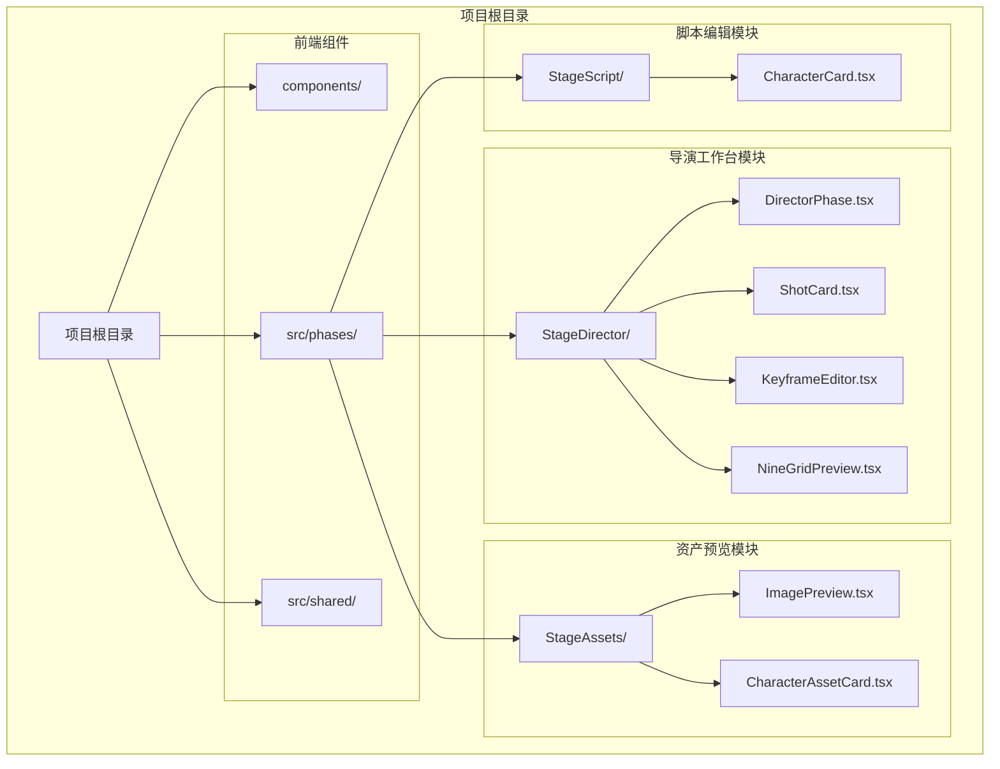
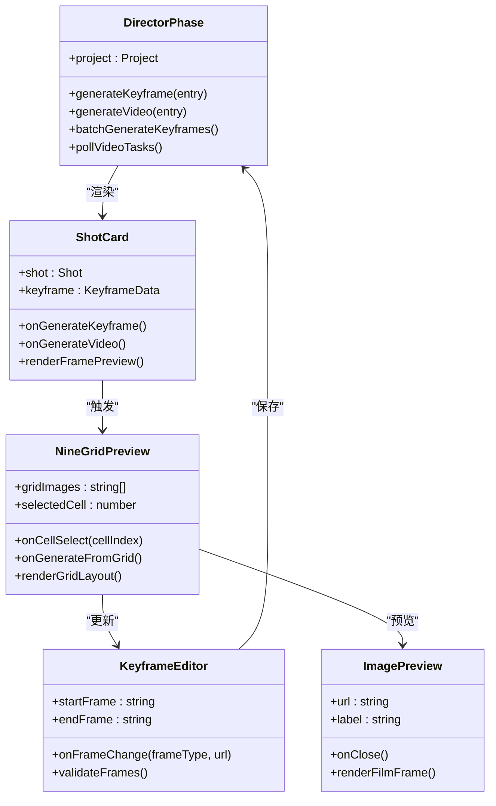
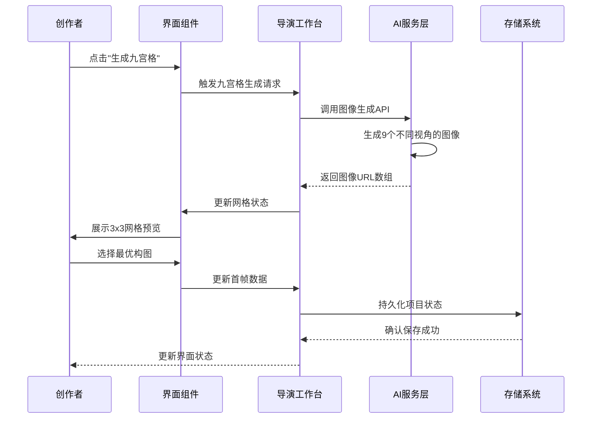
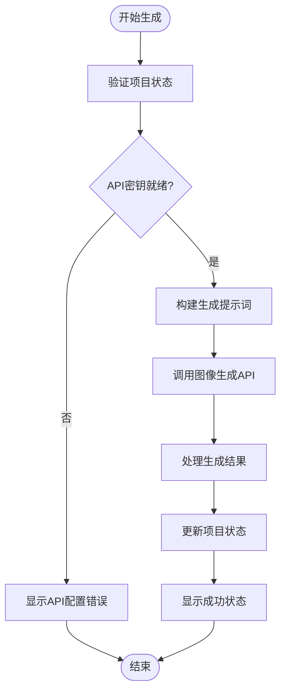
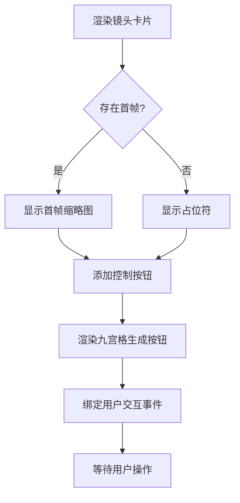
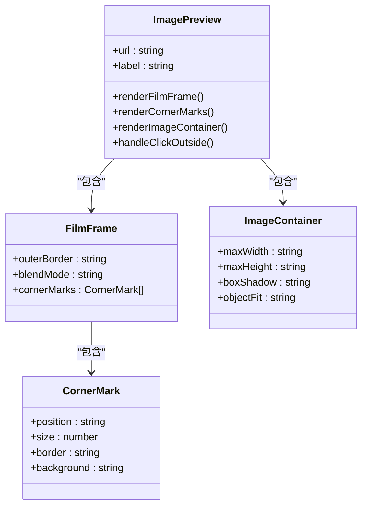
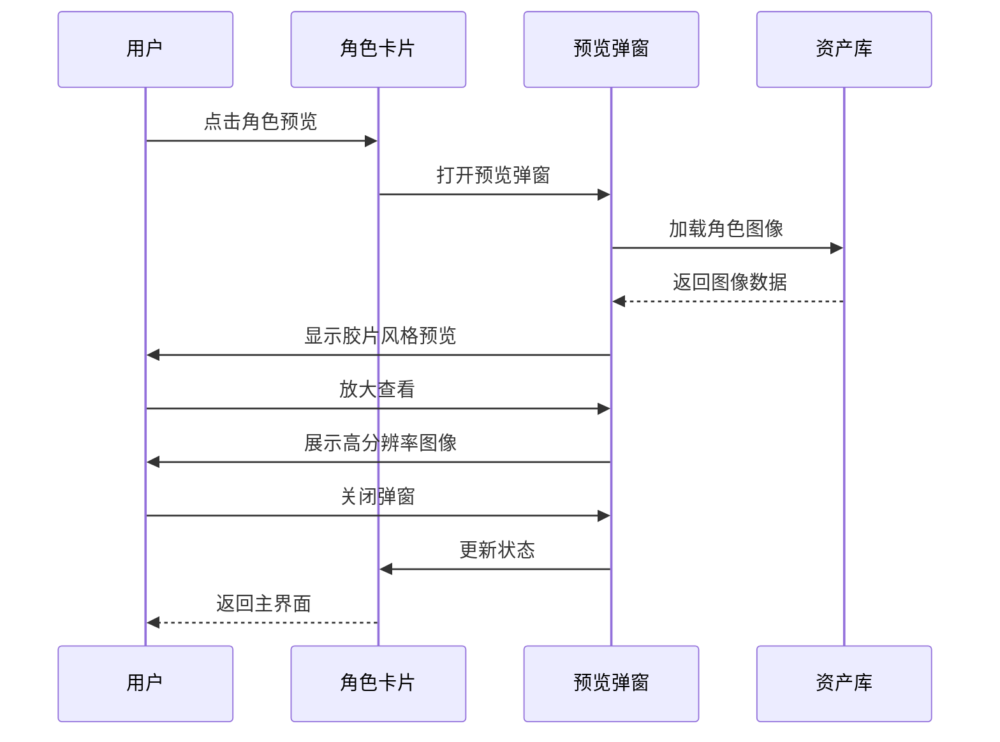
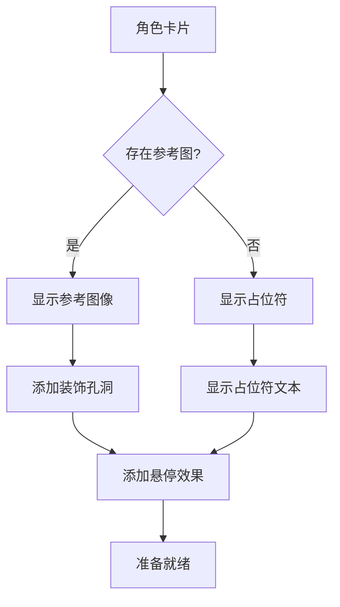
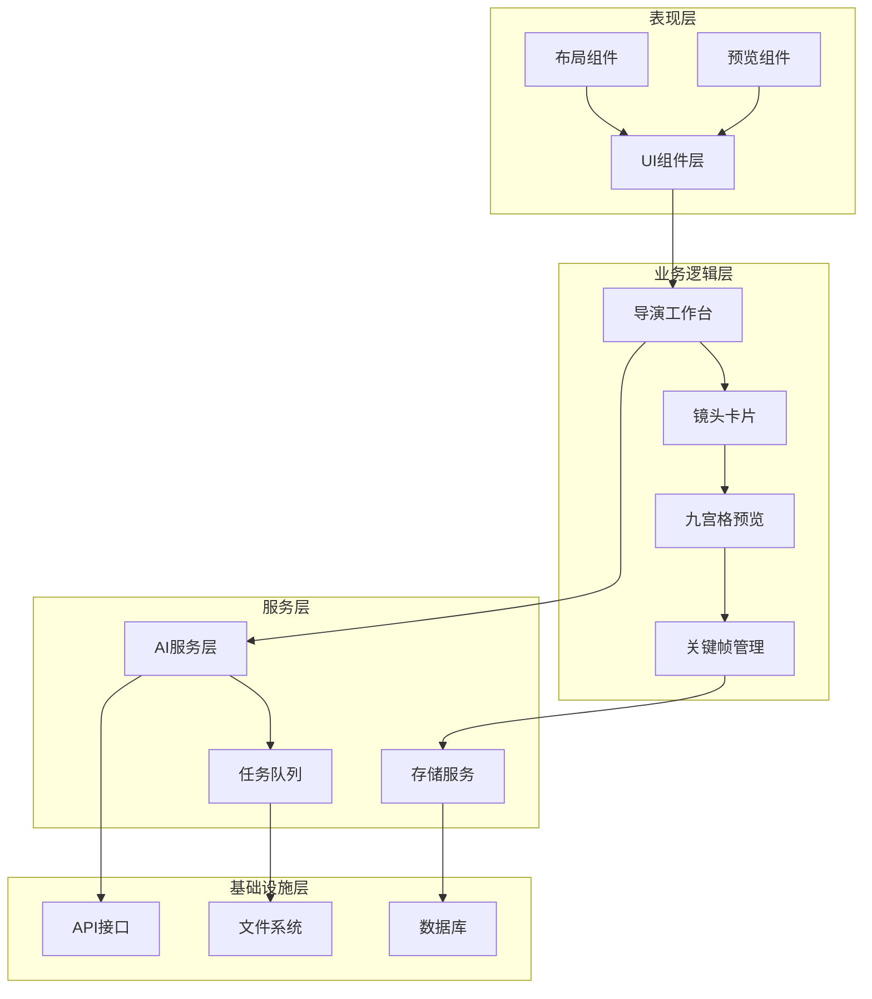

# 九宫格预览系统

<cite>
**本文档引用的文件**
- [README.md](file://README.md)
- [README_EN.md](file://README_EN.md)
- [DirectorPhase.tsx](file://src/phases/director/DirectorPhase.tsx)
- [ShotCard.tsx](file://src/phases/director/components/ShotCard.tsx)
- [ImagePreview.tsx](file://src/phases/assets/components/ImagePreview.tsx)
- [CharacterAssetCard.tsx](file://src/phases/assets/components/CharacterAssetCard.tsx)
- [CharacterCard.tsx](file://src/phases/script/components/CharacterCard.tsx)
- [Layout.tsx](file://src/shared/components/Layout.tsx)
</cite>

## 目录
1. [简介](#简介)
2. [项目结构](#项目结构)
3. [核心组件](#核心组件)
4. [架构概览](#架构概览)
5. [详细组件分析](#详细组件分析)
6. [依赖关系分析](#依赖关系分析)
7. [性能考虑](#性能考虑)
8. [故障排除指南](#故障排除指南)
9. [结论](#结论)
10. [附录](#附录)

## 简介

九宫格预览系统是AI shotlive Director平台的核心创意工具，专为短剧和漫画制作而设计。该系统采用"关键帧驱动"的工作流，通过将单一镜头分解为9个不同视角的预览图像，为创作者提供全方位的构图选择和创意探索空间。

### 系统特色

- **多视角构图探索**：每个镜头生成9个不同角度的预览，涵盖广角、中景、特写等多维度构图
- **智能预览生成**：基于AI图像生成技术，快速产出高质量的构图预览
- **灵活的首帧选择**：支持整张九宫格作为首帧，或单独选择某个格子作为首帧
- **上下文感知生成**：自动整合当前场景图和角色服装图，确保画面一致性
- **工业级工作流**：与完整的"小说→剧本→分镜→资产→关键帧→成片"流水线无缝集成

### 技术架构

系统采用前后端分离架构，前端基于React 19和Vite 6，后端使用Express.js，支持多模型提供商集成。九宫格预览功能深度集成在导演工作台Phase 03中，与现有的关键帧生成和视频渲染流程形成有机整体。

**章节来源**
- [README.md: 79-85:79-85](file://README.md#L79-L85)
- [README_EN.md: 62-71:62-71](file://README_EN.md#L62-L71)

## 项目结构

九宫格预览系统位于项目的导演工作台模块中，与整个AI shotlive平台的分层架构保持一致。

**图表来源**
- [DirectorPhase.tsx: 1-624:1-624](file://src/phases/director/DirectorPhase.tsx#L1-L624)
- [ShotCard.tsx: 117-149:117-149](file://src/phases/director/components/ShotCard.tsx#L117-L149)

### 模块组织原则

系统采用按功能域划分的模块化设计：

- **Phase分层**：按照AI shotlive的四个主要阶段进行功能划分
- **职责分离**：每个模块专注于特定的创作环节
- **组件复用**：基础UI组件在多个模块间共享使用
- **数据一致性**：通过统一的项目上下文确保数据同步

**章节来源**
- [README.md: 308-369:308-369](file://README.md#L308-L369)

## 核心组件

九宫格预览系统的实现涉及多个核心组件，每个组件都有明确的职责和交互关系。

### 组件层次结构

**图表来源**
- [DirectorPhase.tsx: 62-495:62-495](file://src/phases/director/DirectorPhase.tsx#L62-L495)
- [ShotCard.tsx: 117-149:117-149](file://src/phases/director/components/ShotCard.tsx#L117-L149)

### 数据流架构

九宫格预览系统遵循统一的数据流向：

1. **用户交互**：创作者在镜头卡片中触发九宫格生成
2. **AI生成**：系统调用图像生成API创建9个视角的预览
3. **网格展示**：生成的图像以3x3网格形式展示
4. **选择确认**：创作者选择最优构图作为首帧
5. **状态更新**：更新项目数据并返回到主界面

**章节来源**
- [DirectorPhase.tsx: 110-125:110-125](file://src/phases/director/DirectorPhase.tsx#L110-L125)
- [ShotCard.tsx: 117-149:117-149](file://src/phases/director/components/ShotCard.tsx#L117-L149)

## 架构概览

九宫格预览系统采用事件驱动的异步架构，确保用户体验的流畅性和系统的可扩展性。

**图表来源**
- [DirectorPhase.tsx: 110-125:110-125](file://src/phases/director/DirectorPhase.tsx#L110-L125)
- [DirectorPhase.tsx: 161-189:161-189](file://src/phases/director/DirectorPhase.tsx#L161-L189)

### 状态管理模式

系统采用集中式状态管理：

- **项目状态**：存储在全局项目上下文中
- **镜头状态**：每个镜头的关键帧和视频状态
- **UI状态**：当前选中的网格单元和预览状态
- **生成状态**：异步生成任务的进度跟踪

**章节来源**
- [DirectorPhase.tsx: 90-108:90-108](file://src/phases/director/DirectorPhase.tsx#L90-L108)
- [DirectorPhase.tsx: 251-262:251-262](file://src/phases/director/DirectorPhase.tsx#L251-L262)

## 详细组件分析

### 导演工作台核心逻辑

导演工作台是九宫格预览系统的主要入口，负责协调整个生成流程。

#### 关键帧生成流程

**图表来源**
- [DirectorPhase.tsx: 110-125:110-125](file://src/phases/director/DirectorPhase.tsx#L110-L125)

#### 批量处理机制

系统支持批量生成关键帧，提高创作效率：

- **并发控制**：限制同时进行的生成任务数量
- **错误容错**：单个镜头生成失败不影响其他镜头
- **进度跟踪**：实时显示批量处理进度
- **状态同步**：生成完成后自动更新UI状态

**章节来源**
- [DirectorPhase.tsx: 161-189:161-189](file://src/phases/director/DirectorPhase.tsx#L161-L189)

### 镜头卡片组件

镜头卡片是用户与九宫格预览系统交互的主要界面元素。

#### 预览渲染逻辑

**图表来源**
- [ShotCard.tsx: 117-149:117-149](file://src/phases/director/components/ShotCard.tsx#L117-L149)

#### 用户交互设计

镜头卡片提供了直观的用户交互体验：

- **首帧预览**：缩略图形式展示当前首帧
- **生成按钮**：一键触发九宫格生成
- **状态指示**：清晰显示生成进度和状态
- **操作反馈**：即时响应用户操作

**章节来源**
- [ShotCard.tsx: 117-149:117-149](file://src/phases/director/components/ShotCard.tsx#L117-L149)

### 图像预览系统

图像预览系统为用户提供沉浸式的图像查看体验，特别针对九宫格预览进行了专门优化。

#### 胶片风格渲染

**图表来源**
- [ImagePreview.tsx: 91-133:91-133](file://src/phases/assets/components/ImagePreview.tsx#L91-L133)

#### 响应式设计

预览系统采用响应式设计，适应不同屏幕尺寸：

- **最大尺寸限制**：确保大图在小屏幕上完整显示
- **高度自适应**：根据容器高度自动调整显示比例
- **阴影效果**：营造立体的展示效果
- **交互反馈**：提供清晰的点击和悬停反馈

**章节来源**
- [ImagePreview.tsx: 91-133:91-133](file://src/phases/assets/components/ImagePreview.tsx#L91-L133)

### 资产卡片系统

资产卡片系统为角色和场景资产提供了统一的预览和管理界面。

#### 角色资产预览

**图表来源**
- [CharacterAssetCard.tsx: 46-71:46-71](file://src/phases/assets/components/CharacterAssetCard.tsx#L46-L71)

#### 装饰元素设计

资产卡片采用了丰富的装饰元素来增强视觉效果：

- **胶片纹理背景**：营造专业的摄影工作室氛围
- **装饰性孔洞**：模拟胶片的穿孔标记
- **渐变遮罩**：提供悬停时的视觉反馈
- **缩放动画**：平滑的图像缩放过渡效果

**章节来源**
- [CharacterAssetCard.tsx: 33-71:33-71](file://src/phases/assets/components/CharacterAssetCard.tsx#L33-L71)

### 脚本编辑中的角色展示

脚本编辑模块中的角色卡片为创作者提供了角色信息的可视化展示。

#### 角色参考图展示

**图表来源**
- [CharacterCard.tsx: 39-68:39-68](file://src/phases/script/components/CharacterCard.tsx#L39-L68)

**章节来源**
- [CharacterCard.tsx: 39-68:39-68](file://src/phases/script/components/CharacterCard.tsx#L39-L68)

## 依赖关系分析

九宫格预览系统的依赖关系体现了清晰的分层架构和模块化设计。

**图表来源**
- [DirectorPhase.tsx: 13-27:13-27](file://src/phases/director/DirectorPhase.tsx#L13-L27)
- [Layout.tsx: 1-22:1-22](file://src/shared/components/Layout.tsx#L1-L22)

### 外部依赖

系统对外部依赖的管理体现了良好的架构设计：

- **AI模型提供商**：支持多家AI服务提供商，便于成本优化和功能扩展
- **数据库服务**：支持MySQL和SQLite两种存储方案
- **文件存储**：媒体文件的分布式存储和管理
- **API网关**：统一的API接口管理和错误处理

**章节来源**
- [README.md: 111-124:111-124](file://README.md#L111-L124)
- [README_EN.md: 87-98:87-98](file://README_EN.md#L87-L98)

## 性能考虑

九宫格预览系统在设计时充分考虑了性能优化，确保在大规模内容处理时仍能保持流畅的用户体验。

### 并发处理策略

系统采用多层并发控制机制：

- **任务队列管理**：限制同时进行的AI生成任务数量
- **内存优化**：及时释放不再使用的图像数据
- **网络连接池**：复用HTTP连接，减少建立连接的开销
- **缓存策略**：对频繁访问的图像进行本地缓存

### 渲染性能优化

针对九宫格预览的特殊需求，系统实现了多项渲染优化：

- **虚拟滚动**：对于大量镜头的情况，采用虚拟滚动技术
- **懒加载**：只在需要时加载图像数据
- **图像压缩**：在保证质量的前提下压缩图像大小
- **GPU加速**：利用CSS硬件加速提升动画性能

### 内存管理

系统实施了严格的内存管理策略：

- **对象池**：重用DOM元素和图像对象
- **垃圾回收**：及时清理不再使用的引用
- **内存监控**：实时监控内存使用情况
- **异常处理**：防止内存泄漏导致的应用崩溃

## 故障排除指南

九宫格预览系统提供了完善的错误处理和故障排除机制。

### 常见问题诊断

#### API配置问题

**症状**：无法生成九宫格预览，显示API配置错误

**解决方案**：
1. 检查模型配置页面的API密钥是否正确
2. 验证API密钥的有效期和权限
3. 确认网络连接正常
4. 查看API服务的可用性状态

#### 生成失败处理

**症状**：九宫格生成过程中断，部分镜头失败

**解决方案**：
1. 检查失败镜头的错误信息
2. 重试生成失败的镜头
3. 调整生成参数（如分辨率、风格）
4. 检查AI服务的负载情况

#### 性能问题

**症状**：界面响应缓慢，图像加载超时

**解决方案**：
1. 检查网络连接速度
2. 减少同时进行的生成任务数量
3. 清理浏览器缓存
4. 重启应用以释放内存

### 日志和监控

系统提供了详细的日志记录和监控功能：

- **错误日志**：记录所有API调用错误和异常
- **性能指标**：监控生成时间和资源使用情况
- **用户行为**：跟踪用户操作路径和使用频率
- **系统健康**：监控服务可用性和响应时间

**章节来源**
- [DirectorPhase.tsx: 175-181:175-181](file://src/phases/director/DirectorPhase.tsx#L175-L181)
- [DirectorPhase.tsx: 355-388:355-388](file://src/phases/director/DirectorPhase.tsx#L355-L388)

## 结论

九宫格预览系统作为AI shotlive Director平台的核心创意工具，成功地将先进的AI技术与专业的影视制作流程相结合。通过3x3网格化的多视角预览，创作者能够以前所未有的效率探索最佳构图，大大提升了创意工作的质量和效率。

### 系统优势

- **创新性**：独特的九宫格预览模式为创意探索提供了新的可能性
- **易用性**：直观的用户界面和流畅的操作体验
- **扩展性**：模块化的架构设计便于功能扩展和技术升级
- **稳定性**：完善的错误处理和性能优化确保系统可靠运行

### 发展前景

随着AI技术的不断发展和创作需求的持续增长，九宫格预览系统将继续演进，为创作者提供更加智能化和个性化的创意辅助工具。系统的模块化设计也为未来的技术集成和功能扩展奠定了坚实的基础。

## 附录

### 使用技巧和专业指导

#### 九宫格创意拍摄技巧

1. **构图多样性**：充分利用九宫格的多视角特性，探索不同的拍摄角度和构图方式
2. **情感表达**：通过不同角度的预览，更好地表达角色的情感变化和场景氛围
3. **节奏控制**：结合镜头的时长和运动，选择最能体现节奏感的构图
4. **视觉引导**：利用九宫格的网格结构，设计有效的视觉引导线

#### 与传统分镜的区别

- **效率差异**：九宫格预览比传统手绘分镜快几个数量级
- **创意探索**：AI生成的多样化构图有助于突破传统思维局限
- **成本控制**：减少了人工绘制的成本和时间投入
- **质量保证**：通过上下文感知确保画面的一致性和连贯性

#### 最佳实践建议

1. **明确创作目标**：在生成九宫格之前，先确定想要表达的主题和情感
2. **合理使用AI**：将AI作为创意助手而非完全替代人工判断
3. **迭代优化**：通过多次生成和选择，逐步优化最终的构图选择
4. **团队协作**：在团队创作中，九宫格预览可以作为讨论和决策的重要依据