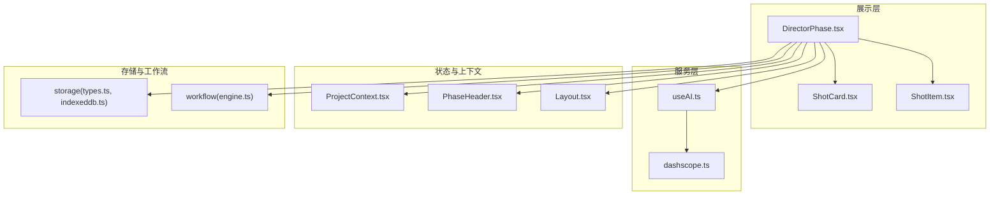
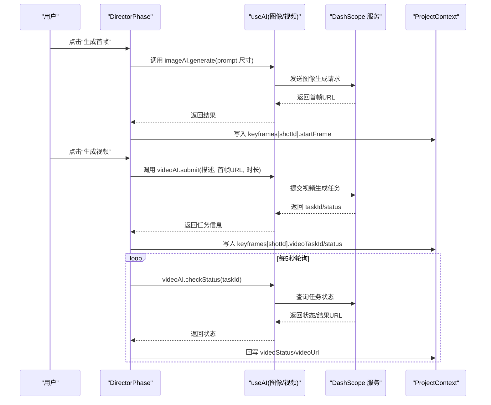
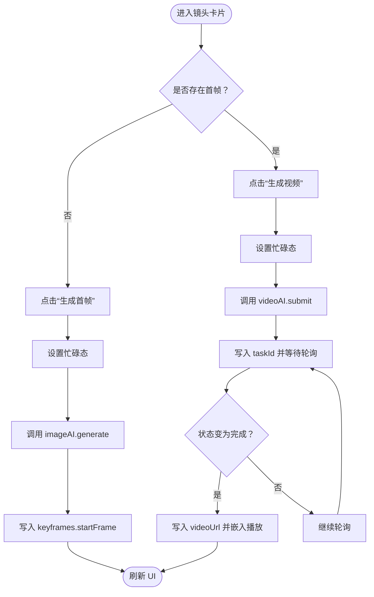
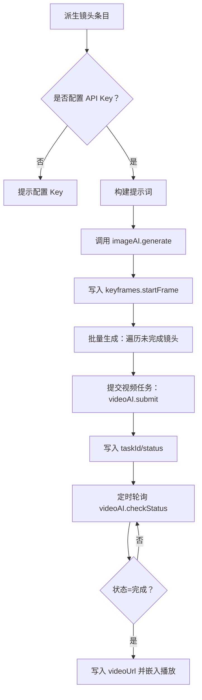
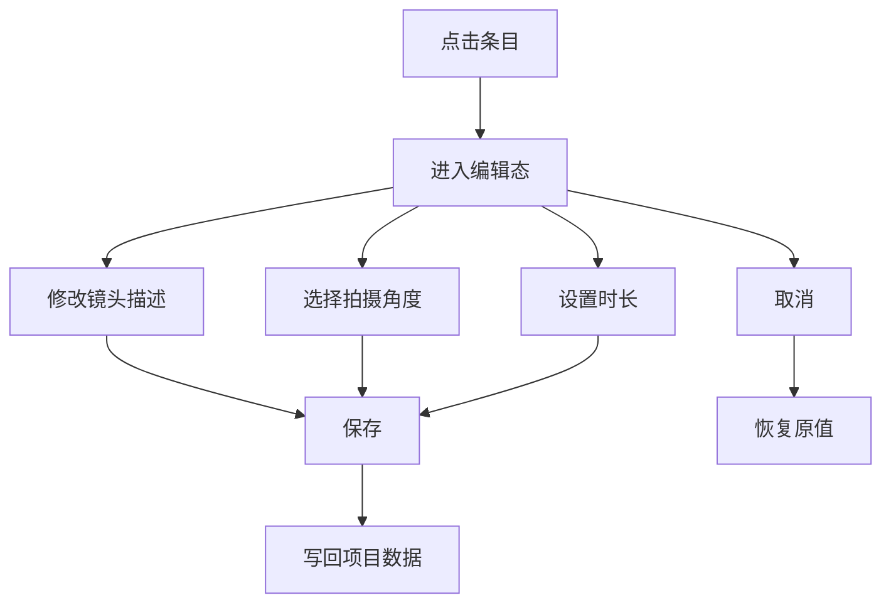
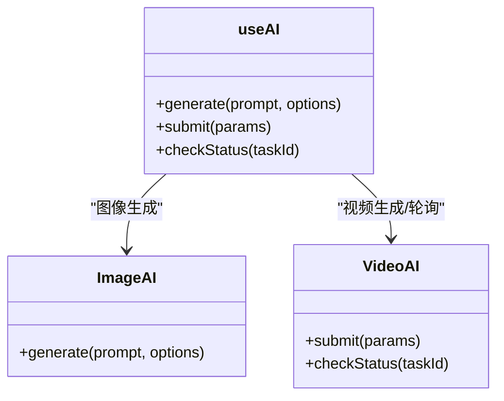
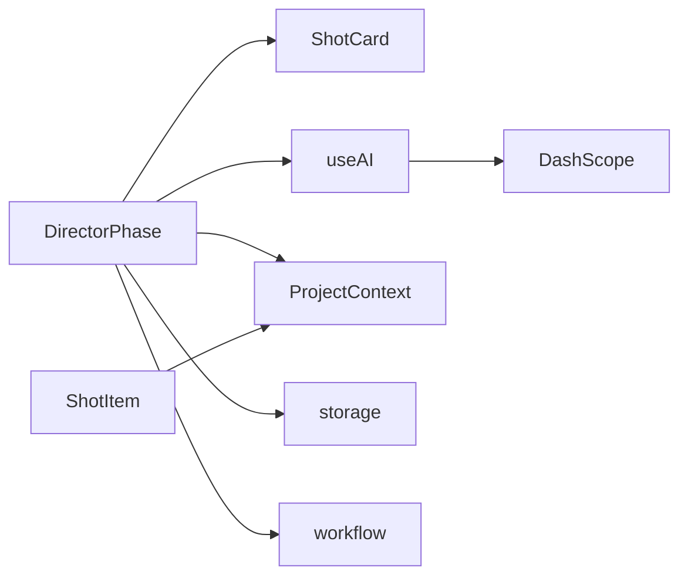
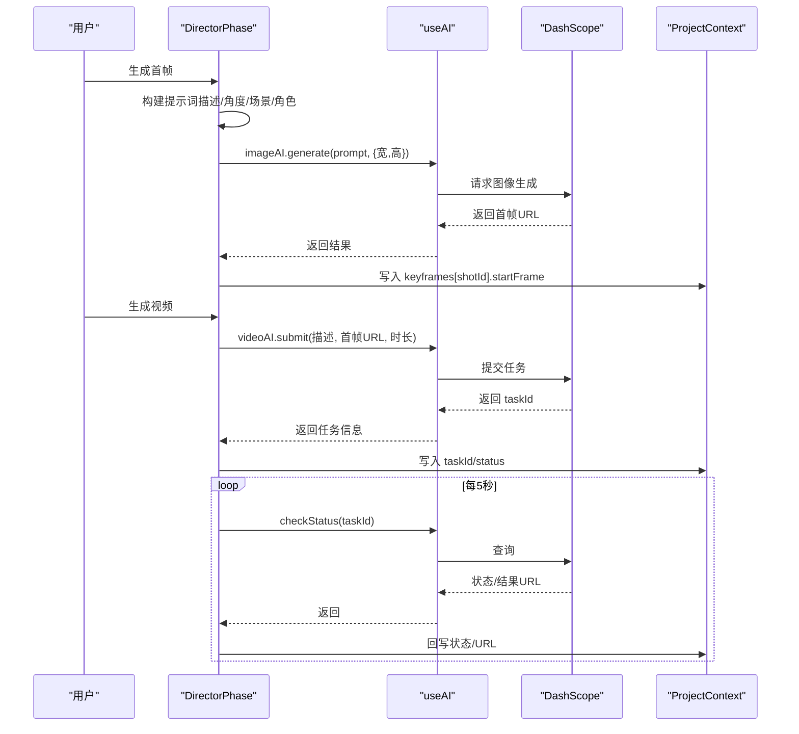

# 关键帧编辑器

<cite>
**本文引用的文件**
- [ShotCard.tsx](file://src/phases/director/components/ShotCard.tsx)
- [DirectorPhase.tsx](file://src/phases/director/DirectorPhase.tsx)
- [ShotItem.tsx](file://src/phases/script/components/ShotItem.tsx)
- [useAI.ts](file://src/shared/hooks/useAI.ts)
- [types.ts](file://src/types.ts)
- [Layout.tsx](file://src/shared/components/Layout.tsx)
- [PhaseHeader.tsx](file://src/shared/components/PhaseHeader.tsx)
- [ProjectContext.tsx](file://src/shared/contexts/ProjectContext.tsx)
- [dashscope.ts](file://src/services/ai/dashscope.ts)
- [types.ts](file://src/services/ai/types.ts)
- [engine.ts](file://src/services/workflow/engine.ts)
- [types.ts](file://src/services/storage/types.ts)
- [indexeddb.ts](file://src/services/storage/indexeddb.ts)
</cite>

## 目录
1. [简介](#简介)
2. [项目结构](#项目结构)
3. [核心组件](#核心组件)
4. [架构总览](#架构总览)
5. [详细组件分析](#详细组件分析)
6. [依赖关系分析](#依赖关系分析)
7. [性能考量](#性能考量)
8. [故障排查指南](#故障排查指南)
9. [结论](#结论)
10. [附录](#附录)

## 简介
本文件面向“关键帧编辑器”的使用者与开发者，系统性阐述关键帧编辑器的界面设计、提示词编辑功能、图像上传与管理机制、起始帧与结束帧的生成流程、AI 增强能力、手动编辑选项、视觉提示词优化、相机运动指导、场景上下文智能匹配、关键帧质量控制、提示词最佳实践，以及与 AI 生成服务的深度集成。同时提供专业技巧与创意指导，帮助用户高效产出高质量的视频内容。

## 项目结构
关键帧编辑器位于“导演工作台”阶段，围绕“镜头卡片”“提示词编辑”“AI 生成服务”“轮询状态更新”等模块协同工作。整体采用分层架构：UI 展示层（DirectorPhase、ShotCard）、数据与状态层（ProjectContext）、AI 服务层（useAI、dashscope）、存储与工作流层（storage、workflow）。

图表来源
- [DirectorPhase.tsx:62-495](file://src/phases/director/DirectorPhase.tsx#L62-L495)
- [ShotCard.tsx:22-295](file://src/phases/director/components/ShotCard.tsx#L22-L295)
- [ShotItem.tsx:21-169](file://src/phases/script/components/ShotItem.tsx#L21-L169)
- [useAI.ts:41-96](file://src/shared/hooks/useAI.ts#L41-L96)
- [dashscope.ts](file://src/services/ai/dashscope.ts)
- [ProjectContext.tsx](file://src/shared/contexts/ProjectContext.tsx)
- [PhaseHeader.tsx](file://src/shared/components/PhaseHeader.tsx)
- [Layout.tsx](file://src/shared/components/Layout.tsx)
- [types.ts](file://src/services/storage/types.ts)
- [indexeddb.ts](file://src/services/storage/indexeddb.ts)
- [engine.ts](file://src/services/workflow/engine.ts)

章节来源
- [DirectorPhase.tsx:62-495](file://src/phases/director/DirectorPhase.tsx#L62-L495)
- [ShotCard.tsx:22-295](file://src/phases/director/components/ShotCard.tsx#L22-L295)
- [ShotItem.tsx:21-169](file://src/phases/script/components/ShotItem.tsx#L21-L169)
- [useAI.ts:41-96](file://src/shared/hooks/useAI.ts#L41-L96)

## 核心组件
- 镜头卡片（ShotCard）：负责单个镜头的首帧预览、状态徽标、生成首帧/重拍按钮、错误提示与视频嵌入播放。
- 导演工作台（DirectorPhase）：负责构建镜头清单、批量生成首帧、提交视频任务、轮询视频状态并回写到项目数据。
- 提示词编辑（ShotItem）：提供镜头描述、拍摄角度、时长的内联编辑，支持快速优化提示词。
- AI 能力（useAI）：统一封装文本/图像/视频生成与状态查询，提供加载与错误状态。
- 类型定义（types.ts）：统一项目、场景、镜头、关键帧数据结构，确保跨模块一致。

章节来源
- [ShotCard.tsx:22-295](file://src/phases/director/components/ShotCard.tsx#L22-L295)
- [DirectorPhase.tsx:62-495](file://src/phases/director/DirectorPhase.tsx#L62-L495)
- [ShotItem.tsx:21-169](file://src/phases/script/components/ShotItem.tsx#L21-L169)
- [useAI.ts:41-96](file://src/shared/hooks/useAI.ts#L41-L96)
- [types.ts](file://src/types.ts)

## 架构总览
关键帧编辑器遵循“信息-反馈律”：导演工作台根据剧本结构派生镜头列表；异步任务通过定时轮询将外部状态拉回到本地反馈环；用户操作（生成首帧/视频）即时反馈 UI，结果落库后供后续阶段读取。

图表来源
- [DirectorPhase.tsx:111-247](file://src/phases/director/DirectorPhase.tsx#L111-L247)
- [useAI.ts:68-96](file://src/shared/hooks/useAI.ts#L68-L96)
- [dashscope.ts](file://src/services/ai/dashscope.ts)

章节来源
- [DirectorPhase.tsx:62-495](file://src/phases/director/DirectorPhase.tsx#L62-L495)
- [useAI.ts:41-96](file://src/shared/hooks/useAI.ts#L41-L96)

## 详细组件分析

### 组件一：镜头卡片（ShotCard）
- 功能要点
  - 首帧预览：若存在首帧则显示图片，否则显示占位背景与“未开发”提示。
  - 状态徽标：根据视频状态（待处理/渲染中/完成）显示不同样式与进度。
  - 操作区：生成首帧/重绘首帧、生成视频/重新拍摄；禁用条件基于忙碌态与锁定态。
  - 错误提示：捕获生成异常，弹出错误面板并允许关闭。
  - 嵌入播放：完成后显示视频并带封面图。
- 交互流程

图表来源
- [ShotCard.tsx:43-69](file://src/phases/director/components/ShotCard.tsx#L43-L69)
- [DirectorPhase.tsx:127-159](file://src/phases/director/DirectorPhase.tsx#L127-L159)

章节来源
- [ShotCard.tsx:22-295](file://src/phases/director/components/ShotCard.tsx#L22-L295)
- [DirectorPhase.tsx:111-159](file://src/phases/director/DirectorPhase.tsx#L111-L159)

### 组件二：导演工作台（DirectorPhase）
- 数据派生：从项目脚本派生镜头条目（场景索引、全局索引），用于分组与渲染。
- 首帧生成：构建提示词（含镜头描述、拍摄角度、场景描述、角色外观），调用图像 AI 生成首帧并写入项目数据。
- 批量生成：筛选未生成首帧的镜头，逐个执行并累计错误，保持流程连续。
- 视频提交：校验首帧存在后提交视频任务，乐观标记为“待处理”，随后轮询状态。
- 轮询机制：并发轮询所有进行中的任务，容忍个别失败，避免阻塞整体。
- 统计与控制：统计镜头总数、首帧数、渲染中数量、已完成数量；提供批量生成按钮与 API Key 校验提示。

图表来源
- [DirectorPhase.tsx:71-247](file://src/phases/director/DirectorPhase.tsx#L71-L247)
- [useAI.ts:41-96](file://src/shared/hooks/useAI.ts#L41-L96)

章节来源
- [DirectorPhase.tsx:62-495](file://src/phases/director/DirectorPhase.tsx#L62-L495)
- [useAI.ts:41-96](file://src/shared/hooks/useAI.ts#L41-L96)

### 组件三：提示词编辑（ShotItem）
- 编辑模式：点击条目进入编辑态，支持修改镜头描述、选择拍摄角度、设置时长。
- 角色角度：提供常见拍摄角度选项，便于快速选择。
- 时长约束：限制输入范围，确保视频生成参数合理。
- 保存与取消：确认后写回项目数据，取消则恢复原值。

图表来源
- [ShotItem.tsx:21-169](file://src/phases/script/components/ShotItem.tsx#L21-L169)

章节来源
- [ShotItem.tsx:21-169](file://src/phases/script/components/ShotItem.tsx#L21-L169)

### 组件四：AI 能力（useAI）
- 统一封装：提供文本、图像、视频三类 AI 服务的调用入口与错误处理。
- 加载与错误：通过 loading/error 状态驱动 UI 反馈，保证用户感知。
- 视频轮询：提供 checkStatus 接口，供导演工作台定时轮询任务状态。

图表来源
- [useAI.ts:41-96](file://src/shared/hooks/useAI.ts#L41-L96)

章节来源
- [useAI.ts:41-96](file://src/shared/hooks/useAI.ts#L41-L96)

### 组件五：类型与数据结构（types.ts）
- 关键帧数据：包含首帧 URL、视频任务 ID、视频状态、视频 URL 等字段。
- 镜头与场景：描述、拍摄角度、时长等字段，作为提示词构建的基础。
- 项目上下文：导演阶段的数据挂载于项目对象，通过 ProjectContext 共享。

章节来源
- [types.ts](file://src/types.ts)

## 依赖关系分析
- UI 依赖：DirectorPhase 依赖 ShotCard 渲染镜头卡片；ShotItem 用于脚本阶段的镜头编辑。
- 服务依赖：DirectorPhase 通过 useAI 调用 DashScope 图像与视频服务；轮询依赖 videoAI.checkStatus。
- 状态依赖：ProjectContext 提供项目数据与更新方法，DirectorPhase 通过 updateProject 写入关键帧数据。
- 存储与工作流：storage 与 workflow 提供本地持久化与任务编排能力，支撑离线与后台处理。

图表来源
- [DirectorPhase.tsx:62-495](file://src/phases/director/DirectorPhase.tsx#L62-L495)
- [ShotCard.tsx:22-295](file://src/phases/director/components/ShotCard.tsx#L22-L295)
- [ShotItem.tsx:21-169](file://src/phases/script/components/ShotItem.tsx#L21-L169)
- [useAI.ts:41-96](file://src/shared/hooks/useAI.ts#L41-L96)
- [dashscope.ts](file://src/services/ai/dashscope.ts)
- [ProjectContext.tsx](file://src/shared/contexts/ProjectContext.tsx)
- [types.ts](file://src/services/storage/types.ts)
- [indexeddb.ts](file://src/services/storage/indexeddb.ts)
- [engine.ts](file://src/services/workflow/engine.ts)

章节来源
- [DirectorPhase.tsx:62-495](file://src/phases/director/DirectorPhase.tsx#L62-L495)
- [ShotCard.tsx:22-295](file://src/phases/director/components/ShotCard.tsx#L22-L295)
- [ShotItem.tsx:21-169](file://src/phases/script/components/ShotItem.tsx#L21-L169)
- [useAI.ts:41-96](file://src/shared/hooks/useAI.ts#L41-L96)

## 性能考量
- 并发轮询：视频状态轮询采用并发策略，减少等待时间，同时对个别失败进行容错。
- 乐观更新：视频提交后立即写入“待处理”状态，提升交互响应速度。
- 批量生成：批量首帧生成时逐个处理并累计错误，避免中断整个批次。
- 尺寸与参数：首帧生成固定分辨率，有助于稳定资源占用与网络传输。

章节来源
- [DirectorPhase.tsx:161-247](file://src/phases/director/DirectorPhase.tsx#L161-L247)

## 故障排查指南
- API Key 未配置：当未检测到有效 API Key 时，相关操作会抛出错误并提示配置；请在“模型配置”中填写 DashScope API Key。
- 首帧缺失：提交视频前需确保首帧已生成，否则会提示“请先生成首帧”。
- 网络轮询失败：轮询期间的网络错误会被记录并忽略，等待下次轮询重试。
- 错误提示：镜头卡片与导演工作台均提供错误弹窗，支持关闭与查看具体错误信息。

章节来源
- [DirectorPhase.tsx:111-159](file://src/phases/director/DirectorPhase.tsx#L111-L159)
- [ShotCard.tsx:43-69](file://src/phases/director/components/ShotCard.tsx#L43-L69)

## 结论
关键帧编辑器通过清晰的 UI 分层、稳健的 AI 服务集成与可靠的轮询机制，实现了从“首帧生成”到“视频渲染”的完整闭环。结合提示词编辑与场景上下文智能拼接，能够显著提升关键帧质量与创作效率。建议在实际使用中优先完善镜头描述与拍摄角度，并配合合理的时长设置，以获得更稳定的生成效果。

## 附录

### 关键帧生成流程（代码级）

图表来源
- [DirectorPhase.tsx:111-247](file://src/phases/director/DirectorPhase.tsx#L111-L247)
- [useAI.ts:41-96](file://src/shared/hooks/useAI.ts#L41-L96)
- [dashscope.ts](file://src/services/ai/dashscope.ts)

### 提示词最佳实践
- 明确镜头描述：包含动作、表情、画面构图等关键信息。
- 拍摄角度：优先使用内置选项，确保与场景节奏匹配。
- 场景上下文：尽量在描述中体现场景氛围与地点特征。
- 角色外观：若有角色定妆描述，建议纳入提示词以提升一致性。
- 风格与质量：固定风格与高质量关键词，确保视觉一致性。

章节来源
- [DirectorPhase.tsx:39-60](file://src/phases/director/DirectorPhase.tsx#L39-L60)
- [ShotItem.tsx:15-19](file://src/phases/script/components/ShotItem.tsx#L15-L19)