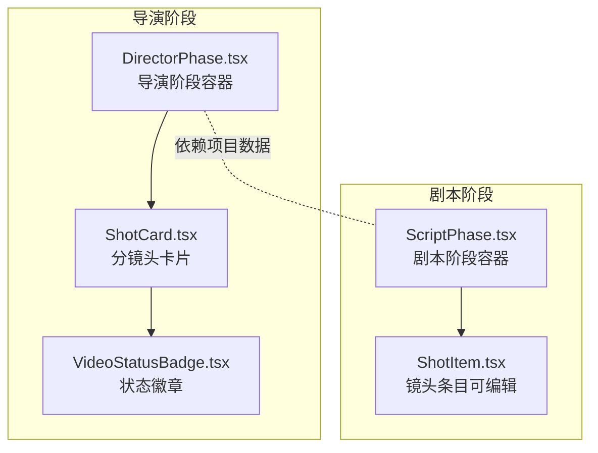
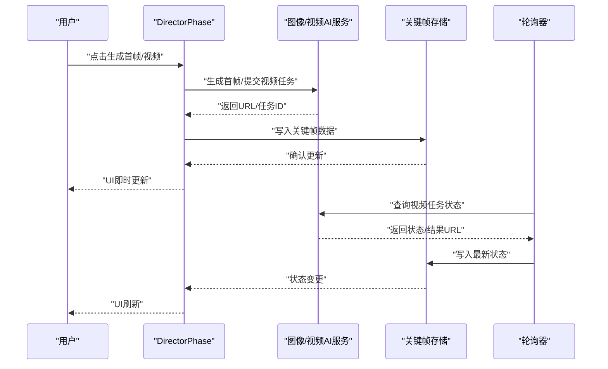
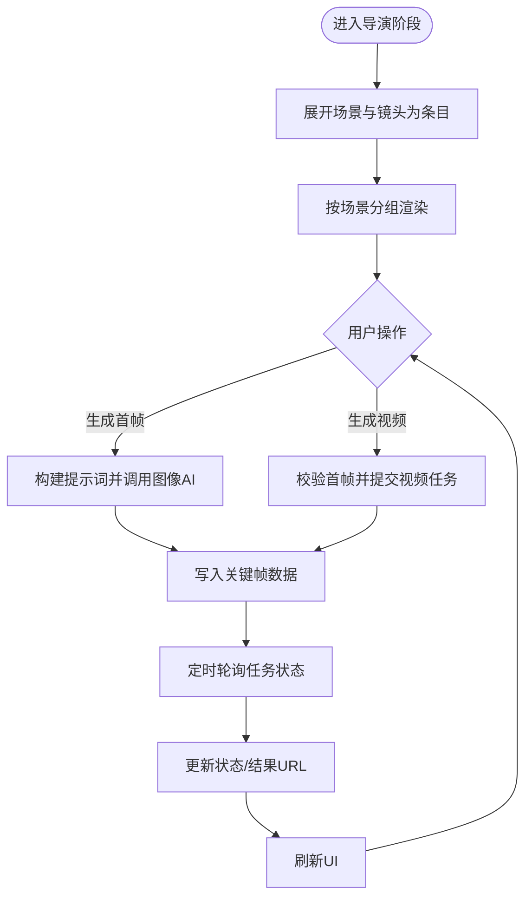
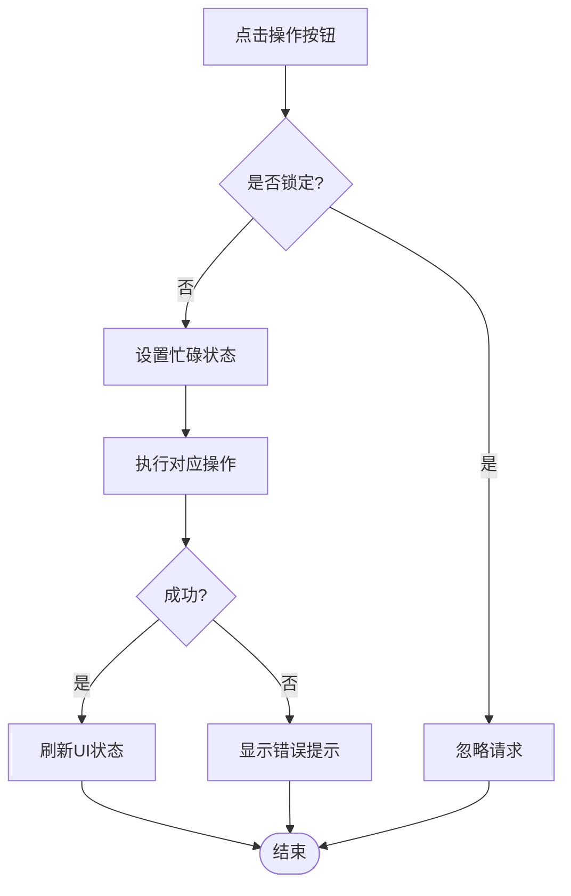
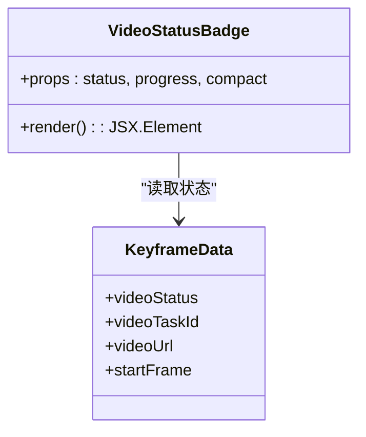
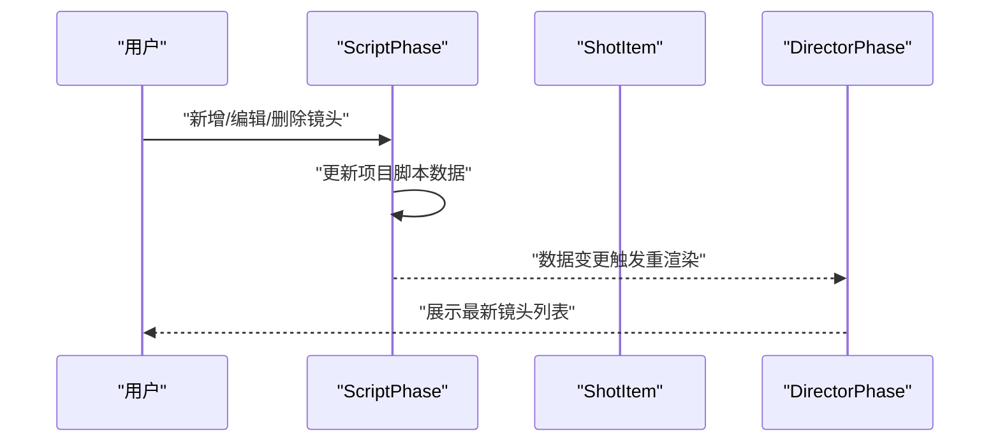
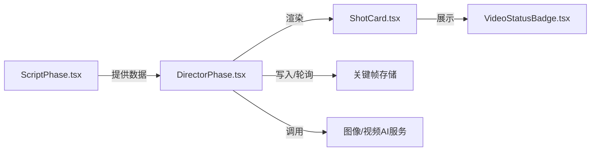

# 分镜头工作台

<cite>
**本文引用的文件**
- [DirectorPhase.tsx](file://src/phases/director/DirectorPhase.tsx)
- [ShotCard.tsx](file://src/phases/director/components/ShotCard.tsx)
- [VideoStatusBadge.tsx](file://src/phases/director/components/VideoStatusBadge.tsx)
- [ScriptPhase.tsx](file://src/phases/script/ScriptPhase.tsx)
- [ShotItem.tsx](file://src/phases/script/components/ShotItem.tsx)
</cite>

## 目录
1. [简介](#简介)
2. [项目结构](#项目结构)
3. [核心组件](#核心组件)
4. [架构总览](#架构总览)
5. [详细组件分析](#详细组件分析)
6. [依赖关系分析](#依赖关系分析)
7. [性能考量](#性能考量)
8. [故障排除指南](#故障排除指南)
9. [结论](#结论)
10. [附录](#附录)

## 简介
本文件面向“分镜头工作台”（导演工作台）的使用者与维护者，系统性阐述其整体布局、分镜头卡片的交互设计、编辑与状态管理、异步视频生成与轮询机制、以及与剧本阶段的协作关系。文档基于实际源码进行分析，提供可视化图示、最佳实践建议、性能优化策略与常见问题排查方法。

## 项目结构
导演工作台位于“导演阶段”（Phase 03），负责将剧本阶段产出的场景与镜头结构转化为可执行的拍摄清单，并通过图像/视频模型生成首帧与动态视频。其核心由以下模块构成：
- 导演阶段容器：负责统计、批量任务、轮询与场景分组渲染
- 分镜头卡片：展示镜头编号、场景上下文、首帧预览、状态徽章与操作按钮
- 状态徽章：统一渲染视频任务的四态（排队、渲染中、已完成、失败）
- 剧本阶段：提供镜头的增删改查与基础编辑能力

**图表来源**
- [DirectorPhase.tsx](file://src/phases/director/DirectorPhase.tsx)
- [ShotCard.tsx](file://src/phases/director/components/ShotCard.tsx)
- [VideoStatusBadge.tsx](file://src/phases/director/components/VideoStatusBadge.tsx)
- [ScriptPhase.tsx](file://src/phases/script/ScriptPhase.tsx)
- [ShotItem.tsx](file://src/phases/script/components/ShotItem.tsx)

**章节来源**
- [DirectorPhase.tsx](file://src/phases/director/DirectorPhase.tsx)
- [ShotCard.tsx](file://src/phases/director/components/ShotCard.tsx)
- [VideoStatusBadge.tsx](file://src/phases/director/components/VideoStatusBadge.tsx)
- [ScriptPhase.tsx](file://src/phases/script/ScriptPhase.tsx)
- [ShotItem.tsx](file://src/phases/script/components/ShotItem.tsx)

## 核心组件
- 导演阶段容器（DirectorPhase）
  - 将项目中的场景与镜头展开为“镜头条目”，用于渲染与控制
  - 提供批量生成首帧、单镜头生成首帧、提交视频任务、轮询视频状态等功能
  - 统计镜头总数、已生成首帧数、渲染中与已完成数量
- 分镜头卡片（ShotCard）
  - 展示镜头编号、场景索引、镜头索引、描述、首帧预览、状态徽章与操作区
  - 支持生成首帧、重绘首帧、生成视频、重新拍摄等操作
- 状态徽章（VideoStatusBadge）
  - 以颜色与图标编码视频任务状态，支持紧凑显示与进度提示
- 剧本阶段（ScriptPhase/ShotItem）
  - 提供镜头的新增、更新、删除与基础编辑能力，是导演工作台的数据来源

**章节来源**
- [DirectorPhase.tsx](file://src/phases/director/DirectorPhase.tsx)
- [ShotCard.tsx](file://src/phases/director/components/ShotCard.tsx)
- [VideoStatusBadge.tsx](file://src/phases/director/components/VideoStatusBadge.tsx)
- [ScriptPhase.tsx](file://src/phases/script/ScriptPhase.tsx)
- [ShotItem.tsx](file://src/phases/script/components/ShotItem.tsx)

## 架构总览
导演工作台采用“信息-反馈律”设计：镜头列表来自剧本结构的运行态实例；异步视频任务通过定时轮询将外部状态拉回到本地反馈环；用户操作（生成首帧/视频）即时反馈 UI，结果落库后供后续阶段读取。

**图表来源**
- [DirectorPhase.tsx](file://src/phases/director/DirectorPhase.tsx)

**章节来源**
- [DirectorPhase.tsx](file://src/phases/director/DirectorPhase.tsx)

## 详细组件分析

### 导演阶段容器（DirectorPhase）
- 数据派生与分组
  - 将项目脚本中的场景与镜头展平为“镜头条目”，并计算全局索引、场景内索引
  - 按场景分组渲染，便于在界面中组织与阅读
- 关键帧写入器
  - 通过稳定回调写入关键帧数据（首帧URL、视频任务ID、状态等）
- 首帧与视频任务
  - 生成首帧：构建提示词并调用图像AI，成功后写入首帧URL
  - 生成视频：校验首帧存在后提交任务，乐观标记为“排队/渲染中”
- 批量处理
  - 自动筛选未生成首帧的镜头，逐个生成并累积错误，保持流程连续
- 轮询机制
  - 定期查询所有处于“排队/渲染中”的任务，更新状态与结果URL
- 统计面板
  - 实时展示镜头总数、已生成首帧、渲染中、已完成数量
- 状态与提示
  - API Key缺失时禁用关键操作，并显示提示
  - 全局错误聚合显示，支持关闭

**图表来源**
- [DirectorPhase.tsx](file://src/phases/director/DirectorPhase.tsx)

**章节来源**
- [DirectorPhase.tsx](file://src/phases/director/DirectorPhase.tsx)

### 分镜头卡片（ShotCard）
- 视觉呈现
  - 顶部：镜头编号、场景/镜头索引、场景标题、状态徽章
  - 中部：首帧预览区域，支持嵌入式视频播放
  - 底部：描述文本与操作区（生成/重绘首帧、生成/重拍视频）
- 交互逻辑
  - 生成首帧/重绘首帧：根据是否已有首帧切换文案与样式
  - 生成视频/重拍视频：仅在首帧存在且非锁定状态下可用
  - 锁定机制：当视频任务处于排队/渲染中时，卡片被锁定防止重复提交
- 错误提示
  - 操作异常时弹出错误提示，支持手动关闭
- 动画与状态
  - 渲染中时显示扫描条动画
  - 已完成时为卡片添加强调边框

**图表来源**
- [ShotCard.tsx](file://src/phases/director/components/ShotCard.tsx)

**章节来源**
- [ShotCard.tsx](file://src/phases/director/components/ShotCard.tsx)

### 状态徽章（VideoStatusBadge）
- 状态编码
  - 排队（pending）、渲染中（processing）、已完成（completed）、失败（failed）
- 视觉设计
  - 不同状态使用不同颜色与图标，渲染中带脉冲动画
  - 支持紧凑模式与进度百分比显示
- 使用场景
  - 在卡片顶部与统计面板中统一展示任务状态

**图表来源**
- [VideoStatusBadge.tsx](file://src/phases/director/components/VideoStatusBadge.tsx)

**章节来源**
- [VideoStatusBadge.tsx](file://src/phases/director/components/VideoStatusBadge.tsx)

### 剧本阶段与镜头编辑（ScriptPhase/ShotItem）
- 镜头增删改查
  - 新增：为指定场景追加新镜头，默认持续时间与占位描述
  - 更新：对描述、景别、持续时间进行局部更新
  - 删除：移除指定镜头，联动场景列表
- 可编辑条目
  - 支持就地编辑描述、景别与持续时间，提供确认与取消
- 与导演工作台的关系
  - 导演工作台直接消费剧本阶段的场景/镜头结构，作为其输入数据源

**图表来源**
- [ScriptPhase.tsx](file://src/phases/script/ScriptPhase.tsx)
- [ShotItem.tsx](file://src/phases/script/components/ShotItem.tsx)

**章节来源**
- [ScriptPhase.tsx](file://src/phases/script/ScriptPhase.tsx)
- [ShotItem.tsx](file://src/phases/script/components/ShotItem.tsx)

## 依赖关系分析
- 组件耦合
  - DirectorPhase 依赖项目上下文与AI服务，负责状态写入与轮询
  - ShotCard 仅依赖传入的回调与关键帧数据，职责清晰
  - VideoStatusBadge 为纯展示组件，无副作用
  - ScriptPhase/ShotItem 与 DirectorPhase 通过项目数据解耦协作
- 外部依赖
  - 图像/视频AI服务接口（生成首帧、提交视频任务、查询状态）
  - 项目存储（关键帧数据的持久化）

**图表来源**
- [DirectorPhase.tsx](file://src/phases/director/DirectorPhase.tsx)
- [ShotCard.tsx](file://src/phases/director/components/ShotCard.tsx)
- [VideoStatusBadge.tsx](file://src/phases/director/components/VideoStatusBadge.tsx)
- [ScriptPhase.tsx](file://src/phases/script/ScriptPhase.tsx)

**章节来源**
- [DirectorPhase.tsx](file://src/phases/director/DirectorPhase.tsx)
- [ShotCard.tsx](file://src/phases/director/components/ShotCard.tsx)
- [VideoStatusBadge.tsx](file://src/phases/director/components/VideoStatusBadge.tsx)
- [ScriptPhase.tsx](file://src/phases/script/ScriptPhase.tsx)

## 性能考量
- 批量生成首帧
  - 串行逐个调用，避免并发过高导致资源争用；累积错误而不中断，保证整体进度可见
- 轮询策略
  - 固定周期轮询，对失败的查询容忍并继续下一次轮询，减少抖动
- UI响应
  - 乐观更新（提交视频任务后立即标记为排队/渲染中），提升感知速度
- 资源加载
  - 视频预览使用元数据预加载，避免全量下载
- 状态缓存
  - 使用引用持有最新项目与轮询函数，避免闭包导致的无效重渲染

**章节来源**
- [DirectorPhase.tsx](file://src/phases/director/DirectorPhase.tsx)

## 故障排除指南
- 无法生成首帧/视频
  - 检查是否已配置有效的API Key；若未配置，相关按钮会被禁用并显示提示
  - 若提示“请先生成首帧”，需先生成首帧后再提交视频任务
- 视频任务长时间处于排队/渲染中
  - 等待轮询自动更新；如网络异常，稍后会自动重试
  - 查看全局错误提示，必要时重试操作
- 卡片被锁定无法操作
  - 当前镜头正在排队或渲染中，或处于忙碌状态；等待状态变化后重试
- 首帧预览为空
  - 首帧尚未生成；点击“生成首帧”或“重绘首帧”后刷新
- 批量生成无反应
  - 若全部镜头已完成首帧，批量按钮会禁用；检查统计面板与镜头状态

**章节来源**
- [DirectorPhase.tsx](file://src/phases/director/DirectorPhase.tsx)
- [ShotCard.tsx](file://src/phases/director/components/ShotCard.tsx)

## 结论
导演工作台通过清晰的组件边界与稳定的轮询机制，实现了从剧本到拍摄的顺畅衔接。其以状态驱动的UI更新与错误容错策略，兼顾了易用性与可靠性。建议在大规模镜头场景下优先使用批量首帧生成与视频任务轮询，结合错误提示与统计面板，形成高效的工作流闭环。

## 附录
- 最佳实践
  - 先在剧本阶段完善镜头描述、景别与持续时间，再进入导演阶段生成首帧
  - 使用批量首帧生成快速补齐素材，随后集中提交视频任务
  - 关注渲染中状态，合理安排后续剪辑与合成工作
- 用户体验设计要点
  - 明确的状态徽章与颜色编码，帮助快速识别任务状态
  - 乐观更新与扫描动画增强反馈感
  - 错误提示简洁明确，支持一键关闭