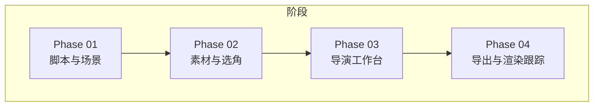
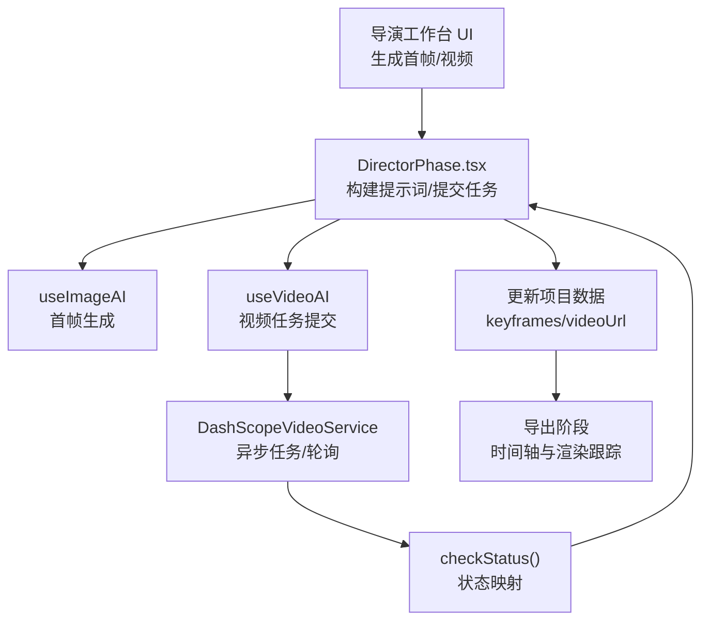
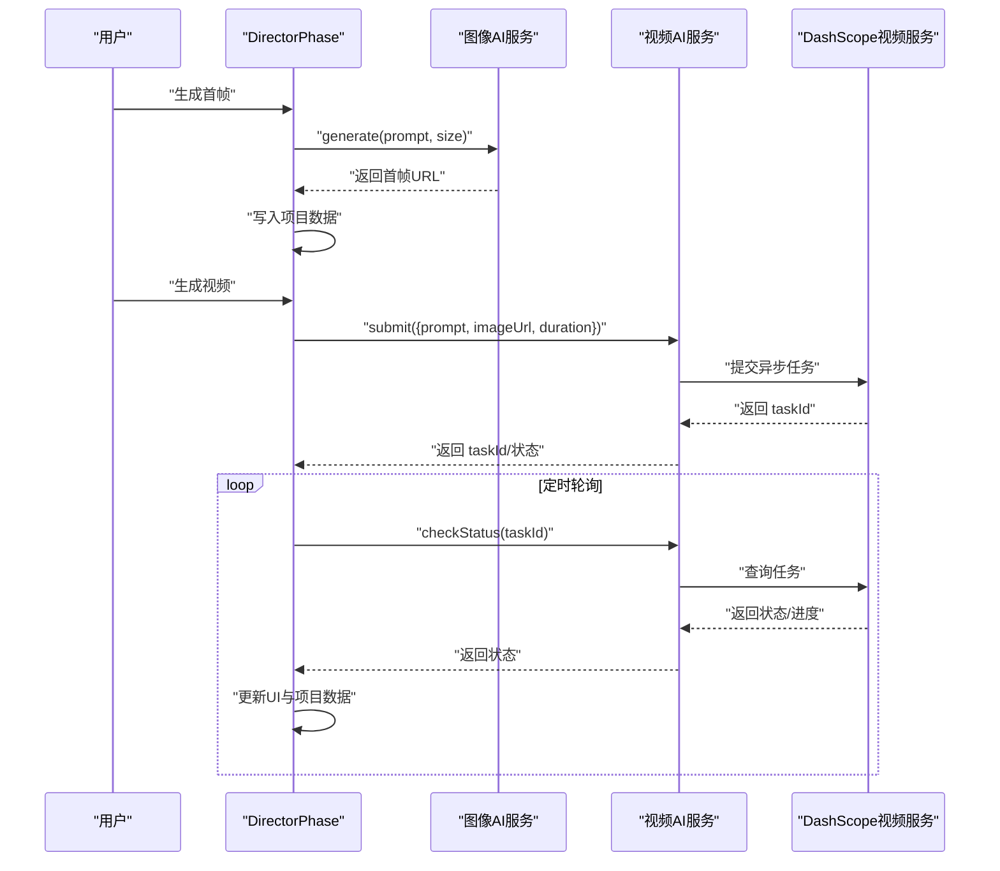
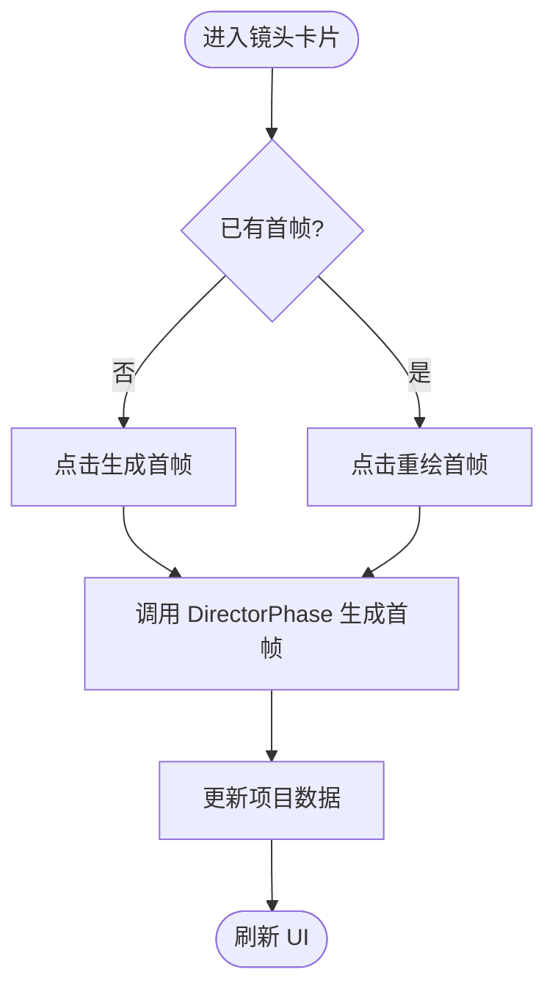
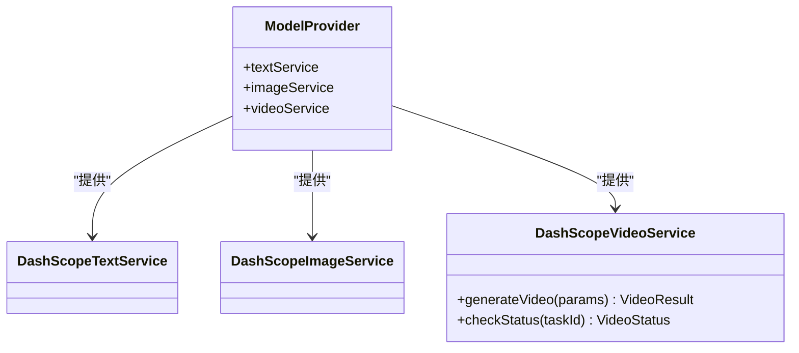
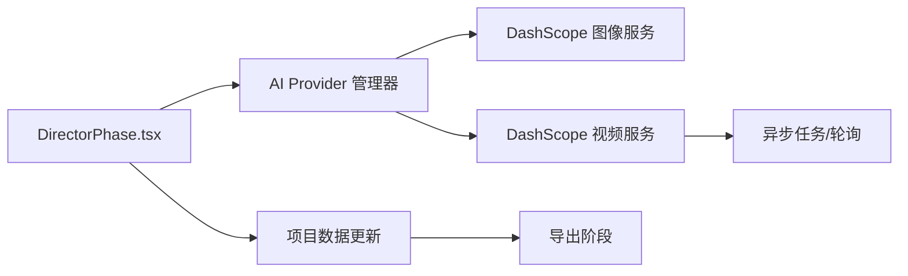

# 视频生成系统

<cite>
**本文引用的文件**
- [src/phases/director/DirectorPhase.tsx](file://src/phases/director/DirectorPhase.tsx)
- [src/phases/director/components/ShotCard.tsx](file://src/phases/director/components/ShotCard.tsx)
- [src/services/ai/dashscope.ts](file://src/services/ai/dashscope.ts)
- [src/services/ai/index.ts](file://src/services/ai/index.ts)
- [src/services/workflow/engine.ts](file://src/services/workflow/engine.ts)
- [README_EN.md](file://README_EN.md)
</cite>

## 目录
1. [简介](#简介)
2. [项目结构](#项目结构)
3. [核心组件](#核心组件)
4. [架构总览](#架构总览)
5. [详细组件分析](#详细组件分析)
6. [依赖关系分析](#依赖关系分析)
7. [性能考虑](#性能考虑)
8. [故障排除指南](#故障排除指南)
9. [结论](#结论)
10. [附录](#附录)

## 简介
本文件面向视频生成系统，聚焦于“导演工作台”阶段的端到端工作流：从剧本镜头到首帧生成、再到视频异步生成与轮询、最终进入导出阶段。文档覆盖以下主题：
- 视频生成工作流程与阶段职责
- 相机运动指导原则与提示词增强策略
- 视频合成与关键帧插值的实现思路
- 参数配置、模型选择策略与质量控制机制
- 关键帧到视频的插值算法、运动强度调节与视频时长管理
- 性能优化、错误处理策略与与AI视频模型的集成
- 制作技巧、创意指导与故障排除方法

## 项目结构
系统采用分阶段的创作管线：
- Phase 01：脚本与场景分解，生成镜头清单
- Phase 02：素材与选角，建立角色与场景一致性
- Phase 03：导演工作台，生成首帧与视频任务
- Phase 04：导出与渲染跟踪，时间轴可视化与资产导出

章节来源
- [README_EN.md: 56-80:56-80](file://README_EN.md#L56-L80)

## 核心组件
- 导演工作台主界面负责组织镜头网格、批量生成首帧、提交视频任务、轮询任务状态与展示结果。
- AI Provider管理器集中封装DashScope（阿里云）的文本、图像与视频服务能力，提供统一接口与错误码。
- 工作流引擎用于阶段状态评估，确保导演阶段至少完成一个视频生成以进入下一阶段。

章节来源
- [src/phases/director/DirectorPhase.tsx: 62-495:62-495](file://src/phases/director/DirectorPhase.tsx#L62-L495)
- [src/services/ai/index.ts: 24-33:24-33](file://src/services/ai/index.ts#L24-L33)
- [src/services/workflow/engine.ts: 56-72:56-72](file://src/services/workflow/engine.ts#L56-L72)

## 架构总览
系统采用“控制论反馈闭环”设计：用户在导演工作台发起操作（生成首帧/视频），系统通过AI Provider提交异步任务；通过定时轮询将外部状态拉回本地，更新UI与项目数据，形成闭环。

图表来源
- [src/phases/director/DirectorPhase.tsx: 62-200:62-200](file://src/phases/director/DirectorPhase.tsx#L62-L200)
- [src/services/ai/dashscope.ts: 258-315:258-315](file://src/services/ai/dashscope.ts#L258-L315)

## 详细组件分析

### 组件一：导演工作台（DirectorPhase）
职责与流程
- 将项目中的场景与镜头展开为“镜头条目”，用于网格化展示与批处理。
- 构建增强提示词（包含镜头描述、景别、灯光风格、角色外观、场景设定等），用于首帧与视频生成。
- 支持批量生成首帧与单镜头视频提交；提交后乐观标记为“待处理”，随后轮询任务状态。
- 提供全局错误聚合，避免单个镜头失败阻断整体流程。

关键交互
- 首帧生成：调用图像AI服务，产出首帧URL并写入项目数据。
- 视频提交：调用视频AI服务，返回任务ID与初始状态，随后由轮询驱动状态更新。
- 轮询机制：固定间隔查询任务状态，映射为“待处理/处理中/已完成/失败”。

图表来源
- [src/phases/director/DirectorPhase.tsx: 111-200:111-200](file://src/phases/director/DirectorPhase.tsx#L111-L200)
- [src/services/ai/dashscope.ts: 258-315:258-315](file://src/services/ai/dashscope.ts#L258-L315)

章节来源
- [src/phases/director/DirectorPhase.tsx: 39-60:39-60](file://src/phases/director/DirectorPhase.tsx#L39-L60)
- [src/phases/director/DirectorPhase.tsx: 111-159:111-159](file://src/phases/director/DirectorPhase.tsx#L111-L159)
- [src/phases/director/DirectorPhase.tsx: 191-200:191-200](file://src/phases/director/DirectorPhase.tsx#L191-L200)

### 组件二：镜头卡片（ShotCard）
职责与流程
- 展示镜头编号、描述、首帧预览与视频状态徽标。
- 提供“生成首帧/重绘首帧”“生成视频”等操作按钮，禁用锁定态（待处理/处理中）。
- 错误弹窗与错误状态聚合，便于定位问题。

图表来源
- [src/phases/director/components/ShotCard.tsx: 22-40:22-40](file://src/phases/director/components/ShotCard.tsx#L22-L40)
- [src/phases/director/components/ShotCard.tsx: 208-230:208-230](file://src/phases/director/components/ShotCard.tsx#L208-L230)

章节来源
- [src/phases/director/components/ShotCard.tsx: 1-230:1-230](file://src/phases/director/components/ShotCard.tsx#L1-L230)

### 组件三：AI Provider与DashScope视频服务
职责与流程
- Provider工厂创建统一的文本/图像/视频服务实例，当前默认DashScope。
- 视频服务提交异步任务，返回任务ID；调用方可自行轮询或使用内置等待方法。
- 任务状态映射：PENDING/RUNNING/SUCCEEDED映射为pending/processing/completed；FAILED/CANCELED/UNKNOWN映射为failed。
- 超时与重试：统一轮询间隔与最大等待时间，失败时抛出带业务码的错误对象。

图表来源
- [src/services/ai/dashscope.ts: 258-315:258-315](file://src/services/ai/dashscope.ts#L258-L315)
- [src/services/ai/index.ts: 318-326:318-326](file://src/services/ai/index.ts#L318-L326)

章节来源
- [src/services/ai/dashscope.ts: 141-217:141-217](file://src/services/ai/dashscope.ts#L141-L217)
- [src/services/ai/dashscope.ts: 258-315:258-315](file://src/services/ai/dashscope.ts#L258-L315)
- [src/services/ai/index.ts: 24-33:24-33](file://src/services/ai/index.ts#L24-L33)

### 组件四：工作流引擎（阶段状态评估）
职责与流程
- 对导演阶段进行“是否完成”的评估：要求至少存在一个已生成视频的镜头。
- 返回完成度百分比与缺失项提示，用于引导用户补齐内容。

章节来源
- [src/services/workflow/engine.ts: 56-72:56-72](file://src/services/workflow/engine.ts#L56-L72)

## 依赖关系分析
- 导演工作台依赖AI Provider（DashScope）提供的图像与视频服务。
- 视频服务依赖统一的异步任务提交与轮询机制。
- 导出阶段依赖导演阶段生成的视频URL与关键帧数据。

图表来源
- [src/phases/director/DirectorPhase.tsx: 62-200:62-200](file://src/phases/director/DirectorPhase.tsx#L62-L200)
- [src/services/ai/index.ts: 24-33:24-33](file://src/services/ai/index.ts#L24-L33)
- [src/services/ai/dashscope.ts: 258-315:258-315](file://src/services/ai/dashscope.ts#L258-L315)

章节来源
- [src/phases/director/DirectorPhase.tsx: 62-200:62-200](file://src/phases/director/DirectorPhase.tsx#L62-L200)
- [src/services/ai/index.ts: 24-33:24-33](file://src/services/ai/index.ts#L24-L33)
- [src/services/ai/dashscope.ts: 258-315:258-315](file://src/services/ai/dashscope.ts#L258-L315)

## 性能考虑
- 批量生成首帧：对未生成首帧的镜头进行顺序批量生成，聚合错误但不中断，提高吞吐。
- 轮询节流：固定轮询间隔与最大等待时间，避免频繁请求与资源浪费。
- 乐观更新：视频提交后立即标记为“待处理”，改善用户感知。
- 资源尺寸与分辨率：首帧生成采用固定分辨率，减少后续视频生成的计算压力。
- 失败重试：统一的重试退避策略，降低瞬时错误对整体流程的影响。

章节来源
- [src/phases/director/DirectorPhase.tsx: 162-189:162-189](file://src/phases/director/DirectorPhase.tsx#L162-L189)
- [src/services/ai/dashscope.ts: 29-32:29-32](file://src/services/ai/dashscope.ts#L29-L32)
- [src/services/ai/dashscope.ts: 201-216:201-216](file://src/services/ai/dashscope.ts#L201-L216)

## 故障排除指南
常见问题与对策
- API Key未配置：在“模型配置”中设置DashScope API Key，否则无法提交任务。
- 首帧未生成：必须先生成首帧再提交视频任务。
- 任务失败：查看错误码与消息，确认提示词、时长、比例等参数是否符合模型约束。
- 任务超时：检查网络与服务商负载，必要时缩短时长或调整分辨率。
- 全局错误聚合：批处理过程中出现部分失败会被记录，可在UI中查看并重试。

章节来源
- [src/phases/director/DirectorPhase.tsx: 114-116:114-116](file://src/phases/director/DirectorPhase.tsx#L114-L116)
- [src/phases/director/DirectorPhase.tsx: 134-137:134-137](file://src/phases/director/DirectorPhase.tsx#L134-L137)
- [src/services/ai/dashscope.ts: 47-51:47-51](file://src/services/ai/dashscope.ts#L47-L51)
- [src/services/ai/dashscope.ts: 207-216:207-216](file://src/services/ai/dashscope.ts#L207-L216)

## 结论
该视频生成系统围绕“导演工作台”实现了从镜头到视频的闭环：通过增强提示词与首帧生成奠定视觉一致性，借助DashScope异步视频服务实现高质量输出，并以轮询与乐观更新保障用户体验。建议在实际使用中结合提示词工程、时长与比例策略，配合批处理与错误聚合，获得稳定高效的视频生产体验。

## 附录

### 相机运动指导原则与提示词增强
- 景别与镜头语言：在提示词中明确景别（如中景/近景/特写），有助于模型理解运动范围与构图。
- 灯光与风格：加入“电影感灯光/动漫风格/高质量”等描述，提升画面一致性。
- 角色与场景：在提示词中融入角色外观与场景设定，减少跨镜头漂移。
- 参考来源：首帧作为严格一致的起始帧，可视为“关键帧”，后续视频生成基于此进行时序扩展。

章节来源
- [src/phases/director/DirectorPhase.tsx: 39-60:39-60](file://src/phases/director/DirectorPhase.tsx#L39-L60)

### 视频合成与关键帧插值实现思路
- 单图到视频：以首帧为起始帧，模型根据提示词与时长生成连续帧序列。
- 起止关键帧插值：若定义结束帧，可作为约束边界，模型在两者之间进行插值，控制运动强度与节奏。
- 运动强度调节：通过提示词描述动作幅度、速度与方向，结合时长与比例共同影响运动表现。
- 视频时长管理：合理设置时长，避免过短导致动作不完整、过长导致模型负担与质量下降。

章节来源
- [README_EN.md: 62-71:62-71](file://README_EN.md#L62-L71)
- [src/services/ai/dashscope.ts: 258-273:258-273](file://src/services/ai/dashscope.ts#L258-L273)

### 参数配置与模型选择策略
- Provider选择：当前默认DashScope，具备文本、图像、视频服务能力；未来可扩展多Provider切换。
- 视频参数：提示词、首帧URL、时长、宽高比等；时长与比例需与目标平台一致。
- 质量控制：通过首帧一致性与提示词增强，减少抖动与变形；失败时重试与错误码辅助定位。

章节来源
- [src/services/ai/index.ts: 318-326:318-326](file://src/services/ai/index.ts#L318-L326)
- [src/services/ai/dashscope.ts: 258-273:258-273](file://src/services/ai/dashscope.ts#L258-L273)