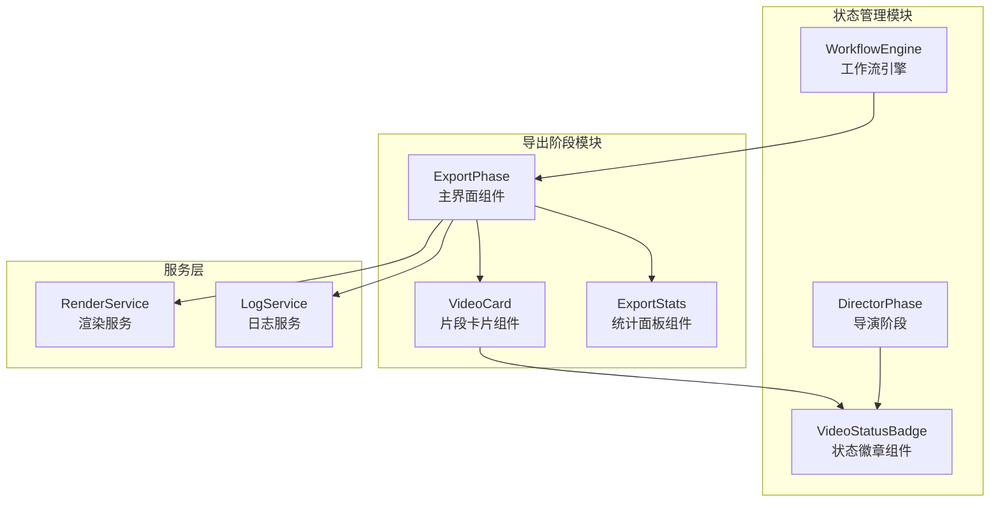
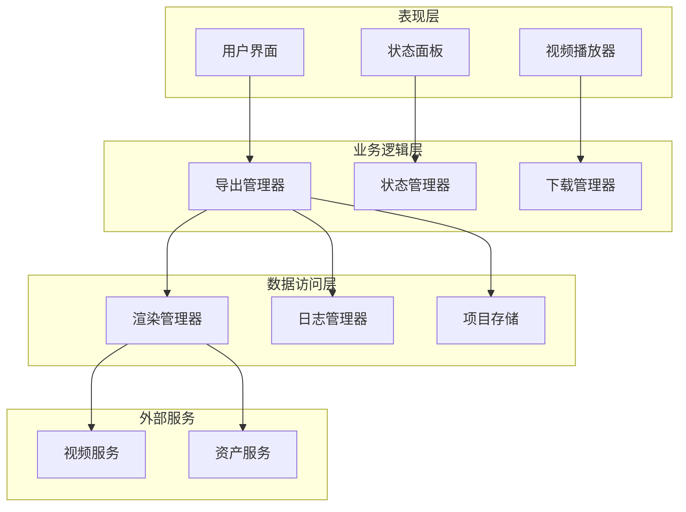
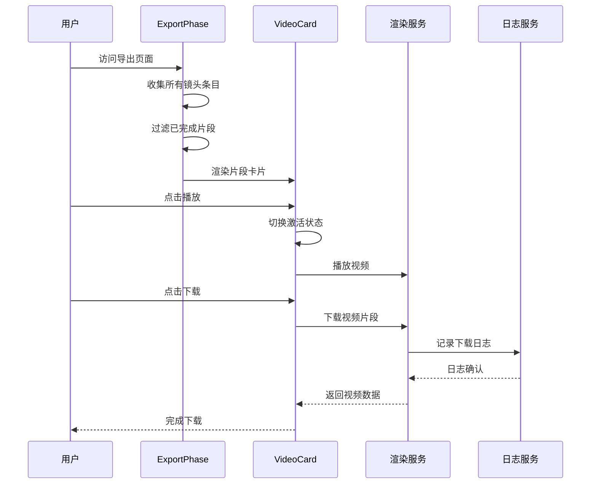
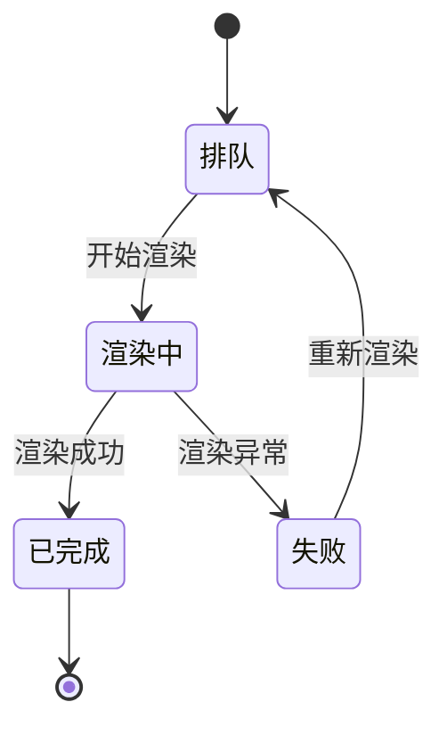
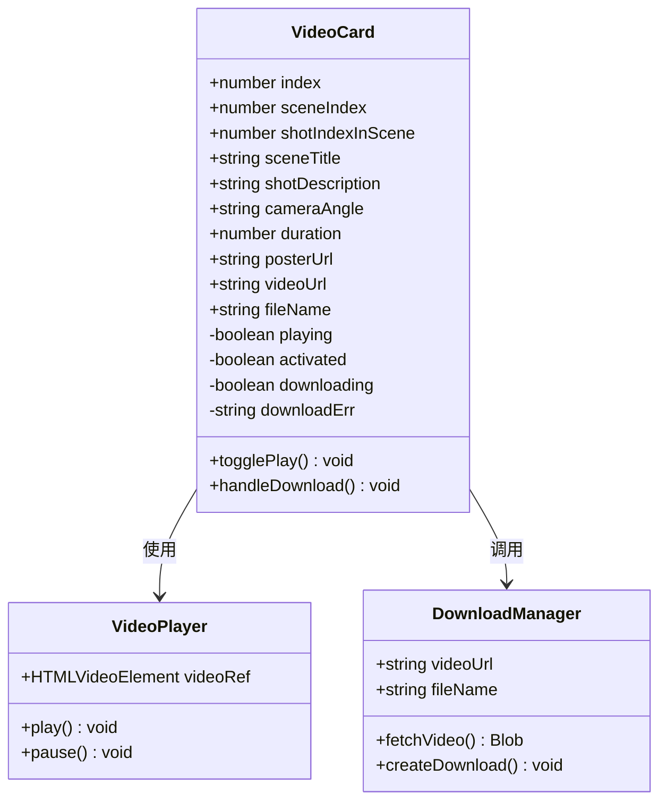
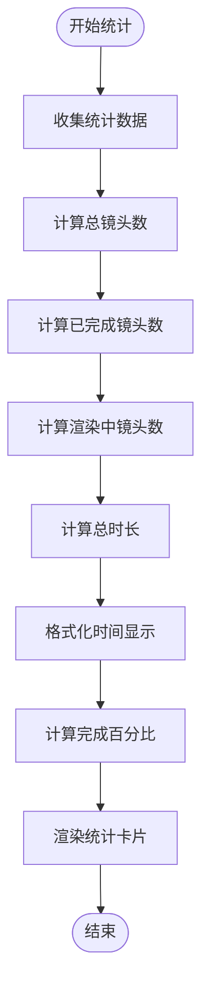
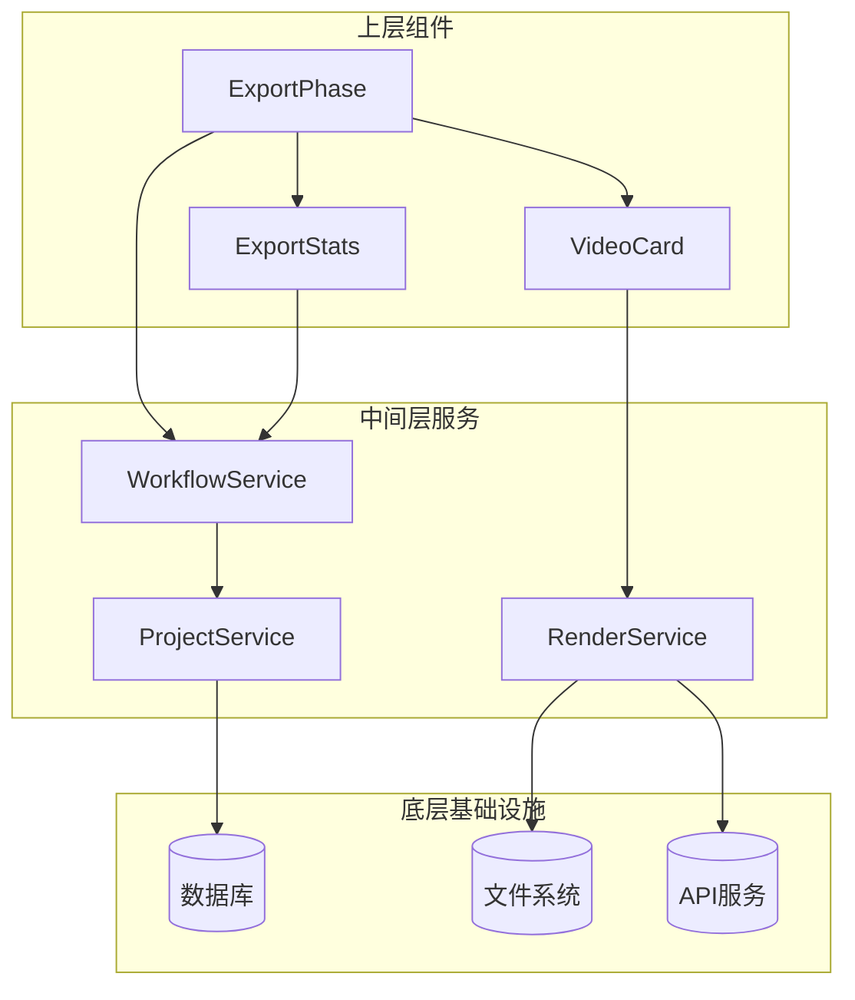
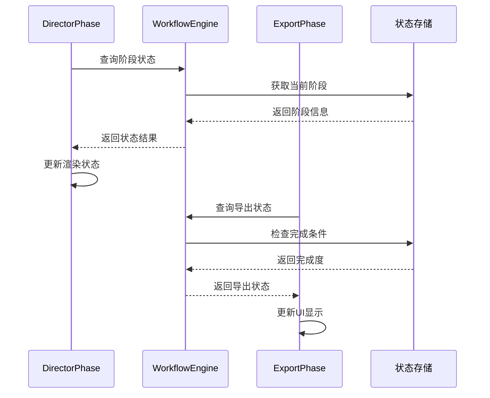
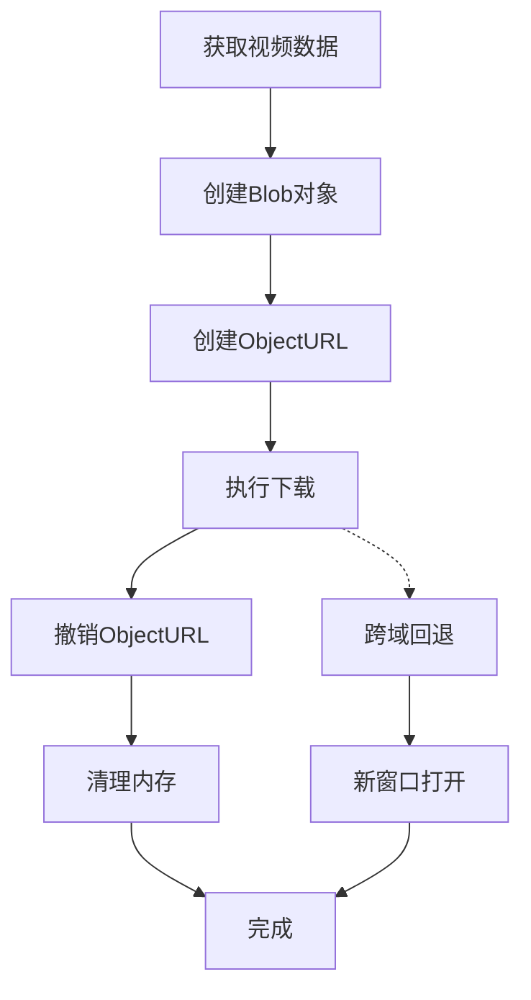

# StageExport导出系统

<cite>
**本文档引用的文件**
- [ExportPhase.tsx](file://src/phases/export/ExportPhase.tsx)
- [VideoCard.tsx](file://src/phases/export/components/VideoCard.tsx)
- [ExportStats.tsx](file://src/phases/export/components/ExportStats.tsx)
- [VideoStatusBadge.tsx](file://src/phases/director/components/VideoStatusBadge.tsx)
- [DirectorPhase.tsx](file://src/phases/director/DirectorPhase.tsx)
- [engine.ts](file://src/services/workflow/engine.ts)
</cite>

## 目录
1. [简介](#简介)
2. [项目结构](#项目结构)
3. [核心组件](#核心组件)
4. [架构概览](#架构概览)
5. [详细组件分析](#详细组件分析)
6. [依赖关系分析](#依赖关系分析)
7. [性能考虑](#性能考虑)
8. [故障排除指南](#故障排除指南)
9. [结论](#结论)
10. [附录](#附录)

## 简介

StageExport导出系统是AI短剧制作工作流中的关键环节，负责将已完成的视频片段进行统一管理和导出。该系统采用控制论"信息-反馈律"设计原则，确保渲染状态的准确反馈和用户界面的实时响应。

系统主要功能包括：
- 视频渲染状态管理与实时监控
- 导出选项配置与质量控制
- 片段档案管理与批量下载
- 渲染日志记录与分析
- 视频播放器模态框功能
- 时间线可视化工具集成

## 项目结构

StageExport导出系统位于项目的阶段化组件架构中，采用模块化设计：

**图表来源**
- [ExportPhase.tsx:1-409](file://src/phases/export/ExportPhase.tsx#L1-L409)
- [VideoCard.tsx:1-285](file://src/phases/export/components/VideoCard.tsx#L1-L285)
- [ExportStats.tsx:1-146](file://src/phases/export/components/ExportStats.tsx#L1-L146)

**章节来源**
- [ExportPhase.tsx:1-409](file://src/phases/export/ExportPhase.tsx#L1-L409)
- [VideoCard.tsx:1-285](file://src/phases/export/components/VideoCard.tsx#L1-L285)
- [ExportStats.tsx:1-146](file://src/phases/export/components/ExportStats.tsx#L1-L146)

## 核心组件

### 导出主界面组件

ExportPhase作为导出阶段的主控制器，负责协调整个导出流程。该组件实现了控制论"信息-反馈律"原则，仅展示已完成状态的视频片段。

核心功能特性：
- **状态过滤**：只显示videoStatus为'completed'且videoUrl存在的片段
- **独立导出**：单片段下载与项目数据导出互不阻塞
- **数据保护**：项目导出仅包含文本/元数据，不嵌入二进制内容

### 片段卡片组件

VideoCard组件提供每个视频片段的完整管理界面，支持内嵌播放和直接下载功能。

主要功能：
- **内嵌播放器**：支持视频预览和播放控制
- **批量下载**：支持单个片段的MP4格式下载
- **跨域处理**：智能处理跨域下载失败的情况

### 统计面板组件

ExportStats组件提供实时的导出进度统计和状态监控。

统计指标：
- 总镜头数/已完成镜头数
- 渲染中/待渲染数量
- 预估总时长
- 完成度百分比

**章节来源**
- [ExportPhase.tsx:82-409](file://src/phases/export/ExportPhase.tsx#L82-L409)
- [VideoCard.tsx:23-285](file://src/phases/export/components/VideoCard.tsx#L23-L285)
- [ExportStats.tsx:23-146](file://src/phases/export/components/ExportStats.tsx#L23-L146)

## 架构概览

系统采用分层架构设计，确保各组件职责清晰分离：

**图表来源**
- [ExportPhase.tsx:82-409](file://src/phases/export/ExportPhase.tsx#L82-L409)
- [engine.ts:83-119](file://src/services/workflow/engine.ts#L83-L119)

系统架构特点：
- **解耦设计**：各组件通过明确的接口交互
- **状态同步**：通过工作流引擎实现状态一致性
- **异步处理**：渲染和下载采用异步模式避免阻塞

## 详细组件分析

### 导出主界面组件深度解析

ExportPhase组件实现了完整的导出工作流控制：

**图表来源**
- [ExportPhase.tsx:82-409](file://src/phases/export/ExportPhase.tsx#L82-L409)
- [VideoCard.tsx:58-92](file://src/phases/export/components/VideoCard.tsx#L58-L92)

#### 状态管理机制

系统采用四态状态管理模型：
- **pending**：排队等待渲染
- **processing**：正在渲染中
- **completed**：渲染完成
- **failed**：渲染失败

**图表来源**
- [VideoStatusBadge.tsx:11-44](file://src/phases/director/components/VideoStatusBadge.tsx#L11-L44)

#### 文件命名策略

系统采用标准化的文件命名规范：
- 格式：`项目名_sceneXX_shotYY.mp4`
- 场景编号：两位数字前缀补零
- 镜头编号：两位数字前缀补零
- 字符安全：自动过滤非法字符

**章节来源**
- [ExportPhase.tsx:31-47](file://src/phases/export/ExportPhase.tsx#L31-L47)
- [ExportPhase.tsx:132-154](file://src/phases/export/ExportPhase.tsx#L132-L154)

### 片段卡片组件详细分析

VideoCard组件提供了完整的视频片段管理功能：

**图表来源**
- [VideoCard.tsx:10-40](file://src/phases/export/components/VideoCard.tsx#L10-L40)

#### 播放器功能特性

内嵌播放器支持以下功能：
- **自动播放**：激活后自动开始播放
- **播放控制**：支持播放/暂停切换
- **进度指示**：实时显示播放状态
- **封面支持**：支持起始帧作为封面

#### 下载机制设计

下载功能采用双路径策略：
1. **直接下载**：通过fetch API获取Blob数据
2. **跨域回退**：无法直接下载时使用新窗口打开

**章节来源**
- [VideoCard.tsx:41-92](file://src/phases/export/components/VideoCard.tsx#L41-L92)

### 统计面板组件分析

ExportStats组件提供全面的导出进度监控：

**图表来源**
- [ExportStats.tsx:15-32](file://src/phases/export/components/ExportStats.tsx#L15-L32)

#### 实时监控功能

统计面板提供以下实时监控能力：
- **进度条动画**：完成度百分比的平滑过渡
- **状态颜色编码**：不同状态使用不同的视觉标识
- **动态更新**：基于项目状态变化自动刷新

**章节来源**
- [ExportStats.tsx:23-87](file://src/phases/export/components/ExportStats.tsx#L23-L87)

## 依赖关系分析

系统组件间的依赖关系体现了清晰的分层架构：

**图表来源**
- [engine.ts:83-119](file://src/services/workflow/engine.ts#L83-L119)
- [DirectorPhase.tsx:202-238](file://src/phases/director/DirectorPhase.tsx#L202-L238)

### 状态同步机制

系统通过工作流引擎实现多阶段状态同步：

**图表来源**
- [engine.ts:97-104](file://src/services/workflow/engine.ts#L97-L104)

**章节来源**
- [engine.ts:74-119](file://src/services/workflow/engine.ts#L74-L119)
- [DirectorPhase.tsx:202-238](file://src/phases/director/DirectorPhase.tsx#L202-L238)

## 性能考虑

### 渲染队列管理

系统采用异步渲染队列管理策略：
- **并行处理**：多个渲染任务可以同时进行
- **错误隔离**：单个任务失败不影响其他任务
- **资源控制**：限制同时进行的渲染任务数量

### 内存管理优化

**图表来源**
- [VideoCard.tsx:63-92](file://src/phases/export/components/VideoCard.tsx#L63-L92)

### 性能优化策略

1. **懒加载机制**：仅在需要时激活视频播放器
2. **缓存策略**：合理使用URL.revokeObjectURL避免内存泄漏
3. **并发控制**：限制同时进行的下载操作数量
4. **错误处理**：优雅处理网络异常和跨域问题

## 故障排除指南

### 常见问题及解决方案

#### 渲染状态异常

**问题现象**：视频状态长时间停留在"渲染中"

**诊断步骤**：
1. 检查工作流引擎状态查询
2. 验证渲染服务连接状态
3. 查看日志服务错误记录

**解决方案**：
- 重启渲染服务
- 清理缓存数据
- 检查网络连接

#### 下载失败处理

**问题现象**：视频下载返回跨域错误

**处理策略**：
- 使用跨域回退方案
- 检查CORS配置
- 验证服务器权限设置

#### 内存泄漏防护

**预防措施**：
- 及时调用URL.revokeObjectURL
- 监控内存使用情况
- 实施超时机制

**章节来源**
- [VideoCard.tsx:76-92](file://src/phases/export/components/VideoCard.tsx#L76-L92)

## 结论

StageExport导出系统通过精心设计的架构实现了高效的视频导出管理。系统的核心优势包括：

1. **实时状态反馈**：通过工作流引擎实现多阶段状态同步
2. **用户友好界面**：直观的状态面板和操作按钮设计
3. **可靠的质量控制**：完善的错误处理和重试机制
4. **高性能性能**：异步处理和内存优化策略

该系统为AI短剧制作提供了完整的导出解决方案，支持从单片段下载到项目级数据导出的多种使用场景。

## 附录

### 操作流程指南

#### 基本导出流程
1. 在导演阶段完成视频渲染
2. 进入导出阶段查看完成状态
3. 选择需要的片段进行下载
4. 导出项目数据进行备份

#### 高级配置选项
- **质量设置**：根据需求调整输出质量
- **格式选择**：支持多种视频格式
- **批量操作**：支持多片段同时处理

### 质量保证策略

1. **状态验证**：确保只有完成的片段才可导出
2. **完整性检查**：验证导出文件的完整性
3. **性能监控**：持续监控系统性能指标
4. **错误日志**：详细记录和分析错误信息