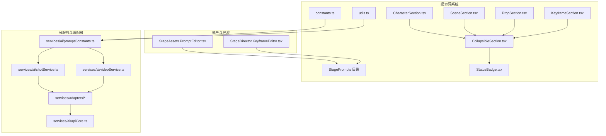
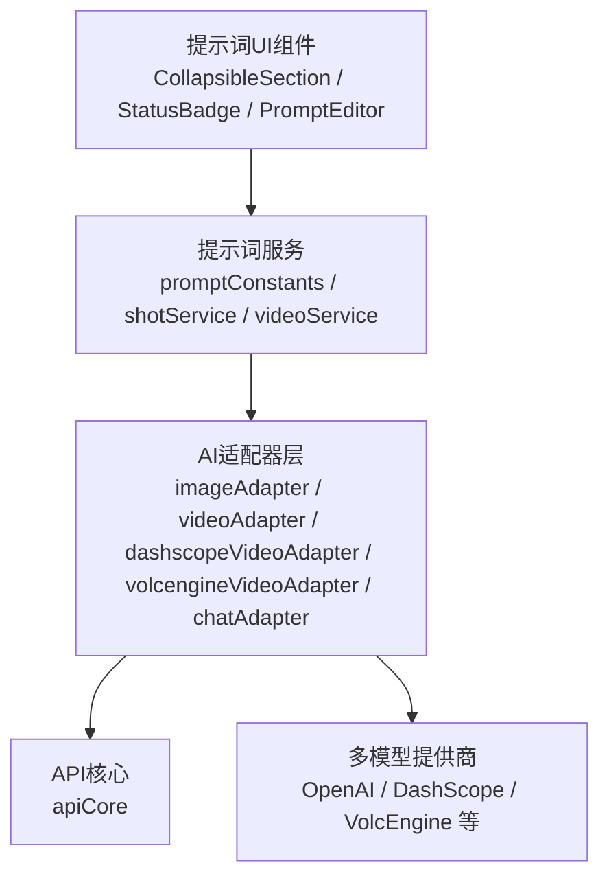
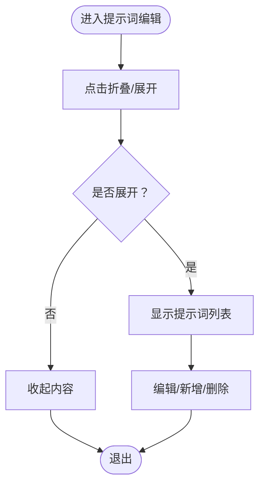
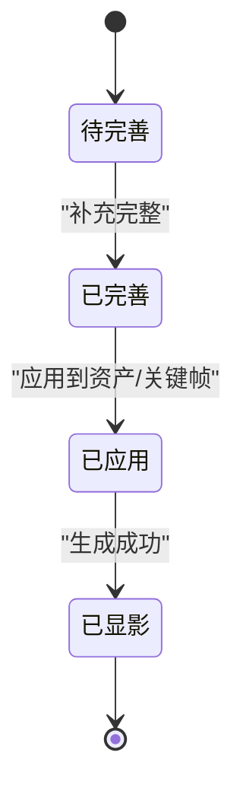
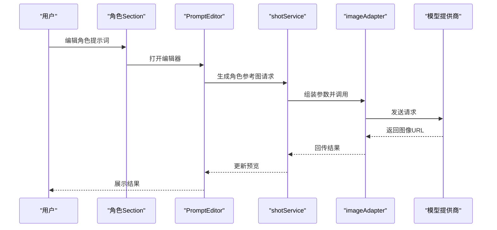
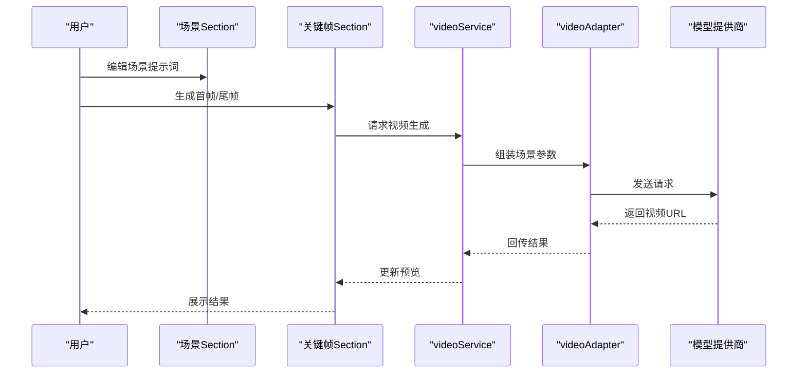
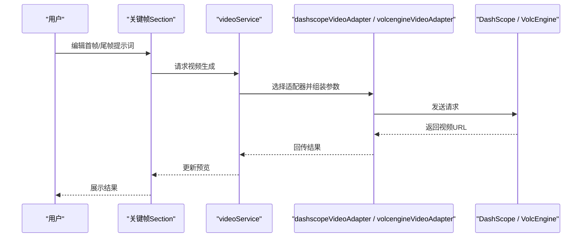
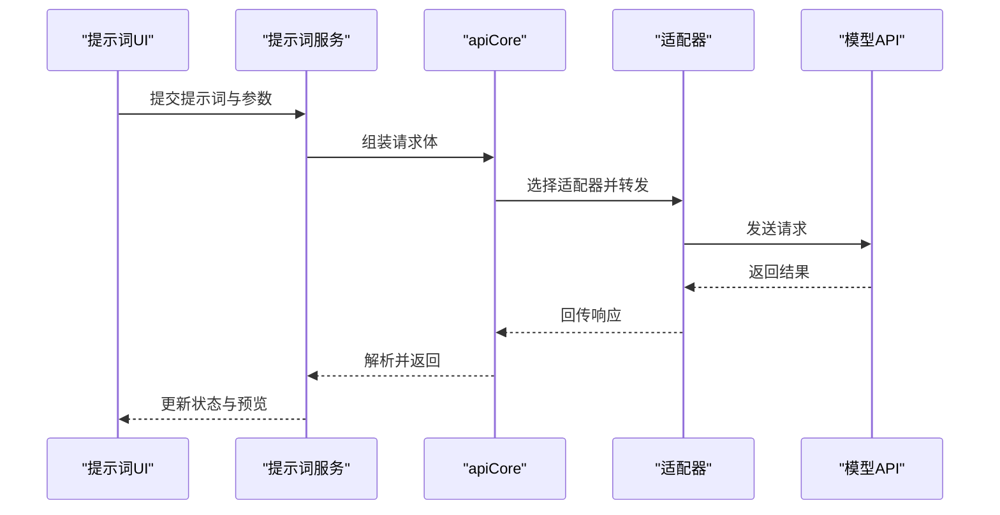
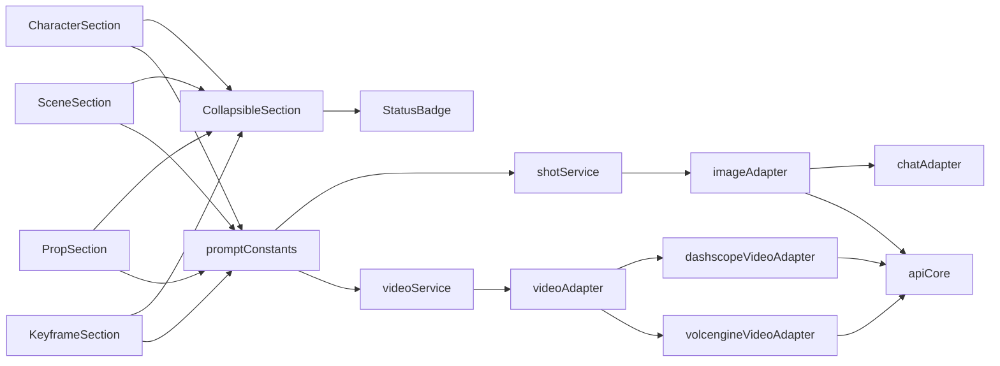

# StagePrompts提示词系统

<cite>
**本文引用的文件**
- [README.md](file://README.md)
- [StagePrompts 目录](file://components/StagePrompts)
- [PromptEditor.tsx](file://components/StageAssets/PromptEditor.tsx)
- [CollapsibleSection.tsx](file://components/StagePrompts/CollapsibleSection.tsx)
- [StatusBadge.tsx](file://components/StagePrompts/StatusBadge.tsx)
- [CharacterSection.tsx](file://components/StagePrompts/CharacterSection.tsx)
- [SceneSection.tsx](file://components/StagePrompts/SceneSection.tsx)
- [PropSection.tsx](file://components/StagePrompts/PropSection.tsx)
- [KeyframeSection.tsx](file://components/StagePrompts/KeyframeSection.tsx)
- [constants.ts](file://components/StagePrompts/constants.ts)
- [utils.ts](file://components/StagePrompts/utils.ts)
- [promptConstants.ts](file://services/ai/promptConstants.ts)
- [shotService.ts](file://services/ai/shotService.ts)
- [videoService.ts](file://services/ai/videoService.ts)
- [imageAdapter.ts](file://services/adapters/imageAdapter.ts)
- [videoAdapter.ts](file://services/adapters/videoAdapter.ts)
- [dashscopeVideoAdapter.ts](file://services/adapters/dashscopeVideoAdapter.ts)
- [volcengineVideoAdapter.ts](file://services/adapters/volcengineVideoAdapter.ts)
- [chatAdapter.ts](file://services/adapters/chatAdapter.ts)
- [apiCore.ts](file://services/ai/apiCore.ts)
- [SceneCard.tsx](file://src/phases/script/components/SceneCard.tsx)
- [SceneAssetCard.tsx](file://src/phases/assets/components/SceneAssetCard.tsx)
- [VideoCard.tsx](file://src/phases/export/components/VideoCard.tsx)
</cite>

## 目录
1. [简介](#简介)
2. [项目结构](#项目结构)
3. [核心组件](#核心组件)
4. [架构总览](#架构总览)
5. [详细组件分析](#详细组件分析)
6. [依赖关系分析](#依赖关系分析)
7. [性能考量](#性能考量)
8. [故障排查指南](#故障排查指南)
9. [结论](#结论)
10. [附录](#附录)

## 简介
StagePrompts提示词系统是“AI短剧/漫剧生成平台”的关键组成部分，围绕“小说→剧本→分镜→资产→关键帧→成片”的工业工作流，提供提示词的分类管理与标准化编辑能力。系统以“角色提示词、场景提示词、道具提示词、关键帧提示词”四类提示词为核心对象，结合可折叠区域、状态徽章与模板系统，帮助创作者在导演工作台与资产生成阶段高效产出一致且高质量的视觉提示词。

根据项目文档，提示词管理界面在“Phase 01剧本与分镜”与“Phase 02资产与选角”之间协同，确保角色定妆、场景概念与关键帧生成的一致性。系统支持多模型提供商（文本/图像/视频），并通过适配器层统一调用，形成稳定的参数传递机制。

**章节来源**
- [README.md: 47-48:47-48](file://README.md#L47-L48)
- [README.md: 60-96:60-96](file://README.md#L60-L96)

## 项目结构
StagePrompts位于components/StagePrompts目录，配合StageAssets中的PromptEditor与StageDirector中的关键帧编辑器共同构成提示词编辑与应用闭环。其核心文件包括：
- 分类区域组件：角色、场景、道具、关键帧四个Section
- 通用组件：可折叠区域、状态徽章
- 常量与工具：提示词常量、格式化与校验工具
- 服务层：提示词常量、分镜与视频服务、AI适配器、API核心

**图表来源**
- [StagePrompts 目录](file://components/StagePrompts)
- [PromptEditor.tsx](file://components/StageAssets/PromptEditor.tsx)
- [CollapsibleSection.tsx](file://components/StagePrompts/CollapsibleSection.tsx)
- [StatusBadge.tsx](file://components/StagePrompts/StatusBadge.tsx)
- [CharacterSection.tsx](file://components/StagePrompts/CharacterSection.tsx)
- [SceneSection.tsx](file://components/StagePrompts/SceneSection.tsx)
- [PropSection.tsx](file://components/StagePrompts/PropSection.tsx)
- [KeyframeSection.tsx](file://components/StagePrompts/KeyframeSection.tsx)
- [constants.ts](file://components/StagePrompts/constants.ts)
- [utils.ts](file://components/StagePrompts/utils.ts)
- [promptConstants.ts](file://services/ai/promptConstants.ts)
- [shotService.ts](file://services/ai/shotService.ts)
- [videoService.ts](file://services/ai/videoService.ts)
- [imageAdapter.ts](file://services/adapters/imageAdapter.ts)
- [videoAdapter.ts](file://services/adapters/videoAdapter.ts)
- [dashscopeVideoAdapter.ts](file://services/adapters/dashscopeVideoAdapter.ts)
- [volcengineVideoAdapter.ts](file://services/adapters/volcengineVideoAdapter.ts)
- [chatAdapter.ts](file://services/adapters/chatAdapter.ts)
- [apiCore.ts](file://services/ai/apiCore.ts)

**章节来源**
- [README.md: 308-369:308-369](file://README.md#L308-L369)

## 核心组件
- 可折叠区域（CollapsibleSection）：提供统一的折叠/展开容器，承载各类提示词Section，支持标题、计数与操作按钮。
- 状态徽章（StatusBadge）：用于显示提示词状态（如已显影、待完善等），通过颜色与图标传达视觉反馈。
- 分类Section：
  - 角色提示词（CharacterSection）：管理角色外观、情绪、动作等提示词
  - 场景提示词（SceneSection）：管理场景氛围、时间、光照等提示词
  - 道具提示词（PropSection）：管理道具描述与使用提示词
  - 关键帧提示词（KeyframeSection）：管理首帧/尾帧的提示词与参数
- 提示词编辑器（PromptEditor）：在资产生成阶段对角色、场景、道具进行提示词编辑与预览
- 常量与工具（constants.ts、utils.ts）：定义提示词模板、默认值、格式化规则与校验逻辑
- 服务与适配器：通过promptConstants与shotService/videoService对接AI模型，经由imageAdapter/videoAdapter等适配器传递参数

**章节来源**
- [README.md: 73-77:73-77](file://README.md#L73-L77)
- [README.md: 79-85:79-85](file://README.md#L79-L85)

## 架构总览
提示词系统采用“UI组件层 + 业务服务层 + AI适配器层”的三层架构：
- UI组件层：负责提示词的可视化与交互（可折叠、状态徽章、编辑器）
- 业务服务层：封装提示词模板、参数校验与标准化流程（promptConstants、shotService、videoService）
- AI适配器层：屏蔽多模型提供商差异，统一流程与参数映射（imageAdapter、videoAdapter、dashscopeVideoAdapter、volcengineVideoAdapter、chatAdapter）

**图表来源**
- [promptConstants.ts](file://services/ai/promptConstants.ts)
- [shotService.ts](file://services/ai/shotService.ts)
- [videoService.ts](file://services/ai/videoService.ts)
- [imageAdapter.ts](file://services/adapters/imageAdapter.ts)
- [videoAdapter.ts](file://services/adapters/videoAdapter.ts)
- [dashscopeVideoAdapter.ts](file://services/adapters/dashscopeVideoAdapter.ts)
- [volcengineVideoAdapter.ts](file://services/adapters/volcengineVideoAdapter.ts)
- [chatAdapter.ts](file://services/adapters/chatAdapter.ts)
- [apiCore.ts](file://services/ai/apiCore.ts)

## 详细组件分析

### 可折叠区域（CollapsibleSection）
- 设计理念：统一的折叠容器，支持标题、副标题、计数与添加按钮，便于在角色、场景、道具、关键帧等不同Section间复用
- 交互设计：点击展开/收起，配合图标与颜色区分状态
- 组织方式：每个Section内部包含若干提示词条目，支持增删改查与批量操作入口

**图表来源**
- [CollapsibleSection.tsx](file://components/StagePrompts/CollapsibleSection.tsx)

**章节来源**
- [CollapsibleSection.tsx](file://components/StagePrompts/CollapsibleSection.tsx)

### 状态徽章（StatusBadge）
- 显示逻辑：根据提示词的完整性、生成状态、是否已应用到资产/关键帧等维度，显示不同颜色与图标
- 视觉反馈：通过颜色（如琥珀色、绿色）与图标（勾选、播放等）直观传达状态
- 与资产卡片联动：在资产卡片中可见“已显影”等状态徽章，体现提示词与资产的关联

**图表来源**
- [StatusBadge.tsx](file://components/StagePrompts/StatusBadge.tsx)
- [SceneAssetCard.tsx: 92-114:92-114](file://src/phases/assets/components/SceneAssetCard.tsx#L92-L114)

**章节来源**
- [StatusBadge.tsx](file://components/StagePrompts/StatusBadge.tsx)
- [SceneAssetCard.tsx: 92-114:92-114](file://src/phases/assets/components/SceneAssetCard.tsx#L92-L114)

### 角色提示词（CharacterSection）
- 管理机制：维护角色外观、服装、表情、动作、背景等提示词
- 标准化格式：遵循统一模板，包含主体描述、风格关键词、光照与情绪标签
- 与资产联动：角色定妆照与角色变体（衣橱）生成时自动带入角色提示词，保证一致性

**图表来源**
- [CharacterSection.tsx](file://components/StagePrompts/CharacterSection.tsx)
- [PromptEditor.tsx](file://components/StageAssets/PromptEditor.tsx)
- [shotService.ts](file://services/ai/shotService.ts)
- [imageAdapter.ts](file://services/adapters/imageAdapter.ts)

**章节来源**
- [CharacterSection.tsx](file://components/StagePrompts/CharacterSection.tsx)
- [PromptEditor.tsx](file://components/StageAssets/PromptEditor.tsx)

### 场景提示词（SceneSection）
- 管理机制：维护场景地点、时间、天气、光照、氛围等提示词
- 标准化格式：包含环境描述、时间标签、光影与情绪关键词
- 与导演工作台联动：关键帧生成时自动带入场景提示词，减少“不连戏”

**图表来源**
- [SceneSection.tsx](file://components/StagePrompts/SceneSection.tsx)
- [KeyframeSection.tsx](file://components/StagePrompts/KeyframeSection.tsx)
- [videoService.ts](file://services/ai/videoService.ts)
- [videoAdapter.ts](file://services/adapters/videoAdapter.ts)

**章节来源**
- [SceneSection.tsx](file://components/StagePrompts/SceneSection.tsx)
- [KeyframeSection.tsx](file://components/StagePrompts/KeyframeSection.tsx)

### 道具提示词（PropSection）
- 管理机制：维护道具类型、材质、颜色、使用方式等提示词
- 标准化格式：包含道具特征、用途与风格关键词
- 与场景/角色联动：在场景与角色提示词基础上，细化道具细节，提升画面一致性

**章节来源**
- [PropSection.tsx](file://components/StagePrompts/PropSection.tsx)

### 关键帧提示词（KeyframeSection）
- 管理机制：管理首帧与尾帧的提示词，支持九宫格预览与参数微调
- 标准化格式：包含主体、动作、构图、运动轨迹与风格关键词
- 参数传递：通过apiCore与适配器层将提示词与参数传递给视频模型

**图表来源**
- [KeyframeSection.tsx](file://components/StagePrompts/KeyframeSection.tsx)
- [videoService.ts](file://services/ai/videoService.ts)
- [dashscopeVideoAdapter.ts](file://services/adapters/dashscopeVideoAdapter.ts)
- [volcengineVideoAdapter.ts](file://services/adapters/volcengineVideoAdapter.ts)

**章节来源**
- [KeyframeSection.tsx](file://components/StagePrompts/KeyframeSection.tsx)

### 提示词编辑器（PromptEditor）
- 交互设计：在资产生成阶段对角色、场景、道具进行提示词编辑与预览
- 可折叠区域：与CollapsibleSection配合，支持分组管理与快速切换
- 状态徽章：实时反映提示词状态，便于跟踪生成进度

**章节来源**
- [PromptEditor.tsx](file://components/StageAssets/PromptEditor.tsx)
- [CollapsibleSection.tsx](file://components/StagePrompts/CollapsibleSection.tsx)
- [StatusBadge.tsx](file://components/StagePrompts/StatusBadge.tsx)

### 提示词模板系统与批量编辑
- 模板系统：通过constants.ts定义提示词模板与默认值，确保提示词格式一致
- 批量编辑：在可折叠区域内支持批量新增、复制、删除与重排，提升效率
- 标准化格式：utils.ts提供格式化与校验逻辑，避免冗余与歧义

**章节来源**
- [constants.ts](file://components/StagePrompts/constants.ts)
- [utils.ts](file://components/StagePrompts/utils.ts)

### 与AI生成服务的参数传递机制
- 统一入口：apiCore负责参数组装与路由分发
- 适配器层：imageAdapter、videoAdapter、dashscopeVideoAdapter、volcengineVideoAdapter等屏蔽模型差异
- 服务层：shotService与videoService分别处理图像与视频生成的业务逻辑

**图表来源**
- [promptConstants.ts](file://services/ai/promptConstants.ts)
- [shotService.ts](file://services/ai/shotService.ts)
- [videoService.ts](file://services/ai/videoService.ts)
- [apiCore.ts](file://services/ai/apiCore.ts)
- [imageAdapter.ts](file://services/adapters/imageAdapter.ts)
- [videoAdapter.ts](file://services/adapters/videoAdapter.ts)
- [dashscopeVideoAdapter.ts](file://services/adapters/dashscopeVideoAdapter.ts)
- [volcengineVideoAdapter.ts](file://services/adapters/volcengineVideoAdapter.ts)

**章节来源**
- [promptConstants.ts](file://services/ai/promptConstants.ts)
- [shotService.ts](file://services/ai/shotService.ts)
- [videoService.ts](file://services/ai/videoService.ts)
- [apiCore.ts](file://services/ai/apiCore.ts)

## 依赖关系分析
- 组件耦合：各Section依赖CollapsibleSection与StatusBadge，形成高内聚低耦合
- 服务依赖：提示词服务依赖AI适配器层，适配器层依赖API核心
- 外部依赖：多模型提供商（OpenAI、DashScope、VolcEngine等），通过适配器统一调用

**图表来源**
- [CharacterSection.tsx](file://components/StagePrompts/CharacterSection.tsx)
- [SceneSection.tsx](file://components/StagePrompts/SceneSection.tsx)
- [PropSection.tsx](file://components/StagePrompts/PropSection.tsx)
- [KeyframeSection.tsx](file://components/StagePrompts/KeyframeSection.tsx)
- [CollapsibleSection.tsx](file://components/StagePrompts/CollapsibleSection.tsx)
- [StatusBadge.tsx](file://components/StagePrompts/StatusBadge.tsx)
- [promptConstants.ts](file://services/ai/promptConstants.ts)
- [shotService.ts](file://services/ai/shotService.ts)
- [videoService.ts](file://services/ai/videoService.ts)
- [imageAdapter.ts](file://services/adapters/imageAdapter.ts)
- [videoAdapter.ts](file://services/adapters/videoAdapter.ts)
- [dashscopeVideoAdapter.ts](file://services/adapters/dashscopeVideoAdapter.ts)
- [volcengineVideoAdapter.ts](file://services/adapters/volcengineVideoAdapter.ts)
- [chatAdapter.ts](file://services/adapters/chatAdapter.ts)
- [apiCore.ts](file://services/ai/apiCore.ts)

**章节来源**
- [promptConstants.ts](file://services/ai/promptConstants.ts)
- [shotService.ts](file://services/ai/shotService.ts)
- [videoService.ts](file://services/ai/videoService.ts)
- [imageAdapter.ts](file://services/adapters/imageAdapter.ts)
- [videoAdapter.ts](file://services/adapters/videoAdapter.ts)
- [dashscopeVideoAdapter.ts](file://services/adapters/dashscopeVideoAdapter.ts)
- [volcengineVideoAdapter.ts](file://services/adapters/volcengineVideoAdapter.ts)
- [chatAdapter.ts](file://services/adapters/chatAdapter.ts)
- [apiCore.ts](file://services/ai/apiCore.ts)

## 性能考量
- 参数最小化：提示词应聚焦关键特征，避免冗余描述导致模型负担
- 适配器选择：根据任务类型（图像/视频）选择合适适配器，减少失败与重试
- 批量策略：优先使用批量编辑与模板，降低重复劳动与错误率
- 缓存与预览：利用预览功能快速迭代，减少无效请求

## 故障排查指南
- 提示词为空或过短：检查constants.ts中的默认模板与utils.ts的校验逻辑
- 生成失败：确认API Key配置与模型可用性，查看适配器层错误码
- 状态不更新：检查StatusBadge与资产卡片联动逻辑，确保状态回写
- 参数不生效：核对apiCore的参数组装与适配器映射

**章节来源**
- [constants.ts](file://components/StagePrompts/constants.ts)
- [utils.ts](file://components/StagePrompts/utils.ts)
- [StatusBadge.tsx](file://components/StagePrompts/StatusBadge.tsx)
- [apiCore.ts](file://services/ai/apiCore.ts)

## 结论
StagePrompts提示词系统通过“分类管理 + 可折叠组织 + 状态徽章 + 模板与批量编辑 + 统一参数传递”的设计，实现了提示词在角色、场景、道具与关键帧四个维度的标准化与高效管理。配合多模型适配器层，系统在保证一致性的同时，提供了灵活的扩展与优化空间。

## 附录

### 提示词编写最佳实践
- 使用清晰、具体的描述词，避免模糊表达
- 保持风格与项目整体一致，参考视觉风格管理
- 在关键帧提示词中明确主体、动作与构图关系
- 利用模板与批量编辑减少重复劳动

### 创意指导原则
- 从场景氛围入手，逐步细化到角色与道具
- 关键帧提示词应体现运动轨迹与情绪变化
- 与资产卡片联动，确保生成结果符合预期

**章节来源**
- [README.md: 111-124:111-124](file://README.md#L111-L124)
- [README.md: 73-85:73-85](file://README.md#L73-L85)