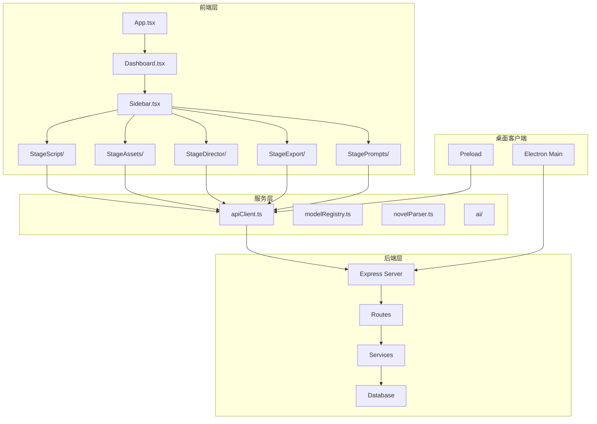
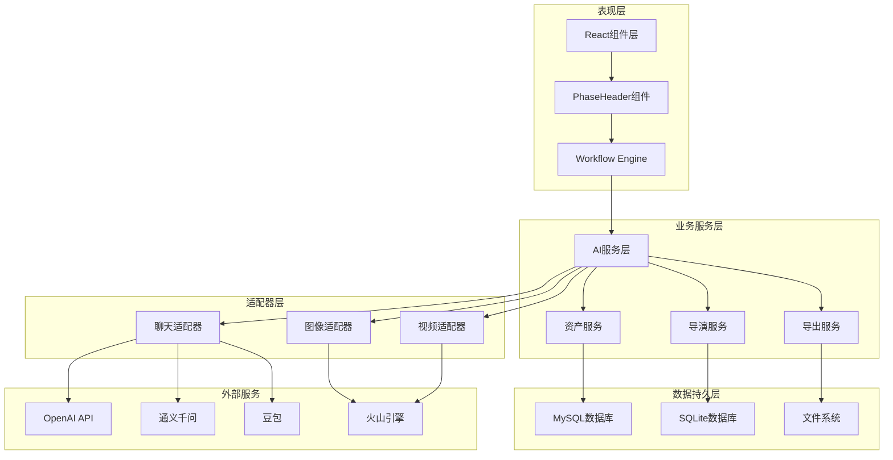
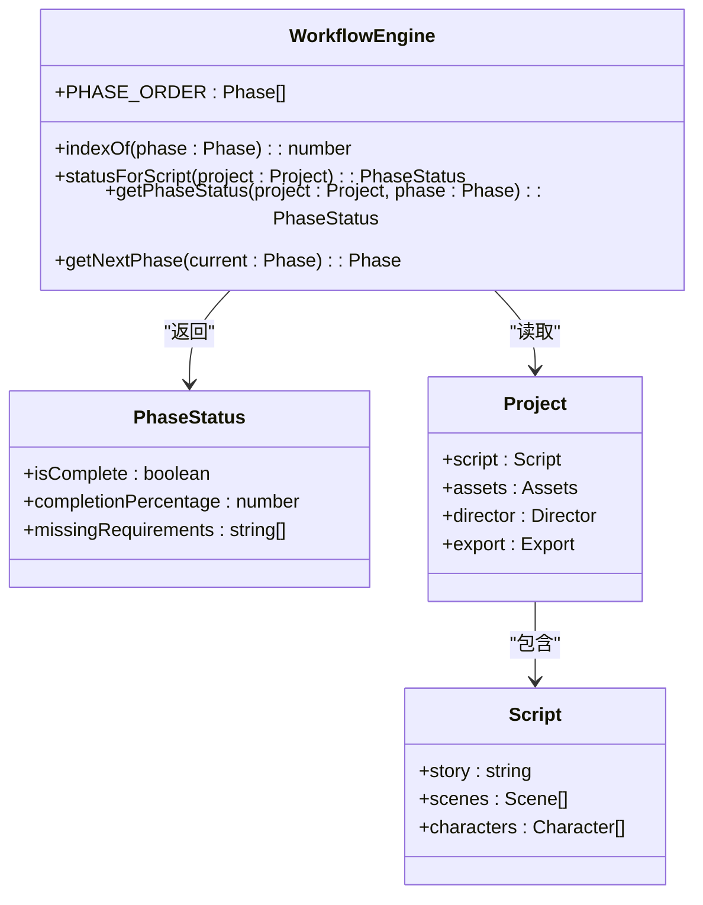
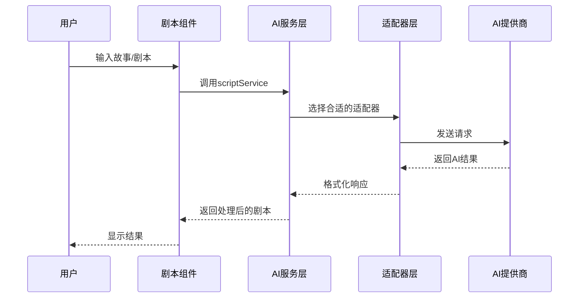
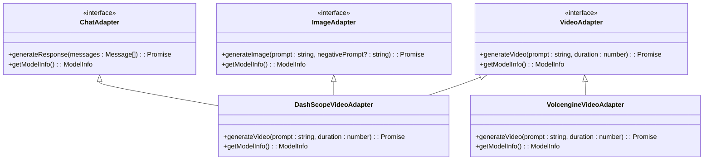
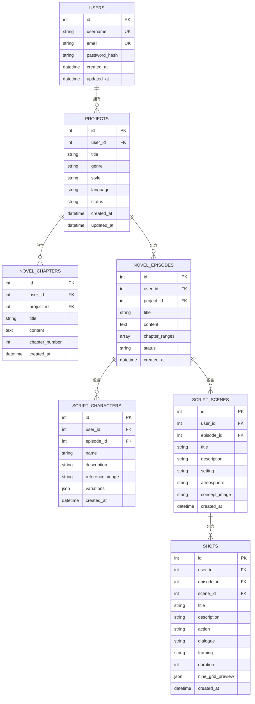
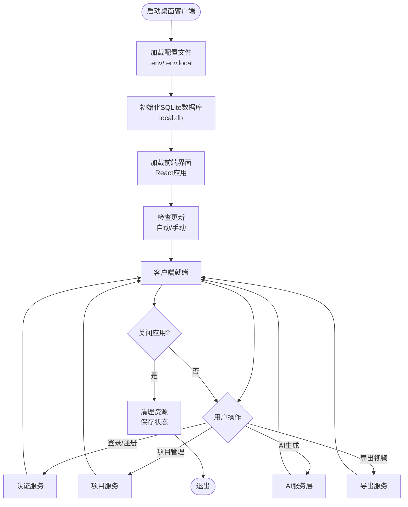
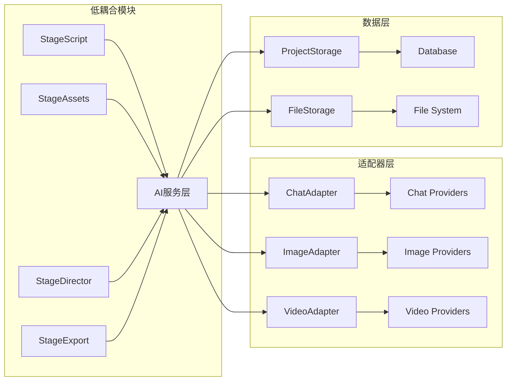
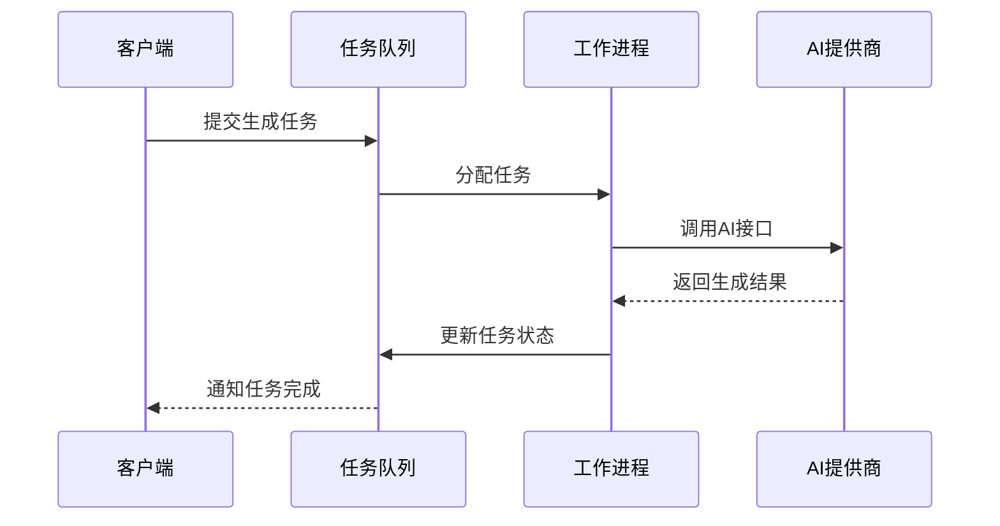

# StageScript剧本系统

<cite>
**本文档引用的文件**
- [README.md](file://README.md)
- [PhaseHeader.tsx](file://src/shared/components/PhaseHeader.tsx)
- [engine.ts](file://src/services/workflow/engine.ts)
- [ScriptPhase.tsx](file://src/phases/script/ScriptPhase.tsx)
- [DirectorPhase.tsx](file://src/phases/director/DirectorPhase.tsx)
- [AssetPhase.tsx](file://src/phases/assets/AssetPhase.tsx)
- [novelParser.ts](file://services/novelParser.ts)
- [novelScriptService.ts](file://services/ai/novelScriptService.ts)
- [scriptService.ts](file://services/ai/scriptService.ts)
- [shotService.ts](file://services/ai/shotService.ts)
- [videoService.ts](file://services/ai/videoService.ts)
- [visualService.ts](file://services/ai/visualService.ts)
- [apiCore.ts](file://services/ai/apiCore.ts)
- [promptConstants.ts](file://services/ai/promptConstants.ts)
- [chatAdapter.ts](file://services/adapters/chatAdapter.ts)
- [imageAdapter.ts](file://services/adapters/imageAdapter.ts)
- [videoAdapter.ts](file://services/adapters/videoAdapter.ts)
- [dashscopeVideoAdapter.ts](file://services/adapters/dashscopeVideoAdapter.ts)
- [volcengineVideoAdapter.ts](file://services/adapters/volcengineVideoAdapter.ts)
- [database.ts](file://server/src/config/database.ts)
- [sqliteDatabase.ts](file://server/src/config/sqliteDatabase.ts)
- [auth.ts](file://server/src/middleware/auth.ts)
- [ai.ts](file://server/src/routes/ai.ts)
- [assets.ts](file://server/src/routes/assets.ts)
- [projects.ts](file://server/src/routes/projects.ts)
- [tasks.ts](file://server/src/routes/tasks.ts)
- [uploads.ts](file://server/src/routes/uploads.ts)
- [visualStyles.ts](file://server/src/routes/visualStyles.ts)
- [taskRunner.ts](file://server/src/services/taskRunner.ts)
- [projectStorage.ts](file://server/src/services/projectStorage.ts)
- [aiProxy.ts](file://server/src/services/aiProxy.ts)
- [index.ts](file://server/src/index.ts)
- [main.ts](file://electron/main.ts)
- [preload.ts](file://electron/preload.ts)
- [types/model.ts](file://types/model.ts)
- [StageScript/README.md](file://components/StageScript/README.md)
- [StageAssets/README.md](file://components/StageAssets/README.md)
- [StageDirector/README.md](file://components/StageDirector/README.md)
- [StageExport/README.md](file://components/StageExport/README.md)
- [StagePrompts/README.md](file://components/StagePrompts/README.md)
</cite>

## 目录
1. [简介](#简介)
2. [项目结构](#项目结构)
3. [核心组件](#核心组件)
4. [架构总览](#架构总览)
5. [详细组件分析](#详细组件分析)
6. [依赖关系分析](#依赖关系分析)
7. [性能考虑](#性能考虑)
8. [故障排除指南](#故障排除指南)
9. [结论](#结论)
10. [附录](#附录)

## 简介
StageScript剧本系统是一个面向创作者的AI短剧/漫剧生产平台，采用「小说 → 剧本 → 分镜 → 资产 → 关键帧 → 成片」的工业化工作流。系统支持多模型提供商，从灵感到成片一站式完成，涵盖小说管理、剧集生成、故事编辑和分镜预览四大核心功能模块。

该系统的核心设计理念是关键帧驱动（Keyframe-Driven），通过先生成首帧与尾帧，再在中间插值生成视频的方式，确保画面的一致性和流畅性。系统还提供了资产约束机制，通过角色定妆照和场景概念图保证人物与场景的统一。

## 项目结构
项目采用前后端分离架构，前端基于React 19 + Vite 6，后端基于Express.js，数据持久化于MySQL或SQLite。整体项目结构清晰，模块化程度高，便于维护和扩展。

**图表来源**
- [README.md: 308-369:308-369](file://README.md#L308-L369)
- [main.ts: 1-50:1-50](file://electron/main.ts#L1-L50)

**章节来源**
- [README.md: 308-369:308-369](file://README.md#L308-L369)

## 核心组件
系统围绕四个核心阶段构建，每个阶段都有明确的功能定位和工作流程：

### 小说与剧本阶段（Phase 01）
负责小说文件的上传、章节解析和剧集生成，支持直接输入故事大纲或剧本进行AI转换。

### 资产与选角阶段（Phase 02）
生成角色定妆照和场景概念图，建立角色衣橱系统，确保画面一致性。

### 导演工作台阶段（Phase 03）
管理分镜表，生成首帧和尾帧，支持九宫格分镜预览和关键帧编辑。

### 成片导出阶段（Phase 04）
提供视频剪辑器，支持多轨道编辑、AI字幕和AI音频生成功能。

**章节来源**
- [README.md: 60-108:60-108](file://README.md#L60-L108)

## 架构总览
系统采用分层架构设计，从底层基础设施到上层业务逻辑层层递进，确保系统的可扩展性和可维护性。

**图表来源**
- [engine.ts: 1-33:1-33](file://src/services/workflow/engine.ts#L1-L33)
- [apiCore.ts: 1-50:1-50](file://services/ai/apiCore.ts#L1-L50)
- [chatAdapter.ts: 1-50:1-50](file://services/adapters/chatAdapter.ts#L1-L50)

## 详细组件分析

### 工作流引擎（Workflow Engine）
工作流引擎是整个系统的核心控制单元，负责推进各个阶段的执行顺序和状态管理。

**图表来源**
- [engine.ts: 1-33:1-33](file://src/services/workflow/engine.ts#L1-L33)
- [PhaseHeader.tsx: 10-25:10-25](file://src/shared/components/PhaseHeader.tsx#L10-L25)

工作流引擎的关键特性包括：
- **阶段顺序控制**：严格遵循script → assets → director → export的执行顺序
- **状态检查机制**：自动检查每个阶段的完成状态和必需条件
- **进度计算**：提供阶段完成百分比和缺失要求的详细信息

**章节来源**
- [engine.ts: 1-33:1-33](file://src/services/workflow/engine.ts#L1-L33)
- [PhaseHeader.tsx: 10-25:10-25](file://src/shared/components/PhaseHeader.tsx#L10-L25)

### AI服务层
AI服务层提供了完整的AI能力集成，包括小说解析、剧本生成、视觉化翻译、分镜生成和视频生成等功能。

**图表来源**
- [scriptService.ts: 1-50:1-50](file://services/ai/scriptService.ts#L1-L50)
- [apiCore.ts: 1-50:1-50](file://services/ai/apiCore.ts#L1-L50)
- [promptConstants.ts: 1-50:1-50](file://services/ai/promptConstants.ts#L1-L50)

AI服务层的主要功能模块：
- **小说解析服务**：处理小说文件上传，自动解析章节结构
- **剧本生成服务**：将故事转换为结构化的剧本
- **视觉化服务**：将剧本描述转换为绘图提示词
- **分镜服务**：生成详细的分镜头脚本
- **视频生成服务**：支持多种视频模型的生成

**章节来源**
- [novelScriptService.ts: 1-50:1-50](file://services/ai/novelScriptService.ts#L1-L50)
- [scriptService.ts: 1-50:1-50](file://services/ai/scriptService.ts#L1-L50)
- [visualService.ts: 1-50:1-50](file://services/ai/visualService.ts#L1-L50)
- [shotService.ts: 1-50:1-50](file://services/ai/shotService.ts#L1-L50)
- [videoService.ts: 1-50:1-50](file://services/ai/videoService.ts#L1-L50)

### 适配器层
适配器层实现了对多家AI提供商的统一接口，支持OpenAI、通义千问、豆包等多种模型提供商。

**图表来源**
- [chatAdapter.ts: 1-50:1-50](file://services/adapters/chatAdapter.ts#L1-L50)
- [imageAdapter.ts: 1-50:1-50](file://services/adapters/imageAdapter.ts#L1-L50)
- [videoAdapter.ts: 1-50:1-50](file://services/adapters/videoAdapter.ts#L1-L50)
- [dashscopeVideoAdapter.ts: 1-50:1-50](file://services/adapters/dashscopeVideoAdapter.ts#L1-L50)
- [volcengineVideoAdapter.ts: 1-50:1-50](file://services/adapters/volcengineVideoAdapter.ts#L1-L50)

适配器层的设计优势：
- **统一接口**：为不同提供商提供一致的调用接口
- **灵活切换**：支持动态切换不同的AI提供商
- **错误处理**：统一的错误处理和重试机制
- **性能优化**：支持并发调用和结果缓存

**章节来源**
- [chatAdapter.ts: 1-50:1-50](file://services/adapters/chatAdapter.ts#L1-L50)
- [imageAdapter.ts: 1-50:1-50](file://services/adapters/imageAdapter.ts#L1-L50)
- [videoAdapter.ts: 1-50:1-50](file://services/adapters/videoAdapter.ts#L1-L50)

### 数据持久层
系统采用MySQL或SQLite进行数据持久化，支持用户隔离和项目数据管理。

**图表来源**
- [README.md: 373-397:373-397](file://README.md#L373-L397)

**章节来源**
- [README.md: 373-397:373-397](file://README.md#L373-L397)

### 桌面客户端
系统提供Electron桌面客户端，内嵌SQLite数据库，支持离线使用和快速部署。

**图表来源**
- [main.ts: 1-50:1-50](file://electron/main.ts#L1-L50)
- [preload.ts: 1-50:1-50](file://electron/preload.ts#L1-L50)

**章节来源**
- [main.ts: 1-50:1-50](file://electron/main.ts#L1-L50)
- [preload.ts: 1-50:1-50](file://electron/preload.ts#L1-L50)

## 依赖关系分析

### 组件耦合度分析
系统采用松耦合设计，各模块之间通过清晰的接口进行通信，降低了模块间的依赖关系。

**图表来源**
- [apiCore.ts: 1-50:1-50](file://services/ai/apiCore.ts#L1-L50)
- [projectStorage.ts: 1-50:1-50](file://server/src/services/projectStorage.ts#L1-L50)

### 外部依赖
系统对外部服务的依赖主要体现在AI模型提供商的选择上，支持灵活切换和配置。

**章节来源**
- [types/model.ts: 1-50:1-50](file://types/model.ts#L1-L50)

## 性能考虑
系统在多个层面进行了性能优化，包括异步任务处理、缓存策略和资源管理。

### 异步任务处理
系统采用任务队列和并发控制机制，确保大量AI生成任务的有序执行。

**图表来源**
- [taskRunner.ts: 1-50:1-50](file://server/src/services/taskRunner.ts#L1-L50)
- [tasks.ts: 1-50:1-50](file://server/src/routes/tasks.ts#L1-L50)

### 缓存策略
系统实现了多层次的缓存机制，包括内存缓存、文件缓存和数据库缓存，提升响应速度。

**章节来源**
- [taskRunner.ts: 1-50:1-50](file://server/src/services/taskRunner.ts#L1-L50)

## 故障排除指南
系统提供了完善的错误处理和日志记录机制，帮助用户快速定位和解决问题。

### 常见问题诊断
- **AI模型连接失败**：检查API Key配置和网络连接
- **任务执行超时**：查看任务队列状态和资源使用情况
- **文件上传失败**：确认文件大小限制和存储权限
- **数据库连接异常**：检查数据库配置和服务状态

### 日志记录
系统支持实时日志记录和错误追踪，便于开发者调试和用户反馈问题。

**章节来源**
- [README.md: 141-146:141-146](file://README.md#L141-L146)

## 结论
StageScript剧本系统通过模块化的设计和完善的架构，为创作者提供了一个功能完整、易于使用的AI短剧/漫剧生产平台。系统的核心优势在于其工业化的制作流程、灵活的AI模型集成和强大的桌面客户端支持。

未来的发展方向包括：
- 增强AI模型的多样性和质量
- 优化用户体验和界面设计
- 扩展更多创意工具和模板
- 提升系统的稳定性和性能

## 附录

### 使用流程示例
1. **项目创建**：登录系统，创建新项目并配置基本信息
2. **小说导入**：上传小说文件，系统自动解析章节
3. **剧本生成**：选择章节生成剧集，AI自动转换为剧本
4. **资产准备**：生成角色定妆和场景概念图
5. **分镜编辑**：编辑分镜头脚本，生成关键帧
6. **视频生成**：选择视频模型生成最终视频
7. **导出成品**：使用视频剪辑器导出最终作品

### 最佳实践建议
- **项目规划**：在开始创作前制定详细的项目计划
- **AI配置**：根据需求选择合适的AI模型和参数
- **质量控制**：定期检查生成质量和一致性
- **备份策略**：定期备份项目数据和媒体文件

**章节来源**
- [README.md: 401-411:401-411](file://README.md#L401-L411)