# 分镜预览模块

<cite>
**本文档引用的文件**
- [ScriptPhase.tsx](file://src/phases/script/ScriptPhase.tsx)
- [SceneCard.tsx](file://src/phases/script/components/SceneCard.tsx)
- [ShotItem.tsx](file://src/phases/script/components/ShotItem.tsx)
- [DirectorPhase.tsx](file://src/phases/director/DirectorPhase.tsx)
- [ShotCard.tsx](file://src/phases/director/components/ShotCard.tsx)
- [VideoStatusBadge.tsx](file://src/phases/director/components/VideoStatusBadge.tsx)
- [ExportPhase.tsx](file://server/src/routes/export/ExportPhase.tsx)
</cite>

## 目录
1. [简介](#简介)
2. [项目结构](#项目结构)
3. [核心组件](#核心组件)
4. [架构概览](#架构概览)
5. [详细组件分析](#详细组件分析)
6. [依赖关系分析](#依赖关系分析)
7. [性能考虑](#性能考虑)
8. [故障排除指南](#故障排除指南)
9. [结论](#结论)
10. [附录](#附录)

## 简介

分镜预览模块是 ShotLive 项目中的核心功能模块，负责将剧本阶段生成的场景和镜头数据转换为可视化的预览界面。该模块实现了从场景分解、镜头可视化到状态跟踪的完整流程，为用户提供直观的分镜创作和管理体验。

模块采用分层架构设计，将剧本阶段的静态数据转换为导演工作台的动态预览界面，支持实时状态更新和批量操作功能。通过颜色编码系统和状态徽章，用户可以快速识别镜头的当前状态和处理进度。

## 项目结构

分镜预览模块主要由三个阶段组成：

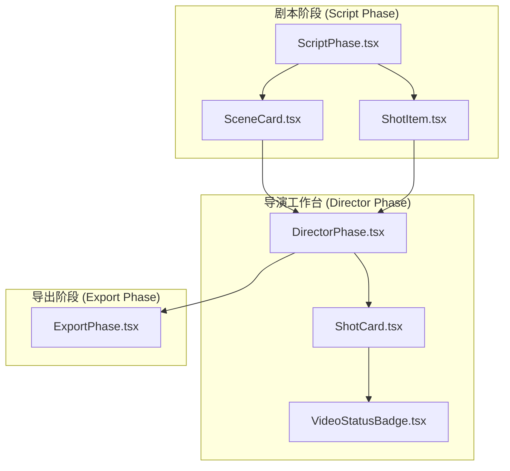

**图表来源**
- [ScriptPhase.tsx:1-583](file://src/phases/script/ScriptPhase.tsx#L1-L583)
- [DirectorPhase.tsx:1-624](file://src/phases/director/DirectorPhase.tsx#L1-L624)
- [ExportPhase.tsx:87-130](file://server/src/routes/export/ExportPhase.tsx#L87-L130)

**章节来源**
- [ScriptPhase.tsx:1-583](file://src/phases/script/ScriptPhase.tsx#L1-L583)
- [DirectorPhase.tsx:1-624](file://src/phases/director/DirectorPhase.tsx#L1-L624)

## 核心组件

### 数据结构设计

分镜预览模块基于清晰的数据层次结构：

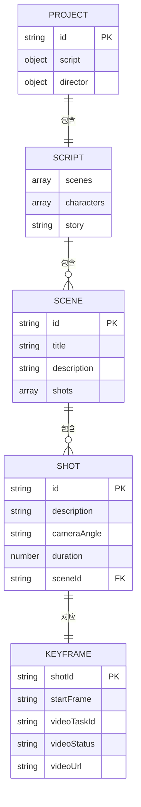

**图表来源**
- [ScriptPhase.tsx:102-138](file://src/phases/script/ScriptPhase.tsx#L102-L138)
- [DirectorPhase.tsx:31-37](file://src/phases/director/DirectorPhase.tsx#L31-L37)

### 状态管理系统

模块实现了完整的状态跟踪机制：

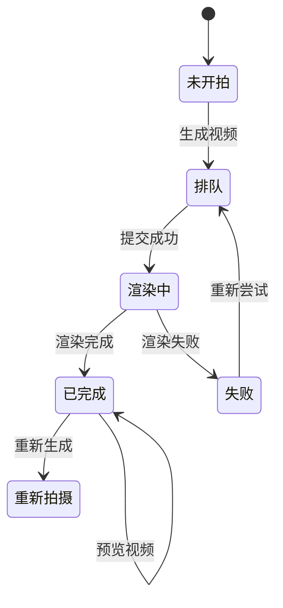

**图表来源**
- [VideoStatusBadge.tsx:11-44](file://src/phases/director/components/VideoStatusBadge.tsx#L11-L44)
- [ShotCard.tsx:37-42](file://src/phases/director/components/ShotCard.tsx#L37-L42)

**章节来源**
- [ScriptPhase.tsx:102-138](file://src/phases/script/ScriptPhase.tsx#L102-L138)
- [DirectorPhase.tsx:31-37](file://src/phases/director/DirectorPhase.tsx#L31-L37)
- [VideoStatusBadge.tsx:11-44](file://src/phases/director/components/VideoStatusBadge.tsx#L11-L44)

## 架构概览

分镜预览模块采用响应式架构，实现了数据驱动的状态管理：

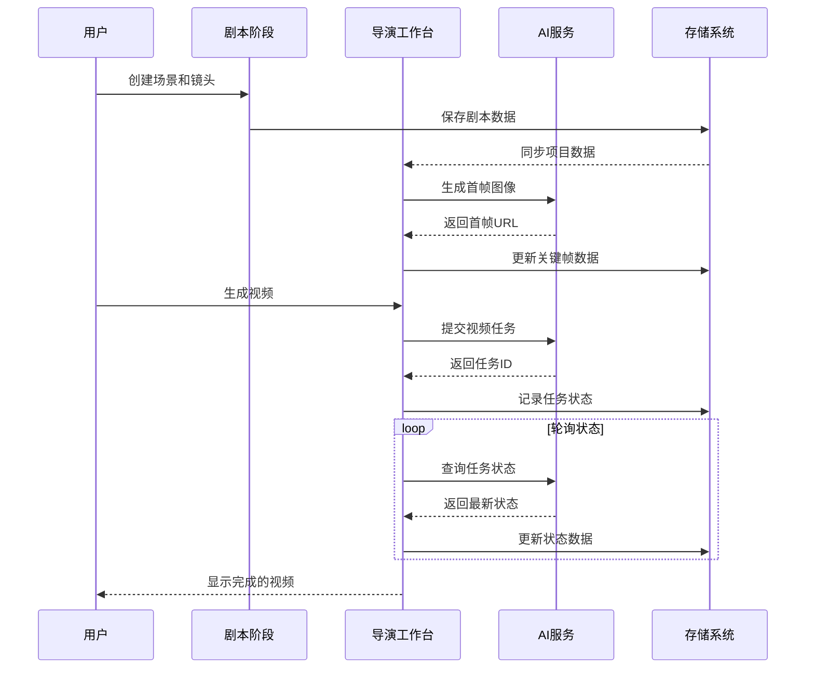

**图表来源**
- [DirectorPhase.tsx:111-159](file://src/phases/director/DirectorPhase.tsx#L111-L159)
- [DirectorPhase.tsx:191-247](file://src/phases/director/DirectorPhase.tsx#L191-L247)

## 详细组件分析

### 场景折叠面板实现

场景折叠面板是剧本阶段的核心交互组件，实现了完整的场景管理和展开/收起功能：

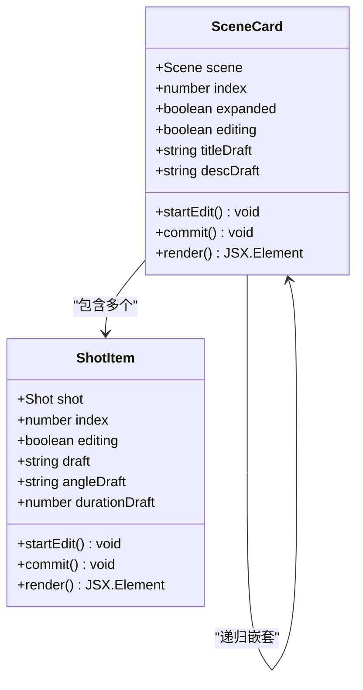

**图表来源**
- [SceneCard.tsx:12-30](file://src/phases/script/components/SceneCard.tsx#L12-L30)
- [ShotItem.tsx:8-13](file://src/phases/script/components/ShotItem.tsx#L8-L13)

场景折叠面板的关键特性：

1. **状态管理**: 使用 React hooks 管理展开/收起状态和编辑状态
2. **数据绑定**: 实现双向数据绑定，支持实时编辑场景和镜头信息
3. **交互设计**: 提供直观的展开/收起按钮和编辑入口
4. **响应式布局**: 支持不同屏幕尺寸的自适应显示

**章节来源**
- [SceneCard.tsx:31-216](file://src/phases/script/components/SceneCard.tsx#L31-L216)
- [ShotItem.tsx:21-170](file://src/phases/script/components/ShotItem.tsx#L21-L170)

### 状态徽章颜色编码系统

状态徽章实现了直观的颜色编码系统，通过不同的颜色和图标表示镜头的不同状态：

| 状态 | 颜色 | 图标 | 背景 | 描述 |
|------|------|------|------|------|
| pending | 灰色 | 沙漏 | 浅棕色透明 | 排队等待处理 |
| processing | 红色 | 加载动画 | 深红色透明 | 正在渲染中 |
| completed | 琥珀色 | 对勾 | 浅琥珀色透明 | 渲染完成 |
| failed | 红色 | 警告三角 | 深红色透明 | 渲染失败 |

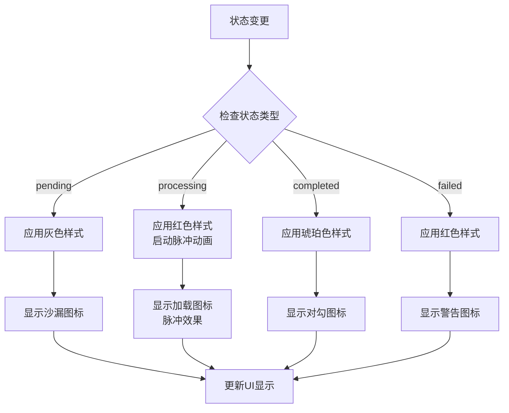

**图表来源**
- [VideoStatusBadge.tsx:11-44](file://src/phases/director/components/VideoStatusBadge.tsx#L11-L44)
- [VideoStatusBadge.tsx:52-81](file://src/phases/director/components/VideoStatusBadge.tsx#L52-L81)

**章节来源**
- [VideoStatusBadge.tsx:11-81](file://src/phases/director/components/VideoStatusBadge.tsx#L11-L81)

### 镜头预览渲染逻辑

镜头预览组件实现了复杂的渲染逻辑，支持多种预览模式：

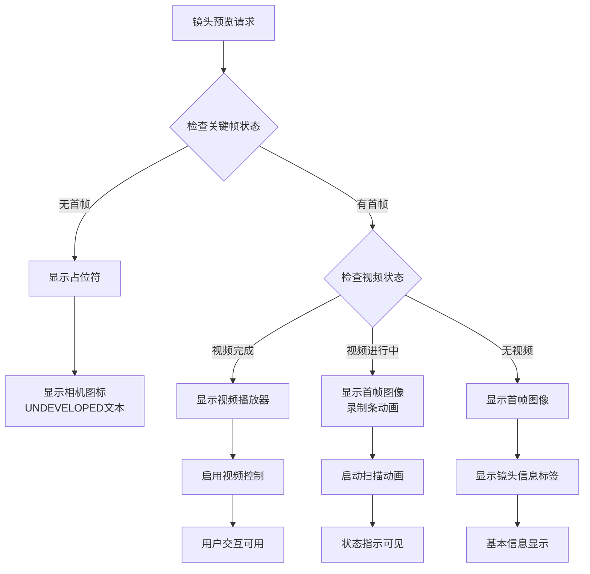

**图表来源**
- [ShotCard.tsx:117-191](file://src/phases/director/components/ShotCard.tsx#L117-L191)
- [ShotCard.tsx:37-42](file://src/phases/director/components/ShotCard.tsx#L37-L42)

**章节来源**
- [ShotCard.tsx:22-308](file://src/phases/director/components/ShotCard.tsx#L22-L308)

### 场景与镜头层级关系

模块实现了清晰的层级关系管理：

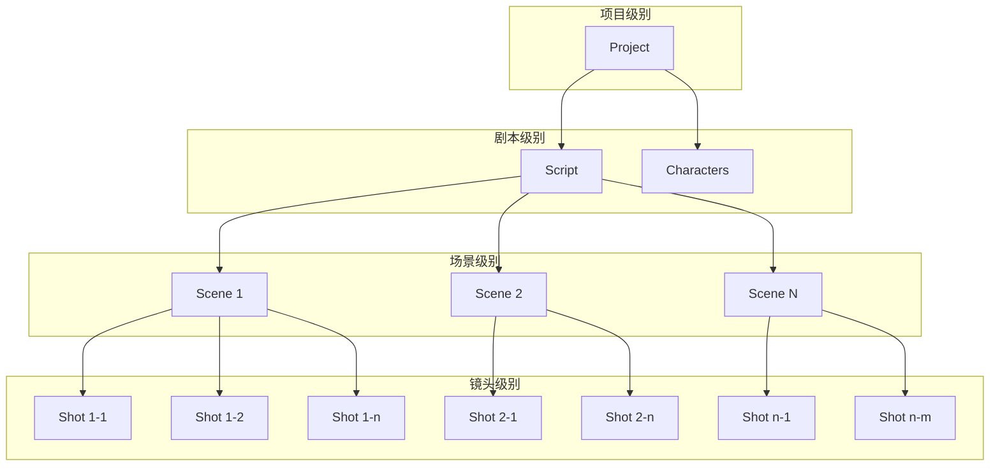

**图表来源**
- [ScriptPhase.tsx:102-138](file://src/phases/script/ScriptPhase.tsx#L102-L138)
- [DirectorPhase.tsx:71-88](file://src/phases/director/DirectorPhase.tsx#L71-L88)

**章节来源**
- [ScriptPhase.tsx:102-138](file://src/phases/script/ScriptPhase.tsx#L102-L138)
- [DirectorPhase.tsx:71-88](file://src/phases/director/DirectorPhase.tsx#L71-L88)

### 预览模式切换机制

预览模式切换支持多种显示模式：

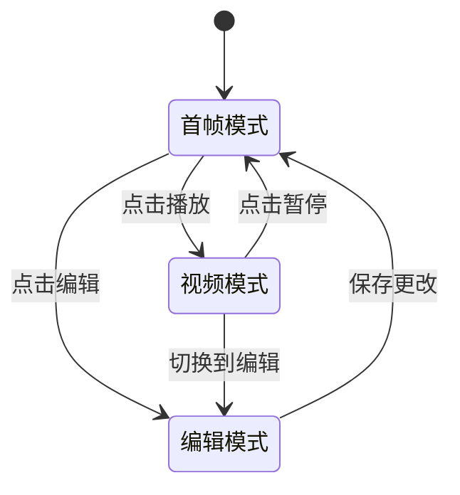

**图表来源**
- [ShotCard.tsx:203-265](file://src/phases/director/components/ShotCard.tsx#L203-L265)

### 批量操作功能

批量操作提供了高效的批量处理能力：

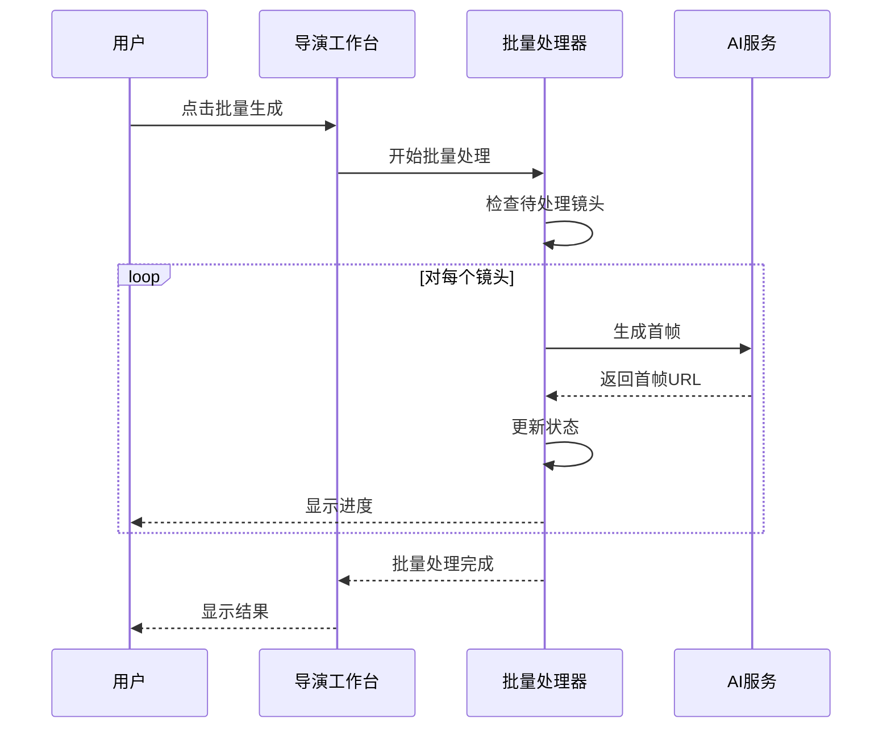

**图表来源**
- [DirectorPhase.tsx:161-189](file://src/phases/director/DirectorPhase.tsx#L161-L189)

**章节来源**
- [DirectorPhase.tsx:161-189](file://src/phases/director/DirectorPhase.tsx#L161-L189)

## 依赖关系分析

分镜预览模块的依赖关系呈现清晰的单向数据流：

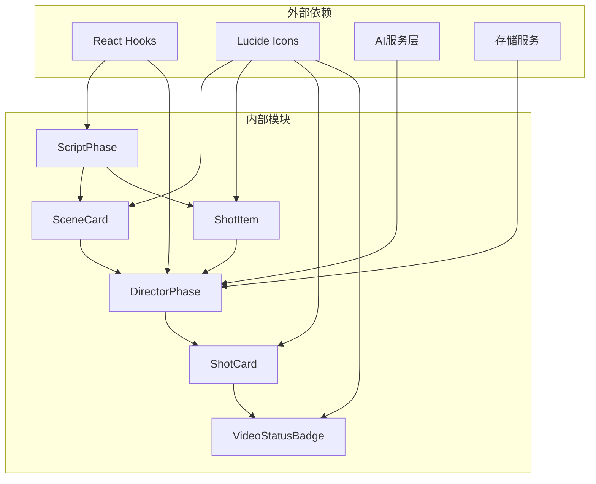

**图表来源**
- [ScriptPhase.tsx:1-583](file://src/phases/script/ScriptPhase.tsx#L1-L583)
- [DirectorPhase.tsx:1-624](file://src/phases/director/DirectorPhase.tsx#L1-L624)

**章节来源**
- [ScriptPhase.tsx:1-583](file://src/phases/script/ScriptPhase.tsx#L1-L583)
- [DirectorPhase.tsx:1-624](file://src/phases/director/DirectorPhase.tsx#L1-L624)

## 性能考虑

### 渲染优化策略

1. **虚拟滚动**: 对于大量镜头的情况，考虑实现虚拟滚动以减少DOM节点数量
2. **懒加载**: 首帧和视频资源采用懒加载策略，提升初始渲染速度
3. **状态缓存**: 使用useMemo和useCallback优化重渲染
4. **并发处理**: 批量操作采用并发处理提升效率

### 状态管理优化

1. **局部状态**: 将UI状态与业务状态分离，减少不必要的重渲染
2. **状态合并**: 合并频繁更新的状态，避免细粒度过小导致的性能问题
3. **防抖处理**: 对用户输入和频繁操作实施防抖策略

## 故障排除指南

### 常见问题及解决方案

| 问题类型 | 症状 | 可能原因 | 解决方案 |
|----------|------|----------|----------|
| API密钥错误 | 无法生成首帧/视频 | 未配置DashScope API Key | 在模型配置中填写有效API Key |
| 状态同步延迟 | 视频状态更新滞后 | 轮询间隔设置不当 | 检查POLL_INTERVAL_MS配置 |
| 预览加载失败 | 首帧或视频无法显示 | 网络连接问题 | 检查网络连接和资源URL |
| 批量操作中断 | 部分镜头生成失败 | 单个镜头处理异常 | 查看错误日志并重试失败项 |

**章节来源**
- [DirectorPhase.tsx:114-116](file://src/phases/director/DirectorPhase.tsx#L114-L116)
- [DirectorPhase.tsx:177-180](file://src/phases/director/DirectorPhase.tsx#L177-L180)

## 结论

分镜预览模块通过精心设计的数据结构、直观的用户界面和强大的状态管理机制，为用户提供了完整的分镜创作和管理工作流。模块的分层架构确保了良好的可维护性和扩展性，而颜色编码系统和状态徽章则大大提升了用户体验。

该模块的成功实现展示了如何将复杂的多阶段工作流程简化为直观的用户界面，同时保持了系统的高性能和可靠性。通过持续的优化和改进，分镜预览模块将继续为用户提供卓越的创作体验。

## 附录

### 使用指南

1. **场景管理**: 使用场景卡片创建和编辑场景，支持展开/收起和批量操作
2. **镜头编辑**: 通过镜头条目编辑镜头描述、角度和时长
3. **状态跟踪**: 通过状态徽章实时了解镜头的处理进度
4. **批量操作**: 使用批量生成功能快速处理多个镜头
5. **预览切换**: 在首帧模式和视频模式之间自由切换

### 效果优化建议

1. **视觉优化**: 调整颜色对比度和字体大小以提升可读性
2. **交互优化**: 添加更多快捷键和键盘导航支持
3. **性能优化**: 实现图片懒加载和视频流式播放
4. **移动端适配**: 优化触摸交互和响应式布局
5. **无障碍访问**: 添加屏幕阅读器支持和键盘导航