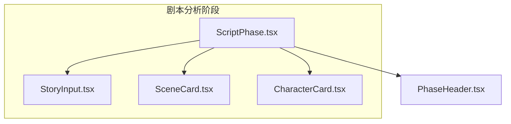
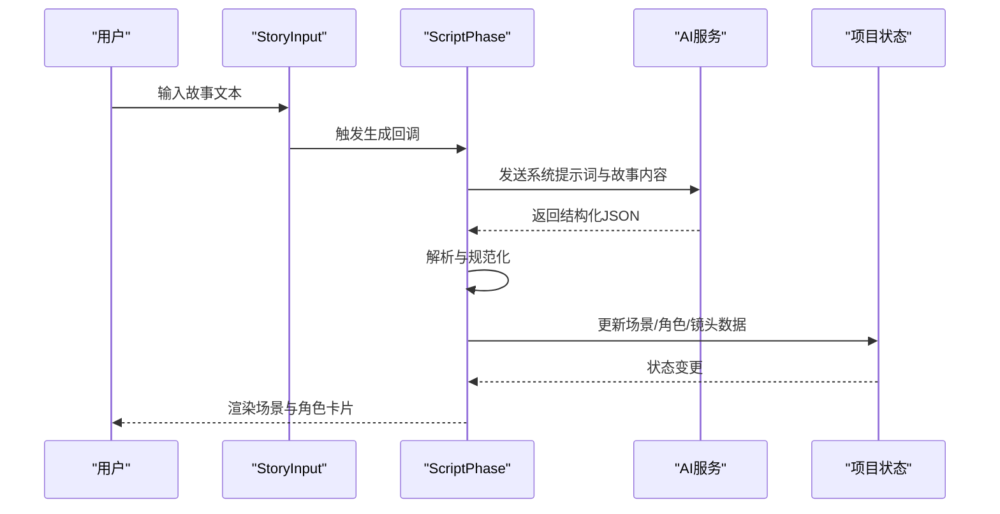
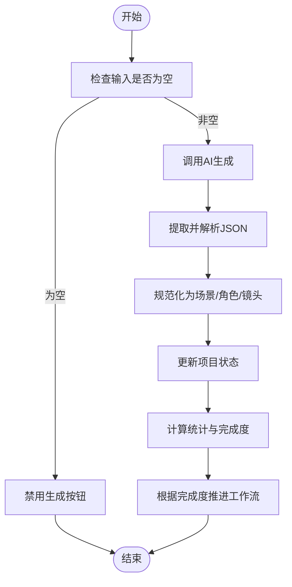
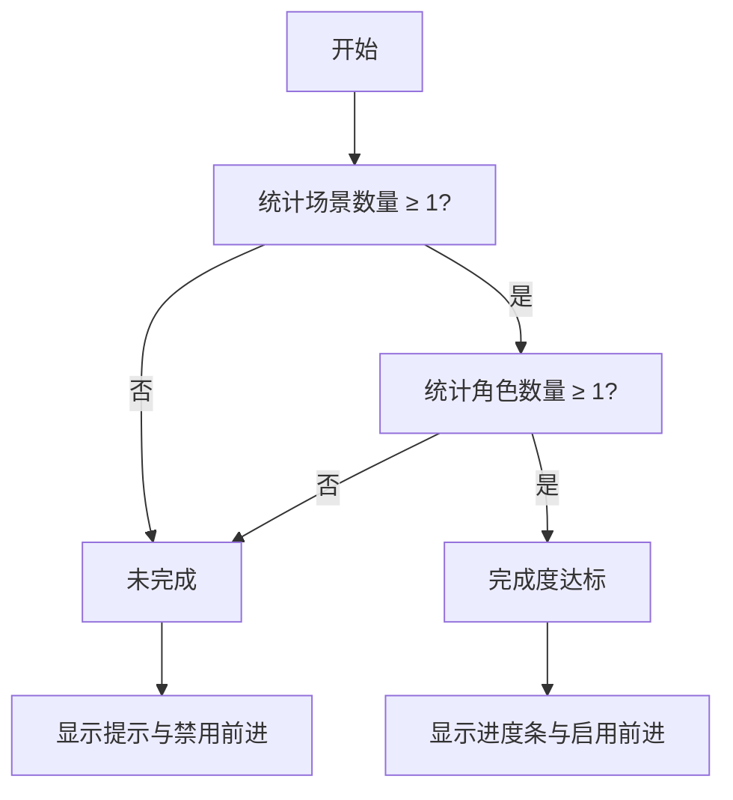
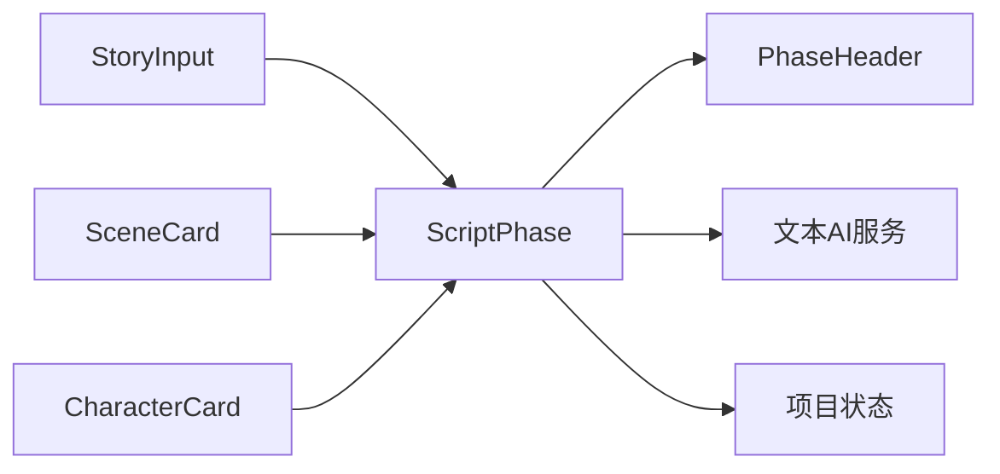

# 剧集管理模块

<cite>
**本文引用的文件**
- [ScriptPhase.tsx](file://src/phases/script/ScriptPhase.tsx)
- [StoryInput.tsx](file://src/phases/script/components/StoryInput.tsx)
- [SceneCard.tsx](file://src/phases/script/components/SceneCard.tsx)
- [CharacterCard.tsx](file://src/phases/script/components/CharacterCard.tsx)
- [PhaseHeader.tsx](file://src/shared/components/PhaseHeader.tsx)
- [README.md](file://README.md)
</cite>

## 目录
1. [简介](#简介)
2. [项目结构](#项目结构)
3. [核心组件](#核心组件)
4. [架构总览](#架构总览)
5. [详细组件分析](#详细组件分析)
6. [依赖关系分析](#依赖关系分析)
7. [性能考量](#性能考量)
8. [故障排查指南](#故障排查指南)
9. [结论](#结论)
10. [附录](#附录)

## 简介
本模块围绕“剧本分析”阶段展开，负责将用户输入的故事内容拆解为结构化的场景与镜头，并维护角色信息。其核心目标包括：
- 剧集生成：基于用户输入，调用AI进行智能拆解，产出场景、镜头与角色清单。
- 章节管理：以场景为单位组织内容，支持增删改查与镜头级编辑。
- 批量处理：通过AI一键生成，覆盖式重写现有场景与角色，提升创作效率。
- 状态管理与完成度跟踪：提供可视化进度条与完成条件，驱动工作流推进至下一阶段。

该模块与“资产生成”“导演工作台”“成片导出”三大阶段形成前后衔接，确保从文本到画面的可控演进。

## 项目结构
本模块位于前端脚本阶段（Phase 01），采用“页面组件 + 子组件”的分层组织方式：
- 页面组件：负责整体逻辑、状态更新与工作流推进。
- 子组件：分别承载故事输入、场景卡片、角色卡片等可复用UI与交互。

图表来源
- [ScriptPhase.tsx:143-495](file://src/phases/script/ScriptPhase.tsx#L143-L495)
- [StoryInput.tsx:17-115](file://src/phases/script/components/StoryInput.tsx#L17-L115)
- [SceneCard.tsx:22-216](file://src/phases/script/components/SceneCard.tsx#L22-L216)
- [CharacterCard.tsx:15-201](file://src/phases/script/components/CharacterCard.tsx#L15-L201)
- [PhaseHeader.tsx:17-86](file://src/shared/components/PhaseHeader.tsx#L17-L86)

章节来源
- [ScriptPhase.tsx:1-583](file://src/phases/script/ScriptPhase.tsx#L1-L583)
- [StoryInput.tsx:1-115](file://src/phases/script/components/StoryInput.tsx#L1-L115)
- [SceneCard.tsx:1-216](file://src/phases/script/components/SceneCard.tsx#L1-L216)
- [CharacterCard.tsx:1-201](file://src/phases/script/components/CharacterCard.tsx#L1-L201)
- [PhaseHeader.tsx:1-86](file://src/shared/components/PhaseHeader.tsx#L1-L86)

## 核心组件
- 剧本分析主组件（ScriptPhase）
  - 负责接收用户输入、调用AI生成、解析并规范化响应、更新项目状态、计算统计与完成度、驱动工作流前进。
  - 关键职责：故事输入处理、AI生成与解析、场景/镜头/角色的CRUD、完成度计算与状态展示。
- 故事输入组件（StoryInput）
  - 提供输入框、字数统计、生成按钮与错误提示，控制生成入口与文案提示。
- 场景卡片组件（SceneCard）
  - 支持场景标题/描述的内联编辑、镜头列表展开/折叠、新增镜头、删除场景。
- 角色卡片组件（CharacterCard）
  - 支持角色姓名/性格/外貌的内联编辑、删除角色、占位参考图区域。

章节来源
- [ScriptPhase.tsx:143-495](file://src/phases/script/ScriptPhase.tsx#L143-L495)
- [StoryInput.tsx:17-115](file://src/phases/script/components/StoryInput.tsx#L17-L115)
- [SceneCard.tsx:22-216](file://src/phases/script/components/SceneCard.tsx#L22-L216)
- [CharacterCard.tsx:15-201](file://src/phases/script/components/CharacterCard.tsx#L15-L201)

## 架构总览
下图展示了从用户输入到AI生成、再到本地状态更新与界面渲染的整体流程：

图表来源
- [ScriptPhase.tsx:173-202](file://src/phases/script/ScriptPhase.tsx#L173-L202)
- [StoryInput.tsx:85-111](file://src/phases/script/components/StoryInput.tsx#L85-L111)

章节来源
- [ScriptPhase.tsx:173-202](file://src/phases/script/ScriptPhase.tsx#L173-L202)
- [StoryInput.tsx:85-111](file://src/phases/script/components/StoryInput.tsx#L85-L111)

## 详细组件分析

### 剧本分析主组件（ScriptPhase）
- 功能要点
  - 输入处理：监听故事文本变化，提供字数统计与生成按钮可用性判断。
  - AI生成：调用文本AI接口，发送系统提示词与温度参数，捕获异常并提示。
  - 响应解析：从AI返回中提取JSON，校验结构合法性，规范化为内部数据结构。
  - 状态更新：将解析后的场景、角色与镜头写回项目状态，触发UI重绘。
  - 统计与完成度：计算镜头总数、预估时长、完成条件（至少1场景+1角色），并驱动工作流前进。
- 关键流程（生成与解析）

图表来源
- [ScriptPhase.tsx:168-202](file://src/phases/script/ScriptPhase.tsx#L168-L202)
- [ScriptPhase.tsx:79-138](file://src/phases/script/ScriptPhase.tsx#L79-L138)

章节来源
- [ScriptPhase.tsx:143-495](file://src/phases/script/ScriptPhase.tsx#L143-L495)

### 故事输入组件（StoryInput）
- 功能要点
  - 文本域输入与字数统计（词数/字符数）。
  - 生成按钮状态控制（最小字数阈值）。
  - 错误提示展示与文案提示（首次生成 vs 重写覆盖）。
- 使用建议
  - 输入长度建议不低于8字，以提高AI拆解质量。
  - 重写会覆盖现有场景与角色，请谨慎操作。

章节来源
- [StoryInput.tsx:17-115](file://src/phases/script/components/StoryInput.tsx#L17-L115)

### 场景卡片组件（SceneCard）
- 功能要点
  - 场景标题与描述的内联编辑，支持取消/保存。
  - 镜头列表展开/折叠，支持新增镜头与删除场景。
  - 显示镜头数量与预估时长（基于镜头时长累加）。
- 交互模式
  - 点击场景卡片进入编辑模式，编辑完成后保存。
  - 点击“展开/收起”切换镜头列表可见性。
  - 点击“添加镜头”在当前场景下追加新镜头。

章节来源
- [SceneCard.tsx:22-216](file://src/phases/script/components/SceneCard.tsx#L22-L216)

### 角色卡片组件（CharacterCard）
- 功能要点
  - 角色姓名、性格背景、外貌描述的内联编辑。
  - 删除角色确认提示。
  - 参考图占位区域（Phase 02可用）。
- 最佳实践
  - 外貌描述需包含发型、服装、体型等细节，便于后续资产生成。

章节来源
- [CharacterCard.tsx:15-201](file://src/phases/script/components/CharacterCard.tsx#L15-L201)

### 工作流与状态管理
- 完成度计算
  - 基于场景与角色的数量判断是否满足“至少1场景+至少1角色”的完成条件。
  - 通过进度条与百分比直观展示当前阶段完成度。
- 工作流推进
  - 完成条件满足后，允许进入下一阶段（资产生成）。
  - 未满足时显示提示，禁止前进。

图表来源
- [ScriptPhase.tsx:164-166](file://src/phases/script/ScriptPhase.tsx#L164-L166)
- [PhaseHeader.tsx:22-25](file://src/shared/components/PhaseHeader.tsx#L22-L25)

章节来源
- [ScriptPhase.tsx:164-166](file://src/phases/script/ScriptPhase.tsx#L164-L166)
- [PhaseHeader.tsx:17-86](file://src/shared/components/PhaseHeader.tsx#L17-L86)

## 依赖关系分析
- 组件耦合
  - ScriptPhase 作为容器组件，聚合 StoryInput、SceneCard、CharacterCard 的交互与状态。
  - 子组件之间低耦合，通过回调函数与属性传递数据，便于独立测试与复用。
- 外部依赖
  - 文本AI服务：用于故事拆解与结构化输出。
  - 项目上下文：通过项目状态更新与工作流引擎协作，驱动阶段推进。
- 数据流向
  - 用户输入 → StoryInput → ScriptPhase → AI → 规范化 → 项目状态 → UI渲染。

图表来源
- [ScriptPhase.tsx:143-495](file://src/phases/script/ScriptPhase.tsx#L143-L495)
- [StoryInput.tsx:17-115](file://src/phases/script/components/StoryInput.tsx#L17-L115)
- [SceneCard.tsx:22-216](file://src/phases/script/components/SceneCard.tsx#L22-L216)
- [CharacterCard.tsx:15-201](file://src/phases/script/components/CharacterCard.tsx#L15-L201)
- [PhaseHeader.tsx:17-86](file://src/shared/components/PhaseHeader.tsx#L17-L86)

章节来源
- [ScriptPhase.tsx:143-495](file://src/phases/script/ScriptPhase.tsx#L143-L495)
- [PhaseHeader.tsx:17-86](file://src/shared/components/PhaseHeader.tsx#L17-L86)

## 性能考量
- 计算开销
  - 统计镜头总数与预估时长为线性复杂度，适合中等规模项目。
  - 建议在大规模场景/镜头时，延迟计算或分页渲染以优化首屏性能。
- 渲染优化
  - 使用受控组件与不可变更新策略，减少不必要的重渲染。
  - 对展开/折叠等交互采用懒加载，仅渲染可见区域。
- AI调用
  - 合理设置温度与系统提示词，减少无效重试与重复生成。
  - 对解析失败进行快速失败与明确提示，避免阻塞主线程。

## 故障排查指南
- 生成按钮不可用
  - 检查输入长度是否达到阈值；确认网络与AI服务可用。
- AI拆解失败
  - 查看错误提示，确认API密钥与网络连接；尝试简化输入或调整提示词。
- 解析失败
  - 确认AI返回内容包含合法JSON结构；检查是否存在多余文本或格式问题。
- 数据未更新
  - 确认项目状态更新回调已执行；检查浏览器控制台是否有异常。
- 完成度不更新
  - 确认场景与角色数量是否满足“≥1”的完成条件；检查进度条与按钮状态联动逻辑。

章节来源
- [ScriptPhase.tsx:173-202](file://src/phases/script/ScriptPhase.tsx#L173-L202)
- [StoryInput.tsx:65-83](file://src/phases/script/components/StoryInput.tsx#L65-L83)

## 结论
本模块通过“输入-生成-解析-更新-渲染”的闭环流程，实现了从故事到结构化脚本的自动化与可视化管理。配合完成度跟踪与工作流推进，有效支撑了从剧本分析到资产生成的顺畅过渡。建议在实际使用中注重输入质量、及时保存与分阶段验证，以获得更稳定高效的创作体验。

## 附录
- 数据模型与章节划分策略
  - 场景：包含标题、描述与镜头数组；镜头包含描述、角度与时长。
  - 角色：包含姓名、描述与外貌描述；预留参考图字段。
  - 章节划分：由AI根据故事内容自动拆分为多个场景，每个场景再细分为若干镜头。
- 与小说内容的对应关系
  - 小说章节可作为输入源，经AI适配为脚本结构，形成“章节 → 剧集”的映射。
- 批量操作
  - 通过“AI智能分镜”实现批量生成与覆盖式重写，显著提升创作效率。
- 最佳实践
  - 输入尽量清晰具体，包含人物、场景、情绪与动作线索。
  - 外貌描述详尽，便于后续资产生成与一致性维护。
  - 分阶段推进，先完成场景与角色，再细化镜头与提示词。

章节来源
- [README.md:370-394](file://README.md#L370-L394)
- [ScriptPhase.tsx:102-138](file://src/phases/script/ScriptPhase.tsx#L102-L138)
- [SceneCard.tsx:50-50](file://src/phases/script/components/SceneCard.tsx#L50-L50)
- [CharacterCard.tsx:30-36](file://src/phases/script/components/CharacterCard.tsx#L30-L36)