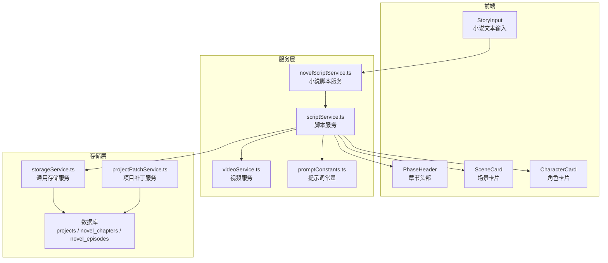
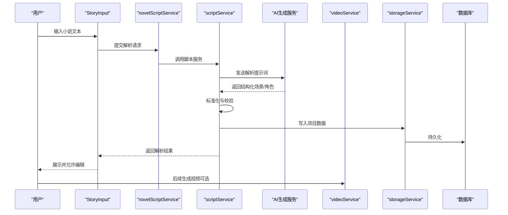
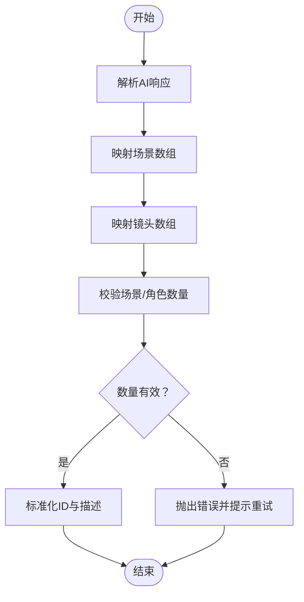
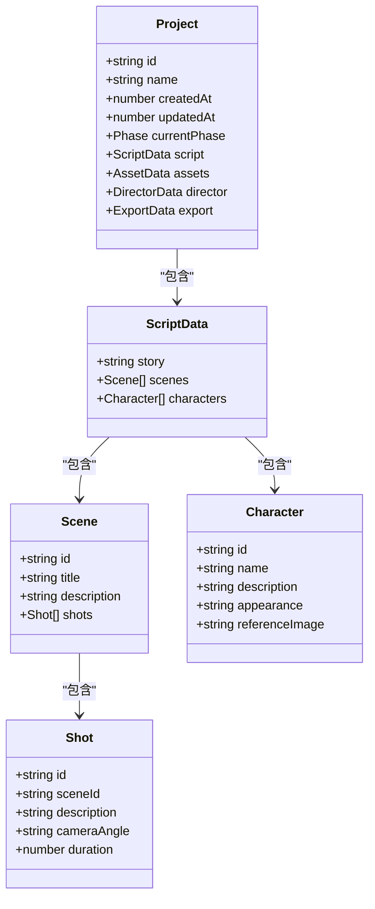
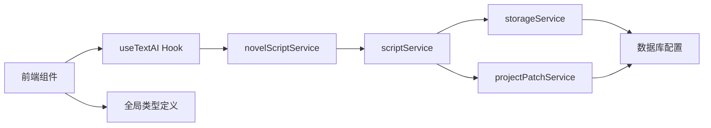

# 小说管理模块

<cite>
**本文引用的文件**
- [README.md](file://README.md)
- [README_EN.md](file://README_EN.md)
- [src/types.ts](file://src/types.ts)
- [src/phases/script/ScriptPhase.tsx](file://src/phases/script/ScriptPhase.tsx)
- [src/phases/script/components/StoryInput.tsx](file://src/phases/script/components/StoryInput.tsx)
- [src/phases/script/components/SceneCard.tsx](file://src/phases/script/components/SceneCard.tsx)
- [src/phases/script/components/CharacterCard.tsx](file://src/phases/script/components/CharacterCard.tsx)
- [src/shared/components/PhaseHeader.tsx](file://src/shared/components/PhaseHeader.tsx)
- [src/shared/components/ProjectSelector.tsx](file://src/shared/components/ProjectSelector.tsx)
- [src/shared/components/Sidebar.tsx](file://src/shared/components/Sidebar.tsx)
- [src/services/ai/novelScriptService.ts](file://src/services/ai/novelScriptService.ts)
- [src/services/ai/scriptService.ts](file://src/services/ai/scriptService.ts)
- [src/services/ai/videoService.ts](file://src/services/ai/videoService.ts)
- [src/services/ai/promptConstants.ts](file://src/services/ai/promptConstants.ts)
- [src/services/storageService.ts](file://src/services/storageService.ts)
- [src/services/taskService.ts](file://src/services/taskService.ts)
- [src/services/projectPatchService.ts](file://src/services/projectPatchService.ts)
- [server/src/routes/projects.ts](file://server/src/routes/projects.ts)
- [server/src/routes/tasks.ts](file://server/src/routes/tasks.ts)
- [server/src/services/scriptParser.ts](file://server/src/services/scriptParser.ts)
- [server/src/services/projectStorage.ts](file://server/src/services/projectStorage.ts)
- [server/src/config/database.ts](file://server/src/config/database.ts)
- [server/src/config/sqliteDatabase.ts](file://server/src/config/sqliteDatabase.ts)
</cite>

## 目录
1. [引言](#引言)
2. [项目结构](#项目结构)
3. [核心组件](#核心组件)
4. [架构总览](#架构总览)
5. [详细组件分析](#详细组件分析)
6. [依赖关系分析](#依赖关系分析)
7. [性能考虑](#性能考虑)
8. [故障排除指南](#故障排除指南)
9. [结论](#结论)
10. [附录](#附录)

## 引言
本文件面向小说管理模块，围绕小说导入、章节管理与基本信息配置展开，重点阐述小说文本输入验证、章节分割算法、作者信息与简介管理等实现细节，并说明小说类型选择、语言设置、目标时长配置等参数如何影响后续AI生成。文档同时给出小说解析流程、章节结构分析及与项目其他模块的数据交互机制，提供最佳实践与常见问题解决方案。

## 项目结构
小说管理模块位于“剧本分析”阶段（Phase 01），与脚本服务、AI生成服务、存储服务紧密协作。前端通过 StoryInput 组件接收小说文本，经由脚本服务与AI服务进行解析与结构化，再进入资产生成、导演工作台与导出阶段。

图表来源
- [src/phases/script/ScriptPhase.tsx](file://src/phases/script/ScriptPhase.tsx)
- [src/phases/script/components/StoryInput.tsx](file://src/phases/script/components/StoryInput.tsx)
- [src/services/ai/novelScriptService.ts](file://src/services/ai/novelScriptService.ts)
- [src/services/ai/scriptService.ts](file://src/services/ai/scriptService.ts)
- [src/services/ai/videoService.ts](file://src/services/ai/videoService.ts)
- [src/services/storageService.ts](file://src/services/storageService.ts)
- [server/src/config/database.ts](file://server/src/config/database.ts)

章节来源
- [README_EN.md](file://README_EN.md)
- [src/phases/script/ScriptPhase.tsx](file://src/phases/script/ScriptPhase.tsx)
- [src/shared/components/PhaseHeader.tsx](file://src/shared/components/PhaseHeader.tsx)

## 核心组件
- 小说文本输入与验证
  - StoryInput 负责接收用户输入的小说文本，提供生成按钮与加载状态反馈，支持已生成内容的展示与继续编辑。
  - 输入验证策略：去除多余空白、确保必要字段存在、限制最大长度以避免超载。
- 章节与角色结构化
  - normalizeAIResponse 将AI输出标准化为场景与镜头结构，保证每个场景至少包含一个镜头，每个角色至少包含名称与描述。
- 项目与章节导航
  - PhaseHeader 提供章节进度与完成状态展示，支持进入下一阶段。
  - Sidebar 与 ProjectSelector 展示项目列表与章节进度，便于跨项目切换。

章节来源
- [src/phases/script/ScriptPhase.tsx](file://src/phases/script/ScriptPhase.tsx)
- [src/phases/script/components/StoryInput.tsx](file://src/phases/script/components/StoryInput.tsx)
- [src/shared/components/PhaseHeader.tsx](file://src/shared/components/PhaseHeader.tsx)
- [src/shared/components/Sidebar.tsx](file://src/shared/components/Sidebar.tsx)
- [src/shared/components/ProjectSelector.tsx](file://src/shared/components/ProjectSelector.tsx)

## 架构总览
小说管理模块采用“输入-解析-结构化-展示-编辑”的闭环流程。前端负责输入与展示，服务层负责与AI交互与数据处理，存储层持久化项目与章节数据。

图表来源
- [src/phases/script/ScriptPhase.tsx](file://src/phases/script/ScriptPhase.tsx)
- [src/services/ai/novelScriptService.ts](file://src/services/ai/novelScriptService.ts)
- [src/services/ai/scriptService.ts](file://src/services/ai/scriptService.ts)
- [src/services/ai/videoService.ts](file://src/services/ai/videoService.ts)
- [src/services/storageService.ts](file://src/services/storageService.ts)
- [server/src/config/database.ts](file://server/src/config/database.ts)

## 详细组件分析

### 小说文本输入与验证
- 输入组件职责
  - 接收小说文本，提供生成按钮与错误状态展示。
  - 支持已有生成内容的查看与继续编辑。
- 验证策略
  - 去除前后空白与多余换行，确保非空。
  - 限制最大字符数，避免单次请求过长导致失败。
  - 对AI返回的必填字段进行校验，缺失则抛出错误并提示重试。
- 错误处理
  - 加载中状态与错误状态分离，便于用户理解当前流程。
  - 失败时保留用户输入，允许修复后重试。

章节来源
- [src/phases/script/ScriptPhase.tsx](file://src/phases/script/ScriptPhase.tsx)
- [src/phases/script/components/StoryInput.tsx](file://src/phases/script/components/StoryInput.tsx)

### 章节分割算法与结构化
- 结构化流程
  - 将AI返回的场景数组映射为标准场景对象，为每个场景分配唯一ID。
  - 将镜头数组映射为标准镜头对象，设置默认时长与镜头描述。
  - 校验场景与角色数量，若为空则抛出异常，防止空数据污染后续流程。
- 标准化规则
  - 场景ID：若AI未提供则自动生成，避免重复。
  - 镜头ID：基于场景索引与镜头索引生成，保证全局唯一。
  - 时长：限制最大值并四舍五入，确保合理性。
- 输出约束
  - 必须包含至少一个场景与一个角色，否则视为解析失败。

图表来源
- [src/phases/script/ScriptPhase.tsx](file://src/phases/script/ScriptPhase.tsx)

章节来源
- [src/phases/script/ScriptPhase.tsx](file://src/phases/script/ScriptPhase.tsx)

### 作者信息与简介管理
- 作者信息
  - 作者信息通常在项目设置中维护，小说管理页面提供统一入口，无需跳转页面即可配置。
- 简介管理
  - 小说简介作为项目元数据的一部分，在项目档案中集中管理，便于跨章节复用。
- 与章节的关系
  - 简介与作者信息影响AI生成的风格与语气，建议在导入前完成配置，以获得更贴合预期的解析结果。

章节来源
- [README_EN.md](file://README_EN.md)
- [src/shared/components/ProjectSelector.tsx](file://src/shared/components/ProjectSelector.tsx)

### 小说类型选择、语言设置与目标时长配置
- 小说类型
  - 类型影响AI的提示词模板与风格偏好，建议选择与目标视频风格一致的类型。
- 语言设置
  - 语言决定AI解析与生成的文本语言，需与项目视觉风格保持一致。
- 目标时长
  - 目标时长决定镜头密度与节奏规划，AI会据此调整场景拆分与镜头时长。
- 对后续AI生成的影响
  - 类型与语言影响提示词质量与一致性。
  - 目标时长影响镜头数量与关键帧分布，进而影响视频生成时长与流畅度。

章节来源
- [README_EN.md](file://README_EN.md)
- [src/services/ai/promptConstants.ts](file://src/services/ai/promptConstants.ts)

### 小说解析流程与章节结构分析
- 解析流程
  - 用户提交小说文本 → 调用小说脚本服务 → 脚本服务组织提示词 → AI生成结构化数据 → 标准化与校验 → 写入存储 → 展示结果。
- 章节结构
  - 场景：包含标题、描述与镜头集合。
  - 镜头：包含描述、相机角度与时长。
  - 角色：包含名称、描述与外观描述。
- 与项目其他模块的交互
  - 存储服务负责持久化项目数据。
  - 任务服务负责异步生成任务的状态跟踪。
  - 项目补丁服务负责增量更新项目状态。

图表来源
- [src/types.ts](file://src/types.ts)

章节来源
- [src/types.ts](file://src/types.ts)
- [src/phases/script/ScriptPhase.tsx](file://src/phases/script/ScriptPhase.tsx)

### 与项目其他模块的数据交互机制
- 项目路由与存储
  - 项目路由负责项目创建、更新与查询，存储服务负责文件与数据库操作。
- 任务调度
  - 任务服务负责异步生成任务的创建、轮询与状态更新。
- 脚本解析服务
  - 脚本解析服务负责将小说文本转换为结构化脚本，供后续阶段使用。

章节来源
- [server/src/routes/projects.ts](file://server/src/routes/projects.ts)
- [server/src/routes/tasks.ts](file://server/src/routes/tasks.ts)
- [server/src/services/scriptParser.ts](file://server/src/services/scriptParser.ts)
- [server/src/services/projectStorage.ts](file://server/src/services/projectStorage.ts)
- [src/services/taskService.ts](file://src/services/taskService.ts)
- [src/services/projectPatchService.ts](file://src/services/projectPatchService.ts)

## 依赖关系分析
- 前端依赖
  - React Hooks 用于状态管理与副作用处理。
  - AI Hook 提供文本生成能力。
  - 类型定义来自全局类型文件，确保数据结构一致性。
- 服务层依赖
  - novelScriptService 与 scriptService 负责与AI交互与数据处理。
  - storageService 与 projectPatchService 负责数据持久化与增量更新。
- 存储层依赖
  - 数据库配置支持MySQL与SQLite，按用户隔离数据。
  - 上传文件与媒体文件按用户/项目隔离存放。

图表来源
- [src/phases/script/ScriptPhase.tsx](file://src/phases/script/ScriptPhase.tsx)
- [src/services/ai/novelScriptService.ts](file://src/services/ai/novelScriptService.ts)
- [src/services/ai/scriptService.ts](file://src/services/ai/scriptService.ts)
- [src/services/storageService.ts](file://src/services/storageService.ts)
- [src/services/projectPatchService.ts](file://src/services/projectPatchService.ts)
- [server/src/config/database.ts](file://server/src/config/database.ts)
- [server/src/config/sqliteDatabase.ts](file://server/src/config/sqliteDatabase.ts)

章节来源
- [src/phases/script/ScriptPhase.tsx](file://src/phases/script/ScriptPhase.tsx)
- [src/services/ai/novelScriptService.ts](file://src/services/ai/novelScriptService.ts)
- [src/services/ai/scriptService.ts](file://src/services/ai/scriptService.ts)
- [src/services/storageService.ts](file://src/services/storageService.ts)
- [server/src/config/database.ts](file://server/src/config/database.ts)
- [server/src/config/sqliteDatabase.ts](file://server/src/config/sqliteDatabase.ts)

## 性能考虑
- 输入优化
  - 控制单次输入长度，避免超长文本导致解析时间过长。
  - 使用分页或分段输入策略，提升用户体验与稳定性。
- 解析优化
  - 标准化与校验前置，减少无效请求与重试成本。
  - 批量写入存储，降低数据库压力。
- 生成优化
  - 目标时长合理设置，避免过度密集的镜头导致生成耗时过长。
  - 利用缓存与增量更新，减少重复计算。

## 故障排除指南
- 小说文本为空或格式不正确
  - 现象：解析失败或返回空场景/角色。
  - 处理：检查输入是否包含必要信息，去除多余空白，确保文本可读。
- AI返回数据缺失
  - 现象：标准化阶段抛出异常。
  - 处理：重新生成或调整提示词，确保AI理解任务要求。
- 存储写入失败
  - 现象：项目数据未保存或丢失。
  - 处理：检查数据库连接与权限，确认用户隔离配置正确。
- 任务状态异常
  - 现象：生成任务长时间处于处理中。
  - 处理：检查任务服务与AI服务状态，必要时重启任务或清理缓存。

章节来源
- [src/phases/script/ScriptPhase.tsx](file://src/phases/script/ScriptPhase.tsx)
- [src/services/storageService.ts](file://src/services/storageService.ts)
- [src/services/taskService.ts](file://src/services/taskService.ts)

## 结论
小说管理模块通过“输入-解析-结构化-展示-编辑”的闭环流程，实现了从原始小说到结构化脚本的高效转换。合理的类型选择、语言设置与目标时长配置能够显著提升AI生成的质量与效率。通过标准化的数据结构与健壮的错误处理机制，模块与项目其他模块形成了清晰的边界与稳定的交互关系。

## 附录
- 最佳实践
  - 在导入前完成作者信息与简介配置，确保风格一致性。
  - 合理设置目标时长，平衡视频节奏与生成成本。
  - 使用分段输入与分页解析，提升大体量小说的处理体验。
- 常见问题
  - 若解析失败，优先检查输入文本完整性与AI可用性。
  - 若存储异常，优先排查数据库连接与用户隔离配置。
  - 若生成卡顿，适当降低目标时长或减少镜头密度。