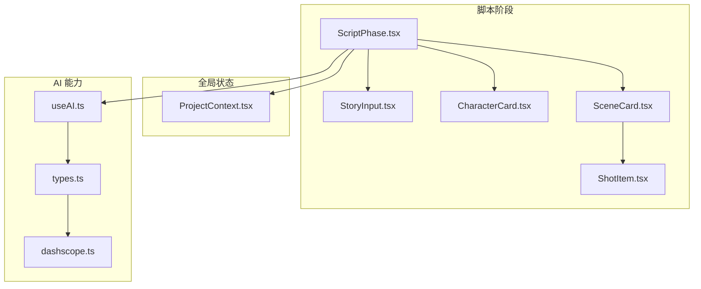
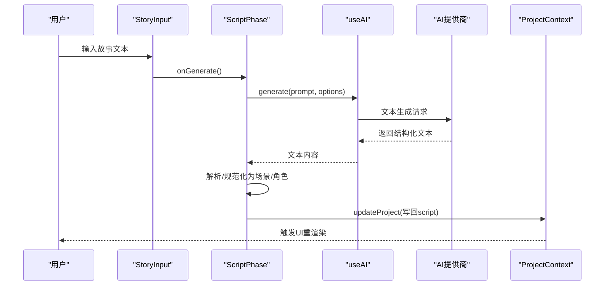
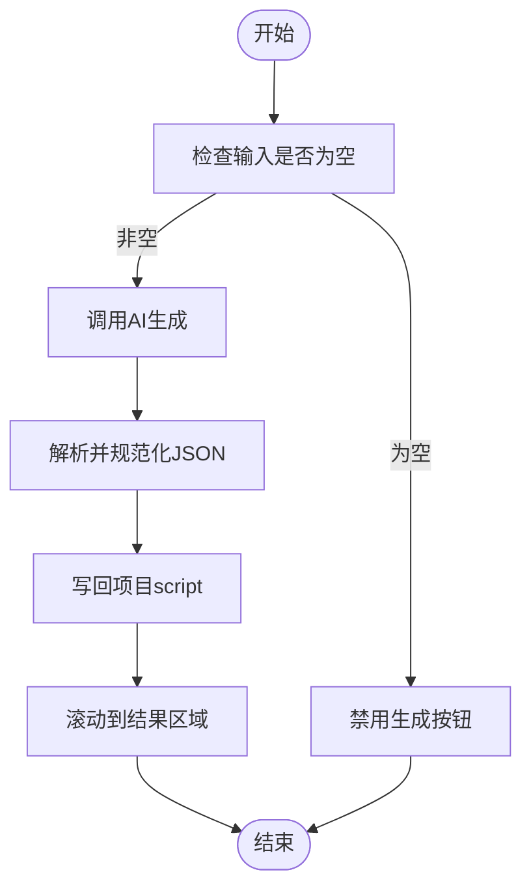
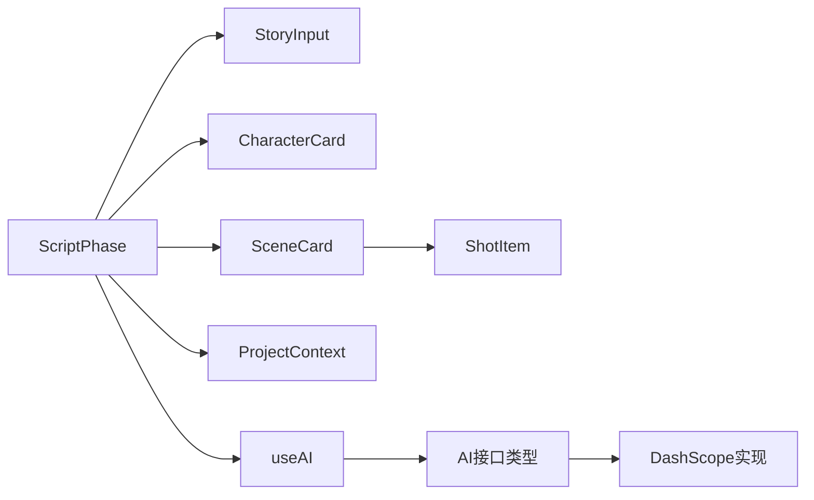

# 故事编辑器

<cite>
**本文引用的文件**
- [ScriptPhase.tsx](file://src/phases/script/ScriptPhase.tsx)
- [StoryInput.tsx](file://src/phases/script/components/StoryInput.tsx)
- [CharacterCard.tsx](file://src/phases/script/components/CharacterCard.tsx)
- [SceneCard.tsx](file://src/phases/script/components/SceneCard.tsx)
- [ShotItem.tsx](file://src/phases/script/components/ShotItem.tsx)
- [useAI.ts](file://src/shared/hooks/useAI.ts)
- [ProjectContext.tsx](file://src/shared/contexts/ProjectContext.tsx)
- [types.ts](file://src/services/ai/types.ts)
- [dashscope.ts](file://src/services/ai/dashscope.ts)
</cite>

## 目录
1. [简介](#简介)
2. [项目结构](#项目结构)
3. [核心组件](#核心组件)
4. [架构总览](#架构总览)
5. [详细组件分析](#详细组件分析)
6. [依赖关系分析](#依赖关系分析)
7. [性能考量](#性能考量)
8. [故障排查指南](#故障排查指南)
9. [结论](#结论)
10. [附录](#附录)

## 简介
本文件为“故事编辑器”的深度技术文档，聚焦剧本编辑、角色管理、场景组织与镜头编辑四大核心功能。文档深入解释内联编辑器的实现原理、选项选择器的交互设计、角色列表与场景列表的数据绑定机制；阐述镜头条目组件的状态管理、编辑模式切换与实时预览能力；并说明与AI续写/改写、编辑历史追踪及跨阶段数据流转的集成方式。最后提供使用技巧与协作最佳实践，帮助团队高效协作与持续迭代。

## 项目结构
故事编辑器位于前端 Phase 01 的脚本阶段，采用“单一可信数据源 + 自动持久化”的上下文驱动架构，配合统一的 AI Hook 实现“信息-反馈律”。核心文件组织如下：
- 脚本阶段主组件：负责整体流程编排、AI 生成、统计计算与阶段跳转
- 输入与展示组件：故事输入区、角色卡片、场景卡片、镜头条目
- 全局状态：项目上下文提供更新、保存与阶段切换
- AI 能力：统一文本/图像/视频服务接口与具体提供商适配

图表来源
- [ScriptPhase.tsx:143-495](file://src/phases/script/ScriptPhase.tsx#L143-L495)
- [StoryInput.tsx:17-115](file://src/phases/script/components/StoryInput.tsx#L17-L115)
- [CharacterCard.tsx:15-201](file://src/phases/script/components/CharacterCard.tsx#L15-L201)
- [SceneCard.tsx:22-216](file://src/phases/script/components/SceneCard.tsx#L22-L216)
- [ShotItem.tsx:21-170](file://src/phases/script/components/ShotItem.tsx#L21-L170)
- [ProjectContext.tsx:47-187](file://src/shared/contexts/ProjectContext.tsx#L47-L187)
- [useAI.ts:14-97](file://src/shared/hooks/useAI.ts#L14-L97)
- [types.ts:6-72](file://src/services/ai/types.ts#L6-L72)
- [dashscope.ts:95-326](file://src/services/ai/dashscope.ts#L95-L326)

章节来源
- [ScriptPhase.tsx:143-495](file://src/phases/script/ScriptPhase.tsx#L143-L495)

## 核心组件
- 脚本阶段主组件：负责统计场景/角色/镜头数量、完成度校验、AI 生成与结果归档、滚动定位、阶段推进
- 故事输入区：提供字词统计、生成按钮可用性控制、错误提示与操作文案
- 角色卡片：内联编辑、参考图占位、序号徽章、删除入口
- 场景卡片：内联编辑、镜头展开/收起、镜头计数与总时长估算、删除入口
- 镜头条目：内联编辑、镜头角度下拉选择、时长输入、删除入口
- 项目上下文：单一可信数据源、防抖持久化、阶段切换
- AI Hook：统一文本/图像/视频调用，集中处理 loading/error

章节来源
- [ScriptPhase.tsx:143-495](file://src/phases/script/ScriptPhase.tsx#L143-L495)
- [StoryInput.tsx:17-115](file://src/phases/script/components/StoryInput.tsx#L17-L115)
- [CharacterCard.tsx:15-201](file://src/phases/script/components/CharacterCard.tsx#L15-L201)
- [SceneCard.tsx:22-216](file://src/phases/script/components/SceneCard.tsx#L22-L216)
- [ShotItem.tsx:21-170](file://src/phases/script/components/ShotItem.tsx#L21-L170)
- [ProjectContext.tsx:47-187](file://src/shared/contexts/ProjectContext.tsx#L47-L187)
- [useAI.ts:14-97](file://src/shared/hooks/useAI.ts#L14-L97)

## 架构总览
故事编辑器遵循“控制论信息-反馈律”：用户输入故事文本 → AI 拆解为结构化数据 → 展示结果 → 用户内联编辑 → 数据回写至项目上下文 → 自动持久化 → 达成阶段完成条件后进入下一阶段。

图表来源
- [ScriptPhase.tsx:174-202](file://src/phases/script/ScriptPhase.tsx#L174-L202)
- [useAI.ts:18-36](file://src/shared/hooks/useAI.ts#L18-L36)
- [types.ts:18-20](file://src/services/ai/types.ts#L18-L20)
- [dashscope.ts:95-138](file://src/services/ai/dashscope.ts#L95-L138)

## 详细组件分析

### 脚本阶段主组件（ScriptPhase）
职责与特性
- 统计与完成度：计算场景数、角色数、镜头总数与总时长，判定阶段完成条件
- AI 生成：封装系统提示词、温度参数与结果解析/规范化流程
- CRUD 操作：对场景、镜头、角色进行增删改，均通过项目上下文写回
- 阶段推进：完成条件满足后启用下一步按钮

关键流程
- 输入变更：直接写入项目故事字段
- 生成流程：调用文本AI → 解析 JSON → 规范化 → 写回项目 → 平滑滚动到结果区
- 场景/镜头/角色 CRUD：映射到场景数组或角色数组的局部更新

图表来源
- [ScriptPhase.tsx:168-202](file://src/phases/script/ScriptPhase.tsx#L168-L202)
- [ScriptPhase.tsx:102-138](file://src/phases/script/ScriptPhase.tsx#L102-L138)

章节来源
- [ScriptPhase.tsx:143-495](file://src/phases/script/ScriptPhase.tsx#L143-L495)

### 故事输入区（StoryInput）
交互与状态
- 字词统计：实时显示词数与字符数
- 生成按钮：根据输入长度与加载状态启用/禁用
- 错误提示：展示AI调用错误信息
- 操作文案：首次生成与重复生成的文案区分

实现要点
- 受控组件：value 与 onChange 双向绑定
- 加载态：禁用输入框，显示加载指示
- 错误态：错误横幅展示，便于用户感知

章节来源
- [StoryInput.tsx:17-115](file://src/phases/script/components/StoryInput.tsx#L17-L115)

### 角色卡片（CharacterCard）
内联编辑与数据绑定
- 编辑态：输入框/多行文本框分别编辑名称、性格背景、外观描述
- 非编辑态：点击卡片主体触发编辑；悬停显示编辑图标
- 删除入口：右上角删除按钮
- 参考图位：占位图与“定妆图 Phase 02”提示
- 序号徽章：基于索引生成的编号

数据绑定机制
- 使用草稿值（draft）隔离编辑过程中的中间态
- 提交时统一写入，确保原子性与一致性

章节来源
- [CharacterCard.tsx:15-201](file://src/phases/script/components/CharacterCard.tsx#L15-L201)

### 场景卡片（SceneCard）
内联编辑与镜头管理
- 编辑态：标题与描述的内联编辑
- 展开/收起：控制镜头列表可见性
- 镜头统计：显示镜头数量与总时长估算
- 删除入口：右上角删除按钮
- 镜头列表：通过子组件 ShotItem 渲染与管理

数据绑定机制
- 通过 onUpdate/onDelete/onAddShot/onUpdateShot/onDeleteShot 回调与父组件联动
- 总时长按镜头时长累加，用于概览展示

章节来源
- [SceneCard.tsx:22-216](file://src/phases/script/components/SceneCard.tsx#L22-L216)

### 镜头条目（ShotItem）
内联编辑与选项选择器
- 编辑态：镜头描述、镜头角度、时长三要素编辑
- 选项选择器：镜头角度下拉框，内置常用角度枚举
- 时长输入：数值输入，带最小/最大约束
- 删除入口：悬停显示删除按钮

交互设计
- 草稿值隔离：编辑过程中不污染真实数据
- 提交校验：仅在合法数值范围内写回

章节来源
- [ShotItem.tsx:21-170](file://src/phases/script/components/ShotItem.tsx#L21-L170)

### 项目上下文（ProjectContext）
状态与持久化
- 单一可信数据源：项目对象作为唯一事实来源
- 防抖保存：2秒去抖，避免频繁写盘
- 生命周期保存：页面卸载前强制保存
- 阶段切换：setPhase 更新当前阶段并写回存储

章节来源
- [ProjectContext.tsx:47-187](file://src/shared/contexts/ProjectContext.tsx#L47-L187)

### AI 能力与提供商适配
- 统一接口：TextAIService/ImageAIService/VideoAIService 抽象
- 具体实现：以 DashScope 为例，封装文本/图像/视频服务
- Hook 封装：useTextAI/useImageAI/useVideoAI 统一 loading/error 状态

章节来源
- [useAI.ts:14-97](file://src/shared/hooks/useAI.ts#L14-L97)
- [types.ts:6-72](file://src/services/ai/types.ts#L6-L72)
- [dashscope.ts:95-326](file://src/services/ai/dashscope.ts#L95-L326)

## 依赖关系分析
- 组件耦合
  - ScriptPhase 依赖 StoryInput、CharacterCard、SceneCard
  - SceneCard 依赖 ShotItem
  - 所有编辑组件通过回调与 ScriptPhase 联动
- 上下文依赖
  - ScriptPhase 依赖 ProjectContext 进行数据写回与持久化
- AI 依赖
  - ScriptPhase 通过 useTextAI 调用 AI 文本服务
  - useAI 依赖 AI 接口抽象与具体提供商实现

图表来源
- [ScriptPhase.tsx:143-495](file://src/phases/script/ScriptPhase.tsx#L143-L495)
- [StoryInput.tsx:17-115](file://src/phases/script/components/StoryInput.tsx#L17-L115)
- [CharacterCard.tsx:15-201](file://src/phases/script/components/CharacterCard.tsx#L15-L201)
- [SceneCard.tsx:22-216](file://src/phases/script/components/SceneCard.tsx#L22-L216)
- [ShotItem.tsx:21-170](file://src/phases/script/components/ShotItem.tsx#L21-L170)
- [ProjectContext.tsx:47-187](file://src/shared/contexts/ProjectContext.tsx#L47-L187)
- [useAI.ts:14-97](file://src/shared/hooks/useAI.ts#L14-L97)
- [types.ts:6-72](file://src/services/ai/types.ts#L6-L72)
- [dashscope.ts:95-326](file://src/services/ai/dashscope.ts#L95-L326)

## 性能考量
- 防抖持久化：2秒去抖减少频繁写盘，适合长文本编辑
- 计算优化：统计镜头总数与总时长使用 useMemo，避免不必要的重算
- 渲染节流：卡片动画延迟按索引递增，提升视觉层次感但不影响交互响应
- UI 状态：内联编辑采用草稿值，降低回流与无效渲染

## 故障排查指南
常见问题与处理
- AI 生成失败
  - 现象：错误横幅出现，按钮不可用
  - 排查：确认 API Key 配置、网络连通性、提供商限额
  - 参考：AI Hook 在异常时设置 error，并在主组件中弹出提示
- JSON 解析失败
  - 现象：解析阶段抛错，提示未找到合法 JSON 结构
  - 排查：检查系统提示词格式、模型输出稳定性
- 项目保存失败
  - 现象：保存状态异常或列表未刷新
  - 排查：检查本地存储权限、磁盘空间、去抖定时器状态

章节来源
- [ScriptPhase.tsx:191-202](file://src/phases/script/ScriptPhase.tsx#L191-L202)
- [useAI.ts:18-36](file://src/shared/hooks/useAI.ts#L18-L36)
- [ProjectContext.tsx:71-106](file://src/shared/contexts/ProjectContext.tsx#L71-L106)

## 结论
故事编辑器以清晰的组件边界与统一的上下文驱动，实现了从“输入-拆解-展示-编辑-持久化-推进”的完整闭环。内联编辑器与选项选择器提供了直观高效的编辑体验；AI 续写/改写可通过扩展文本服务接口无缝接入；防抖持久化与阶段完成度校验保障了协作效率与质量门槛。建议在团队中推广“先AI拆解再人工细化”的工作流，并结合阶段完成条件推动跨阶段协作。

## 附录

### 使用技巧
- 先输入简明故事梗概，再使用“AI 智能分镜”生成初版结构
- 优先完善角色外观描述，便于后续资产生成
- 使用镜头角度下拉快速标准化镜头语言
- 利用“展开/收起”聚焦当前场景，减少信息过载

### 协作最佳实践
- 团队成员在各自场景/角色上并行编辑，减少冲突
- 定期导出项目快照，利用防抖保存机制保证数据安全
- 通过阶段完成条件卡点，确保每个阶段质量再进入下一阶段