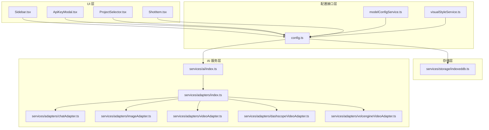
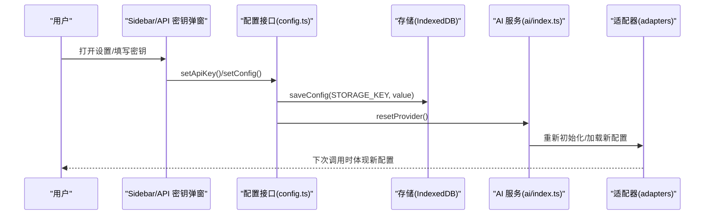
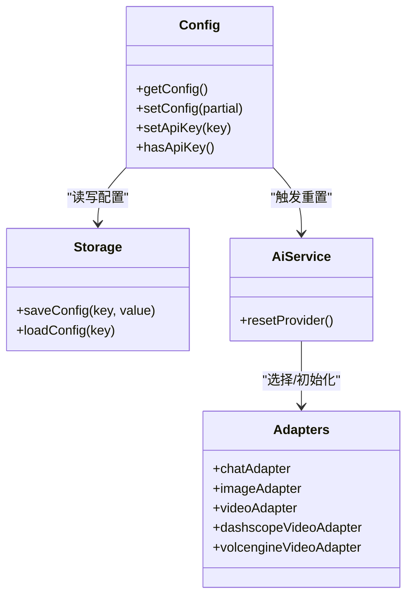
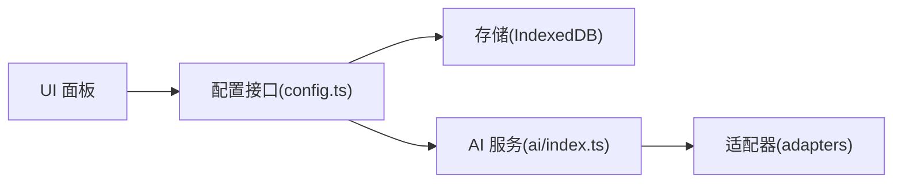

# 配置面板

<cite>
**本文引用的文件**
- [src/config.ts](file://src/config.ts)
- [src/services/storage/indexeddb.ts](file://src/services/storage/indexeddb.ts)
- [src/shared/components/ApiKeyModal.tsx](file://src/shared/components/ApiKeyModal.tsx)
- [src/shared/components/Sidebar.tsx](file://src/shared/components/Sidebar.tsx)
- [src/shared/components/ProjectSelector.tsx](file://src/shared/components/ProjectSelector.tsx)
- [src/services/ai/index.ts](file://src/services/ai/index.ts)
- [src/services/modelConfigService.ts](file://src/services/modelConfigService.ts)
- [src/services/visualStyleService.ts](file://src/services/visualStyleService.ts)
- [src/services/modelService.ts](file://src/services/modelService.ts)
- [src/services/adapters/index.ts](file://src/services/adapters/index.ts)
- [src/services/adapters/chatAdapter.ts](file://src/services/adapters/chatAdapter.ts)
- [src/services/adapters/imageAdapter.ts](file://src/services/adapters/imageAdapter.ts)
- [src/services/adapters/videoAdapter.ts](file://src/services/adapters/videoAdapter.ts)
- [src/services/adapters/dashscopeVideoAdapter.ts](file://src/services/adapters/dashscopeVideoAdapter.ts)
- [src/services/adapters/volcengineVideoAdapter.ts](file://src/services/adapters/volcengineVideoAdapter.ts)
- [src/phases/script/components/ShotItem.tsx](file://src/phases/script/components/ShotItem.tsx)
</cite>

## 目录
1. [简介](#简介)
2. [项目结构](#项目结构)
3. [核心组件](#核心组件)
4. [架构总览](#架构总览)
5. [详细组件分析](#详细组件分析)
6. [依赖关系分析](#依赖关系分析)
7. [性能考量](#性能考量)
8. [故障排除指南](#故障排除指南)
9. [结论](#结论)
10. [附录](#附录)

## 简介
本文件面向“配置面板”的设计与实现，聚焦以下能力：
- AI 模型选择：文本、图像、视频模型的配置与切换
- 视觉风格配置：风格参数的管理与应用
- 语言设置：界面语言与提示语言的控制
- 时长控制：镜头时长等参数的输入与校验
- 验证机制与默认值管理：配置项的合法性与回退策略
- 用户自定义选项处理：本地存储与实时生效
- 与 AI 服务的集成：参数传递与调用链路
- 配置持久化策略：IndexedDB 存储与键空间管理
- 版本兼容与重置：配置迁移与重置流程
- 优化建议与故障排除

## 项目结构
配置相关能力由“配置接口层 + 存储层 + UI 面板 + AI 适配器”构成，形成“配置驱动、本地持久化、实时生效”的闭环。

图表来源
- [src/shared/components/Sidebar.tsx:39-214](file://src/shared/components/Sidebar.tsx#L39-L214)
- [src/shared/components/ApiKeyModal.tsx:1-114](file://src/shared/components/ApiKeyModal.tsx#L1-L114)
- [src/shared/components/ProjectSelector.tsx:1-302](file://src/shared/components/ProjectSelector.tsx#L1-L302)
- [src/phases/script/components/ShotItem.tsx:63-126](file://src/phases/script/components/ShotItem.tsx#L63-L126)
- [src/config.ts:1-47](file://src/config.ts#L1-L47)
- [src/services/storage/indexeddb.ts:1-190](file://src/services/storage/indexeddb.ts#L1-L190)
- [src/services/ai/index.ts](file://src/services/ai/index.ts)
- [src/services/adapters/index.ts](file://src/services/adapters/index.ts)
- [src/services/adapters/chatAdapter.ts](file://src/services/adapters/chatAdapter.ts)
- [src/services/adapters/imageAdapter.ts](file://src/services/adapters/imageAdapter.ts)
- [src/services/adapters/videoAdapter.ts](file://src/services/adapters/videoAdapter.ts)
- [src/services/adapters/dashscopeVideoAdapter.ts](file://src/services/adapters/dashscopeVideoAdapter.ts)
- [src/services/adapters/volcengineVideoAdapter.ts](file://src/services/adapters/volcengineVideoAdapter.ts)

章节来源
- [src/shared/components/Sidebar.tsx:39-214](file://src/shared/components/Sidebar.tsx#L39-L214)
- [src/shared/components/ApiKeyModal.tsx:1-114](file://src/shared/components/ApiKeyModal.tsx#L1-L114)
- [src/shared/components/ProjectSelector.tsx:1-302](file://src/shared/components/ProjectSelector.tsx#L1-L302)
- [src/phases/script/components/ShotItem.tsx:63-126](file://src/phases/script/components/ShotItem.tsx#L63-L126)
- [src/config.ts:1-47](file://src/config.ts#L1-L47)
- [src/services/storage/indexeddb.ts:1-190](file://src/services/storage/indexeddb.ts#L1-L190)

## 核心组件
- 配置接口层：集中管理应用配置，提供默认值、读取与更新能力，并与存储层交互。
- 存储层：以 IndexedDB 作为本地持久化后端，提供项目、资产与配置三类对象存储。
- UI 面板：侧边栏“设置”入口、API 密钥弹窗、项目选择器、镜头时长编辑等。
- AI 服务层：统一的 AI 服务入口与适配器集合，负责将配置映射为具体请求参数。

章节来源
- [src/config.ts:1-47](file://src/config.ts#L1-L47)
- [src/services/storage/indexeddb.ts:1-190](file://src/services/storage/indexeddb.ts#L1-L190)
- [src/shared/components/Sidebar.tsx:39-214](file://src/shared/components/Sidebar.tsx#L39-L214)
- [src/shared/components/ApiKeyModal.tsx:1-114](file://src/shared/components/ApiKeyModal.tsx#L1-L114)
- [src/shared/components/ProjectSelector.tsx:1-302](file://src/shared/components/ProjectSelector.tsx#L1-L302)
- [src/services/ai/index.ts](file://src/services/ai/index.ts)
- [src/services/adapters/index.ts](file://src/services/adapters/index.ts)

## 架构总览
配置从 UI 面板进入，经配置接口层写入存储层，同时触发 AI 服务的重置与参数刷新，确保配置变更实时生效。

图表来源
- [src/shared/components/ApiKeyModal.tsx:36-47](file://src/shared/components/ApiKeyModal.tsx#L36-L47)
- [src/config.ts:32-46](file://src/config.ts#L32-L46)
- [src/services/storage/indexeddb.ts:171-185](file://src/services/storage/indexeddb.ts#L171-L185)
- [src/services/ai/index.ts](file://src/services/ai/index.ts)

## 详细组件分析

### 配置接口层（config.ts）
- 结构与职责
  - 定义 AppConfig 接口，包含 AI 相关的 apiKey、baseUrl、textModel、imageModel、videoModel 字段。
  - 提供默认配置 DEFAULT_CONFIG，确保首次使用时具备可用值。
  - 提供 getConfig/setConfig/setApiKey/hasApiKey 等方法，支持部分更新与键级合并。
- 默认值与验证
  - 默认值在 DEFAULT_CONFIG 中集中定义，避免硬编码。
  - hasApiKey 用于 UI 状态提示（如“已配置/未配置”）。
- 实时性与副作用
  - setApiKey/setConfig 会更新内存中的 currentConfig。
  - 与存储层配合，保证重启后仍可恢复。

章节来源
- [src/config.ts:1-47](file://src/config.ts#L1-L47)

### 存储层（IndexedDB）
- 存储结构
  - 对象存储：projects、assets、config。
  - 配置键空间：通过 saveConfig/loadConfig 以 key-value 形式持久化。
- 事务与错误处理
  - 统一封装 IDBRequest/IDBTransaction 的 Promise 化，提供 onsuccess/onerror/onabort 的统一处理。
  - 版本变更事件 onversionchange 主动关闭数据库，避免跨标签页锁库。
- 与配置的协作
  - ApiKeyModal 使用 STORAGE_KEY='ai.apiKey' 读写密钥。
  - 配置变更后立即落盘，保障离线可用与重启恢复。

章节来源
- [src/services/storage/indexeddb.ts:1-190](file://src/services/storage/indexeddb.ts#L1-L190)

### UI 面板：侧边栏设置入口（Sidebar.tsx）
- 功能点
  - 在底部展示“设置”按钮，点击打开 API 密钥弹窗。
  - 根据 hasApiKey 切换“已配置/未配置”的颜色状态。
- 与配置的交互
  - 打开弹窗时读取当前配置；关闭时刷新状态。
  - 通过 ApiKeyModal 完成密钥保存与重置。

章节来源
- [src/shared/components/Sidebar.tsx:178-214](file://src/shared/components/Sidebar.tsx#L178-L214)

### UI 面板：API 密钥弹窗（ApiKeyModal.tsx）
- 输入与验证
  - 支持明文/密文切换，保存前进行 trim() 去除首尾空白。
- 写入与重置
  - setApiKey 更新内存配置。
  - storage.saveConfig 将密钥写入 IndexedDB。
  - resetProvider 通知 AI 服务层重置适配器，使新密钥立即生效。
- 可访问性与 UX
  - 自动聚焦输入框，禁用无效输入，提供保存中状态反馈。

章节来源
- [src/shared/components/ApiKeyModal.tsx:1-114](file://src/shared/components/ApiKeyModal.tsx#L1-L114)

### UI 面板：项目选择器（ProjectSelector.tsx）
- 功能点
  - 展示“API 已配置/未配置”的状态提示，引导用户前往设置。
  - 加载本地 API Key 并刷新项目列表。
- 与配置的协作
  - 通过 loadApiKeyFromStorage 与 hasApiKey 与配置层联动。

章节来源
- [src/shared/components/ProjectSelector.tsx:1-302](file://src/shared/components/ProjectSelector.tsx#L1-L302)

### 时长控制（镜头时长编辑）
- 输入控件
  - 在镜头编辑区域提供时长输入框，限定最小值与最大值范围。
  - 输入类型为数字，单位为秒，实时保存至草稿并在提交后写入。
- 验证与边界
  - min/max 限制防止非法输入。
  - 提交时转换为数值并写入。

章节来源
- [src/phases/script/components/ShotItem.tsx:63-126](file://src/phases/script/components/ShotItem.tsx#L63-L126)

### AI 服务集成与参数传递
- 服务入口
  - services/ai/index.ts 作为统一入口，负责根据当前配置选择合适的适配器。
- 适配器族
  - chatAdapter、imageAdapter、videoAdapter 作为通用适配器。
  - dashscopeVideoAdapter、volcengineVideoAdapter 作为视频生成的具体实现。
- 参数映射
  - 配置层的 baseUrl、textModel、imageModel、videoModel 会被映射到对应适配器的请求参数中。
  - 适配器内部负责将配置参数序列化为供应商 API 所需格式。

图表来源
- [src/config.ts:28-46](file://src/config.ts#L28-L46)
- [src/services/storage/indexeddb.ts:171-185](file://src/services/storage/indexeddb.ts#L171-L185)
- [src/services/ai/index.ts](file://src/services/ai/index.ts)
- [src/services/adapters/index.ts](file://src/services/adapters/index.ts)
- [src/services/adapters/chatAdapter.ts](file://src/services/adapters/chatAdapter.ts)
- [src/services/adapters/imageAdapter.ts](file://src/services/adapters/imageAdapter.ts)
- [src/services/adapters/videoAdapter.ts](file://src/services/adapters/videoAdapter.ts)
- [src/services/adapters/dashscopeVideoAdapter.ts](file://src/services/adapters/dashscopeVideoAdapter.ts)
- [src/services/adapters/volcengineVideoAdapter.ts](file://src/services/adapters/volcengineVideoAdapter.ts)

## 依赖关系分析
- 组件耦合
  - UI 面板仅依赖配置接口层与存储层，不直接接触适配器，降低耦合。
  - 配置接口层与存储层松耦合，通过键空间隔离。
- 外部依赖
  - IndexedDB 作为浏览器内置存储，无需额外依赖。
  - 适配器依赖第三方供应商 API，配置层负责参数映射与选择。

图表来源
- [src/shared/components/ApiKeyModal.tsx:1-114](file://src/shared/components/ApiKeyModal.tsx#L1-L114)
- [src/config.ts:1-47](file://src/config.ts#L1-L47)
- [src/services/storage/indexeddb.ts:1-190](file://src/services/storage/indexeddb.ts#L1-L190)
- [src/services/ai/index.ts](file://src/services/ai/index.ts)
- [src/services/adapters/index.ts](file://src/services/adapters/index.ts)

## 性能考量
- 存储性能
  - IndexedDB 事务批量写入，避免频繁 IO。
  - 配置键空间独立，减少锁竞争。
- UI 响应
  - 配置变更采用异步写入与重置，避免阻塞主线程。
  - 输入控件即时校验，减少无效请求。
- 适配器初始化
  - resetProvider 仅在配置变更时触发，避免不必要的初始化成本。

## 故障排除指南
- API 密钥无法保存
  - 检查 IndexedDB 是否可用（浏览器隐私模式或受限环境可能禁用）。
  - 确认 STORAGE_KEY='ai.apiKey' 的读写是否成功。
- 配置未生效
  - 确认是否调用了 resetProvider，使 AI 服务层重新加载配置。
  - 检查配置接口层的 setApiKey/setConfig 是否被正确调用。
- 时长输入异常
  - 确认 min/max 边界与输入类型（number）是否符合预期。
  - 检查草稿到持久化的提交流程是否执行。

章节来源
- [src/shared/components/ApiKeyModal.tsx:36-47](file://src/shared/components/ApiKeyModal.tsx#L36-L47)
- [src/services/storage/indexeddb.ts:171-185](file://src/services/storage/indexeddb.ts#L171-L185)
- [src/services/ai/index.ts](file://src/services/ai/index.ts)
- [src/phases/script/components/ShotItem.tsx:63-126](file://src/phases/script/components/ShotItem.tsx#L63-L126)

## 结论
配置面板通过“配置接口层 + 存储层 + UI 面板 + AI 服务层”的清晰分层，实现了：
- 明确的默认值与验证机制
- 本地持久化与跨会话恢复
- 配置变更的实时生效与适配器重置
- 清晰的扩展点（新增模型/风格/语言）

## 附录

### 配置项与默认值清单
- AI 配置
  - apiKey: 空字符串（需用户配置）
  - baseUrl: 供应商兼容模式地址
  - textModel: qwen-plus
  - imageModel: wanx-v1
  - videoModel: wanx-video-v1

章节来源
- [src/config.ts:16-24](file://src/config.ts#L16-L24)

### 持久化策略与键空间
- 键空间
  - ai.apiKey：API 密钥
  - 其他配置键：预留于 config.ts 的 setConfig 扩展
- 存储位置
  - IndexedDB 对象存储：config
- 版本兼容
  - IndexedDB 版本升级时主动关闭数据库，避免锁库冲突

章节来源
- [src/shared/components/ApiKeyModal.tsx:15-20](file://src/shared/components/ApiKeyModal.tsx#L15-L20)
- [src/services/storage/indexeddb.ts:44-75](file://src/services/storage/indexeddb.ts#L44-L75)

### 配置重置流程
- 触发时机
  - 用户在 API 密钥弹窗中保存密钥后
- 执行步骤
  - setApiKey 更新内存配置
  - storage.saveConfig 写入持久化
  - resetProvider 重置 AI 服务与适配器
- 效果
  - 新密钥立即生效，后续请求使用最新配置

章节来源
- [src/shared/components/ApiKeyModal.tsx:36-47](file://src/shared/components/ApiKeyModal.tsx#L36-L47)
- [src/services/ai/index.ts](file://src/services/ai/index.ts)