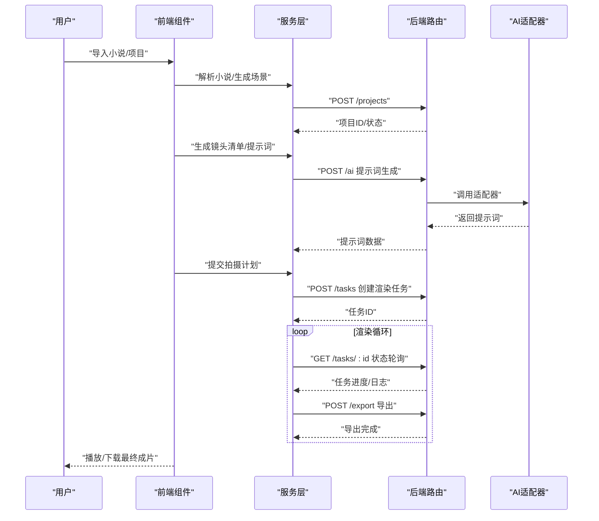
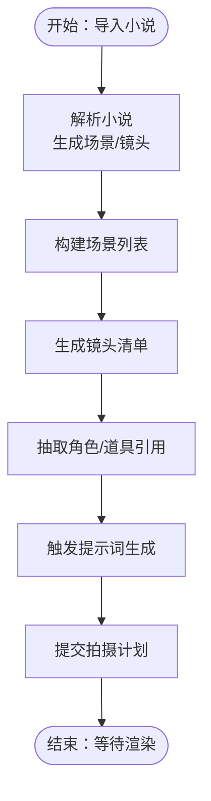
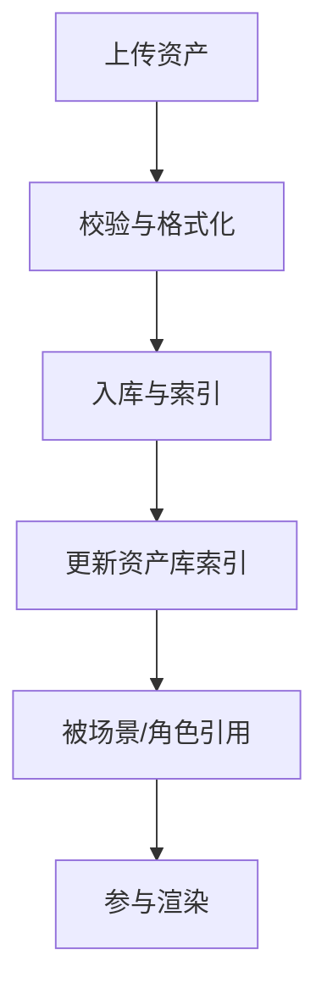
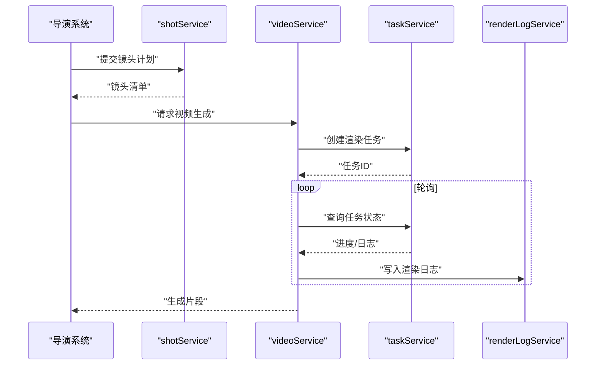
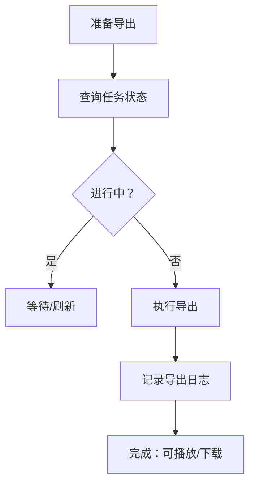
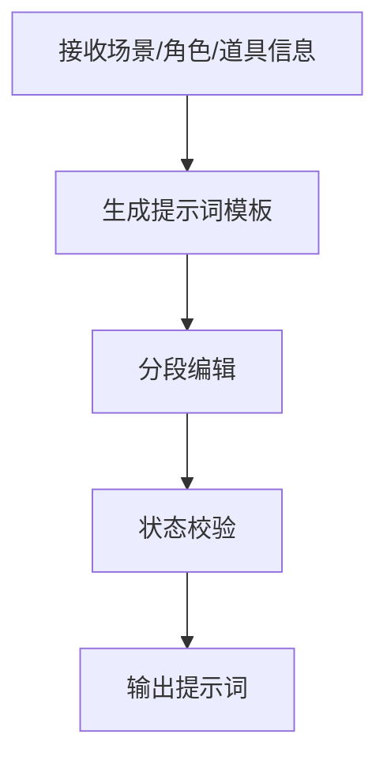
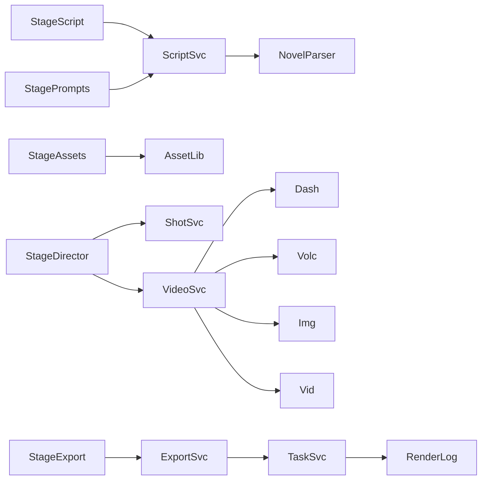

# 工作流阶段组件

<cite>
**本文引用的文件**
- [README.md](file://README.md)
- [App.tsx](file://App.tsx)
- [StageScript/index.tsx](file://components/StageScript/index.tsx)
- [StageScript/README.md](file://components/StageScript/README.md)
- [StageScript/utils.ts](file://components/StageScript/utils.ts)
- [StageScript/constants.ts](file://components/StageScript/constants.ts)
- [StageAssets/index.tsx](file://components/StageAssets/index.tsx)
- [StageAssets/README.md](file://components/StageAssets/README.md)
- [StageAssets/utils.ts](file://components/StageAssets/utils.ts)
- [StageAssets/constants.ts](file://components/StageAssets/constants.ts)
- [StageDirector/index.tsx](file://components/StageDirector/index.tsx)
- [StageDirector/README.md](file://components/StageDirector/README.md)
- [StageDirector/utils.ts](file://components/StageDirector/utils.ts)
- [StageDirector/constants.ts](file://components/StageDirector/constants.ts)
- [StageExport/index.tsx](file://components/StageExport/index.tsx)
- [StageExport/README.md](file://components/StageExport/README.md)
- [StageExport/utils.ts](file://components/StageExport/utils.ts)
- [StageExport/constants.ts](file://components/StageExport/constants.ts)
- [StagePrompts/index.tsx](file://components/StagePrompts/index.tsx)
- [StagePrompts/README.md](file://components/StagePrompts/README.md)
- [StagePrompts/utils.ts](file://components/StagePrompts/utils.ts)
- [StagePrompts/constants.ts](file://components/StagePrompts/constants.ts)
- [StageScript.tsx](file://components/StageScript.tsx)
- [StageAssets.tsx](file://components/StageAssets.tsx)
- [StageDirector.tsx](file://components/StageDirector.tsx)
- [StageExport.tsx](file://components/StageExport.tsx)
- [StagePrompts.tsx](file://components/StagePrompts.tsx)
- [server/src/services/scriptService.ts](file://server/src/services/scriptService.ts)
- [server/src/services/shotService.ts](file://server/src/services/shotService.ts)
- [server/src/services/videoService.ts](file://server/src/services/videoService.ts)
- [services/novelParser.ts](file://services/novelParser.ts)
- [services/assetLibraryService.ts](file://services/assetLibraryService.ts)
- [services/exportService.ts](file://services/exportService.ts)
- [services/renderLogService.ts](file://services/renderLogService.ts)
- [services/taskService.ts](file://services/taskService.ts)
- [services/modelService.ts](file://services/modelService.ts)
- [services/visualStyleService.ts](file://services/visualStyleService.ts)
- [services/adapters/chatAdapter.ts](file://services/adapters/chatAdapter.ts)
- [services/adapters/imageAdapter.ts](file://services/adapters/imageAdapter.ts)
- [services/adapters/videoAdapter.ts](file://services/adapters/videoAdapter.ts)
- [services/adapters/dashscopeVideoAdapter.ts](file://services/adapters/dashscopeVideoAdapter.ts)
- [services/adapters/volcengineVideoAdapter.ts](file://services/adapters/volcengineVideoAdapter.ts)
- [server/src/routes/projects.ts](file://server/src/routes/projects.ts)
- [server/src/routes/tasks.ts](file://server/src/routes/tasks.ts)
- [server/src/routes/assets.ts](file://server/src/routes/assets.ts)
- [server/src/routes/ai.ts](file://server/src/routes/ai.ts)
- [server/src/routes/dataTransfer.ts](file://server/src/routes/dataTransfer.ts)
- [server/src/middleware/auth.ts](file://server/src/middleware/auth.ts)
- [server/src/config/database.ts](file://server/src/config/database.ts)
- [server/src/config/sqliteDatabase.ts](file://server/src/config/sqliteDatabase.ts)
- [server/src/lib/utils.ts](file://server/src/lib/utils.ts)
- [types/model.ts](file://types/model.ts)
</cite>

## 目录
1. [简介](#简介)
2. [项目结构](#项目结构)
3. [核心组件](#核心组件)
4. [架构总览](#架构总览)
5. [详细组件分析](#详细组件分析)
6. [依赖分析](#依赖分析)
7. [性能考虑](#性能考虑)
8. [故障排除指南](#故障排除指南)
9. [结论](#结论)
10. [附录](#附录)

## 简介
本文件面向AI Shotlive工作流阶段组件，围绕五个核心阶段展开：StageScript（剧本系统）、StageAssets（资产系统）、StageDirector（导演系统）、StageExport（导出系统）、StagePrompts（提示词系统）。文档从设计理念、职责边界、数据流转、组件间协作、端到端执行流程、通信与状态同步、错误处理策略等方面进行系统化梳理，并提供使用示例与最佳实践建议。

## 项目结构
AI Shotlive采用前端React组件与后端Node服务分层架构，前端通过组件模块化组织五大阶段，后端以路由与服务层解耦业务逻辑。整体结构如下：

```mermaid
graph TB
subgraph "前端"
App["App.tsx"]
StageScript["StageScript 组件"]
StageAssets["StageAssets 组件"]
StageDirector["StageDirector 组件"]
StageExport["StageExport 组件"]
StagePrompts["StagePrompts 组件"]
end
subgraph "服务层"
ScriptSvc["scriptService.ts"]
ShotSvc["shotService.ts"]
VideoSvc["videoService.ts"]
AssetLib["assetLibraryService.ts"]
ExportSvc["exportService.ts"]
RenderLog["renderLogService.ts"]
TaskSvc["taskService.ts"]
ModelSvc["modelService.ts"]
VSvc["visualStyleService.ts"]
NovelParser["novelParser.ts"]
end
subgraph "适配器"
Chat["chatAdapter.ts"]
Img["imageAdapter.ts"]
Vid["videoAdapter.ts"]
Dash["dashscopeVideoAdapter.ts"]
Volc["volcengineVideoAdapter.ts"]
end
subgraph "后端路由"
RoutesProj["projects.ts"]
RoutesTasks["tasks.ts"]
RoutesAssets["assets.ts"]
RoutesAI["ai.ts"]
RoutesDT["dataTransfer.ts"]
AuthMW["auth.ts"]
end
App --> StageScript
App --> StageAssets
App --> StageDirector
App --> StageExport
App --> StagePrompts
StageScript --> ScriptSvc
StageAssets --> AssetLib
StageDirector --> ShotSvc
StageDirector --> VideoSvc
StageExport --> ExportSvc
StageExport --> RenderLog
StagePrompts --> ScriptSvc
ScriptSvc --> NovelParser
ShotSvc --> TaskSvc
VideoSvc --> Img
VideoSvc --> Vid
VideoSvc --> Dash
VideoSvc --> Volc
ExportSvc --> TaskSvc
RoutesProj --> ScriptSvc
RoutesTasks --> TaskSvc
RoutesAssets --> AssetLib
RoutesAI --> Chat
RoutesAI --> Img
RoutesAI --> Vid
RoutesDT --> ScriptSvc
AuthMW --> RoutesProj
AuthMW --> RoutesTasks
AuthMW --> RoutesAssets
AuthMW --> RoutesAI
```

图表来源
- [App.tsx](file://App.tsx)
- [StageScript/index.tsx](file://components/StageScript/index.tsx)
- [StageAssets/index.tsx](file://components/StageAssets/index.tsx)
- [StageDirector/index.tsx](file://components/StageDirector/index.tsx)
- [StageExport/index.tsx](file://components/StageExport/index.tsx)
- [StagePrompts/index.tsx](file://components/StagePrompts/index.tsx)
- [server/src/services/scriptService.ts](file://server/src/services/scriptService.ts)
- [server/src/services/shotService.ts](file://server/src/services/shotService.ts)
- [server/src/services/videoService.ts](file://server/src/services/videoService.ts)
- [services/novelParser.ts](file://services/novelParser.ts)
- [services/assetLibraryService.ts](file://services/assetLibraryService.ts)
- [services/exportService.ts](file://services/exportService.ts)
- [services/renderLogService.ts](file://services/renderLogService.ts)
- [services/taskService.ts](file://services/taskService.ts)
- [services/modelService.ts](file://services/modelService.ts)
- [services/visualStyleService.ts](file://services/visualStyleService.ts)
- [services/adapters/chatAdapter.ts](file://services/adapters/chatAdapter.ts)
- [services/adapters/imageAdapter.ts](file://services/adapters/imageAdapter.ts)
- [services/adapters/videoAdapter.ts](file://services/adapters/videoAdapter.ts)
- [services/adapters/dashscopeVideoAdapter.ts](file://services/adapters/dashscopeVideoAdapter.ts)
- [services/adapters/volcengineVideoAdapter.ts](file://services/adapters/volcengineVideoAdapter.ts)
- [server/src/routes/projects.ts](file://server/src/routes/projects.ts)
- [server/src/routes/tasks.ts](file://server/src/routes/tasks.ts)
- [server/src/routes/assets.ts](file://server/src/routes/assets.ts)
- [server/src/routes/ai.ts](file://server/src/routes/ai.ts)
- [server/src/routes/dataTransfer.ts](file://server/src/routes/dataTransfer.ts)
- [server/src/middleware/auth.ts](file://server/src/middleware/auth.ts)

章节来源
- [README.md](file://README.md)
- [App.tsx](file://App.tsx)

## 核心组件
本节概述五大阶段组件的职责边界与协作关系，强调数据在各阶段之间的流向与转换。

- StageScript（剧本系统）
  - 职责：负责小说文本解析、场景拆分、镜头分解、角色与道具管理、脚本编辑与配置面板。
  - 关键输入：小说文本或项目数据；关键输出：场景列表、镜头清单、角色/道具信息。
  - 协作：与后端scriptService交互，调用novelParser进行解析；与StagePrompts联动生成提示词；与StageDirector传递镜头清单。

- StageAssets（资产系统）
  - 职责：管理角色、场景、道具等视觉资产，支持上传、预览、选择与关联。
  - 关键输入：资产文件与元数据；关键输出：资产库条目、关联映射。
  - 协作：通过assetLibraryService维护资产；与StageDirector共享场景/角色资源；与StageExport提供素材。

- StageDirector（导演系统）
  - 职责：镜头编排、关键帧编辑、相机运动指导、渲染任务调度。
  - 关键输入：场景/镜头清单、资产信息、视觉风格；关键输出：拍摄计划、渲染任务。
  - 协作：调用shotService与videoService生成视频片段；与TaskService协调异步任务；与RenderLog记录渲染日志。

- StageExport（导出系统）
  - 职责：渲染结果可视化、二次选项配置、导出控制、渲染日志查看。
  - 关键输入：渲染任务状态、视频片段；关键输出：最终成片、导出参数。
  - 协作：通过exportService与renderLogService管理导出流程；与TaskService查询任务状态。

- StagePrompts（提示词系统）
  - 职责：根据剧本与资产生成提示词模板，支持分段编辑与状态反馈。
  - 关键输入：场景/角色/道具信息；关键输出：提示词内容。
  - 协作：与scriptService联动；与AI适配器交互生成提示词。

章节来源
- [StageScript/README.md](file://components/StageScript/README.md)
- [StageAssets/README.md](file://components/StageAssets/README.md)
- [StageDirector/README.md](file://components/StageDirector/README.md)
- [StageExport/README.md](file://components/StageExport/README.md)
- [StagePrompts/README.md](file://components/StagePrompts/README.md)

## 架构总览
下图展示从“小说解析”到“最终成片”的端到端执行流程，涵盖前端组件、服务层与后端路由的交互。

图表来源
- [server/src/routes/projects.ts](file://server/src/routes/projects.ts)
- [server/src/routes/tasks.ts](file://server/src/routes/tasks.ts)
- [server/src/routes/ai.ts](file://server/src/routes/ai.ts)
- [server/src/routes/dataTransfer.ts](file://server/src/routes/dataTransfer.ts)
- [services/adapters/chatAdapter.ts](file://services/adapters/chatAdapter.ts)
- [services/adapters/imageAdapter.ts](file://services/adapters/imageAdapter.ts)
- [services/adapters/videoAdapter.ts](file://services/adapters/videoAdapter.ts)
- [services/adapters/dashscopeVideoAdapter.ts](file://services/adapters/dashscopeVideoAdapter.ts)
- [services/adapters/volcengineVideoAdapter.ts](file://services/adapters/volcengineVideoAdapter.ts)

## 详细组件分析

### StageScript 剧本系统
- 设计理念
  - 将小说文本结构化为可执行的场景与镜头清单，提供可视化编辑与配置能力。
  - 通过常量与工具函数抽象通用行为，保证跨页面一致性。
- 数据流
  - 输入：小说文本或项目数据
  - 处理：解析、场景拆分、镜头分解、角色/道具抽取
  - 输出：场景列表、镜头清单、角色/道具信息
- 关键接口与职责
  - 场景管理：场景列表、场景分解视图、场景编辑器
  - 角色与道具：角色列表、道具列表、关联与预览
  - 配置与导出：配置面板、导出与传输
- 与后端协作
  - 通过scriptService与novelParser完成解析与存储
  - 与StagePrompts联动生成提示词
  - 与StageDirector传递镜头清单

图表来源
- [server/src/services/scriptService.ts](file://server/src/services/scriptService.ts)
- [services/novelParser.ts](file://services/novelParser.ts)
- [StageScript/utils.ts](file://components/StageScript/utils.ts)
- [StageScript/constants.ts](file://components/StageScript/constants.ts)

章节来源
- [StageScript/index.tsx](file://components/StageScript/index.tsx)
- [StageScript/README.md](file://components/StageScript/README.md)
- [StageScript/utils.ts](file://components/StageScript/utils.ts)
- [StageScript/constants.ts](file://components/StageScript/constants.ts)
- [server/src/services/scriptService.ts](file://server/src/services/scriptService.ts)
- [services/novelParser.ts](file://services/novelParser.ts)

### StageAssets 资产系统
- 设计理念
  - 提供统一的资产库管理界面，支持上传、预览、分类与关联，确保导演与导出阶段可快速检索所需资源。
- 数据流
  - 输入：图片/模型等资产文件
  - 处理：校验、入库、索引、元数据写入
  - 输出：资产条目、可用资源集合
- 关键接口与职责
  - 资产卡片：角色卡、场景卡、道具卡
  - 上传与预览：图片上传按钮、预览模态框
  - 选择与关联：回合制/着装切换、网格预览
- 与后端协作
  - 通过assetLibraryService维护资产生命周期
  - 与StageDirector共享场景/角色资源
  - 与StageExport提供素材

图表来源
- [services/assetLibraryService.ts](file://services/assetLibraryService.ts)
- [StageAssets/utils.ts](file://components/StageAssets/utils.ts)
- [StageAssets/constants.ts](file://components/StageAssets/constants.ts)

章节来源
- [StageAssets/index.tsx](file://components/StageAssets/index.tsx)
- [StageAssets/README.md](file://components/StageAssets/README.md)
- [StageAssets/utils.ts](file://components/StageAssets/utils.ts)
- [StageAssets/constants.ts](file://components/StageAssets/constants.ts)
- [services/assetLibraryService.ts](file://services/assetLibraryService.ts)

### StageDirector 导演系统
- 设计理念
  - 将镜头清单转化为可执行的拍摄计划，提供关键帧编辑与相机运动指导，协调渲染任务。
- 数据流
  - 输入：场景/镜头清单、资产信息、视觉风格
  - 处理：关键帧编辑、相机运动、任务调度
  - 输出：渲染任务、拍摄计划
- 关键接口与职责
  - 拍摄工作台：镜头卡片、关键帧编辑器、九宫格预览
  - 场景上下文：场景上下文面板、图像预览
  - 渲染生成：视频生成器、相机运动指导
- 与后端协作
  - 通过shotService与videoService生成视频片段
  - 与TaskService协调异步任务
  - 与RenderLog记录渲染日志

图表来源
- [server/src/services/shotService.ts](file://server/src/services/shotService.ts)
- [server/src/services/videoService.ts](file://server/src/services/videoService.ts)
- [services/taskService.ts](file://services/taskService.ts)
- [services/renderLogService.ts](file://services/renderLogService.ts)
- [StageDirector/utils.ts](file://components/StageDirector/utils.ts)
- [StageDirector/constants.ts](file://components/StageDirector/constants.ts)

章节来源
- [StageDirector/index.tsx](file://components/StageDirector/index.tsx)
- [StageDirector/README.md](file://components/StageDirector/README.md)
- [StageDirector/utils.ts](file://components/StageDirector/utils.ts)
- [StageDirector/constants.ts](file://components/StageDirector/constants.ts)
- [server/src/services/shotService.ts](file://server/src/services/shotService.ts)
- [server/src/services/videoService.ts](file://server/src/services/videoService.ts)
- [services/taskService.ts](file://services/taskService.ts)
- [services/renderLogService.ts](file://services/renderLogService.ts)

### StageExport 导出系统
- 设计理念
  - 提供渲染结果可视化、二次选项配置与导出控制，支持查看渲染日志与回放。
- 数据流
  - 输入：渲染任务状态、视频片段
  - 处理：状态面板、时间线可视化、二次选项
  - 输出：最终成片、导出参数
- 关键接口与职责
  - 状态面板：渲染状态、进度、日志
  - 时间线可视化：片段拼接、预览
  - 行动按钮：导出、重试、下载
- 与后端协作
  - 通过exportService与renderLogService管理导出流程
  - 与TaskService查询任务状态

图表来源
- [services/exportService.ts](file://services/exportService.ts)
- [services/renderLogService.ts](file://services/renderLogService.ts)
- [services/taskService.ts](file://services/taskService.ts)
- [StageExport/utils.ts](file://components/StageExport/utils.ts)
- [StageExport/constants.ts](file://components/StageExport/constants.ts)

章节来源
- [StageExport/index.tsx](file://components/StageExport/index.tsx)
- [StageExport/README.md](file://components/StageExport/README.md)
- [StageExport/utils.ts](file://components/StageExport/utils.ts)
- [StageExport/constants.ts](file://components/StageExport/constants.ts)
- [services/exportService.ts](file://services/exportService.ts)
- [services/renderLogService.ts](file://services/renderLogService.ts)
- [services/taskService.ts](file://services/taskService.ts)

### StagePrompts 提示词系统
- 设计理念
  - 基于剧本与资产自动生成提示词模板，支持分段编辑与状态反馈，提升AI生成质量与可控性。
- 数据流
  - 输入：场景/角色/道具信息
  - 处理：模板生成、分段编辑、状态标记
  - 输出：提示词内容
- 关键接口与职责
  - 分段编辑：角色、场景、道具、关键帧等分节
  - 可折叠面板：按需展开/收起
  - 状态徽章：提示词生成状态
- 与后端协作
  - 与scriptService联动；与AI适配器交互生成提示词

图表来源
- [StagePrompts/utils.ts](file://components/StagePrompts/utils.ts)
- [StagePrompts/constants.ts](file://components/StagePrompts/constants.ts)
- [server/src/services/scriptService.ts](file://server/src/services/scriptService.ts)
- [services/adapters/chatAdapter.ts](file://services/adapters/chatAdapter.ts)

章节来源
- [StagePrompts/index.tsx](file://components/StagePrompts/index.tsx)
- [StagePrompts/README.md](file://components/StagePrompts/README.md)
- [StagePrompts/utils.ts](file://components/StagePrompts/utils.ts)
- [StagePrompts/constants.ts](file://components/StagePrompts/constants.ts)
- [server/src/services/scriptService.ts](file://server/src/services/scriptService.ts)
- [services/adapters/chatAdapter.ts](file://services/adapters/chatAdapter.ts)

## 依赖分析
- 组件内聚与耦合
  - 各阶段组件内部通过utils与constants实现高内聚、低耦合；跨阶段通过服务层与后端路由解耦。
- 外部依赖
  - AI适配器：dashscopeVideoAdapter、volcengineVideoAdapter、imageAdapter、videoAdapter、chatAdapter
  - 数据库：sqliteDatabase与database配置
  - 中间件：鉴权中间件auth.ts
- 循环依赖风险
  - 前端组件之间无直接循环依赖；服务层与路由通过明确接口避免循环

图表来源
- [server/src/services/scriptService.ts](file://server/src/services/scriptService.ts)
- [services/novelParser.ts](file://services/novelParser.ts)
- [server/src/services/shotService.ts](file://server/src/services/shotService.ts)
- [server/src/services/videoService.ts](file://server/src/services/videoService.ts)
- [services/assetLibraryService.ts](file://services/assetLibraryService.ts)
- [services/exportService.ts](file://services/exportService.ts)
- [services/renderLogService.ts](file://services/renderLogService.ts)
- [services/taskService.ts](file://services/taskService.ts)
- [services/adapters/dashscopeVideoAdapter.ts](file://services/adapters/dashscopeVideoAdapter.ts)
- [services/adapters/volcengineVideoAdapter.ts](file://services/adapters/volcengineVideoAdapter.ts)
- [services/adapters/imageAdapter.ts](file://services/adapters/imageAdapter.ts)
- [services/adapters/videoAdapter.ts](file://services/adapters/videoAdapter.ts)

章节来源
- [server/src/config/sqliteDatabase.ts](file://server/src/config/sqliteDatabase.ts)
- [server/src/config/database.ts](file://server/src/config/database.ts)
- [server/src/middleware/auth.ts](file://server/src/middleware/auth.ts)

## 性能考虑
- 异步渲染与轮询
  - 使用taskService进行任务状态轮询，避免阻塞UI；合理设置轮询间隔，降低服务器压力。
- 资源缓存与预加载
  - StageAssets与StageDirector应缓存常用资源，减少重复请求；对大文件采用懒加载策略。
- 批量操作
  - 在StageScript批量生成镜头与提示词时，采用批处理与增量更新，避免全量重绘。
- 适配器并发
  - AI适配器支持并发请求时，应限制并发度并实现退避重试，防止服务过载。

## 故障排除指南
- 解析失败
  - 检查novelParser与scriptService的错误码与日志；确认输入格式与编码。
- 渲染异常
  - 通过renderLogService查看渲染日志；核对任务状态与资源路径。
- 导出失败
  - 检查exportService的参数与权限；确认任务已完成且片段可用。
- 适配器错误
  - 切换至备用适配器（如dashscope与volcengine），并记录错误上下文。
- 权限问题
  - 确认鉴权中间件已正确挂载，路由访问受控。

章节来源
- [services/novelParser.ts](file://services/novelParser.ts)
- [services/renderLogService.ts](file://services/renderLogService.ts)
- [services/exportService.ts](file://services/exportService.ts)
- [services/adapters/dashscopeVideoAdapter.ts](file://services/adapters/dashscopeVideoAdapter.ts)
- [services/adapters/volcengineVideoAdapter.ts](file://services/adapters/volcengineVideoAdapter.ts)
- [server/src/middleware/auth.ts](file://server/src/middleware/auth.ts)

## 结论
AI Shotlive的五大阶段组件通过清晰的职责划分与稳健的服务层解耦，实现了从“小说解析”到“最终成片”的高效工作流。StageScript负责结构化输入，StageAssets提供资源保障，StageDirector协调渲染，StageExport完成交付，StagePrompts提升提示词质量。配合完善的错误处理与性能优化策略，可满足复杂项目的创作需求。

## 附录
- 使用示例与最佳实践
  - StageScript：优先完成场景拆分与角色/道具抽取，再生成镜头清单与提示词。
  - StageAssets：建立标准化命名规范，确保资产可检索与复用。
  - StageDirector：先关键帧编辑再提交渲染，合理设置相机运动节奏。
  - StageExport：导出前核对渲染日志，必要时回滚或重试。
  - StagePrompts：分段编辑与状态标记，便于团队协作与质量把控。
- 技术要点
  - 组件间通信：通过服务层与后端路由传递数据，避免直接跨组件耦合。
  - 状态同步：使用任务轮询与日志记录，确保前端与后端状态一致。
  - 错误处理：统一错误码与日志格式，提供可追踪的诊断信息。