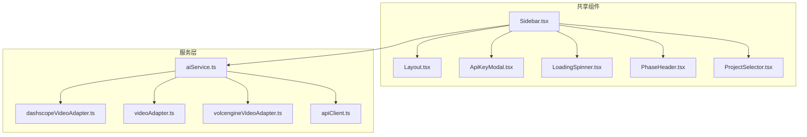
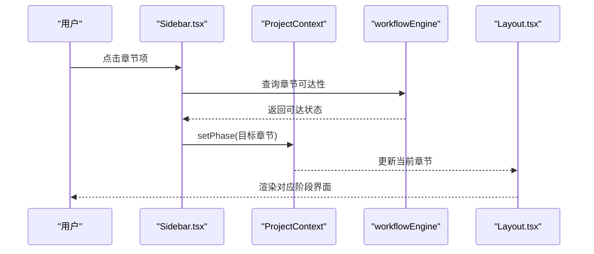
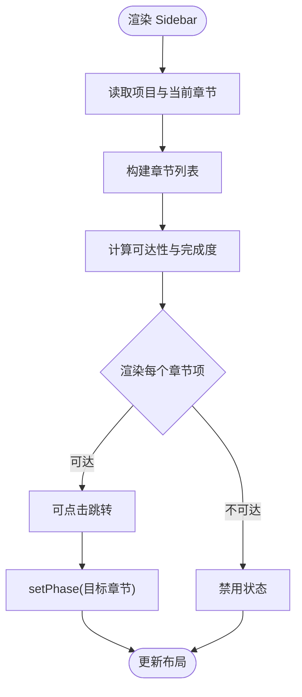
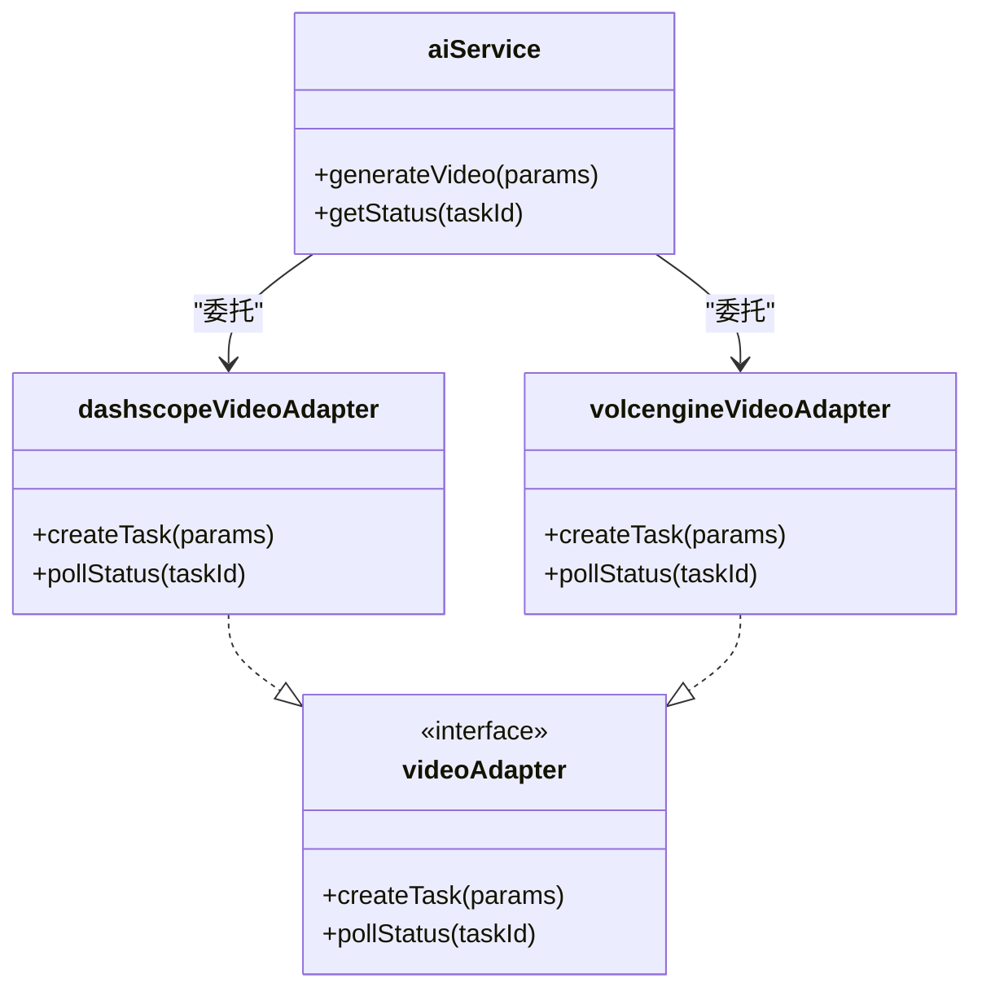
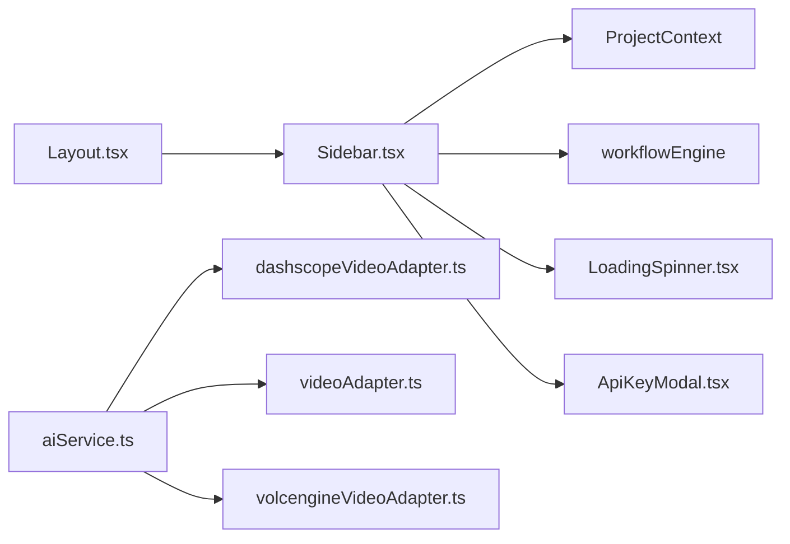

# 工具组件

<cite>
**本文引用的文件**
- [Sidebar.tsx](file://src/shared/components/Sidebar.tsx)
- [Layout.tsx](file://src/shared/components/Layout.tsx)
- [ApiKeyModal.tsx](file://src/shared/components/ApiKeyModal.tsx)
- [LoadingSpinner.tsx](file://src/shared/components/LoadingSpinner.tsx)
- [PhaseHeader.tsx](file://src/shared/components/PhaseHeader.tsx)
- [ProjectSelector.tsx](file://src/shared/components/ProjectSelector.tsx)
- [DashscopeVideoAdapter.tsx](file://services/adapters/dashscopeVideoAdapter.ts)
- [videoAdapter.ts](file://services/adapters/videoAdapter.ts)
- [volcengineVideoAdapter.tsx](file://services/adapters/volcengineVideoAdapter.ts)
- [aiService.ts](file://services/aiService.ts)
- [apiClient.ts](file://services/apiClient.ts)
- [theme-dark.css](file://public/styles/theme-dark.css)
- [theme-light.css](file://public/styles/theme-light.css)
</cite>

## 目录
1. [简介](#简介)
2. [项目结构](#项目结构)
3. [核心组件](#核心组件)
4. [架构总览](#架构总览)
5. [详细组件分析](#详细组件分析)
6. [依赖关系分析](#依赖关系分析)
7. [性能考虑](#性能考虑)
8. [故障排除指南](#故障排除指南)
9. [结论](#结论)
10. [附录](#附录)

## 简介
本文件聚焦于 AI Shotlive 的工具组件体系，围绕以下关键组件进行系统化说明：
- Sidebar 侧边栏：负责编辑流程的章节导航、进度状态与交互控制
- Layout 布局容器：提供统一的页面骨架与主题适配
- ApiKeyModal 全局配置弹窗：集中管理模型服务密钥
- LoadingSpinner 加载指示器：统一的加载态反馈
- PhaseHeader 阶段头部：阶段标题与状态提示
- ProjectSelector 项目选择器：项目上下文切换
- DashscopeVideoAdapter/VolcengineVideoAdapter 等视频适配器：底层能力接入
- aiService/apiClient：对外服务封装与网络请求

文档将从架构、数据流、处理逻辑、可复用性、样式定制与响应式适配等方面展开，并提供使用示例与集成指南。

## 项目结构
工具组件主要分布在 src/shared/components 目录下，配合服务层 adapters 与 services，形成“UI 组件 + 业务服务”的分层结构。Sidebar 作为导航中枢，贯穿整个编辑流程；Layout 提供统一布局与主题注入；LoadingSpinner 与 ApiKeyModal 提供通用交互体验；PhaseHeader 与 ProjectSelector 则分别承担阶段标识与项目上下文切换。

图表来源
- [Sidebar.tsx:1-215](file://src/shared/components/Sidebar.tsx#L1-L215)
- [Layout.tsx:1-200](file://src/shared/components/Layout.tsx#L1-L200)
- [ApiKeyModal.tsx:1-200](file://src/shared/components/ApiKeyModal.tsx#L1-L200)
- [LoadingSpinner.tsx:1-120](file://src/shared/components/LoadingSpinner.tsx#L1-L120)
- [PhaseHeader.tsx:1-150](file://src/shared/components/PhaseHeader.tsx#L1-L150)
- [ProjectSelector.tsx:1-200](file://src/shared/components/ProjectSelector.tsx#L1-L200)
- [dashscopeVideoAdapter.ts:1-200](file://services/adapters/dashscopeVideoAdapter.ts#L1-L200)
- [videoAdapter.ts:1-200](file://services/adapters/videoAdapter.ts#L1-L200)
- [volcengineVideoAdapter.ts:1-200](file://services/adapters/volcengineVideoAdapter.ts#L1-L200)
- [aiService.ts:1-200](file://services/aiService.ts#L1-L200)
- [apiClient.ts:1-200](file://services/apiClient.ts#L1-L200)

章节来源
- [Sidebar.tsx:1-215](file://src/shared/components/Sidebar.tsx#L1-L215)
- [Layout.tsx:1-200](file://src/shared/components/Layout.tsx#L1-L200)

## 核心组件
- Sidebar：左侧导航面板，展示项目信息、章节列表、进度条与状态徽章，支持章节跳转与保存状态提示
- Layout：页面骨架容器，承载主题注入与全局样式
- ApiKeyModal：模型密钥配置弹窗，用于 DashScope 等服务的密钥管理
- LoadingSpinner：统一加载指示器，支持尺寸与文案
- PhaseHeader：阶段标题与状态提示，用于各阶段页面顶部
- ProjectSelector：项目选择器，用于切换当前项目上下文

章节来源
- [Sidebar.tsx:39-215](file://src/shared/components/Sidebar.tsx#L39-L215)
- [Layout.tsx:1-200](file://src/shared/components/Layout.tsx#L1-L200)
- [ApiKeyModal.tsx:1-200](file://src/shared/components/ApiKeyModal.tsx#L1-L200)
- [LoadingSpinner.tsx:1-120](file://src/shared/components/LoadingSpinner.tsx#L1-L120)
- [PhaseHeader.tsx:1-150](file://src/shared/components/PhaseHeader.tsx#L1-L150)
- [ProjectSelector.tsx:1-200](file://src/shared/components/ProjectSelector.tsx#L1-L200)

## 架构总览
工具组件通过上下文与服务层协同工作：Sidebar 读取项目上下文与工作流引擎状态，决定章节可达性与进度；Layout 注入主题变量；LoadingSpinner 与 ApiKeyModal 提供一致的用户反馈；aiService 封装对外服务调用，videoAdapter 系列适配不同厂商能力。

图表来源
- [Sidebar.tsx:82-176](file://src/shared/components/Sidebar.tsx#L82-L176)
- [Layout.tsx:1-200](file://src/shared/components/Layout.tsx#L1-L200)

## 详细组件分析

### Sidebar 侧边栏
- 导航结构
  - 固定四节：剧本分析、资产生成、导演工作台、成片导出
  - 每节包含编号、标题、副标题、图标与进度百分比
- 折叠与状态
  - 当前节左侧高亮条与发光效果
  - 完成节显示完成徽章，未达节显示锁定图标
  - 进度条宽度随 completionPercentage 动态变化
- 交互行为
  - 只有可达章节可点击跳转
  - 底部显示 API 配置状态与保存状态（加载中/已存档）
- 样式定制
  - 使用 CSS 变量控制边框色、背景色、文字色与高亮色
  - 支持主题切换（深色/浅色）

图表来源
- [Sidebar.tsx:39-215](file://src/shared/components/Sidebar.tsx#L39-L215)

章节来源
- [Sidebar.tsx:32-37](file://src/shared/components/Sidebar.tsx#L32-L37)
- [Sidebar.tsx:82-176](file://src/shared/components/Sidebar.tsx#L82-L176)
- [Sidebar.tsx:190-211](file://src/shared/components/Sidebar.tsx#L190-L211)

### Layout 布局容器
- 职责
  - 承载页面骨架，注入主题变量与全局样式
  - 与 Sidebar 协同，提供统一的边距、分隔线与颜色体系
- 主题适配
  - 通过 CSS 变量映射颜色，支持深色/浅色主题切换
- 响应式
  - 侧边栏宽度固定，主体区域自适应

章节来源
- [Layout.tsx:1-200](file://src/shared/components/Layout.tsx#L1-L200)
- [theme-dark.css:1-200](file://public/styles/theme-dark.css#L1-L200)
- [theme-light.css:1-200](file://public/styles/theme-light.css#L1-L200)

### ApiKeyModal 全局配置弹窗
- 功能
  - 集中配置 DashScope 等服务的 API Key
  - 配置后刷新 Sidebar 中的 API 状态显示
- 交互
  - 打开/关闭受控，回调中同步外部状态

章节来源
- [ApiKeyModal.tsx:1-200](file://src/shared/components/ApiKeyModal.tsx#L1-L200)
- [Sidebar.tsx:205-211](file://src/shared/components/Sidebar.tsx#L205-L211)

### LoadingSpinner 加载指示器
- 功能
  - 统一加载态反馈，支持尺寸与文案
  - 在 Sidebar 底部显示“存档中”状态
- 设计
  - 通过类名与尺寸枚举控制外观

章节来源
- [LoadingSpinner.tsx:1-120](file://src/shared/components/LoadingSpinner.tsx#L1-L120)
- [Sidebar.tsx:190-202](file://src/shared/components/Sidebar.tsx#L190-L202)

### PhaseHeader 阶段头部
- 功能
  - 展示当前阶段标题、副标题与状态提示
  - 与 Layout 协同，提供一致的视觉风格

章节来源
- [PhaseHeader.tsx:1-150](file://src/shared/components/PhaseHeader.tsx#L1-L150)

### ProjectSelector 项目选择器
- 功能
  - 切换当前项目上下文，驱动 Sidebar 与布局更新
- 设计
  - 与 ProjectContext 协作，保持状态一致性

章节来源
- [ProjectSelector.tsx:1-200](file://src/shared/components/ProjectSelector.tsx#L1-L200)

### 视频适配器与服务封装
- 适配器
  - dashscopeVideoAdapter：DashScope 视频生成功能适配
  - volcengineVideoAdapter：火山引擎视频生成功能适配
  - videoAdapter：通用视频服务适配接口
- 服务封装
  - aiService：统一调用入口，聚合多适配器能力
  - apiClient：网络请求封装，统一错误处理与重试策略

图表来源
- [aiService.ts:1-200](file://services/aiService.ts#L1-L200)
- [dashscopeVideoAdapter.ts:1-200](file://services/adapters/dashscopeVideoAdapter.ts#L1-L200)
- [volcengineVideoAdapter.ts:1-200](file://services/adapters/volcengineVideoAdapter.ts#L1-L200)
- [videoAdapter.ts:1-200](file://services/adapters/videoAdapter.ts#L1-L200)

章节来源
- [aiService.ts:1-200](file://services/aiService.ts#L1-L200)
- [dashscopeVideoAdapter.ts:1-200](file://services/adapters/dashscopeVideoAdapter.ts#L1-L200)
- [volcengineVideoAdapter.ts:1-200](file://services/adapters/volcengineVideoAdapter.ts#L1-L200)
- [videoAdapter.ts:1-200](file://services/adapters/videoAdapter.ts#L1-L200)

## 依赖关系分析
- 组件耦合
  - Sidebar 强依赖 ProjectContext 与 workflowEngine，弱依赖 LoadingSpinner、ApiKeyModal
  - Layout 作为容器，被所有页面共享
- 外部依赖
  - 服务层通过 aiService 聚合 videoAdapter 系列，避免 UI 层直接耦合具体厂商
- 循环依赖
  - 未发现循环依赖迹象；组件间通过上下文与服务层解耦

图表来源
- [Sidebar.tsx:18-22](file://src/shared/components/Sidebar.tsx#L18-L22)
- [Layout.tsx:1-200](file://src/shared/components/Layout.tsx#L1-L200)
- [aiService.ts:1-200](file://services/aiService.ts#L1-L200)
- [dashscopeVideoAdapter.ts:1-200](file://services/adapters/dashscopeVideoAdapter.ts#L1-L200)
- [videoAdapter.ts:1-200](file://services/adapters/videoAdapter.ts#L1-L200)
- [volcengineVideoAdapter.ts:1-200](file://services/adapters/volcengineVideoAdapter.ts#L1-L200)

章节来源
- [Sidebar.tsx:18-22](file://src/shared/components/Sidebar.tsx#L18-L22)
- [aiService.ts:1-200](file://services/aiService.ts#L1-L200)

## 性能考虑
- 渲染优化
  - Sidebar 使用状态计算结果进行条件渲染，避免不必要的重绘
  - 进度条宽度动画通过过渡类实现，减少强制布局
- 交互反馈
  - LoadingSpinner 仅在保存状态时出现，降低 UI 干扰
- 服务调用
  - aiService 对外统一入口，便于缓存与去抖
- 主题切换
  - CSS 变量驱动的颜色体系，避免频繁样式重排

## 故障排除指南
- 章节不可点击
  - 检查 workflowEngine 的可达性判断是否正确
  - 确认项目状态与章节完成度
- API 配置无效
  - 确认 ApiKeyModal 已正确写入配置
  - 检查 hasApiKey 的返回值
- 加载状态异常
  - 确认 isSaving 状态变更路径
  - 检查 LoadingSpinner 的尺寸与文案传入
- 主题显示异常
  - 检查 CSS 变量是否正确注入
  - 确认 theme-dark.css 与 theme-light.css 的加载顺序

章节来源
- [Sidebar.tsx:82-176](file://src/shared/components/Sidebar.tsx#L82-L176)
- [Sidebar.tsx:190-211](file://src/shared/components/Sidebar.tsx#L190-L211)
- [ApiKeyModal.tsx:1-200](file://src/shared/components/ApiKeyModal.tsx#L1-L200)

## 结论
工具组件以 Sidebar 为核心枢纽，结合 Layout、LoadingSpinner、ApiKeyModal、PhaseHeader 与 ProjectSelector，形成统一的导航与交互体验。通过服务层的适配器模式与 aiService 封装，实现了对多厂商能力的抽象与解耦。整体设计具备良好的可复用性、可定制性与响应式适配能力，适合在复杂编辑流程中持续演进。

## 附录
- 使用示例
  - 在页面中引入 Layout 包裹内容，确保主题变量生效
  - 在需要的地方渲染 Sidebar，绑定 ProjectContext 与 workflowEngine
  - 通过 ApiKeyModal 配置密钥，随后在 aiService 中调用视频生成
- 集成指南
  - 新增章节：在 Sidebar 的 PHASES 中添加元数据，确保 workflowEngine 能识别新章节
  - 自定义样式：通过 CSS 变量覆盖默认颜色，保持与主题一致
  - 响应式适配：保持 Sidebar 固定宽度，主体区域自适应