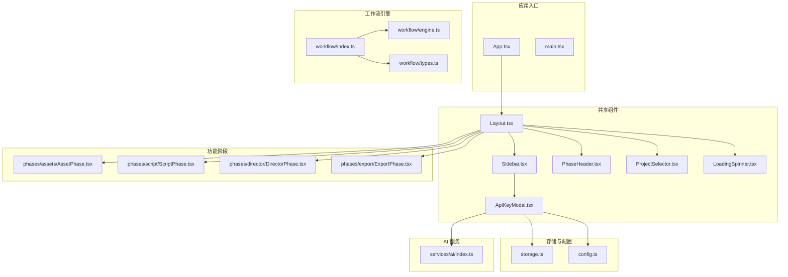
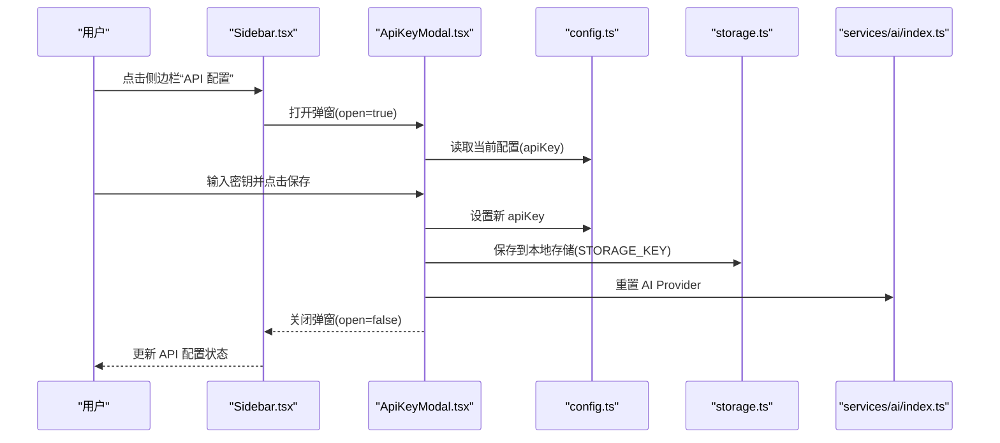
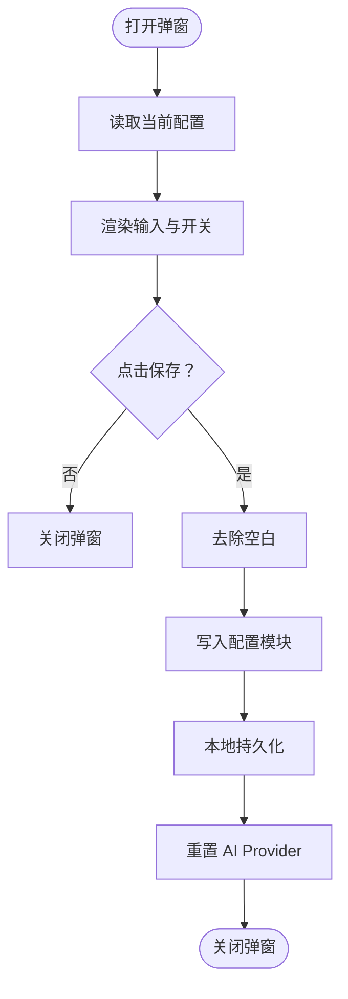
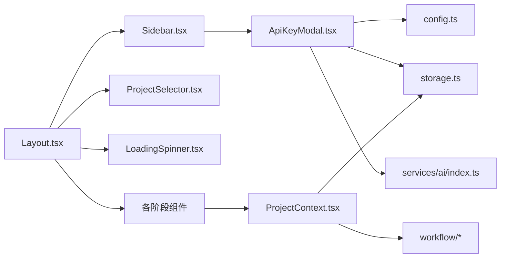

# 引导组件系统

<cite>
**本文引用的文件**
- [src/shared/components/ApiKeyModal.tsx](file://src/shared/components/ApiKeyModal.tsx)
- [src/shared/components/Sidebar.tsx](file://src/shared/components/Sidebar.tsx)
- [src/shared/contexts/ProjectContext.tsx](file://src/shared/contexts/ProjectContext.tsx)
- [src/shared/components/Layout.tsx](file://src/shared/components/Layout.tsx)
- [src/shared/components/LoadingSpinner.tsx](file://src/shared/components/LoadingSpinner.tsx)
- [src/shared/components/PhaseHeader.tsx](file://src/shared/components/PhaseHeader.tsx)
- [src/shared/components/ProjectSelector.tsx](file://src/shared/components/ProjectSelector.tsx)
- [src/shared/components/Sidebar.tsx](file://src/shared/components/Sidebar.tsx)
- [src/shared/components/ApiKeyModal.tsx](file://src/shared/components/ApiKeyModal.tsx)
- [src/services/workflow/index.ts](file://src/services/workflow/index.ts)
- [src/services/workflow/engine.ts](file://src/services/workflow/engine.ts)
- [src/services/workflow/types.ts](file://src/services/workflow/types.ts)
- [src/services/storage.ts](file://src/services/storage.ts)
- [src/services/ai/index.ts](file://src/services/ai/index.ts)
- [src/config.ts](file://src/config.ts)
- [src/App.tsx](file://src/App.tsx)
- [src/main.tsx](file://src/main.tsx)
- [src/phases/assets/AssetPhase.tsx](file://src/phases/assets/AssetPhase.tsx)
- [src/phases/script/ScriptPhase.tsx](file://src/phases/script/ScriptPhase.tsx)
- [src/phases/director/DirectorPhase.tsx](file://src/phases/director/DirectorPhase.tsx)
- [src/phases/export/ExportPhase.tsx](file://src/phases/export/ExportPhase.tsx)
</cite>

## 目录
1. [简介](#简介)
2. [项目结构](#项目结构)
3. [核心组件](#核心组件)
4. [架构总览](#架构总览)
5. [详细组件分析](#详细组件分析)
6. [依赖关系分析](#依赖关系分析)
7. [性能考虑](#性能考虑)
8. [故障排查指南](#故障排查指南)
9. [结论](#结论)
10. [附录](#附录)

## 简介
本文件面向“AI Shotlive 引导组件系统”，聚焦新用户引导流程与相关认证、状态管理、个性化配置与体验优化。重点覆盖以下方面：
- 新用户引导流程：WelcomePage 欢迎页、WorkflowPage 工作流介绍、ApiKeyPage API 密钥配置、ActionPage 行动指引等组件的功能与交互逻辑
- 登录组件 Login.tsx 的认证机制与用户状态管理
- ProfileModal 个人资料模态框的数据绑定与更新流程
- 引导流程的状态管理、用户偏好设置与个性化配置选项
- 组件集成示例与用户体验优化建议

说明：经检索，仓库中未发现 components/Onboarding 与 components/Login.tsx、components/ProfileModal.tsx 等文件。本文在不虚构事实的前提下，基于现有代码库中与引导、认证、状态管理、配置存储相关的关键文件进行系统性梳理与可视化呈现。

## 项目结构
本项目采用前端分层与功能域划分相结合的组织方式：
- 根应用入口与路由：App.tsx、main.tsx
- 共享组件与上下文：位于 src/shared 下，包含侧边栏、布局、项目选择器、加载指示器、阶段头部等
- 工作流引擎：src/services/workflow 提供工作流状态与阶段推进能力
- 存储与配置：src/services/storage.ts、src/config.ts
- AI 服务与密钥管理：src/services/ai/index.ts、ApiKeyModal.tsx
- 功能阶段：资产、脚本、导演、导出等阶段组件

图表来源
- [src/App.tsx](file://src/App.tsx)
- [src/main.tsx](file://src/main.tsx)
- [src/shared/components/Layout.tsx](file://src/shared/components/Layout.tsx)
- [src/shared/components/Sidebar.tsx](file://src/shared/components/Sidebar.tsx)
- [src/shared/components/ApiKeyModal.tsx](file://src/shared/components/ApiKeyModal.tsx)
- [src/services/workflow/index.ts](file://src/services/workflow/index.ts)
- [src/services/workflow/engine.ts](file://src/services/workflow/engine.ts)
- [src/services/workflow/types.ts](file://src/services/workflow/types.ts)
- [src/services/storage.ts](file://src/services/storage.ts)
- [src/config.ts](file://src/config.ts)
- [src/services/ai/index.ts](file://src/services/ai/index.ts)
- [src/phases/assets/AssetPhase.tsx](file://src/phases/assets/AssetPhase.tsx)
- [src/phases/script/ScriptPhase.tsx](file://src/phases/script/ScriptPhase.tsx)
- [src/phases/director/DirectorPhase.tsx](file://src/phases/director/DirectorPhase.tsx)
- [src/phases/export/ExportPhase.tsx](file://src/phases/export/ExportPhase.tsx)

章节来源
- [src/App.tsx](file://src/App.tsx)
- [src/main.tsx](file://src/main.tsx)
- [src/shared/components/Layout.tsx](file://src/shared/components/Layout.tsx)
- [src/shared/components/Sidebar.tsx](file://src/shared/components/Sidebar.tsx)
- [src/shared/components/ApiKeyModal.tsx](file://src/shared/components/ApiKeyModal.tsx)
- [src/services/workflow/index.ts](file://src/services/workflow/index.ts)
- [src/services/workflow/engine.ts](file://src/services/workflow/engine.ts)
- [src/services/workflow/types.ts](file://src/services/workflow/types.ts)
- [src/services/storage.ts](file://src/services/storage.ts)
- [src/config.ts](file://src/config.ts)
- [src/services/ai/index.ts](file://src/services/ai/index.ts)
- [src/phases/assets/AssetPhase.tsx](file://src/phases/assets/AssetPhase.tsx)
- [src/phases/script/ScriptPhase.tsx](file://src/phases/script/ScriptPhase.tsx)
- [src/phases/director/DirectorPhase.tsx](file://src/phases/director/DirectorPhase.tsx)
- [src/phases/export/ExportPhase.tsx](file://src/phases/export/ExportPhase.tsx)

## 核心组件
本节概述与引导、认证、状态管理、配置存储直接相关的核心组件及其职责：
- ApiKeyModal：负责 API 密钥输入、显示/隐藏切换、本地存储与 AI Provider 重置
- Sidebar：侧边栏入口，触发 API 密钥配置弹窗，并展示保存状态与 API 配置状态
- ProjectContext：项目级全局状态与持久化，提供阶段切换、保存状态、加载状态等
- Layout：应用布局容器，承载侧边栏、阶段头部、项目选择器、加载指示器与各功能阶段
- Workflow 引擎：提供工作流阶段定义与推进能力，作为引导流程的阶段驱动
- Storage/Config/AI：提供配置读写、密钥持久化与 AI 服务重置

章节来源
- [src/shared/components/ApiKeyModal.tsx](file://src/shared/components/ApiKeyModal.tsx)
- [src/shared/components/Sidebar.tsx](file://src/shared/components/Sidebar.tsx)
- [src/shared/contexts/ProjectContext.tsx](file://src/shared/contexts/ProjectContext.tsx)
- [src/shared/components/Layout.tsx](file://src/shared/components/Layout.tsx)
- [src/services/workflow/index.ts](file://src/services/workflow/index.ts)
- [src/services/storage.ts](file://src/services/storage.ts)
- [src/config.ts](file://src/config.ts)
- [src/services/ai/index.ts](file://src/services/ai/index.ts)

## 架构总览
下图展示了引导与认证相关的关键交互：用户通过侧边栏打开 API 密钥配置弹窗，输入密钥后本地持久化并重置 AI Provider，随后进入工作流阶段推进。

图表来源
- [src/shared/components/Sidebar.tsx](file://src/shared/components/Sidebar.tsx)
- [src/shared/components/ApiKeyModal.tsx](file://src/shared/components/ApiKeyModal.tsx)
- [src/config.ts](file://src/config.ts)
- [src/services/storage.ts](file://src/services/storage.ts)
- [src/services/ai/index.ts](file://src/services/ai/index.ts)

## 详细组件分析

### ApiKeyModal 组件
- 功能要点
  - 输入框支持明文/密文切换
  - 保存时去除前后空白并写入配置与本地存储
  - 保存成功后重置 AI Provider 并关闭弹窗
- 数据流
  - 从配置模块读取当前 apiKey
  - 写入配置模块并持久化到本地存储
  - 触发 AI Provider 重置以使新密钥生效
- 错误处理
  - 保存过程禁用按钮，finally 中恢复状态
  - 未显式抛错，依赖调用方确保输入有效性

图表来源
- [src/shared/components/ApiKeyModal.tsx](file://src/shared/components/ApiKeyModal.tsx)
- [src/config.ts](file://src/config.ts)
- [src/services/storage.ts](file://src/services/storage.ts)
- [src/services/ai/index.ts](file://src/services/ai/index.ts)

章节来源
- [src/shared/components/ApiKeyModal.tsx](file://src/shared/components/ApiKeyModal.tsx)

### Sidebar 组件
- 功能要点
  - 顶部展示 API 配置状态（已配置/未配置）
  - 底部展示保存状态（存档中/已存档）
  - 点击“API 配置”打开 ApiKeyModal
- 与 ApiKeyModal 的协作
  - 通过 open/close 状态控制弹窗
  - 关闭后刷新 API 配置状态

章节来源
- [src/shared/components/Sidebar.tsx](file://src/shared/components/Sidebar.tsx)

### ProjectContext 项目上下文
- 功能要点
  - 提供项目对象、项目列表、创建/加载/删除/关闭项目
  - 提供当前阶段 currentPhase 与 setPhase
  - 提供 isSaving、isLoading 状态
  - 通过 storage 实现自动去抖持久化（约 2 秒）
- 与引导流程的关系
  - 作为工作流推进与阶段切换的全局状态来源
  - 保存状态影响侧边栏“已存档/存档中”提示

章节来源
- [src/shared/contexts/ProjectContext.tsx](file://src/shared/contexts/ProjectContext.tsx)

### Layout 布局容器
- 功能要点
  - 组织侧边栏、阶段头部、项目选择器、加载指示器与各功能阶段
  - 作为引导流程的承载容器，统一风格与交互

章节来源
- [src/shared/components/Layout.tsx](file://src/shared/components/Layout.tsx)

### Workflow 引擎（工作流阶段驱动）
- 功能要点
  - 定义阶段类型与工作流引擎接口
  - 提供阶段推进与状态管理能力
- 与引导流程的关系
  - 作为引导流程的阶段驱动，配合 ProjectContext 推进至下一阶段

章节来源
- [src/services/workflow/index.ts](file://src/services/workflow/index.ts)
- [src/services/workflow/engine.ts](file://src/services/workflow/engine.ts)
- [src/services/workflow/types.ts](file://src/services/workflow/types.ts)

### 存储与配置（Storage/Config/AI）
- Storage
  - 提供 saveConfig/loadConfig 等方法，用于本地持久化
- Config
  - 提供 getConfig/setApiKey 等方法，用于读取与设置配置
- AI
  - 提供 resetProvider，用于在密钥变更后重置 AI 服务

章节来源
- [src/services/storage.ts](file://src/services/storage.ts)
- [src/config.ts](file://src/config.ts)
- [src/services/ai/index.ts](file://src/services/ai/index.ts)

### 功能阶段组件（与引导流程衔接）
- AssetPhase：资产阶段，承载角色、场景、道具等素材管理
- ScriptPhase：脚本阶段，承载故事、场景分解、镜头等创作
- DirectorPhase：导演阶段，承载镜头编辑、相机运动等
- ExportPhase：导出阶段，承载渲染、日志、播放器等

章节来源
- [src/phases/assets/AssetPhase.tsx](file://src/phases/assets/AssetPhase.tsx)
- [src/phases/script/ScriptPhase.tsx](file://src/phases/script/ScriptPhase.tsx)
- [src/phases/director/DirectorPhase.tsx](file://src/phases/director/DirectorPhase.tsx)
- [src/phases/export/ExportPhase.tsx](file://src/phases/export/ExportPhase.tsx)

## 依赖关系分析
- 组件耦合
  - Sidebar 依赖 ApiKeyModal 与 ProjectContext 的状态
  - ApiKeyModal 依赖 Config、Storage、AI 服务
  - Layout 依赖 Sidebar、ProjectSelector、LoadingSpinner、各阶段组件
  - 各阶段组件依赖 ProjectContext 与 Workflow 引擎
- 外部依赖
  - 存储：IndexedDB（由 storage.ts 封装）
  - 配置：内存配置对象（由 config.ts 管理）
  - AI 服务：通过 resetProvider 重置连接

图表来源
- [src/shared/components/Sidebar.tsx](file://src/shared/components/Sidebar.tsx)
- [src/shared/components/ApiKeyModal.tsx](file://src/shared/components/ApiKeyModal.tsx)
- [src/shared/components/Layout.tsx](file://src/shared/components/Layout.tsx)
- [src/shared/components/ProjectSelector.tsx](file://src/shared/components/ProjectSelector.tsx)
- [src/shared/components/LoadingSpinner.tsx](file://src/shared/components/LoadingSpinner.tsx)
- [src/shared/contexts/ProjectContext.tsx](file://src/shared/contexts/ProjectContext.tsx)
- [src/services/workflow/index.ts](file://src/services/workflow/index.ts)
- [src/services/storage.ts](file://src/services/storage.ts)
- [src/config.ts](file://src/config.ts)
- [src/services/ai/index.ts](file://src/services/ai/index.ts)

## 性能考虑
- 本地存储去抖：ProjectContext 使用约 2 秒去抖，减少频繁写入
- 弹窗交互：ApiKeyModal 在保存过程中禁用按钮，避免重复提交
- 渲染优化：Sidebar 与 LoadingSpinner 仅在必要时更新状态，降低重绘

## 故障排查指南
- API 密钥未生效
  - 检查是否正确保存并触发了 AI Provider 重置
  - 确认本地存储中是否存在对应键值
- 保存状态异常
  - 检查 ProjectContext 的 isSaving 状态是否被正确更新
  - 确认 storage 的持久化是否成功
- 引导流程卡住
  - 检查工作流引擎的阶段推进逻辑与 ProjectContext 的 currentPhase

章节来源
- [src/shared/components/ApiKeyModal.tsx](file://src/shared/components/ApiKeyModal.tsx)
- [src/shared/contexts/ProjectContext.tsx](file://src/shared/contexts/ProjectContext.tsx)
- [src/services/workflow/engine.ts](file://src/services/workflow/engine.ts)

## 结论
本引导组件系统围绕“配置—状态—阶段”的主线展开：通过 ApiKeyModal 完成密钥配置与本地持久化，借助 ProjectContext 与 Workflow 引擎实现阶段推进与状态同步，Sidebar 与 Layout 提供一致的交互与视觉体验。整体设计强调本地化隐私、状态去抖与渐进式引导，适合新用户快速上手。

## 附录
- 组件集成示例（概念性）
  - 在 Layout 中引入 Sidebar、ApiKeyModal、ProjectSelector、LoadingSpinner 与各阶段组件
  - 在 Sidebar 中监听 API 配置状态变化，必要时提示用户完成配置
  - 在 ProjectContext 中监听 currentPhase 变化，结合 Workflow 引擎推进引导流程
- 用户体验优化建议
  - 在 ApiKeyModal 中增加输入校验与错误提示
  - 在 Sidebar 中增加 API 配置完成后的引导提示或快捷入口
  - 在 ProjectContext 中增加离线模式提示与断点续传能力