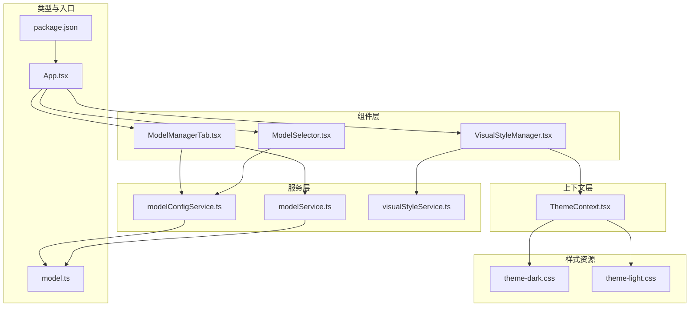
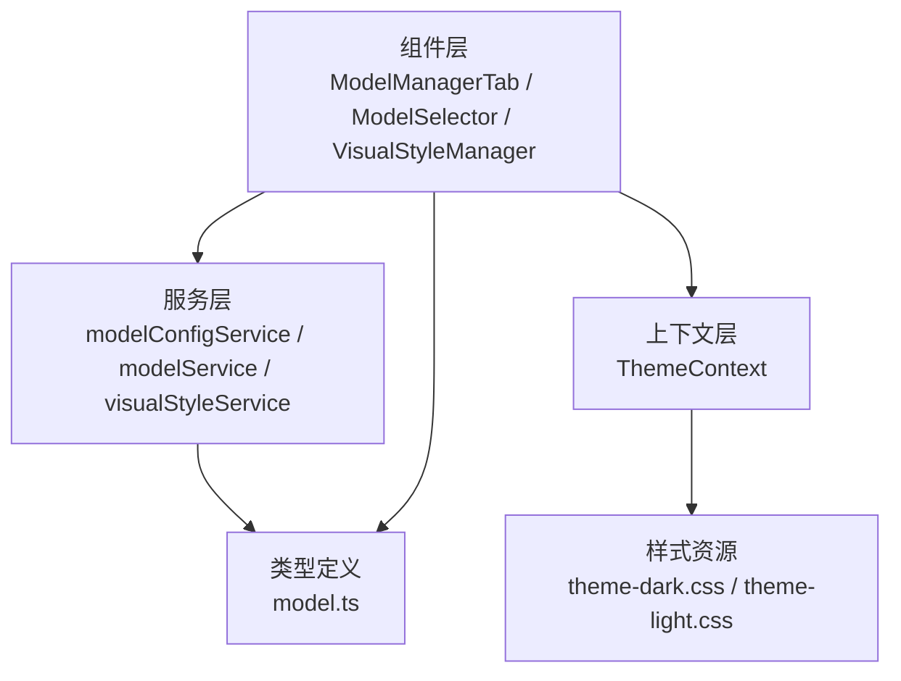
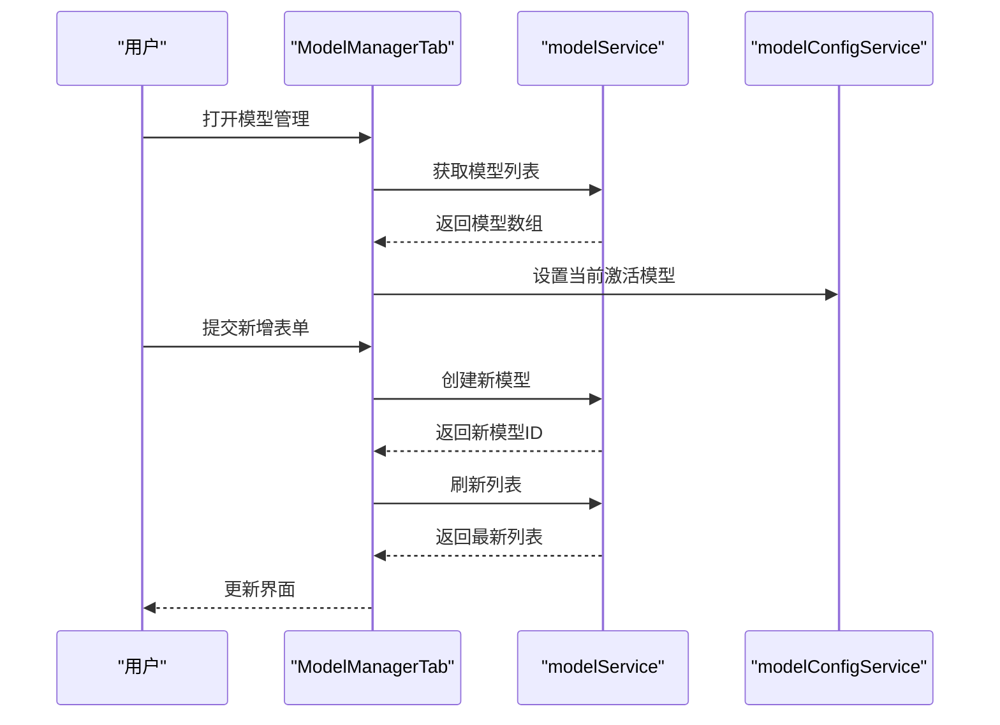
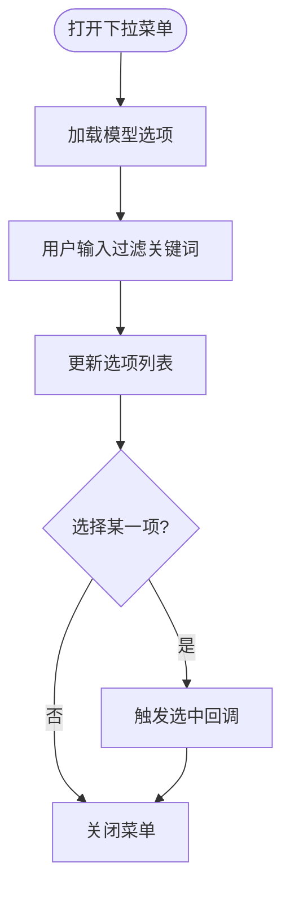
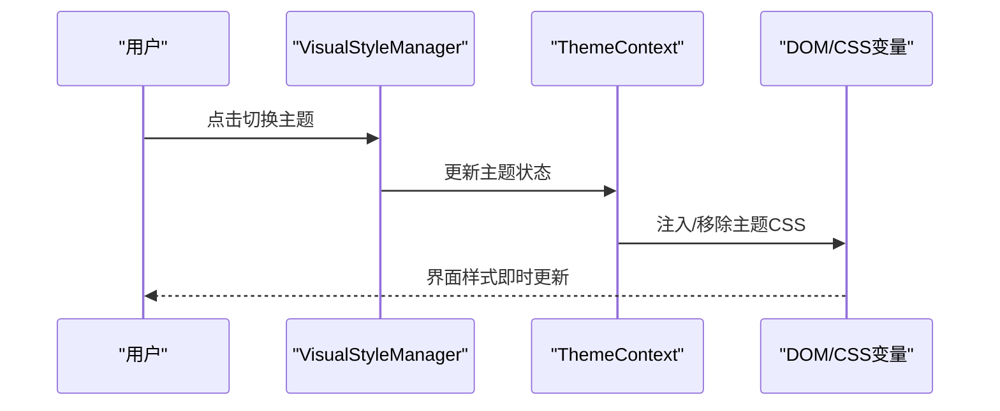
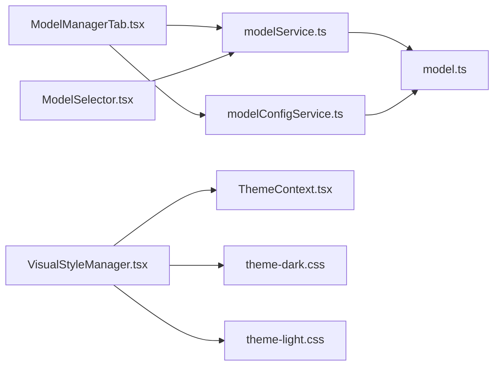

# 模型配置组件

<cite>
**本文引用的文件**
- [components/ModelManagerTab.tsx](file://components/ModelManagerTab.tsx)
- [components/ModelSelector.tsx](file://components/ModelSelector.tsx)
- [components/VisualStyleManager.tsx](file://components/VisualStyleManager.tsx)
- [services/modelConfigService.ts](file://services/modelConfigService.ts)
- [services/modelService.ts](file://services/modelService.ts)
- [services/visualStyleService.ts](file://services/visualStyleService.ts)
- [contexts/ThemeContext.tsx](file://contexts/ThemeContext.tsx)
- [public/styles/theme-dark.css](file://public/styles/theme-dark.css)
- [public/styles/theme-light.css](file://public/styles/theme-light.css)
- [types/model.ts](file://types/model.ts)
- [App.tsx](file://App.tsx)
- [package.json](file://package.json)
</cite>

## 目录
1. [引言](#引言)
2. [项目结构](#项目结构)
3. [核心组件](#核心组件)
4. [架构总览](#架构总览)
5. [详细组件分析](#详细组件分析)
6. [依赖关系分析](#依赖关系分析)
7. [性能考虑](#性能考虑)
8. [故障排除指南](#故障排除指南)
9. [结论](#结论)
10. [附录](#附录)

## 引言
本文件面向AI Shotlive的模型配置组件，系统性梳理模型管理与视觉风格两大功能域的架构设计与实现要点。重点覆盖以下组件与能力：
- 模型管理标签页：集中展示与操作模型配置的界面容器与交互流程
- 模型选择器：下拉菜单式的选择控件，支持模型选项加载、过滤与选中反馈
- 视觉风格管理器：主题切换与样式配置的统一入口，支持明暗主题与自定义样式
- 数据绑定与验证：表单数据流、校验规则与实时预览联动
- 集成示例与优化建议：如何在项目中正确接入与调优模型配置

## 项目结构
模型配置相关代码主要分布在以下位置：
- 组件层：components/ModelManagerTab.tsx、components/ModelSelector.tsx、components/VisualStyleManager.tsx
- 服务层：services/modelConfigService.ts、services/modelService.ts、services/visualStyleService.ts
- 上下文层：contexts/ThemeContext.tsx
- 样式资源：public/styles/theme-dark.css、public/styles/theme-light.css
- 类型定义：types/model.ts
- 应用入口：App.tsx
- 依赖声明：package.json

**图表来源**
- [components/ModelManagerTab.tsx](file://components/ModelManagerTab.tsx)
- [components/ModelSelector.tsx](file://components/ModelSelector.tsx)
- [components/VisualStyleManager.tsx](file://components/VisualStyleManager.tsx)
- [services/modelConfigService.ts](file://services/modelConfigService.ts)
- [services/modelService.ts](file://services/modelService.ts)
- [services/visualStyleService.ts](file://services/visualStyleService.ts)
- [contexts/ThemeContext.tsx](file://contexts/ThemeContext.tsx)
- [public/styles/theme-dark.css](file://public/styles/theme-dark.css)
- [public/styles/theme-light.css](file://public/styles/theme-light.css)
- [types/model.ts](file://types/model.ts)
- [App.tsx](file://App.tsx)
- [package.json](file://package.json)

**章节来源**
- [components/ModelManagerTab.tsx](file://components/ModelManagerTab.tsx)
- [components/ModelSelector.tsx](file://components/ModelSelector.tsx)
- [components/VisualStyleManager.tsx](file://components/VisualStyleManager.tsx)
- [services/modelConfigService.ts](file://services/modelConfigService.ts)
- [services/modelService.ts](file://services/modelService.ts)
- [services/visualStyleService.ts](file://services/visualStyleService.ts)
- [contexts/ThemeContext.tsx](file://contexts/ThemeContext.tsx)
- [public/styles/theme-dark.css](file://public/styles/theme-dark.css)
- [public/styles/theme-light.css](file://public/styles/theme-light.css)
- [types/model.ts](file://types/model.ts)
- [App.tsx](file://App.tsx)
- [package.json](file://package.json)

## 核心组件
本节概述三大核心组件的职责与协作方式：
- ModelManagerTab：模型管理的主界面容器，负责渲染模型列表、处理新增/删除/切换等操作，并与服务层进行数据交互
- ModelSelector：模型选择器下拉菜单，提供模型选项加载、过滤与选中回调，支持多语言与无障碍访问
- VisualStyleManager：视觉风格管理器，封装主题切换逻辑与样式应用，通过上下文暴露状态给子组件

这些组件通过服务层与类型定义形成清晰的分层：视图层负责UI与用户交互，服务层负责业务逻辑与数据持久化，类型定义确保数据结构一致性。

**章节来源**
- [components/ModelManagerTab.tsx](file://components/ModelManagerTab.tsx)
- [components/ModelSelector.tsx](file://components/ModelSelector.tsx)
- [components/VisualStyleManager.tsx](file://components/VisualStyleManager.tsx)
- [services/modelConfigService.ts](file://services/modelConfigService.ts)
- [services/modelService.ts](file://services/modelService.ts)
- [services/visualStyleService.ts](file://services/visualStyleService.ts)
- [types/model.ts](file://types/model.ts)

## 架构总览
整体架构采用“组件-服务-上下文-样式”的分层设计，数据从服务层流向组件层，状态通过上下文共享，样式通过CSS变量与主题文件实现动态切换。

**图表来源**
- [components/ModelManagerTab.tsx](file://components/ModelManagerTab.tsx)
- [components/ModelSelector.tsx](file://components/ModelSelector.tsx)
- [components/VisualStyleManager.tsx](file://components/VisualStyleManager.tsx)
- [services/modelConfigService.ts](file://services/modelConfigService.ts)
- [services/modelService.ts](file://services/modelService.ts)
- [services/visualStyleService.ts](file://services/visualStyleService.ts)
- [contexts/ThemeContext.tsx](file://contexts/ThemeContext.tsx)
- [public/styles/theme-dark.css](file://public/styles/theme-dark.css)
- [public/styles/theme-light.css](file://public/styles/theme-light.css)
- [types/model.ts](file://types/model.ts)

## 详细组件分析

### ModelManagerTab 模型管理标签页
- 界面设计
  - 作为模型配置的主容器，提供模型列表展示、新增模型表单、模型切换与删除等操作入口
  - 采用卡片式布局与分组显示，便于用户快速定位目标模型
- 操作流程
  - 加载：从服务层获取模型列表并渲染
  - 新增：打开新增表单，提交后刷新列表
  - 切换：选择当前激活模型，触发预览更新
  - 删除：确认后移除模型并同步更新
- 数据绑定与验证
  - 表单字段与模型实体双向绑定，提交前执行必填与格式校验
  - 实时预览：切换模型或修改参数时即时反映到预览区域
- 错误处理
  - 服务调用失败时弹出错误提示，并保留用户输入以便修正

**图表来源**
- [components/ModelManagerTab.tsx](file://components/ModelManagerTab.tsx)
- [services/modelService.ts](file://services/modelService.ts)
- [services/modelConfigService.ts](file://services/modelConfigService.ts)

**章节来源**
- [components/ModelManagerTab.tsx](file://components/ModelManagerTab.tsx)
- [services/modelService.ts](file://services/modelService.ts)
- [services/modelConfigService.ts](file://services/modelConfigService.ts)

### ModelSelector 模型选择器
- 下拉菜单实现
  - 支持选项懒加载与本地过滤，提升大列表场景下的交互流畅度
  - 选中项高亮，提供键盘导航与无障碍读屏支持
- 选项管理
  - 从服务层获取可用模型列表，按名称排序并去重
  - 支持禁用项与分组显示（如需）
- 回调与状态
  - 选中变更时触发回调，父组件可据此更新当前模型与预览

**图表来源**
- [components/ModelSelector.tsx](file://components/ModelSelector.tsx)
- [services/modelService.ts](file://services/modelService.ts)

**章节来源**
- [components/ModelSelector.tsx](file://components/ModelSelector.tsx)
- [services/modelService.ts](file://services/modelService.ts)

### VisualStyleManager 视觉风格管理器
- 样式配置
  - 封装主题切换逻辑，支持明/暗主题与自定义样式变量
  - 通过上下文暴露主题状态与切换函数，子组件可订阅主题变化
- 主题切换机制
  - 切换时动态注入/移除对应CSS文件，更新根元素的CSS变量
  - 记忆用户偏好，重启后恢复上次主题
- 与组件的协作
  - 组件内部根据主题变量渲染不同颜色与背景，保证一致的视觉体验

**图表来源**
- [components/VisualStyleManager.tsx](file://components/VisualStyleManager.tsx)
- [contexts/ThemeContext.tsx](file://contexts/ThemeContext.tsx)
- [public/styles/theme-dark.css](file://public/styles/theme-dark.css)
- [public/styles/theme-light.css](file://public/styles/theme-light.css)

**章节来源**
- [components/VisualStyleManager.tsx](file://components/VisualStyleManager.tsx)
- [contexts/ThemeContext.tsx](file://contexts/ThemeContext.tsx)
- [public/styles/theme-dark.css](file://public/styles/theme-dark.css)
- [public/styles/theme-light.css](file://public/styles/theme-light.css)

### 数据绑定、验证规则与实时预览
- 数据绑定
  - 表单字段与模型实体建立双向绑定，确保输入与存储一致
  - 使用受控组件模式，避免非预期的状态漂移
- 验证规则
  - 必填字段校验：模型名称、提供商、API密钥等
  - 格式校验：URL格式、数值范围、枚举值等
  - 业务规则：同名模型唯一性、当前模型不可删除等
- 实时预览
  - 切换模型或修改参数时，立即更新预览区域，提升用户体验
  - 对于耗时操作，提供加载状态与进度反馈

**章节来源**
- [components/ModelManagerTab.tsx](file://components/ModelManagerTab.tsx)
- [services/modelConfigService.ts](file://services/modelConfigService.ts)
- [types/model.ts](file://types/model.ts)

### 模型集成示例与配置优化建议
- 集成步骤
  - 在应用入口注册模型管理与视觉风格相关组件
  - 初始化服务层，确保模型列表与配置持久化正常工作
  - 在需要的地方引入ModelSelector与VisualStyleManager，按需传参
- 优化建议
  - 性能：对大列表启用虚拟滚动与分页加载
  - 可靠性：增加重试与降级策略，网络异常时保持本地可用
  - 可维护性：统一错误码与日志埋点，便于问题追踪
  - 可访问性：完善键盘导航、焦点管理与屏幕阅读器支持

**章节来源**
- [App.tsx](file://App.tsx)
- [package.json](file://package.json)
- [components/ModelManagerTab.tsx](file://components/ModelManagerTab.tsx)
- [components/ModelSelector.tsx](file://components/ModelSelector.tsx)
- [components/VisualStyleManager.tsx](file://components/VisualStyleManager.tsx)

## 依赖关系分析
- 组件与服务
  - ModelManagerTab依赖modelService与modelConfigService进行数据读写
  - ModelSelector依赖modelService获取模型选项
  - VisualStyleManager依赖ThemeContext与样式文件实现主题切换
- 类型与约束
  - 所有服务方法与组件属性遵循types/model.ts中的模型定义，确保类型安全
- 外部依赖
  - 应用入口与包管理配置决定组件的打包与运行环境

**图表来源**
- [components/ModelManagerTab.tsx](file://components/ModelManagerTab.tsx)
- [components/ModelSelector.tsx](file://components/ModelSelector.tsx)
- [components/VisualStyleManager.tsx](file://components/VisualStyleManager.tsx)
- [services/modelService.ts](file://services/modelService.ts)
- [services/modelConfigService.ts](file://services/modelConfigService.ts)
- [services/visualStyleService.ts](file://services/visualStyleService.ts)
- [contexts/ThemeContext.tsx](file://contexts/ThemeContext.tsx)
- [public/styles/theme-dark.css](file://public/styles/theme-dark.css)
- [public/styles/theme-light.css](file://public/styles/theme-light.css)
- [types/model.ts](file://types/model.ts)

**章节来源**
- [components/ModelManagerTab.tsx](file://components/ModelManagerTab.tsx)
- [components/ModelSelector.tsx](file://components/ModelSelector.tsx)
- [components/VisualStyleManager.tsx](file://components/VisualStyleManager.tsx)
- [services/modelService.ts](file://services/modelService.ts)
- [services/modelConfigService.ts](file://services/modelConfigService.ts)
- [services/visualStyleService.ts](file://services/visualStyleService.ts)
- [contexts/ThemeContext.tsx](file://contexts/ThemeContext.tsx)
- [public/styles/theme-dark.css](file://public/styles/theme-dark.css)
- [public/styles/theme-light.css](file://public/styles/theme-light.css)
- [types/model.ts](file://types/model.ts)

## 性能考虑
- 渲染优化
  - 对长列表启用虚拟化，减少DOM节点数量
  - 合理拆分组件，按需渲染与懒加载
- 网络与存储
  - 为模型列表与配置提供缓存策略，降低重复请求
  - 异步加载与并发控制，避免阻塞主线程
- 主题切换
  - 预加载主题CSS，减少切换抖动
  - 使用CSS变量实现平滑过渡效果

## 故障排除指南
- 常见问题
  - 模型列表为空：检查服务初始化与网络连接
  - 无法切换主题：确认CSS文件路径与上下文状态
  - 保存失败：查看服务返回的错误码与日志
- 排查步骤
  - 打开浏览器开发者工具，观察网络请求与控制台错误
  - 检查服务层日志与错误上报
  - 验证类型定义与组件属性是否匹配

**章节来源**
- [services/modelService.ts](file://services/modelService.ts)
- [services/modelConfigService.ts](file://services/modelConfigService.ts)
- [contexts/ThemeContext.tsx](file://contexts/ThemeContext.tsx)

## 结论
本文档系统梳理了AI Shotlive模型配置组件的架构与实现，明确了各组件的职责边界、数据流与交互流程，并提供了验证规则、实时预览与集成优化建议。通过服务层与上下文层的解耦设计，组件具备良好的扩展性与可维护性，能够满足复杂场景下的模型管理与视觉风格需求。

## 附录
- 相关文件清单
  - 组件：components/ModelManagerTab.tsx、components/ModelSelector.tsx、components/VisualStyleManager.tsx
  - 服务：services/modelConfigService.ts、services/modelService.ts、services/visualStyleService.ts
  - 上下文：contexts/ThemeContext.tsx
  - 样式：public/styles/theme-dark.css、public/styles/theme-light.css
  - 类型：types/model.ts
  - 入口与依赖：App.tsx、package.json