# 组件层次结构

<cite>
**本文档引用的文件**
- [App.tsx](file://App.tsx)
- [StageScript/index.tsx](file://components/StageScript/index.tsx)
- [StageAssets/index.tsx](file://components/StageAssets/index.tsx)
- [StageDirector/index.tsx](file://components/StageDirector/index.tsx)
- [StageExport/index.tsx](file://components/StageExport/index.tsx)
- [StageScript/utils.ts](file://components/StageScript/utils.ts)
- [StageAssets/utils.ts](file://components/StageAssets/utils.ts)
- [StageDirector/utils.ts](file://components/StageDirector/utils.ts)
- [StageExport/utils.ts](file://components/StageExport/utils.ts)
- [types.ts](file://types.ts)
</cite>

## 目录
1. [简介](#简介)
2. [项目结构](#项目结构)
3. [核心组件](#核心组件)
4. [架构概览](#架构概览)
5. [详细组件分析](#详细组件分析)
6. [依赖分析](#依赖分析)
7. [性能考虑](#性能考虑)
8. [故障排除指南](#故障排除指南)
9. [结论](#结论)

## 简介

AI Shotlive 是一个基于 React 和 TypeScript 开发的 AI 短剧生产平台，采用分层组件架构设计。该系统通过四个主要工作流阶段组件（StageScript、StageAssets、StageDirector、StageExport）实现从剧本创作到成品导出的完整生产流程。

该组件层次结构的核心设计理念是：
- **分层协作**：每个阶段专注于特定的创作任务
- **数据驱动**：所有状态通过统一的 ProjectState 管理
- **异步处理**：大量 AI 生成任务通过后台任务队列处理
- **状态持久化**：实时增量保存确保数据安全
- **模块化设计**：组件间通过明确定义的接口通信

## 项目结构

AI Shotlive 采用基于功能域的组件组织方式，每个工作流阶段都是一个独立的组件模块：

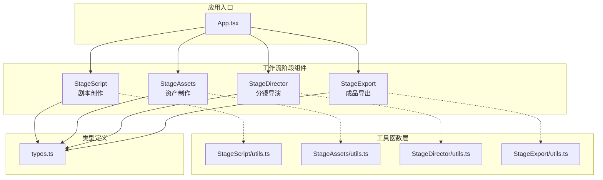

**图表来源**
- [App.tsx:233-260](file://App.tsx#L233-L260)
- [types.ts:246-271](file://types.ts#L246-L271)

**章节来源**
- [App.tsx:233-260](file://App.tsx#L233-L260)
- [types.ts:246-271](file://types.ts#L246-L271)

## 核心组件

### 组件层次结构设计原则

AI Shotlive 的组件层次结构遵循以下设计原则：

1. **单一职责原则**：每个阶段组件负责特定的创作任务
2. **状态集中管理**：所有组件共享统一的 ProjectState
3. **异步任务处理**：AI 生成任务通过后台队列处理
4. **实时数据同步**：组件间通过增量更新保持数据一致性
5. **错误边界处理**：每个组件都有完善的错误处理机制

### 组件间通信机制

组件间的通信通过以下方式实现：

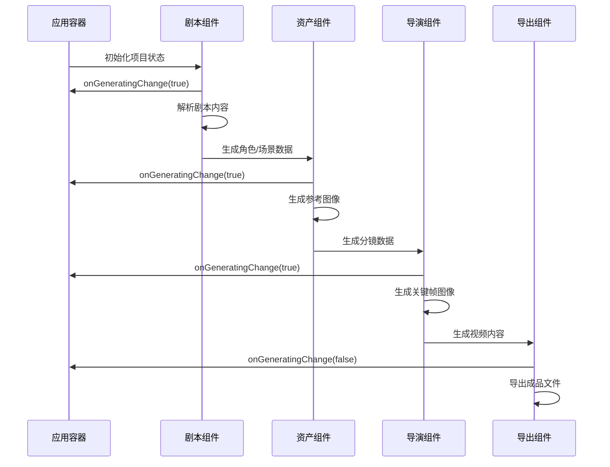

**图表来源**
- [App.tsx:143-161](file://App.tsx#L143-L161)
- [StageScript/index.tsx:90-99](file://components/StageScript/index.tsx#L90-L99)
- [StageAssets/index.tsx:192-209](file://components/StageAssets/index.tsx#L192-L209)
- [StageDirector/index.tsx:164-177](file://components/StageDirector/index.tsx#L164-L177)

**章节来源**
- [App.tsx:143-161](file://App.tsx#L143-L161)
- [StageScript/index.tsx:90-99](file://components/StageScript/index.tsx#L90-L99)
- [StageAssets/index.tsx:192-209](file://components/StageAssets/index.tsx#L192-L209)
- [StageDirector/index.tsx:164-177](file://components/StageDirector/index.tsx#L164-L177)

## 架构概览

### 数据流架构

AI Shotlive 采用双向数据流架构，确保数据的一致性和可追溯性：

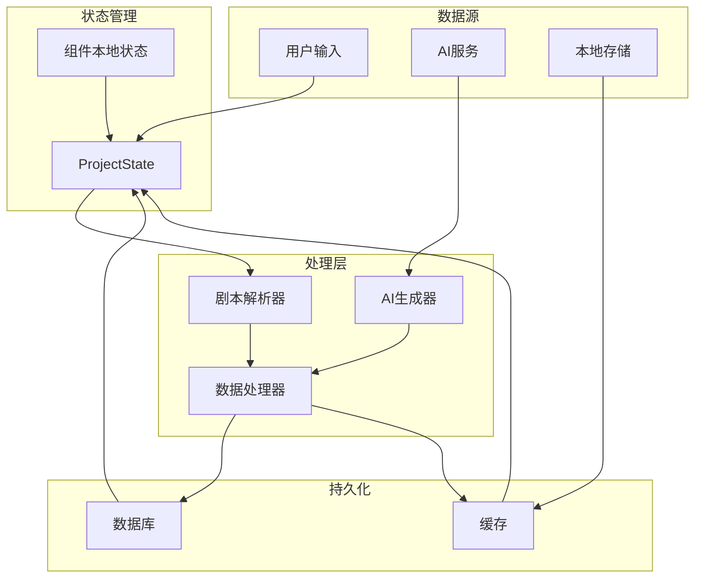

**图表来源**
- [types.ts:246-271](file://types.ts#L246-L271)
- [StageScript/index.tsx:106-136](file://components/StageScript/index.tsx#L106-L136)
- [StageAssets/index.tsx:109-141](file://components/StageAssets/index.tsx#L109-L141)

### 生命周期管理

组件的生命周期管理采用统一的模式：

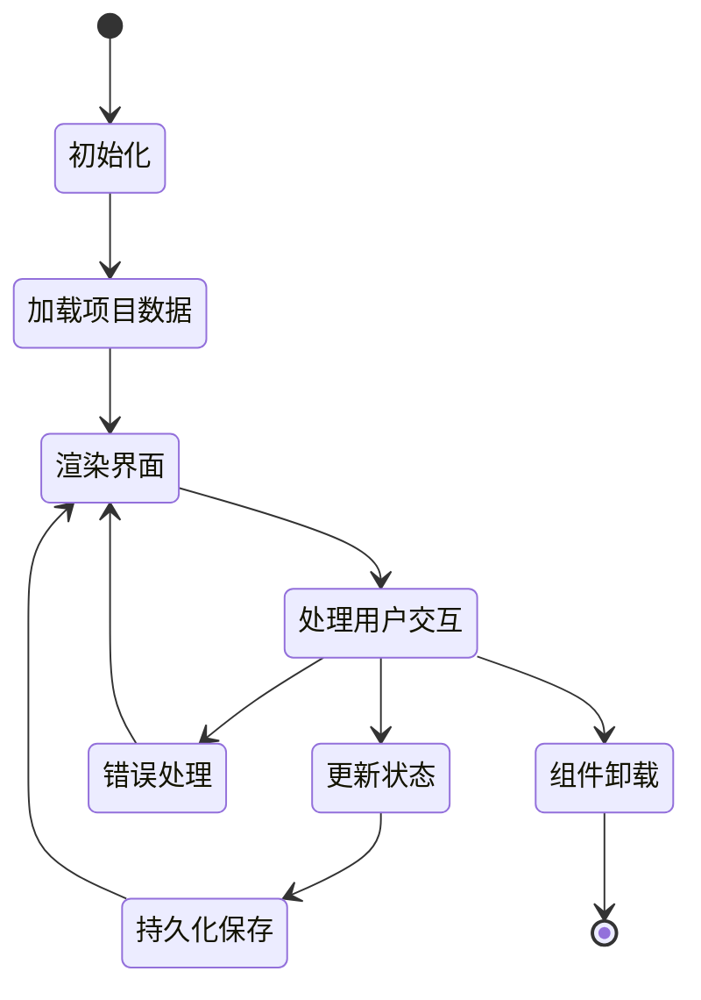

**图表来源**
- [App.tsx:131-141](file://App.tsx#L131-L141)
- [StageScript/index.tsx:96-100](file://components/StageScript/index.tsx#L96-L100)
- [StageAssets/index.tsx:212-216](file://components/StageAssets/index.tsx#L212-L216)

**章节来源**
- [types.ts:246-271](file://types.ts#L246-L271)
- [App.tsx:131-141](file://App.tsx#L131-L141)
- [StageScript/index.tsx:96-100](file://components/StageScript/index.tsx#L96-L100)
- [StageAssets/index.tsx:212-216](file://components/StageAssets/index.tsx#L212-L216)

## 详细组件分析

### StageScript 组件分析

StageScript 是整个 AI 短剧生产流程的起点，负责剧本创作和分镜生成。

#### 核心功能模块

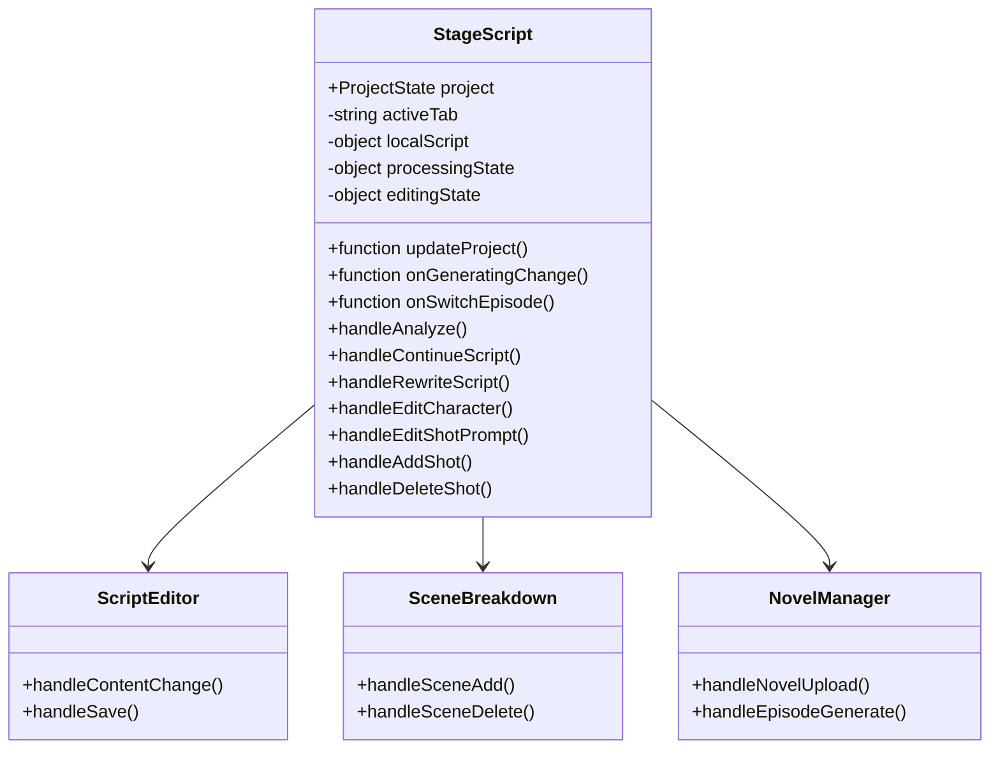

**图表来源**
- [StageScript/index.tsx:17-23](file://components/StageScript/index.tsx#L17-L23)
- [StageScript/index.tsx:27-87](file://components/StageScript/index.tsx#L27-L87)

#### 剧本解析流程

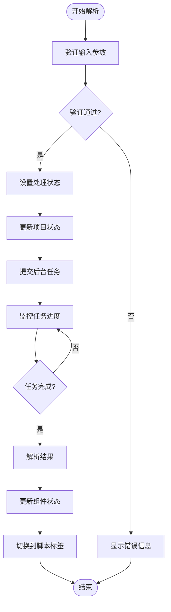

**图表来源**
- [StageScript/index.tsx:196-296](file://components/StageScript/index.tsx#L196-L296)
- [StageScript/utils.ts:43-62](file://components/StageScript/utils.ts#L43-L62)

**章节来源**
- [StageScript/index.tsx:17-23](file://components/StageScript/index.tsx#L17-L23)
- [StageScript/index.tsx:27-87](file://components/StageScript/index.tsx#L27-L87)
- [StageScript/index.tsx:196-296](file://components/StageScript/index.tsx#L196-L296)
- [StageScript/utils.ts:43-62](file://components/StageScript/utils.ts#L43-L62)

### StageAssets 组件分析

StageAssets 负责角色、场景和道具的视觉资产创建，是 AI 短剧制作的重要基础。

#### 资产管理系统

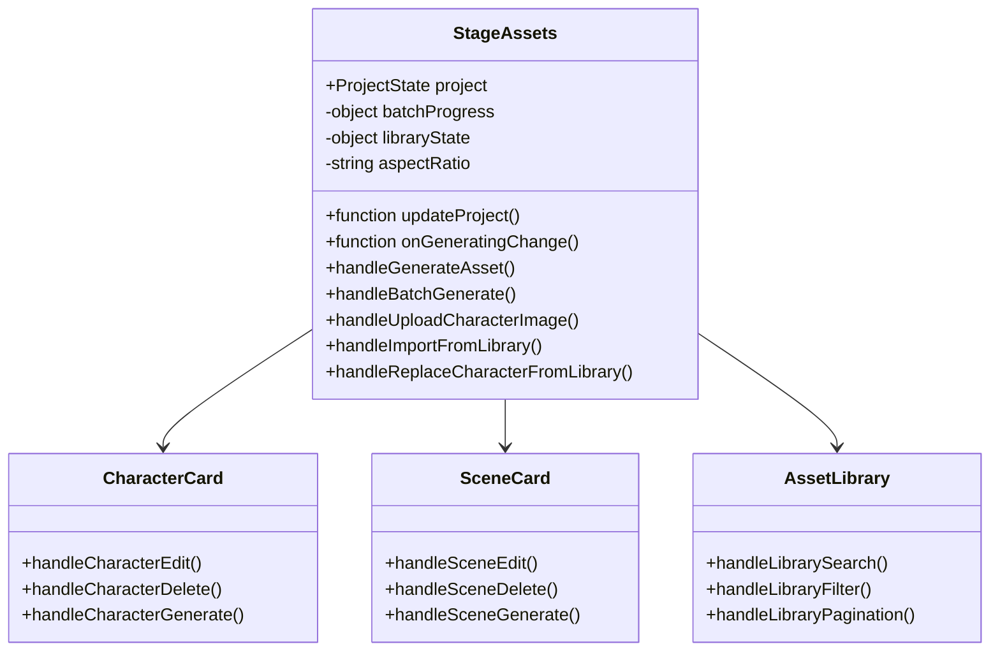

**图表来源**
- [StageAssets/index.tsx:59-64](file://components/StageAssets/index.tsx#L59-L64)
- [StageAssets/index.tsx:71-96](file://components/StageAssets/index.tsx#L71-L96)

#### 批量生成机制

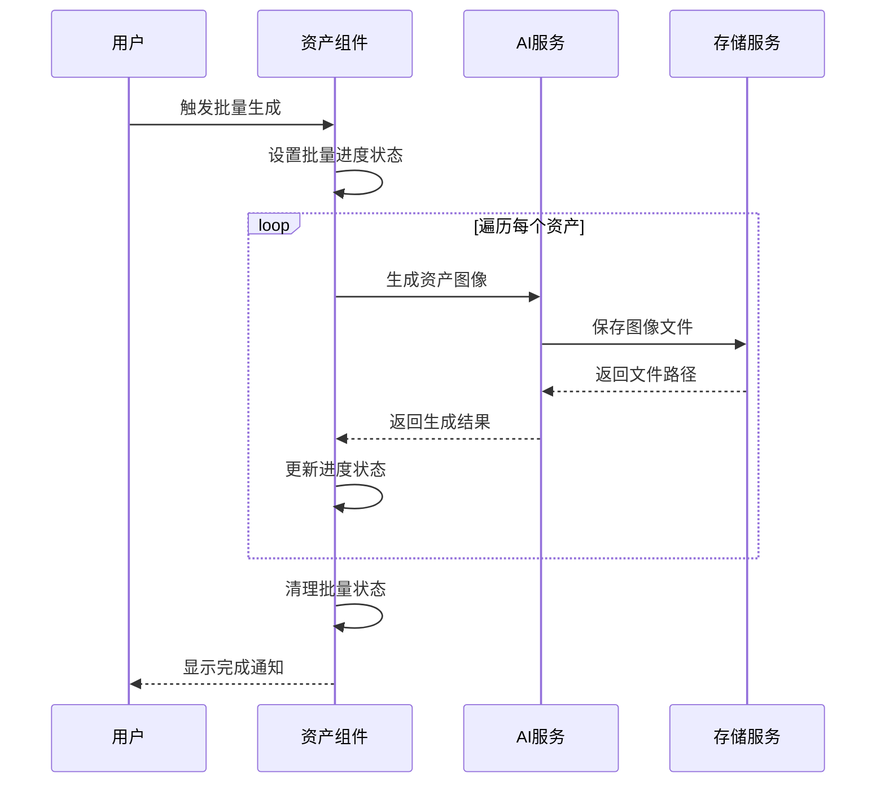

**图表来源**
- [StageAssets/index.tsx:366-401](file://components/StageAssets/index.tsx#L366-L401)
- [StageAssets/utils.ts:18-28](file://components/StageAssets/utils.ts#L18-L28)

**章节来源**
- [StageAssets/index.tsx:59-64](file://components/StageAssets/index.tsx#L59-L64)
- [StageAssets/index.tsx:71-96](file://components/StageAssets/index.tsx#L71-L96)
- [StageAssets/index.tsx:366-401](file://components/StageAssets/index.tsx#L366-L401)
- [StageAssets/utils.ts:18-28](file://components/StageAssets/utils.ts#L18-L28)

### StageDirector 组件分析

StageDirector 是整个生产流程的核心，负责将剧本转化为具体的分镜画面。

#### 分镜生成架构

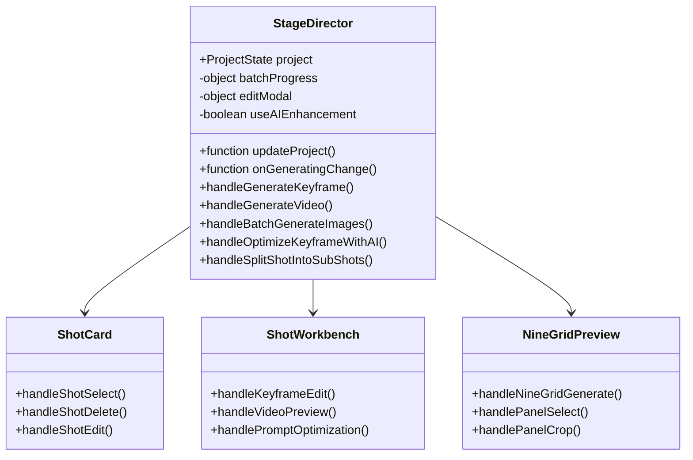

**图表来源**
- [StageDirector/index.tsx:35-40](file://components/StageDirector/index.tsx#L35-L40)
- [StageDirector/index.tsx:42-68](file://components/StageDirector/index.tsx#L42-L68)

#### 关键帧生成流程

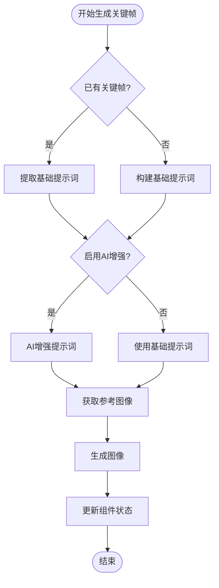

**图表来源**
- [StageDirector/index.tsx:233-330](file://components/StageDirector/index.tsx#L233-L330)
- [StageDirector/utils.ts:102-191](file://components/StageDirector/utils.ts#L102-L191)

**章节来源**
- [StageDirector/index.tsx:35-40](file://components/StageDirector/index.tsx#L35-L40)
- [StageDirector/index.tsx:42-68](file://components/StageDirector/index.tsx#L42-L68)
- [StageDirector/index.tsx:233-330](file://components/StageDirector/index.tsx#L233-L330)
- [StageDirector/utils.ts:102-191](file://components/StageDirector/utils.ts#L102-L191)

### StageExport 组件分析

StageExport 负责将所有生成的素材整合成最终的成品视频。

#### 导出系统架构

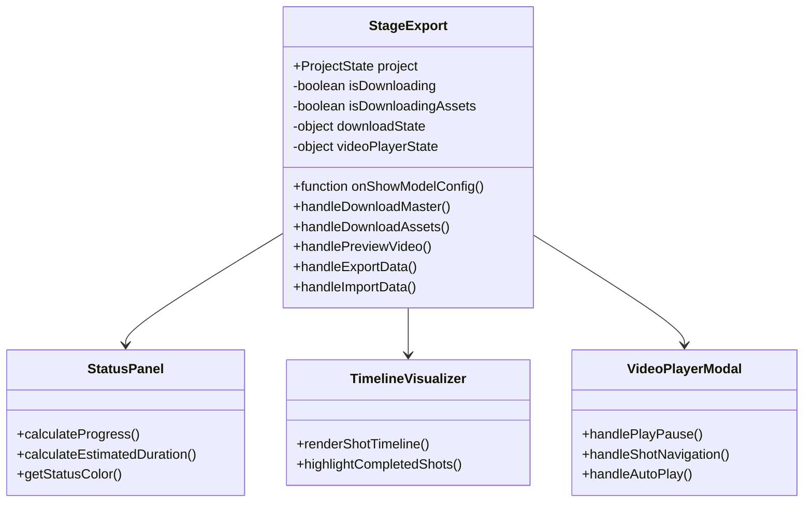

**图表来源**
- [StageExport/index.tsx:22-25](file://components/StageExport/index.tsx#L22-L25)
- [StageExport/index.tsx:27-56](file://components/StageExport/index.tsx#L27-L56)

#### 下载和导出流程

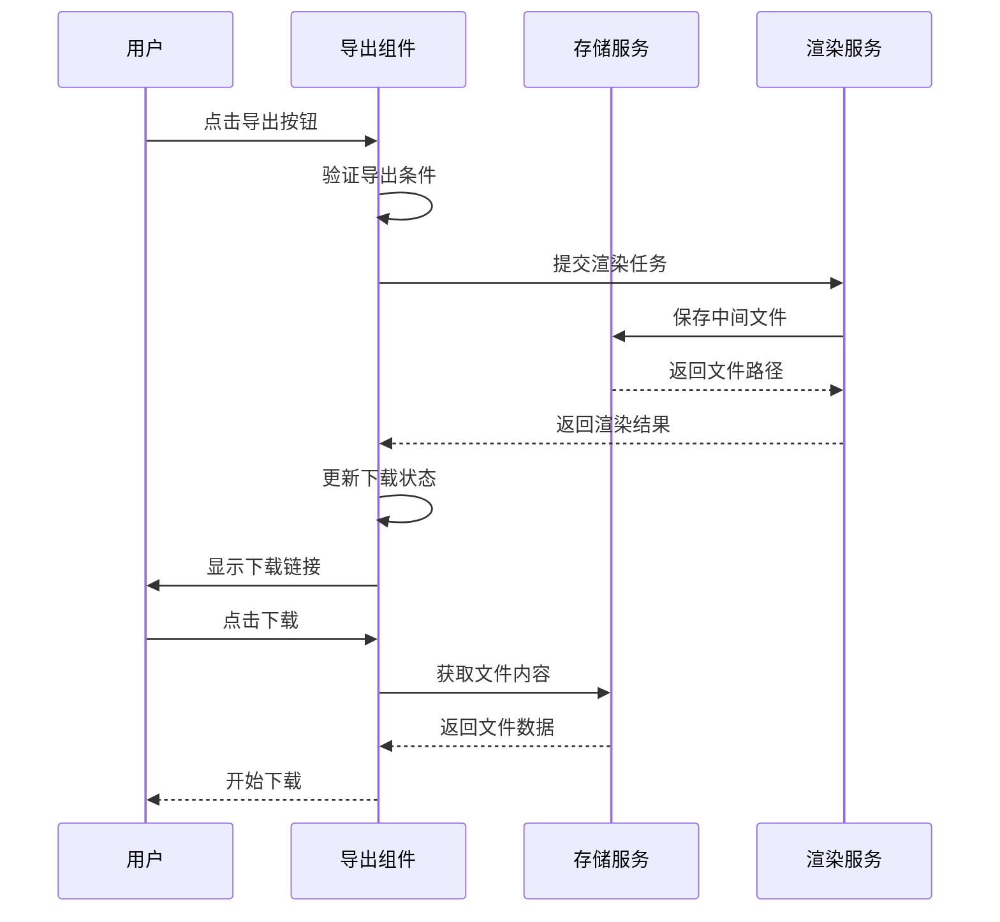

**图表来源**
- [StageExport/index.tsx:115-140](file://components/StageExport/index.tsx#L115-L140)
- [StageExport/utils.ts:17-35](file://components/StageExport/utils.ts#L17-L35)

**章节来源**
- [StageExport/index.tsx:22-25](file://components/StageExport/index.tsx#L22-L25)
- [StageExport/index.tsx:27-56](file://components/StageExport/index.tsx#L27-L56)
- [StageExport/index.tsx:115-140](file://components/StageExport/index.tsx#L115-L140)
- [StageExport/utils.ts:17-35](file://components/StageExport/utils.ts#L17-L35)

## 依赖分析

### 组件依赖关系

AI Shotlive 组件间的依赖关系体现了清晰的分层架构：

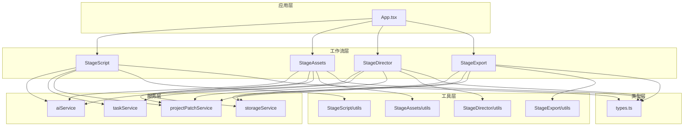

**图表来源**
- [App.tsx:3-6](file://App.tsx#L3-L6)
- [StageScript/index.tsx:1-16](file://components/StageScript/index.tsx#L1-L16)
- [StageAssets/index.tsx:1-28](file://components/StageAssets/index.tsx#L1-L28)
- [StageDirector/index.tsx:1-34](file://components/StageDirector/index.tsx#L1-L34)
- [StageExport/index.tsx:1-6](file://components/StageExport/index.tsx#L1-L6)

### 状态传递模式

组件间的状态传递采用以下模式：

1. **自顶向下传递**：App 组件通过 props 向子组件传递项目状态
2. **事件回调**：子组件通过回调函数向上报告状态变化
3. **增量更新**：使用 projectPatchService 进行实时增量保存
4. **全局状态**：通过全局 alert 和日志服务进行状态同步

**章节来源**
- [App.tsx:131-141](file://App.tsx#L131-L141)
- [StageScript/index.tsx:106-136](file://components/StageScript/index.tsx#L106-L136)
- [StageAssets/index.tsx:109-141](file://components/StageAssets/index.tsx#L109-L141)

## 性能考虑

### 异步任务处理

AI Shotlive 采用异步任务处理机制来优化性能：

1. **后台任务队列**：所有 AI 生成任务都在服务器端异步执行
2. **任务恢复机制**：页面刷新后自动恢复未完成的任务
3. **批量处理优化**：支持批量生成和批量下载功能
4. **缓存策略**：合理利用浏览器缓存和服务器缓存

### 内存管理

组件级别的内存管理策略：

1. **状态清理**：组件卸载时自动清理生成状态
2. **定时器管理**：使用 useRef 管理定时器，防止内存泄漏
3. **事件监听器**：组件卸载时移除所有事件监听器
4. **图片资源管理**：及时释放不再使用的图片资源

### 网络优化

1. **请求去重**：避免重复发送相同的请求
2. **超时控制**：为所有网络请求设置合理的超时时间
3. **错误重试**：实现智能的错误重试机制
4. **进度反馈**：提供详细的进度和状态反馈

## 故障排除指南

### 常见问题诊断

#### API Key 错误处理

当检测到 API Key 相关错误时，系统会自动弹出模型配置对话框：

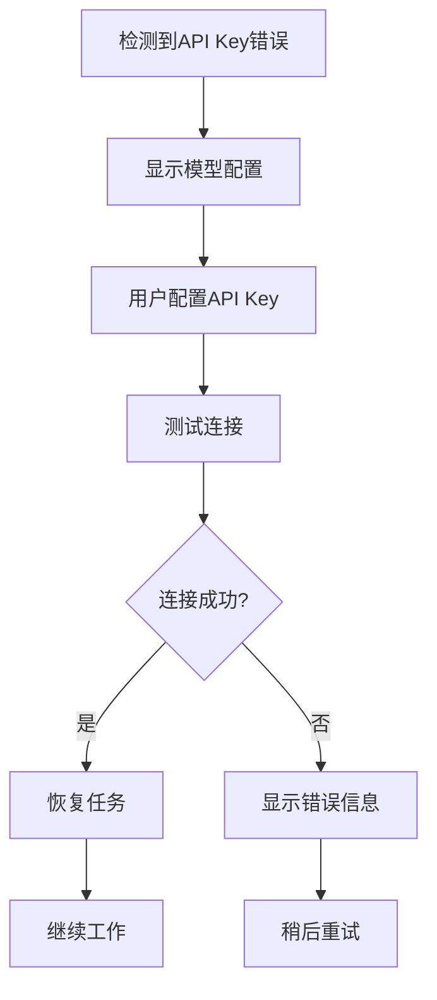

**图表来源**
- [App.tsx:75-106](file://App.tsx#L75-L106)

#### 生成任务卡死处理

系统提供自动检测和恢复机制：

1. **状态检查**：启动时扫描所有生成中的实体
2. **状态重置**：自动将卡死的任务重置为失败状态
3. **用户通知**：向用户显示相应的错误信息
4. **手动重试**：允许用户重新发起生成任务

**章节来源**
- [App.tsx:75-106](file://App.tsx#L75-L106)
- [StageAssets/index.tsx:147-186](file://components/StageAssets/index.tsx#L147-L186)
- [StageDirector/index.tsx:80-108](file://components/StageDirector/index.tsx#L80-L108)

### 调试技巧

1. **日志收集**：通过 renderLogService 收集详细的生成日志
2. **状态检查**：使用浏览器开发者工具检查组件状态
3. **网络监控**：监控 API 请求和响应
4. **性能分析**：使用性能分析工具识别性能瓶颈

## 结论

AI Shotlive 的组件层次结构设计体现了现代前端应用的最佳实践：

### 设计优势

1. **清晰的职责分离**：每个组件都有明确的功能边界
2. **强大的扩展性**：模块化设计便于功能扩展和维护
3. **优秀的用户体验**：异步处理和状态反馈提升了用户满意度
4. **可靠的数据管理**：统一的状态管理和持久化机制确保数据安全

### 技术亮点

1. **分层架构**：从应用容器到具体组件的清晰层次结构
2. **异步处理**：高效的后台任务处理机制
3. **状态管理**：统一的 ProjectState 管理所有应用状态
4. **错误处理**：完善的错误捕获和恢复机制

### 未来改进方向

1. **组件复用**：进一步抽象可复用的 UI 组件
2. **性能优化**：实现更精细的懒加载和代码分割
3. **测试覆盖**：增加单元测试和集成测试
4. **文档完善**：提供更详细的开发和集成文档

这个组件层次结构为 AI 短剧生产提供了一个强大而灵活的基础设施，为未来的功能扩展和技术演进奠定了坚实的基础。