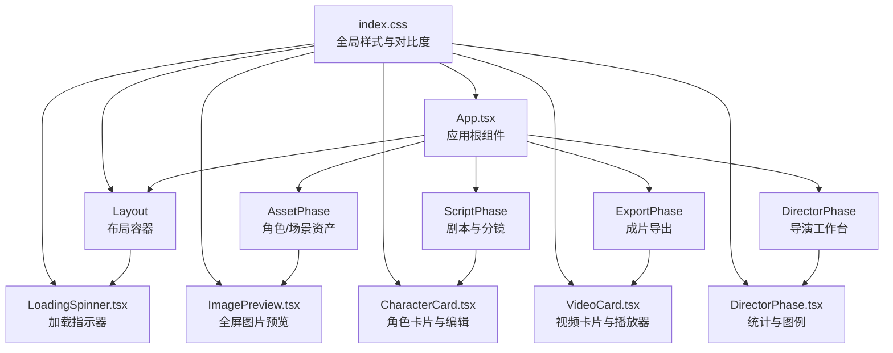
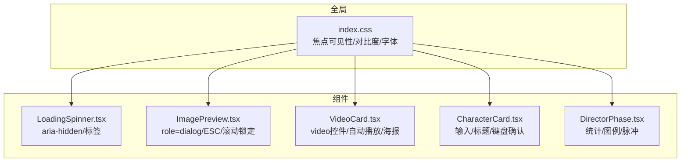
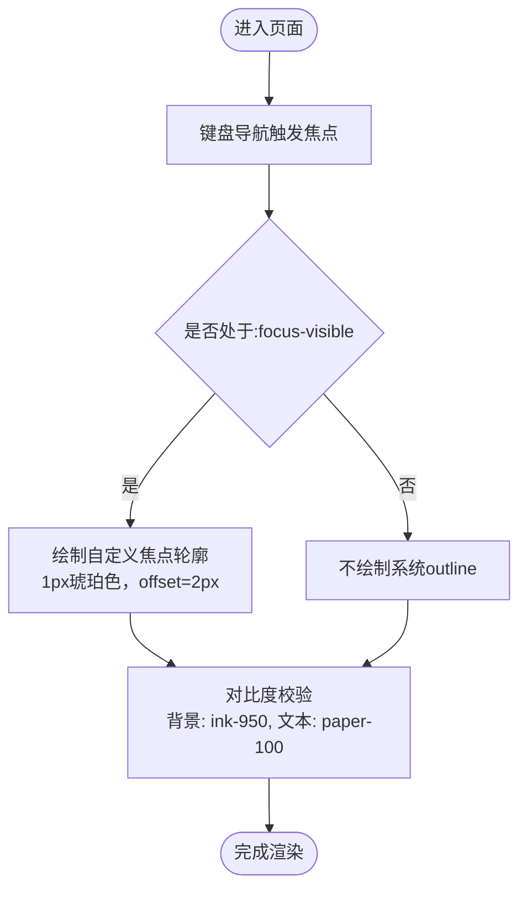
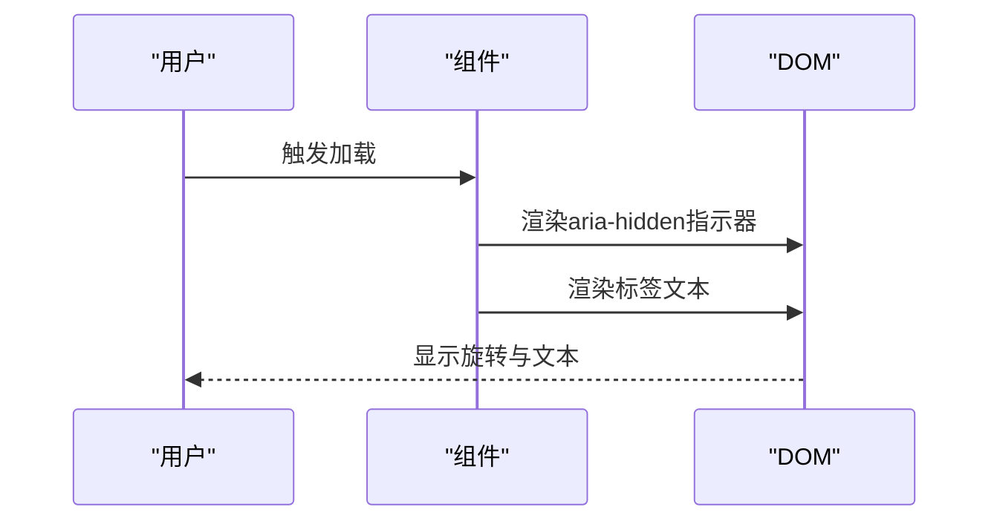
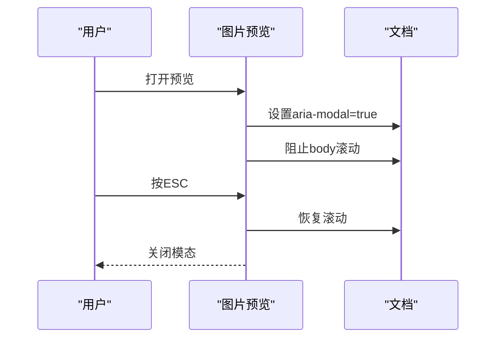
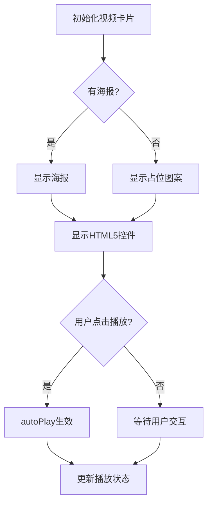
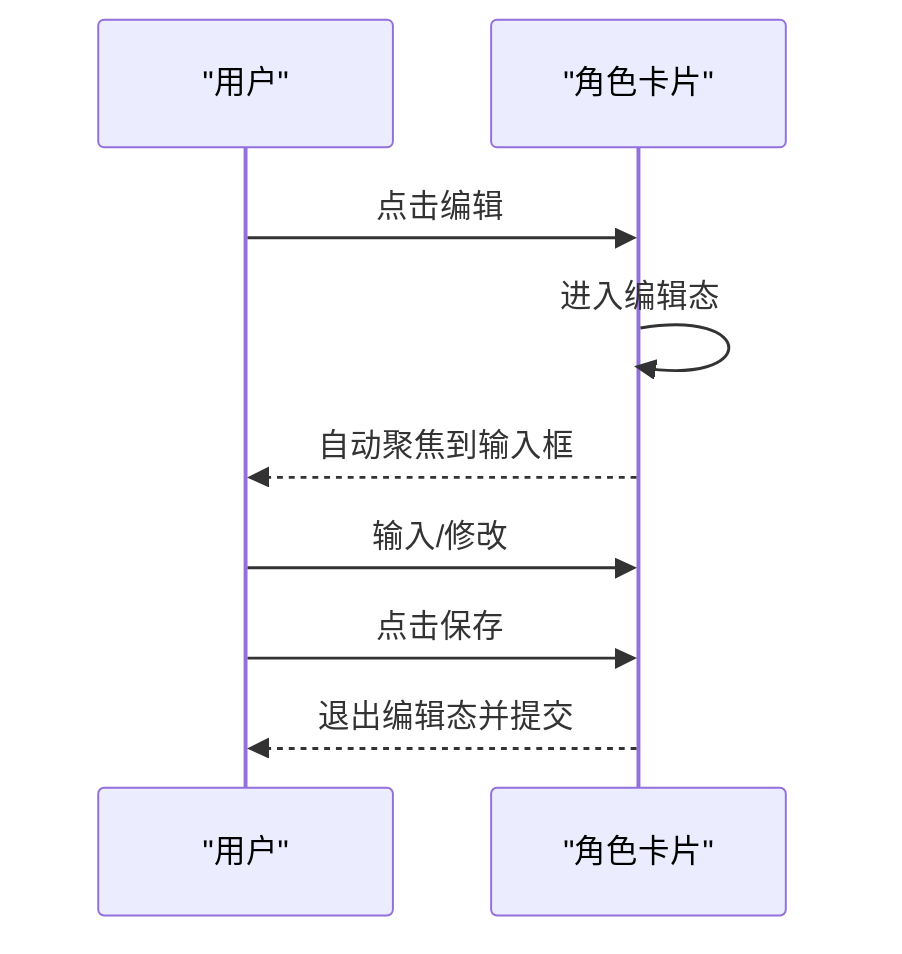
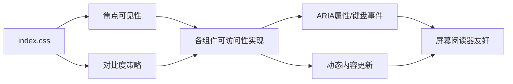

# 可访问性设计指南

<cite>
**本文引用的文件**
- [README.md](file://README.md)
- [App.tsx](file://src/App.tsx)
- [index.css](file://src/index.css)
- [LoadingSpinner.tsx](file://src/shared/components/LoadingSpinner.tsx)
- [ImagePreview.tsx](file://src/phases/assets/components/ImagePreview.tsx)
- [VideoCard.tsx](file://src/phases/export/components/VideoCard.tsx)
- [CharacterCard.tsx](file://src/phases/script/components/CharacterCard.tsx)
- [AssetPhase.tsx](file://src/phases/assets/AssetPhase.tsx)
- [DirectorPhase.tsx](file://src/phases/director/DirectorPhase.tsx)
- [PhaseHeader.tsx](file://src/shared/components/PhaseHeader.tsx)
</cite>

## 目录
1. [简介](#简介)
2. [项目结构](#项目结构)
3. [核心组件](#核心组件)
4. [架构总览](#架构总览)
5. [详细组件分析](#详细组件分析)
6. [依赖关系分析](#依赖关系分析)
7. [性能考量](#性能考量)
8. [故障排查指南](#故障排查指南)
9. [结论](#结论)
10. [附录](#附录)

## 简介
本指南面向AI Shotlive组件的可访问性设计，聚焦于ARIA属性使用规范、键盘导航支持、屏幕阅读器兼容性，以及颜色对比度、字体大小、视觉辅助等视觉设计规范。文档还涵盖表单控件可访问性、动态内容更新、焦点管理最佳实践，并提供可访问性测试工具、WCAG合规性检查与审计方法，辅以可访问性代码示例路径与测试案例。

## 项目结构
AI Shotlive采用前后端分离架构，前端基于React 19 + Vite 6 + Tailwind CSS 4，组件分布在多个功能阶段（Phase 01-04）。可访问性相关的关键点包括：
- 全局样式与焦点可见性控制
- 模态对话框与键盘交互
- 动态内容与播放器控件
- 表单输入与编辑行为
- 统一的视觉语言与对比度策略

图表来源
- [App.tsx:1-44](file://src/App.tsx#L1-L44)
- [index.css:1-208](file://src/index.css#L1-L208)
- [LoadingSpinner.tsx:1-42](file://src/shared/components/LoadingSpinner.tsx#L1-L42)
- [ImagePreview.tsx:1-161](file://src/phases/assets/components/ImagePreview.tsx#L1-L161)
- [VideoCard.tsx:94-141](file://src/phases/export/components/VideoCard.tsx#L94-L141)
- [CharacterCard.tsx:93-162](file://src/phases/script/components/CharacterCard.tsx#L93-L162)
- [DirectorPhase.tsx:497-559](file://src/phases/director/DirectorPhase.tsx#L497-L559)

章节来源
- [README.md:127-138](file://README.md#L127-L138)
- [App.tsx:1-44](file://src/App.tsx#L1-L44)
- [index.css:1-208](file://src/index.css#L1-L208)

## 核心组件
本节梳理与可访问性直接相关的组件与样式要点：
- 全局样式与焦点可见性：通过CSS禁用系统默认轮廓，统一绘制琥珀色焦点环，确保键盘可达性与高对比度。
- 加载指示器：使用aria-hidden避免重复播报，标签文本提供语义补充。
- 图片预览模态：使用role="dialog"与aria-modal="true"声明模态，ESC关闭与背景点击关闭，body滚动锁定。
- 视频播放器：使用HTML5 video控件，自动播放与播放状态同步，poster占位提升可感知性。
- 表单与编辑：输入框与按钮具备明确语义与标题提示，编辑态焦点管理与键盘确认/取消。
- 统计与图例：使用语义化标记与颜色区分状态，脉冲动画仅作装饰，不替代文本信息。

章节来源
- [index.css:39-68](file://src/index.css#L39-L68)
- [LoadingSpinner.tsx:1-42](file://src/shared/components/LoadingSpinner.tsx#L1-L42)
- [ImagePreview.tsx:15-161](file://src/phases/assets/components/ImagePreview.tsx#L15-L161)
- [VideoCard.tsx:94-141](file://src/phases/export/components/VideoCard.tsx#L94-L141)
- [CharacterCard.tsx:93-162](file://src/phases/script/components/CharacterCard.tsx#L93-L162)
- [DirectorPhase.tsx:497-559](file://src/phases/director/DirectorPhase.tsx#L497-L559)

## 架构总览
可访问性在UI层面由“全局样式 + 组件实现”共同保障：
- 全局焦点可见性与对比度策略
- 对话框与模态的ARIA声明与键盘交互
- 动态内容更新时的语义化通知
- 表单控件的标签与标题提示
- 视频播放器的可操作性与可感知性

图表来源
- [index.css:39-68](file://src/index.css#L39-L68)
- [LoadingSpinner.tsx:1-42](file://src/shared/components/LoadingSpinner.tsx#L1-L42)
- [ImagePreview.tsx:15-161](file://src/phases/assets/components/ImagePreview.tsx#L15-L161)
- [VideoCard.tsx:94-141](file://src/phases/export/components/VideoCard.tsx#L94-L141)
- [CharacterCard.tsx:93-162](file://src/phases/script/components/CharacterCard.tsx#L93-L162)
- [DirectorPhase.tsx:497-559](file://src/phases/director/DirectorPhase.tsx#L497-L559)

## 详细组件分析

### 组件A：全局样式与焦点可见性（index.css）
- 焦点可见性：禁用系统outline，统一绘制1px琥珀色轮廓，offset为2px，满足WCAG 2.x AA对可见聚焦的要求。
- 对比度：深色背景（ink-950）与浅色文字（paper-100）组合，配合琥珀色强调色，确保文本与控件在暗色主题下的可读性。
- 字体与排版：显示字体（display）用于标题与阶段编号，等宽字体（mono）用于技术标签与小字号信息，保证信息层级清晰。
- 输入与占位符：输入框背景与边框颜色遵循暗色主题，占位符采用斜体与低饱和度，避免与真实输入混淆。

图表来源
- [index.css:39-68](file://src/index.css#L39-L68)

章节来源
- [index.css:39-68](file://src/index.css#L39-L68)

### 组件B：加载指示器（LoadingSpinner.tsx）
- ARIA属性：旋转指示器元素使用aria-hidden，避免重复播报；标签文本提供可读性补充。
- 动画与可感知性：通过CSS动画实现持续旋转，结合标签文本传达“加载中”语义。
- 无障碍建议：若加载内容具有明确语义（如“生成中”），可考虑在父容器上添加aria-live="polite"以提升可感知性。

图表来源
- [LoadingSpinner.tsx:1-42](file://src/shared/components/LoadingSpinner.tsx#L1-L42)

章节来源
- [LoadingSpinner.tsx:1-42](file://src/shared/components/LoadingSpinner.tsx#L1-L42)

### 组件C：图片预览模态（ImagePreview.tsx）
- ARIA声明：使用role="dialog"与aria-modal="true"明确模态语义，确保屏幕阅读器识别。
- 键盘交互：监听Escape键关闭，支持键盘关闭按钮与背景点击关闭。
- 焦点管理：打开时隐藏body滚动，关闭时恢复；建议在打开时将焦点移至模态容器或关闭按钮。
- 语义化内容：顶部徽标、标签与底部说明提供上下文信息，便于屏幕阅读器理解。

图表来源
- [ImagePreview.tsx:15-161](file://src/phases/assets/components/ImagePreview.tsx#L15-L161)

章节来源
- [ImagePreview.tsx:15-161](file://src/phases/assets/components/ImagePreview.tsx#L15-L161)

### 组件D：视频播放器（VideoCard.tsx）
- HTML5控件：使用video元素与controls属性，确保键盘与屏幕阅读器可操作。
- 自动播放与状态：自动播放与播放/暂停事件同步，便于用户感知状态变化。
- 占位与海报：无视频时显示海报或占位图案，提升可感知性与加载体验。
- 无障碍建议：为视频添加track字幕（如可用），并在播放失败时提供可访问的错误提示。

图表来源
- [VideoCard.tsx:94-141](file://src/phases/export/components/VideoCard.tsx#L94-L141)

章节来源
- [VideoCard.tsx:94-141](file://src/phases/export/components/VideoCard.tsx#L94-L141)

### 组件E：角色卡片与表单编辑（CharacterCard.tsx）
- 输入控件：姓名、性格背景、外貌描述等输入框具备明确占位符与样式，支持键盘导航与回车确认。
- 编辑态焦点：编辑时自动聚焦到输入框，提供取消与保存按钮，标题提示“点击编辑”。
- 键盘操作：支持Esc取消编辑，Enter确认保存，符合常见表单可访问性模式。
- 无障碍建议：为编辑按钮添加aria-label，为删除按钮提供“删除角色”的标题提示。

图表来源
- [CharacterCard.tsx:93-162](file://src/phases/script/components/CharacterCard.tsx#L93-L162)

章节来源
- [CharacterCard.tsx:93-162](file://src/phases/script/components/CharacterCard.tsx#L93-L162)

### 组件F：统计与图例（DirectorPhase.tsx）
- 语义化标记：统计数值与标签使用小字号等宽字体，颜色区分强调与普通状态。
- 脉冲动画：仅作装饰，不替代文本；建议为异常状态提供可读文本描述。
- 无障碍建议：为关键状态（如进行中/异常）提供aria-live区域或状态行，确保动态更新被及时告知。

章节来源
- [DirectorPhase.tsx:497-559](file://src/phases/director/DirectorPhase.tsx#L497-L559)

## 依赖关系分析
可访问性实现依赖于全局样式与组件级别的ARIA/键盘/焦点策略协同：
- index.css提供统一的焦点可见性与对比度基础
- 组件通过ARIA属性与键盘事件实现可感知与可操作
- 动态内容更新需结合aria-live与状态同步

图表来源
- [index.css:39-68](file://src/index.css#L39-L68)
- [ImagePreview.tsx:15-161](file://src/phases/assets/components/ImagePreview.tsx#L15-L161)
- [VideoCard.tsx:94-141](file://src/phases/export/components/VideoCard.tsx#L94-L141)
- [CharacterCard.tsx:93-162](file://src/phases/script/components/CharacterCard.tsx#L93-L162)

章节来源
- [index.css:39-68](file://src/index.css#L39-L68)
- [ImagePreview.tsx:15-161](file://src/phases/assets/components/ImagePreview.tsx#L15-L161)
- [VideoCard.tsx:94-141](file://src/phases/export/components/VideoCard.tsx#L94-L141)
- [CharacterCard.tsx:93-162](file://src/phases/script/components/CharacterCard.tsx#L93-L162)

## 性能考量
- 动画与可访问性平衡：脉冲与旋转动画应适度，避免影响屏幕阅读器的感知节奏。
- 滚动锁定与模态：模态打开时锁定body滚动，关闭时恢复，减少不必要的DOM重排。
- 视频播放：合理使用preload与poster，避免长时间无反馈导致的可感知性问题。

## 故障排查指南
- 焦点可见性问题：若发现键盘导航无焦点环，检查全局CSS是否正确覆盖系统outline。
- 模态不可关闭：确认role="dialog"与aria-modal="true"已设置，且ESC事件与背景点击事件正常绑定。
- 视频无法播放：检查controls属性与poster占位，确保自动播放策略与浏览器策略兼容。
- 表单编辑无焦点：编辑态应自动聚焦到首个输入框，确认autofocus与事件绑定有效。
- 动态内容未播报：为关键状态添加aria-live区域或状态行，确保屏幕阅读器及时播报。

章节来源
- [index.css:39-68](file://src/index.css#L39-L68)
- [ImagePreview.tsx:15-161](file://src/phases/assets/components/ImagePreview.tsx#L15-L161)
- [VideoCard.tsx:94-141](file://src/phases/export/components/VideoCard.tsx#L94-L141)
- [CharacterCard.tsx:93-162](file://src/phases/script/components/CharacterCard.tsx#L93-L162)

## 结论
AI Shotlive通过全局样式与组件实现相结合，建立了较为完善的可访问性基础：统一的焦点可见性、ARIA模态声明、HTML5控件与键盘交互、以及动态内容的状态同步。建议在现有基础上进一步完善aria-live区域、为关键按钮添加aria-label、优化动态更新的可感知性，并持续进行WCAG合规性检查与可访问性审计。

## 附录

### WCAG合规性检查清单
- 焦点可见性：键盘可达，焦点轮廓清晰（AA）
- 对比度：文本与背景对比度≥4.5:1（AA），图标与强调色≥3:1（AA）
- ARIA语义：模态、轮播、标签页等使用正确role与属性
- 键盘操作：所有可交互元素可通过键盘操作（Tab/Enter/Space/ESC）
- 动态内容：重要状态变化通过aria-live或状态行告知
- 表单可访问性：输入框具备label或aria-label，错误提示可读
- 媒体可访问性：视频提供字幕与音频描述（如适用）

### 可访问性测试工具与方法
- 浏览器辅助功能：启用系统朗读功能，验证语音播报与焦点顺序
- 屏幕阅读器：NVDA/JAWS/VoiceOver，检查ARIA语义与动态内容播报
- 自动化测试：axe-core、Lighthouse、Pa11y，扫描WCAG违规
- 键盘导航：仅使用键盘完成关键流程（新建/编辑/保存/导出）
- 对比度检查：AChecker、WebAIM Contrast Checker，验证色彩组合
- 视频与音频：验证controls可用性、字幕与音频描述（如适用）

### 可访问性代码示例路径
- 全局焦点与对比度策略：[index.css:39-68](file://src/index.css#L39-L68)
- 加载指示器（aria-hidden/标签）：[LoadingSpinner.tsx:1-42](file://src/shared/components/LoadingSpinner.tsx#L1-L42)
- 图片预览模态（role/dialog/ESC）：[ImagePreview.tsx:15-161](file://src/phases/assets/components/ImagePreview.tsx#L15-L161)
- 视频播放器（HTML5控件/自动播放/海报）：[VideoCard.tsx:94-141](file://src/phases/export/components/VideoCard.tsx#L94-L141)
- 角色卡片表单（输入/标题/键盘确认）：[CharacterCard.tsx:93-162](file://src/phases/script/components/CharacterCard.tsx#L93-L162)
- 统计与图例（颜色/脉冲/语义化）：[DirectorPhase.tsx:497-559](file://src/phases/director/DirectorPhase.tsx#L497-L559)