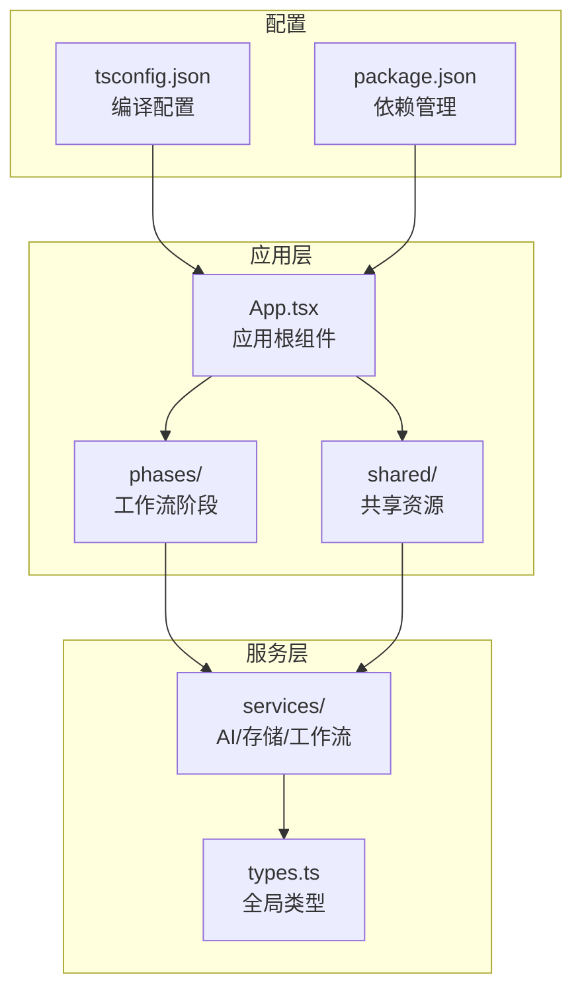
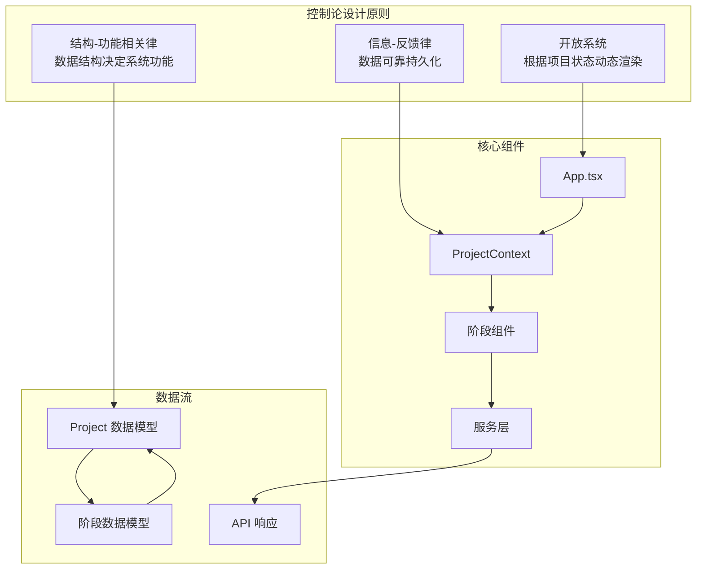
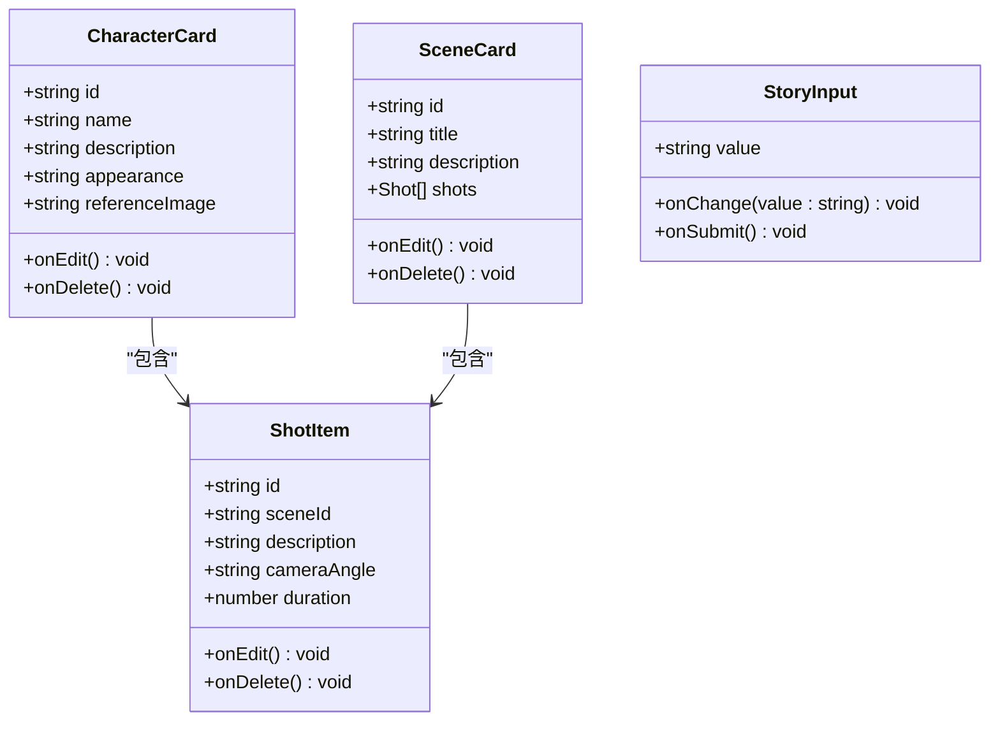
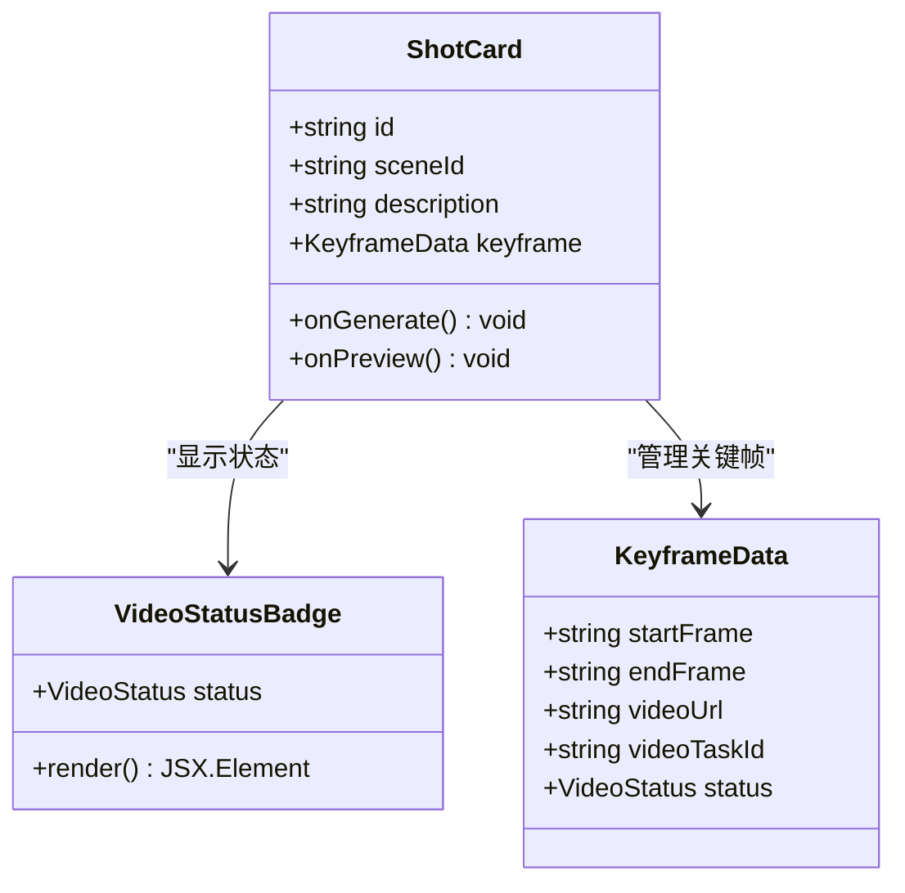
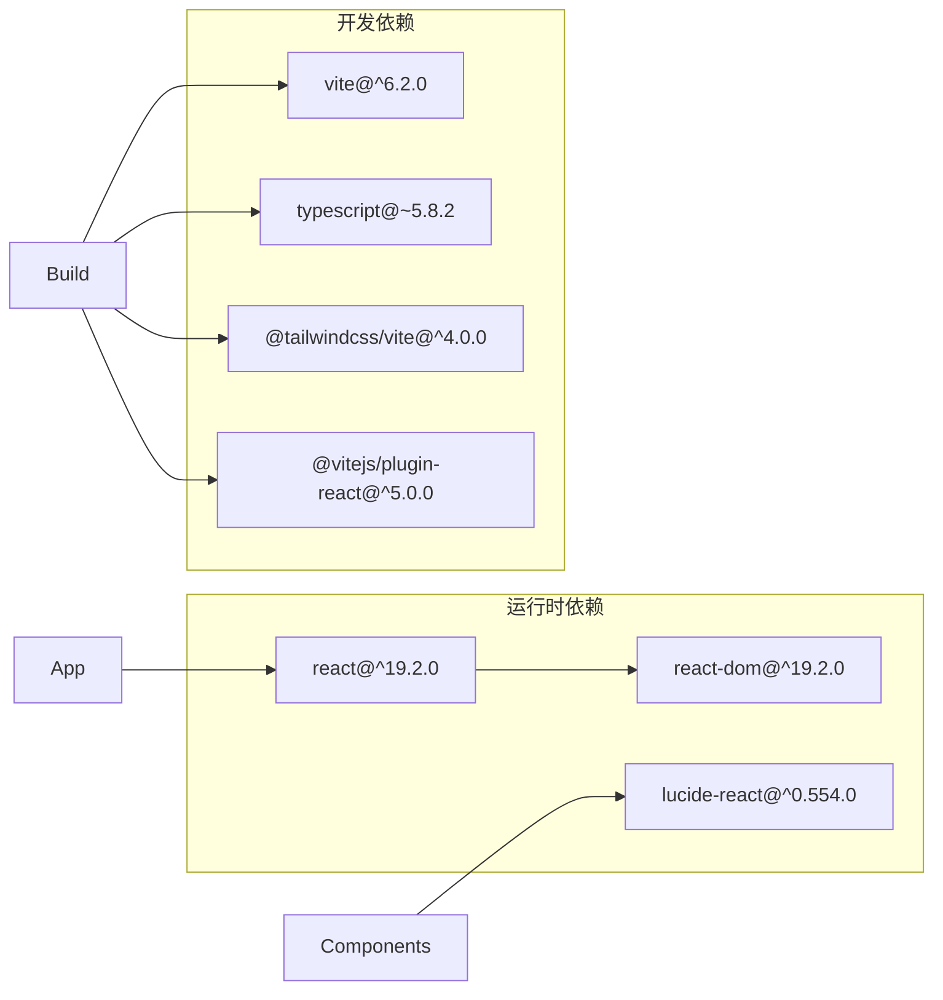
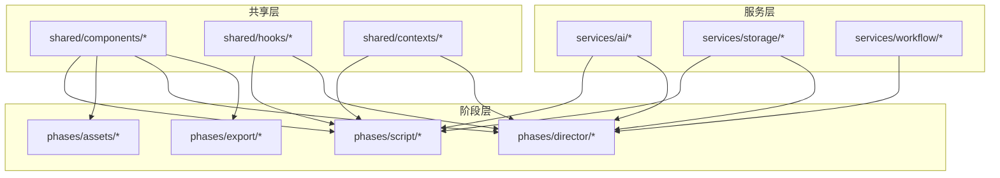

# 开发规范与最佳实践

<cite>
**本文档引用的文件**
- [tsconfig.json](file://tsconfig.json)
- [package.json](file://package.json)
- [App.tsx](file://src/App.tsx)
- [types.ts](file://src/types.ts)
- [ai/types.ts](file://src/services/ai/types.ts)
- [storage/types.ts](file://src/services/storage/types.ts)
- [CharacterCard.tsx](file://src/phases/script/components/CharacterCard.tsx)
- [SceneCard.tsx](file://src/phases/script/components/SceneCard.tsx)
- [ShotItem.tsx](file://src/phases/script/components/ShotItem.tsx)
- [StoryInput.tsx](file://src/phases/script/components/StoryInput.tsx)
- [ShotCard.tsx](file://src/phases/director/components/ShotCard.tsx)
- [VideoStatusBadge.tsx](file://src/phases/director/components/VideoStatusBadge.tsx)
- [ApiKeyModal.tsx](file://src/shared/components/ApiKeyModal.tsx)
- [LoadingSpinner.tsx](file://src/shared/components/LoadingSpinner.tsx)
- [useProject.ts](file://src/shared/hooks/useProject.ts)
- [ProjectContext.tsx](file://src/shared/contexts/ProjectContext.tsx)
</cite>

## 目录
1. [引言](#引言)
2. [项目结构](#项目结构)
3. [核心组件](#核心组件)
4. [架构概览](#架构概览)
5. [详细组件分析](#详细组件分析)
6. [依赖分析](#依赖分析)
7. [性能考虑](#性能考虑)
8. [故障排除指南](#故障排除指南)
9. [结论](#结论)
10. [附录](#附录)

## 引言
本文件为AI Shotlive组件开发规范与最佳实践指南，旨在为React + TypeScript项目提供统一的开发标准。内容涵盖TypeScript接口定义规范、Props类型约束标准、组件生命周期管理最佳实践、组件命名约定、文件组织结构、代码注释规范，以及错误处理模式、状态管理模式和异步操作处理规范。通过具体示例展示正确的开发方式，包括组件属性传递、事件处理和样式类名使用规范。

## 项目结构
AI Shotlive采用分层模块化架构，主要目录结构如下：
- `src/`：源代码根目录
  - `phases/`：工作流阶段组件（script、assets、director、export）
  - `services/`：服务层（AI、存储、工作流）
  - `shared/`：共享组件、上下文和hooks
  - `types.ts`：全局类型定义
- 根目录配置文件：tsconfig.json、package.json



**图表来源**
- [App.tsx:1-44](file://src/App.tsx#L1-L44)
- [types.ts:1-96](file://src/types.ts#L1-L96)

**章节来源**
- [tsconfig.json:1-21](file://tsconfig.json#L1-L21)
- [package.json:1-26](file://package.json#L1-L26)

## 核心组件
本节分析项目的核心组件及其职责分工：

### 应用根组件
App.tsx作为应用入口，负责：
- 初始化项目上下文
- 根据当前阶段渲染对应的工作流界面
- 启动时加载持久化的API密钥

### 类型系统
项目建立了完整的类型体系：
- Phase枚举定义四个工作流阶段
- Project接口描述完整项目数据结构
- 分阶段的数据模型（ScriptData、AssetData、DirectorData、ExportData）
- 工具函数createEmptyProject提供数据初始化

### 服务接口
服务层采用统一接口设计：
- AI服务：TextAIService、ImageAIService、VideoAIService
- 存储服务：StorageService接口定义
- 模型提供商：ModelProvider抽象

**章节来源**
- [App.tsx:1-44](file://src/App.tsx#L1-L44)
- [types.ts:1-96](file://src/types.ts#L1-L96)
- [ai/types.ts:1-73](file://src/services/ai/types.ts#L1-L73)
- [storage/types.ts:1-31](file://src/services/storage/types.ts#L1-L31)

## 架构概览
AI Shotlive采用控制论设计理念，强调系统的开放性、结构-功能相关性和信息反馈机制。



**图表来源**
- [App.tsx:1-44](file://src/App.tsx#L1-L44)
- [types.ts:1-96](file://src/types.ts#L1-L96)

## 详细组件分析

### 组件命名约定
项目遵循统一的命名规范：
- 组件文件使用帕斯卡命名法（如CharacterCard.tsx）
- Props接口使用PascalCase前缀（如CharacterCardProps）
- 状态类型使用PascalCase（如VideoStatus）
- 常量使用SCREAMING_SNAKE_CASE

### 文件组织结构
组件按功能模块组织：
```
components/
├── StageAssets/          # 资产管理
├── StageDirector/        # 导演工作台
├── StageExport/          # 导出功能
├── StagePrompts/         # 提示词管理
├── StageScript/          # 剧本编辑
└── Onboarding/           # 引导流程
```

### TypeScript接口定义规范

#### Props类型约束标准
所有组件Props必须明确类型定义，推荐使用以下模式：

```typescript
interface ComponentNameProps {
  // 必需属性
  requiredProp: string;
  
  // 可选属性
  optionalProp?: number;
  
  // 回调函数
  onChange?: (value: string) => void;
  
  // 只读属性
  readonly readOnlyProp: boolean;
}
```

#### 接口继承与组合
复杂组件可采用接口组合模式：
- 基础接口定义通用属性
- 扩展接口添加特定功能
- 使用Partial实现可选属性

### 组件生命周期管理最佳实践

#### 函数组件生命周期
```typescript
function MyComponent({ data }: MyComponentProps) {
  const [localState, setLocalState] = useState(initialValue);
  const [loading, setLoading] = useState(false);
  
  // 初始化副作用
  useEffect(() => {
    // 组件挂载时执行
    loadData();
    
    // 清理函数
    return () => {
      cleanup();
    };
  }, []);
  
  // 依赖变化时执行
  useEffect(() => {
    if (data) {
      processData(data);
    }
  }, [data]);
  
  return <div>{children}</div>;
}
```

#### 错误边界处理
```typescript
function ErrorBoundary({ children }: { children: React.ReactNode }) {
  const [hasError, setHasError] = useState(false);
  
  useEffect(() => {
    const handleError = (error: Error) => {
      setHasError(true);
      logError(error);
    };
    
    window.addEventListener('error', handleError);
    return () => window.removeEventListener('error', handleError);
  }, []);
  
  if (hasError) {
    return <div>发生错误，请重试</div>;
  }
  
  return <>{children}</>;
}
```

### 组件开发最佳实践

#### 属性传递模式
```typescript
// 正确：明确的Props定义
interface ButtonProps {
  onClick: () => void;
  disabled?: boolean;
  variant?: 'primary' | 'secondary';
}

// 正确：默认值设置
const Button: React.FC<ButtonProps> = ({ 
  onClick, 
  disabled = false, 
  variant = 'primary' 
}) => {
  return (
    <button 
      onClick={onClick}
      disabled={disabled}
      className={`btn btn-${variant}`}
    >
      {children}
    </button>
  );
};
```

#### 事件处理规范
```typescript
interface EventHandlerProps {
  onValueChange?: (value: string) => void;
  onError?: (error: Error) => void;
}

const EventHandler: React.FC<EventHandlerProps> = ({ 
  onValueChange, 
  onError 
}) => {
  const handleChange = (e: React.ChangeEvent<HTMLInputElement>) => {
    try {
      const value = e.target.value;
      // 验证输入
      if (!validateInput(value)) {
        throw new Error('输入无效');
      }
      
      onValueChange?.(value);
    } catch (error) {
      onError?.(error as Error);
    }
  };
  
  return <input onChange={handleChange} />;
};
```

#### 样式类名使用规范
```typescript
// 使用CSS Modules或BEM命名法
const className = `
  ${styles.component}
  ${props.variant ? styles[`variant-${props.variant}`] : ''}
  ${props.disabled ? styles.disabled : ''}
`;

// 或使用Tailwind CSS
<div className={cn(
  'px-4 py-2 rounded-md',
  props.variant === 'primary' && 'bg-blue-500 text-white',
  props.disabled && 'opacity-50 cursor-not-allowed'
)}>
  {children}
</div>
```

### 具体组件分析

#### 剧本阶段组件
剧本阶段包含多个核心组件，每个组件都遵循统一的开发规范：



**图表来源**
- [CharacterCard.tsx](file://src/phases/script/components/CharacterCard.tsx)
- [SceneCard.tsx](file://src/phases/script/components/SceneCard.tsx)
- [ShotItem.tsx](file://src/phases/script/components/ShotItem.tsx)
- [StoryInput.tsx](file://src/phases/script/components/StoryInput.tsx)

#### 导演阶段组件
导演阶段组件专注于视频生成和状态管理：



**图表来源**
- [ShotCard.tsx](file://src/phases/director/components/ShotCard.tsx)
- [VideoStatusBadge.tsx](file://src/phases/director/components/VideoStatusBadge.tsx)
- [types.ts:63-69](file://src/types.ts#L63-L69)

### 错误处理模式

#### 统一错误处理
```typescript
interface ErrorBoundaryState {
  hasError: boolean;
  error: Error | null;
}

class ErrorBoundary extends React.Component<{}, ErrorBoundaryState> {
  constructor(props: {}) {
    super(props);
    this.state = { hasError: false, error: null };
  }
  
  static getDerivedStateFromError(error: Error) {
    return { hasError: true, error };
  }
  
  componentDidCatch(error: Error, errorInfo: React.ErrorInfo) {
    logError(error, errorInfo);
  }
  
  render() {
    if (this.state.hasError) {
      return (
        <div className="error-container">
          <h2>出现了一些问题</h2>
          <button onClick={() => this.setState({ hasError: false, error: null })}>
            重试
          </button>
        </div>
      );
    }
    
    return this.props.children;
  }
}
```

#### 异步操作处理
```typescript
interface AsyncState<T> {
  loading: boolean;
  data: T | null;
  error: Error | null;
}

function useAsyncData<T>(asyncFn: () => Promise<T>): AsyncState<T> {
  const [state, setState] = useState<AsyncState<T>>({
    loading: false,
    data: null,
    error: null
  });
  
  const execute = useCallback(async () => {
    setState(prev => ({ ...prev, loading: true, error: null }));
    try {
      const data = await asyncFn();
      setState({ loading: false, data, error: null });
    } catch (error) {
      setState({ loading: false, data: null, error: error as Error });
    }
  }, [asyncFn]);
  
  return { ...state, execute };
}
```

### 状态管理模式

#### 上下文模式
```typescript
interface ProjectContextType {
  project: Project | null;
  currentPhase: Phase;
  updateProject: (updates: Partial<Project>) => void;
  switchPhase: (phase: Phase) => void;
}

const ProjectContext = createContext<ProjectContextType | undefined>(undefined);

function ProjectProvider({ children }: { children: React.ReactNode }) {
  const [project, setProject] = useState<Project | null>(null);
  const [currentPhase, setCurrentPhase] = useState<Phase>('script');
  
  const updateProject = useCallback((updates: Partial<Project>) => {
    setProject(prev => prev ? { ...prev, ...updates, updatedAt: Date.now() } : null);
  }, []);
  
  const switchPhase = useCallback((phase: Phase) => {
    setCurrentPhase(phase);
  }, []);
  
  return (
    <ProjectContext.Provider value={{ project, currentPhase, updateProject, switchPhase }}>
      {children}
    </ProjectContext.Provider>
  );
}
```

#### Hook模式
```typescript
function useProject() {
  const context = useContext(ProjectContext);
  if (!context) {
    throw new Error('useProject must be used within ProjectProvider');
  }
  return context;
}

function useAI() {
  const [loading, setLoading] = useState(false);
  const [error, setError] = useState<Error | null>(null);
  
  const generateText = useCallback(async (prompt: string) => {
    setLoading(true);
    setError(null);
    try {
      const result = await aiService.generateText(prompt);
      return result;
    } catch (err) {
      const error = err as Error;
      setError(error);
      throw error;
    } finally {
      setLoading(false);
    }
  }, []);
  
  return { generateText, loading, error };
}
```

## 依赖分析

### 外部依赖关系
项目使用现代化的前端技术栈，依赖关系清晰明确：



**图表来源**
- [package.json:11-24](file://package.json#L11-L24)

### 内部模块依赖
组件间依赖遵循单向数据流原则：



**图表来源**
- [App.tsx:1-44](file://src/App.tsx#L1-L44)
- [ProjectContext.tsx](file://src/shared/contexts/ProjectContext.tsx)

**章节来源**
- [package.json:1-26](file://package.json#L1-L26)

## 性能考虑
基于项目现有实现，建议关注以下性能优化点：

### 组件渲染优化
- 使用React.memo包装纯展示组件
- 合理使用useMemo和useCallback避免不必要的重渲染
- 实施虚拟滚动处理大量列表数据

### 状态更新优化
- 批量更新状态减少重渲染次数
- 使用局部状态而非全局状态
- 实施防抖和节流处理高频事件

### 资源加载优化
- 实施懒加载和代码分割
- 优化图片和视频资源加载
- 使用缓存策略减少重复请求

## 故障排除指南

### 常见问题诊断
```typescript
// 错误边界实现
class ComponentErrorBoundary extends React.Component<{}, { hasError: boolean }> {
  constructor(props: {}) {
    super(props);
    this.state = { hasError: false };
  }
  
  static getDerivedStateFromError(error: Error) {
    return { hasError: true };
  }
  
  componentDidCatch(error: Error, errorInfo: React.ErrorInfo) {
    console.error('组件错误:', error, errorInfo);
  }
  
  render() {
    if (this.state.hasError) {
      return <h2>组件加载失败</h2>;
    }
    return this.props.children;
  }
}
```

### 开发环境调试
- 使用React Developer Tools检查组件树
- 利用TypeScript类型检查发现潜在问题
- 实施详细的日志记录便于问题追踪

**章节来源**
- [LoadingSpinner.tsx](file://src/shared/components/LoadingSpinner.tsx)
- [ApiKeyModal.tsx](file://src/shared/components/ApiKeyModal.tsx)

## 结论
AI Shotlive项目展现了良好的TypeScript开发实践和组件化架构设计。通过统一的类型系统、清晰的组件命名规范、严格的Props约束和完善的错误处理机制，为复杂的AI创作工具提供了可靠的开发基础。建议在后续开发中继续坚持这些最佳实践，并根据实际需求逐步完善状态管理和性能优化方案。

## 附录

### 编码规范速查表
- **命名规范**：组件使用帕斯卡命名法，变量使用camelCase
- **类型定义**：所有Props必须有明确的TypeScript类型
- **错误处理**：实现统一的错误边界和异常捕获机制
- **状态管理**：优先使用React Hooks，避免过度使用Redux
- **异步处理**：使用Promise和async/await，实施适当的错误处理
- **样式规范**：使用CSS Modules或Tailwind CSS，避免全局样式污染

### 最佳实践清单
- ✅ 组件Props必须有明确的类型定义
- ✅ 实现必要的错误边界处理
- ✅ 使用React.memo优化渲染性能
- ✅ 合理使用useMemo和useCallback
- ✅ 实施适当的异步操作状态管理
- ✅ 遵循单一职责原则组织组件
- ✅ 使用语义化HTML和ARIA属性
- ✅ 实施响应式设计和无障碍访问