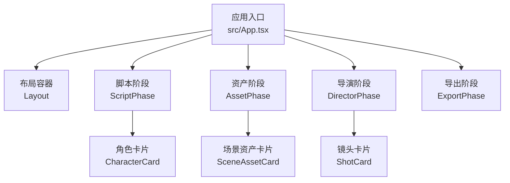
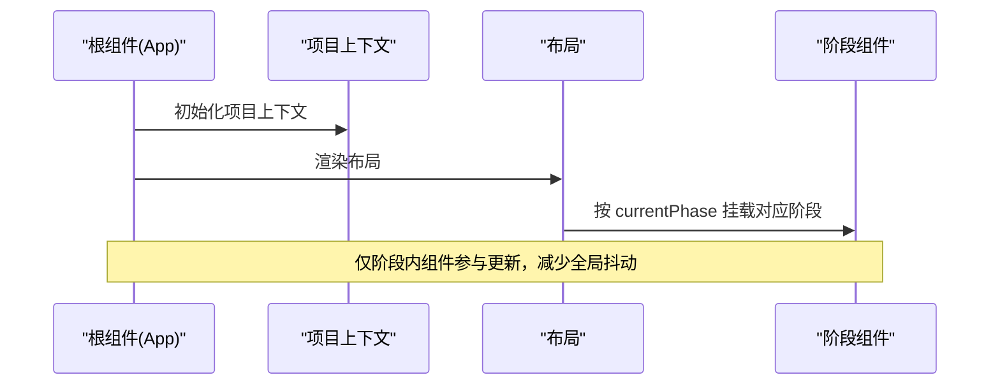
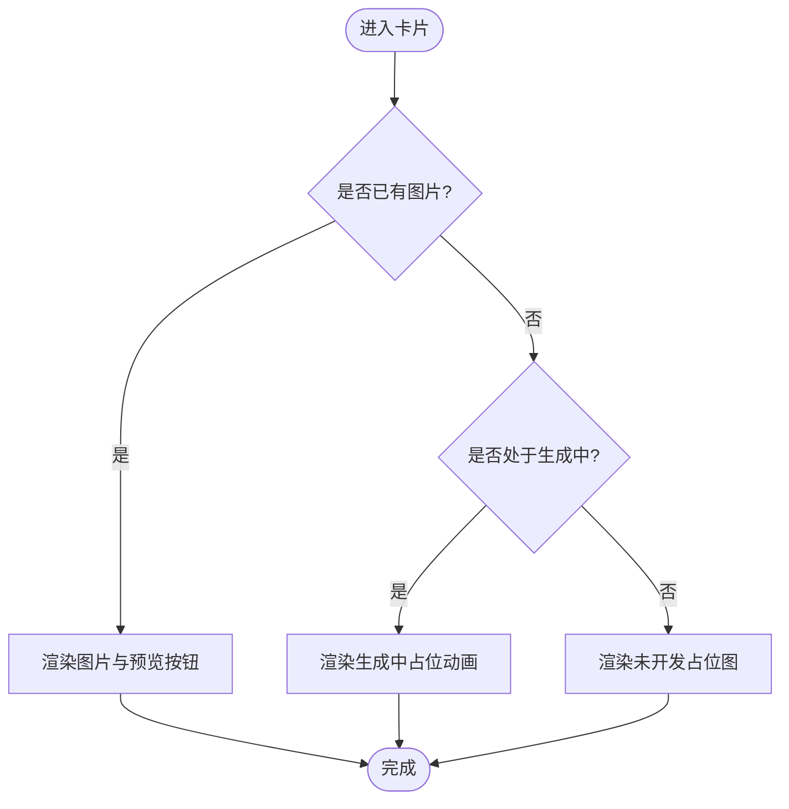
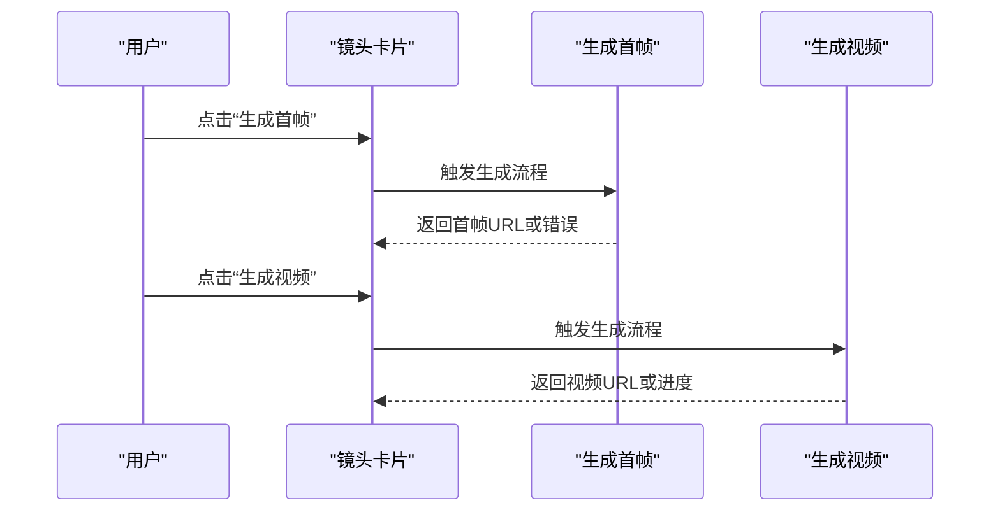
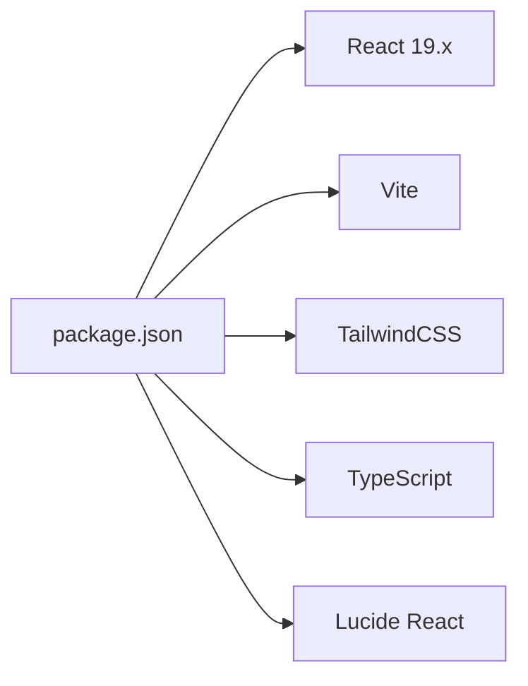

# 性能优化指南

<cite>
**本文引用的文件**
- [src/App.tsx](file://src/App.tsx)
- [src/phases/assets/components/SceneAssetCard.tsx](file://src/phases/assets/components/SceneAssetCard.tsx)
- [src/phases/director/components/ShotCard.tsx](file://src/phases/director/components/ShotCard.tsx)
- [src/phases/script/components/CharacterCard.tsx](file://src/phases/script/components/CharacterCard.tsx)
- [package.json](file://package.json)
- [package-lock.json](file://package-lock.json)
</cite>

## 目录
1. [简介](#简介)
2. [项目结构](#项目结构)
3. [核心组件](#核心组件)
4. [架构总览](#架构总览)
5. [详细组件分析](#详细组件分析)
6. [依赖分析](#依赖分析)
7. [性能注意事项](#性能注意事项)
8. [故障排查指南](#故障排查指南)
9. [结论](#结论)
10. [附录](#附录)

## 简介
本指南面向 AI Shotlive 的前端组件，聚焦渲染性能优化、虚拟滚动与懒加载策略、内存泄漏预防、垃圾回收优化、大列表处理、重渲染控制、useMemo/useCallback 使用建议、状态提升最佳实践、性能监控与诊断方法，并提供可落地的优化路径与基准测试思路。内容基于仓库中的实际组件与依赖配置进行提炼，避免空谈，强调可执行性。

## 项目结构
- 应用入口与根组件负责按阶段切换渲染，减少不必要的全局重渲染。
- 各功能阶段以组件形式组织，典型组件包括场景资产卡片、镜头卡片、角色卡片等，均承担图片/视频资源的展示与交互。
- 依赖采用现代前端技术栈，React 版本较新，具备良好的性能基线。

图表来源
- [src/App.tsx:15-28](file://src/App.tsx#L15-L28)

章节来源
- [src/App.tsx:1-44](file://src/App.tsx#L1-L44)

## 核心组件
- 场景资产卡片：负责场景概念图的占位、加载态、错误态与生成按钮，涉及图片懒加载与交互防抖。
- 镜头卡片：负责首帧图与视频的预览、状态徽标、生成/重拍按钮，涉及视频标签的预加载策略与交互锁定。
- 角色卡片：负责角色信息的编辑与展示，涉及输入框与草稿状态管理。

章节来源
- [src/phases/assets/components/SceneAssetCard.tsx:1-243](file://src/phases/assets/components/SceneAssetCard.tsx#L1-L243)
- [src/phases/director/components/ShotCard.tsx:1-308](file://src/phases/director/components/ShotCard.tsx#L1-L308)
- [src/phases/script/components/CharacterCard.tsx:1-201](file://src/phases/script/components/CharacterCard.tsx#L1-L201)

## 架构总览
应用采用“阶段化”渲染模式，根组件依据当前阶段选择性挂载对应阶段组件，降低全局重渲染概率。各阶段内的卡片组件承担具体的数据与交互逻辑，通过 props 注入与回调解耦。

图表来源
- [src/App.tsx:30-42](file://src/App.tsx#L30-L42)

章节来源
- [src/App.tsx:15-28](file://src/App.tsx#L15-L28)

## 详细组件分析

### 场景资产卡片（SceneAssetCard）
- 渲染分支：已生成/生成中/未开发三种状态，分别渲染不同 UI 结构与动画。
- 图片懒加载：在“已生成”状态下才渲染 img 标签，避免过早请求资源。
- 交互防抖：生成按钮与预览按钮在忙碌态下禁用，防止重复触发。
- 错误提示：错误信息以独立区域呈现，避免影响主内容渲染。

图表来源
- [src/phases/assets/components/SceneAssetCard.tsx:46-90](file://src/phases/assets/components/SceneAssetCard.tsx#L46-L90)

章节来源
- [src/phases/assets/components/SceneAssetCard.tsx:26-184](file://src/phases/assets/components/SceneAssetCard.tsx#L26-L184)

### 镜头卡片（ShotCard）
- 状态驱动渲染：根据 keyframe 的状态决定首帧图或视频预览。
- 视频预加载策略：使用预加载元数据策略，平衡首屏速度与带宽占用。
- 交互锁定：生成/重拍按钮在忙碌态或锁定态禁用，避免并发请求。
- 进度与状态可视化：通过状态徽标与扫描条增强用户感知。

图表来源
- [src/phases/director/components/ShotCard.tsx:43-69](file://src/phases/director/components/ShotCard.tsx#L43-L69)
- [src/phases/director/components/ShotCard.tsx:182-190](file://src/phases/director/components/ShotCard.tsx#L182-L190)

章节来源
- [src/phases/director/components/ShotCard.tsx:22-295](file://src/phases/director/components/ShotCard.tsx#L22-L295)

### 角色卡片（CharacterCard）
- 编辑态与展示态切换：通过本地状态控制输入草稿，减少父级频繁重渲染。
- 输入草稿同步：在开始编辑时同步当前值，避免不一致。
- 展示区采用只读文本，减少不必要的受控组件开销。

章节来源
- [src/phases/script/components/CharacterCard.tsx:15-37](file://src/phases/script/components/CharacterCard.tsx#L15-L37)
- [src/phases/script/components/CharacterCard.tsx:135-195](file://src/phases/script/components/CharacterCard.tsx#L135-L195)

## 依赖分析
- React 版本：19.x，具备更好的并发特性与调度能力，有利于优化重渲染与批处理。
- 开发工具链：Vite + TailwindCSS + TypeScript，构建与样式体系成熟，便于性能分析与产物优化。
- 第三方库：Lucide React 图标库，体积较小，对整体性能影响有限。

图表来源
- [package.json:11-24](file://package.json#L11-L24)

章节来源
- [package.json:1-26](file://package.json#L1-L26)
- [package-lock.json:11949-11987](file://package-lock.json#L11949-L11987)
- [package-lock.json:11988-12018](file://package-lock.json#L11988-L12018)

## 性能注意事项

### 组件渲染性能优化技巧
- 条件渲染与最小化 DOM 树
  - 在场景资产卡片中，仅在有图片时渲染 img，避免过早请求与布局抖动。
  - 在镜头卡片中，仅在有首帧或视频时渲染相应媒体元素。
- 动画与过渡的节流
  - 利用 CSS 动画替代 JS 动画，减少主线程压力。
  - 控制动画时长与缓动函数，避免过度复杂的逐帧动画。
- 图片与视频资源优化
  - 图片使用合适的尺寸与格式，结合懒加载策略。
  - 视频标签设置合理的预加载策略，避免阻塞首屏。

章节来源
- [src/phases/assets/components/SceneAssetCard.tsx:46-90](file://src/phases/assets/components/SceneAssetCard.tsx#L46-L90)
- [src/phases/director/components/ShotCard.tsx:118-190](file://src/phases/director/components/ShotCard.tsx#L118-L190)

### 虚拟滚动实现
- 适用场景
  - 大型场景列表、镜头列表、角色列表等。
- 实现要点
  - 计算可视窗口内的可见项索引区间，仅渲染可见项及其缓冲区。
  - 使用固定高度或测量高度的容器，确保滚动位置与高度计算稳定。
  - 对媒体资源采用懒加载策略，避免一次性加载过多资源。
  - 保持稳定的 key 值，避免节点重建导致的重排。
- 推荐方案
  - 使用轻量虚拟滚动库或自研简易实现，优先保证交互流畅与内存占用可控。

[本节为通用指导，无需特定文件引用]

### 懒加载策略
- 图片懒加载
  - 仅在进入视口时加载图片，结合 IntersectionObserver 或容器滚动事件。
  - 提供占位图与骨架屏，改善感知性能。
- 视频懒加载
  - 首帧图先行，视频在用户主动播放或接近可视区域时再加载。
  - 使用预加载元数据策略，兼顾首屏与交互体验。
- 资源分块
  - 将大列表拆分为多个小块，按需加载，降低峰值内存占用。

章节来源
- [src/phases/assets/components/SceneAssetCard.tsx:63-67](file://src/phases/assets/components/SceneAssetCard.tsx#L63-L67)
- [src/phases/director/components/ShotCard.tsx:182-189](file://src/phases/director/components/ShotCard.tsx#L182-L189)

### 内存泄漏预防与垃圾回收优化
- 避免闭包持有长生命周期引用
  - 在组件卸载前清理定时器、订阅与回调引用。
- 事件监听器解绑
  - 在 useEffect cleanup 中移除全局事件监听，避免悬挂引用。
- 大对象与数组的及时释放
  - 避免在组件外缓存大量临时数据，及时清空或复用。
- 避免不必要的 ref 持有
  - 仅在必要时使用 ref，避免长期持有 DOM 引用导致 GC 困难。

[本节为通用指导，无需特定文件引用]

### 大列表处理方法
- 分页与无限滚动
  - 限制单次渲染数量，滚动到阈值时增量加载。
- 数据去重与稳定排序
  - 保持唯一 key，避免重复渲染。
- 虚拟化与骨架屏
  - 使用虚拟滚动与骨架屏提升感知性能。
- 并发与批处理
  - 利用 React 19 的并发特性，合理安排任务优先级。

[本节为通用指导，无需特定文件引用]

### 重渲染控制与状态提升最佳实践
- 使用 memo 包装纯展示组件
  - 对 props 不变即不重渲染的组件使用 memo，减少子树渲染。
- useMemo/useCallback 的正确使用
  - 将昂贵计算结果与回调函数稳定化，避免每次渲染都产生新引用。
  - 注意依赖数组完整性，避免漏依赖导致的无效重渲染。
- 状态提升与就近原则
  - 将共享状态提升至最近公共祖先，避免多处重复状态。
  - 将局部状态下沉到子组件，减少无关更新传播。

[本节为通用指导，无需特定文件引用]

### 性能监控与诊断
- 浏览器性能面板
  - 使用 Performance 录制交互过程，观察主线程占用、布局与绘制耗时。
- FPS 与帧时间
  - 关注长帧与掉帧，定位动画与重排热点。
- 内存快照
  - 定期采集内存快照，检查是否存在未释放的 DOM、事件监听器与闭包。
- React DevTools Profiler
  - 分析组件渲染次数与耗时，识别重渲染热点。
- Lighthouse/第三方性能监控
  - 首屏、交互、内存等指标持续观测，建立基线。

[本节为通用指导，无需特定文件引用]

### 性能基准测试方法
- 基准场景设计
  - 构造 N 个场景/镜头/角色的列表，记录渲染时间与内存占用。
- 测试维度
  - 首次渲染、批量更新、滚动性能、交互响应、内存峰值。
- 对比实验
  - 对比启用/禁用虚拟滚动、懒加载、memo 等优化前后的指标差异。
- 自动化回归
  - 将关键指标纳入 CI，防止回归。

[本节为通用指导，无需特定文件引用]

## 故障排查指南
- 图片不显示或加载缓慢
  - 检查图片 URL 是否存在、跨域策略与网络状况。
  - 确认懒加载逻辑是否正确触发，占位图是否被提前渲染。
- 视频无法播放或卡顿
  - 检查视频格式与浏览器支持，确认预加载策略与网络带宽。
  - 关注状态更新频率，避免频繁切换状态导致的资源争用。
- 交互按钮无响应
  - 检查忙碌态与锁定态逻辑，确认禁用条件与状态回写。
- 内存占用过高
  - 检查是否存在未清理的定时器、事件监听器与闭包引用。
  - 关注大列表的虚拟化与懒加载是否生效。

章节来源
- [src/phases/assets/components/SceneAssetCard.tsx:163-180](file://src/phases/assets/components/SceneAssetCard.tsx#L163-L180)
- [src/phases/director/components/ShotCard.tsx:208-265](file://src/phases/director/components/ShotCard.tsx#L208-L265)

## 结论
通过阶段化渲染、条件渲染、懒加载与虚拟滚动、memo 与回调稳定化、状态就近与提升等策略，可在不牺牲用户体验的前提下显著提升渲染性能与交互流畅度。配合持续的性能监控与基准测试，可形成闭环优化机制，保障系统在复杂场景下的稳定性与可维护性。

## 附录
- 术语
  - 虚拟滚动：仅渲染可视区域内的元素，通过计算偏移实现长列表滚动。
  - 懒加载：延迟加载资源，减少初始负载与内存占用。
  - memo：对 props 不变的组件进行记忆化，避免重渲染。
- 参考实现位置
  - 场景资产卡片渲染分支与懒加载策略：[src/phases/assets/components/SceneAssetCard.tsx:46-90](file://src/phases/assets/components/SceneAssetCard.tsx#L46-L90)
  - 镜头卡片状态与视频预加载策略：[src/phases/director/components/ShotCard.tsx:118-190](file://src/phases/director/components/ShotCard.tsx#L118-L190)
  - 角色卡片编辑态与草稿同步：[src/phases/script/components/CharacterCard.tsx:15-37](file://src/phases/script/components/CharacterCard.tsx#L15-L37)