# 组件开发指南

<cite>
**本文档引用的文件**
- [App.tsx](file://src/App.tsx)
- [types.ts](file://src/types.ts)
- [ai/types.ts](file://src/services/ai/types.ts)
- [storage/types.ts](file://src/services/storage/types.ts)
- [workflow/types.ts](file://src/services/workflow/types.ts)
</cite>

## 目录
1. [简介](#简介)
2. [项目结构](#项目结构)
3. [核心组件](#核心组件)
4. [架构概览](#架构概览)
5. [详细组件分析](#详细组件分析)
6. [依赖分析](#依赖分析)
7. [性能考虑](#性能考虑)
8. [故障排除指南](#故障排除指南)
9. [结论](#结论)
10. [附录](#附录)

## 简介

AI Shotlive是一个基于React和TypeScript的视频生成工作流平台，专注于电影级视觉效果的自动化制作。本指南旨在为开发者提供完整的组件开发规范，涵盖TypeScript接口定义、Props类型约束、组件生命周期管理、组件复用策略、高阶组件模式、组件组合技巧、测试方法、性能优化策略、可访问性设计原则，以及组件开发最佳实践和代码风格规范。

## 项目结构

项目采用模块化的组件架构，主要分为以下几个核心模块：

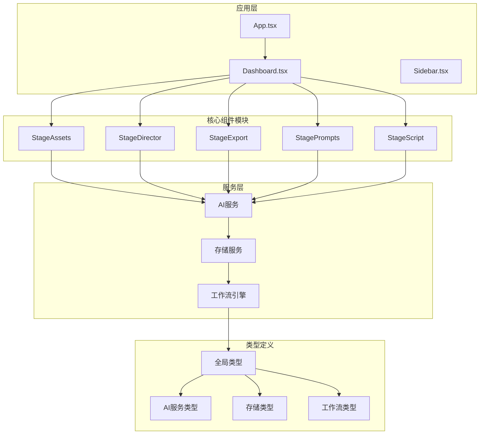

**图表来源**
- [App.tsx:1-6](file://src/App.tsx#L1-L6)
- [types.ts:1-96](file://src/types.ts#L1-L96)

**章节来源**
- [App.tsx:1-6](file://src/App.tsx#L1-L6)
- [types.ts:1-96](file://src/types.ts#L1-L96)

## 核心组件

### 类型系统架构

项目建立了完整的类型系统，确保组件间的数据传递安全性和一致性：

#### 项目数据模型
项目采用分阶段的数据管理模式，每个阶段都有明确的数据结构定义：

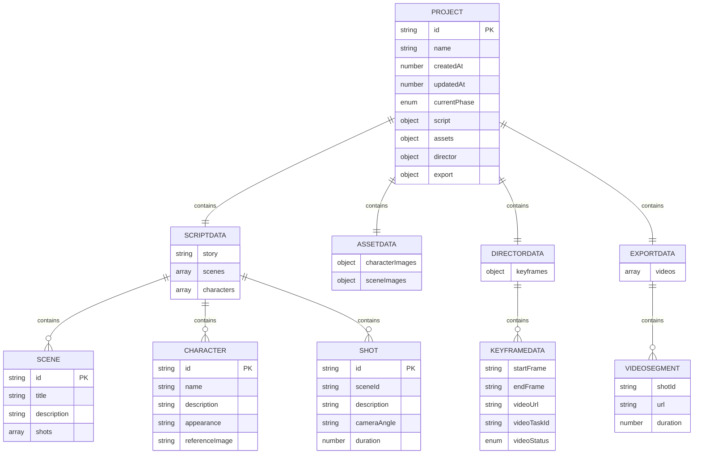

**图表来源**
- [types.ts:10-80](file://src/types.ts#L10-L80)

#### AI服务接口定义

AI服务采用统一的接口抽象，支持多厂商适配：

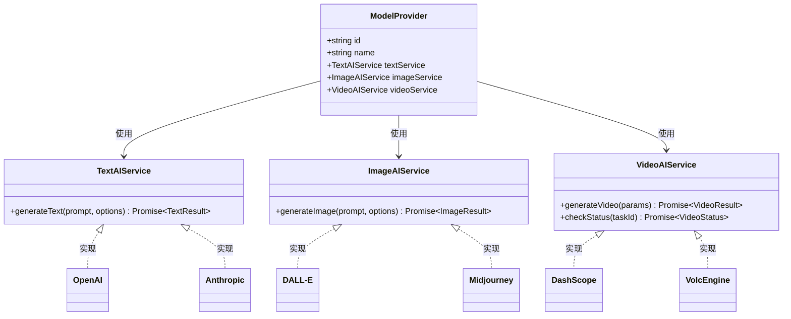

**图表来源**
- [ai/types.ts:18-72](file://src/services/ai/types.ts#L18-L72)

**章节来源**
- [types.ts:6-96](file://src/types.ts#L6-L96)
- [ai/types.ts:1-73](file://src/services/ai/types.ts#L1-L73)

## 架构概览

### 组件生命周期管理

项目采用受控组件模式，通过状态提升实现组件间的协调：

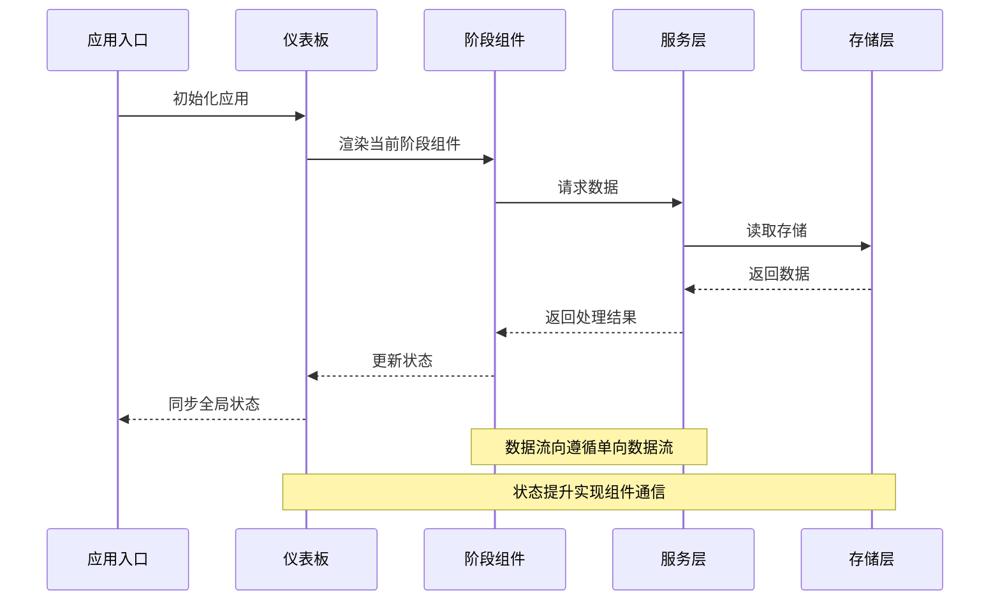

**图表来源**
- [App.tsx:1-6](file://src/App.tsx#L1-L6)
- [types.ts:10-20](file://src/types.ts#L10-L20)

### 工作流引擎设计

工作流引擎确保阶段转换的确定性和可预测性：

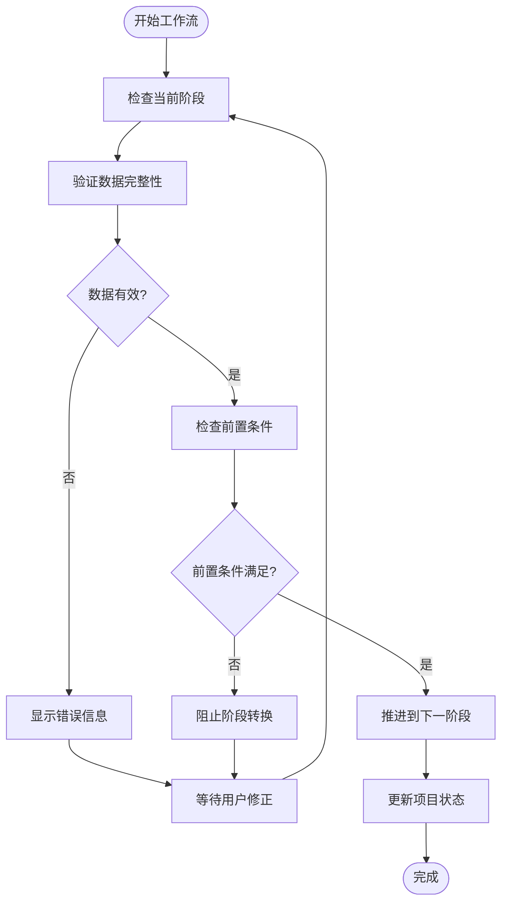

**图表来源**
- [workflow/types.ts:13-18](file://src/services/workflow/types.ts#L13-L18)

**章节来源**
- [workflow/types.ts:1-21](file://src/services/workflow/types.ts#L1-21)

## 详细组件分析

### 组件开发规范

#### TypeScript接口定义最佳实践

1. **接口命名约定**
   - 使用名词短语描述实体特征
   - 接口名以大写字母开头
   - 避免使用缩写，保持语义清晰

2. **属性类型约束**
   - 必需属性不使用可选标记
   - 可选属性使用`?`标记
   - 默认值属性使用可选类型

3. **泛型使用规范**
   - 明确泛型参数名称
   - 提供合理的默认类型
   - 避免过度复杂的泛型约束

#### Props类型约束策略

组件Props应遵循以下约束原则：

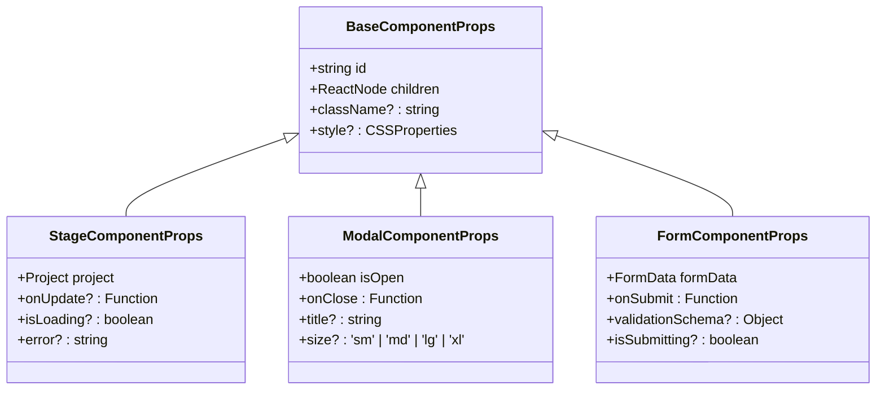

**图表来源**
- [types.ts:10-20](file://src/types.ts#L10-L20)

### 组件复用策略

#### 高阶组件(HOC)模式

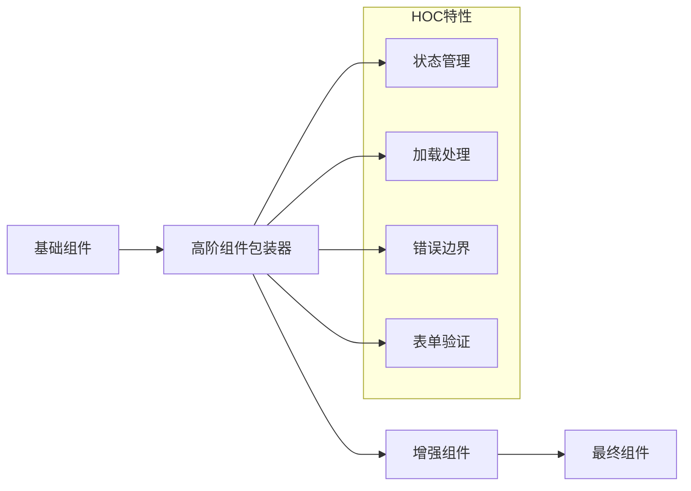

#### 组合组件模式

组件组合采用"容器-展示"分离模式：

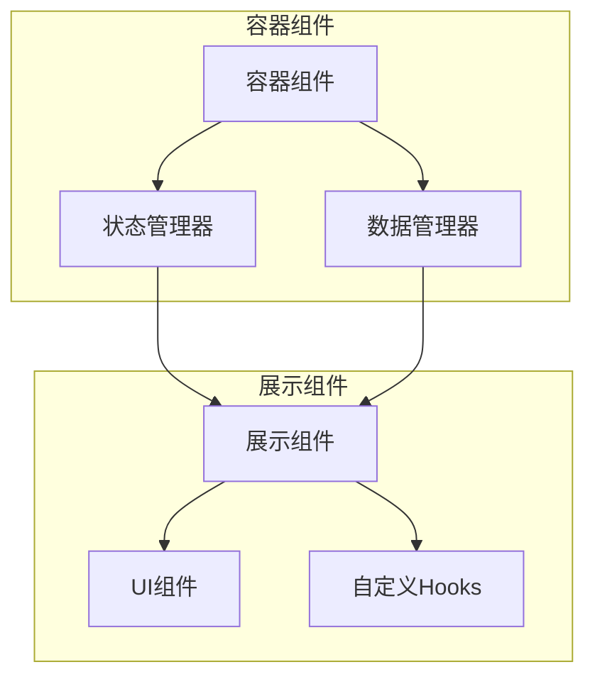

### 组件生命周期管理

#### React组件生命周期钩子

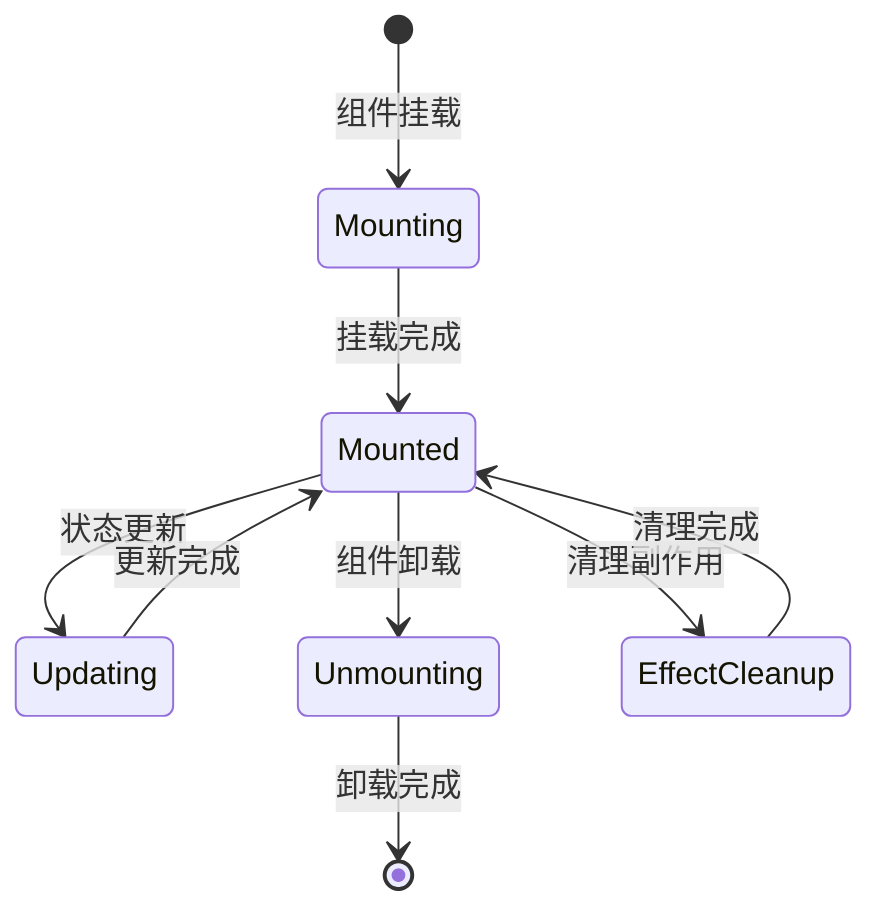

#### 自定义Hook设计模式

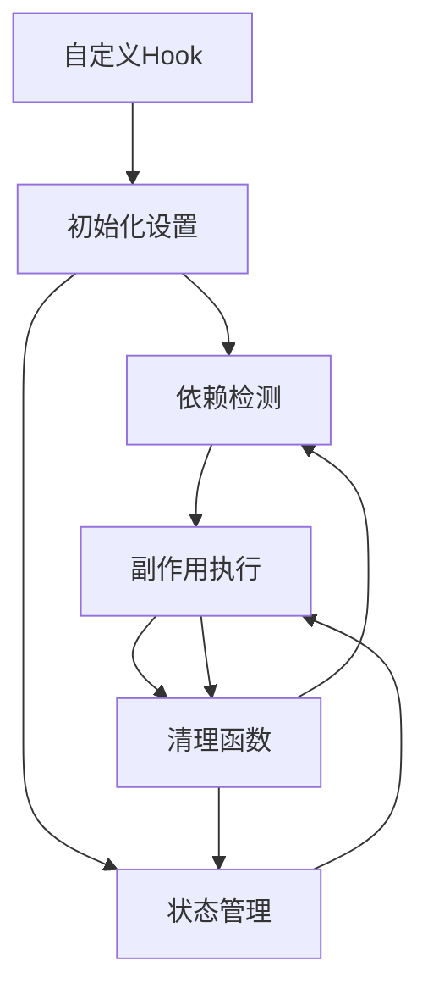

**章节来源**
- [types.ts:10-80](file://src/types.ts#L10-L80)

## 依赖分析

### 服务层依赖关系

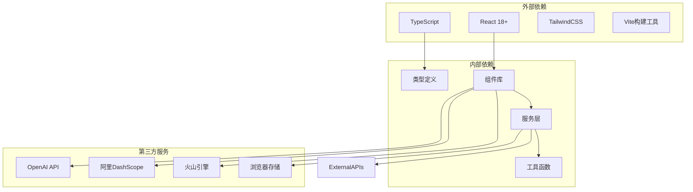

**图表来源**
- [ai/types.ts:66-72](file://src/services/ai/types.ts#L66-L72)
- [storage/types.ts:15-30](file://src/services/storage/types.ts#L15-L30)

### 组件间通信机制

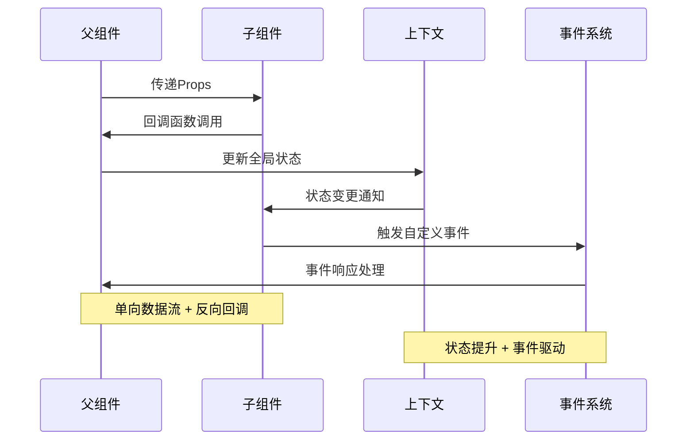

**图表来源**
- [types.ts:10-20](file://src/types.ts#L10-L20)

**章节来源**
- [storage/types.ts:15-30](file://src/services/storage/types.ts#L15-L30)
- [workflow/types.ts:7-18](file://src/services/workflow/types.ts#L7-L18)

## 性能考虑

### 渲染性能优化

1. **组件懒加载**
   - 使用React.lazy实现代码分割
   - 结合Suspense处理加载状态
   - 优先加载关键路径组件

2. **虚拟化技术**
   - 大列表使用react-window实现虚拟滚动
   - 图片懒加载避免阻塞渲染
   - Canvas组件按需渲染

3. **状态优化**
   - 使用useMemo缓存计算结果
   - 使用useCallback稳定回调函数引用
   - 合理拆分组件状态

### 内存管理

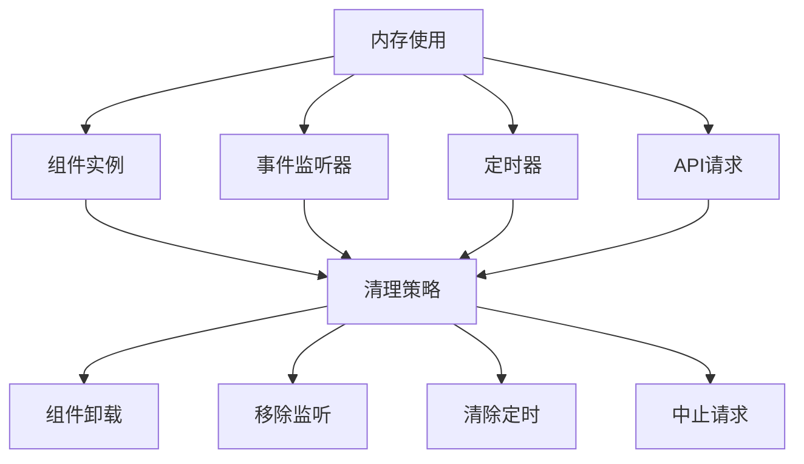

### 缓存策略

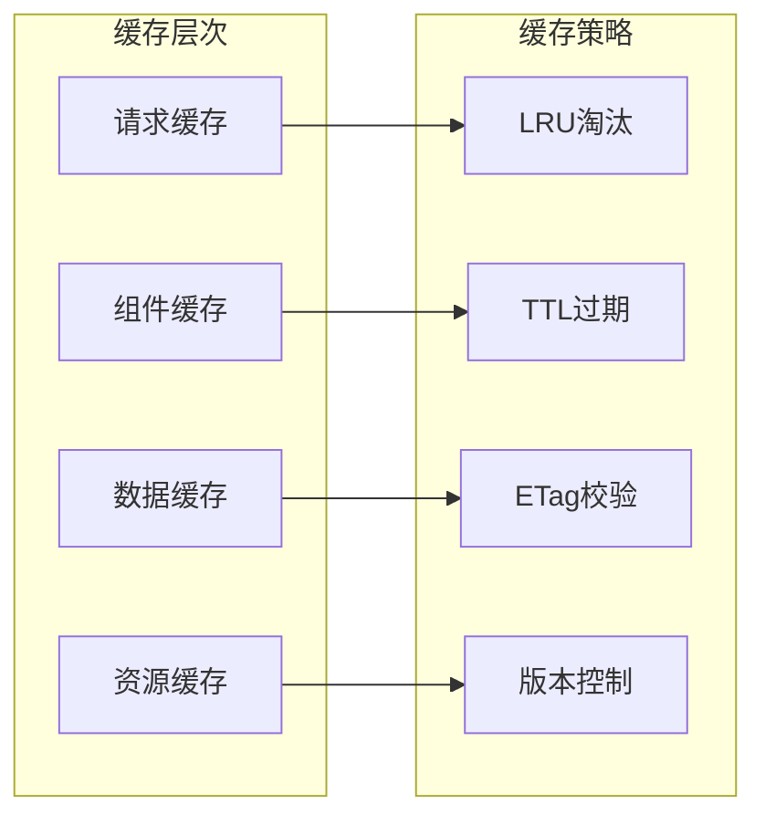

## 故障排除指南

### 常见问题诊断

#### 类型错误排查

1. **接口不匹配**
   - 检查Props类型定义
   - 验证数据结构一致性
   - 确认可选属性处理

2. **泛型约束问题**
   - 明确泛型参数含义
   - 检查默认类型设置
   - 验证类型推导结果

#### 运行时错误处理

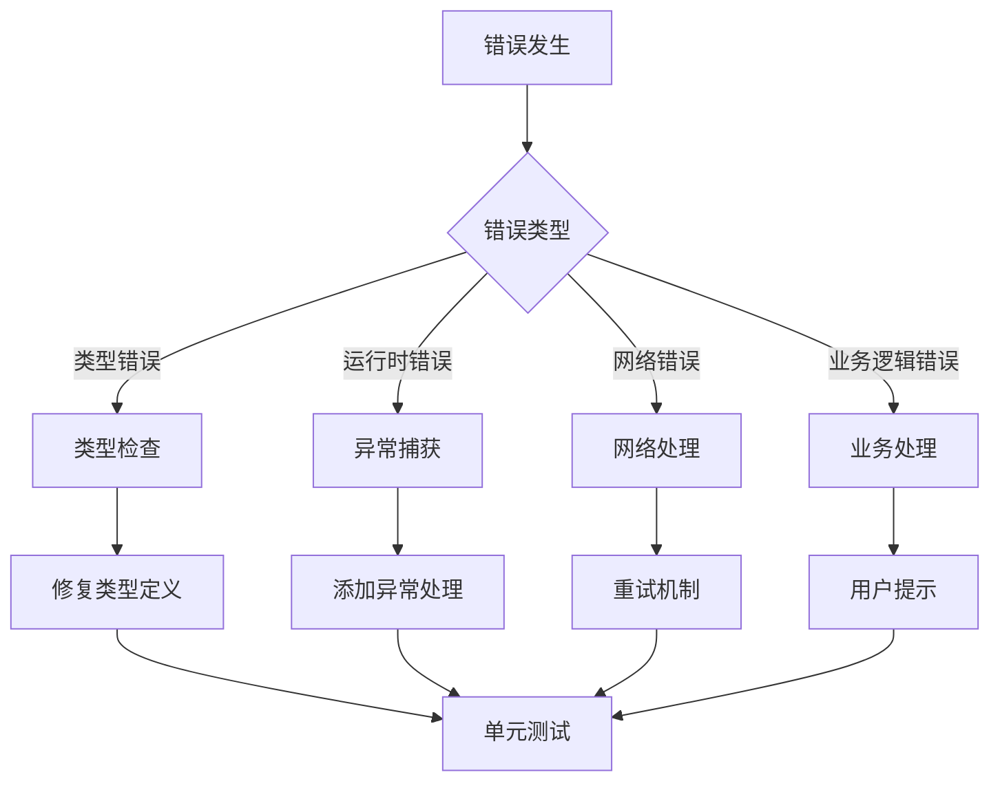

#### 性能问题诊断

1. **渲染性能监控**
   - 使用React DevTools Profiler
   - 监控组件重渲染频率
   - 分析长任务执行时间

2. **内存泄漏检测**
   - 检查事件监听器清理
   - 验证定时器清理
   - 确认资源释放

**章节来源**
- [ai/types.ts:48-58](file://src/services/ai/types.ts#L48-L58)

## 结论

AI Shotlive组件开发指南提供了完整的开发规范和最佳实践。通过严格的类型系统、清晰的组件架构、完善的错误处理机制和性能优化策略，确保了系统的可维护性和扩展性。

关键要点包括：
- 建立统一的类型定义规范
- 实施组件复用和组合策略
- 设计健壮的生命周期管理
- 采用渐进式性能优化
- 建立完善的测试和调试流程

这些规范为团队协作和项目长期发展奠定了坚实基础。

## 附录

### 开发环境配置

#### 项目依赖
- React 18+
- TypeScript 5+
- TailwindCSS
- Vite
- ESLint + Prettier

#### 开发工具
- VS Code推荐插件
- React DevTools
- Redux DevTools
- Browser DevTools

### 贡献指南

#### 代码提交规范
- 使用Conventional Commits格式
- 提供清晰的提交信息
- 包含必要的测试用例

#### 代码审查标准
- 代码质量检查
- 性能影响评估
- 兼容性验证
- 文档完整性检查