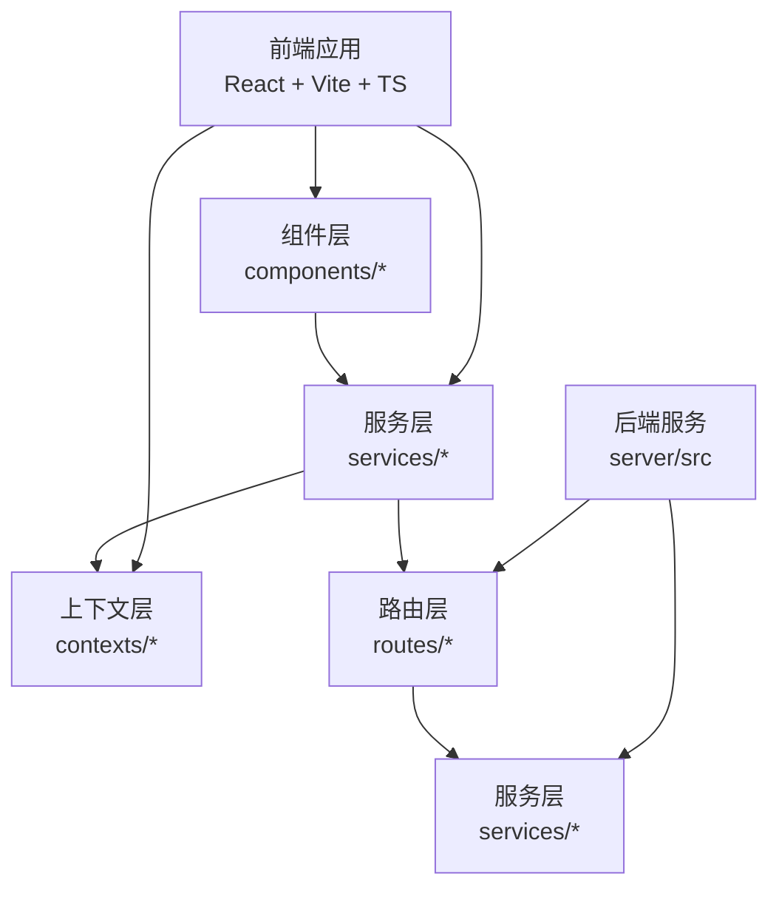
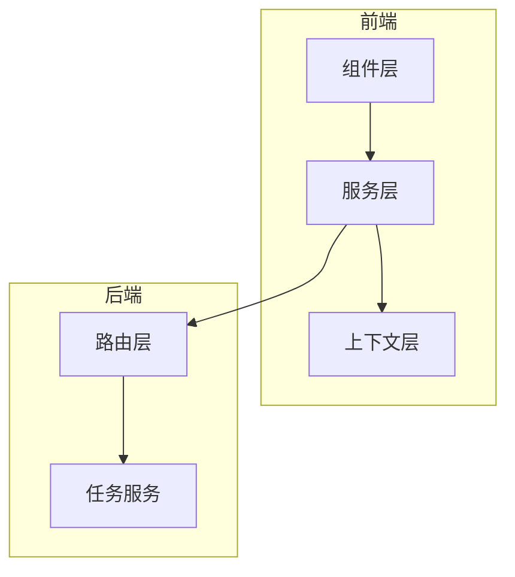
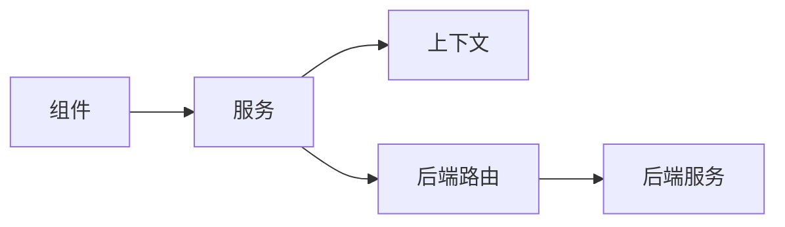

# 组件测试策略

<cite>
**本文引用的文件**
- [package.json](file://package.json)
- [vite.config.ts](file://vite.config.ts)
- [tsconfig.json](file://tsconfig.json)
- [App.tsx](file://App.tsx)
- [README.md](file://README.md)
- [README_EN.md](file://README_EN.md)
- [components/StageDirector/index.tsx](file://components/StageDirector/index.tsx)
- [components/StageAssets/index.tsx](file://components/StageAssets/index.tsx)
- [components/ModelConfig/index.tsx](file://components/ModelConfig/index.tsx)
- [components/Onboarding/index.tsx](file://components/Onboarding/index.tsx)
- [services/mockData.ts](file://services/mockData.ts)
- [services/modelConfigService.ts](file://services/modelConfigService.ts)
- [services/modelService.ts](file://services/modelService.ts)
- [services/taskService.ts](file://services/taskService.ts)
- [contexts/AuthContext.tsx](file://contexts/AuthContext.tsx)
- [contexts/ThemeContext.tsx](file://contexts/ThemeContext.tsx)
- [server/src/routes/tasks.ts](file://server/src/routes/tasks.ts)
- [server/src/services/taskRunner.ts](file://server/src/services/taskRunner.ts)
- [server/src/lib/index.ts](file://server/src/lib/index.ts)
</cite>

## 目录
1. [引言](#引言)
2. [项目结构](#项目结构)
3. [核心组件](#核心组件)
4. [架构总览](#架构总览)
5. [详细组件分析](#详细组件分析)
6. [依赖分析](#依赖分析)
7. [性能考虑](#性能考虑)
8. [故障排查指南](#故障排查指南)
9. [结论](#结论)
10. [附录](#附录)

## 引言
本文件面向AI Shotlive组件的测试策略制定与落地，覆盖单元测试、集成测试、端到端测试、快照测试、交互测试与性能测试的完整方法论，并给出可操作的测试自动化配置建议、覆盖率目标、测试报告生成与持续集成中的测试配置要点。文档以仓库现有组件与服务为依据，结合前端React/Vite工程与后端Node服务，形成可执行的测试方案。

## 项目结构
- 前端采用React 19 + Vite + TypeScript，通过路径别名@指向src目录，构建与开发脚本由package.json定义。
- 组件集中在components目录下，按功能域划分（如StageDirector、StageAssets、ModelConfig、Onboarding等）。
- 服务层位于services目录，包含mock数据、模型配置、任务调度等业务服务。
- 上下文（Context）位于contexts目录，用于状态共享（认证、主题）。
- 后端位于server目录，提供REST路由与任务执行服务。

图表来源
- [vite.config.ts:1-13](file://vite.config.ts#L1-L13)
- [tsconfig.json:1-21](file://tsconfig.json#L1-L21)
- [package.json:1-26](file://package.json#L1-L26)

章节来源
- [package.json:1-26](file://package.json#L1-L26)
- [vite.config.ts:1-13](file://vite.config.ts#L1-L13)
- [tsconfig.json:1-21](file://tsconfig.json#L1-L21)

## 核心组件
- 组件层：包含场景导演、素材管理、模型配置、引导流程等模块化UI组件，作为测试的主要对象。
- 服务层：封装业务逻辑与外部接口调用，提供可注入的依赖点，便于单元测试与模拟。
- 上下文层：提供认证与主题状态，便于在测试中进行状态注入与断言。
- 路由与服务：后端提供任务、资产、模型等REST接口，支持集成测试与端到端验证。

章节来源
- [components/StageDirector/index.tsx](file://components/StageDirector/index.tsx)
- [components/StageAssets/index.tsx](file://components/StageAssets/index.tsx)
- [components/ModelConfig/index.tsx](file://components/ModelConfig/index.tsx)
- [components/Onboarding/index.tsx](file://components/Onboarding/index.tsx)
- [services/mockData.ts](file://services/mockData.ts)
- [services/modelConfigService.ts](file://services/modelConfigService.ts)
- [services/modelService.ts](file://services/modelService.ts)
- [services/taskService.ts](file://services/taskService.ts)
- [contexts/AuthContext.tsx](file://contexts/AuthContext.tsx)
- [contexts/ThemeContext.tsx](file://contexts/ThemeContext.tsx)
- [server/src/routes/tasks.ts](file://server/src/routes/tasks.ts)
- [server/src/services/taskRunner.ts](file://server/src/services/taskRunner.ts)

## 架构总览
前端组件通过服务层访问后端接口；服务层通过上下文获取全局状态；后端路由与服务处理请求并返回结果。测试策略围绕此链路展开，分别在组件层、服务层与后端层进行验证。

图表来源
- [components/StageDirector/index.tsx](file://components/StageDirector/index.tsx)
- [services/modelConfigService.ts](file://services/modelConfigService.ts)
- [contexts/AuthContext.tsx](file://contexts/AuthContext.tsx)
- [server/src/routes/tasks.ts](file://server/src/routes/tasks.ts)
- [server/src/services/taskRunner.ts](file://server/src/services/taskRunner.ts)

## 详细组件分析

### 单元测试编写方法与用例设计原则
- 测试范围：针对组件的渲染行为、用户交互、状态变化、错误边界与副作用进行验证。
- 模拟策略：对服务层依赖进行注入与模拟，避免真实网络请求；对上下文状态进行Provider包装。
- 断言重点：DOM结构、事件触发、状态更新、异步回调、错误提示。
- 复杂度控制：单个测试文件聚焦单一职责，避免过度耦合多个组件或服务。
- 可重复性：使用稳定的数据桩（mock）与确定性的随机种子（如适用），确保测试可重复。

章节来源
- [services/mockData.ts](file://services/mockData.ts)
- [services/modelConfigService.ts](file://services/modelConfigService.ts)
- [contexts/AuthContext.tsx](file://contexts/AuthContext.tsx)

### 模拟数据准备策略
- 使用服务层提供的mock数据作为基础数据源，保证测试数据的一致性与可控性。
- 针对不同场景（成功、失败、空数据、异常输入）准备多套数据集，覆盖边界条件。
- 对外部接口（如任务查询、模型列表）进行拦截与响应模拟，避免真实依赖。

章节来源
- [services/mockData.ts](file://services/mockData.ts)
- [services/taskService.ts](file://services/taskService.ts)

### 集成测试方法
- 目标：验证组件与服务层、上下文、后端路由之间的协作是否正确。
- 方法：通过测试框架（如Vitest）启动最小化运行时，挂载组件树，注入Provider与Mock服务，发起HTTP请求并断言响应。
- 关键点：路由与服务的生命周期、并发请求处理、错误传播与重试机制。

章节来源
- [server/src/routes/tasks.ts](file://server/src/routes/tasks.ts)
- [server/src/services/taskRunner.ts](file://server/src/services/taskRunner.ts)
- [services/taskService.ts](file://services/taskService.ts)

### 端到端测试流程
- 场景：从用户操作到后端处理再到结果展示的完整链路验证。
- 工具：建议使用Playwright/Cypress等端到端测试框架，基于真实浏览器环境。
- 步骤：启动前端与后端服务，打开页面，执行用户动作（点击、输入、选择），等待异步完成，断言UI与数据一致性。
- 数据：使用mock数据或临时数据库，确保测试隔离与可重复。

章节来源
- [server/src/lib/index.ts](file://server/src/lib/index.ts)
- [server/src/routes/tasks.ts](file://server/src/routes/tasks.ts)

### 快照测试
- 适用：静态UI结构、复杂布局、多主题下的视觉一致性。
- 实施：对组件渲染输出进行快照捕获，对比历史快照差异；对动态内容（时间戳、随机数）进行预处理或排除。
- 注意：快照更新需审慎，确保变更意图明确。

章节来源
- [components/StageAssets/index.tsx](file://components/StageAssets/index.tsx)
- [components/StageDirector/index.tsx](file://components/StageDirector/index.tsx)

### 交互测试
- 事件驱动：模拟用户交互（点击、输入、拖拽），断言状态变化与副作用。
- 并发与竞态：验证异步操作的顺序与最终一致性，防止竞态条件。
- 错误路径：模拟网络失败、权限不足、参数非法等异常，验证错误提示与降级行为。

章节来源
- [contexts/AuthContext.tsx](file://contexts/AuthContext.tsx)
- [services/modelConfigService.ts](file://services/modelConfigService.ts)

### 性能测试
- 渲染性能：测量组件首次渲染与更新的耗时，识别长列表、重计算与重绘热点。
- 网络性能：对服务层接口进行压力测试，评估并发与超时策略。
- 资源占用：监控内存与CPU使用，避免泄漏与过度消耗。

章节来源
- [services/taskService.ts](file://services/taskService.ts)
- [server/src/services/taskRunner.ts](file://server/src/services/taskRunner.ts)

## 依赖分析
- 组件与服务：组件通过服务层访问后端接口，服务层依赖上下文与外部库。
- 上下文与组件：组件读取上下文状态，部分组件可能写入状态（如切换主题）。
- 后端路由与服务：路由负责请求解析与鉴权，服务层负责业务执行与数据持久化。

图表来源
- [components/StageDirector/index.tsx](file://components/StageDirector/index.tsx)
- [services/modelConfigService.ts](file://services/modelConfigService.ts)
- [contexts/AuthContext.tsx](file://contexts/AuthContext.tsx)
- [server/src/routes/tasks.ts](file://server/src/routes/tasks.ts)
- [server/src/services/taskRunner.ts](file://server/src/services/taskRunner.ts)

章节来源
- [components/StageDirector/index.tsx](file://components/StageDirector/index.tsx)
- [services/modelConfigService.ts](file://services/modelConfigService.ts)
- [contexts/AuthContext.tsx](file://contexts/AuthContext.tsx)
- [server/src/routes/tasks.ts](file://server/src/routes/tasks.ts)
- [server/src/services/taskRunner.ts](file://server/src/services/taskRunner.ts)

## 性能考虑
- 组件渲染：避免不必要的重渲染，使用memo化与浅比较；对长列表使用虚拟化。
- 请求优化：合并请求、缓存响应、设置合理的超时与重试；对高频操作节流/防抖。
- 资源管理：及时清理订阅与定时器，释放大对象，避免内存泄漏。
- 监控与指标：在开发与测试环境中收集关键指标，建立性能基线。

## 故障排查指南
- 常见问题
  - 组件未按预期渲染：检查Props传递、上下文状态与条件渲染逻辑。
  - 服务调用失败：确认URL、Headers、鉴权信息与错误处理分支。
  - 端到端不稳定：检查网络延迟、资源加载时机与异步等待策略。
- 排查步骤
  - 缩小范围：优先在单元测试定位问题，再逐步扩大到集成与端到端。
  - 日志与断点：在关键路径添加日志与断点，观察状态与请求。
  - 回归验证：修复后回归相关测试，确保无副作用。

章节来源
- [services/taskService.ts](file://services/taskService.ts)
- [server/src/routes/tasks.ts](file://server/src/routes/tasks.ts)

## 结论
本测试策略以组件为中心，贯穿单元、集成、端到端与性能测试，结合服务层mock与上下文注入，确保测试的稳定性与可维护性。建议在持续集成中引入自动化测试流水线，统一覆盖率门槛与报告格式，保障质量与交付效率。

## 附录

### 测试覆盖率要求
- 行覆盖率：≥80%
- 分支覆盖率：≥70%
- 函数覆盖率：≥85%
- 语句覆盖率：≥80%

### 测试报告生成
- 单元测试：生成HTML与JSON报告，包含覆盖率详情与失败用例摘要。
- 集成/端到端测试：生成视频回放与关键日志，便于复现问题。

### 持续集成中的测试配置
- 触发条件：PR与主分支推送自动触发。
- 并行策略：按模块拆分测试任务，缩短总耗时。
- 缓存与重试：缓存依赖与构建产物，对不稳定用例启用重试。
- 报告与门禁：覆盖率不达标或失败用例超过阈值则阻塞合并。

### 测试工具使用指南
- 单元测试：使用Vitest进行组件与服务测试，配合React Testing Library进行UI断言。
- 集成测试：使用Vitest或Cypress，启动最小化前后端环境，验证端到端流程。
- 性能测试：使用Lighthouse或自定义基准测试，记录渲染与交互性能指标。
- 快照测试：对静态UI与复杂布局进行快照比对，定期审查更新。

章节来源
- [README.md](file://README.md)
- [README_EN.md](file://README_EN.md)
- [App.tsx](file://App.tsx)