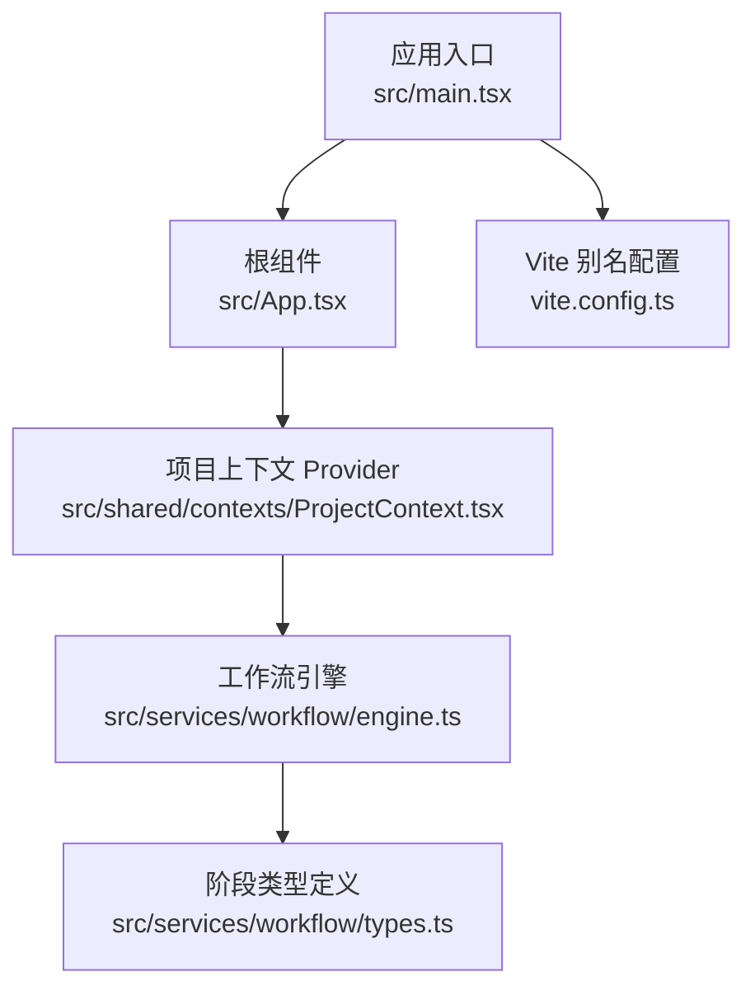
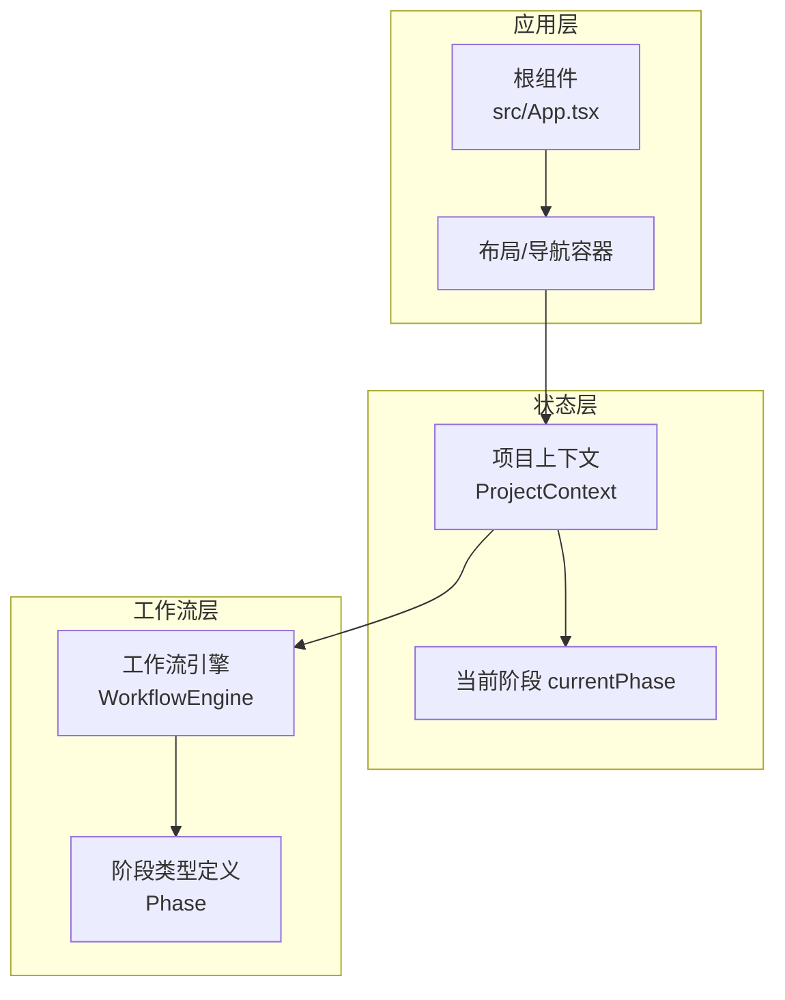
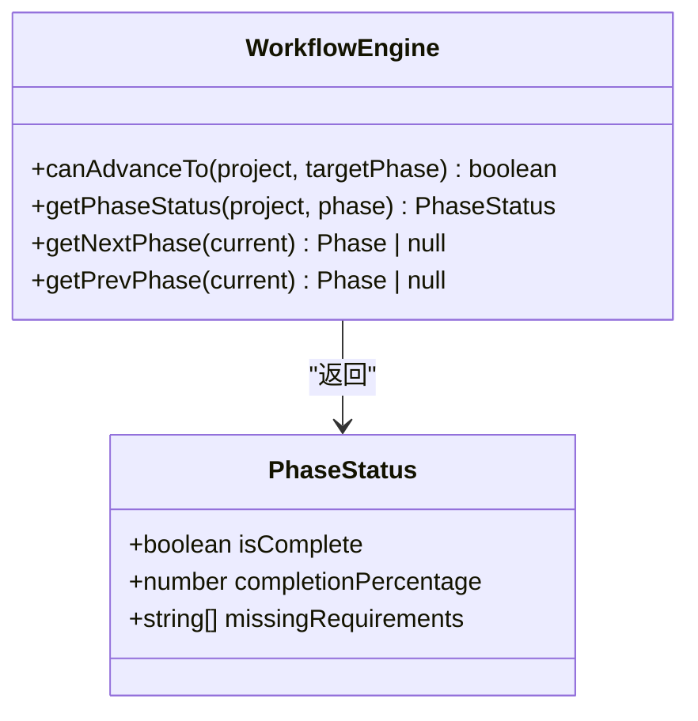
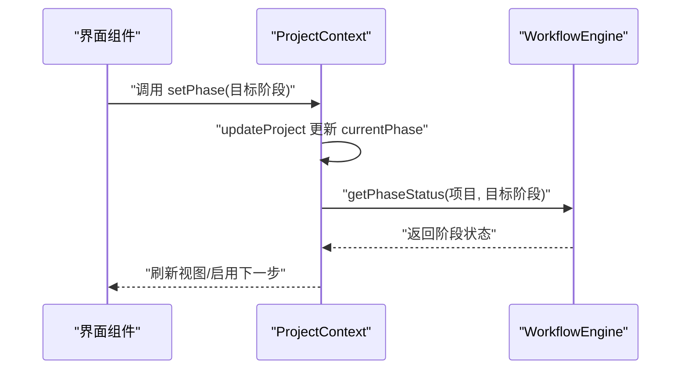
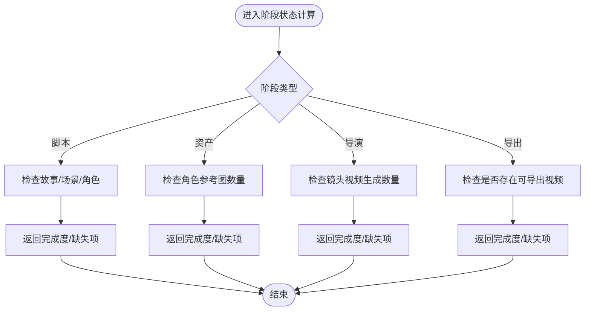
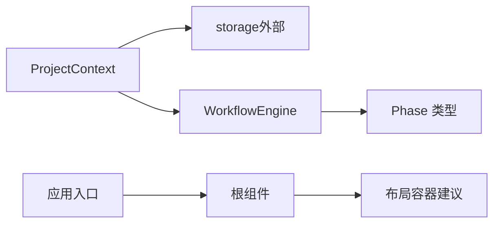

# 路由系统

<cite>
**本文引用的文件**
- [src/main.tsx](file://src/main.tsx)
- [src/App.tsx](file://src/App.tsx)
- [src/shared/contexts/ProjectContext.tsx](file://src/shared/contexts/ProjectContext.tsx)
- [src/services/workflow/engine.ts](file://src/services/workflow/engine.ts)
- [src/services/workflow/types.ts](file://src/services/workflow/types.ts)
- [vite.config.ts](file://vite.config.ts)
</cite>

## 目录
1. [简介](#简介)
2. [项目结构](#项目结构)
3. [核心组件](#核心组件)
4. [架构总览](#架构总览)
5. [详细组件分析](#详细组件分析)
6. [依赖分析](#依赖分析)
7. [性能考虑](#性能考虑)
8. [故障排查指南](#故障排查指南)
9. [结论](#结论)
10. [附录](#附录)

## 简介
本文件面向“AI Shotlive”项目中的路由与导航体系，聚焦以下目标：
- 解释应用的路由架构设计，包括工作流导航、页面跳转、以及路由守卫机制
- 详细说明Dashboard主导航、Sidebar侧边栏导航、以及各工作流阶段间的路由切换逻辑
- 阐述路由参数传递、查询字符串处理、以及路由状态管理
- 包含路由权限控制、面包屑导航、以及路由性能优化策略
- 提供路由配置示例和导航最佳实践

当前仓库中未发现传统前端路由库（如React Router）的显式配置或页面级路由声明；项目采用“工作流引擎 + 全局项目上下文”的方式驱动阶段流转与界面切换。因此，本文将围绕现有代码进行系统性梳理，并给出可落地的路由设计方案与最佳实践。

## 项目结构
从入口到工作流引擎的关键路径如下：
- 应用入口负责挂载根组件
- 根组件目前仅展示占位内容，实际UI由各功能模块按需渲染
- 工作流引擎定义阶段顺序、完成度校验与前进/后退规则
- 项目上下文提供全局项目状态与阶段切换能力

图表来源
- [src/main.tsx:1-6](file://src/main.tsx#L1-L6)
- [src/App.tsx:1-6](file://src/App.tsx#L1-L6)
- [src/shared/contexts/ProjectContext.tsx:1-186](file://src/shared/contexts/ProjectContext.tsx#L1-L186)
- [src/services/workflow/engine.ts:1-119](file://src/services/workflow/engine.ts#L1-L119)
- [src/services/workflow/types.ts:1-20](file://src/services/workflow/types.ts#L1-L20)
- [vite.config.ts:1-13](file://vite.config.ts#L1-L13)

章节来源
- [src/main.tsx:1-6](file://src/main.tsx#L1-L6)
- [src/App.tsx:1-6](file://src/App.tsx#L1-L6)
- [vite.config.ts:1-13](file://vite.config.ts#L1-L13)

## 核心组件
- 应用入口与根组件
  - 应用入口负责创建根节点并渲染根组件
  - 根组件当前为占位内容，后续可扩展为路由容器或布局容器
- 项目上下文（ProjectContext）
  - 提供项目生命周期管理（创建/加载/删除/关闭）、更新与保存调度、阶段切换等能力
  - 暴露 setPhase 方法，用于驱动工作流阶段变更
- 工作流引擎（WorkflowEngine）
  - 定义阶段顺序与推进规则
  - 提供 canAdvanceTo、getPhaseStatus、getNextPhase、getPrevPhase 等方法
- Vite 别名配置
  - 通过别名 @ 指向 src，便于统一导入路径

章节来源
- [src/main.tsx:1-6](file://src/main.tsx#L1-L6)
- [src/App.tsx:1-6](file://src/App.tsx#L1-L6)
- [src/shared/contexts/ProjectContext.tsx:170-186](file://src/shared/contexts/ProjectContext.tsx#L170-L186)
- [src/services/workflow/engine.ts:83-119](file://src/services/workflow/engine.ts#L83-L119)
- [src/services/workflow/types.ts:13-18](file://src/services/workflow/types.ts#L13-L18)
- [vite.config.ts:7-11](file://vite.config.ts#L7-L11)

## 架构总览
整体架构以“工作流引擎 + 全局状态上下文”为核心，通过 setPhase 驱动阶段切换，结合项目上下文的持久化与状态暴露，形成闭环的导航与状态管理机制。

图表来源
- [src/App.tsx:1-6](file://src/App.tsx#L1-L6)
- [src/shared/contexts/ProjectContext.tsx:170-186](file://src/shared/contexts/ProjectContext.tsx#L170-L186)
- [src/services/workflow/engine.ts:83-119](file://src/services/workflow/engine.ts#L83-L119)
- [src/services/workflow/types.ts:13-18](file://src/services/workflow/types.ts#L13-L18)

## 详细组件分析

### 组件A：工作流引擎（WorkflowEngine）
- 设计要点
  - 阶段顺序固定且线性：脚本 → 资产 → 导演 → 导出
  - 前进规则：必须按顺序完成前序阶段，方可进入下一阶段
  - 回退规则：允许自由回到之前的任意阶段
  - 各阶段完成度由具体业务规则计算，返回完成百分比与缺失项列表
- 关键接口
  - canAdvanceTo：判断是否可前进到目标阶段
  - getPhaseStatus：获取指定阶段的完成状态
  - getNextPhase / getPrevPhase：获取前后相邻阶段

图表来源
- [src/services/workflow/engine.ts:83-119](file://src/services/workflow/engine.ts#L83-L119)
- [src/services/workflow/types.ts:7-11](file://src/services/workflow/types.ts#L7-L11)

章节来源
- [src/services/workflow/engine.ts:1-119](file://src/services/workflow/engine.ts#L1-L119)
- [src/services/workflow/types.ts:1-20](file://src/services/workflow/types.ts#L1-L20)

### 组件B：项目上下文（ProjectContext）
- 设计要点
  - 提供 create/load/delete/close 项目生命周期管理
  - updateProject 支持深拷贝与时间戳更新，配合防抖保存
  - setPhase 通过更新 currentPhase 驱动工作流引擎推进
  - 暴露 isLoading/isSaving 状态，便于 UI 层反馈
- 与工作流引擎的关系
  - setPhase 会触发 updateProject，从而影响工作流引擎对阶段状态的评估
  - 项目持久化与阶段切换解耦，确保状态一致性

图表来源
- [src/shared/contexts/ProjectContext.tsx:163-168](file://src/shared/contexts/ProjectContext.tsx#L163-L168)
- [src/services/workflow/engine.ts:97-104](file://src/services/workflow/engine.ts#L97-L104)

章节来源
- [src/shared/contexts/ProjectContext.tsx:108-168](file://src/shared/contexts/ProjectContext.tsx#L108-L168)
- [src/services/workflow/engine.ts:83-119](file://src/services/workflow/engine.ts#L83-L119)

### 组件C：阶段状态计算（脚本/资产/导演/导出）
- 脚本阶段
  - 完成条件：故事大纲、场景列表、角色列表均需满足
  - 计算完成百分比与缺失项
- 资产阶段
  - 完成条件：至少存在一个角色并拥有参考图
  - 计算比例与缺失项
- 导演阶段
  - 完成条件：至少存在一个镜头并已生成视频
  - 计算比例与缺失项
- 导出阶段
  - 完成条件：存在可导出视频
  - 返回完成状态与提示

图表来源
- [src/services/workflow/engine.ts:15-33](file://src/services/workflow/engine.ts#L15-L33)
- [src/services/workflow/engine.ts:35-54](file://src/services/workflow/engine.ts#L35-L54)
- [src/services/workflow/engine.ts:56-81](file://src/services/workflow/engine.ts#L56-L81)

章节来源
- [src/services/workflow/engine.ts:15-81](file://src/services/workflow/engine.ts#L15-L81)

### 组件D：路由与导航建议（基于现有代码的落地方案）
- 路由容器与布局
  - 在根组件或新增布局容器中，根据 currentPhase 渲染对应的功能面板（脚本、资产、导演、导出）
  - 使用 setPhase 触发阶段切换，避免直接依赖外部路由库
- 页面跳转与守卫
  - 可在 setPhase 前后增加校验逻辑，若 canAdvanceTo 返回 false，则阻止跳转并提示用户完成前置阶段
  - 对于回退操作，可直接允许，但建议提示用户可能丢失未保存进度
- 参数传递与查询字符串
  - 当前未见查询字符串处理逻辑；如需支持，可在布局容器中解析 location.search 并同步到上下文状态
  - 重要参数建议通过上下文状态持久化，减少对 URL 的依赖
- 面包屑导航
  - 可根据 currentPhase 与阶段顺序动态生成面包屑路径，显示当前所处阶段与可访问的历史阶段
- 权限控制
  - 项目上下文可扩展鉴权逻辑（如项目归属、编辑权限），在 setPhase 前进行校验
- 性能优化
  - 防抖保存与懒加载：利用现有防抖保存策略降低写入频率
  - 按需渲染：仅在当前阶段激活时渲染对应子树，减少重绘
  - 缓存与去抖：对频繁读取的状态进行缓存，避免重复计算

章节来源
- [src/shared/contexts/ProjectContext.tsx:163-168](file://src/shared/contexts/ProjectContext.tsx#L163-L168)
- [src/services/workflow/engine.ts:84-95](file://src/services/workflow/engine.ts#L84-L95)

## 依赖分析
- 模块耦合关系
  - ProjectContext 依赖存储服务（storage）进行项目持久化
  - WorkflowEngine 依赖 Project 类型与 Phase 枚举，不直接依赖 UI
  - 根组件与入口文件保持极简，便于后续接入路由或布局容器
- 外部依赖
  - Vite 别名 @ 指向 src，简化导入路径
  - 未发现第三方路由库依赖

图表来源
- [src/shared/contexts/ProjectContext.tsx:108-168](file://src/shared/contexts/ProjectContext.tsx#L108-L168)
- [src/services/workflow/engine.ts:83-119](file://src/services/workflow/engine.ts#L83-L119)
- [vite.config.ts:7-11](file://vite.config.ts#L7-L11)

章节来源
- [src/shared/contexts/ProjectContext.tsx:108-168](file://src/shared/contexts/ProjectContext.tsx#L108-L168)
- [src/services/workflow/engine.ts:83-119](file://src/services/workflow/engine.ts#L83-L119)
- [vite.config.ts:7-11](file://vite.config.ts#L7-L11)

## 性能考虑
- 防抖保存与卸载清理
  - 通过定时器与 beforeunload 事件确保未保存数据及时落盘，减少丢失风险
- 状态更新与渲染
  - updateProject 使用浅拷贝与时间戳更新，避免不必要的重渲染
  - 建议在布局容器中按需渲染当前阶段内容，减少全局重绘
- 计算复杂度
  - 阶段状态计算为 O(n) 级别（遍历场景/镜头/角色），在项目规模可控范围内性能良好
- 资源加载
  - 图片/视频等资源建议懒加载与缓存，避免阻塞首屏

章节来源
- [src/shared/contexts/ProjectContext.tsx:45-106](file://src/shared/contexts/ProjectContext.tsx#L45-L106)
- [src/services/workflow/engine.ts:15-81](file://src/services/workflow/engine.ts#L15-L81)

## 故障排查指南
- 无法前进到下一阶段
  - 检查当前阶段的完成度计算是否满足要求
  - 确认项目状态中 currentPhase 是否正确更新
- 回退后数据异常
  - 确认 setPhase 是否正确调用 updateProject
  - 检查防抖保存是否被提前清理（beforeunload 事件）
- 面包屑/导航不更新
  - 确认布局容器是否监听 currentPhase 并重新渲染
- 查询字符串无效
  - 若引入了查询参数解析，请确认其与上下文状态同步逻辑

章节来源
- [src/services/workflow/engine.ts:84-95](file://src/services/workflow/engine.ts#L84-L95)
- [src/shared/contexts/ProjectContext.tsx:163-168](file://src/shared/contexts/ProjectContext.tsx#L163-L168)
- [src/shared/contexts/ProjectContext.tsx:92-106](file://src/shared/contexts/ProjectContext.tsx#L92-L106)

## 结论
本项目当前采用“无路由库”的轻量导航模式：以工作流引擎与项目上下文为核心，通过 setPhase 驱动阶段切换与界面渲染。该模式具备清晰的阶段推进规则与良好的状态一致性，适合中小型项目快速迭代。若未来需要更复杂的页面级导航、权限控制与SEO需求，可在现有基础上引入路由容器与守卫机制，同时保留工作流引擎与上下文作为状态核心。

## 附录
- 路由配置示例（概念性，非现有实现）
  - 在布局容器中根据 currentPhase 渲染对应功能面板
  - 在 setPhase 前执行 canAdvanceTo 校验，失败则弹窗提示并阻止跳转
  - 将关键参数映射到上下文状态，减少对URL的依赖
- 最佳实践
  - 保持阶段推进规则稳定，避免频繁调整阶段顺序
  - 对外暴露 clear/restore 等调试接口，便于开发期快速切换阶段
  - 在布局容器中统一处理加载态、错误态与空态，提升用户体验