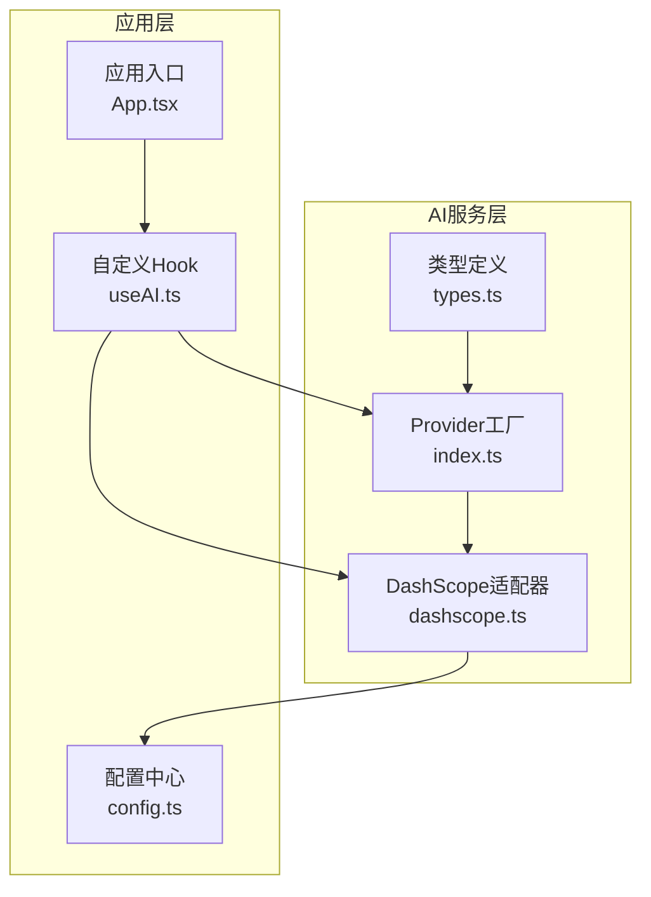
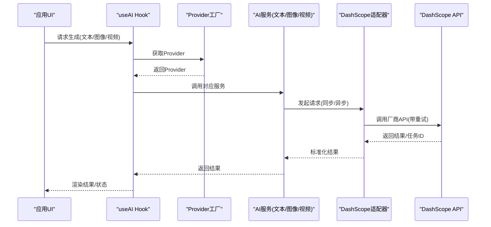
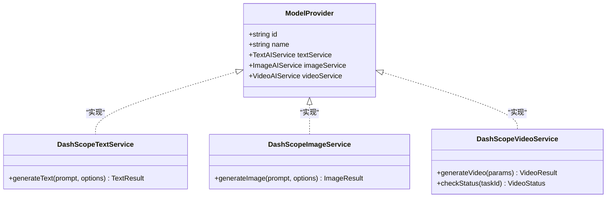
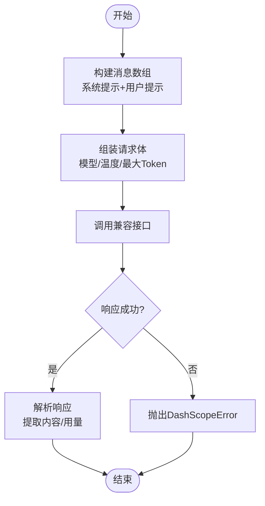
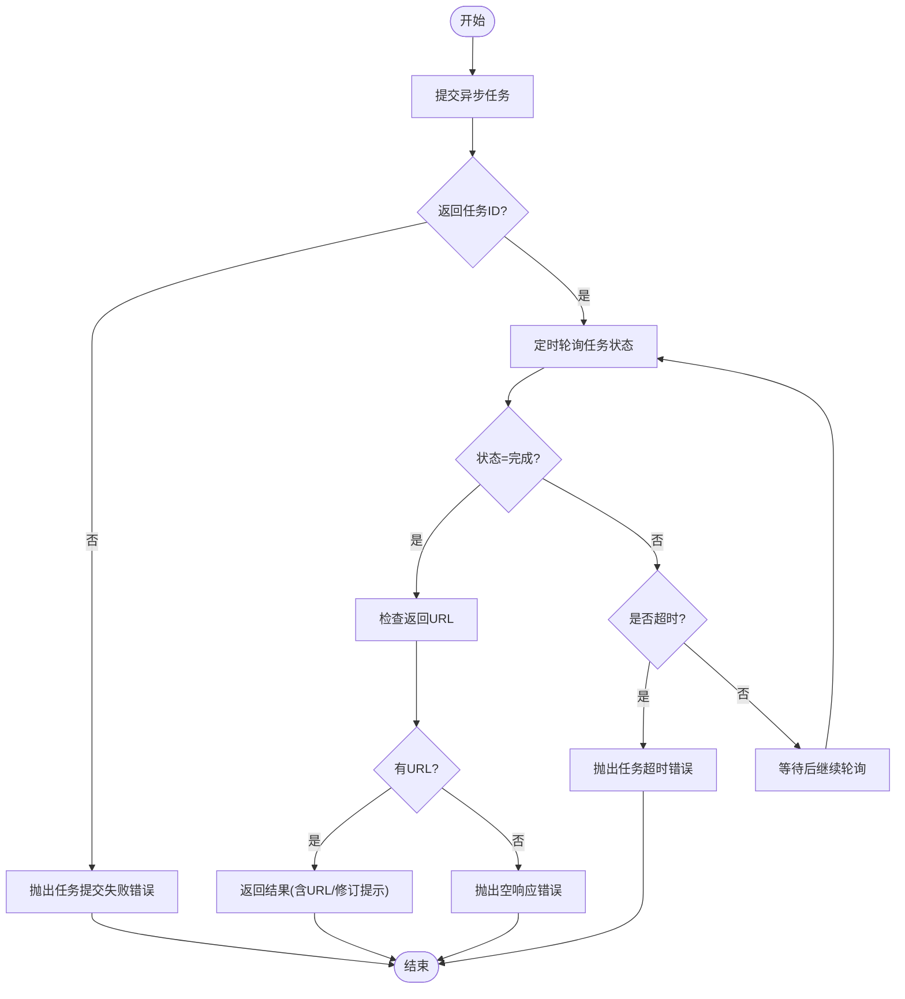
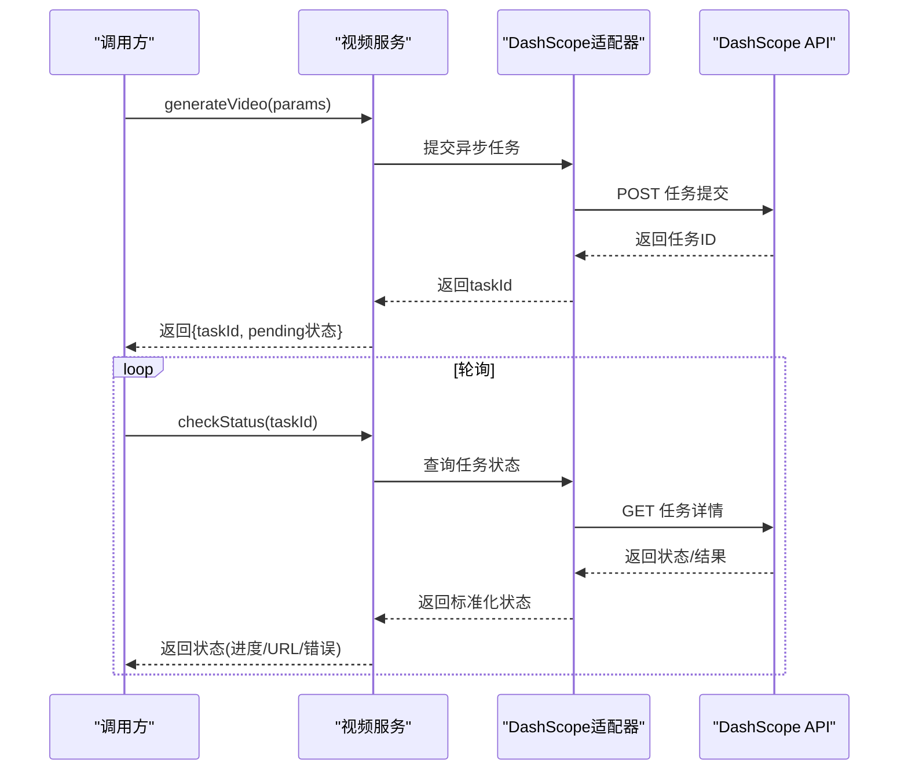
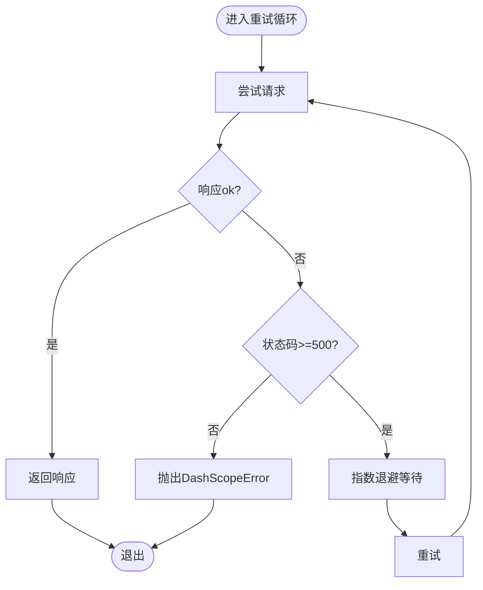
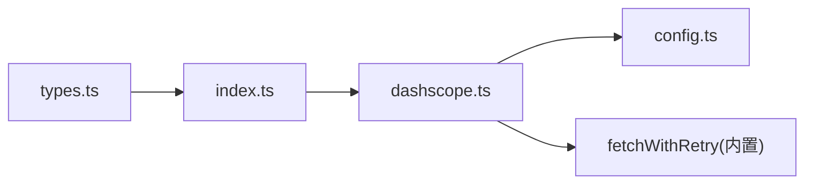

# AI服务路由

<cite>
**本文引用的文件**
- [src/services/ai/index.ts](file://src/services/ai/index.ts)
- [src/services/ai/dashscope.ts](file://src/services/ai/dashscope.ts)
- [src/services/ai/types.ts](file://src/services/ai/types.ts)
- [src/shared/hooks/useAI.ts](file://src/shared/hooks/useAI.ts)
- [src/App.tsx](file://src/App.tsx)
- [src/config.ts](file://src/config.ts)
</cite>

## 目录
1. [简介](#简介)
2. [项目结构](#项目结构)
3. [核心组件](#核心组件)
4. [架构总览](#架构总览)
5. [详细组件分析](#详细组件分析)
6. [依赖关系分析](#依赖关系分析)
7. [性能考量](#性能考量)
8. [故障排查指南](#故障排查指南)
9. [结论](#结论)
10. [附录](#附录)

## 简介
本文件聚焦于AI Shotlive中的“AI服务路由”模块，系统性阐述以下内容：
- AI生成请求与图像/视频生成的API设计与调用策略
- AI适配器层（以DashScope为例）的集成方式与请求转发机制
- 响应处理流程（同步与异步任务、轮询与状态查询）
- 负载均衡与错误重试机制的设计与实现
- AI服务调用流程图与集成示例

该模块采用“统一接口 + 适配器”的架构，屏蔽不同AI厂商的差异，当前默认集成DashScope（阿里云通义），同时保留未来扩展其他Provider的能力。

## 项目结构
AI服务路由相关代码主要位于前端src/services/ai目录，核心文件包括：
- 类型定义：统一的文本、图像、视频服务接口与Provider契约
- DashScope适配器：实现具体厂商API调用、异步任务提交与轮询、错误重试
- Provider工厂：集中创建与缓存Provider实例
- 使用入口：通过自定义Hook在应用层注入与调用

图表来源
- [src/services/ai/types.ts:1-73](file://src/services/ai/types.ts#L1-L73)
- [src/services/ai/index.ts:1-34](file://src/services/ai/index.ts#L1-L34)
- [src/services/ai/dashscope.ts:1-327](file://src/services/ai/dashscope.ts#L1-L327)
- [src/shared/hooks/useAI.ts](file://src/shared/hooks/useAI.ts)
- [src/App.tsx](file://src/App.tsx)
- [src/config.ts](file://src/config.ts)

章节来源
- [src/services/ai/types.ts:1-73](file://src/services/ai/types.ts#L1-L73)
- [src/services/ai/index.ts:1-34](file://src/services/ai/index.ts#L1-L34)
- [src/services/ai/dashscope.ts:1-327](file://src/services/ai/dashscope.ts#L1-L327)
- [src/shared/hooks/useAI.ts](file://src/shared/hooks/useAI.ts)
- [src/App.tsx](file://src/App.tsx)
- [src/config.ts](file://src/config.ts)

## 核心组件
- 统一接口契约：定义文本、图像、视频三类AI服务的输入输出规范与Provider能力边界，确保上层调用与厂商解耦
- Provider工厂：惰性创建并缓存Provider实例，当前默认DashScope
- DashScope适配器：封装DashScope API调用，支持OpenAI兼容模式（文本）、异步任务（图像/视频）与轮询查询
- 错误重试与退避：对网络异常与服务端错误进行指数退避重试，区分客户端错误与服务端错误
- 配置注入：从全局配置读取API Key与模型参数，保证运行时可配置

章节来源
- [src/services/ai/types.ts:6-73](file://src/services/ai/types.ts#L6-L73)
- [src/services/ai/index.ts:22-33](file://src/services/ai/index.ts#L22-L33)
- [src/services/ai/dashscope.ts:26-93](file://src/services/ai/dashscope.ts#L26-L93)
- [src/config.ts](file://src/config.ts)

## 架构总览
AI服务路由的整体调用链路如下：
- 应用层通过自定义Hook获取Provider
- Provider根据业务类型选择对应服务（文本/图像/视频）
- 服务层调用DashScope适配器执行请求
- 对于异步任务，服务层返回taskId，调用方可自行轮询或使用内置轮询
- 适配器内部实现重试与退避，最终返回标准化结果

图表来源
- [src/shared/hooks/useAI.ts](file://src/shared/hooks/useAI.ts)
- [src/services/ai/index.ts:24-29](file://src/services/ai/index.ts#L24-L29)
- [src/services/ai/dashscope.ts:96-139](file://src/services/ai/dashscope.ts#L96-L139)
- [src/services/ai/dashscope.ts:219-255](file://src/services/ai/dashscope.ts#L219-L255)
- [src/services/ai/dashscope.ts:258-315](file://src/services/ai/dashscope.ts#L258-L315)

## 详细组件分析

### 组件A：Provider工厂与DashScope适配器
- 职责分离：Provider工厂负责实例化与复用Provider；DashScope适配器负责具体API交互
- 设计原则：控制论“开放系统设计”，通过统一接口屏蔽厂商差异；控制论“竞争-协同律”，当前单Provider但支持未来多Provider切换
- 关键实现：
  - 文本服务：OpenAI兼容模式，同步调用
  - 图像/视频服务：异步任务 + 轮询，支持状态查询
  - 错误重试：fetchWithRetry对网络错误与5xx进行指数退避重试，4xx直接抛错
  - 超时与轮询：统一轮询间隔与最大等待时间，映射任务状态到统一状态枚举

图表来源
- [src/services/ai/types.ts:66-72](file://src/services/ai/types.ts#L66-L72)
- [src/services/ai/types.ts:18-20](file://src/services/ai/types.ts#L18-L20)
- [src/services/ai/types.ts:36-38](file://src/services/ai/types.ts#L36-L38)
- [src/services/ai/types.ts:60-63](file://src/services/ai/types.ts#L60-L63)
- [src/services/ai/dashscope.ts:318-326](file://src/services/ai/dashscope.ts#L318-L326)

章节来源
- [src/services/ai/index.ts:22-33](file://src/services/ai/index.ts#L22-L33)
- [src/services/ai/dashscope.ts:318-326](file://src/services/ai/dashscope.ts#L318-L326)
- [src/services/ai/types.ts:66-73](file://src/services/ai/types.ts#L66-L73)

### 组件B：文本生成API设计与调用策略
- 输入参数：prompt、systemPrompt、temperature、maxTokens
- 输出结果：content、usage（可选）
- 调用策略：OpenAI兼容模式，同步调用，适合短文本生成场景
- 错误处理：认证失败、配额超限、网络异常等均通过DashScopeError统一抛出

图表来源
- [src/services/ai/dashscope.ts:96-139](file://src/services/ai/dashscope.ts#L96-L139)

章节来源
- [src/services/ai/dashscope.ts:96-139](file://src/services/ai/dashscope.ts#L96-L139)
- [src/services/ai/types.ts:7-20](file://src/services/ai/types.ts#L7-L20)

### 组件C：图像生成API设计与异步处理
- 输入参数：prompt、negativePrompt、width、height、style、count
- 处理流程：提交异步任务 -> 轮询任务状态 -> 完成后返回URL与revisedPrompt
- 轮询策略：固定间隔轮询，最大等待时间限制，失败/取消映射为失败状态
- 错误处理：任务提交失败、超时、完成但无URL等均抛出DashScopeError

图表来源
- [src/services/ai/dashscope.ts:219-255](file://src/services/ai/dashscope.ts#L219-L255)
- [src/services/ai/dashscope.ts:155-216](file://src/services/ai/dashscope.ts#L155-L216)

章节来源
- [src/services/ai/dashscope.ts:219-255](file://src/services/ai/dashscope.ts#L219-L255)
- [src/services/ai/types.ts:23-38](file://src/services/ai/types.ts#L23-L38)

### 组件D：视频生成API设计与状态查询
- 输入参数：prompt、imageUrl、duration、aspectRatio
- 处理策略：立即返回taskId，调用方可自行轮询checkStatus或使用内置等待方法（若未提供则由调用层管理）
- 状态映射：PENDING/RUNNING/SUCCEEDED/FAILED/CANCELED/UNKNOWN映射为统一状态枚举
- 完成条件：返回视频URL；失败/完成但无URL时返回错误信息

图表来源
- [src/services/ai/dashscope.ts:258-315](file://src/services/ai/dashscope.ts#L258-L315)
- [src/services/ai/types.ts:40-63](file://src/services/ai/types.ts#L40-L63)

章节来源
- [src/services/ai/dashscope.ts:258-315](file://src/services/ai/dashscope.ts#L258-L315)
- [src/services/ai/types.ts:40-63](file://src/services/ai/types.ts#L40-L63)

### 组件E：错误重试与退避机制
- 重试范围：网络错误与服务端错误（5xx）进行指数退避重试；客户端错误（4xx）直接抛错
- 退避策略：固定基础退避时间，按2的指数幂递增
- 最大重试次数与超时：可配置的最大重试次数与最大等待时间
- 错误分类：认证失败、配额超限、网络异常、任务失败、任务超时等

图表来源
- [src/services/ai/dashscope.ts:58-93](file://src/services/ai/dashscope.ts#L58-L93)

章节来源
- [src/services/ai/dashscope.ts:26-33](file://src/services/ai/dashscope.ts#L26-L33)
- [src/services/ai/dashscope.ts:58-93](file://src/services/ai/dashscope.ts#L58-L93)

### 组件F：集成示例与最佳实践
- 在应用层通过自定义Hook获取Provider，避免重复初始化
- 文本生成：适用于短文本、需要快速响应的场景
- 图像/视频生成：采用异步任务 + 轮询，注意控制轮询频率与最大等待时间
- 错误处理：捕获DashScopeError，区分错误类型进行用户提示与日志记录
- 配置管理：通过全局配置中心读取API Key与模型参数，便于多环境切换

章节来源
- [src/shared/hooks/useAI.ts](file://src/shared/hooks/useAI.ts)
- [src/App.tsx](file://src/App.tsx)
- [src/config.ts](file://src/config.ts)

## 依赖关系分析
- 内部依赖
  - types.ts被index.ts与dashscope.ts共同依赖，作为统一契约
  - index.ts依赖dashscope.ts以创建Provider实例
  - dashscope.ts依赖config.ts读取运行时配置
- 外部依赖
  - fetchWithRetry封装fetch，统一处理网络与HTTP错误
  - DashScope API：兼容模式与原生模式分别用于文本与异步任务

图表来源
- [src/services/ai/types.ts:1-73](file://src/services/ai/types.ts#L1-L73)
- [src/services/ai/index.ts:1-34](file://src/services/ai/index.ts#L1-L34)
- [src/services/ai/dashscope.ts:1-327](file://src/services/ai/dashscope.ts#L1-L327)
- [src/config.ts](file://src/config.ts)

章节来源
- [src/services/ai/types.ts:1-73](file://src/services/ai/types.ts#L1-L73)
- [src/services/ai/index.ts:1-34](file://src/services/ai/index.ts#L1-L34)
- [src/services/ai/dashscope.ts:1-327](file://src/services/ai/dashscope.ts#L1-L327)
- [src/config.ts](file://src/config.ts)

## 性能考量
- 异步任务与轮询：图像/视频采用异步任务，减少前端阻塞；合理设置轮询间隔与最大等待时间，避免过度请求
- 指数退避：降低对厂商API的压力，提高整体成功率
- 结果缓存：对于相同输入的图像/视频，可在应用层做去重与缓存，避免重复提交任务
- 超时控制：严格控制最大等待时间，防止长时间占用资源
- 并发控制：在调用层限制并发数量，结合队列策略平滑请求峰值

## 故障排查指南
- 认证失败（401）：检查API Key是否正确配置与有效
- 配额超限（429）：降低请求频率或提升配额
- 网络异常：确认网络连通性与代理设置
- 任务提交失败：检查请求体格式与必填字段
- 任务超时：适当增加最大等待时间或优化轮询策略
- 任务完成但无URL：核对厂商返回结构与权限配置

章节来源
- [src/services/ai/dashscope.ts:68-78](file://src/services/ai/dashscope.ts#L68-L78)
- [src/services/ai/dashscope.ts:167-172](file://src/services/ai/dashscope.ts#L167-L172)
- [src/services/ai/dashscope.ts:207-215](file://src/services/ai/dashscope.ts#L207-L215)
- [src/services/ai/dashscope.ts:294-302](file://src/services/ai/dashscope.ts#L294-L302)

## 结论
AI服务路由模块通过“统一接口 + 适配器”的设计，实现了对DashScope（阿里云）的深度集成，并为未来扩展其他Provider预留了空间。模块具备完善的错误重试与退避机制、清晰的异步任务处理流程，以及可配置的运行时参数。建议在实际应用中结合业务场景优化轮询策略、并发控制与结果缓存，以获得更佳的用户体验与资源利用率。

## 附录
- 快速集成步骤
  - 在应用层引入自定义Hook获取Provider
  - 根据业务类型调用对应服务（文本/图像/视频）
  - 对于异步任务，使用taskId进行状态查询或自行轮询
  - 捕获DashScopeError并进行用户提示与日志记录
- 参考文件
  - [src/services/ai/index.ts](file://src/services/ai/index.ts)
  - [src/services/ai/dashscope.ts](file://src/services/ai/dashscope.ts)
  - [src/services/ai/types.ts](file://src/services/ai/types.ts)
  - [src/shared/hooks/useAI.ts](file://src/shared/hooks/useAI.ts)
  - [src/App.tsx](file://src/App.tsx)
  - [src/config.ts](file://src/config.ts)