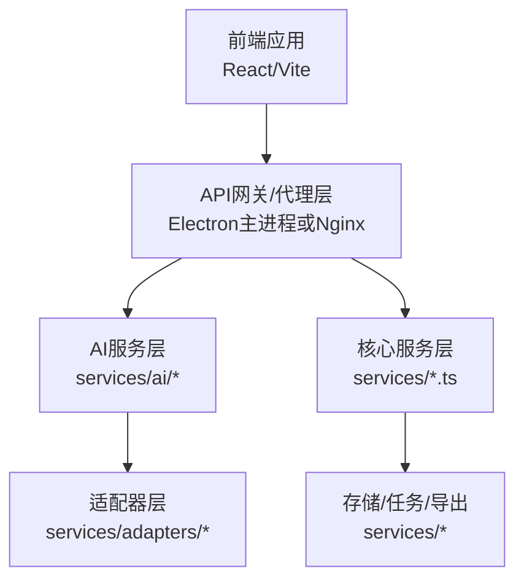
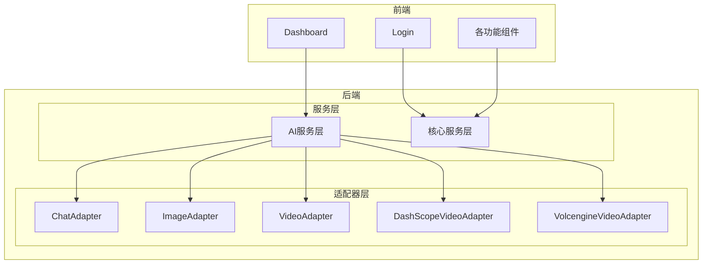
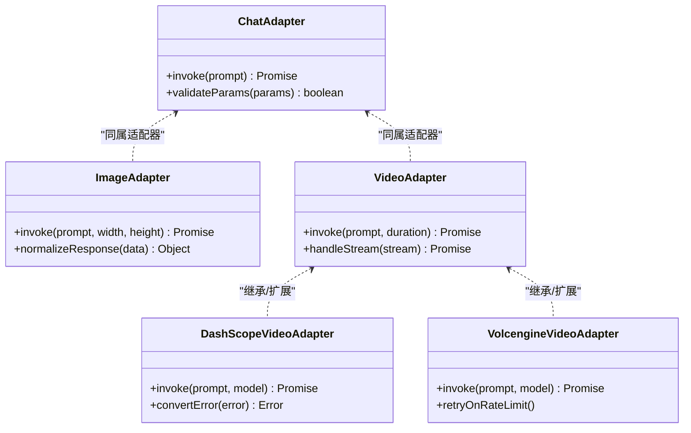
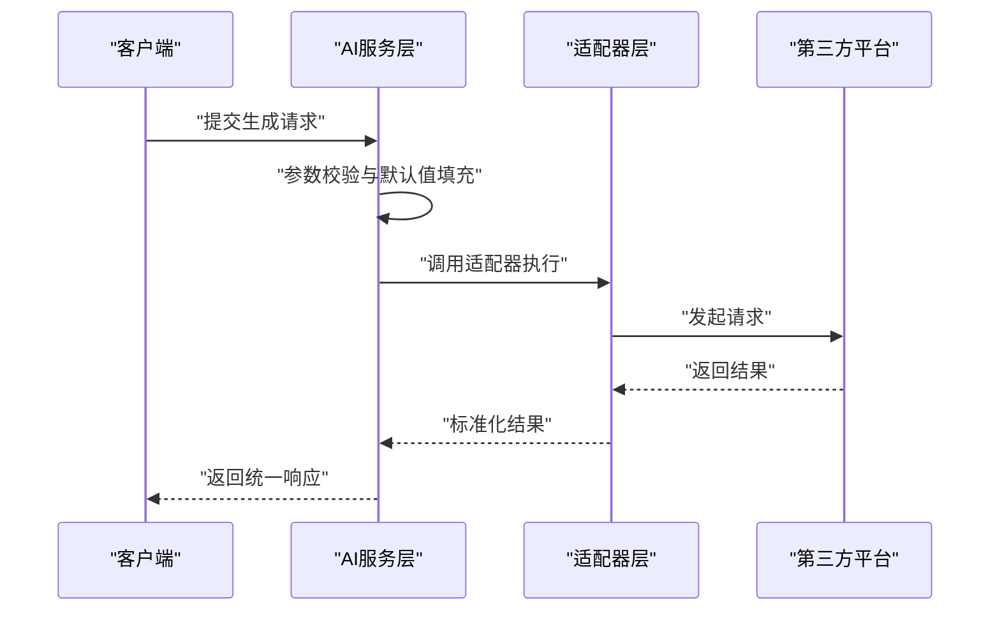
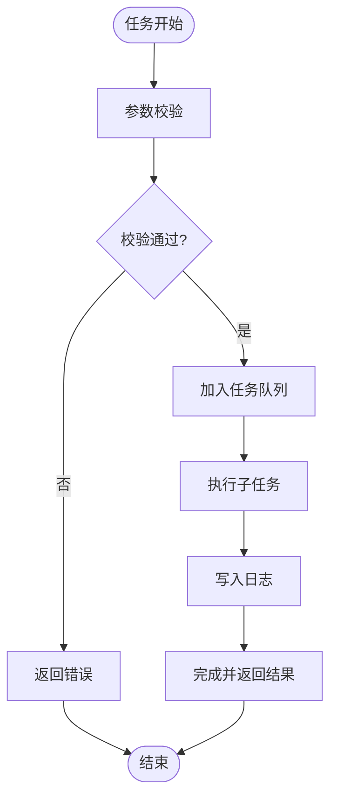
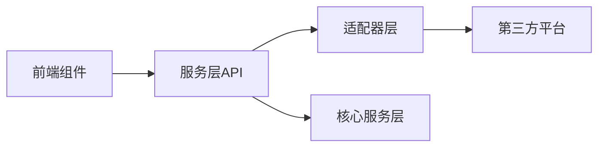

# API路由系统

<cite>
**本文引用的文件**
- [package.json](file://package.json)
- [README.md](file://README.md)
- [README_EN.md](file://README_EN.md)
- [src/config.ts](file://src/config.ts)
- [src/types.ts](file://src/types.ts)
- [vite.config.ts](file://vite.config.ts)
- [electron/main.ts](file://electron/main.ts)
- [electron/preload.ts](file://electron/preload.ts)
- [services/adapters/index.ts](file://services/adapters/index.ts)
- [services/adapters/chatAdapter.ts](file://services/adapters/chatAdapter.ts)
- [services/adapters/imageAdapter.ts](file://services/adapters/imageAdapter.ts)
- [services/adapters/videoAdapter.ts](file://services/adapters/videoAdapter.ts)
- [services/adapters/dashscopeVideoAdapter.ts](file://services/adapters/dashscopeVideoAdapter.ts)
- [services/adapters/volcengineVideoAdapter.ts](file://services/adapters/volcengineVideoAdapter.ts)
- [services/ai/index.ts](file://services/ai/index.ts)
- [services/ai/apiCore.ts](file://services/ai/apiCore.ts)
- [services/ai/scriptService.ts](file://services/ai/scriptService.ts)
- [services/ai/shotService.ts](file://services/ai/shotService.ts)
- [services/ai/videoService.ts](file://services/ai/videoService.ts)
- [services/ai/visualService.ts](file://services/ai/visualService.ts)
- [services/ai/novelScriptService.ts](file://services/ai/novelScriptService.ts)
- [services/ai/promptConstants.ts](file://services/ai/promptConstants.ts)
- [services/aiService.ts](file://services/aiService.ts)
- [services/apiClient.ts](file://services/apiClient.ts)
- [services/modelConfigService.ts](file://services/modelConfigService.ts)
- [services/modelService.ts](file://services/modelService.ts)
- [services/storageService.ts](file://services/storageService.ts)
- [services/taskService.ts](file://services/taskService.ts)
- [services/renderLogService.ts](file://services/renderLogService.ts)
- [services/assetLibraryService.ts](file://services/assetLibraryService.ts)
- [services/exportService.ts](file://services/exportService.ts)
- [services/projectPatchService.ts](file://services/projectPatchService.ts)
- [services/visualStyleService.ts](file://services/visualStyleService.ts)
- [contexts/AuthContext.tsx](file://contexts/AuthContext.tsx)
- [contexts/ThemeContext.tsx](file://contexts/ThemeContext.tsx)
- [components/Dashboard.tsx](file://components/Dashboard.tsx)
- [components/Login.tsx](file://components/Login.tsx)
- [components/GlobalAlert.tsx](file://components/GlobalAlert.tsx)
- [components/Sidebar.tsx](file://components/Sidebar.tsx)
- [components/StageAssets/index.tsx](file://components/StageAssets/index.tsx)
- [components/StageAssets/utils.ts](file://components/StageAssets/utils.ts)
- [components/StageDirector/index.tsx](file://components/StageDirector/index.tsx)
- [components/StageDirector/utils.ts](file://components/StageDirector/utils.ts)
- [components/StageExport/index.tsx](file://components/StageExport/index.tsx)
- [components/StageExport/utils.ts](file://components/StageExport/utils.ts)
- [components/StagePrompts/index.tsx](file://components/StagePrompts/index.tsx)
- [components/StagePrompts/utils.ts](file://components/StagePrompts/utils.ts)
- [components/StageScript/index.tsx](file://components/StageScript/index.tsx)
- [components/StageScript/utils.ts](file://components/StageScript/utils.ts)
- [components/StageAssets/SceneCard.tsx](file://components/StageAssets/SceneCard.tsx)
- [components/StageAssets/CharacterCard.tsx](file://components/StageAssets/CharacterCard.tsx)
- [components/StageAssets/PropCard.tsx](file://components/StageAssets/PropCard.tsx)
- [components/StageAssets/ImageUploadButton.tsx](file://components/StageAssets/ImageUploadButton.tsx)
- [components/StageAssets/PromptEditor.tsx](file://components/StageAssets/PromptEditor.tsx)
- [components/StageAssets/TurnaroundModal.tsx](file://components/StageAssets/TurnaroundModal.tsx)
- [components/StageAssets/WardrobeModal.tsx](file://components/StageAssets/WardrobeModal.tsx)
- [components/StageAssets/ImagePreviewModal.tsx](file://components/StageAssets/ImagePreviewModal.tsx)
- [components/StageDirector/ShotCard.tsx](file://components/StageDirector/ShotCard.tsx)
- [components/StageDirector/KeyframeEditor.tsx](file://components/StageDirector/KeyframeEditor.tsx)
- [components/StageDirector/NineGridPreview.tsx](file://components/StageDirector/NineGridPreview.tsx)
- [components/StageDirector/VideoGenerator.tsx](file://components/StageDirector/VideoGenerator.tsx)
- [components/StageDirector/EditModal.tsx](file://components/StageDirector/EditModal.tsx)
- [components/StageDirector/ImagePreviewModal.tsx](file://components/StageDirector/ImagePreviewModal.tsx)
- [components/StageDirector/SceneContext.tsx](file://components/StageDirector/SceneContext.tsx)
- [components/StageExport/RenderLogsModal.tsx](file://components/StageExport/RenderLogsModal.tsx)
- [components/StageExport/StatusPanel.tsx](file://components/StageExport/StatusPanel.tsx)
- [components/StageExport/TimelineVisualizer.tsx](file://components/StageExport/TimelineVisualizer.tsx)
- [components/StageExport/VideoPlayerModal.tsx](file://components/StageExport/VideoPlayerModal.tsx)
- [components/StageExport/SecondaryOptions.tsx](file://components/StageExport/SecondaryOptions.tsx)
- [components/StageExport/ActionButtons.tsx](file://components/StageExport/ActionButtons.tsx)
- [components/StagePrompts/CharacterSection.tsx](file://components/StagePrompts/CharacterSection.tsx)
- [components/StagePrompts/KeyframeSection.tsx](file://components/StagePrompts/KeyframeSection.tsx)
- [components/StagePrompts/PropSection.tsx](file://components/StagePrompts/PropSection.tsx)
- [components/StagePrompts/SceneSection.tsx](file://components/StagePrompts/SceneSection.tsx)
- [components/StagePrompts/CollapsibleSection.tsx](file://components/StagePrompts/CollapsibleSection.tsx)
- [components/StagePrompts/PromptEditor.tsx](file://components/StagePrompts/PromptEditor.tsx)
- [components/StagePrompts/StatusBadge.tsx](file://components/StagePrompts/StatusBadge.tsx)
- [components/StageScript/ScriptEditor.tsx](file://components/StageScript/ScriptEditor.tsx)
- [components/StageScript/SceneList.tsx](file://components/StageScript/SceneList.tsx)
- [components/StageScript/CharacterList.tsx](file://components/StageScript/CharacterList.tsx)
- [components/StageScript/EpisodeManager.tsx](file://components/StageScript/EpisodeManager.tsx)
- [components/StageScript/NovelManager.tsx](file://components/StageScript/NovelManager.tsx)
- [components/StageScript/SceneBreakdown.tsx](file://components/StageScript/SceneBreakdown.tsx)
- [components/StageScript/InlineEditor.tsx](file://components/StageScript/InlineEditor.tsx)
- [components/StageScript/OptionSelector.tsx](file://components/StageScript/OptionSelector.tsx)
- [components/StageScript/ConfigPanel.tsx](file://components/StageScript/ConfigPanel.tsx)
- [components/StageScript/ShotRow.tsx](file://components/StageScript/ShotRow.tsx)
</cite>

## 目录
1. [简介](#简介)
2. [项目结构](#项目结构)
3. [核心组件](#核心组件)
4. [架构总览](#架构总览)
5. [详细组件分析](#详细组件分析)
6. [依赖分析](#依赖分析)
7. [性能考虑](#性能考虑)
8. [故障排查指南](#故障排查指南)
9. [结论](#结论)
10. [附录](#附录)

## 简介
本文件面向“AI Shotlive”项目的API路由系统，聚焦后端服务的RESTful设计、路由分组策略、HTTP方法映射、参数校验、响应格式标准化、中间件集成、错误处理与API版本控制策略，并提供路由扩展指南、新增路由流程、API文档生成建议及性能优化与安全加固建议。由于当前仓库未包含传统Express/Koa风格的路由定义文件，本文基于现有服务层与适配器结构进行抽象化梳理，帮助读者在现有架构上扩展与维护API。

## 项目结构
- 项目采用前后端一体化的Vite工程，后端服务位于server目录（通过脚本与环境变量启动），前端React应用位于根目录。
- 服务层与适配器位于services目录，封装了AI能力（如对话、图像、视频、视觉风格）、任务执行、存储、导出等功能。
- 路由层在当前仓库中未直接呈现为独立的Express/Koa路由文件，但可通过服务层对外暴露统一的API入口（例如通过Electron主进程或代理层转发请求到服务层）。

章节来源
- [package.json:1-26](file://package.json#L1-L26)
- [README.md:161-206](file://README.md#L161-L206)
- [README_EN.md:188-259](file://README_EN.md#L188-L259)

## 核心组件
- 适配器层：封装第三方AI平台（如DashScope、火山引擎）的接口差异，统一输入输出格式，便于在服务层复用。
- AI服务层：围绕脚本、分镜、视频、视觉风格等业务域构建，提供高层API能力。
- 核心服务层：负责任务调度、存储、渲染日志、资产库、导出、项目补丁、模型配置等。
- 上下文与组件：认证上下文、主题上下文，以及多个功能模块的UI组件，支撑前端交互与状态管理。

章节来源
- [services/adapters/index.ts](file://services/adapters/index.ts)
- [services/adapters/chatAdapter.ts](file://services/adapters/chatAdapter.ts)
- [services/adapters/imageAdapter.ts](file://services/adapters/imageAdapter.ts)
- [services/adapters/videoAdapter.ts](file://services/adapters/videoAdapter.ts)
- [services/adapters/dashscopeVideoAdapter.ts](file://services/adapters/dashscopeVideoAdapter.ts)
- [services/adapters/volcengineVideoAdapter.ts](file://services/adapters/volcengineVideoAdapter.ts)
- [services/ai/index.ts](file://services/ai/index.ts)
- [services/ai/apiCore.ts](file://services/ai/apiCore.ts)
- [services/ai/scriptService.ts](file://services/ai/scriptService.ts)
- [services/ai/shotService.ts](file://services/ai/shotService.ts)
- [services/ai/videoService.ts](file://services/ai/videoService.ts)
- [services/ai/visualService.ts](file://services/ai/visualService.ts)
- [services/ai/novelScriptService.ts](file://services/ai/novelScriptService.ts)
- [services/ai/promptConstants.ts](file://services/ai/promptConstants.ts)
- [services/aiService.ts](file://services/aiService.ts)
- [services/apiClient.ts](file://services/apiClient.ts)
- [services/modelConfigService.ts](file://services/modelConfigService.ts)
- [services/modelService.ts](file://services/modelService.ts)
- [services/storageService.ts](file://services/storageService.ts)
- [services/taskService.ts](file://services/taskService.ts)
- [services/renderLogService.ts](file://services/renderLogService.ts)
- [services/assetLibraryService.ts](file://services/assetLibraryService.ts)
- [services/exportService.ts](file://services/exportService.ts)
- [services/projectPatchService.ts](file://services/projectPatchService.ts)
- [services/visualStyleService.ts](file://services/visualStyleService.ts)

## 架构总览
- 服务层通过统一的适配器接口屏蔽外部平台差异，AI服务层在更高层次组织业务流程。
- API入口可通过Electron主进程或Nginx代理，将前端请求转发至服务层，返回标准化响应。
- 认证与主题上下文为前端提供状态支持，后端通过JWT等机制保障接口安全。

## 详细组件分析

### 适配器层（Adapters）
- 设计目标：对齐不同AI平台的输入输出规范，统一错误码与响应结构，便于在服务层透明切换供应商。
- 关键点：
  - 输入参数标准化：统一提示词、尺寸、采样步数、种子等关键字段。
  - 输出结果规范化：统一返回图片URL或视频URL、元信息、耗时统计。
  - 错误处理：捕获网络异常、超时、平台限流，转换为统一错误对象。
- 典型流程：前端请求 -> 服务层调用适配器 -> 适配器向第三方发起请求 -> 返回标准化结果。

图表来源
- [services/adapters/chatAdapter.ts](file://services/adapters/chatAdapter.ts)
- [services/adapters/imageAdapter.ts](file://services/adapters/imageAdapter.ts)
- [services/adapters/videoAdapter.ts](file://services/adapters/videoAdapter.ts)
- [services/adapters/dashscopeVideoAdapter.ts](file://services/adapters/dashscopeVideoAdapter.ts)
- [services/adapters/volcengineVideoAdapter.ts](file://services/adapters/volcengineVideoAdapter.ts)

章节来源
- [services/adapters/index.ts](file://services/adapters/index.ts)
- [services/adapters/chatAdapter.ts](file://services/adapters/chatAdapter.ts)
- [services/adapters/imageAdapter.ts](file://services/adapters/imageAdapter.ts)
- [services/adapters/videoAdapter.ts](file://services/adapters/videoAdapter.ts)
- [services/adapters/dashscopeVideoAdapter.ts](file://services/adapters/dashscopeVideoAdapter.ts)
- [services/adapters/volcengineVideoAdapter.ts](file://services/adapters/volcengineVideoAdapter.ts)

### AI服务层（AI Services）
- 设计目标：围绕脚本生成、分镜规划、视频合成、视觉风格等业务域，提供高阶API能力。
- 关键点：
  - 组合适配器：根据场景选择合适的适配器组合，如先文本后图像再视频。
  - 参数校验：对输入参数进行范围与类型校验，必要时进行默认值填充。
  - 响应格式：统一返回结构体，包含任务ID、进度、结果链接、元数据。
  - 错误传播：将底层适配器错误包装为业务错误，保留原始错误上下文。
- 典型流程：接收请求 -> 参数校验 -> 调用适配器 -> 汇总结果 -> 返回统一响应。

图表来源
- [services/ai/apiCore.ts](file://services/ai/apiCore.ts)
- [services/ai/scriptService.ts](file://services/ai/scriptService.ts)
- [services/ai/shotService.ts](file://services/ai/shotService.ts)
- [services/ai/videoService.ts](file://services/ai/videoService.ts)
- [services/ai/visualService.ts](file://services/ai/visualService.ts)
- [services/ai/novelScriptService.ts](file://services/ai/novelScriptService.ts)
- [services/ai/promptConstants.ts](file://services/ai/promptConstants.ts)

章节来源
- [services/ai/index.ts](file://services/ai/index.ts)
- [services/ai/apiCore.ts](file://services/ai/apiCore.ts)
- [services/ai/scriptService.ts](file://services/ai/scriptService.ts)
- [services/ai/shotService.ts](file://services/ai/shotService.ts)
- [services/ai/videoService.ts](file://services/ai/videoService.ts)
- [services/ai/visualService.ts](file://services/ai/visualService.ts)
- [services/ai/novelScriptService.ts](file://services/ai/novelScriptService.ts)
- [services/ai/promptConstants.ts](file://services/ai/promptConstants.ts)

### 核心服务层（Core Services）
- 职责：任务调度、存储、渲染日志、资产库、导出、项目补丁、模型配置、可视化风格等。
- 关键点：
  - 任务队列与并发控制：避免资源争用，合理设置最大并发。
  - 数据一致性：事务性操作与幂等设计，确保重试不产生副作用。
  - 日志与追踪：记录任务生命周期与关键指标，便于排障。
- 典型流程：接收任务 -> 分配资源 -> 执行子任务 -> 更新状态 -> 写入日志。

图表来源
- [services/taskService.ts](file://services/taskService.ts)
- [services/storageService.ts](file://services/storageService.ts)
- [services/renderLogService.ts](file://services/renderLogService.ts)
- [services/assetLibraryService.ts](file://services/assetLibraryService.ts)
- [services/exportService.ts](file://services/exportService.ts)
- [services/projectPatchService.ts](file://services/projectPatchService.ts)
- [services/modelConfigService.ts](file://services/modelConfigService.ts)
- [services/modelService.ts](file://services/modelService.ts)
- [services/visualStyleService.ts](file://services/visualStyleService.ts)

章节来源
- [services/taskService.ts](file://services/taskService.ts)
- [services/storageService.ts](file://services/storageService.ts)
- [services/renderLogService.ts](file://services/renderLogService.ts)
- [services/assetLibraryService.ts](file://services/assetLibraryService.ts)
- [services/exportService.ts](file://services/exportService.ts)
- [services/projectPatchService.ts](file://services/projectPatchService.ts)
- [services/modelConfigService.ts](file://services/modelConfigService.ts)
- [services/modelService.ts](file://services/modelService.ts)
- [services/visualStyleService.ts](file://services/visualStyleService.ts)

### 认证与上下文（Auth & Theme）
- 认证上下文：提供登录态管理、权限判断、用户信息获取等能力。
- 主题上下文：提供明暗主题切换、样式变量注入等能力。
- 与API的关系：前端通过认证上下文发起受保护的API请求，后端通过JWT等机制鉴权。

章节来源
- [contexts/AuthContext.tsx](file://contexts/AuthContext.tsx)
- [contexts/ThemeContext.tsx](file://contexts/ThemeContext.tsx)
- [components/Login.tsx](file://components/Login.tsx)
- [components/Dashboard.tsx](file://components/Dashboard.tsx)

### 前端组件与API交互
- 组件职责：场景卡、角色卡、道具卡、图像上传、预览弹窗、分镜编辑、九宫格预览、视频生成器、渲染日志面板、时间线可视化、视频播放器、二次选项、动作按钮等。
- 与服务层关系：组件通过服务层封装的API进行数据读写与任务提交，保持UI与业务逻辑解耦。

章节来源
- [components/StageAssets/index.tsx](file://components/StageAssets/index.tsx)
- [components/StageAssets/utils.ts](file://components/StageAssets/utils.ts)
- [components/StageDirector/index.tsx](file://components/StageDirector/index.tsx)
- [components/StageDirector/utils.ts](file://components/StageDirector/utils.ts)
- [components/StageExport/index.tsx](file://components/StageExport/index.tsx)
- [components/StageExport/utils.ts](file://components/StageExport/utils.ts)
- [components/StagePrompts/index.tsx](file://components/StagePrompts/index.tsx)
- [components/StagePrompts/utils.ts](file://components/StagePrompts/utils.ts)
- [components/StageScript/index.tsx](file://components/StageScript/index.tsx)
- [components/StageScript/utils.ts](file://components/StageScript/utils.ts)
- [components/StageAssets/SceneCard.tsx](file://components/StageAssets/SceneCard.tsx)
- [components/StageAssets/CharacterCard.tsx](file://components/StageAssets/CharacterCard.tsx)
- [components/StageAssets/PropCard.tsx](file://components/StageAssets/PropCard.tsx)
- [components/StageAssets/ImageUploadButton.tsx](file://components/StageAssets/ImageUploadButton.tsx)
- [components/StageAssets/PromptEditor.tsx](file://components/StageAssets/PromptEditor.tsx)
- [components/StageAssets/TurnaroundModal.tsx](file://components/StageAssets/TurnaroundModal.tsx)
- [components/StageAssets/WardrobeModal.tsx](file://components/StageAssets/WardrobeModal.tsx)
- [components/StageAssets/ImagePreviewModal.tsx](file://components/StageAssets/ImagePreviewModal.tsx)
- [components/StageDirector/ShotCard.tsx](file://components/StageDirector/ShotCard.tsx)
- [components/StageDirector/KeyframeEditor.tsx](file://components/StageDirector/KeyframeEditor.tsx)
- [components/StageDirector/NineGridPreview.tsx](file://components/StageDirector/NineGridPreview.tsx)
- [components/StageDirector/VideoGenerator.tsx](file://components/StageDirector/VideoGenerator.tsx)
- [components/StageDirector/EditModal.tsx](file://components/StageDirector/EditModal.tsx)
- [components/StageDirector/ImagePreviewModal.tsx](file://components/StageDirector/ImagePreviewModal.tsx)
- [components/StageDirector/SceneContext.tsx](file://components/StageDirector/SceneContext.tsx)
- [components/StageExport/RenderLogsModal.tsx](file://components/StageExport/RenderLogsModal.tsx)
- [components/StageExport/StatusPanel.tsx](file://components/StageExport/StatusPanel.tsx)
- [components/StageExport/TimelineVisualizer.tsx](file://components/StageExport/TimelineVisualizer.tsx)
- [components/StageExport/VideoPlayerModal.tsx](file://components/StageExport/VideoPlayerModal.tsx)
- [components/StageExport/SecondaryOptions.tsx](file://components/StageExport/SecondaryOptions.tsx)
- [components/StageExport/ActionButtons.tsx](file://components/StageExport/ActionButtons.tsx)
- [components/StagePrompts/CharacterSection.tsx](file://components/StagePrompts/CharacterSection.tsx)
- [components/StagePrompts/KeyframeSection.tsx](file://components/StagePrompts/KeyframeSection.tsx)
- [components/StagePrompts/PropSection.tsx](file://components/StagePrompts/PropSection.tsx)
- [components/StagePrompts/SceneSection.tsx](file://components/StagePrompts/SceneSection.tsx)
- [components/StagePrompts/CollapsibleSection.tsx](file://components/StagePrompts/CollapsibleSection.tsx)
- [components/StagePrompts/PromptEditor.tsx](file://components/StagePrompts/PromptEditor.tsx)
- [components/StagePrompts/StatusBadge.tsx](file://components/StagePrompts/StatusBadge.tsx)
- [components/StageScript/ScriptEditor.tsx](file://components/StageScript/ScriptEditor.tsx)
- [components/StageScript/SceneList.tsx](file://components/StageScript/SceneList.tsx)
- [components/StageScript/CharacterList.tsx](file://components/StageScript/CharacterList.tsx)
- [components/StageScript/EpisodeManager.tsx](file://components/StageScript/EpisodeManager.tsx)
- [components/StageScript/NovelManager.tsx](file://components/StageScript/NovelManager.tsx)
- [components/StageScript/SceneBreakdown.tsx](file://components/StageScript/SceneBreakdown.tsx)
- [components/StageScript/InlineEditor.tsx](file://components/StageScript/InlineEditor.tsx)
- [components/StageScript/OptionSelector.tsx](file://components/StageScript/OptionSelector.tsx)
- [components/StageScript/ConfigPanel.tsx](file://components/StageScript/ConfigPanel.tsx)
- [components/StageScript/ShotRow.tsx](file://components/StageScript/ShotRow.tsx)

## 依赖分析
- 适配器依赖第三方平台SDK或HTTP客户端，需关注超时、重试、限流策略。
- 服务层依赖适配器与核心服务，形成清晰的分层依赖，降低耦合度。
- 前端组件依赖服务层提供的API，通过上下文与状态管理实现松耦合。

## 性能考虑
- 适配器层
  - 连接池与超时设置：为第三方请求配置合理的连接池大小与超时阈值，避免阻塞。
  - 流式响应：对视频/图像生成等长耗时任务，优先采用流式返回，提升用户体验。
  - 缓存策略：对静态提示词、风格模板等进行缓存，减少重复计算。
- 服务层
  - 并发控制：限制同时执行的任务数量，防止资源枯竭。
  - 任务优先级：区分实时任务与后台任务，保证关键路径性能。
  - 指标埋点：记录任务耗时、成功率、失败原因，持续优化。
- 前端
  - 懒加载与虚拟滚动：对列表与预览组件启用懒加载，减少首屏压力。
  - 防抖与节流：对频繁触发的操作（如预览、搜索）进行防抖/节流。

## 故障排查指南
- 通用步骤
  - 检查环境变量与数据库连接（若涉及）。
  - 查看服务层日志与渲染日志，定位失败节点。
  - 复现最小化请求，逐步缩小问题范围。
- 常见问题
  - 第三方平台限流：适配器层已内置重试与退避策略，若仍失败，检查配额与速率限制。
  - 网络超时：增加超时阈值或改用更稳定的网络环境。
  - 参数非法：服务层对参数进行严格校验，确认必填项与取值范围。
- 安全加固
  - 对外暴露的API需启用HTTPS、CORS白名单、请求频率限制。
  - 敏感参数（如API Key）仅在服务端保存，前端不直接持有。
  - 使用JWT进行身份验证，设置合理的过期时间与刷新策略。

## 结论
本项目通过“适配器层 + 服务层”的分层架构，实现了对多平台AI能力的统一抽象与高效编排。尽管当前仓库未呈现传统路由文件，但服务层已具备完善的参数校验、错误处理与响应标准化能力。建议在此基础上引入统一的API入口（如Electron主进程或Nginx代理），并完善路由中间件、版本控制与文档生成流程，以支撑更大规模的业务演进。

## 附录

### 路由扩展指南与新增流程
- 新增适配器
  - 在适配器层新增类，实现统一的invoke与错误转换方法。
  - 在index.ts中注册新适配器，确保服务层可按需选择。
- 新增服务
  - 在服务层新增模块，定义输入输出契约与参数校验规则。
  - 在AI服务或核心服务中组合适配器，形成完整的业务流程。
- 新增API入口
  - 通过Electron主进程或Nginx代理，将前端请求转发至服务层。
  - 在代理层添加中间件（鉴权、限流、日志），并统一响应格式。
- 版本控制
  - 采用路径前缀或查询参数进行版本隔离，如/api/v1。
  - 保持向后兼容，新增字段采用默认值，废弃字段标注为非必需。
- 文档生成
  - 基于服务层注释与类型定义，自动生成OpenAPI/Swagger文档。
  - 提供示例请求与响应，覆盖常见业务场景。

章节来源
- [services/adapters/index.ts](file://services/adapters/index.ts)
- [services/ai/index.ts](file://services/ai/index.ts)
- [electron/main.ts](file://electron/main.ts)
- [vite.config.ts](file://vite.config.ts)