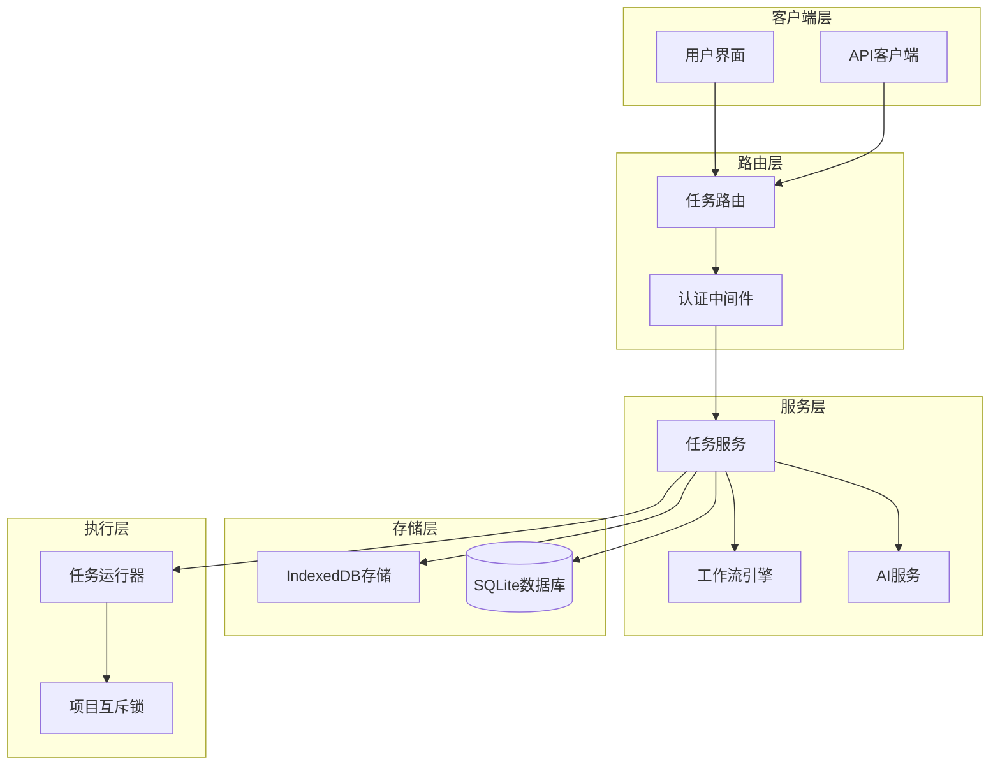
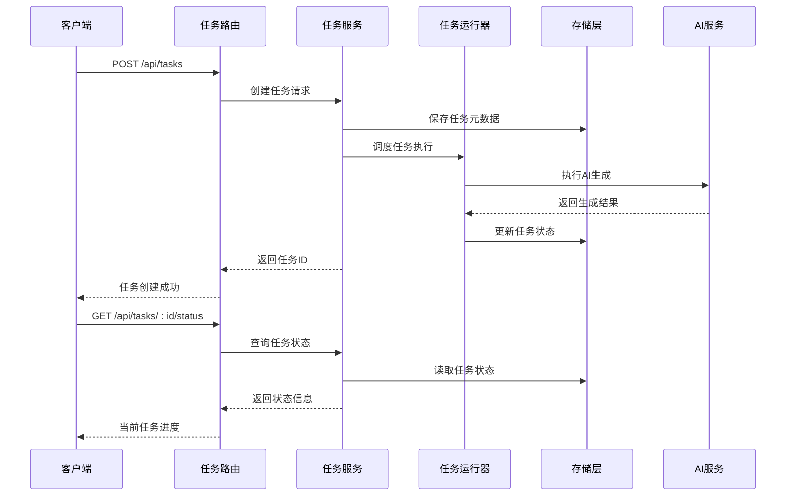
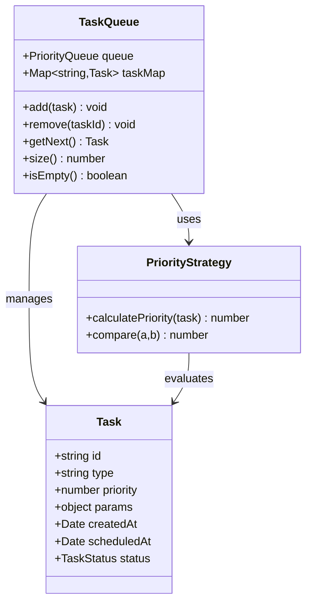
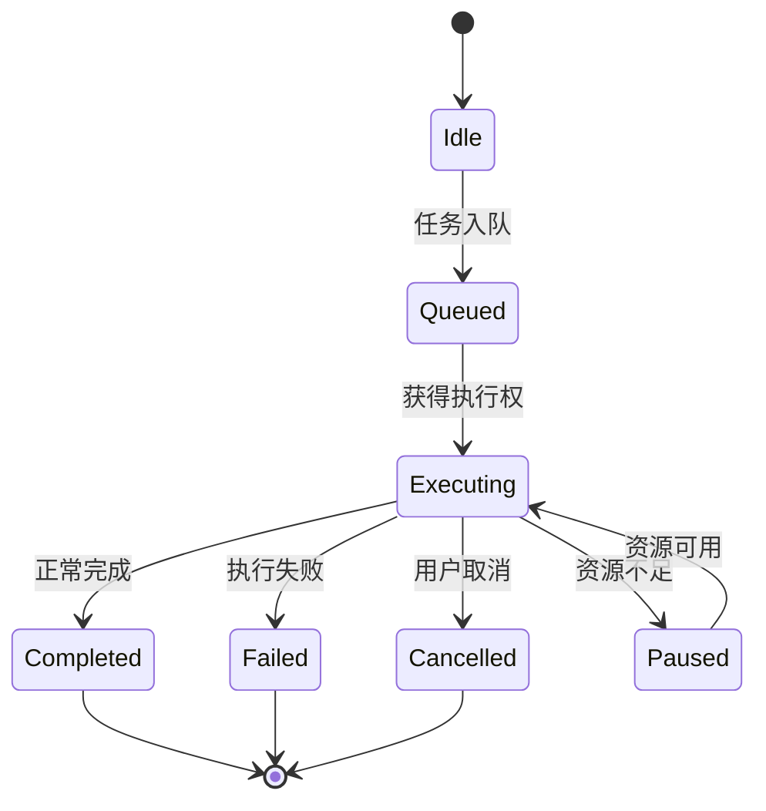
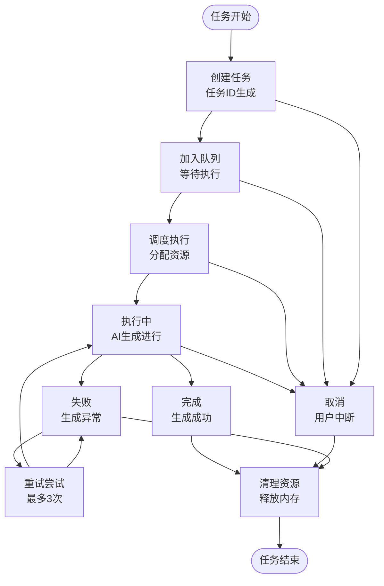
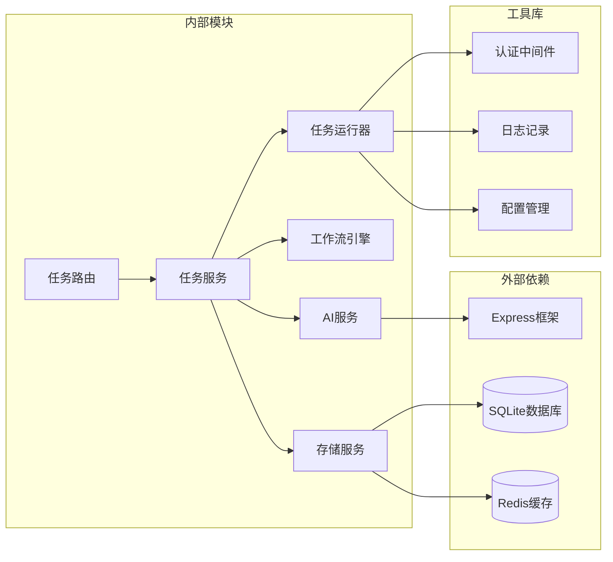

# 任务管理路由

<cite>
**本文档引用的文件**
- [server/src/routes/tasks.ts](file://server/src/routes/tasks.ts)
- [server/src/services/taskRunner.ts](file://server/src/services/taskRunner.ts)
- [services/taskService.ts](file://services/taskService.ts)
- [src/services/ai/index.ts](file://src/services/ai/index.ts)
- [src/services/workflow/engine.ts](file://src/services/workflow/engine.ts)
- [src/services/storage/indexeddb.ts](file://src/services/storage/indexeddb.ts)
- [src/services/storage/types.ts](file://src/services/storage/types.ts)
- [server/src/middleware/auth.ts](file://server/src/middleware/auth.ts)
- [server/src/config/database.ts](file://server/src/config/database.ts)
- [server/src/utils/projectMutex.ts](file://server/src/utils/projectMutex.ts)
</cite>

## 目录
1. [简介](#简介)
2. [项目结构](#项目结构)
3. [核心组件](#核心组件)
4. [架构概览](#架构概览)
5. [详细组件分析](#详细组件分析)
6. [依赖关系分析](#依赖关系分析)
7. [性能考虑](#性能考虑)
8. [故障排除指南](#故障排除指南)
9. [结论](#结论)

## 简介

AI Shotlive任务管理路由模块是一个完整的异步任务管理系统，负责处理AI生成任务的创建、执行、监控和取消。该系统采用分层架构设计，结合工作流引擎、任务队列管理和并发控制机制，为用户提供可靠的AI内容生成服务。

系统主要功能包括：
- 异步任务创建和调度
- 实时任务状态查询
- 任务取消和中断
- 任务优先级管理
- 超时处理和错误恢复
- 并发控制和资源管理

## 项目结构

任务管理路由模块位于项目的多个层次中，形成了清晰的分层架构：

**图表来源**
- [server/src/routes/tasks.ts](file://server/src/routes/tasks.ts)
- [server/src/services/taskRunner.ts](file://server/src/services/taskRunner.ts)
- [services/taskService.ts](file://services/taskService.ts)

**章节来源**
- [server/src/routes/tasks.ts](file://server/src/routes/tasks.ts)
- [server/src/services/taskRunner.ts](file://server/src/services/taskRunner.ts)
- [services/taskService.ts](file://services/taskService.ts)

## 核心组件

### 任务路由控制器

任务路由模块提供了RESTful API接口，支持以下核心操作：

- **POST /api/tasks**: 创建新任务
- **GET /api/tasks**: 查询任务列表
- **GET /api/tasks/:id**: 获取单个任务详情
- **DELETE /api/tasks/:id**: 取消任务
- **GET /api/tasks/:id/status**: 查询任务状态

### 任务服务层

任务服务负责协调各个子系统的交互，包括：
- 任务生命周期管理
- 工作流状态跟踪
- 资源分配和释放
- 错误处理和恢复

### 任务运行器

任务运行器实现了具体的任务执行逻辑，支持：
- 并发任务调度
- 任务优先级排序
- 超时检测和处理
- 内存和CPU资源监控

**章节来源**
- [server/src/routes/tasks.ts](file://server/src/routes/tasks.ts)
- [server/src/services/taskRunner.ts](file://server/src/services/taskRunner.ts)
- [services/taskService.ts](file://services/taskService.ts)

## 架构概览

任务管理系统的整体架构采用了分层设计模式，确保了系统的可扩展性和可维护性：

**图表来源**
- [server/src/routes/tasks.ts](file://server/src/routes/tasks.ts)
- [server/src/services/taskRunner.ts](file://server/src/services/taskRunner.ts)
- [services/taskService.ts](file://services/taskService.ts)

## 详细组件分析

### 任务队列管理

任务队列采用优先级队列设计，支持多种优先级级别：

**图表来源**
- [server/src/services/taskRunner.ts](file://server/src/services/taskRunner.ts)

### 并发控制机制

系统实现了智能的并发控制，通过项目互斥锁确保同一项目的任务串行执行：

**图表来源**
- [server/src/utils/projectMutex.ts](file://server/src/utils/projectMutex.ts)
- [server/src/services/taskRunner.ts](file://server/src/services/taskRunner.ts)

### 任务状态跟踪

任务状态采用有限状态机设计，确保状态转换的正确性和一致性：

**图表来源**
- [server/src/services/taskRunner.ts](file://server/src/services/taskRunner.ts)
- [services/taskService.ts](file://services/taskService.ts)

### 任务优先级设置

系统支持动态优先级调整，基于以下因素计算任务优先级：

| 优先级类别 | 计算公式 | 适用场景 |
|------------|----------|----------|
| 紧急任务 | priority = 100 | 用户主动请求的任务 |
| 普通任务 | priority = 50 | 标准AI生成任务 |
| 后台任务 | priority = 10 | 批量处理任务 |

**章节来源**
- [server/src/services/taskRunner.ts](file://server/src/services/taskRunner.ts)
- [server/src/utils/projectMutex.ts](file://server/src/utils/projectMutex.ts)

## 依赖关系分析

任务管理路由模块的依赖关系呈现清晰的层次结构：

**图表来源**
- [server/src/routes/tasks.ts](file://server/src/routes/tasks.ts)
- [server/src/services/taskRunner.ts](file://server/src/services/taskRunner.ts)
- [services/taskService.ts](file://services/taskService.ts)

**章节来源**
- [server/src/routes/tasks.ts](file://server/src/routes/tasks.ts)
- [server/src/services/taskRunner.ts](file://server/src/services/taskRunner.ts)
- [services/taskService.ts](file://services/taskService.ts)

## 性能考虑

### 内存管理

系统实现了智能的内存管理策略：
- 任务完成后自动清理临时数据
- 大文件生成采用流式处理
- 内存使用监控和预警机制

### 并发优化

并发控制采用以下策略：
- 最大并发数限制为CPU核心数×2
- 项目级别的任务串行化
- 资源使用率监控和动态调整

### 缓存策略

系统采用多层缓存机制：
- Redis缓存热点任务状态
- IndexedDB本地持久化
- 文件系统缓存生成的媒体文件

## 故障排除指南

### 常见问题及解决方案

| 问题类型 | 症状 | 解决方案 |
|----------|------|----------|
| 任务超时 | 任务长时间无响应 | 检查AI服务可用性，增加超时时间 |
| 内存溢出 | 系统内存持续增长 | 优化任务批处理大小，启用垃圾回收 |
| 并发冲突 | 任务执行顺序混乱 | 检查项目互斥锁实现，确保串行化 |
| 数据不一致 | 任务状态与实际不符 | 检查事务提交，实现补偿机制 |

### 调试工具

系统提供了完善的调试功能：
- 任务执行日志追踪
- 性能指标监控
- 错误堆栈分析
- 资源使用统计

**章节来源**
- [server/src/services/taskRunner.ts](file://server/src/services/taskRunner.ts)
- [server/src/utils/projectMutex.ts](file://server/src/utils/projectMutex.ts)

## 结论

AI Shotlive任务管理路由模块通过精心设计的架构和实现，为AI内容生成提供了稳定可靠的服务。系统的关键优势包括：

1. **高可靠性**: 完善的错误处理和恢复机制
2. **高性能**: 智能并发控制和资源管理
3. **可扩展性**: 分层架构支持功能扩展
4. **易维护性**: 清晰的代码结构和文档

该模块为AI Shotlive平台的AI生成功能奠定了坚实的技术基础，能够满足从个人用户到企业级应用的各种需求。