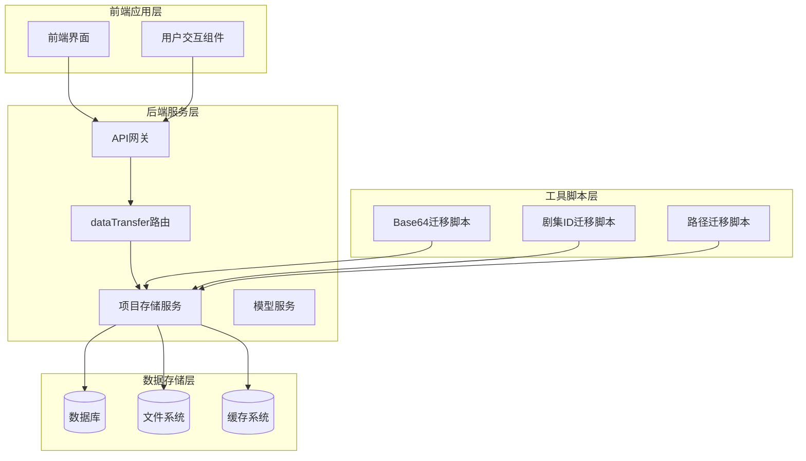
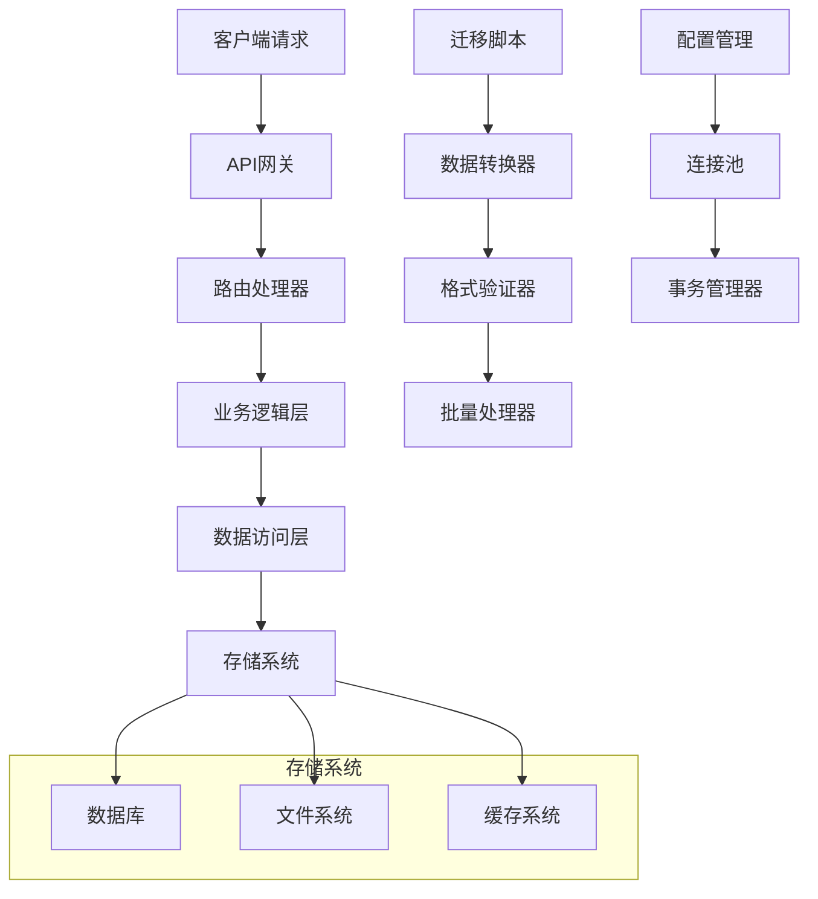
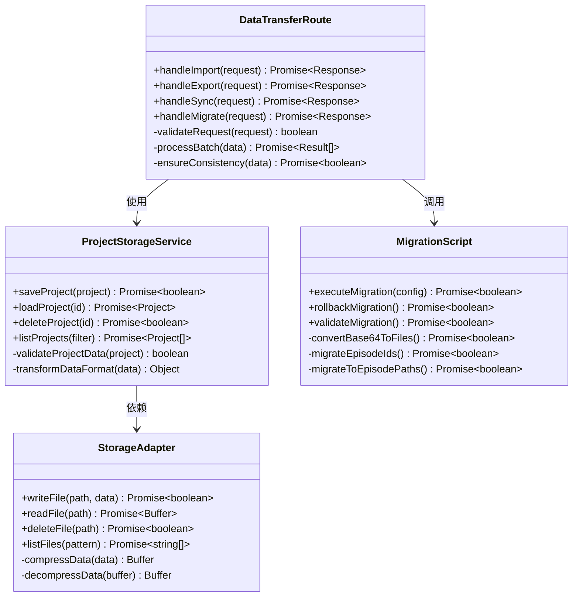
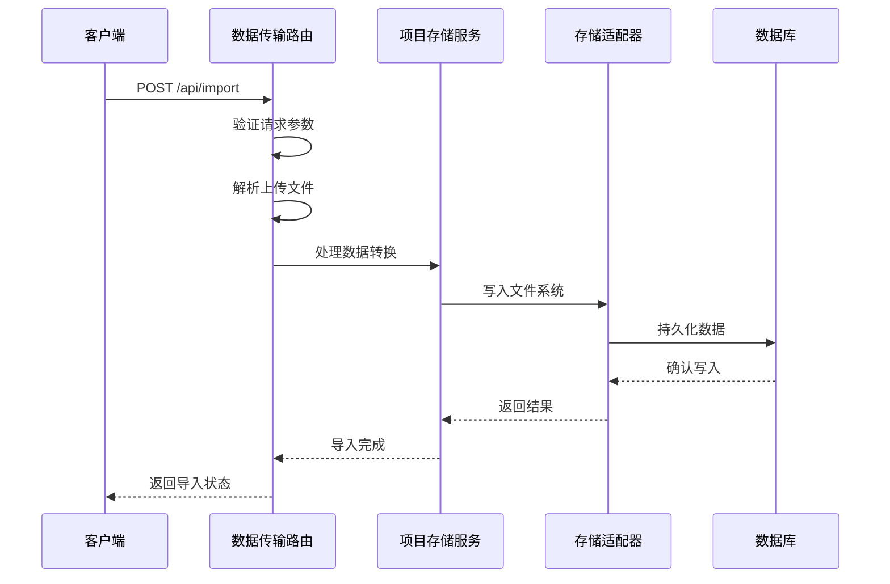
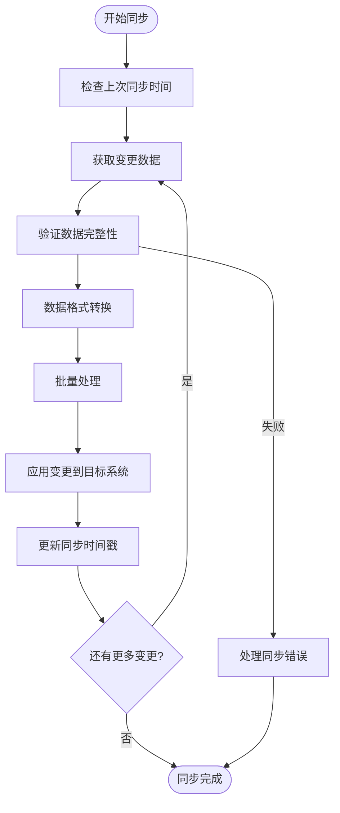
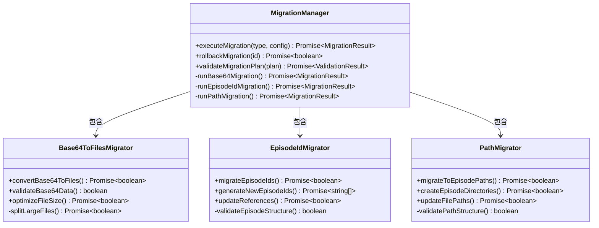
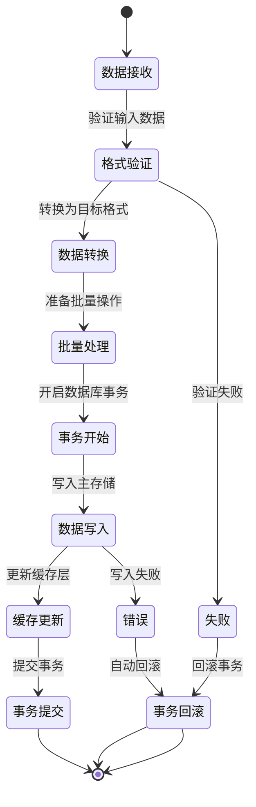
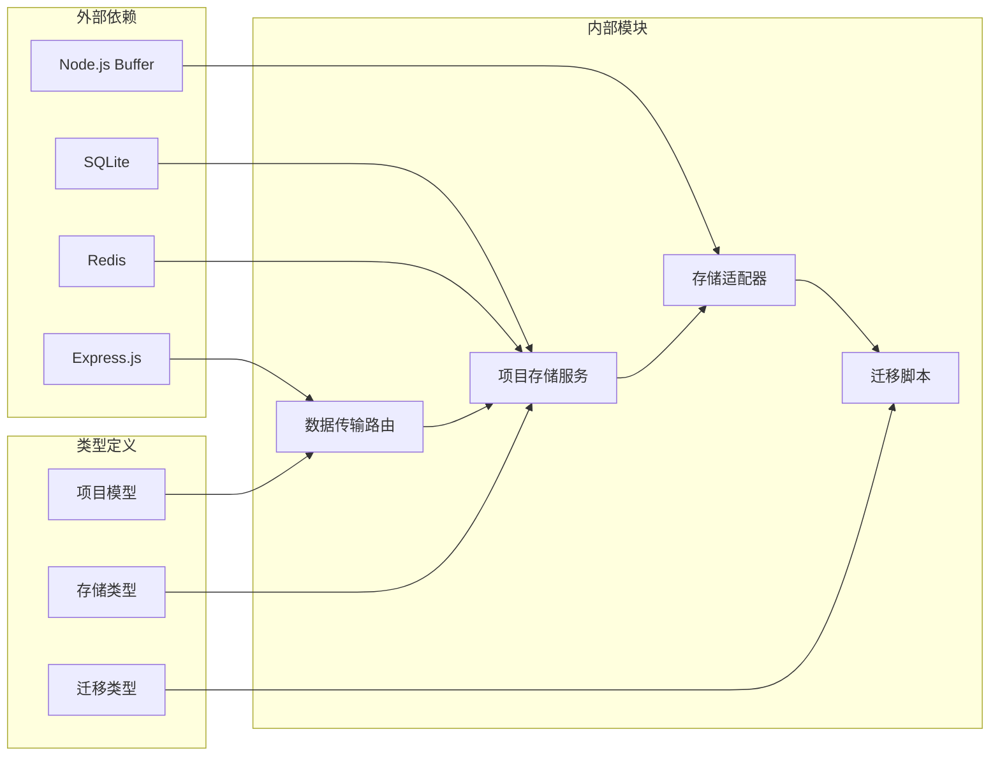

# 数据传输路由

<cite>
**本文档引用的文件**
- [index.ts](file://server/src/index.ts)
- [dataTransfer.ts](file://server/src/routes/dataTransfer.ts)
- [projectStorage.ts](file://server/src/services/projectStorage.ts)
- [migrateBase64ToFiles.ts](file://server/src/scripts/migrateBase64ToFiles.ts)
- [migrateEpisodeIds.ts](file://server/src/scripts/migrateEpisodeIds.ts)
- [migrateToEpisodePaths.ts](file://server/src/scripts/migrateToEpisodePaths.ts)
- [storage.ts](file://src/services/storage/index.ts)
- [types.ts](file://types/model.ts)
</cite>

## 目录
1. [简介](#简介)
2. [项目结构](#项目结构)
3. [核心组件](#核心组件)
4. [架构概览](#架构概览)
5. [详细组件分析](#详细组件分析)
6. [依赖关系分析](#依赖关系分析)
7. [性能考虑](#性能考虑)
8. [故障排除指南](#故障排除指南)
9. [结论](#结论)
10. [附录](#附录)

## 简介

AI Shotlive数据传输路由模块是整个系统的核心数据处理引擎，负责管理项目数据的导入、导出、增量同步和数据迁移功能。该模块采用现代化的架构设计，支持多种数据格式转换、批量操作处理，并提供了完善的数据一致性保证机制。

本模块的主要目标包括：
- 实现高效的数据导入导出流程
- 支持增量同步以减少网络传输开销
- 提供可靠的数据迁移解决方案
- 确保数据格式转换的准确性和完整性
- 建立完整的数据备份和版本兼容性策略

## 项目结构

AI Shotlive项目采用前后端分离的架构模式，数据传输路由模块位于后端服务器部分，与前端应用通过RESTful API进行通信。

**图表来源**
- [index.ts](file://server/src/index.ts)
- [dataTransfer.ts](file://server/src/routes/dataTransfer.ts)
- [projectStorage.ts](file://server/src/services/projectStorage.ts)

**章节来源**
- [index.ts](file://server/src/index.ts)
- [dataTransfer.ts](file://server/src/routes/dataTransfer.ts)

## 核心组件

数据传输路由模块由多个核心组件构成，每个组件都有明确的职责分工：

### 1. 路由控制器
负责处理HTTP请求和响应，定义API端点和路由规则。

### 2. 项目存储服务
管理项目数据的持久化存储，包括数据库操作和文件系统管理。

### 3. 数据迁移脚本
提供历史数据迁移和格式转换功能。

### 4. 存储适配器
抽象不同存储系统的访问接口，支持多种存储后端。

**章节来源**
- [dataTransfer.ts](file://server/src/routes/dataTransfer.ts)
- [projectStorage.ts](file://server/src/services/projectStorage.ts)
- [storage.ts](file://src/services/storage/index.ts)

## 架构概览

数据传输路由模块采用分层架构设计，确保了良好的可维护性和扩展性。

**图表来源**
- [dataTransfer.ts](file://server/src/routes/dataTransfer.ts)
- [projectStorage.ts](file://server/src/services/projectStorage.ts)

## 详细组件分析

### 数据传输路由组件

数据传输路由组件是整个模块的核心，负责处理所有数据传输相关的请求。

**图表来源**
- [dataTransfer.ts](file://server/src/routes/dataTransfer.ts)
- [projectStorage.ts](file://server/src/services/projectStorage.ts)
- [migrateBase64ToFiles.ts](file://server/src/scripts/migrateBase64ToFiles.ts)
- [migrateEpisodeIds.ts](file://server/src/scripts/migrateEpisodeIds.ts)
- [migrateToEpisodePaths.ts](file://server/src/scripts/migrateToEpisodePaths.ts)

#### 数据导入流程

**图表来源**
- [dataTransfer.ts](file://server/src/routes/dataTransfer.ts)
- [projectStorage.ts](file://server/src/services/projectStorage.ts)

#### 增量同步流程

**图表来源**
- [dataTransfer.ts](file://server/src/routes/dataTransfer.ts)

### 数据迁移组件

数据迁移组件提供了完整的历史数据迁移解决方案，支持多种迁移场景。

**图表来源**
- [migrateBase64ToFiles.ts](file://server/src/scripts/migrateBase64ToFiles.ts)
- [migrateEpisodeIds.ts](file://server/src/scripts/migrateEpisodeIds.ts)
- [migrateToEpisodePaths.ts](file://server/src/scripts/migrateToEpisodePaths.ts)

### 数据一致性保证机制

系统实现了多层次的数据一致性保证机制：

**图表来源**
- [projectStorage.ts](file://server/src/services/projectStorage.ts)

**章节来源**
- [dataTransfer.ts](file://server/src/routes/dataTransfer.ts)
- [projectStorage.ts](file://server/src/services/projectStorage.ts)
- [migrateBase64ToFiles.ts](file://server/src/scripts/migrateBase64ToFiles.ts)
- [migrateEpisodeIds.ts](file://server/src/scripts/migrateEpisodeIds.ts)
- [migrateToEpisodePaths.ts](file://server/src/scripts/migrateToEpisodePaths.ts)

## 依赖关系分析

数据传输路由模块的依赖关系体现了清晰的分层架构设计。

**图表来源**
- [index.ts](file://server/src/index.ts)
- [dataTransfer.ts](file://server/src/routes/dataTransfer.ts)
- [projectStorage.ts](file://server/src/services/projectStorage.ts)

**章节来源**
- [index.ts](file://server/src/index.ts)
- [types.ts](file://types/model.ts)

## 性能考虑

数据传输路由模块在设计时充分考虑了性能优化需求：

### 1. 批量处理优化
- 支持批量数据导入导出
- 实现流式处理减少内存占用
- 采用异步处理提高并发性能

### 2. 缓存策略
- 多级缓存架构（内存、磁盘、分布式）
- 智能缓存失效机制
- 缓存预热和预加载

### 3. 数据压缩
- 自动数据压缩减少存储空间
- 支持多种压缩算法选择
- 压缩率与性能的平衡

### 4. 连接池管理
- 数据库连接池优化
- 文件系统连接复用
- 超时和重试机制

## 故障排除指南

### 常见问题及解决方案

#### 1. 数据导入失败
**症状**: 导入过程中出现错误或数据丢失
**可能原因**:
- 文件格式不正确
- 权限不足
- 存储空间不足
- 网络中断

**解决步骤**:
1. 检查文件格式是否符合要求
2. 验证存储权限设置
3. 确认磁盘空间充足
4. 重新建立网络连接

#### 2. 同步延迟
**症状**: 数据同步存在明显延迟
**可能原因**:
- 网络带宽限制
- 数据量过大
- 并发冲突
- 缓存未命中

**解决步骤**:
1. 优化网络配置
2. 分批处理大数据
3. 调整并发参数
4. 清理缓存

#### 3. 迁移失败
**症状**: 数据迁移过程中断
**可能原因**:
- 原始数据损坏
- 目标格式不兼容
- 内存不足
- 磁盘空间不足

**解决步骤**:
1. 备份原始数据
2. 验证目标格式兼容性
3. 清理内存和磁盘空间
4. 分段执行迁移

**章节来源**
- [dataTransfer.ts](file://server/src/routes/dataTransfer.ts)
- [projectStorage.ts](file://server/src/services/projectStorage.ts)

## 结论

AI Shotlive数据传输路由模块通过其精心设计的架构和完善的实现，为整个系统提供了强大的数据处理能力。模块具备以下优势：

1. **高可靠性**: 多层次的数据一致性保证机制确保数据安全
2. **高性能**: 批量处理、缓存优化和连接池管理提升整体性能
3. **可扩展性**: 模块化设计支持功能扩展和新存储后端接入
4. **易维护性**: 清晰的分层架构便于代码维护和问题排查

该模块为AI Shotlive项目的数据管理奠定了坚实基础，能够满足从个人项目到企业级应用的各种数据处理需求。

## 附录

### API设计规范

#### 数据导入API
- **端点**: `POST /api/import`
- **请求体**: 支持多种数据格式（JSON、XML、CSV等）
- **响应**: 导入状态和统计信息

#### 数据导出API  
- **端点**: `GET /api/export/{projectId}`
- **参数**: 项目ID、导出格式、过滤条件
- **响应**: 文件下载链接或直接文件内容

#### 增量同步API
- **端点**: `POST /api/sync/incremental`
- **请求体**: 最后同步时间戳、变更类型
- **响应**: 同步状态和变更详情

#### 数据迁移API
- **端点**: `POST /api/migrate`
- **请求体**: 迁移类型、配置参数
- **响应**: 迁移进度和结果

### 数据格式转换支持

系统支持以下数据格式转换：
- JSON ↔ XML ↔ CSV
- Base64 ↔ 文件存储
- 不同版本间的格式转换
- 多语言文本编码转换

### 版本兼容性策略

- 向后兼容性保证
- 渐进式升级方案
- 自动迁移机制
- 兼容性测试套件