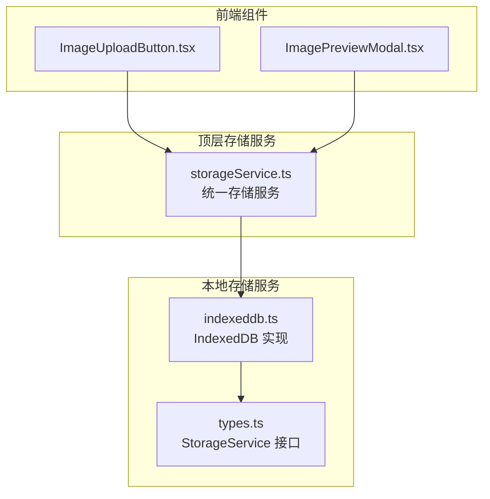
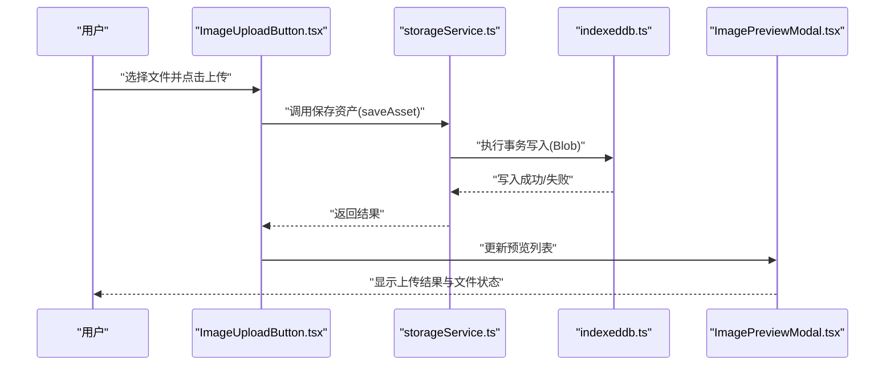
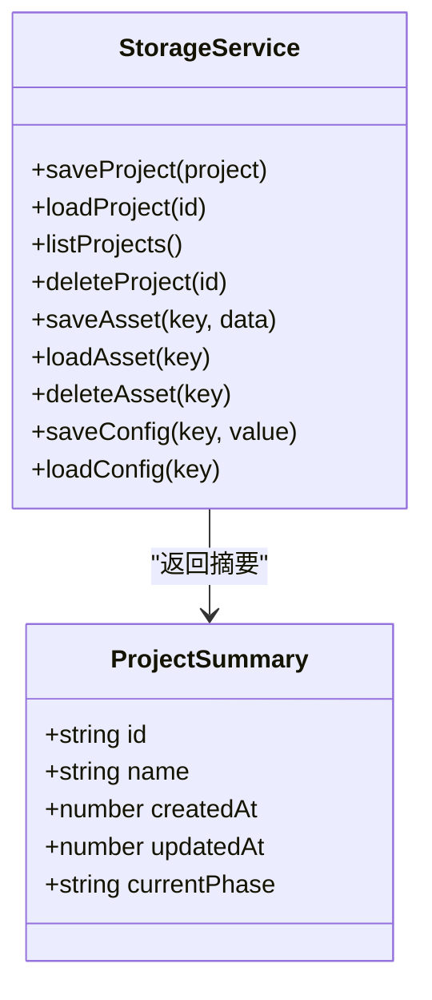
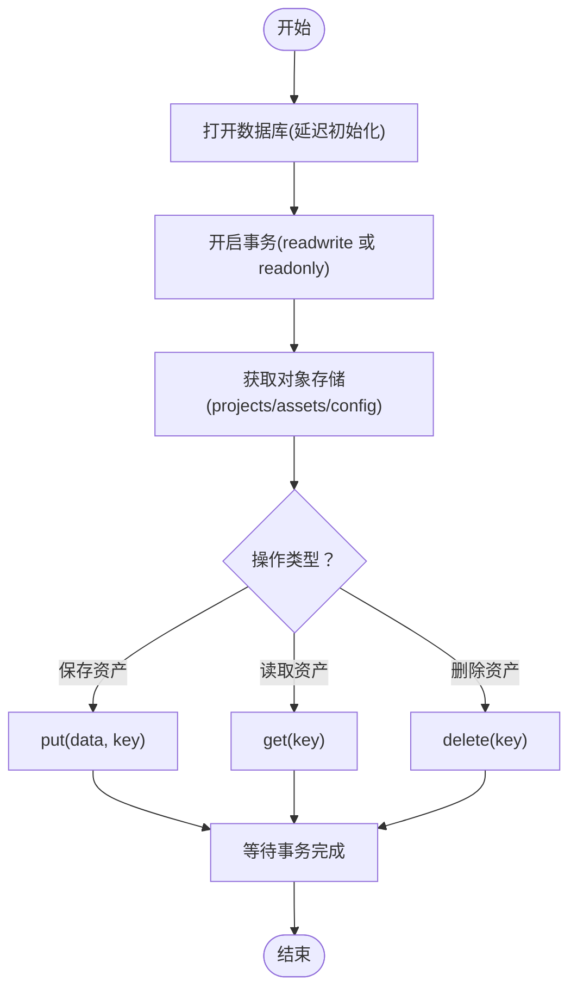
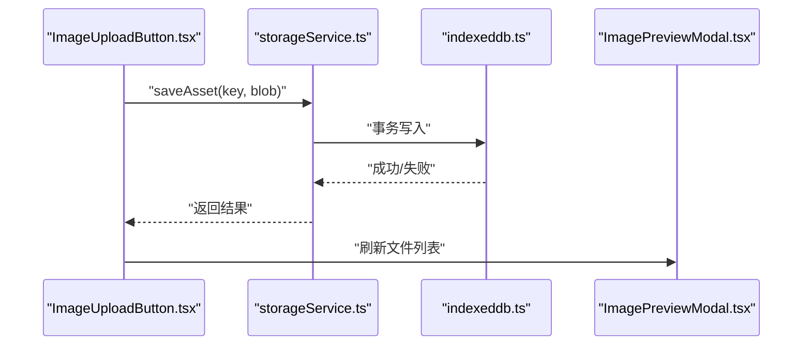
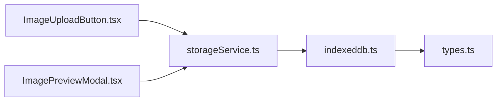
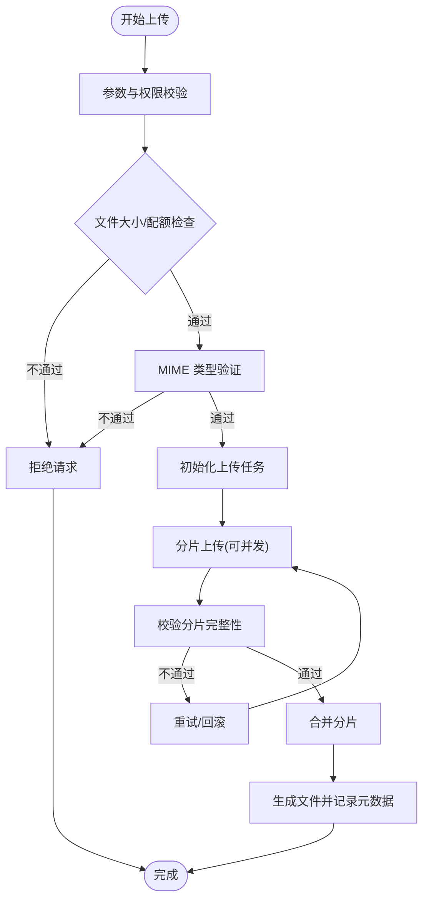

# 文件上传路由

<cite>
**本文引用的文件**
- [index.ts](file://src/services/storage/index.ts)
- [types.ts](file://src/services/storage/types.ts)
- [indexeddb.ts](file://src/services/storage/indexeddb.ts)
- [storageService.ts](file://services/storageService.ts)
- [README.md](file://components/StageAssets/README.md)
- [ImageUploadButton.tsx](file://components/StageAssets/ImageUploadButton.tsx)
- [ImagePreviewModal.tsx](file://components/StageAssets/ImagePreviewModal.tsx)
- [README.md](file://README.md)
</cite>

## 目录
1. [简介](#简介)
2. [项目结构](#项目结构)
3. [核心组件](#核心组件)
4. [架构总览](#架构总览)
5. [详细组件分析](#详细组件分析)
6. [依赖关系分析](#依赖关系分析)
7. [性能考量](#性能考量)
8. [故障排查指南](#故障排查指南)
9. [结论](#结论)
10. [附录](#附录)

## 简介
本文件聚焦于 AI Shotlive 的“文件上传路由”能力与相关实现，目标是为用户提供一套清晰、可落地的文件上传、下载与文件管理 API 设计说明，涵盖以下关键主题：
- 文件上传、下载与管理的 API 设计思路
- 文件存储策略与 MIME 类型验证
- 文件安全检查机制
- 大文件分片上传、断点续传与存储配额管理
- 上传流程图与安全最佳实践

需要特别说明的是：当前仓库中未发现后端路由层（如 uploads.ts）与专用文件存储服务（如 fileStorage.ts）的具体实现；因此本文在“后端路由与存储服务”部分以“概念性设计”形式呈现，帮助团队在现有前端与本地存储能力基础上进行扩展与落地。

## 项目结构
围绕文件上传与管理，项目中与之直接相关的模块包括：
- 前端组件：图像上传按钮、预览弹窗等
- 本地存储服务：IndexedDB 封装的存储接口与实现
- 顶层存储服务：统一的存储服务封装（供业务调用）

**图表来源**
- [index.ts:1-3](file://src/services/storage/index.ts#L1-L3)
- [types.ts:1-30](file://src/services/storage/types.ts#L1-L30)
- [indexeddb.ts:44-167](file://src/services/storage/indexeddb.ts#L44-L167)
- [storageService.ts](file://services/storageService.ts)

**章节来源**
- [index.ts:1-3](file://src/services/storage/index.ts#L1-L3)
- [types.ts:1-30](file://src/services/storage/types.ts#L1-L30)
- [indexeddb.ts:44-167](file://src/services/storage/indexeddb.ts#L44-L167)

## 核心组件
- 存储服务接口（StorageService）：定义了项目、资产与配置的保存、加载、删除能力，支持二进制资产的存取。
- IndexedDB 实现：基于浏览器 IndexedDB 的具体实现，提供异步事务、对象存储与版本升级处理。
- 统一存储服务（storageService.ts）：对外暴露统一的存储 API，屏蔽底层存储细节。

这些组件共同构成前端侧的“文件上传路由”基础：前端负责收集与校验文件，通过统一存储服务完成本地持久化或与后端交互。

**章节来源**
- [types.ts:15-30](file://src/services/storage/types.ts#L15-L30)
- [indexeddb.ts:103-167](file://src/services/storage/indexeddb.ts#L103-L167)
- [storageService.ts](file://services/storageService.ts)

## 架构总览
下图展示了从用户触发上传到本地存储的整体流程，以及与现有前端组件的衔接：

**图表来源**
- [ImageUploadButton.tsx](file://components/StageAssets/ImageUploadButton.tsx)
- [ImagePreviewModal.tsx](file://components/StageAssets/ImagePreviewModal.tsx)
- [storageService.ts](file://services/storageService.ts)
- [indexeddb.ts:145-151](file://src/services/storage/indexeddb.ts#L145-L151)

## 详细组件分析

### 组件A：存储服务接口（StorageService）
- 职责：抽象出项目、资产、配置三类数据的 CRUD 操作，其中资产操作以 Blob 为单位。
- 关键方法：
  - saveProject/loadProject/listProjects/deleteProject
  - saveAsset/loadAsset/deleteAsset
  - saveConfig/loadConfig
- 数据结构：项目摘要（ProjectSummary）仅包含必要字段，避免传输冗余数据。

**图表来源**
- [types.ts:7-30](file://src/services/storage/types.ts#L7-L30)

**章节来源**
- [types.ts:15-30](file://src/services/storage/types.ts#L15-L30)

### 组件B：IndexedDB 实现（indexeddb.ts）
- 打开数据库：延迟初始化，支持版本升级与 onversionchange 处理。
- 事务封装：提供通用 Promise 化的请求与事务完成回调。
- 资产读写：以 key 为索引存储 Blob，支持 put/get/delete。
- 项目与配置：分别使用独立的对象存储，便于查询与维护。

**图表来源**
- [indexeddb.ts:44-99](file://src/services/storage/indexeddb.ts#L44-L99)
- [indexeddb.ts:145-167](file://src/services/storage/indexeddb.ts#L145-L167)

**章节来源**
- [indexeddb.ts:44-99](file://src/services/storage/indexeddb.ts#L44-L99)
- [indexeddb.ts:145-167](file://src/services/storage/indexeddb.ts#L145-L167)

### 组件C：统一存储服务（storageService.ts）
- 角色：对上层业务提供一致的存储 API，内部委派给具体存储实现（如 IndexedDB）。
- 价值：隔离业务与存储细节，便于替换底层存储（如迁移到后端文件系统）。

**章节来源**
- [storageService.ts](file://services/storageService.ts)

### 组件D：前端上传组件（ImageUploadButton.tsx / ImagePreviewModal.tsx）
- ImageUploadButton：负责文件选择、触发上传、错误提示与进度反馈。
- ImagePreviewModal：展示已上传文件列表、缩略图与操作入口（如删除、下载）。

**图表来源**
- [ImageUploadButton.tsx](file://components/StageAssets/ImageUploadButton.tsx)
- [ImagePreviewModal.tsx](file://components/StageAssets/ImagePreviewModal.tsx)
- [storageService.ts](file://services/storageService.ts)
- [indexeddb.ts:145-151](file://src/services/storage/indexeddb.ts#L145-L151)

**章节来源**
- [ImageUploadButton.tsx](file://components/StageAssets/ImageUploadButton.tsx)
- [ImagePreviewModal.tsx](file://components/StageAssets/ImagePreviewModal.tsx)

## 依赖关系分析
- 组件耦合：前端组件依赖统一存储服务；统一存储服务依赖 IndexedDB 实现；IndexedDB 实现依赖存储接口定义。
- 可能的循环依赖：当前结构为单向依赖，无明显循环。
- 外部依赖：浏览器 IndexedDB API；React 组件生态。

**图表来源**
- [index.ts:1-3](file://src/services/storage/index.ts#L1-L3)
- [types.ts:1-30](file://src/services/storage/types.ts#L1-L30)
- [indexeddb.ts:44-167](file://src/services/storage/indexeddb.ts#L44-L167)
- [storageService.ts](file://services/storageService.ts)

**章节来源**
- [index.ts:1-3](file://src/services/storage/index.ts#L1-L3)
- [types.ts:1-30](file://src/services/storage/types.ts#L1-L30)
- [indexeddb.ts:44-167](file://src/services/storage/indexeddb.ts#L44-L167)
- [storageService.ts](file://services/storageService.ts)

## 性能考量
- 事务批处理：将多次写入合并到同一事务，减少锁竞争与 I/O 开销。
- 对象存储拆分：项目、资产、配置分别存储，提升查询效率与并发能力。
- 数据裁剪：项目列表仅返回摘要字段，降低网络与内存占用。
- 前端缓存：利用浏览器缓存与本地存储，减少重复请求与渲染成本。

[本节为通用性能建议，不直接分析特定文件]

## 故障排查指南
- 打不开数据库或版本升级失败
  - 检查 onupgradeneeded 中对象存储创建逻辑是否正确
  - 关注 onversionchange 回调，确保多标签页升级时及时关闭旧连接
- 写入失败或事务异常
  - 使用 promisifyTransaction 捕获 onerror/onabort
  - 确认 keyPath 与外键约束设置
- 读取不到数据
  - 确认 key 是否匹配，store.get(key) 返回值判空处理
- 上传组件无响应
  - 检查统一存储服务调用链与错误回调
  - 确认 Blob 数据格式与大小限制

**章节来源**
- [indexeddb.ts:44-99](file://src/services/storage/indexeddb.ts#L44-L99)
- [indexeddb.ts:145-167](file://src/services/storage/indexeddb.ts#L145-L167)

## 结论
当前仓库提供了完善的前端侧文件上传与本地存储能力：通过统一的存储服务接口与 IndexedDB 实现，满足项目、资产与配置的持久化需求。若需扩展至后端路由与分布式存储，可在现有接口之上增加后端适配器，保持前端调用不变，平滑演进。

[本节为总结性内容，不直接分析特定文件]

## 附录

### 后端路由与存储服务（概念性设计）
为满足大规模文件上传、MIME 验证、安全检查与配额管理，建议在后端新增如下能力（概念性说明）：
- 路由层
  - 上传：/api/uploads
  - 断点续传：/api/uploads/resume
  - 下载：/api/uploads/:key
  - 列表：/api/uploads
- 存储策略
  - 分片上传：客户端将大文件切分为固定大小的片段，逐片上传并记录偏移
  - 断点续传：服务端记录已接收片段，客户端按需重传缺失片段
  - 存储配额：按用户维度限制总容量，超过阈值拒绝新上传
- 安全与验证
  - MIME 类型白名单：仅允许受信任类型
  - 文件大小限制：防止超大文件占用资源
  - 文件名规范化：去除危险字符，避免路径穿越
  - 访问鉴权：所有上传/下载接口需登录态
  - 内容扫描：对敏感类型进行二次审核
- API 设计要点
  - 上传：multipart/form-data，返回上传任务标识与分片信息
  - 断点续传：查询已接收片段，返回缺失列表
  - 下载：按 key 返回文件流，支持 Range 请求
  - 列表：返回文件元信息（名称、大小、时间、状态）

[本节为概念性设计，不直接分析特定文件]

### 上传流程图（概念性）

[本图为概念性流程，不直接映射到具体源码文件]

### 安全最佳实践
- 输入校验：严格限制文件类型与大小
- 存储隔离：按用户/项目划分命名空间
- 访问控制：仅授权用户可访问其文件
- 日志审计：记录上传/下载事件与异常
- 清理策略：定期清理过期与无效文件

[本节为通用安全建议，不直接分析特定文件]