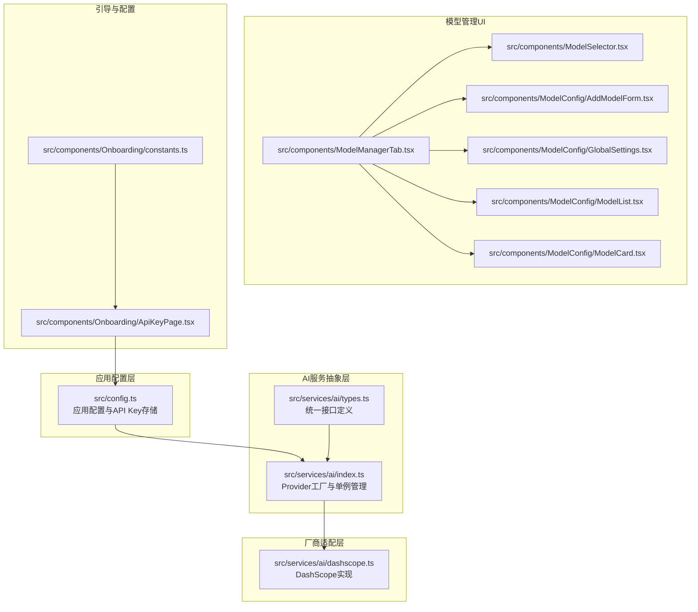
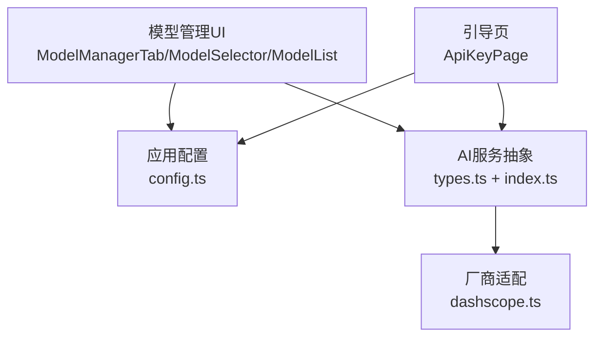
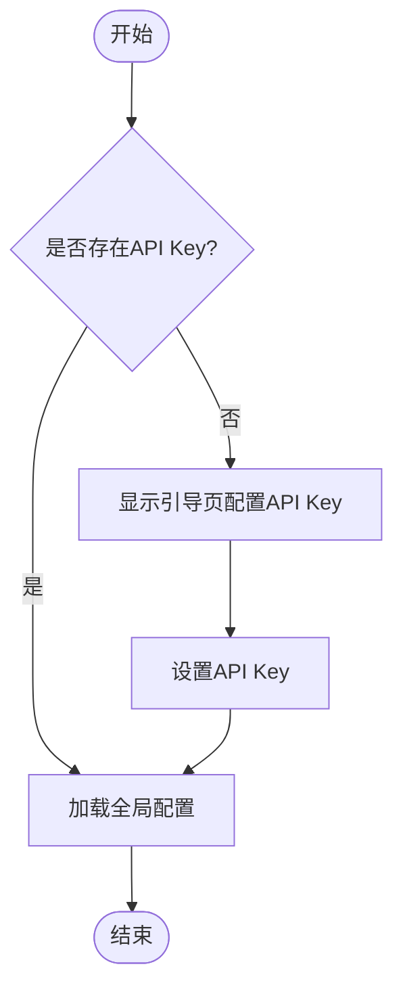
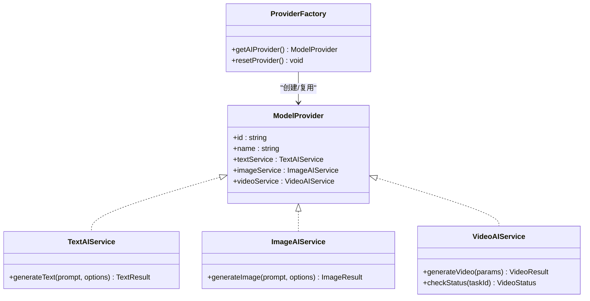
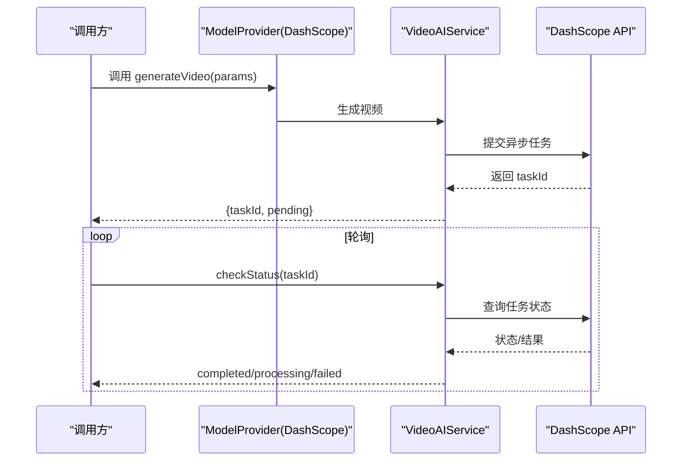
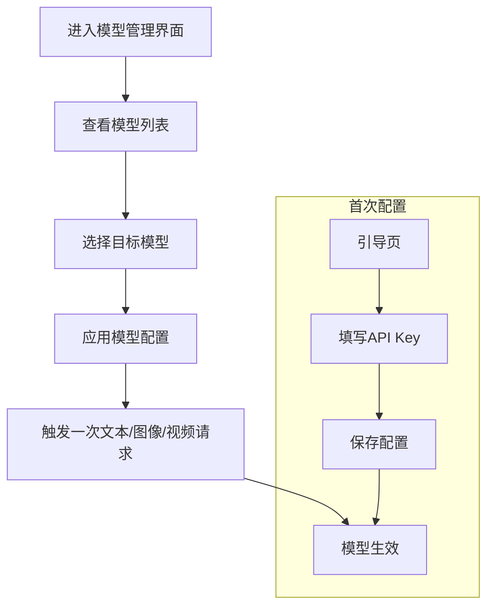
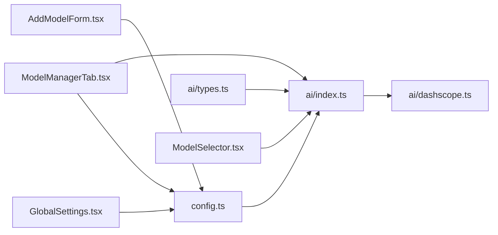

# 模型管理路由

<cite>
**本文引用的文件**
- [src/config.ts](file://src/config.ts)
- [src/services/ai/index.ts](file://src/services/ai/index.ts)
- [src/services/ai/types.ts](file://src/services/ai/types.ts)
- [src/services/ai/dashscope.ts](file://src/services/ai/dashscope.ts)
- [src/components/ModelManagerTab.tsx](file://src/components/ModelManagerTab.tsx)
- [src/components/ModelSelector.tsx](file://src/components/ModelSelector.tsx)
- [src/components/ModelConfig/AddModelForm.tsx](file://src/components/ModelConfig/AddModelForm.tsx)
- [src/components/ModelConfig/GlobalSettings.tsx](file://src/components/ModelConfig/GlobalSettings.tsx)
- [src/components/ModelConfig/ModelCard.tsx](file://src/components/ModelConfig/ModelCard.tsx)
- [src/components/ModelConfig/ModelList.tsx](file://src/components/ModelConfig/ModelList.tsx)
- [src/components/Onboarding/ApiKeyPage.tsx](file://src/components/Onboarding/ApiKeyPage.tsx)
- [src/components/Onboarding/constants.ts](file://src/components/Onboarding/constants.ts)
- [README.md](file://README.md)
</cite>

## 目录
1. [简介](#简介)
2. [项目结构](#项目结构)
3. [核心组件](#核心组件)
4. [架构总览](#架构总览)
5. [详细组件分析](#详细组件分析)
6. [依赖关系分析](#依赖关系分析)
7. [性能考虑](#性能考虑)
8. [故障排查指南](#故障排查指南)
9. [结论](#结论)
10. [附录](#附录)

## 简介
本文件聚焦于AI Shotlive的“模型管理路由”相关模块，系统性阐述以下内容：
- 模型配置与API Key管理
- 多厂商模型支持策略（以DashScope为例）
- 模型注册机制与切换流程
- 参数配置、使用统计与性能监控建议
- 模型管理流程图与配置示例

该系统采用“配置驱动 + 抽象接口 + 厂商适配器”的架构，既保证了对单一厂商的快速落地，又为后续接入OpenAI、Google或其他厂商预留了清晰的扩展路径。

## 项目结构
围绕模型管理的关键文件分布如下：
- 应用配置与全局设置：src/config.ts
- AI服务抽象与Provider管理：src/services/ai/types.ts、src/services/ai/index.ts
- 厂商实现（DashScope）：src/services/ai/dashscope.ts
- 模型管理UI组件：src/components/ModelManagerTab.tsx、src/components/ModelSelector.tsx、src/components/ModelConfig/*
- 引导页与API Key配置入口：src/components/Onboarding/ApiKeyPage.tsx、src/components/Onboarding/constants.ts
- 项目说明与厂商支持声明：README.md

图表来源
- [src/config.ts:1-46](file://src/config.ts#L1-L46)
- [src/services/ai/types.ts:1-72](file://src/services/ai/types.ts#L1-L72)
- [src/services/ai/index.ts:1-33](file://src/services/ai/index.ts#L1-L33)
- [src/services/ai/dashscope.ts:275-326](file://src/services/ai/dashscope.ts#L275-L326)
- [src/components/ModelManagerTab.tsx](file://src/components/ModelManagerTab.tsx)
- [src/components/ModelSelector.tsx](file://src/components/ModelSelector.tsx)
- [src/components/ModelConfig/AddModelForm.tsx](file://src/components/ModelConfig/AddModelForm.tsx)
- [src/components/ModelConfig/GlobalSettings.tsx](file://src/components/ModelConfig/GlobalSettings.tsx)
- [src/components/ModelConfig/ModelCard.tsx](file://src/components/ModelConfig/ModelCard.tsx)
- [src/components/ModelConfig/ModelList.tsx](file://src/components/ModelConfig/ModelList.tsx)
- [src/components/Onboarding/ApiKeyPage.tsx](file://src/components/Onboarding/ApiKeyPage.tsx)
- [src/components/Onboarding/constants.ts](file://src/components/Onboarding/constants.ts)

章节来源
- [src/config.ts:1-46](file://src/config.ts#L1-L46)
- [src/services/ai/types.ts:1-72](file://src/services/ai/types.ts#L1-L72)
- [src/services/ai/index.ts:1-33](file://src/services/ai/index.ts#L1-L33)
- [src/services/ai/dashscope.ts:275-326](file://src/services/ai/dashscope.ts#L275-L326)
- [src/components/ModelManagerTab.tsx](file://src/components/ModelManagerTab.tsx)
- [src/components/ModelSelector.tsx](file://src/components/ModelSelector.tsx)
- [src/components/ModelConfig/AddModelForm.tsx](file://src/components/ModelConfig/AddModelForm.tsx)
- [src/components/ModelConfig/GlobalSettings.tsx](file://src/components/ModelConfig/GlobalSettings.tsx)
- [src/components/ModelConfig/ModelCard.tsx](file://src/components/ModelConfig/ModelCard.tsx)
- [src/components/ModelConfig/ModelList.tsx](file://src/components/ModelConfig/ModelList.tsx)
- [src/components/Onboarding/ApiKeyPage.tsx](file://src/components/Onboarding/ApiKeyPage.tsx)
- [src/components/Onboarding/constants.ts](file://src/components/Onboarding/constants.ts)
- [README.md:141-206](file://README.md#L141-L206)

## 核心组件
- 应用配置与API Key管理
  - 提供全局配置读取、写入、API Key设置与存在性检测能力，确保配置驱动的灵活性与安全性。
- AI服务抽象与Provider管理
  - 定义文本、图像、视频三类统一接口，以及ModelProvider抽象，支持未来多Provider切换。
- 厂商适配实现（DashScope）
  - 提供具体的文本、图像、视频服务实现，封装异步任务提交与状态查询。
- 模型管理UI
  - 包含模型列表、模型卡片、全局设置、添加模型表单及模型选择器等组件，支撑模型注册、切换与配置。
- 引导页与配置入口
  - 在首次使用时引导用户配置API Key，确保系统可用性。

章节来源
- [src/config.ts:1-46](file://src/config.ts#L1-L46)
- [src/services/ai/types.ts:1-72](file://src/services/ai/types.ts#L1-L72)
- [src/services/ai/index.ts:1-33](file://src/services/ai/index.ts#L1-L33)
- [src/services/ai/dashscope.ts:275-326](file://src/services/ai/dashscope.ts#L275-L326)
- [src/components/ModelManagerTab.tsx](file://src/components/ModelManagerTab.tsx)
- [src/components/ModelSelector.tsx](file://src/components/ModelSelector.tsx)
- [src/components/ModelConfig/AddModelForm.tsx](file://src/components/ModelConfig/AddModelForm.tsx)
- [src/components/ModelConfig/GlobalSettings.tsx](file://src/components/ModelConfig/GlobalSettings.tsx)
- [src/components/ModelConfig/ModelCard.tsx](file://src/components/ModelConfig/ModelCard.tsx)
- [src/components/ModelConfig/ModelList.tsx](file://src/components/ModelConfig/ModelList.tsx)
- [src/components/Onboarding/ApiKeyPage.tsx](file://src/components/Onboarding/ApiKeyPage.tsx)
- [src/components/Onboarding/constants.ts](file://src/components/Onboarding/constants.ts)

## 架构总览
系统采用分层架构：
- 表现层：模型管理UI组件负责展示与交互
- 配置层：集中管理API Key与基础URL、模型名称等
- 服务层：抽象统一接口，屏蔽厂商差异
- 适配层：具体厂商实现，如DashScope
- 引导层：首次使用时的API Key配置流程

图表来源
- [src/components/ModelManagerTab.tsx](file://src/components/ModelManagerTab.tsx)
- [src/components/ModelSelector.tsx](file://src/components/ModelSelector.tsx)
- [src/components/ModelConfig/ModelList.tsx](file://src/components/ModelConfig/ModelList.tsx)
- [src/config.ts:1-46](file://src/config.ts#L1-L46)
- [src/services/ai/types.ts:1-72](file://src/services/ai/types.ts#L1-L72)
- [src/services/ai/index.ts:1-33](file://src/services/ai/index.ts#L1-L33)
- [src/services/ai/dashscope.ts:275-326](file://src/services/ai/dashscope.ts#L275-L326)
- [src/components/Onboarding/ApiKeyPage.tsx](file://src/components/Onboarding/ApiKeyPage.tsx)

## 详细组件分析

### 组件A：应用配置与API Key管理
- 职责
  - 提供全局配置对象的读取与更新
  - 支持API Key的设置与存在性判断
  - 默认值集中管理，便于扩展新字段
- 关键点
  - 配置合并策略：深拷贝避免污染默认值
  - API Key存在性检测用于引导页与服务调用前置校验
- 使用场景
  - 首次进入引导页时检测是否已配置API Key
  - Provider工厂在首次调用时读取配置并初始化

图表来源
- [src/config.ts:40-46](file://src/config.ts#L40-L46)
- [src/components/Onboarding/ApiKeyPage.tsx](file://src/components/Onboarding/ApiKeyPage.tsx)
- [src/components/Onboarding/constants.ts](file://src/components/Onboarding/constants.ts)

章节来源
- [src/config.ts:1-46](file://src/config.ts#L1-L46)
- [src/components/Onboarding/ApiKeyPage.tsx](file://src/components/Onboarding/ApiKeyPage.tsx)
- [src/components/Onboarding/constants.ts](file://src/components/Onboarding/constants.ts)

### 组件B：AI服务抽象与Provider管理
- 职责
  - 定义文本、图像、视频三类统一接口
  - 定义ModelProvider抽象，聚合三类服务
  - Provider工厂函数与单例缓存，支持未来多Provider切换
- 设计要点
  - 接口解耦：调用方仅依赖抽象，不关心具体厂商
  - 单例Provider：避免重复初始化
  - resetProvider：用于测试或动态切换

图表来源
- [src/services/ai/types.ts:18-72](file://src/services/ai/types.ts#L18-L72)
- [src/services/ai/index.ts:22-33](file://src/services/ai/index.ts#L22-L33)

章节来源
- [src/services/ai/types.ts:1-72](file://src/services/ai/types.ts#L1-L72)
- [src/services/ai/index.ts:1-33](file://src/services/ai/index.ts#L1-L33)

### 组件C：DashScope厂商适配
- 职责
  - 实现文本、图像、视频服务的具体逻辑
  - 封装异步任务提交与状态轮询
- 关键流程
  - 视频生成：提交任务后立即返回taskId，调用方可轮询或使用内部等待方法
  - 状态映射：根据任务状态返回不同结果，完成时提取视频URL
- 扩展建议
  - 新增厂商时，遵循相同接口契约，保持调用方一致

图表来源
- [src/services/ai/dashscope.ts:275-326](file://src/services/ai/dashscope.ts#L275-L326)

章节来源
- [src/services/ai/dashscope.ts:275-326](file://src/services/ai/dashscope.ts#L275-L326)

### 组件D：模型管理UI与流程
- 模型管理标签页与选择器
  - ModelManagerTab：聚合模型管理功能
  - ModelSelector：模型切换入口
- 模型配置与列表
  - AddModelForm：新增模型配置表单
  - GlobalSettings：全局模型参数设置
  - ModelList/ModelCard：模型列表与卡片展示
- 流程图：从引导到模型可用

图表来源
- [src/components/ModelManagerTab.tsx](file://src/components/ModelManagerTab.tsx)
- [src/components/ModelSelector.tsx](file://src/components/ModelSelector.tsx)
- [src/components/ModelConfig/AddModelForm.tsx](file://src/components/ModelConfig/AddModelForm.tsx)
- [src/components/ModelConfig/GlobalSettings.tsx](file://src/components/ModelConfig/GlobalSettings.tsx)
- [src/components/ModelConfig/ModelList.tsx](file://src/components/ModelConfig/ModelList.tsx)
- [src/components/ModelConfig/ModelCard.tsx](file://src/components/ModelConfig/ModelCard.tsx)
- [src/components/Onboarding/ApiKeyPage.tsx](file://src/components/Onboarding/ApiKeyPage.tsx)

章节来源
- [src/components/ModelManagerTab.tsx](file://src/components/ModelManagerTab.tsx)
- [src/components/ModelSelector.tsx](file://src/components/ModelSelector.tsx)
- [src/components/ModelConfig/AddModelForm.tsx](file://src/components/ModelConfig/AddModelForm.tsx)
- [src/components/ModelConfig/GlobalSettings.tsx](file://src/components/ModelConfig/GlobalSettings.tsx)
- [src/components/ModelConfig/ModelList.tsx](file://src/components/ModelConfig/ModelList.tsx)
- [src/components/ModelConfig/ModelCard.tsx](file://src/components/ModelConfig/ModelCard.tsx)
- [src/components/Onboarding/ApiKeyPage.tsx](file://src/components/Onboarding/ApiKeyPage.tsx)

## 依赖关系分析
- 配置层依赖
  - Provider工厂依赖全局配置读取API Key与基础URL
- 服务层依赖
  - Provider聚合三类服务，调用方仅依赖抽象
- 适配层依赖
  - DashScope实现依赖统一接口契约
- UI层依赖
  - 模型管理UI依赖Provider与配置层，形成闭环

图表来源
- [src/config.ts:1-46](file://src/config.ts#L1-L46)
- [src/services/ai/types.ts:1-72](file://src/services/ai/types.ts#L1-L72)
- [src/services/ai/index.ts:1-33](file://src/services/ai/index.ts#L1-L33)
- [src/services/ai/dashscope.ts:275-326](file://src/services/ai/dashscope.ts#L275-L326)
- [src/components/ModelManagerTab.tsx](file://src/components/ModelManagerTab.tsx)
- [src/components/ModelSelector.tsx](file://src/components/ModelSelector.tsx)
- [src/components/ModelConfig/AddModelForm.tsx](file://src/components/ModelConfig/AddModelForm.tsx)
- [src/components/ModelConfig/GlobalSettings.tsx](file://src/components/ModelConfig/GlobalSettings.tsx)

章节来源
- [src/config.ts:1-46](file://src/config.ts#L1-L46)
- [src/services/ai/types.ts:1-72](file://src/services/ai/types.ts#L1-L72)
- [src/services/ai/index.ts:1-33](file://src/services/ai/index.ts#L1-L33)
- [src/services/ai/dashscope.ts:275-326](file://src/services/ai/dashscope.ts#L275-L326)
- [src/components/ModelManagerTab.tsx](file://src/components/ModelManagerTab.tsx)
- [src/components/ModelSelector.tsx](file://src/components/ModelSelector.tsx)
- [src/components/ModelConfig/AddModelForm.tsx](file://src/components/ModelConfig/AddModelForm.tsx)
- [src/components/ModelConfig/GlobalSettings.tsx](file://src/components/ModelConfig/GlobalSettings.tsx)

## 性能考虑
- 异步任务与轮询
  - 视频生成采用异步任务，调用方可按需轮询，避免阻塞主线程
- 缓存与重用
  - Provider采用单例缓存，减少重复初始化开销
- 配置合并
  - 深拷贝合并配置，避免意外共享引用导致的并发问题
- 建议
  - 对高频调用的接口增加本地缓存策略（如最近使用的模型参数）
  - 在UI层对轮询频率进行节流控制，降低网络压力

## 故障排查指南
- API Key缺失
  - 现象：无法发起请求或出现鉴权错误
  - 排查：确认引导页已完成API Key配置，且hasApiKey返回true
- 任务状态异常
  - 现象：checkStatus返回failed或缺少视频URL
  - 排查：检查DashScope返回的任务状态映射与错误信息
- 模型切换无效
  - 现象：切换模型后仍使用旧配置
  - 排查：确认Provider单例已被重置或重新获取，确保新配置已加载

章节来源
- [src/config.ts:40-46](file://src/config.ts#L40-L46)
- [src/services/ai/dashscope.ts:289-314](file://src/services/ai/dashscope.ts#L289-L314)
- [src/services/ai/index.ts:31-33](file://src/services/ai/index.ts#L31-L33)

## 结论
本模块通过“配置驱动 + 抽象接口 + 厂商适配”的设计，实现了对多厂商模型的支持与灵活切换。结合引导页与模型管理UI，用户可以便捷地完成API Key配置、模型注册与切换。未来扩展新厂商时，仅需实现统一接口契约并接入Provider工厂即可，具备良好的可维护性与可扩展性。

## 附录

### 模型参数配置清单
- 文本模型参数
  - 温度、最大Token数、系统提示词
- 图像模型参数
  - 宽高、风格、反向提示词、数量
- 视频模型参数
  - 提示词、初始图像、时长、宽高比
- 全局配置项
  - API Key、基础URL、文本/图像/视频模型名称

章节来源
- [src/services/ai/types.ts:7-58](file://src/services/ai/types.ts#L7-L58)
- [src/config.ts:6-24](file://src/config.ts#L6-L24)

### 多厂商模型支持策略
- 当前策略
  - 采用单一Provider（DashScope），满足快速落地需求
- 扩展路径
  - 新增Provider工厂函数，按需切换
  - 保持统一接口不变，确保调用方无侵入

章节来源
- [src/services/ai/index.ts:6-29](file://src/services/ai/index.ts#L6-L29)
- [README.md:141-146](file://README.md#L141-L146)

### 配置示例（步骤化）
- 步骤1：打开引导页，输入API Key并保存
- 步骤2：在模型管理界面查看/添加模型
- 步骤3：在全局设置中调整文本/图像/视频模型名称
- 步骤4：通过模型选择器切换当前使用模型
- 步骤5：触发一次AI请求验证配置是否生效

章节来源
- [src/components/Onboarding/ApiKeyPage.tsx](file://src/components/Onboarding/ApiKeyPage.tsx)
- [src/components/ModelManagerTab.tsx](file://src/components/ModelManagerTab.tsx)
- [src/components/ModelConfig/GlobalSettings.tsx](file://src/components/ModelConfig/GlobalSettings.tsx)
- [src/components/ModelSelector.tsx](file://src/components/ModelSelector.tsx)