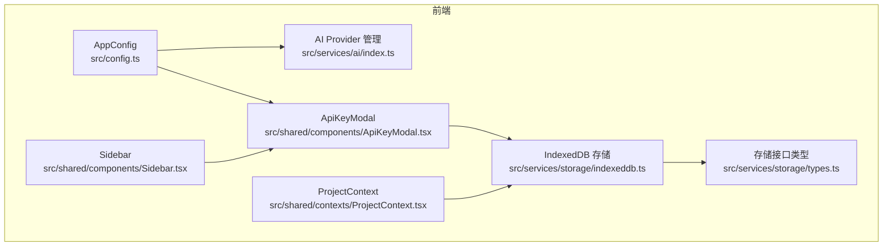
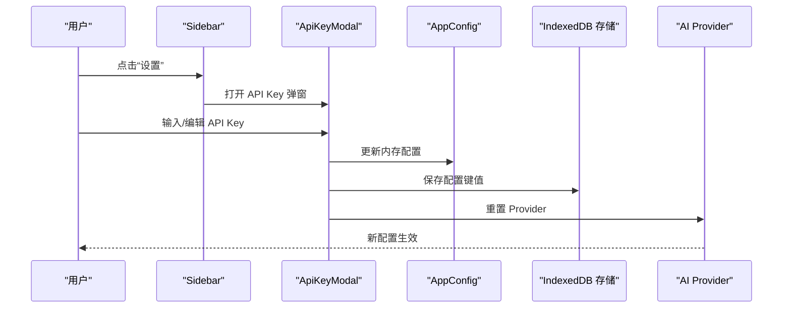
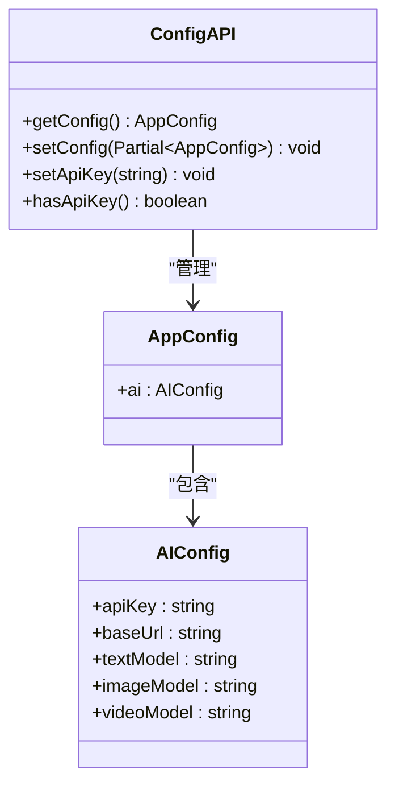
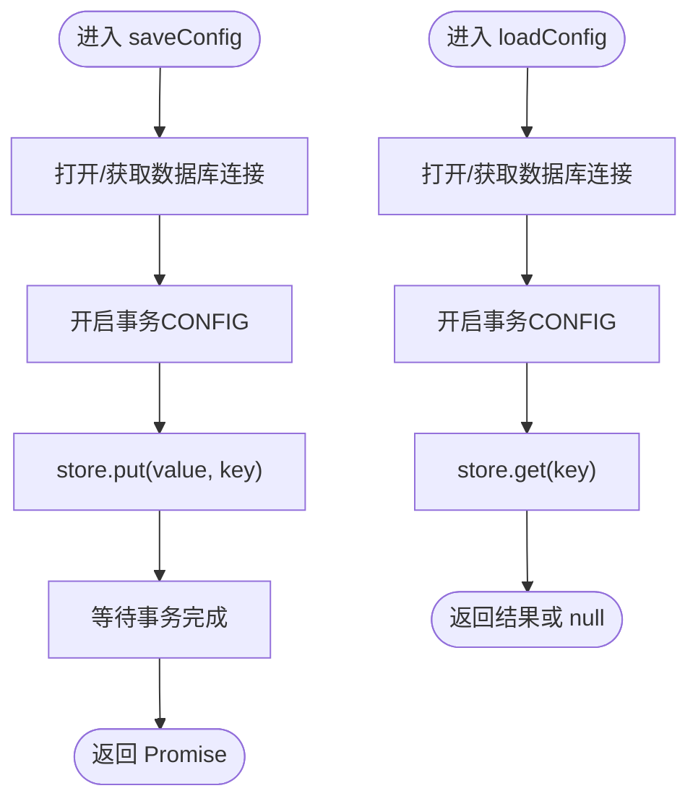
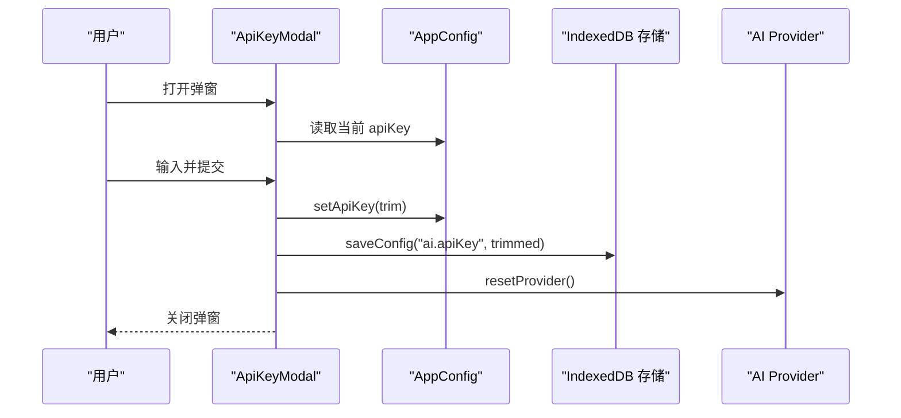
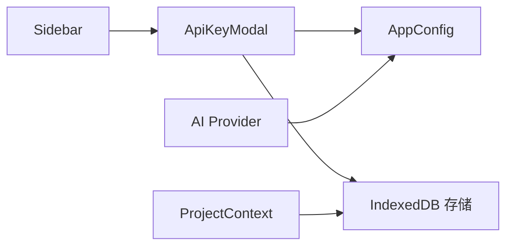

# 用户偏好路由

<cite>
**本文引用的文件**
- [src/config.ts](file://src/config.ts)
- [src/services/storage/indexeddb.ts](file://src/services/storage/indexeddb.ts)
- [src/services/storage/types.ts](file://src/services/storage/types.ts)
- [src/shared/components/ApiKeyModal.tsx](file://src/shared/components/ApiKeyModal.tsx)
- [src/shared/components/Sidebar.tsx](file://src/shared/components/Sidebar.tsx)
- [src/services/ai/index.ts](file://src/services/ai/index.ts)
- [src/shared/contexts/ProjectContext.tsx](file://src/shared/contexts/ProjectContext.tsx)
</cite>

## 目录
1. [简介](#简介)
2. [项目结构](#项目结构)
3. [核心组件](#核心组件)
4. [架构总览](#架构总览)
5. [详细组件分析](#详细组件分析)
6. [依赖关系分析](#依赖关系分析)
7. [性能考量](#性能考量)
8. [故障排查指南](#故障排查指南)
9. [结论](#结论)
10. [附录](#附录)

## 简介
本文件聚焦“用户偏好路由”模块，围绕用户设置、个性化配置与偏好管理展开，系统性说明以下内容：
- 偏好数据结构与默认值管理
- 偏好验证与持久化策略
- 配置同步与跨设备一致性
- 数据迁移与兼容性处理
- 偏好配置示例与管理流程

该模块以“配置驱动、不硬编码”的控制论思想为核心，通过前端本地存储（IndexedDB）与全局配置管理（AppConfig）实现用户偏好的加载、保存与传播。

## 项目结构
用户偏好路由涉及的关键文件与职责如下：
- 配置与默认值：src/config.ts
- 本地存储与配置键值：src/services/storage/indexeddb.ts、src/services/storage/types.ts
- 偏好界面与交互：src/shared/components/ApiKeyModal.tsx、src/shared/components/Sidebar.tsx
- AI Provider重置与偏好生效：src/services/ai/index.ts
- 项目上下文与自动持久化：src/shared/contexts/ProjectContext.tsx

图表来源
- [src/config.ts:1-47](file://src/config.ts#L1-L47)
- [src/services/storage/indexeddb.ts:1-190](file://src/services/storage/indexeddb.ts#L1-L190)
- [src/services/storage/types.ts:1-31](file://src/services/storage/types.ts#L1-L31)
- [src/shared/components/ApiKeyModal.tsx:1-114](file://src/shared/components/ApiKeyModal.tsx#L1-L114)
- [src/shared/components/Sidebar.tsx:178-214](file://src/shared/components/Sidebar.tsx#L178-L214)
- [src/services/ai/index.ts:1-34](file://src/services/ai/index.ts#L1-L34)
- [src/shared/contexts/ProjectContext.tsx:1-51](file://src/shared/contexts/ProjectContext.tsx#L1-L51)

章节来源
- [src/config.ts:1-47](file://src/config.ts#L1-L47)
- [src/services/storage/indexeddb.ts:1-190](file://src/services/storage/indexeddb.ts#L1-L190)
- [src/services/storage/types.ts:1-31](file://src/services/storage/types.ts#L1-L31)
- [src/shared/components/ApiKeyModal.tsx:1-114](file://src/shared/components/ApiKeyModal.tsx#L1-L114)
- [src/shared/components/Sidebar.tsx:178-214](file://src/shared/components/Sidebar.tsx#L178-L214)
- [src/services/ai/index.ts:1-34](file://src/services/ai/index.ts#L1-L34)
- [src/shared/contexts/ProjectContext.tsx:1-51](file://src/shared/contexts/ProjectContext.tsx#L1-L51)

## 核心组件
- AppConfig 与默认值
  - 定义了应用级偏好结构（如 AI 提供商相关参数），并提供获取与更新函数。
  - 默认值集中管理，确保首次使用时具备合理初始状态。
- IndexedDB 存储与配置键值
  - 统一的存储接口与对象存储分区，其中 CONFIG 分区用于存放键值型配置。
  - 提供 saveConfig/loadConfig 的异步读写能力，保证偏好持久化。
- 偏好界面与交互
  - ApiKeyModal 负责 API Key 的输入、可见性切换与保存。
  - Sidebar 展示 API Key 配置状态与存档状态，触发偏好弹窗。
- AI Provider 重置
  - 当偏好变更（如 API Key）生效时，重置 Provider，确保后续调用使用新配置。
- 项目上下文与自动持久化
  - 项目数据自动持久化，体现“单一可信数据源 + 自动持久化”的控制论原则，为偏好同步提供参考模式。

章节来源
- [src/config.ts:6-46](file://src/config.ts#L6-L46)
- [src/services/storage/indexeddb.ts:171-185](file://src/services/storage/indexeddb.ts#L171-L185)
- [src/services/storage/types.ts:15-30](file://src/services/storage/types.ts#L15-L30)
- [src/shared/components/ApiKeyModal.tsx:17-47](file://src/shared/components/ApiKeyModal.tsx#L17-L47)
- [src/services/ai/index.ts:31-33](file://src/services/ai/index.ts#L31-L33)
- [src/shared/contexts/ProjectContext.tsx:45-51](file://src/shared/contexts/ProjectContext.tsx#L45-L51)

## 架构总览
用户偏好路由采用“配置中心 + 本地存储 + UI 弹窗 + Provider 重置”的闭环设计：
- 配置中心：AppConfig 提供默认值与更新入口
- 本地存储：IndexedDB CONFIG 分区保存键值型偏好
- UI 弹窗：ApiKeyModal 负责输入与保存
- 生效机制：保存后重置 Provider，使新配置立即生效

图表来源
- [src/shared/components/Sidebar.tsx:182-211](file://src/shared/components/Sidebar.tsx#L182-L211)
- [src/shared/components/ApiKeyModal.tsx:22-47](file://src/shared/components/ApiKeyModal.tsx#L22-L47)
- [src/config.ts:28-42](file://src/config.ts#L28-L42)
- [src/services/storage/indexeddb.ts:171-185](file://src/services/storage/indexeddb.ts#L171-L185)
- [src/services/ai/index.ts:31-33](file://src/services/ai/index.ts#L31-L33)

## 详细组件分析

### 组件A：AppConfig 与默认值管理
- 数据结构
  - ai 字段包含 apiKey、baseUrl、textModel、imageModel、videoModel 等键。
- 默认值
  - 在 DEFAULT_CONFIG 中集中定义，避免硬编码。
- 更新策略
  - setConfig 支持部分更新，内部进行深合并（对象层级合并）。
  - setApiKey 提供便捷更新入口。
- 验证建议
  - 建议在 setConfig 前增加字段校验（如长度、格式），并在 UI 层提示错误。

图表来源
- [src/config.ts:6-46](file://src/config.ts#L6-L46)

章节来源
- [src/config.ts:6-46](file://src/config.ts#L6-L46)

### 组件B：IndexedDB 存储与配置键值
- 对象存储分区
  - PROJECTS、ASSETS、CONFIG 三类分区，CONFIG 专门用于键值型配置。
- 接口契约
  - saveConfig(key, value)、loadConfig<T>(key) 提供统一读写。
- 版本与升级
  - 通过 onupgradeneeded 初始化对象存储，避免重复创建。
  - onversionchange 监听版本变化，主动关闭数据库以避免锁库。
- 错误处理
  - 封装 IDBRequest 为 Promise，统一 onerror/onabort/oncomplete 处理。

图表来源
- [src/services/storage/indexeddb.ts:27-78](file://src/services/storage/indexeddb.ts#L27-L78)
- [src/services/storage/indexeddb.ts:171-185](file://src/services/storage/indexeddb.ts#L171-L185)

章节来源
- [src/services/storage/indexeddb.ts:13-78](file://src/services/storage/indexeddb.ts#L13-L78)
- [src/services/storage/indexeddb.ts:171-185](file://src/services/storage/indexeddb.ts#L171-L185)
- [src/services/storage/types.ts:15-30](file://src/services/storage/types.ts#L15-L30)

### 组件C：ApiKeyModal 与偏好交互
- 生命周期
  - 打开时从 AppConfig 读取当前值，支持显示/隐藏密码。
- 保存流程
  - trim 后更新 AppConfig，并持久化到 IndexedDB CONFIG 分区。
  - 调用 resetProvider 使新配置立即生效。
- 状态反馈
  - 保存中禁用按钮，成功后关闭弹窗。

图表来源
- [src/shared/components/ApiKeyModal.tsx:22-47](file://src/shared/components/ApiKeyModal.tsx#L22-L47)
- [src/config.ts:40-42](file://src/config.ts#L40-L42)
- [src/services/storage/indexeddb.ts:171-185](file://src/services/storage/indexeddb.ts#L171-L185)
- [src/services/ai/index.ts:31-33](file://src/services/ai/index.ts#L31-L33)

章节来源
- [src/shared/components/ApiKeyModal.tsx:17-47](file://src/shared/components/ApiKeyModal.tsx#L17-L47)
- [src/config.ts:40-42](file://src/config.ts#L40-L42)
- [src/services/storage/indexeddb.ts:171-185](file://src/services/storage/indexeddb.ts#L171-L185)
- [src/services/ai/index.ts:31-33](file://src/services/ai/index.ts#L31-L33)

### 组件D：Sidebar 与偏好入口
- 角色
  - 在底部展示“设置”入口，指示 API Key 配置状态（已配置/未配置）。
  - 与 ApiKeyModal 协作，打开/关闭弹窗并刷新状态。
- 体验
  - 使用颜色与图标直观表达配置状态与存档状态。

章节来源
- [src/shared/components/Sidebar.tsx:178-214](file://src/shared/components/Sidebar.tsx#L178-L214)

### 组件E：AI Provider 重置与偏好生效
- 设计
  - Provider 单例缓存，resetProvider 清空缓存，下次访问时重建。
- 作用
  - 确保 API Key 等偏好变更后，后续调用使用最新配置。

章节来源
- [src/services/ai/index.ts:22-33](file://src/services/ai/index.ts#L22-L33)

### 组件F：项目上下文与自动持久化（参考模式）
- 设计要点
  - 单一可信数据源（Project）+ 自动持久化（IndexedDB，带防抖）。
- 对偏好同步的启示
  - 偏好可借鉴此模式：在内存中维护 AppConfig，结合本地存储实现持久化与跨会话恢复。

章节来源
- [src/shared/contexts/ProjectContext.tsx:45-51](file://src/shared/contexts/ProjectContext.tsx#L45-L51)

## 依赖关系分析
- 组件耦合
  - ApiKeyModal 依赖 AppConfig 与 IndexedDB 存储；Sidebar 依赖 ApiKeyModal 的开关。
  - AI Provider 与 AppConfig 解耦，通过 resetProvider 实现弱绑定。
- 外部依赖
  - IndexedDB 浏览器原生 API；fetch 重试逻辑在 AI 适配层实现。
- 潜在循环依赖
  - 当前模块无明显循环依赖；若扩展更多偏好键值，需避免在存储层引入 UI 依赖。

图表来源
- [src/shared/components/ApiKeyModal.tsx:6-8](file://src/shared/components/ApiKeyModal.tsx#L6-L8)
- [src/shared/components/Sidebar.tsx:205-211](file://src/shared/components/Sidebar.tsx#L205-L211)
- [src/services/ai/index.ts:24-29](file://src/services/ai/index.ts#L24-L29)
- [src/shared/contexts/ProjectContext.tsx:17](file://src/shared/contexts/ProjectContext.tsx#L17)

章节来源
- [src/shared/components/ApiKeyModal.tsx:6-8](file://src/shared/components/ApiKeyModal.tsx#L6-L8)
- [src/shared/components/Sidebar.tsx:205-211](file://src/shared/components/Sidebar.tsx#L205-L211)
- [src/services/ai/index.ts:24-29](file://src/services/ai/index.ts#L24-L29)
- [src/shared/contexts/ProjectContext.tsx:17](file://src/shared/contexts/ProjectContext.tsx#L17)

## 性能考量
- IndexedDB 写入
  - 使用事务批量写入，避免频繁 IO；读写分离（CONFIG 分区）降低锁冲突。
- 防抖与去抖
  - 参考项目上下文的防抖策略，可在偏好保存时加入防抖，减少频繁写入。
- Provider 缓存
  - Provider 单例缓存减少初始化成本；必要时通过 resetProvider 切换配置。

## 故障排查指南
- 无法打开 IndexedDB
  - 检查浏览器是否支持 IndexedDB；确认 onupgradeneeded 是否正确创建对象存储。
- 保存失败
  - 核对事务 onerror/onabort 回调，定位具体错误码；检查键名与类型。
- 配置未生效
  - 确认是否调用 resetProvider；检查 AppConfig 更新链路是否被覆盖。
- UI 状态不同步
  - 确认 Sidebar 与 ApiKeyModal 的状态同步逻辑；检查 hasApiKey 的调用时机。

章节来源
- [src/services/storage/indexeddb.ts:34-42](file://src/services/storage/indexeddb.ts#L34-L42)
- [src/services/storage/indexeddb.ts:94-99](file://src/services/storage/indexeddb.ts#L94-L99)
- [src/services/ai/index.ts:31-33](file://src/services/ai/index.ts#L31-L33)
- [src/shared/components/ApiKeyModal.tsx:36-47](file://src/shared/components/ApiKeyModal.tsx#L36-L47)

## 结论
用户偏好路由以 AppConfig 为中心，结合 IndexedDB 的键值存储与 ApiKeyModal 的交互，实现了“可配置、可持久、可生效”的偏好管理体系。通过 Provider 重置与 UI 状态联动，确保用户修改即时生效。建议后续在偏好键值扩展时，延续“配置驱动、不硬编码”的原则，并完善验证与迁移机制。

## 附录

### 偏好数据结构与默认值
- 结构
  - ai: { apiKey, baseUrl, textModel, imageModel, videoModel }
- 默认值
  - 在 DEFAULT_CONFIG 中集中定义，避免硬编码。

章节来源
- [src/config.ts:16-24](file://src/config.ts#L16-L24)

### 偏好验证建议
- 输入清理：trim、长度限制、格式校验（如 API Key 前缀）。
- 类型约束：在 setConfig 前进行类型与范围校验。
- UI 反馈：在 ApiKeyModal 中提供实时校验提示。

章节来源
- [src/shared/components/ApiKeyModal.tsx:36-47](file://src/shared/components/ApiKeyModal.tsx#L36-L47)
- [src/config.ts:32-38](file://src/config.ts#L32-L38)

### 配置同步与多设备
- 同步策略
  - 当前实现为本地存储（IndexedDB），不跨设备同步。
  - 若需多设备同步，建议引入后端配置服务与加密传输，并在本地保留缓存与冲突解决策略。
- 迁移与兼容
  - 新增偏好键时，提供默认值回退；旧版本配置可通过迁移脚本补齐缺失键。

章节来源
- [src/services/storage/indexeddb.ts:44-61](file://src/services/storage/indexeddb.ts#L44-L61)

### 偏好配置示例与管理流程
- 示例
  - 设置 API Key：在 Sidebar 打开 ApiKeyModal，输入并保存。
  - 查看状态：Sidebar 底部显示“已配置/未配置”。
- 流程
  - 读取 -> 更新 -> 持久化 -> 重置 Provider -> 生效。

章节来源
- [src/shared/components/Sidebar.tsx:182-211](file://src/shared/components/Sidebar.tsx#L182-L211)
- [src/shared/components/ApiKeyModal.tsx:22-47](file://src/shared/components/ApiKeyModal.tsx#L22-L47)
- [src/services/ai/index.ts:31-33](file://src/services/ai/index.ts#L31-L33)