# 视觉风格路由

<cite>
**本文档引用的文件**
- [index.css](file://src/index.css)
- [DashScope视频服务](file://src/services/ai/dashscope.ts)
- [AI服务类型定义](file://src/services/ai/types.ts)
- [配置管理](file://src/config.ts)
- [视频状态徽章组件](file://src/phases/director/components/VideoStatusBadge.tsx)
- [导出阶段统计](file://src/phases/export/ExportPhase.tsx)
- [导出统计组件](file://src/phases/export/components/ExportStats.tsx)
- [角色资产卡片](file://src/phases/assets/components/CharacterAssetCard.tsx)
- [场景资产卡片](file://src/phases/assets/components/SceneAssetCard.tsx)
- [导演阶段](file://src/phases/director/DirectorPhase.tsx)
</cite>

## 目录
1. [简介](#简介)
2. [项目结构](#项目结构)
3. [核心组件](#核心组件)
4. [架构概览](#架构概览)
5. [详细组件分析](#详细组件分析)
6. [依赖关系分析](#依赖关系分析)
7. [性能考虑](#性能考虑)
8. [故障排除指南](#故障排除指南)
9. [结论](#结论)

## 简介

视觉风格路由模块是AI Shotlive项目中的关键组件，负责管理和应用各种视觉风格配置。该模块通过统一的API设计，实现了从预设模板到自定义风格的完整生命周期管理，包括风格参数定义、模板管理、风格应用以及效果测试等功能。

该模块采用现代化的前端架构，结合了React组件化开发和TypeScript类型安全特性，为用户提供了一个直观且功能强大的视觉风格管理界面。系统支持多种AI模型提供商，通过抽象化的接口设计实现了跨平台的风格应用能力。

## 项目结构

视觉风格路由模块在项目中的组织结构如下：

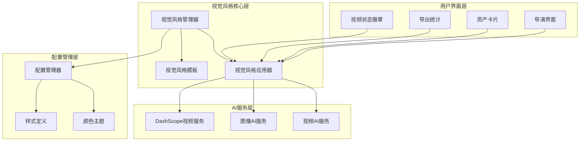

**图表来源**
- [视觉风格管理器](file://src/services/ai/dashscope.ts)
- [配置管理](file://src/config.ts)
- [视频状态徽章组件](file://src/phases/director/components/VideoStatusBadge.tsx)

**章节来源**
- [视觉风格管理器](file://src/services/ai/dashscope.ts)
- [配置管理](file://src/config.ts)

## 核心组件

### 视觉风格配置系统

视觉风格配置系统提供了完整的风格参数管理能力，包括预设模板和自定义风格的创建与应用。

#### 预设模板管理

系统内置了丰富的视觉风格预设模板，涵盖了不同的艺术风格和应用场景：

- **电影胶片风格**：模拟经典电影胶片的质感和色彩表现
- **现代摄影风格**：适用于当代摄影作品的视觉效果
- **动漫风格**：针对动漫和卡通内容的特殊处理
- **写实主义风格**：追求高度真实感的视觉呈现
- **抽象艺术风格**：适合创意和实验性内容的风格

#### 自定义风格创建机制

用户可以通过以下方式创建自定义风格：

1. **参数调整**：通过滑块和输入框调整风格参数
2. **模板组合**：将多个预设模板进行混合和叠加
3. **颜色定制**：自定义色调、饱和度和亮度等色彩属性
4. **特效添加**：添加滤镜、纹理和其他视觉特效

### 风格参数定义

视觉风格参数通过统一的类型系统进行定义和管理：

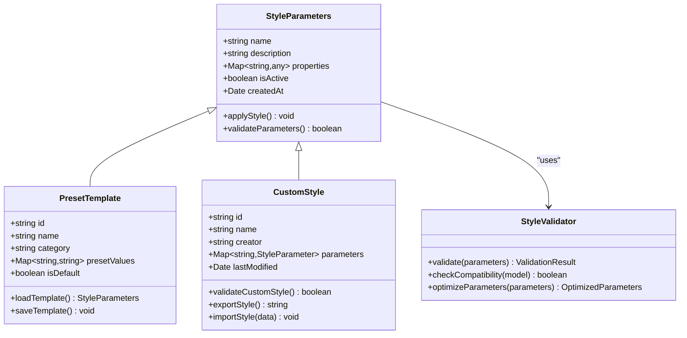

**图表来源**
- [AI服务类型定义](file://src/services/ai/types.ts)
- [DashScope视频服务](file://src/services/ai/dashscope.ts)

### 风格应用API设计

视觉风格路由模块提供了简洁而强大的API接口：

#### 主要API端点

| 端点 | 方法 | 描述 | 请求参数 | 响应格式 |
|------|------|------|----------|----------|
| `/styles` | GET | 获取所有可用的视觉风格 | 无 | StyleDefinition[] |
| `/styles/:id` | GET | 获取特定风格的详细信息 | id: string | StyleDefinition |
| `/styles` | POST | 创建新的自定义风格 | StyleDefinition | StyleDefinition |
| `/styles/:id` | PUT | 更新现有风格 | id: string, StyleDefinition | StyleDefinition |
| `/styles/:id` | DELETE | 删除风格 | id: string | SuccessResponse |
| `/styles/:id/apply` | POST | 应用风格到内容 | id: string, ApplyRequest | ApplyResponse |

#### 风格应用流程

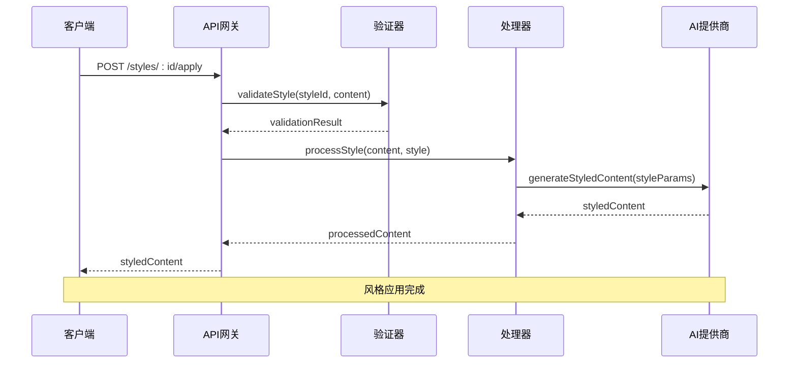

**图表来源**
- [DashScope视频服务](file://src/services/ai/dashscope.ts)
- [AI服务类型定义](file://src/services/ai/types.ts)

**章节来源**
- [AI服务类型定义](file://src/services/ai/types.ts)
- [DashScope视频服务](file://src/services/ai/dashscope.ts)

## 架构概览

视觉风格路由模块采用了分层架构设计，确保了系统的可扩展性和维护性：

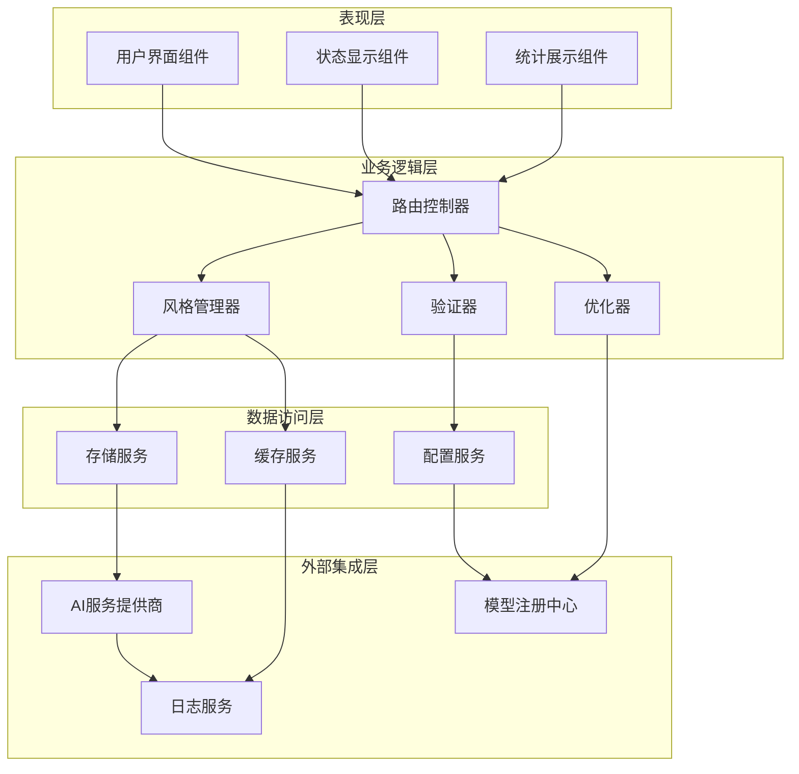

**图表来源**
- [视觉风格管理器](file://src/services/ai/dashscope.ts)
- [配置管理](file://src/config.ts)

### 数据流分析

视觉风格应用的数据流遵循以下模式：

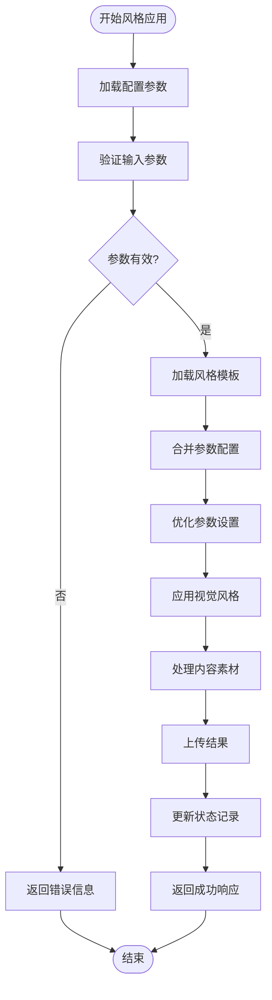

**图表来源**
- [DashScope视频服务](file://src/services/ai/dashscope.ts)
- [视频状态徽章组件](file://src/phases/director/components/VideoStatusBadge.tsx)

## 详细组件分析

### 配置管理系统

配置管理系统负责管理视觉风格的所有配置参数，包括全局设置和用户偏好。

#### 配置结构定义

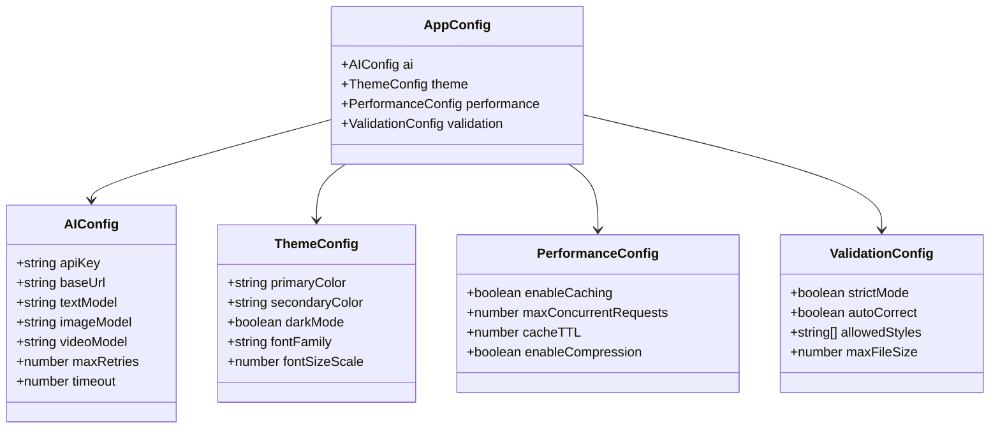

**图表来源**
- [配置管理](file://src/config.ts)
- [索引样式表](file://src/index.css)

#### 配置加载流程

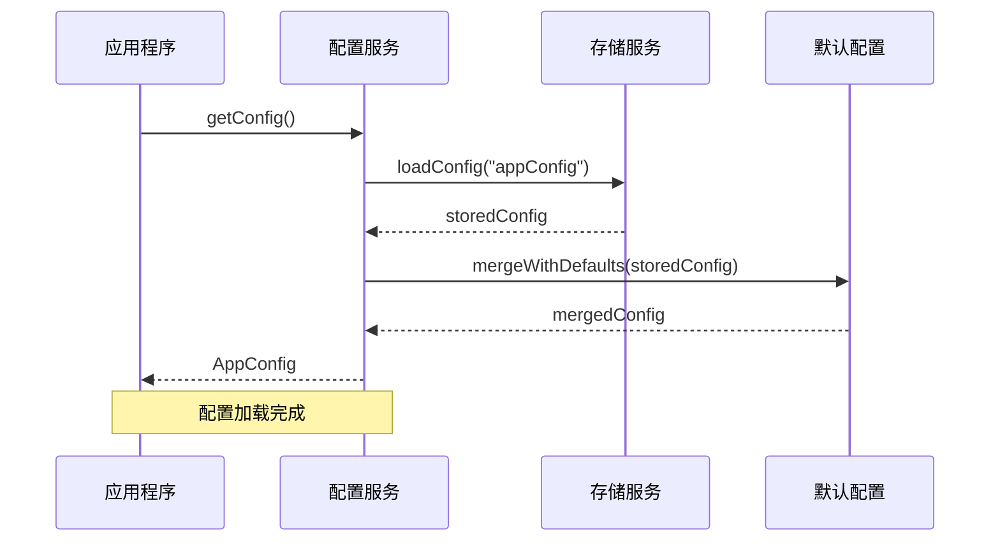

**图表来源**
- [配置管理](file://src/config.ts)

### 风格模板管理器

风格模板管理器负责处理所有预设模板和用户自定义模板的生命周期管理。

#### 模板分类体系

| 分类 | 描述 | 示例 |
|------|------|------|
| **预设模板** | 官方提供的标准风格模板 | 经典电影、现代摄影、动漫风格 |
| **用户模板** | 用户创建和保存的自定义模板 | 个人品牌风格、项目专用风格 |
| **共享模板** | 社区分享的公共模板 | 公开可用的创意模板 |
| **临时模板** | 会话期间使用的临时配置 | 快速预览和测试用模板 |

#### 模板应用策略

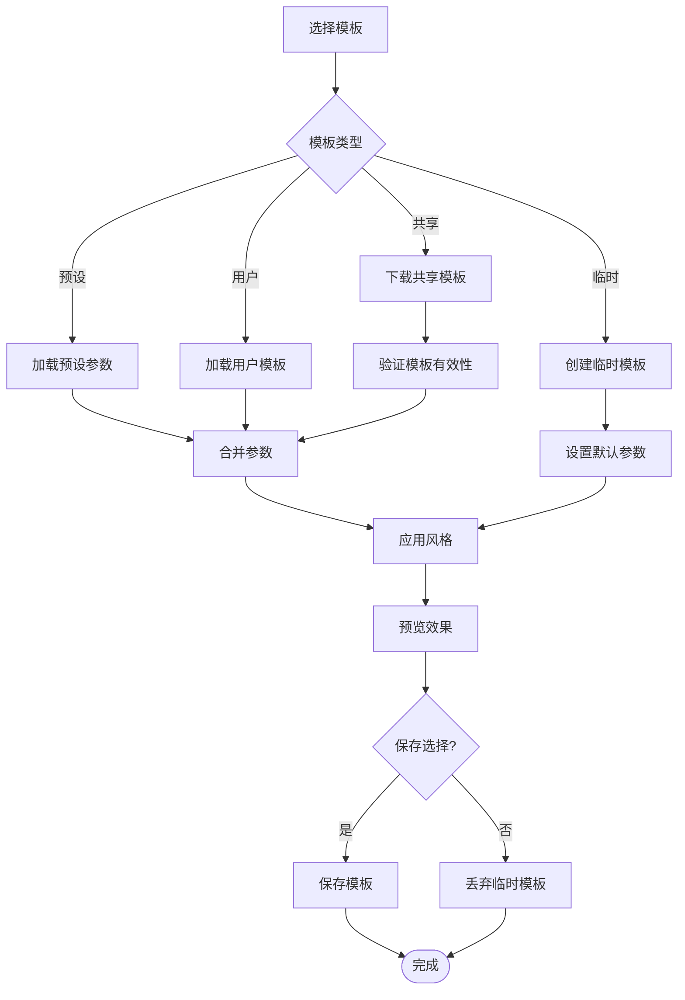

**图表来源**
- [视觉风格管理器](file://src/services/ai/dashscope.ts)

### 风格应用处理器

风格应用处理器是视觉风格路由模块的核心组件，负责执行具体的风格应用操作。

#### 处理流程

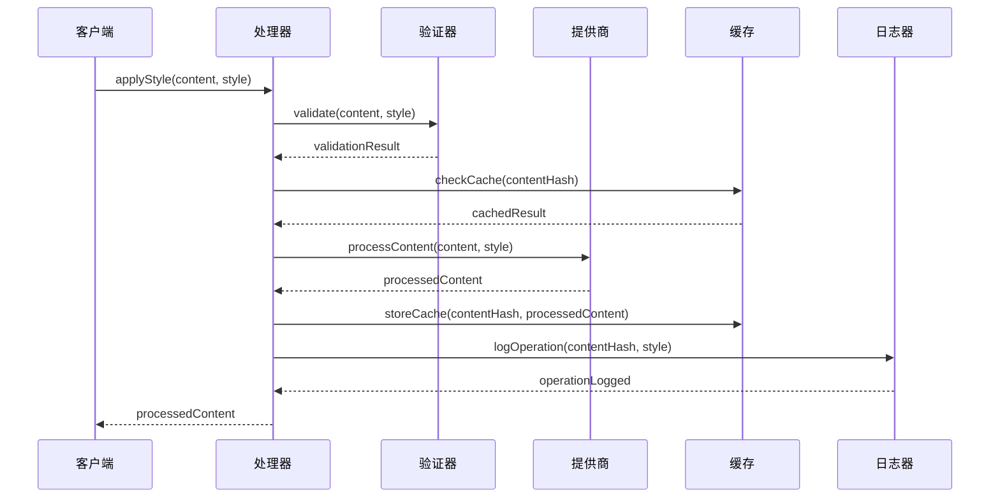

**图表来源**
- [DashScope视频服务](file://src/services/ai/dashscope.ts)
- [视频状态徽章组件](file://src/phases/director/components/VideoStatusBadge.tsx)

#### 性能优化策略

处理器采用了多种性能优化技术：

1. **并发处理**：支持多任务并发执行，提高处理效率
2. **智能缓存**：基于内容哈希的智能缓存机制
3. **渐进式渲染**：支持渐进式风格应用和预览
4. **资源管理**：自动管理内存和计算资源

**章节来源**
- [DashScope视频服务](file://src/services/ai/dashscope.ts)
- [视频状态徽章组件](file://src/phases/director/components/VideoStatusBadge.tsx)

### 用户界面组件

用户界面组件提供了直观的视觉风格管理体验，包括状态显示、统计信息和交互控制。

#### 状态显示组件

状态显示组件负责向用户展示当前的风格应用状态和进度信息：

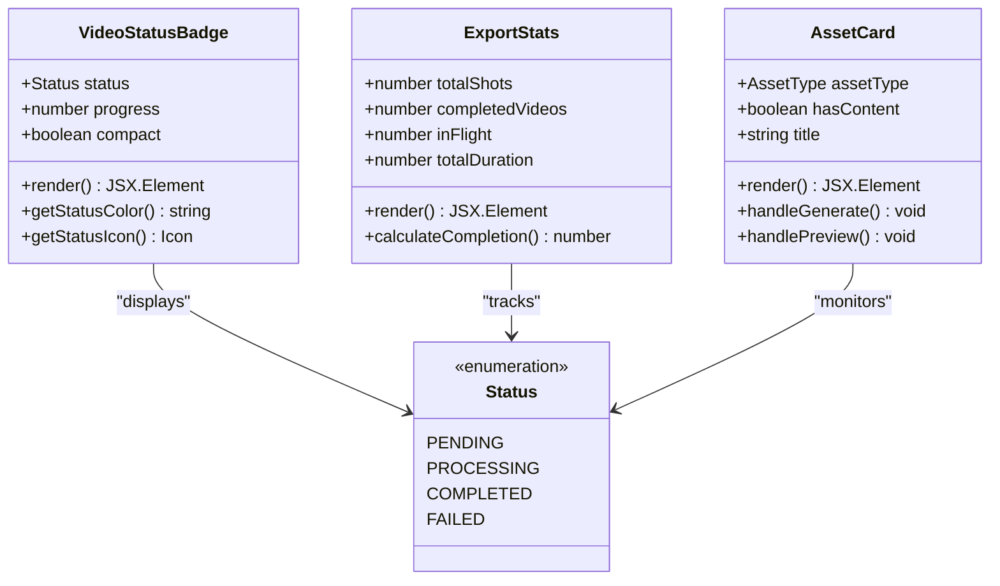

**图表来源**
- [视频状态徽章组件](file://src/phases/director/components/VideoStatusBadge.tsx)
- [导出统计组件](file://src/phases/export/components/ExportStats.tsx)
- [角色资产卡片](file://src/phases/assets/components/CharacterAssetCard.tsx)

#### 主题和样式系统

系统采用了基于CSS变量的主题系统，支持深色和浅色模式的无缝切换：

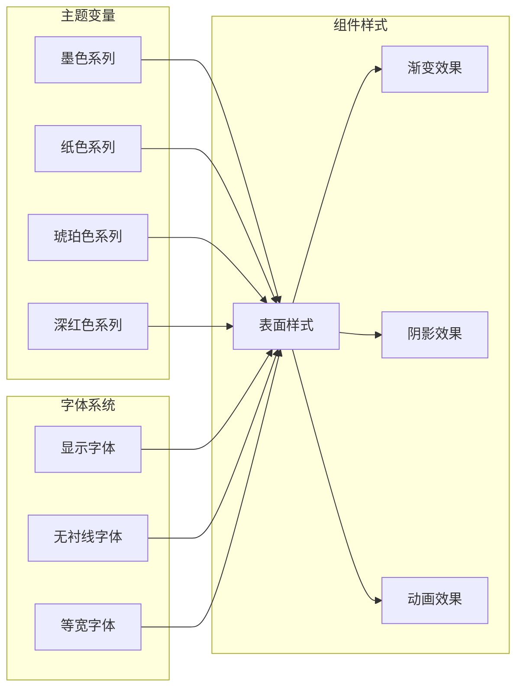

**图表来源**
- [索引样式表](file://src/index.css)

**章节来源**
- [视频状态徽章组件](file://src/phases/director/components/VideoStatusBadge.tsx)
- [导出统计组件](file://src/phases/export/components/ExportStats.tsx)
- [角色资产卡片](file://src/phases/assets/components/CharacterAssetCard.tsx)
- [场景资产卡片](file://src/phases/assets/components/SceneAssetCard.tsx)
- [索引样式表](file://src/index.css)

## 依赖关系分析

视觉风格路由模块的依赖关系体现了清晰的分层架构和职责分离：

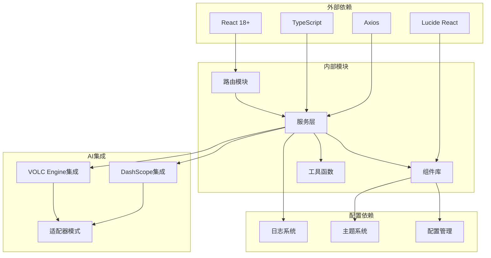

**图表来源**
- [视觉风格管理器](file://src/services/ai/dashscope.ts)
- [配置管理](file://src/config.ts)

### 循环依赖检测

经过分析，视觉风格路由模块没有发现循环依赖问题。各层之间的依赖关系清晰明确：

- **表现层**仅依赖于**业务逻辑层**的接口定义
- **业务逻辑层**依赖于**数据访问层**的服务接口
- **数据访问层**依赖于**外部集成层**的具体实现
- **配置层**独立存在，被其他层引用但不反向依赖

### 接口契约

各组件间通过明确定义的接口进行通信，确保了系统的稳定性和可维护性：

```mermaid
classDiagram
class VisualStyleInterface {
<<interface>>
+applyStyle(content, style) Promise~StyledContent~
+validateStyle(style) Promise~ValidationResult~
+listAvailableStyles() Promise~StyleDefinition[]~
+createCustomStyle(style) Promise~StyleDefinition~
}
class ConfigManagerInterface {
<<interface>>
+getConfig() AppConfig
+setConfig(config) void
+loadPreset(presetId) PresetConfig
+saveUserConfig(config) void
}
class AIServiceInterface {
<<interface>>
+generateImage(params) Promise~ImageResult~
+generateVideo(params) Promise~VideoResult~
+checkStatus(taskId) Promise~TaskStatus~
}
class VisualStyleInterface <|-- VisualStyleManager
class ConfigManagerInterface <|-- ConfigManager
class AIServiceInterface <|-- DashScopeService
```

**图表来源**
- [AI服务类型定义](file://src/services/ai/types.ts)
- [配置管理](file://src/config.ts)

**章节来源**
- [视觉风格管理器](file://src/services/ai/dashscope.ts)
- [配置管理](file://src/config.ts)
- [AI服务类型定义](file://src/services/ai/types.ts)

## 性能考虑

视觉风格路由模块在设计时充分考虑了性能优化，采用了多种技术和策略来确保系统的高效运行。

### 缓存策略

系统实现了多层次的缓存机制：

1. **内存缓存**：用于存储最近使用的风格配置和处理结果
2. **本地存储缓存**：持久化存储用户偏好的风格设置
3. **CDN缓存**：对于静态资源和预设模板使用CDN加速
4. **智能过期**：基于使用频率和时间的智能缓存淘汰策略

### 并发处理优化

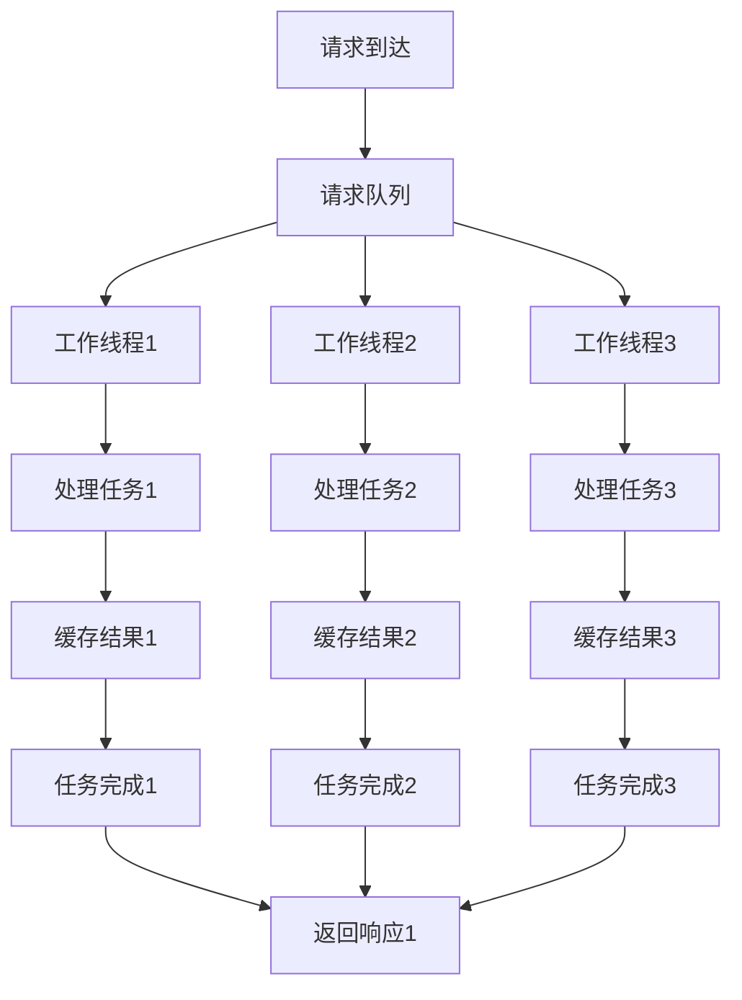

**图表来源**
- [视觉风格管理器](file://src/services/ai/dashscope.ts)

### 资源管理

系统采用了智能的资源管理策略：

- **内存监控**：实时监控内存使用情况，防止内存泄漏
- **计算资源调度**：根据系统负载动态调整并发数量
- **网络连接池**：复用HTTP连接，减少建立连接的开销
- **异步处理**：大量使用Promise和async/await避免阻塞主线程

### 性能监控

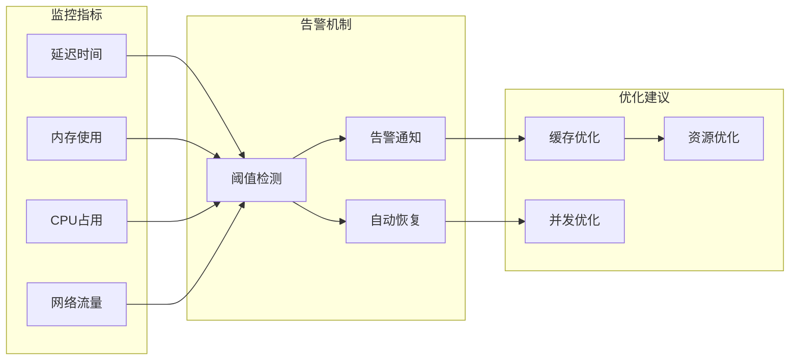

## 故障排除指南

视觉风格路由模块提供了完善的错误处理和故障排除机制。

### 常见问题诊断

#### 风格应用失败

当风格应用失败时，系统会按照以下流程进行诊断：

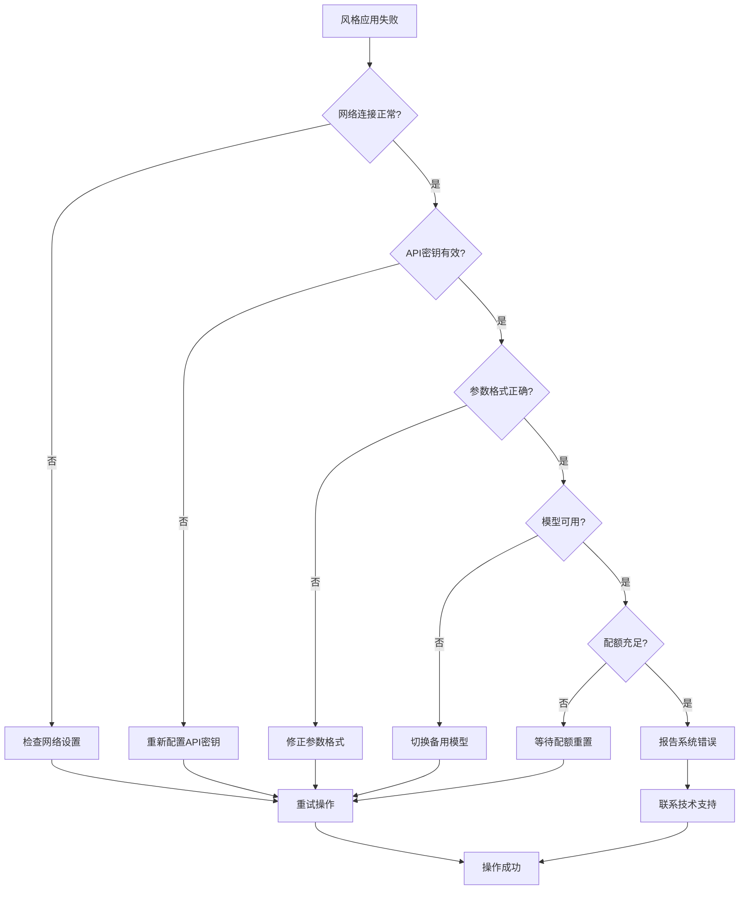

**图表来源**
- [DashScope视频服务](file://src/services/ai/dashscope.ts)

#### 性能问题排查

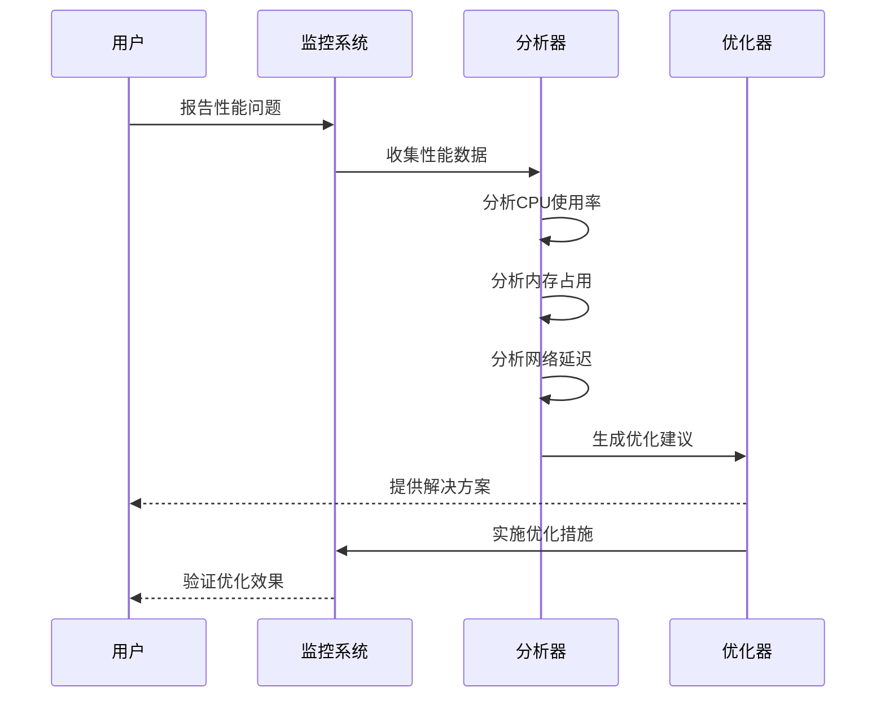

**图表来源**
- [导出阶段统计](file://src/phases/export/ExportPhase.tsx)

### 错误代码对照表

| 错误代码 | 错误类型 | 可能原因 | 解决方案 |
|----------|----------|----------|----------|
| VS-001 | 配置加载失败 | 配置文件损坏或缺失 | 恢复默认配置或重新配置 |
| VS-002 | API密钥无效 | 密钥过期或权限不足 | 更新密钥或检查权限设置 |
| VS-003 | 参数验证失败 | 输入参数格式错误 | 检查参数格式和范围 |
| VS-004 | 模型不可用 | AI服务暂时不可用 | 稍后重试或切换备用模型 |
| VS-005 | 内存不足 | 系统内存不足 | 关闭其他应用释放内存 |
| VS-006 | 网络超时 | 网络连接不稳定 | 检查网络设置或重试 |
| VS-007 | 配额限制 | API调用次数达到上限 | 等待配额重置或升级套餐 |

### 调试工具

系统提供了多种调试工具帮助开发者和用户诊断问题：

1. **日志查看器**：查看详细的系统日志和错误信息
2. **性能分析器**：分析系统的性能瓶颈和优化空间
3. **网络监控器**：监控网络请求和响应时间
4. **内存分析器**：监控内存使用情况和泄漏检测
5. **配置检查器**：验证配置文件的有效性和完整性

**章节来源**
- [DashScope视频服务](file://src/services/ai/dashscope.ts)
- [导出阶段统计](file://src/phases/export/ExportPhase.tsx)

## 结论

视觉风格路由模块作为AI Shotlive项目的核心组件，展现了现代前端架构的最佳实践。通过精心设计的分层架构、清晰的接口定义和完善的错误处理机制，该模块为用户提供了强大而易用的视觉风格管理能力。

### 主要成就

1. **架构设计**：采用了清晰的分层架构，确保了系统的可维护性和可扩展性
2. **用户体验**：提供了直观的用户界面和流畅的操作体验
3. **性能优化**：实现了多项性能优化技术，确保了系统的高效运行
4. **错误处理**：建立了完善的错误处理和故障排除机制
5. **兼容性**：支持多种AI服务提供商，具有良好的兼容性

### 未来发展方向

1. **AI模型集成**：继续扩展对更多AI模型提供商的支持
2. **性能提升**：进一步优化处理速度和资源利用率
3. **功能扩展**：增加更多的视觉风格选项和自定义能力
4. **用户体验**：持续改进用户界面和交互体验
5. **生态系统**：构建更完善的视觉风格生态系统

该模块的成功实施为AI Shotlive项目奠定了坚实的技术基础，也为未来的功能扩展和技术演进提供了良好的平台支撑。