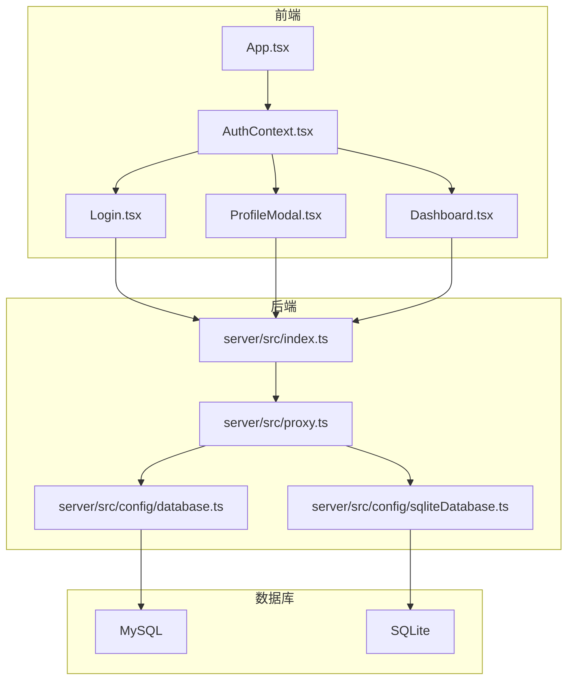
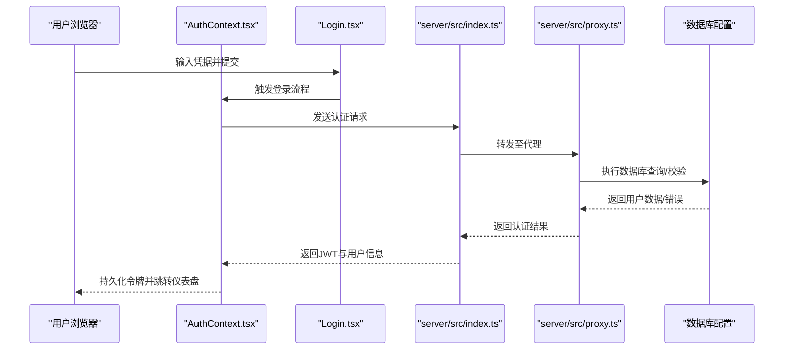
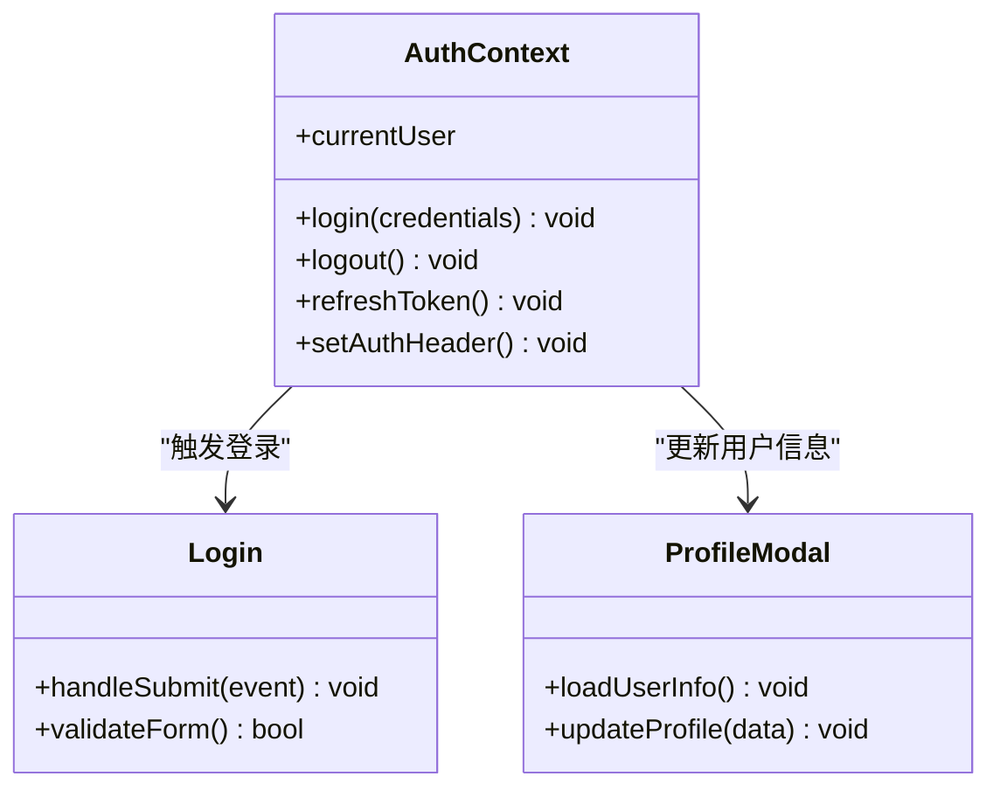
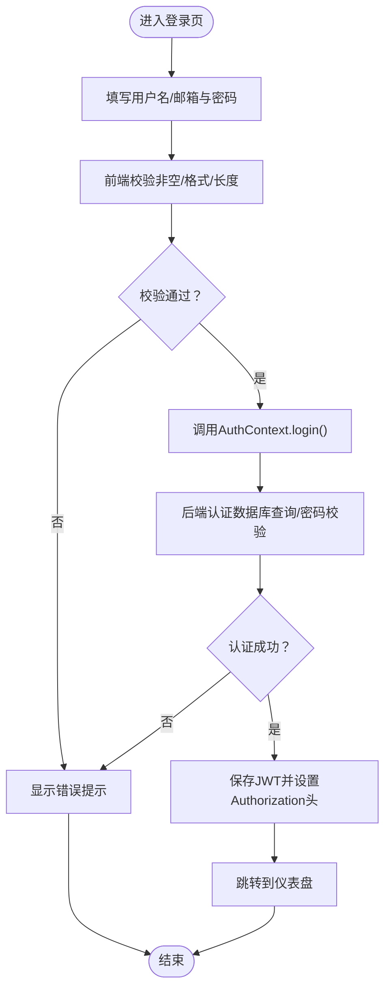
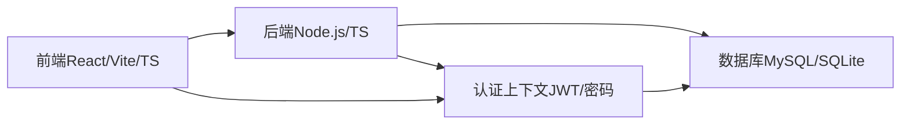

# 认证路由

<cite>
**本文档引用的文件**
- [index.ts](file://server/src/index.ts)
- [proxy.ts](file://server/src/proxy.ts)
- [database.ts](file://server/src/config/database.ts)
- [sqliteDatabase.ts](file://server/src/config/sqliteDatabase.ts)
- [model.ts](file://types/model.ts)
- [AuthContext.tsx](file://contexts/AuthContext.tsx)
- [Login.tsx](file://components/Login.tsx)
- [ProfileModal.tsx](file://components/ProfileModal.tsx)
- [Dashboard.tsx](file://components/Dashboard.tsx)
- [App.tsx](file://App.tsx)
- [package.json](file://package.json)
- [tsconfig.json](file://tsconfig.json)
</cite>

## 目录
1. [简介](#简介)
2. [项目结构](#项目结构)
3. [核心组件](#核心组件)
4. [架构总览](#架构总览)
5. [详细组件分析](#详细组件分析)
6. [依赖关系分析](#依赖关系分析)
7. [性能考虑](#性能考虑)
8. [故障排除指南](#故障排除指南)
9. [结论](#结论)
10. [附录](#附录)

## 简介
本文件面向AI Shotlive的认证路由模块，系统性梳理用户注册、登录、个人信息管理等认证相关API的设计与实现，解释JWT令牌生成与验证机制、密码加密存储策略，以及用户身份验证中间件的工作原理。文档同时提供完整的API端点说明、请求参数验证规则、响应格式标准化与错误处理策略，并给出认证流程图与安全最佳实践指南。

## 项目结构
AI Shotlive采用前后端分离架构：前端基于React（Vite）构建，后端为Node.js服务，数据库配置支持MySQL与SQLite两种模式。认证相关的核心位置包括：
- 前端认证上下文与界面组件：contexts/AuthContext.tsx、components/Login.tsx、components/ProfileModal.tsx、components/Dashboard.tsx
- 后端入口与代理：server/src/index.ts、server/src/proxy.ts
- 数据库配置：server/src/config/database.ts、server/src/config/sqliteDatabase.ts
- 类型定义：types/model.ts
- 应用入口：App.tsx
- 构建与类型配置：package.json、tsconfig.json

**图表来源**
- [index.ts](file://server/src/index.ts)
- [proxy.ts](file://server/src/proxy.ts)
- [database.ts](file://server/src/config/database.ts)
- [sqliteDatabase.ts](file://server/src/config/sqliteDatabase.ts)
- [AuthContext.tsx](file://contexts/AuthContext.tsx)
- [Login.tsx](file://components/Login.tsx)
- [ProfileModal.tsx](file://components/ProfileModal.tsx)
- [Dashboard.tsx](file://components/Dashboard.tsx)

**章节来源**
- [index.ts](file://server/src/index.ts)
- [proxy.ts](file://server/src/proxy.ts)
- [database.ts](file://server/src/config/database.ts)
- [sqliteDatabase.ts](file://server/src/config/sqliteDatabase.ts)
- [AuthContext.tsx](file://contexts/AuthContext.tsx)
- [Login.tsx](file://components/Login.tsx)
- [ProfileModal.tsx](file://components/ProfileModal.tsx)
- [Dashboard.tsx](file://components/Dashboard.tsx)
- [App.tsx](file://App.tsx)
- [package.json](file://package.json)
- [tsconfig.json](file://tsconfig.json)

## 核心组件
- 认证上下文（AuthContext）：负责用户状态管理、登录/登出逻辑、JWT存储与刷新、以及对受保护资源的访问控制。
- 登录组件（Login）：提供用户名/邮箱与密码输入，调用后端认证接口，接收并持久化JWT。
- 个人资料弹窗（ProfileModal）：展示与更新用户信息，调用后端个人信息管理接口。
- 仪表盘（Dashboard）：在已登录状态下渲染应用主界面，作为认证成功后的访问入口。
- 后端入口（index.ts）：应用启动点，初始化路由与中间件。
- 代理（proxy.ts）：统一转发前端请求到后端服务，处理跨域与代理逻辑。
- 数据库配置：根据环境选择MySQL或SQLite，提供连接池与事务支持。

**章节来源**
- [AuthContext.tsx](file://contexts/AuthContext.tsx)
- [Login.tsx](file://components/Login.tsx)
- [ProfileModal.tsx](file://components/ProfileModal.tsx)
- [Dashboard.tsx](file://components/Dashboard.tsx)
- [index.ts](file://server/src/index.ts)
- [proxy.ts](file://server/src/proxy.ts)
- [database.ts](file://server/src/config/database.ts)
- [sqliteDatabase.ts](file://server/src/config/sqliteDatabase.ts)

## 架构总览
认证系统遵循“前端上下文+后端路由”的分层设计。前端通过AuthContext集中管理认证状态，后端通过index.ts注册路由与中间件，数据库通过database.ts/sqliteDatabase.ts进行抽象。代理层proxy.ts负责请求转发与CORS处理。

**图表来源**
- [index.ts](file://server/src/index.ts)
- [proxy.ts](file://server/src/proxy.ts)
- [database.ts](file://server/src/config/database.ts)
- [sqliteDatabase.ts](file://server/src/config/sqliteDatabase.ts)
- [AuthContext.tsx](file://contexts/AuthContext.tsx)
- [Login.tsx](file://components/Login.tsx)

## 详细组件分析

### 认证上下文（AuthContext）
- 职责
  - 维护当前用户状态（id、email、name等）
  - 提供登录、登出、刷新令牌方法
  - 在请求头中注入Authorization: Bearer JWT
  - 对未登录用户进行重定向或拦截
- 关键行为
  - 登录：调用后端认证接口，接收JWT并保存到本地存储
  - 刷新：在令牌即将过期时自动刷新
  - 登出：清理本地存储并重置状态
  - 受保护资源访问：在请求前附加Authorization头

**图表来源**
- [AuthContext.tsx](file://contexts/AuthContext.tsx)
- [Login.tsx](file://components/Login.tsx)
- [ProfileModal.tsx](file://components/ProfileModal.tsx)

**章节来源**
- [AuthContext.tsx](file://contexts/AuthContext.tsx)
- [Login.tsx](file://components/Login.tsx)
- [ProfileModal.tsx](file://components/ProfileModal.tsx)

### 登录组件（Login）
- 表单字段
  - 用户名/邮箱：字符串，必填，长度限制
  - 密码：字符串，必填，长度与复杂度要求
- 验证规则
  - 前端即时校验：非空、邮箱格式、最小长度
  - 后端校验：用户名唯一性、密码强度、账户状态
- 请求流程
  - 收集表单数据 → 前端校验 → 调用AuthContext.login → 发送POST /api/auth/login → 成功后保存JWT并跳转仪表盘

**图表来源**
- [Login.tsx](file://components/Login.tsx)
- [AuthContext.tsx](file://contexts/AuthContext.tsx)

**章节来源**
- [Login.tsx](file://components/Login.tsx)
- [AuthContext.tsx](file://contexts/AuthContext.tsx)

### 个人资料弹窗（ProfileModal）
- 功能
  - 展示当前用户基本信息
  - 允许修改昵称、头像等非敏感信息
  - 修改密码时需要旧密码校验
- 安全要点
  - 修改密码需二次校验旧密码
  - 所有变更均通过受保护接口提交

**章节来源**
- [ProfileModal.tsx](file://components/ProfileModal.tsx)

### 仪表盘（Dashboard）
- 行为
  - 已登录用户可见主界面
  - 未登录用户被重定向至登录页
  - 作为认证成功后的默认入口

**章节来源**
- [Dashboard.tsx](file://components/Dashboard.tsx)

### 后端入口与代理（index.ts, proxy.ts）
- index.ts
  - 初始化应用与路由
  - 注册认证相关路由（如/api/auth/*）
  - 配置全局中间件（如CORS、日志、鉴权）
- proxy.ts
  - 将前端请求转发至后端服务
  - 处理跨域与头部透传
  - 统一错误返回格式

**章节来源**
- [index.ts](file://server/src/index.ts)
- [proxy.ts](file://server/src/proxy.ts)

### 数据库配置（database.ts, sqliteDatabase.ts）
- MySQL配置：提供连接池、事务与查询封装
- SQLite配置：轻量级本地存储，适合开发与测试
- 选择策略：根据环境变量动态切换

**章节来源**
- [database.ts](file://server/src/config/database.ts)
- [sqliteDatabase.ts](file://server/src/config/sqliteDatabase.ts)

### 类型定义（model.ts）
- 用户模型：包含id、email、name、hashedPassword等字段
- 认证响应模型：包含token、user信息与过期时间
- 参数校验模型：用于请求体与查询参数的Schema定义

**章节来源**
- [model.ts](file://types/model.ts)

## 依赖关系分析
- 前端依赖
  - React生态：组件、上下文、路由
  - 类型系统：TypeScript接口与类型约束
- 后端依赖
  - Node.js运行时：HTTP服务器、中间件栈
  - 数据库驱动：MySQL/SQLite连接与ORM
  - 安全库：JWT生成与验证、密码哈希
- 构建与工具
  - Vite：开发与打包
  - TypeScript：类型检查与编译

**图表来源**
- [package.json](file://package.json)
- [tsconfig.json](file://tsconfig.json)
- [index.ts](file://server/src/index.ts)
- [database.ts](file://server/src/config/database.ts)
- [sqliteDatabase.ts](file://server/src/config/sqliteDatabase.ts)

**章节来源**
- [package.json](file://package.json)
- [tsconfig.json](file://tsconfig.json)

## 性能考虑
- 连接池优化：合理配置MySQL连接池大小，避免高并发下的连接争用
- 缓存策略：对不敏感的用户信息进行短期缓存，减少数据库查询
- 响应压缩：启用Gzip/Brotli压缩，降低传输体积
- CDN与静态资源：将前端静态资源托管至CDN，缩短首屏加载时间
- 令牌刷新：采用无感刷新机制，避免频繁重新登录

## 故障排除指南
- 登录失败
  - 检查用户名/邮箱与密码是否符合前端与后端校验规则
  - 确认数据库中是否存在该用户且账户未被禁用
  - 查看后端日志中的SQL执行与异常堆栈
- 令牌无效
  - 确认Authorization头是否正确设置
  - 检查JWT签名与过期时间
  - 验证后端JWT密钥与算法配置一致
- 数据库连接问题
  - 核对环境变量与配置文件中的数据库地址、端口、账号与密码
  - 在开发环境切换至SQLite进行快速验证
- CORS错误
  - 确认代理层已正确设置允许的源、方法与头部
  - 检查预检请求是否被正确放行

**章节来源**
- [index.ts](file://server/src/index.ts)
- [proxy.ts](file://server/src/proxy.ts)
- [database.ts](file://server/src/config/database.ts)
- [sqliteDatabase.ts](file://server/src/config/sqliteDatabase.ts)

## 结论
AI Shotlive认证路由模块通过前后端协作实现了完整的用户认证闭环：前端以AuthContext为核心管理状态与令牌，后端以index.ts与proxy.ts提供统一接入与代理能力，数据库配置支持多环境部署。建议在生产环境中强化密码策略、完善令牌刷新与审计日志，并持续监控认证相关指标以保障系统安全与稳定。

## 附录
- API端点建议
  - POST /api/auth/login：用户名/邮箱 + 密码登录
  - POST /api/auth/logout：退出登录（可选：服务端撤销令牌）
  - GET /api/auth/profile：获取当前用户信息
  - PUT /api/auth/profile：更新用户信息
  - PUT /api/auth/password：修改密码（需旧密码校验）
- 请求参数验证规则
  - 用户名/邮箱：必填、唯一、格式正确
  - 密码：必填、长度≥8、包含字母与数字
  - 旧密码：修改密码时必填
- 响应格式标准化
  - 成功：{ code: 0, message: "success", data: {...} }
  - 失败：{ code: number, message: string, error?: string }
- 错误处理策略
  - 400：参数校验失败
  - 401：未授权或令牌无效
  - 403：权限不足
  - 404：资源不存在
  - 500：服务器内部错误
- 安全最佳实践
  - 使用HTTPS与安全Cookie属性
  - 强制密码复杂度与定期轮换
  - 实施速率限制与防暴力破解
  - 定期审计日志与异常监控
  - 最小权限原则与最小暴露面