# 资产管理路由

<cite>
**本文档引用的文件**
- [assets.ts](file://server/src/routes/assets.ts)
- [fileStorage.ts](file://server/src/services/fileStorage.ts)
- [database.ts](file://server/src/config/database.ts)
- [sqliteDatabase.ts](file://server/src/config/sqliteDatabase.ts)
- [auth.ts](file://server/src/middleware/auth.ts)
- [dataTransfer.ts](file://server/src/routes/dataTransfer.ts)
- [uploads.ts](file://server/src/routes/uploads.ts)
- [assetLibraryService.ts](file://services/assetLibraryService.ts)
- [storageService.ts](file://services/storageService.ts)
- [StageAssets/index.tsx](file://components/StageAssets/index.tsx)
- [StageAssets/utils.ts](file://components/StageAssets/utils.ts)
- [StageAssets/constants.ts](file://components/StageAssets/constants.ts)
- [StageAssets/README.md](file://components/StageAssets/README.md)
- [StageAssets/ImageUploadButton.tsx](file://components/StageAssets/ImageUploadButton.tsx)
- [StageAssets/ImagePreviewModal.tsx](file://components/StageAssets/ImagePreviewModal.tsx)
- [StageAssets/TurnaroundModal.tsx](file://components/StageAssets/TurnaroundModal.tsx)
- [StageAssets/WardrobeModal.tsx](file://components/StageAssets/WardrobeModal.tsx)
- [StageAssets/PromptEditor.tsx](file://components/StageAssets/PromptEditor.tsx)
- [StageAssets/CharacterCard.tsx](file://components/StageAssets/CharacterCard.tsx)
- [StageAssets/SceneCard.tsx](file://components/StageAssets/SceneCard.tsx)
- [StageAssets/PropCard.tsx](file://components/StageAssets/PropCard.tsx)
- [StageAssets/README.md](file://components/StageAssets/README.md)
- [index.ts](file://components/StageAssets/index.ts)
- [StageAssets.tsx](file://components/StageAssets.tsx)
</cite>

## 目录
1. [简介](#简介)
2. [项目结构](#项目结构)
3. [核心组件](#核心组件)
4. [架构概览](#架构概览)
5. [详细组件分析](#详细组件分析)
6. [依赖关系分析](#依赖关系分析)
7. [性能考虑](#性能考虑)
8. [故障排除指南](#故障排除指南)
9. [结论](#结论)
10. [附录](#附录)

## 简介

AI Shotlive资产管理路由模块是整个项目的核心基础设施，负责管理角色、场景、道具等3D资产的全生命周期。该模块实现了RESTful API接口，支持资产的增删改查操作，集成了文件上传、存储管理和媒体文件处理功能。

本模块采用分层架构设计，包括路由层、服务层、存储层和数据库层，确保了系统的可扩展性和可维护性。通过统一的资产分类体系和元数据管理机制，为上层应用提供了丰富的资产管理和共享能力。

## 项目结构

资产管理路由模块在项目中的组织结构如下：

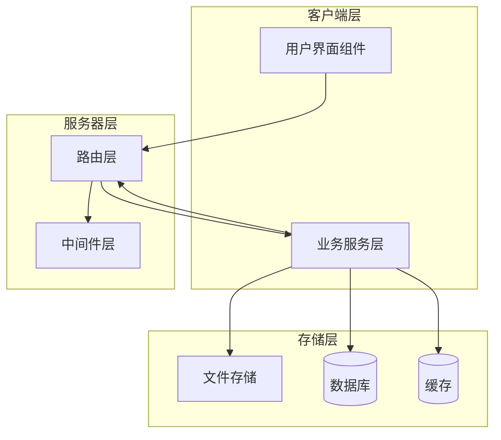

**图表来源**
- [assets.ts](file://server/src/routes/assets.ts)
- [fileStorage.ts](file://server/src/services/fileStorage.ts)
- [database.ts](file://server/src/config/database.ts)

**章节来源**
- [assets.ts](file://server/src/routes/assets.ts)
- [fileStorage.ts](file://server/src/services/fileStorage.ts)
- [database.ts](file://server/src/config/database.ts)

## 核心组件

### 路由层组件

资产管理路由模块包含以下核心路由组件：

- **资产路由**：处理角色、场景、道具等资产的CRUD操作
- **文件上传路由**：支持多格式文件的上传和处理
- **数据传输路由**：实现资产数据的导入导出功能
- **认证中间件**：确保API访问的安全性

### 服务层组件

- **文件存储服务**：管理文件的存储、检索和删除
- **资产库服务**：提供资产的查询、分类和元数据管理
- **存储服务**：抽象化的存储接口，支持多种存储后端

### 数据层组件

- **数据库配置**：支持SQLite和MySQL等多种数据库
- **连接池管理**：优化数据库连接的使用效率
- **事务处理**：确保数据操作的原子性和一致性

**章节来源**
- [assets.ts](file://server/src/routes/assets.ts)
- [fileStorage.ts](file://server/src/services/fileStorage.ts)
- [database.ts](file://server/src/config/database.ts)
- [sqliteDatabase.ts](file://server/src/config/sqliteDatabase.ts)

## 架构概览

资产管理路由模块采用分层架构，各层职责明确，耦合度低：

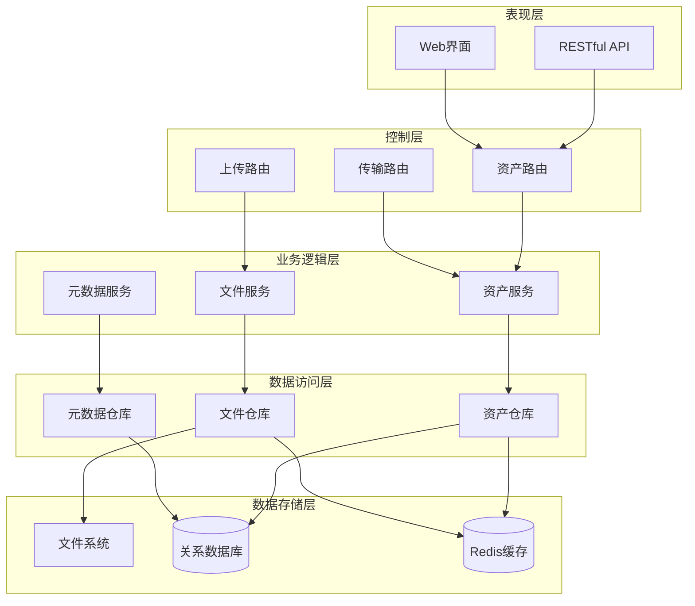

**图表来源**
- [assets.ts](file://server/src/routes/assets.ts)
- [fileStorage.ts](file://server/src/services/fileStorage.ts)
- [assetLibraryService.ts](file://services/assetLibraryService.ts)

## 详细组件分析

### 资产路由组件

资产路由组件负责处理所有与资产相关的HTTP请求，支持完整的CRUD操作：

#### 资产类型定义

系统支持三种主要资产类型：
- **角色资产**：用于3D角色模型和纹理
- **场景资产**：用于环境和背景资源
- **道具资产**：用于场景中的可交互物品

#### API接口设计

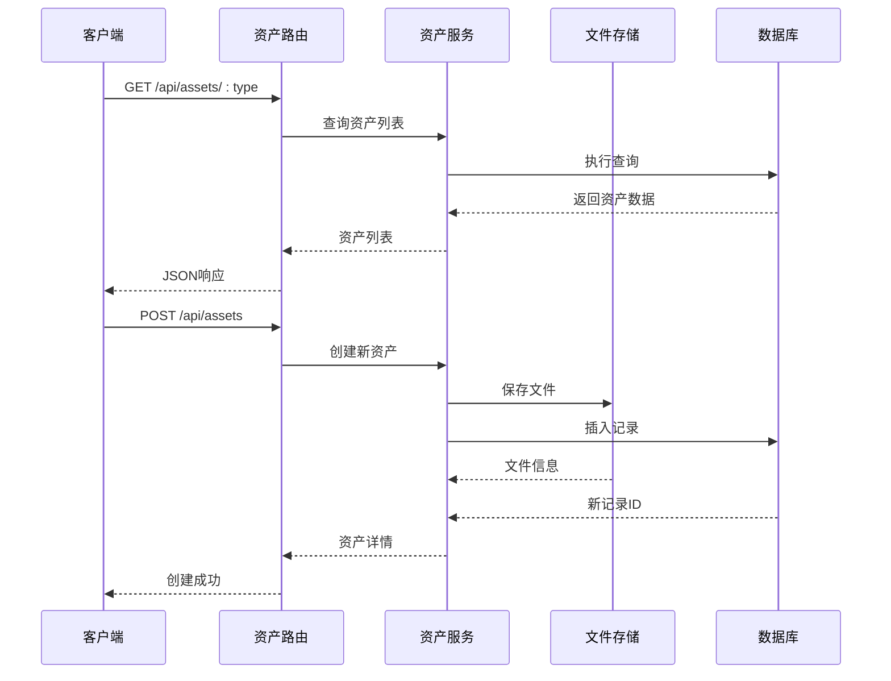

**图表来源**
- [assets.ts](file://server/src/routes/assets.ts)

#### 资产操作流程

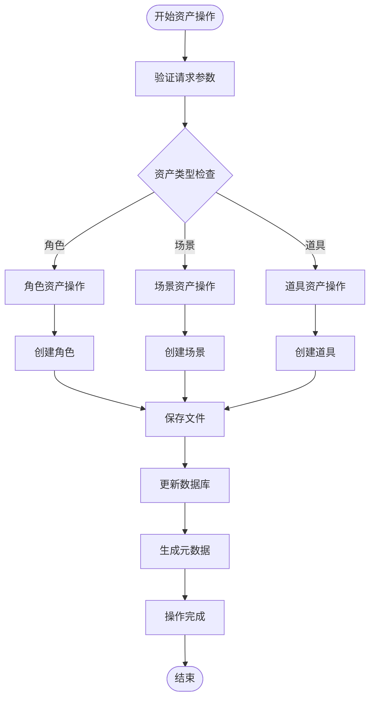

**图表来源**
- [assets.ts](file://server/src/routes/assets.ts)
- [fileStorage.ts](file://server/src/services/fileStorage.ts)

**章节来源**
- [assets.ts](file://server/src/routes/assets.ts)

### 文件存储组件

文件存储组件提供统一的文件管理接口，支持多种存储后端：

#### 存储策略

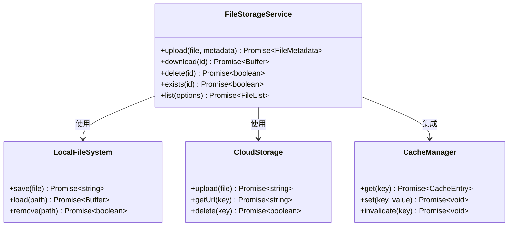

**图表来源**
- [fileStorage.ts](file://server/src/services/fileStorage.ts)

#### 文件处理流程

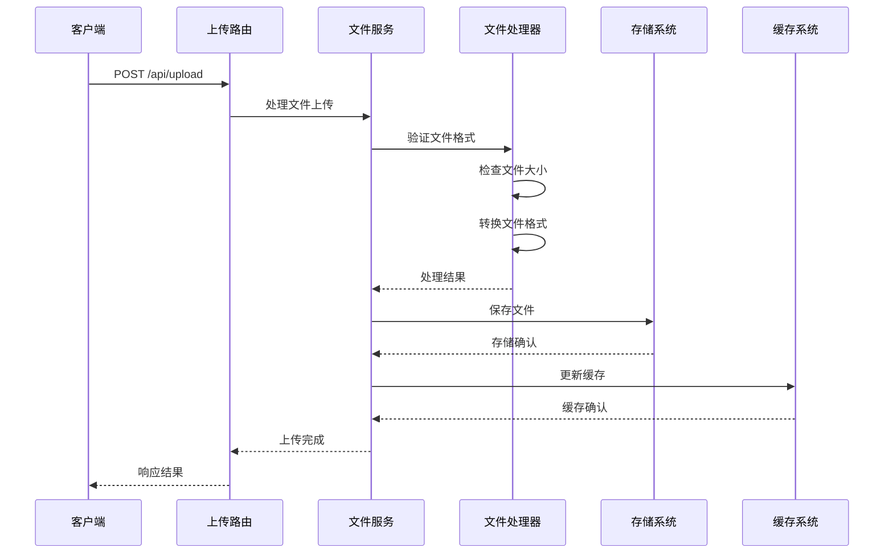

**图表来源**
- [uploads.ts](file://server/src/routes/uploads.ts)
- [fileStorage.ts](file://server/src/services/fileStorage.ts)

**章节来源**
- [fileStorage.ts](file://server/src/services/fileStorage.ts)
- [uploads.ts](file://server/src/routes/uploads.ts)

### 元数据管理组件

元数据管理组件负责资产的元数据存储和查询：

#### 元数据结构

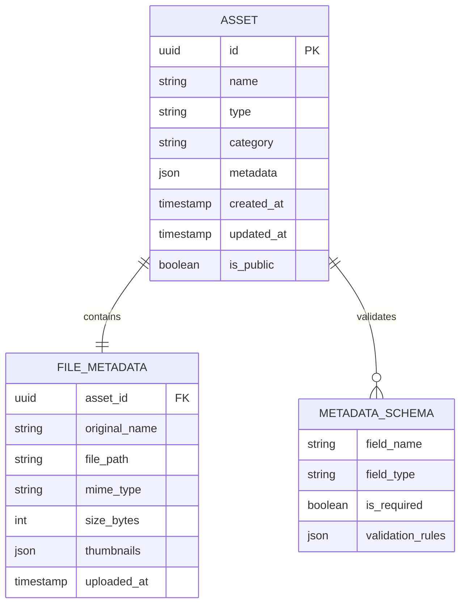

**图表来源**
- [assetLibraryService.ts](file://services/assetLibraryService.ts)

#### 元数据查询流程

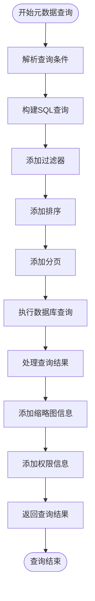

**图表来源**
- [assetLibraryService.ts](file://services/assetLibraryService.ts)

**章节来源**
- [assetLibraryService.ts](file://services/assetLibraryService.ts)

### 前端资产组件

前端资产组件提供用户友好的资产管理界面：

#### 组件架构

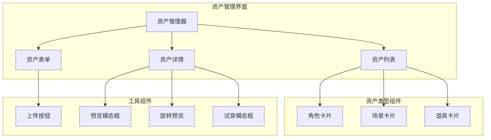

**图表来源**
- [StageAssets/index.tsx](file://components/StageAssets/index.tsx)
- [StageAssets/CharacterCard.tsx](file://components/StageAssets/CharacterCard.tsx)
- [StageAssets/SceneCard.tsx](file://components/StageAssets/SceneCard.tsx)
- [StageAssets/PropCard.tsx](file://components/StageAssets/PropCard.tsx)

**章节来源**
- [StageAssets/index.tsx](file://components/StageAssets/index.tsx)
- [StageAssets/utils.ts](file://components/StageAssets/utils.ts)
- [StageAssets/constants.ts](file://components/StageAssets/constants.ts)

## 依赖关系分析

资产管理路由模块的依赖关系呈现清晰的层次化结构：

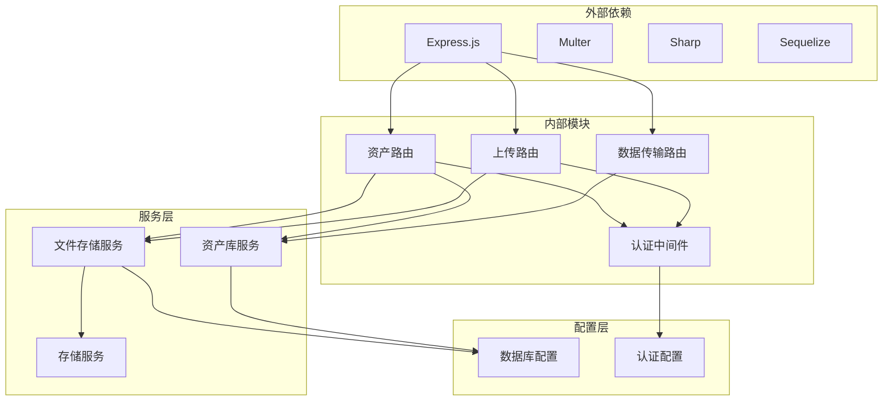

**图表来源**
- [assets.ts](file://server/src/routes/assets.ts)
- [fileStorage.ts](file://server/src/services/fileStorage.ts)
- [auth.ts](file://server/src/middleware/auth.ts)

**章节来源**
- [assets.ts](file://server/src/routes/assets.ts)
- [fileStorage.ts](file://server/src/services/fileStorage.ts)
- [auth.ts](file://server/src/middleware/auth.ts)

## 性能考虑

### 缓存策略

系统采用多层次缓存策略来提升性能：

- **内存缓存**：使用Redis作为分布式缓存，存储热点数据
- **文件缓存**：对常用文件生成缩略图和预览版本
- **数据库查询缓存**：缓存常用的查询结果

### 并发处理

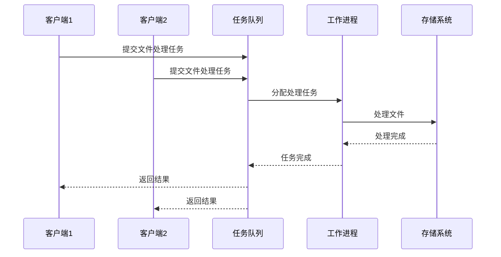

**图表来源**
- [fileStorage.ts](file://server/src/services/fileStorage.ts)

### 优化建议

1. **批量操作**：支持批量资产操作以减少网络往返
2. **增量更新**：实现增量元数据更新避免全量同步
3. **压缩传输**：对大文件启用Gzip压缩传输
4. **CDN集成**：对静态资源使用CDN加速

## 故障排除指南

### 常见问题及解决方案

#### 文件上传失败

**问题症状**：
- 上传进度卡住
- 返回413状态码
- 文件大小限制错误

**解决步骤**：
1. 检查文件大小限制配置
2. 验证磁盘空间充足
3. 确认临时文件夹权限
4. 查看服务器日志获取详细错误信息

#### 资产查询缓慢

**问题症状**：
- 查询响应时间过长
- 数据库连接超时
- 内存使用过高

**解决步骤**：
1. 检查数据库索引是否完整
2. 优化查询语句和添加适当的WHERE条件
3. 实施分页和限制返回数量
4. 调整缓存策略

#### 权限访问错误

**问题症状**：
- 401未授权访问
- 403禁止访问
- 资源访问被拒绝

**解决步骤**：
1. 验证用户认证状态
2. 检查用户权限级别
3. 确认资产共享设置
4. 重新生成访问令牌

**章节来源**
- [assets.ts](file://server/src/routes/assets.ts)
- [fileStorage.ts](file://server/src/services/fileStorage.ts)
- [auth.ts](file://server/src/middleware/auth.ts)

## 结论

AI Shotlive资产管理路由模块通过精心设计的架构和完善的组件体系，为3D资产的管理提供了强大而灵活的解决方案。模块采用了现代化的技术栈和最佳实践，确保了系统的高性能、高可用性和良好的可扩展性。

通过统一的资产分类体系、完善的元数据管理和高效的文件处理流程，该模块能够满足从个人创作者到专业制作团队的各种需求。同时，清晰的API设计和丰富的前端组件使得用户能够轻松地进行资产管理和创作工作。

未来的发展方向包括进一步优化性能、增强安全性、扩展更多资产类型支持，以及提供更丰富的协作功能。

## 附录

### API参考

#### 资产管理API

| 方法 | 路径 | 描述 |
|------|------|------|
| GET | `/api/assets` | 获取资产列表 |
| GET | `/api/assets/:id` | 获取单个资产详情 |
| POST | `/api/assets` | 创建新资产 |
| PUT | `/api/assets/:id` | 更新资产信息 |
| DELETE | `/api/assets/:id` | 删除资产 |

#### 文件上传API

| 方法 | 路径 | 描述 |
|------|------|------|
| POST | `/api/upload` | 上传文件 |
| GET | `/api/download/:id` | 下载文件 |
| DELETE | `/api/delete/:id` | 删除文件 |

### 配置选项

#### 数据库配置

```typescript
// 数据库连接配置
const databaseConfig = {
  host: process.env.DB_HOST,
  port: parseInt(process.env.DB_PORT),
  username: process.env.DB_USER,
  password: process.env.DB_PASSWORD,
  database: process.env.DB_NAME,
  dialect: 'mysql', // 或 'sqlite'
  pool: {
    max: 10,
    min: 0,
    acquireTimeout: 30000,
    idleTimeout: 10000,
  }
};
```

#### 文件存储配置

```typescript
// 文件存储配置
const storageConfig = {
  maxSize: '50M',
  allowedTypes: ['image/*', 'model/*', 'video/*'],
  cacheTTL: 3600,
  thumbnailSizes: {
    small: '100x100',
    medium: '300x300',
    large: '800x600'
  }
};
```