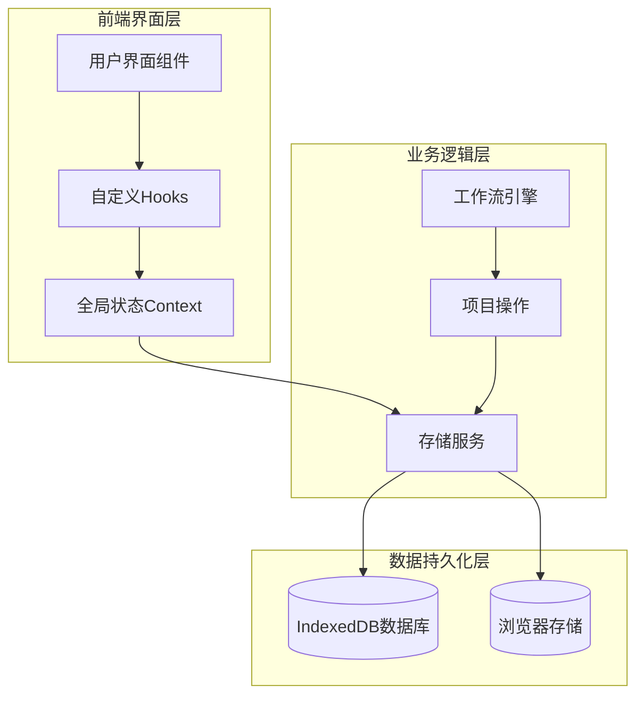
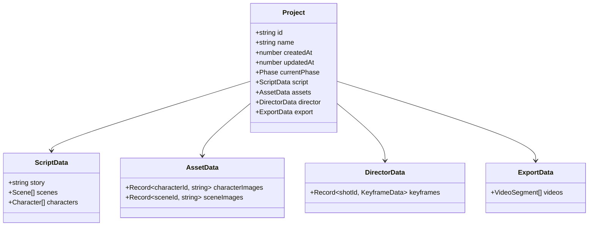
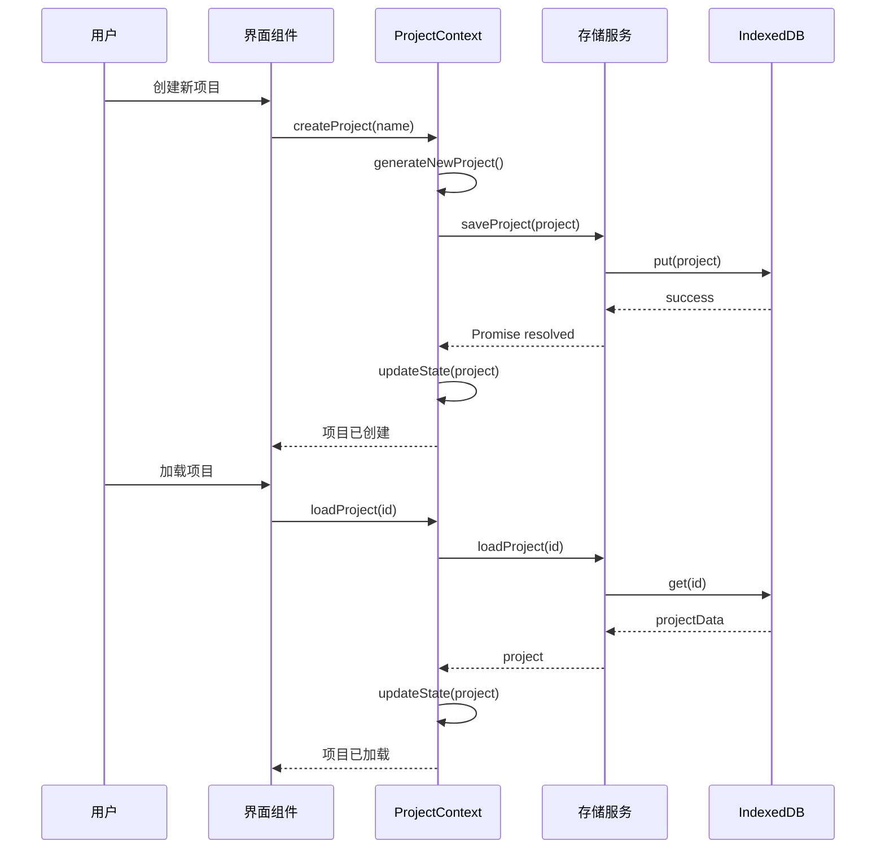
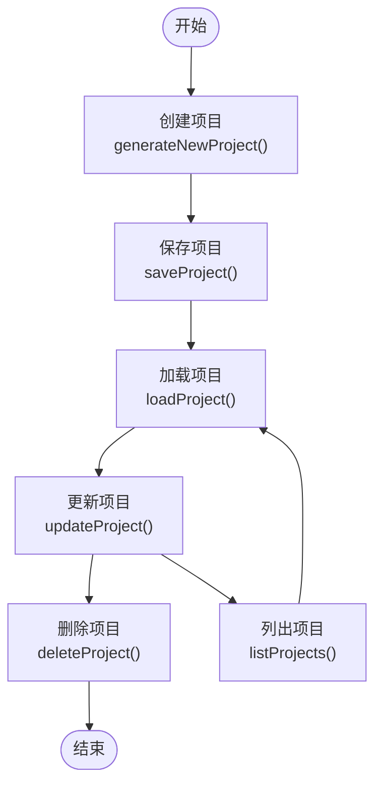
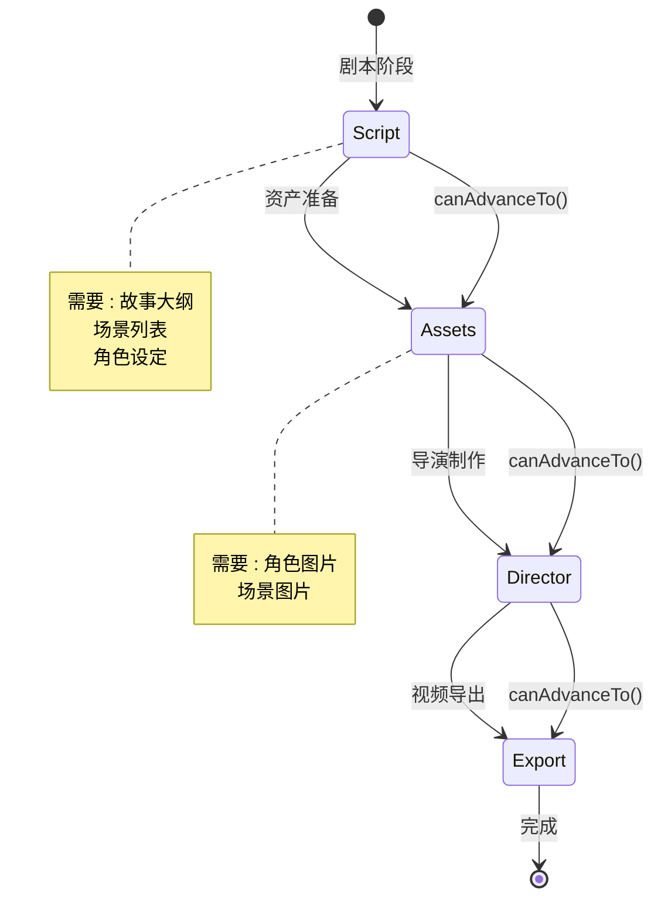
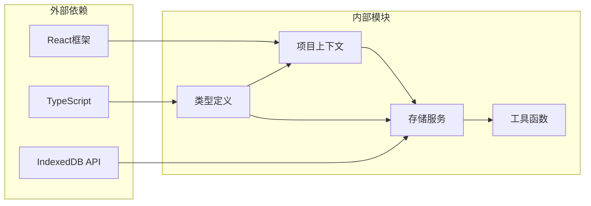

# 项目管理路由

<cite>
**本文档引用的文件**
- [types.ts](file://src/types.ts)
- [ProjectContext.tsx](file://src/shared/contexts/ProjectContext.tsx)
- [indexeddb.ts](file://src/services/storage/indexeddb.ts)
- [storage/types.ts](file://src/services/storage/types.ts)
- [useProject.ts](file://src/shared/hooks/useProject.ts)
- [ProjectSelector.tsx](file://src/shared/components/ProjectSelector.tsx)
- [workflow/types.ts](file://src/services/workflow/types.ts)
</cite>

## 目录
1. [简介](#简介)
2. [项目结构](#项目结构)
3. [核心组件](#核心组件)
4. [架构概览](#架构概览)
5. [详细组件分析](#详细组件分析)
6. [依赖关系分析](#依赖关系分析)
7. [性能考虑](#性能考虑)
8. [故障排除指南](#故障排除指南)
9. [结论](#结论)

## 简介

AI Shotlive项目管理路由模块是整个应用的核心数据管理层，负责管理用户的影视项目从创建到导出的完整生命周期。该模块实现了基于React Context的全局状态管理，结合IndexedDB本地存储，为用户提供流畅的项目管理体验。

项目管理路由模块采用控制论设计理念，强调"信息-反馈律"和"结构-功能相关律"，通过单一可信数据源和自动持久化机制，确保项目数据的一致性和可靠性。系统支持多阶段工作流管理，包括剧本创作、资产准备、导演制作和视频导出四个主要阶段。

## 项目结构

项目管理路由模块采用分层架构设计，主要分为以下层次：

**图表来源**
- [ProjectContext.tsx:1-186](file://src/shared/contexts/ProjectContext.tsx#L1-L186)
- [indexeddb.ts:125-167](file://src/services/storage/indexeddb.ts#L125-L167)

**章节来源**
- [ProjectContext.tsx:1-186](file://src/shared/contexts/ProjectContext.tsx#L1-L186)
- [storage/types.ts:1-30](file://src/services/storage/types.ts#L1-L30)

## 核心组件

### 项目数据模型

项目管理路由模块的核心数据结构基于TypeScript接口定义，采用分阶段的数据组织方式：

**图表来源**
- [types.ts:10-95](file://src/types.ts#L10-L95)

### 全局状态管理

ProjectContext提供统一的项目状态管理，包含以下核心功能：

- **项目创建**：createEmptyProject函数生成新的项目实例
- **项目加载**：异步加载现有项目数据
- **项目更新**：响应式更新项目状态并自动持久化
- **项目删除**：安全删除项目及其关联资源
- **阶段切换**：在不同工作阶段间导航

**章节来源**
- [ProjectContext.tsx:170-186](file://src/shared/contexts/ProjectContext.tsx#L170-L186)
- [types.ts:83-95](file://src/types.ts#L83-L95)

## 架构概览

项目管理路由模块采用客户端单页应用架构，所有项目数据都存储在本地IndexedDB中，确保离线可用性和数据持久性。

**图表来源**
- [ProjectContext.tsx:47-168](file://src/shared/contexts/ProjectContext.tsx#L47-L168)
- [indexeddb.ts:125-167](file://src/services/storage/indexeddb.ts#L125-L167)

## 详细组件分析

### 项目生命周期管理

项目生命周期管理涵盖了从创建到删除的完整过程，每个阶段都有特定的数据结构和处理逻辑：

**图表来源**
- [ProjectContext.tsx:150-168](file://src/shared/contexts/ProjectContext.tsx#L150-L168)
- [indexeddb.ts:125-167](file://src/services/storage/indexeddb.ts#L125-L167)

### 数据持久化机制

系统采用双重持久化策略确保数据安全：

1. **自动保存机制**：使用防抖技术每2秒自动保存一次项目状态
2. **手动保存触发**：项目更新时立即触发保存操作
3. **事务性操作**：所有数据库操作都在事务中执行，确保数据一致性

**章节来源**
- [ProjectContext.tsx:45-46](file://src/shared/contexts/ProjectContext.tsx#L45-L46)
- [ProjectContext.tsx:150-160](file://src/shared/contexts/ProjectContext.tsx#L150-L160)

### 用户数据隔离机制

系统通过以下机制实现用户数据隔离：

- **项目ID唯一性**：每个项目都有唯一的UUID标识符
- **本地存储隔离**：项目数据完全存储在本地IndexedDB中
- **无服务器依赖**：所有操作都在客户端完成，无需服务器参与
- **隐私保护**：敏感的项目数据不会上传到任何服务器

**章节来源**
- [types.ts:83-95](file://src/types.ts#L83-L95)
- [indexeddb.ts:125-167](file://src/services/storage/indexeddb.ts#L125-L167)

### 项目状态管理策略

项目状态管理遵循严格的控制论原则：

**图表来源**
- [workflow/types.ts:13-18](file://src/services/workflow/types.ts#L13-L18)

**章节来源**
- [workflow/types.ts:1-20](file://src/services/workflow/types.ts#L1-L20)

## 依赖关系分析

项目管理路由模块的依赖关系清晰明确，遵循单一职责原则：

**图表来源**
- [ProjectContext.tsx:15-18](file://src/shared/contexts/ProjectContext.tsx#L15-L18)
- [storage/types.ts:5-30](file://src/services/storage/types.ts#L5-L30)

**章节来源**
- [ProjectContext.tsx:15-18](file://src/shared/contexts/ProjectContext.tsx#L15-L18)
- [storage/types.ts:15-30](file://src/services/storage/types.ts#L15-L30)

## 性能考虑

项目管理路由模块在性能方面采用了多项优化策略：

### 内存管理
- **延迟加载**：项目数据按需加载，避免内存占用过高
- **数据压缩**：项目摘要信息仅包含必要字段，减少传输开销
- **垃圾回收**：及时清理不再使用的项目引用

### 存储优化
- **批量操作**：多个项目操作合并为事务执行
- **索引优化**：为常用查询字段建立数据库索引
- **缓存策略**：最近使用的项目保持在内存中

### 网络效率
- **离线优先**：所有操作优先使用本地存储
- **增量同步**：只传输变更的数据部分
- **并发控制**：限制同时进行的数据库操作数量

## 故障排除指南

### 常见问题及解决方案

**项目无法保存**
- 检查浏览器是否支持IndexedDB
- 确认有足够的磁盘空间
- 清理浏览器缓存后重试

**项目加载失败**
- 检查项目ID是否正确
- 验证项目数据格式完整性
- 查看浏览器开发者工具中的错误日志

**数据丢失恢复**
- 利用浏览器的撤销功能
- 检查本地备份文件
- 重新创建项目并导入备份

**性能问题诊断**
- 监控内存使用情况
- 检查数据库操作耗时
- 优化项目大小和复杂度

**章节来源**
- [ProjectContext.tsx:150-168](file://src/shared/contexts/ProjectContext.tsx#L150-L168)
- [indexeddb.ts:125-167](file://src/services/storage/indexeddb.ts#L125-L167)

## 结论

AI Shotlive项目管理路由模块通过精心设计的架构和实现，为用户提供了可靠的项目管理体验。模块的核心优势包括：

1. **数据安全性**：所有项目数据完全存储在本地，确保用户隐私
2. **操作流畅性**：自动保存和防抖机制提供无缝的用户体验
3. **扩展性**：清晰的模块化设计便于功能扩展和维护
4. **可靠性**：事务性数据库操作确保数据一致性

该模块成功实现了控制论设计理念，通过单一可信数据源和自动持久化机制，构建了一个高效、可靠的项目管理平台。未来可以考虑添加云同步功能，以支持多设备间的项目共享和协作。