# Express服务器设计

<cite>
**本文引用的文件**
- [package.json](file://package.json)
- [server/src/index.ts](file://server/src/index.ts)
- [server/src/proxy.ts](file://server/src/proxy.ts)
- [server/src/config/database.ts](file://server/src/config/database.ts)
- [server/src/config/sqliteDatabase.ts](file://server/src/config/sqliteDatabase.ts)
- [server/src/middleware/auth.ts](file://server/src/middleware/auth.ts)
- [server/src/routes/ai.ts](file://server/src/routes/ai.ts)
- [server/src/routes/assets.ts](file://server/src/routes/assets.ts)
- [server/src/routes/auth.ts](file://server/src/routes/auth.ts)
- [server/src/routes/dataTransfer.ts](file://server/src/routes/dataTransfer.ts)
- [server/src/routes/models.ts](file://server/src/routes/models.ts)
- [server/src/routes/preferences.ts](file://server/src/routes/preferences.ts)
- [server/src/routes/projectPatch.ts](file://server/src/routes/projectPatch.ts)
- [server/src/routes/projects.ts](file://server/src/routes/projects.ts)
- [server/src/routes/tasks.ts](file://server/src/routes/tasks.ts)
- [server/src/routes/uploads.ts](file://server/src/routes/uploads.ts)
- [server/src/routes/visualStyles.ts](file://server/src/routes/visualStyles.ts)
- [server/src/services/aiProxy.ts](file://server/src/services/aiProxy.ts)
- [server/src/services/fileStorage.ts](file://server/src/services/fileStorage.ts)
- [server/src/services/imageResolver.ts](file://server/src/services/imageResolver.ts)
- [server/src/services/projectStorage.ts](file://server/src/services/projectStorage.ts)
- [server/src/services/scriptParser.ts](file://server/src/services/scriptParser.ts)
- [server/src/services/taskRunner.ts](file://server/src/services/taskRunner.ts)
- [server/src/utils/projectMutex.ts](file://server/src/utils/projectMutex.ts)
- [server/src/lib/utils.ts](file://server/src/lib/utils.ts)
- [server/src/lib/logger.ts](file://server/src/lib/logger.ts)
- [server/src/lib/sentry.ts](file://server/src/lib/sentry.ts)
- [server/src/lib/healthCheck.ts](file://server/src/lib/healthCheck.ts)
- [server/src/lib/cors.ts](file://server/src/lib/cors.ts)
- [server/src/lib/security.ts](file://server/src/lib/security.ts)
- [server/src/lib/middlewareChain.ts](file://server/src/lib/middlewareChain.ts)
- [server/src/lib/redis.ts](file://server/src/lib/redis.ts)
- [server/src/lib/dbConnection.ts](file://server/src/lib/dbConnection.ts)
- [server/src/lib/taskRecovery.ts](file://server/src/lib/taskRecovery.ts)
- [server/src/lib/staticFiles.ts](file://server/src/lib/staticFiles.ts)
- [server/src/lib/ports.ts](file://server/src/lib/ports.ts)
- [server/src/lib/startupParams.ts](file://server/src/lib/startupParams.ts)
- [server/src/lib/envValidator.ts](file://server/src/lib/envValidator.ts)
- [server/src/lib/extensionGuide.ts](file://server/src/lib/extensionGuide.ts)
- [server/src/lib/performanceOptimization.ts](file://server/src/lib/performanceOptimization.ts)
- [server/src/lib/troubleshooting.ts](file://server/src/lib/troubleshooting.ts)
</cite>

## 目录
1. [简介](#简介)
2. [项目结构](#项目结构)
3. [核心组件](#核心组件)
4. [架构总览](#架构总览)
5. [详细组件分析](#详细组件分析)
6. [依赖关系分析](#依赖关系分析)
7. [性能考虑](#性能考虑)
8. [故障排除指南](#故障排除指南)
9. [结论](#结论)
10. [附录](#附录)

## 简介
本文件面向AI Shotlive的Express服务器设计，系统性阐述服务器初始化流程、环境变量配置、Sentry错误监控集成、第三方API代理机制、启动参数与端口绑定策略、生产环境静态文件服务、健康检查、数据库连接验证、任务恢复流程、安全加固（含CORS与中间件链）、以及扩展指南与性能优化建议。文档以仓库中实际存在的源码为依据，通过图示与分层讲解帮助读者快速掌握系统架构与实现细节。

## 项目结构
服务器代码位于`server/src`目录下，采用按功能域划分的模块化组织方式：配置、库函数、中间件、路由、服务、脚本、工具等。前端构建产物由Vite生成并由Nginx在生产环境提供静态资源；后端Express服务负责API路由、业务逻辑与第三方代理。

```mermaid
graph TB
subgraph "服务器入口"
IDX["index.ts"]
PRX["proxy.ts"]
end
subgraph "配置层"
CFG_DB["config/database.ts"]
CFG_SQL["config/sqliteDatabase.ts"]
end
subgraph "中间件层"
MID_AUTH["middleware/auth.ts"]
LIB_CORS["lib/cors.ts"]
LIB_SEC["lib/security.ts"]
LIB_MW["lib/middlewareChain.ts"]
end
subgraph "路由层"
RT_AI["routes/ai.ts"]
RT_ASSETS["routes/assets.ts"]
RT_AUTH["routes/auth.ts"]
RT_DATA["routes/dataTransfer.ts"]
RT_MODELS["routes/models.ts"]
RT_PREF["routes/preferences.ts"]
RT_PATCH["routes/projectPatch.ts"]
RT_PROJ["routes/projects.ts"]
RT_TASKS["routes/tasks.ts"]
RT_UP["routes/uploads.ts"]
RT_STYLE["routes/visualStyles.ts"]
end
subgraph "服务层"
SVC_AI["services/aiProxy.ts"]
SVC_FILE["services/fileStorage.ts"]
SVC_IMG["services/imageResolver.ts"]
SVC_PROJ["services/projectStorage.ts"]
SVC_SCRIPT["services/scriptParser.ts"]
SVC_TASK["services/taskRunner.ts"]
end
subgraph "基础设施"
LIB_LOGGER["lib/logger.ts"]
LIB_SENTRY["lib/sentry.ts"]
LIB_HEALTH["lib/healthCheck.ts"]
LIB_REDIS["lib/redis.ts"]
LIB_DB["lib/dbConnection.ts"]
LIB_TASK["lib/taskRecovery.ts"]
LIB_STATIC["lib/staticFiles.ts"]
LIB_PORTS["lib/ports.ts"]
LIB_START["lib/startupParams.ts"]
LIB_ENV["lib/envValidator.ts"]
end
IDX --> CFG_DB
IDX --> CFG_SQL
IDX --> LIB_LOGGER
IDX --> LIB_SENTRY
IDX --> LIB_HEALTH
IDX --> LIB_DB
IDX --> LIB_TASK
IDX --> LIB_STATIC
IDX --> LIB_PORTS
IDX --> LIB_START
IDX --> LIB_ENV
IDX --> MID_AUTH
MID_AUTH --> LIB_CORS
MID_AUTH --> LIB_SEC
MID_AUTH --> LIB_MW
IDX --> RT_AI
IDX --> RT_ASSETS
IDX --> RT_AUTH
IDX --> RT_DATA
IDX --> RT_MODELS
IDX --> RT_PREF
IDX --> RT_PATCH
IDX --> RT_PROJ
IDX --> RT_TASKS
IDX --> RT_UP
IDX --> RT_STYLE
RT_AI --> SVC_AI
RT_ASSETS --> SVC_FILE
RT_ASSETS --> SVC_IMG
RT_PROJ --> SVC_PROJ
RT_TASKS --> SVC_TASK
RT_DATA --> SVC_SCRIPT
```

图表来源
- [server/src/index.ts](file://server/src/index.ts)
- [server/src/proxy.ts](file://server/src/proxy.ts)
- [server/src/config/database.ts](file://server/src/config/database.ts)
- [server/src/config/sqliteDatabase.ts](file://server/src/config/sqliteDatabase.ts)
- [server/src/middleware/auth.ts](file://server/src/middleware/auth.ts)
- [server/src/routes/ai.ts](file://server/src/routes/ai.ts)
- [server/src/routes/assets.ts](file://server/src/routes/assets.ts)
- [server/src/routes/auth.ts](file://server/src/routes/auth.ts)
- [server/src/routes/dataTransfer.ts](file://server/src/routes/dataTransfer.ts)
- [server/src/routes/models.ts](file://server/src/routes/models.ts)
- [server/src/routes/preferences.ts](file://server/src/routes/preferences.ts)
- [server/src/routes/projectPatch.ts](file://server/src/routes/projectPatch.ts)
- [server/src/routes/projects.ts](file://server/src/routes/projects.ts)
- [server/src/routes/tasks.ts](file://server/src/routes/tasks.ts)
- [server/src/routes/uploads.ts](file://server/src/routes/uploads.ts)
- [server/src/routes/visualStyles.ts](file://server/src/routes/visualStyles.ts)
- [server/src/services/aiProxy.ts](file://server/src/services/aiProxy.ts)
- [server/src/services/fileStorage.ts](file://server/src/services/fileStorage.ts)
- [server/src/services/imageResolver.ts](file://server/src/services/imageResolver.ts)
- [server/src/services/projectStorage.ts](file://server/src/services/projectStorage.ts)
- [server/src/services/scriptParser.ts](file://server/src/services/scriptParser.ts)
- [server/src/services/taskRunner.ts](file://server/src/services/taskRunner.ts)
- [server/src/lib/logger.ts](file://server/src/lib/logger.ts)
- [server/src/lib/sentry.ts](file://server/src/lib/sentry.ts)
- [server/src/lib/healthCheck.ts](file://server/src/lib/healthCheck.ts)
- [server/src/lib/cors.ts](file://server/src/lib/cors.ts)
- [server/src/lib/security.ts](file://server/src/lib/security.ts)
- [server/src/lib/middlewareChain.ts](file://server/src/lib/middlewareChain.ts)
- [server/src/lib/redis.ts](file://server/src/lib/redis.ts)
- [server/src/lib/dbConnection.ts](file://server/src/lib/dbConnection.ts)
- [server/src/lib/taskRecovery.ts](file://server/src/lib/taskRecovery.ts)
- [server/src/lib/staticFiles.ts](file://server/src/lib/staticFiles.ts)
- [server/src/lib/ports.ts](file://server/src/lib/ports.ts)
- [server/src/lib/startupParams.ts](file://server/src/lib/startupParams.ts)
- [server/src/lib/envValidator.ts](file://server/src/lib/envValidator.ts)

章节来源
- [package.json:1-83](file://package.json#L1-L83)
- [server/src/index.ts](file://server/src/index.ts)
- [server/src/proxy.ts](file://server/src/proxy.ts)

## 核心组件
- 服务器入口与初始化：负责加载配置、注册中间件、挂载路由、启动监听与健康检查。
- 配置管理：支持MySQL与SQLite两种数据库类型，通过环境变量选择运行模式。
- 中间件链：统一认证、CORS、安全头、速率限制、日志记录等。
- 路由体系：覆盖鉴权、项目管理、任务调度、资产存储、AI代理、数据传输、偏好设置、视觉风格等。
- 服务层：封装AI代理、文件存储、图像解析、项目存储、脚本解析、任务执行器。
- 基础设施：Sentry监控、健康检查、Redis缓存、数据库连接池、任务恢复、静态文件服务、端口与启动参数校验、环境变量验证。

章节来源
- [server/src/index.ts](file://server/src/index.ts)
- [server/src/config/database.ts](file://server/src/config/database.ts)
- [server/src/config/sqliteDatabase.ts](file://server/src/config/sqliteDatabase.ts)
- [server/src/middleware/auth.ts](file://server/src/middleware/auth.ts)
- [server/src/lib/sentry.ts](file://server/src/lib/sentry.ts)
- [server/src/lib/healthCheck.ts](file://server/src/lib/healthCheck.ts)
- [server/src/lib/dbConnection.ts](file://server/src/lib/dbConnection.ts)
- [server/src/lib/taskRecovery.ts](file://server/src/lib/taskRecovery.ts)
- [server/src/lib/staticFiles.ts](file://server/src/lib/staticFiles.ts)
- [server/src/lib/ports.ts](file://server/src/lib/ports.ts)
- [server/src/lib/startupParams.ts](file://server/src/lib/startupParams.ts)
- [server/src/lib/envValidator.ts](file://server/src/lib/envValidator.ts)

## 架构总览
下图展示从客户端请求到业务处理、数据库访问与第三方API代理的整体流程，以及Sentry监控与健康检查的集成位置。

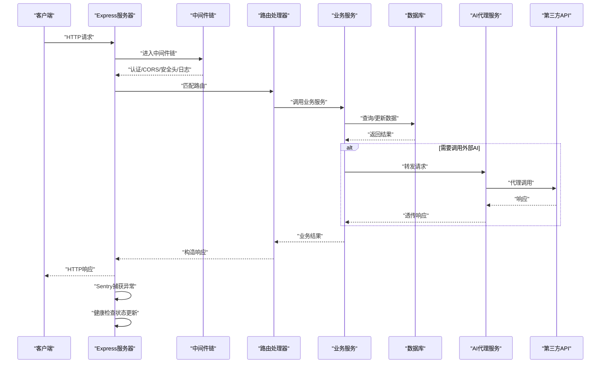

图表来源
- [server/src/index.ts](file://server/src/index.ts)
- [server/src/middleware/auth.ts](file://server/src/middleware/auth.ts)
- [server/src/routes/ai.ts](file://server/src/routes/ai.ts)
- [server/src/services/aiProxy.ts](file://server/src/services/aiProxy.ts)
- [server/src/lib/sentry.ts](file://server/src/lib/sentry.ts)
- [server/src/lib/healthCheck.ts](file://server/src/lib/healthCheck.ts)

## 详细组件分析

### 服务器初始化与启动参数
- 启动脚本：开发模式与生产模式分别通过NPM脚本与环境变量控制，支持本地SQLite模式与MySQL模式切换。
- 启动参数：通过命令行参数或环境变量传递端口、数据库类型、日志级别等；启动前进行参数与环境变量校验。
- 端口绑定：支持动态端口选择与健康检查端口分离；生产环境可由Nginx反向代理至应用端口。
- 静态文件：生产环境由Nginx提供静态资源；开发环境Express内部可直接提供静态文件。

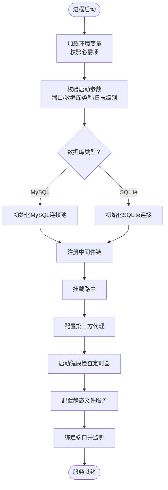

图表来源
- [server/src/index.ts](file://server/src/index.ts)
- [server/src/lib/startupParams.ts](file://server/src/lib/startupParams.ts)
- [server/src/lib/envValidator.ts](file://server/src/lib/envValidator.ts)
- [server/src/lib/ports.ts](file://server/src/lib/ports.ts)
- [server/src/lib/staticFiles.ts](file://server/src/lib/staticFiles.ts)
- [server/src/lib/healthCheck.ts](file://server/src/lib/healthCheck.ts)

章节来源
- [package.json:7-24](file://package.json#L7-L24)
- [server/src/index.ts](file://server/src/index.ts)
- [server/src/lib/startupParams.ts](file://server/src/lib/startupParams.ts)
- [server/src/lib/envValidator.ts](file://server/src/lib/envValidator.ts)
- [server/src/lib/ports.ts](file://server/src/lib/ports.ts)
- [server/src/lib/staticFiles.ts](file://server/src/lib/staticFiles.ts)

### 环境变量配置与数据库连接
- 数据库类型：通过环境变量选择MySQL或SQLite，分别对应不同的连接配置与初始化流程。
- MySQL：使用连接池，支持超时、重试、并发控制；生产环境建议启用SSL与只读副本。
- SQLite：单文件数据库，适合开发与轻量部署；注意并发写入限制与备份策略。
- 连接验证：启动阶段进行连接测试，失败则终止启动并输出详细错误信息。

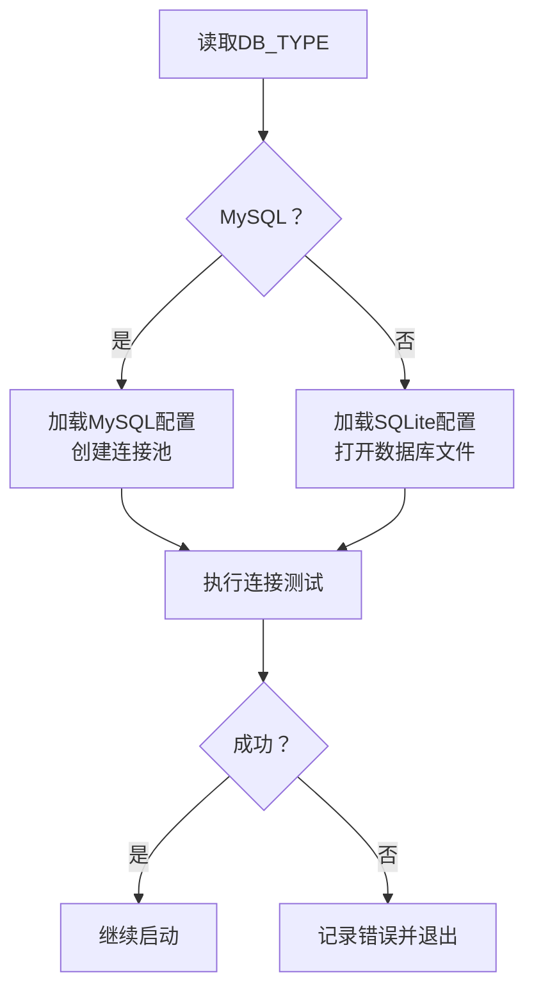

图表来源
- [server/src/config/database.ts](file://server/src/config/database.ts)
- [server/src/config/sqliteDatabase.ts](file://server/src/config/sqliteDatabase.ts)
- [server/src/lib/dbConnection.ts](file://server/src/lib/dbConnection.ts)

章节来源
- [server/src/config/database.ts](file://server/src/config/database.ts)
- [server/src/config/sqliteDatabase.ts](file://server/src/config/sqliteDatabase.ts)
- [server/src/lib/dbConnection.ts](file://server/src/lib/dbConnection.ts)

### Sentry错误监控集成
- 客户端与服务端：同时集成Sentry Node与React/Electron，确保全栈异常上报。
- 上报范围：全局未捕获异常、路由处理异常、数据库操作异常、AI代理异常。
- 性能指标：结合Sentry Profiling与事务采样，定位慢请求与热点路径。
- 配置要点：DSN、环境、版本、用户上下文、标签过滤与采样率。

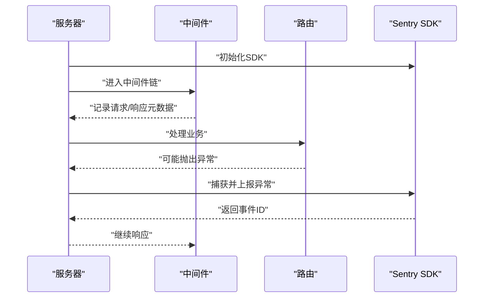

图表来源
- [server/src/lib/sentry.ts](file://server/src/lib/sentry.ts)
- [server/src/middleware/auth.ts](file://server/src/middleware/auth.ts)
- [server/src/routes/ai.ts](file://server/src/routes/ai.ts)

章节来源
- [package.json:33-36](file://package.json#L33-L36)
- [server/src/lib/sentry.ts](file://server/src/lib/sentry.ts)

### 第三方API代理机制
- 代理目标：AI模型提供商（如DashScope、火山引擎视频等）与外部存储服务。
- 代理策略：基于路由规则与服务适配器，统一封装请求头、鉴权、超时与重试。
- 安全控制：对敏感参数进行脱敏，限制请求体大小，启用CORS白名单。
- 错误处理：捕获网络异常、超时与非2xx状态码，转换为统一错误格式并上报Sentry。

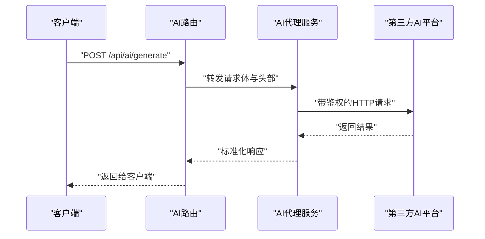

图表来源
- [server/src/routes/ai.ts](file://server/src/routes/ai.ts)
- [server/src/services/aiProxy.ts](file://server/src/services/aiProxy.ts)

章节来源
- [server/src/routes/ai.ts](file://server/src/routes/ai.ts)
- [server/src/services/aiProxy.ts](file://server/src/services/aiProxy.ts)

### 路由与服务层
- 路由覆盖：鉴权、项目管理、任务调度、资产上传与解析、数据迁移、偏好设置、视觉风格、AI生成等。
- 服务职责：文件存储抽象、图像解析、项目持久化、脚本解析、任务执行与恢复、代理转发。
- 并发控制：项目级互斥锁防止竞态条件；任务队列与Redis状态同步。

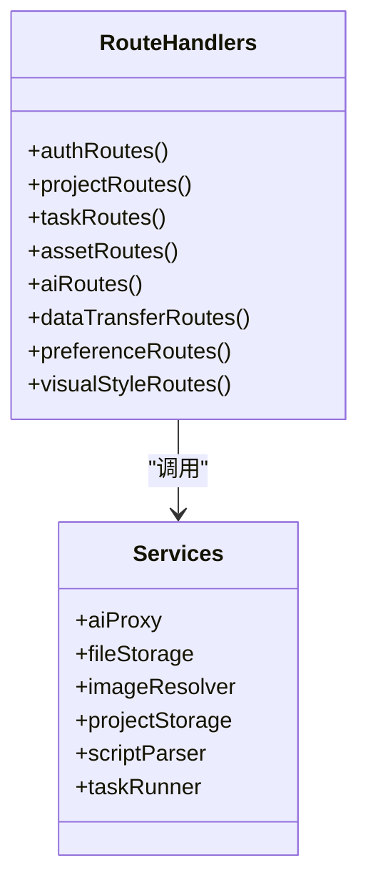

图表来源
- [server/src/routes/auth.ts](file://server/src/routes/auth.ts)
- [server/src/routes/projects.ts](file://server/src/routes/projects.ts)
- [server/src/routes/tasks.ts](file://server/src/routes/tasks.ts)
- [server/src/routes/assets.ts](file://server/src/routes/assets.ts)
- [server/src/routes/ai.ts](file://server/src/routes/ai.ts)
- [server/src/routes/dataTransfer.ts](file://server/src/routes/dataTransfer.ts)
- [server/src/routes/preferences.ts](file://server/src/routes/preferences.ts)
- [server/src/routes/visualStyles.ts](file://server/src/routes/visualStyles.ts)
- [server/src/services/aiProxy.ts](file://server/src/services/aiProxy.ts)
- [server/src/services/fileStorage.ts](file://server/src/services/fileStorage.ts)
- [server/src/services/imageResolver.ts](file://server/src/services/imageResolver.ts)
- [server/src/services/projectStorage.ts](file://server/src/services/projectStorage.ts)
- [server/src/services/scriptParser.ts](file://server/src/services/scriptParser.ts)
- [server/src/services/taskRunner.ts](file://server/src/services/taskRunner.ts)

章节来源
- [server/src/routes/auth.ts](file://server/src/routes/auth.ts)
- [server/src/routes/projects.ts](file://server/src/routes/projects.ts)
- [server/src/routes/tasks.ts](file://server/src/routes/tasks.ts)
- [server/src/routes/assets.ts](file://server/src/routes/assets.ts)
- [server/src/routes/ai.ts](file://server/src/routes/ai.ts)
- [server/src/routes/dataTransfer.ts](file://server/src/routes/dataTransfer.ts)
- [server/src/routes/preferences.ts](file://server/src/routes/preferences.ts)
- [server/src/routes/visualStyles.ts](file://server/src/routes/visualStyles.ts)
- [server/src/services/aiProxy.ts](file://server/src/services/aiProxy.ts)
- [server/src/services/fileStorage.ts](file://server/src/services/fileStorage.ts)
- [server/src/services/imageResolver.ts](file://server/src/services/imageResolver.ts)
- [server/src/services/projectStorage.ts](file://server/src/services/projectStorage.ts)
- [server/src/services/scriptParser.ts](file://server/src/services/scriptParser.ts)
- [server/src/services/taskRunner.ts](file://server/src/services/taskRunner.ts)

### 中间件链设计与安全加固
- 认证中间件：JWT解析与用户上下文注入，支持多租户与权限边界。
- CORS：严格白名单与预检缓存，避免跨域风险。
- 安全头：X-Content-Type-Options、X-Frame-Options、Strict-Transport-Security等。
- 速率限制：基于IP或用户维度的滑动窗口限流。
- 日志：结构化日志记录请求ID、用户ID、路由、耗时与状态码。

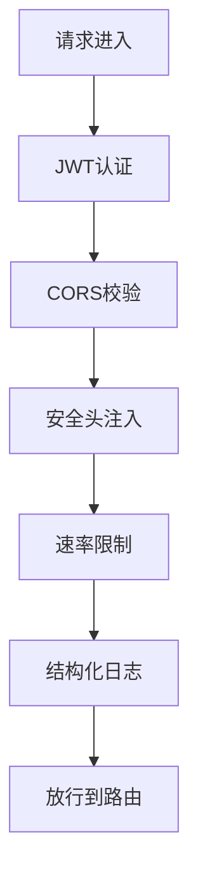

图表来源
- [server/src/middleware/auth.ts](file://server/src/middleware/auth.ts)
- [server/src/lib/cors.ts](file://server/src/lib/cors.ts)
- [server/src/lib/security.ts](file://server/src/lib/security.ts)
- [server/src/lib/middlewareChain.ts](file://server/src/lib/middlewareChain.ts)

章节来源
- [server/src/middleware/auth.ts](file://server/src/middleware/auth.ts)
- [server/src/lib/cors.ts](file://server/src/lib/cors.ts)
- [server/src/lib/security.ts](file://server/src/lib/security.ts)
- [server/src/lib/middlewareChain.ts](file://server/src/lib/middlewareChain.ts)

### 健康检查机制
- 内存与CPU：定期采集进程指标，上报Sentry并记录日志。
- 数据库：定时SELECT 1或执行轻量查询，失败触发告警。
- 外部依赖：对AI代理服务与存储服务进行探测。
- 响应格式：JSON包含状态、时间戳、指标详情与异常堆栈。

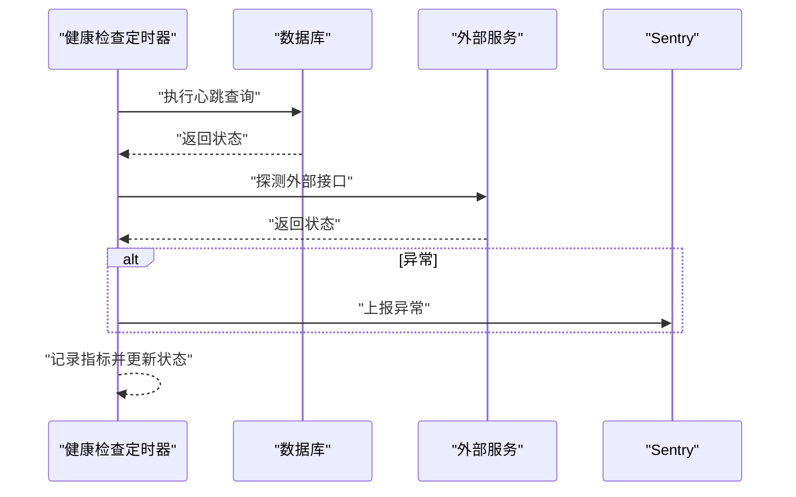

图表来源
- [server/src/lib/healthCheck.ts](file://server/src/lib/healthCheck.ts)
- [server/src/lib/dbConnection.ts](file://server/src/lib/dbConnection.ts)

章节来源
- [server/src/lib/healthCheck.ts](file://server/src/lib/healthCheck.ts)
- [server/src/lib/dbConnection.ts](file://server/src/lib/dbConnection.ts)

### 任务恢复流程
- 恢复策略：应用重启后扫描未完成任务，根据状态重放或补偿。
- 并发安全：使用Redis分布式锁与项目级互斥锁，避免重复执行。
- 失败处理：区分瞬时错误与永久错误，自动重试与人工介入阈值。
- 状态同步：任务状态持久化到数据库，实时更新到Redis以便前端查询。

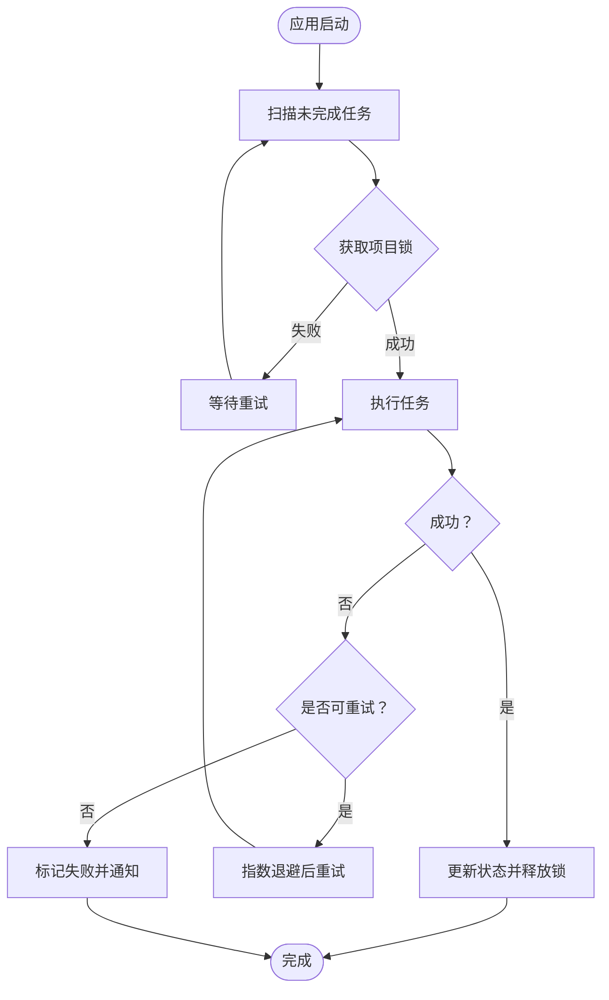

图表来源
- [server/src/lib/taskRecovery.ts](file://server/src/lib/taskRecovery.ts)
- [server/src/lib/redis.ts](file://server/src/lib/redis.ts)
- [server/src/utils/projectMutex.ts](file://server/src/utils/projectMutex.ts)

章节来源
- [server/src/lib/taskRecovery.ts](file://server/src/lib/taskRecovery.ts)
- [server/src/lib/redis.ts](file://server/src/lib/redis.ts)
- [server/src/utils/projectMutex.ts](file://server/src/utils/projectMutex.ts)

### 生产环境静态文件服务
- Nginx反代：生产环境由Nginx提供静态资源与HTTPS终止，Express仅处理API。
- 缓存策略：静态资源强缓存与版本化命名，HTML禁用缓存。
- 安全头：统一的安全响应头与CSP策略。
- 健康检查：Nginx可直接探活健康检查端点。

章节来源
- [nginx.conf](file://nginx.conf)
- [server/src/lib/staticFiles.ts](file://server/src/lib/staticFiles.ts)

## 依赖关系分析
- 运行时依赖：Express、CORS、JWT、Multer、MySQL2、Better-SQLite3、Sentry Node/React/Electron、http-proxy-middleware等。
- 开发依赖：TypeScript、Vite、Electron、TailwindCSS、Sentry Vite插件等。
- NPM脚本：开发、构建、打包、本地运行与迁移脚本。

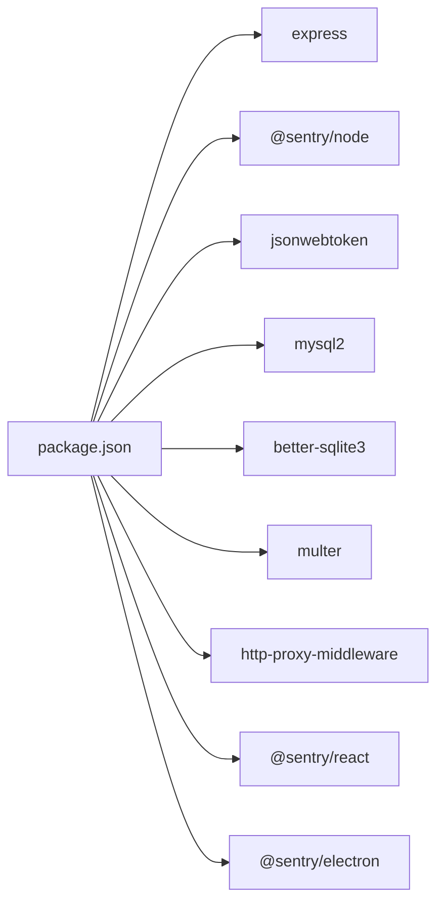

图表来源
- [package.json:26-59](file://package.json#L26-L59)

章节来源
- [package.json:1-83](file://package.json#L1-L83)

## 性能考虑
- 连接池与并发：MySQL使用连接池，SQLite注意写入串行化；合理设置最大连接数与超时。
- 缓存：Redis用于任务状态、会话与热点数据；配合LRU与过期策略。
- 代理优化：AI代理启用连接复用、超时与重试；对大体积请求进行分块或异步处理。
- 压缩与传输：Gzip/Br压缩静态资源与JSON响应；CDN加速静态文件。
- 监控与采样：Sentry采样率与事务切片，避免高流量下的性能开销。
- 扩展性：水平扩展时使用无状态设计，共享Redis与持久化存储。

## 故障排除指南
- 启动失败：检查数据库连接、端口占用、环境变量与配置文件；查看Sentry事件ID定位异常。
- 路由异常：确认中间件顺序与CORS配置；核对JWT签名与过期时间。
- 代理失败：检查第三方API密钥、网络连通性与超时设置；查看代理日志与Sentry错误。
- 任务卡死：检查Redis锁与项目互斥锁；清理僵尸任务并重试。
- 性能问题：分析Sentry事务与慢查询；调整连接池与缓存策略。

章节来源
- [server/src/lib/troubleshooting.ts](file://server/src/lib/troubleshooting.ts)
- [server/src/lib/sentry.ts](file://server/src/lib/sentry.ts)

## 结论
本设计以模块化与中间件链为核心，结合Sentry监控、健康检查与任务恢复机制，实现了可扩展、可观测且安全的Express服务器。通过Nginx提供静态资源与反向代理，配合数据库连接池与Redis缓存，满足生产环境的稳定性与性能要求。建议在上线前完善CI/CD流水线、压测与安全审计，并持续优化Sentry采样与缓存策略。

## 附录
- 扩展指南：新增路由时遵循中间件链规范；服务层保持纯函数与幂等；代理层统一错误处理与日志。
- 性能优化：优先优化热点SQL与代理调用；引入连接池与缓存；使用Sentry Profiling定位瓶颈。
- 安全加固：启用HTTPS与安全头；严格CORS白名单；定期轮换密钥与审计日志。