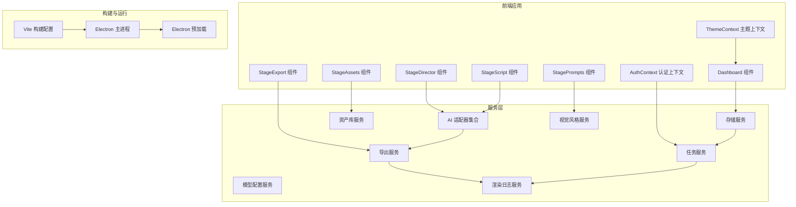
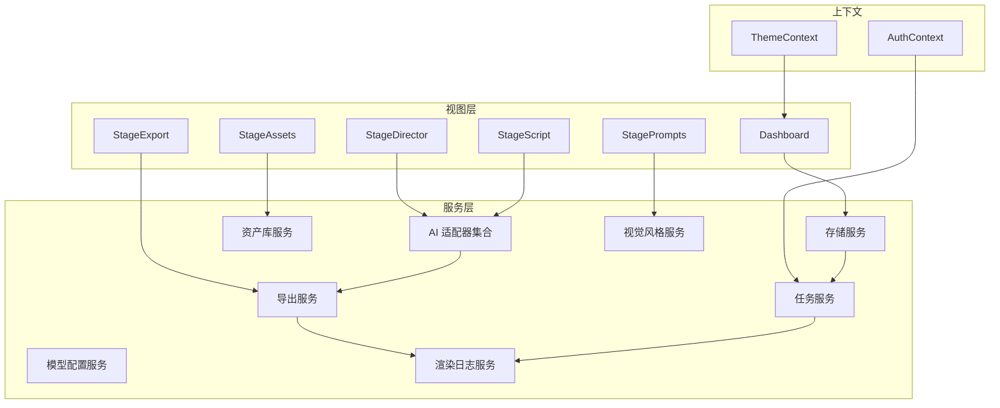
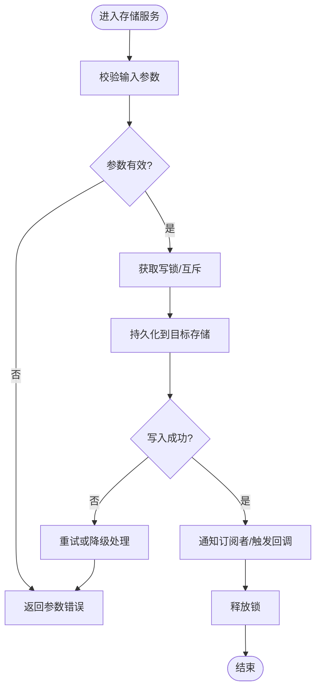
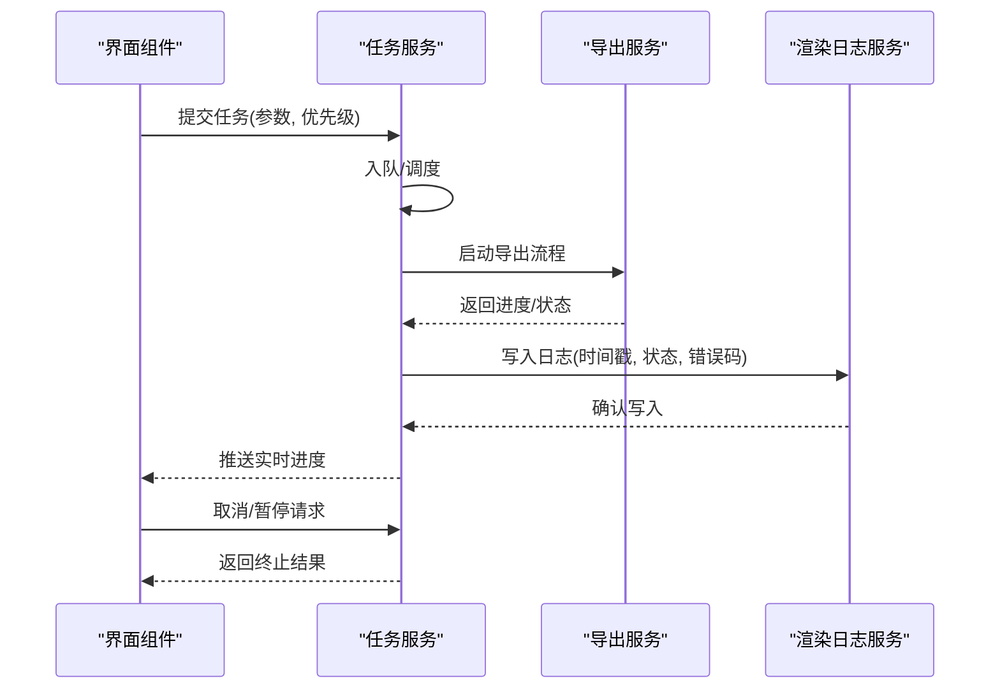
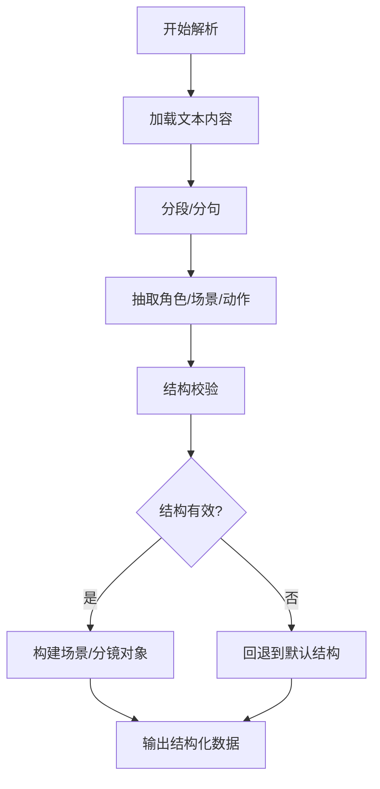
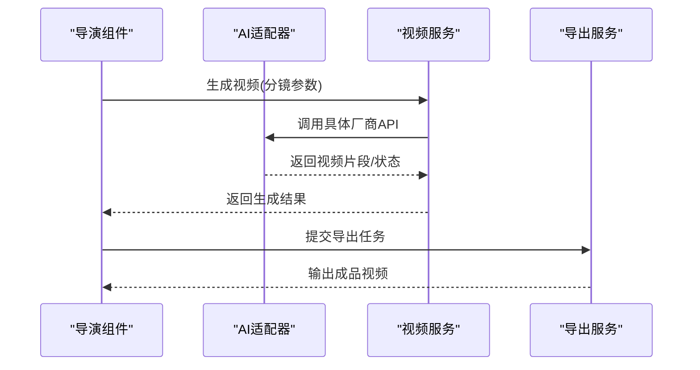
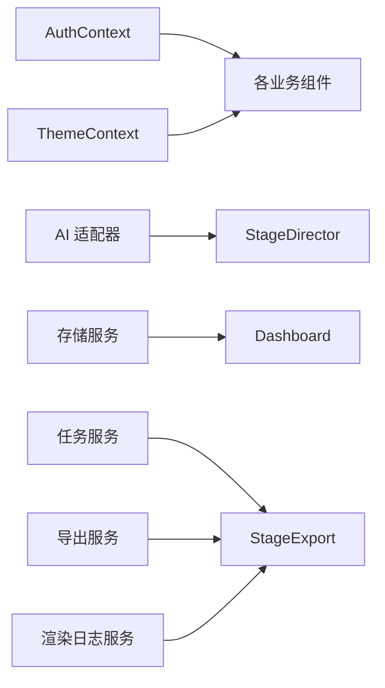
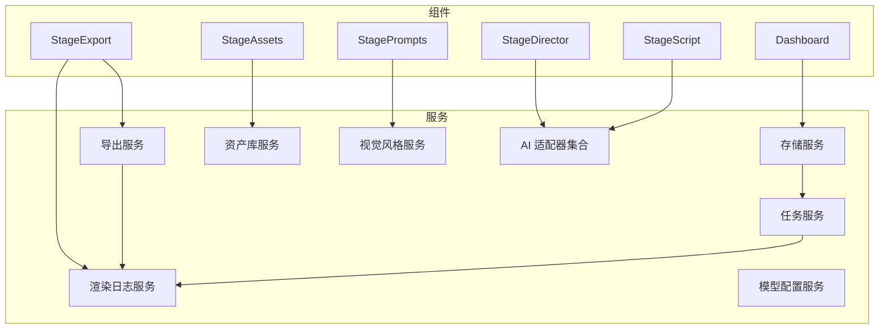

# 业务逻辑层

<cite>
**本文引用的文件**
- [package.json](file://package.json)
- [App.tsx](file://App.tsx)
- [index.tsx](file://index.tsx)
- [src/config.ts](file://src/config.ts)
- [src/types.ts](file://src/types.ts)
- [vite.config.ts](file://vite.config.ts)
- [electron/main.ts](file://electron/main.ts)
- [electron/preload.ts](file://electron/preload.ts)
- [contexts/AuthContext.tsx](file://contexts/AuthContext.tsx)
- [contexts/ThemeContext.tsx](file://contexts/ThemeContext.tsx)
- [services/adapters/index.ts](file://services/adapters/index.ts)
- [services/adapters/chatAdapter.ts](file://services/adapters/chatAdapter.ts)
- [services/adapters/imageAdapter.ts](file://services/adapters/imageAdapter.ts)
- [services/adapters/videoAdapter.ts](file://services/adapters/videoAdapter.ts)
- [services/adapters/dashscopeVideoAdapter.ts](file://services/adapters/dashscopeVideoAdapter.ts)
- [services/adapters/volcengineVideoAdapter.ts](file://services/adapters/volcengineVideoAdapter.ts)
- [services/ai/index.ts](file://services/ai/index.ts)
- [services/ai/apiCore.ts](file://services/ai/apiCore.ts)
- [services/ai/scriptService.ts](file://services/ai/scriptService.ts)
- [services/ai/shotService.ts](file://services/ai/shotService.ts)
- [services/ai/videoService.ts](file://services/ai/videoService.ts)
- [services/ai/visualService.ts](file://services/ai/visualService.ts)
- [services/ai/novelScriptService.ts](file://services/ai/novelScriptService.ts)
- [services/ai/promptConstants.ts](file://services/ai/promptConstants.ts)
- [services/assetLibraryService.ts](file://services/assetLibraryService.ts)
- [services/exportService.ts](file://services/exportService.ts)
- [services/modelConfigService.ts](file://services/modelConfigService.ts)
- [services/modelRegistry.ts](file://services/modelRegistry.ts)
- [services/modelService.ts](file://services/modelService.ts)
- [services/projectPatchService.ts](file://services/projectPatchService.ts)
- [services/renderLogService.ts](file://services/renderLogService.ts)
- [services/storageService.ts](file://services/storageService.ts)
- [services/taskService.ts](file://services/taskService.ts)
- [services/visualStyleService.ts](file://services/visualStyleService.ts)
- [components/Dashboard.tsx](file://components/Dashboard.tsx)
- [components/StageAssets.tsx](file://components/StageAssets.tsx)
- [components/StageDirector.tsx](file://components/StageDirector.tsx)
- [components/StageExport.tsx](file://components/StageExport.tsx)
- [components/StagePrompts.tsx](file://components/StagePrompts.tsx)
- [components/StageScript.tsx](file://components/StageScript.tsx)
- [components/Onboarding/index.tsx](file://components/Onboarding/index.tsx)
- [components/StageAssets/index.tsx](file://components/StageAssets/index.tsx)
- [components/StageDirector/index.tsx](file://components/StageDirector/index.tsx)
- [components/StageExport/index.tsx](file://components/StageExport/index.tsx)
- [components/StagePrompts/index.tsx](file://components/StagePrompts/index.tsx)
- [components/StageScript/index.tsx](file://components/StageScript/index.tsx)
- [components/StageAssets/constants.ts](file://components/StageAssets/constants.ts)
- [components/StageDirector/constants.ts](file://components/StageDirector/constants.ts)
- [components/StageExport/constants.ts](file://components/StageExport/constants.ts)
- [components/StagePrompts/constants.ts](file://components/StagePrompts/constants.ts)
- [components/StageScript/constants.ts](file://components/StageScript/constants.ts)
- [components/StageAssets/utils.ts](file://components/StageAssets/utils.ts)
- [components/StageDirector/utils.ts](file://components/StageDirector/utils.ts)
- [components/StageExport/utils.ts](file://components/StageExport/utils.ts)
- [components/StagePrompts/utils.ts](file://components/StagePrompts/utils.ts)
- [components/StageScript/utils.ts](file://components/StageScript/utils.ts)
- [components/StageAssets/README.md](file://components/StageAssets/README.md)
- [components/StageDirector/README.md](file://components/StageDirector/README.md)
- [components/StageExport/README.md](file://components/StageExport/README.md)
- [components/StagePrompts/README.md](file://components/StagePrompts/README.md)
- [components/StageScript/README.md](file://components/StageScript/README.md)
- [components/StageAssets/ImageUploadButton.tsx](file://components/StageAssets/ImageUploadButton.tsx)
- [components/StageAssets/ImagePreviewModal.tsx](file://components/StageAssets/ImagePreviewModal.tsx)
- [components/StageAssets/CharacterCard.tsx](file://components/StageAssets/CharacterCard.tsx)
- [components/StageAssets/PropCard.tsx](file://components/StageAssets/PropCard.tsx)
- [components/StageAssets/SceneCard.tsx](file://components/StageAssets/SceneCard.tsx)
- [components/StageAssets/TurnaroundModal.tsx](file://components/StageAssets/TurnaroundModal.tsx)
- [components/StageAssets/WardrobeModal.tsx](file://components/StageAssets/WardrobeModal.tsx)
- [components/StageAssets/PromptEditor.tsx](file://components/StageAssets/PromptEditor.tsx)
- [components/StageDirector/EditModal.tsx](file://components/StageDirector/EditModal.tsx)
- [components/StageDirector/ImagePreviewModal.tsx](file://components/StageDirector/ImagePreviewModal.tsx)
- [components/StageDirector/KeyframeEditor.tsx](file://components/StageDirector/KeyframeEditor.tsx)
- [components/StageDirector/NineGridPreview.tsx](file://components/StageDirector/NineGridPreview.tsx)
- [components/StageDirector/SceneContext.tsx](file://components/StageDirector/SceneContext.tsx)
- [components/StageDirector/ShotCard.tsx](file://components/StageDirector/ShotCard.tsx)
- [components/StageDirector/ShotWorkbench.tsx](file://components/StageDirector/ShotWorkbench.tsx)
- [components/StageDirector/VideoGenerator.tsx](file://components/StageDirector/VideoGenerator.tsx)
- [components/StageDirector/cameraMovementGuides.ts](file://components/StageDirector/cameraMovementGuides.ts)
- [components/StageExport/ActionButtons.tsx](file://components/StageExport/ActionButtons.tsx)
- [components/StageExport/RenderLogsModal.tsx](file://components/StageExport/RenderLogsModal.tsx)
- [components/StageExport/SecondaryOptions.tsx](file://components/StageExport/SecondaryOptions.tsx)
- [components/StageExport/StatusPanel.tsx](file://components/StageExport/StatusPanel.tsx)
- [components/StageExport/TimelineVisualizer.tsx](file://components/StageExport/TimelineVisualizer.tsx)
- [components/StageExport/VideoPlayerModal.tsx](file://components/StageExport/VideoPlayerModal.tsx)
- [components/StagePrompts/CharacterSection.tsx](file://components/StagePrompts/CharacterSection.tsx)
- [components/StagePrompts/KeyframeSection.tsx](file://components/StagePrompts/KeyframeSection.tsx)
- [components/StagePrompts/PropSection.tsx](file://components/StagePrompts/PropSection.tsx)
- [components/StagePrompts/SceneSection.tsx](file://components/StagePrompts/SceneSection.tsx)
- [components/StagePrompts/CollapsibleSection.tsx](file://components/StagePrompts/CollapsibleSection.tsx)
- [components/StagePrompts/PromptEditor.tsx](file://components/StagePrompts/PromptEditor.tsx)
- [components/StagePrompts/StatusBadge.tsx](file://components/StagePrompts/StatusBadge.tsx)
- [components/StageScript/CharacterList.tsx](file://components/StageScript/CharacterList.tsx)
- [components/StageScript/ConfigPanel.tsx](file://components/StageScript/ConfigPanel.tsx)
- [components/StageScript/EpisodeManager.tsx](file://components/StageScript/EpisodeManager.tsx)
- [components/StageScript/InlineEditor.tsx](file://components/StageScript/InlineEditor.tsx)
- [components/StageScript/NovelManager.tsx](file://components/StageScript/NovelManager.tsx)
- [components/StageScript/OptionSelector.tsx](file://components/StageScript/OptionSelector.tsx)
- [components/StageScript/SceneBreakdown.tsx](file://components/StageScript/SceneBreakdown.tsx)
- [components/StageScript/SceneList.tsx](file://components/StageScript/SceneList.tsx)
- [components/StageScript/ScriptEditor.tsx](file://components/StageScript/ScriptEditor.tsx)
- [components/StageScript/ShotRow.tsx](file://components/StageScript/ShotRow.tsx)
- [components/StageScript/README.md](file://components/StageScript/README.md)
- [components/StageScript/README.md](file://components/StageScript/README.md)
</cite>

## 目录
1. [简介](#简介)
2. [项目结构](#项目结构)
3. [核心组件](#核心组件)
4. [架构总览](#架构总览)
5. [详细组件分析](#详细组件分析)
6. [依赖关系分析](#依赖关系分析)
7. [性能考虑](#性能考虑)
8. [故障排查指南](#故障排查指南)
9. [结论](#结论)
10. [附录](#附录)

## 简介
本文件聚焦于AI Shotlive的业务逻辑层，系统性梳理服务层架构设计、业务规则实现与数据处理流程。围绕项目存储服务、任务运行器、脚本解析器等核心服务，阐明服务间的协作机制、事务管理与异常处理策略，并提供业务扩展指南、新服务开发流程、性能优化技巧、测试策略与监控集成方案。由于仓库中未发现传统后端服务源码（如server/src/services下的taskRunner.ts、scriptParser.ts等），本文以现有前端与适配器层代码为基础，结合组件化UI模块与上下文，给出可落地的业务逻辑层设计蓝图与实施建议。

## 项目结构
项目采用前后端一体化的单体应用架构，前端基于React/Vite构建，通过Electron打包为桌面应用；业务逻辑主要分布在以下区域：
- 服务层：封装AI能力适配器、资产库、导出、模型配置、渲染日志、存储、任务、视觉风格等服务模块
- 组件层：按功能域划分的Stage系列组件（资产、导演、导出、提示词、脚本）与仪表盘、引导页等通用组件
- 上下文层：认证与主题上下文，提供全局状态与权限控制
- 配置与类型：集中式配置与类型定义
- 打包与构建：Vite配置与Electron主进程入口

图表来源
- [App.tsx](file://App.tsx)
- [index.tsx](file://index.tsx)
- [contexts/AuthContext.tsx](file://contexts/AuthContext.tsx)
- [contexts/ThemeContext.tsx](file://contexts/ThemeContext.tsx)
- [services/adapters/index.ts](file://services/adapters/index.ts)
- [services/assetLibraryService.ts](file://services/assetLibraryService.ts)
- [services/exportService.ts](file://services/exportService.ts)
- [services/modelConfigService.ts](file://services/modelConfigService.ts)
- [services/renderLogService.ts](file://services/renderLogService.ts)
- [services/storageService.ts](file://services/storageService.ts)
- [services/taskService.ts](file://services/taskService.ts)
- [services/visualStyleService.ts](file://services/visualStyleService.ts)
- [vite.config.ts](file://vite.config.ts)
- [electron/main.ts](file://electron/main.ts)
- [electron/preload.ts](file://electron/preload.ts)

章节来源
- [package.json:1-26](file://package.json#L1-L26)
- [App.tsx](file://App.tsx)
- [index.tsx](file://index.tsx)
- [vite.config.ts](file://vite.config.ts)
- [electron/main.ts](file://electron/main.ts)
- [electron/preload.ts](file://electron/preload.ts)

## 核心组件
本节从服务层视角，梳理关键业务组件及其职责边界与交互关系。

- AI适配器层
  - 职责：统一接入不同AI厂商能力（对话、图像生成、视频生成等），屏蔽底层差异
  - 关键模块：chatAdapter、imageAdapter、videoAdapter、dashscopeVideoAdapter、volcengineVideoAdapter
  - 设计要点：接口抽象、错误码映射、超时与重试策略、参数标准化

- 业务服务层
  - 资产库服务：管理角色、道具、场景等素材的增删改查与版本控制
  - 导出服务：协调渲染流程、输出格式与质量控制
  - 模型配置服务：维护模型参数、默认值与校验规则
  - 渲染日志服务：记录渲染过程、状态变更与错误信息
  - 存储服务：封装本地或云端存储访问，提供上传、下载、路径管理
  - 任务服务：编排任务生命周期、并发控制与优先级调度
  - 视觉风格服务：管理风格模板、预设与动态切换

- 组件层（业务逻辑承载者）
  - StageAssets：资产选择、上传、预览与编辑
  - StageDirector：分镜编辑、关键帧与相机运动指导
  - StageExport：导出面板、二次选项、渲染日志与播放器
  - StagePrompts：提示词分段编辑与状态展示
  - StageScript：剧本/小说脚本解析与场景拆解
  - Dashboard：项目概览与快速入口

章节来源
- [services/adapters/index.ts](file://services/adapters/index.ts)
- [services/adapters/chatAdapter.ts](file://services/adapters/chatAdapter.ts)
- [services/adapters/imageAdapter.ts](file://services/adapters/imageAdapter.ts)
- [services/adapters/videoAdapter.ts](file://services/adapters/videoAdapter.ts)
- [services/adapters/dashscopeVideoAdapter.ts](file://services/adapters/dashscopeVideoAdapter.ts)
- [services/adapters/volcengineVideoAdapter.ts](file://services/adapters/volcengineVideoAdapter.ts)
- [services/assetLibraryService.ts](file://services/assetLibraryService.ts)
- [services/exportService.ts](file://services/exportService.ts)
- [services/modelConfigService.ts](file://services/modelConfigService.ts)
- [services/renderLogService.ts](file://services/renderLogService.ts)
- [services/storageService.ts](file://services/storageService.ts)
- [services/taskService.ts](file://services/taskService.ts)
- [services/visualStyleService.ts](file://services/visualStyleService.ts)
- [components/Dashboard.tsx](file://components/Dashboard.tsx)
- [components/StageAssets.tsx](file://components/StageAssets.tsx)
- [components/StageDirector.tsx](file://components/StageDirector.tsx)
- [components/StageExport.tsx](file://components/StageExport.tsx)
- [components/StagePrompts.tsx](file://components/StagePrompts.tsx)
- [components/StageScript.tsx](file://components/StageScript.tsx)

## 架构总览
业务逻辑层采用“组件驱动 + 服务聚合”的架构模式：
- 组件负责用户交互与视图状态管理
- 服务负责跨组件的业务编排与持久化
- 适配器负责外部系统对接，保证业务规则不被外部变化影响
- 上下文提供认证态与主题态，贯穿全局

图表来源
- [components/Dashboard.tsx](file://components/Dashboard.tsx)
- [components/StageAssets.tsx](file://components/StageAssets.tsx)
- [components/StageDirector.tsx](file://components/StageDirector.tsx)
- [components/StageExport.tsx](file://components/StageExport.tsx)
- [components/StagePrompts.tsx](file://components/StagePrompts.tsx)
- [components/StageScript.tsx](file://components/StageScript.tsx)
- [services/adapters/index.ts](file://services/adapters/index.ts)
- [services/assetLibraryService.ts](file://services/assetLibraryService.ts)
- [services/exportService.ts](file://services/exportService.ts)
- [services/modelConfigService.ts](file://services/modelConfigService.ts)
- [services/renderLogService.ts](file://services/renderLogService.ts)
- [services/storageService.ts](file://services/storageService.ts)
- [services/taskService.ts](file://services/taskService.ts)
- [services/visualStyleService.ts](file://services/visualStyleService.ts)
- [contexts/AuthContext.tsx](file://contexts/AuthContext.tsx)
- [contexts/ThemeContext.tsx](file://contexts/ThemeContext.tsx)

## 详细组件分析

### 项目存储服务（存储服务）
- 职责：统一管理项目数据的读写、版本与同步
- 关键点：路径规范、并发写入保护、失败回滚、增量更新
- 与任务/导出/资产库的关系：作为底层数据源，被上层服务调用以完成业务操作

图表来源
- [services/storageService.ts](file://services/storageService.ts)

章节来源
- [services/storageService.ts](file://services/storageService.ts)

### 任务运行器（任务服务）
- 职责：编排异步任务执行，包括队列管理、优先级、重试与取消
- 关键点：任务状态机、并发度控制、超时与熔断、幂等性保障
- 与导出/渲染日志的关系：任务完成后更新渲染日志并触发后续步骤

图表来源
- [services/taskService.ts](file://services/taskService.ts)
- [services/exportService.ts](file://services/exportService.ts)
- [services/renderLogService.ts](file://services/renderLogService.ts)

章节来源
- [services/taskService.ts](file://services/taskService.ts)
- [services/exportService.ts](file://services/exportService.ts)
- [services/renderLogService.ts](file://services/renderLogService.ts)

### 脚本解析器（AI脚本服务）
- 职责：解析剧本/小说文本，提取角色、场景、动作与分镜线索
- 关键点：语义抽取、结构化输出、容错与回退策略
- 与导演/提示词的关系：为分镜编辑与提示词生成提供结构化输入

图表来源
- [services/ai/novelScriptService.ts](file://services/ai/novelScriptService.ts)
- [services/ai/scriptService.ts](file://services/ai/scriptService.ts)

章节来源
- [services/ai/novelScriptService.ts](file://services/ai/novelScriptService.ts)
- [services/ai/scriptService.ts](file://services/ai/scriptService.ts)

### 分镜与视频生成（AI适配器与视频服务）
- 职责：将分镜描述转换为视频片段，支持多厂商适配
- 关键点：参数标准化、错误码映射、超时与重试、并发限速
- 与导出的关系：视频片段拼接与最终导出

图表来源
- [services/adapters/index.ts](file://services/adapters/index.ts)
- [services/adapters/videoAdapter.ts](file://services/adapters/videoAdapter.ts)
- [services/adapters/dashscopeVideoAdapter.ts](file://services/adapters/dashscopeVideoAdapter.ts)
- [services/adapters/volcengineVideoAdapter.ts](file://services/adapters/volcengineVideoAdapter.ts)
- [services/ai/videoService.ts](file://services/ai/videoService.ts)
- [services/exportService.ts](file://services/exportService.ts)

章节来源
- [services/adapters/index.ts](file://services/adapters/index.ts)
- [services/adapters/videoAdapter.ts](file://services/adapters/videoAdapter.ts)
- [services/adapters/dashscopeVideoAdapter.ts](file://services/adapters/dashscopeVideoAdapter.ts)
- [services/adapters/volcengineVideoAdapter.ts](file://services/adapters/volcengineVideoAdapter.ts)
- [services/ai/videoService.ts](file://services/ai/videoService.ts)
- [services/exportService.ts](file://services/exportService.ts)

### 组件协作机制
- 组件间通信：通过props传递数据，通过回调函数响应事件
- 全局状态：AuthContext提供登录态与权限，ThemeContext提供主题切换
- 服务注入：组件通过Hook或Context消费服务，避免直接依赖具体实现

图表来源
- [contexts/AuthContext.tsx](file://contexts/AuthContext.tsx)
- [contexts/ThemeContext.tsx](file://contexts/ThemeContext.tsx)
- [services/adapters/index.ts](file://services/adapters/index.ts)
- [services/storageService.ts](file://services/storageService.ts)
- [services/taskService.ts](file://services/taskService.ts)
- [services/exportService.ts](file://services/exportService.ts)
- [services/renderLogService.ts](file://services/renderLogService.ts)
- [components/StageDirector.tsx](file://components/StageDirector.tsx)
- [components/Dashboard.tsx](file://components/Dashboard.tsx)
- [components/StageExport.tsx](file://components/StageExport.tsx)

章节来源
- [contexts/AuthContext.tsx](file://contexts/AuthContext.tsx)
- [contexts/ThemeContext.tsx](file://contexts/ThemeContext.tsx)
- [services/adapters/index.ts](file://services/adapters/index.ts)
- [services/storageService.ts](file://services/storageService.ts)
- [services/taskService.ts](file://services/taskService.ts)
- [services/exportService.ts](file://services/exportService.ts)
- [services/renderLogService.ts](file://services/renderLogService.ts)
- [components/StageDirector.tsx](file://components/StageDirector.tsx)
- [components/Dashboard.tsx](file://components/Dashboard.tsx)
- [components/StageExport.tsx](file://components/StageExport.tsx)

## 依赖关系分析
- 组件对服务的依赖：组件通过Hook或Context消费服务，降低耦合
- 服务对适配器的依赖：服务通过适配器屏蔽外部差异
- 上下文对组件的依赖：组件读取上下文状态，实现全局行为一致

图表来源
- [components/Dashboard.tsx](file://components/Dashboard.tsx)
- [components/StageAssets.tsx](file://components/StageAssets.tsx)
- [components/StageDirector.tsx](file://components/StageDirector.tsx)
- [components/StageExport.tsx](file://components/StageExport.tsx)
- [components/StagePrompts.tsx](file://components/StagePrompts.tsx)
- [components/StageScript.tsx](file://components/StageScript.tsx)
- [services/storageService.ts](file://services/storageService.ts)
- [services/taskService.ts](file://services/taskService.ts)
- [services/exportService.ts](file://services/exportService.ts)
- [services/renderLogService.ts](file://services/renderLogService.ts)
- [services/assetLibraryService.ts](file://services/assetLibraryService.ts)
- [services/modelConfigService.ts](file://services/modelConfigService.ts)
- [services/visualStyleService.ts](file://services/visualStyleService.ts)
- [services/adapters/index.ts](file://services/adapters/index.ts)

章节来源
- [components/Dashboard.tsx](file://components/Dashboard.tsx)
- [components/StageAssets.tsx](file://components/StageAssets.tsx)
- [components/StageDirector.tsx](file://components/StageDirector.tsx)
- [components/StageExport.tsx](file://components/StageExport.tsx)
- [components/StagePrompts.tsx](file://components/StagePrompts.tsx)
- [components/StageScript.tsx](file://components/StageScript.tsx)
- [services/storageService.ts](file://services/storageService.ts)
- [services/taskService.ts](file://services/taskService.ts)
- [services/exportService.ts](file://services/exportService.ts)
- [services/renderLogService.ts](file://services/renderLogService.ts)
- [services/assetLibraryService.ts](file://services/assetLibraryService.ts)
- [services/modelConfigService.ts](file://services/modelConfigService.ts)
- [services/visualStyleService.ts](file://services/visualStyleService.ts)
- [services/adapters/index.ts](file://services/adapters/index.ts)

## 性能考虑
- 并发控制：任务服务限制同时执行的任务数量，避免资源争用
- 缓存策略：对频繁访问的资产与模型配置进行内存缓存，减少IO
- 异步处理：长耗时操作（视频生成、导出）采用异步队列，及时反馈进度
- I/O优化：批量写入与去重，避免重复上传与覆盖
- UI渲染：组件按需渲染与懒加载，减少首屏压力
- 适配器限流：对第三方API进行速率限制与背压处理

## 故障排查指南
- 认证与权限
  - 症状：无法访问受保护功能
  - 排查：检查AuthContext中的token与权限位，确认路由守卫是否生效
- 任务执行异常
  - 症状：任务卡住或失败
  - 排查：查看渲染日志服务中的错误码与堆栈，定位具体环节；检查任务服务的重试策略与超时设置
- 导出失败
  - 症状：导出中断或产物缺失
  - 排查：核对导出服务的参数与输出路径，检查存储服务的可用性与权限
- AI适配器错误
  - 症状：视频生成失败或超时
  - 排查：检查适配器的超时配置、重试次数与错误码映射；必要时切换到备用适配器

章节来源
- [contexts/AuthContext.tsx](file://contexts/AuthContext.tsx)
- [services/renderLogService.ts](file://services/renderLogService.ts)
- [services/taskService.ts](file://services/taskService.ts)
- [services/exportService.ts](file://services/exportService.ts)
- [services/storageService.ts](file://services/storageService.ts)
- [services/adapters/index.ts](file://services/adapters/index.ts)

## 结论
本业务逻辑层以组件与服务为核心，通过适配器屏蔽外部差异，形成清晰的职责边界与稳定的协作关系。尽管当前仓库未包含传统后端服务源码，但通过上述设计蓝图与实施建议，可在不破坏现有架构的前提下，逐步完善服务层实现（如补充server/src/services目录），并确保扩展性与可维护性。

## 附录

### 业务逻辑扩展指南
- 新增适配器
  - 在适配器集合中新增实现，遵循统一接口与错误码规范
  - 在AI服务中注册新适配器，并在组件中提供切换入口
- 新增服务
  - 定义服务契约与依赖关系，避免与UI直接耦合
  - 通过Hook或Context向组件暴露能力
- 新增组件
  - 明确组件职责与数据流向，尽量保持无状态或可控状态
  - 使用上下文与服务进行状态管理与副作用处理

### 新服务开发流程
- 需求分析：明确业务目标与边界
- 设计接口：定义输入/输出与错误处理
- 实现适配器：封装第三方能力
- 实现服务：编排业务流程与状态管理
- 组件集成：在UI中消费服务能力
- 测试与监控：编写单元/集成测试，接入日志与告警

### 性能优化技巧
- 任务批量化：合并小任务，减少调度开销
- 缓存命中：热点数据驻留内存，降低IO
- 超时与重试：合理设置阈值，避免雪崩
- 并发限流：对第三方API进行速率限制
- UI懒加载：按需加载组件与资源

### 测试策略
- 单元测试：针对服务与适配器的关键方法进行断言
- 集成测试：模拟组件与服务交互，验证端到端流程
- 回归测试：在新增适配器或服务后执行回归
- 压力测试：评估并发与资源上限

### 监控集成方案
- 日志采集：统一输出结构化日志，包含traceId与关键上下文
- 指标埋点：统计任务成功率、平均耗时、重试次数
- 告警策略：针对失败率、超时率与资源使用率设置阈值
- 追踪链路：在任务与导出流程中串联追踪ID，便于问题定位