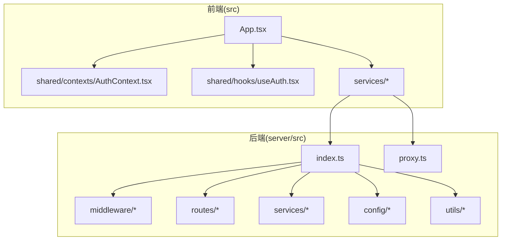
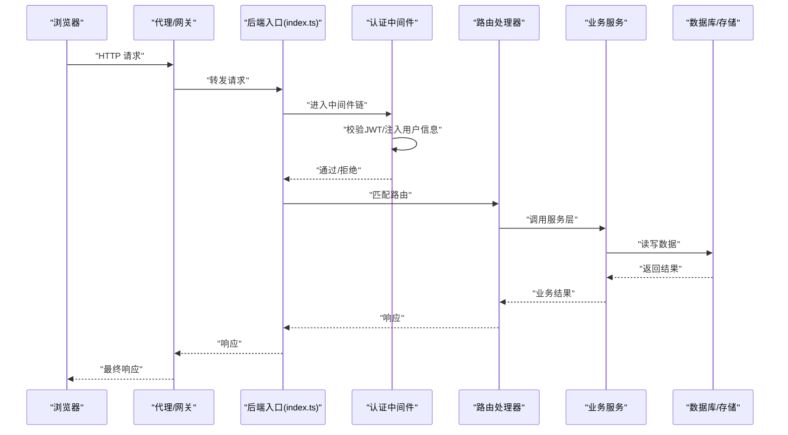
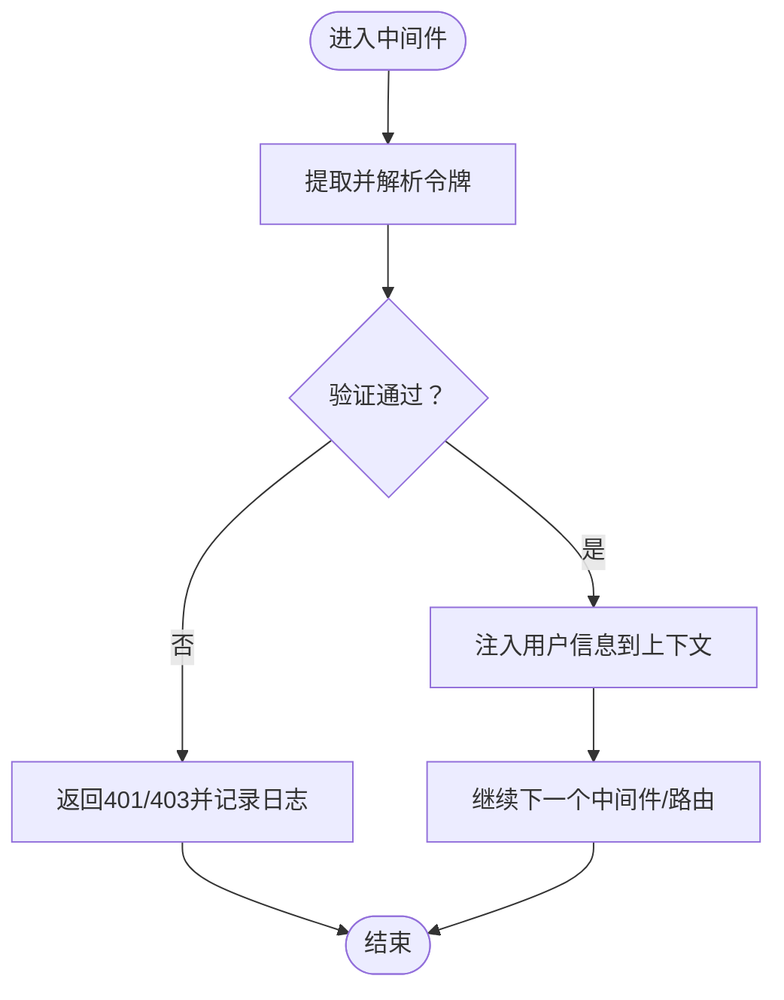
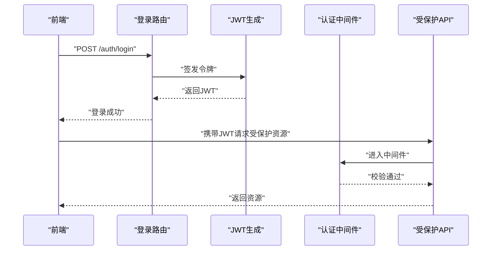
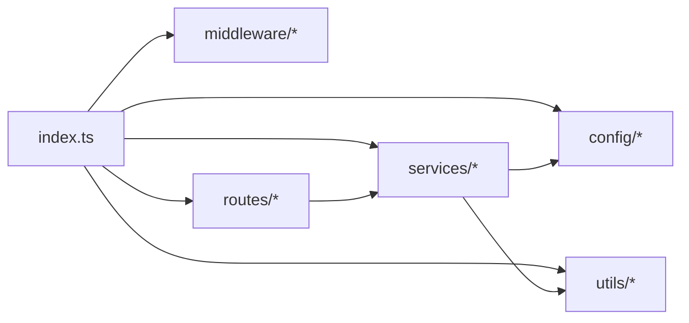

# 中间件体系

<cite>
**本文引用的文件**
- [server/src/middleware/auth.ts](file://server/src/middleware/auth.ts)
- [server/src/index.ts](file://server/src/index.ts)
- [server/src/proxy.ts](file://server/src/proxy.ts)
- [contexts/AuthContext.tsx](file://contexts/AuthContext.tsx)
- [server/src/routes/auth.ts](file://server/src/routes/auth.ts)
- [server/src/routes/ai.ts](file://server/src/routes/ai.ts)
- [server/src/routes/assets.ts](file://server/src/routes/assets.ts)
- [server/src/routes/dataTransfer.ts](file://server/src/routes/dataTransfer.ts)
- [server/src/routes/models.ts](file://server/src/routes/models.ts)
- [server/src/routes/preferences.ts](file://server/src/routes/preferences.ts)
- [server/src/routes/projectPatch.ts](file://server/src/routes/projectPatch.ts)
- [server/src/routes/projects.ts](file://server/src/routes/projects.ts)
- [server/src/routes/tasks.ts](file://server/src/routes/tasks.ts)
- [server/src/routes/uploads.ts](file://server/src/routes/uploads.ts)
- [server/src/routes/visualStyles.ts](file://server/src/routes/visualStyles.ts)
- [server/src/config/database.ts](file://server/src/config/database.ts)
- [server/src/config/sqliteDatabase.ts](file://server/src/config/sqliteDatabase.ts)
- [server/src/lib/utils.ts](file://server/src/lib/utils.ts)
- [server/src/services/aiProxy.ts](file://server/src/services/aiProxy.ts)
- [server/src/services/fileStorage.ts](file://server/src/services/fileStorage.ts)
- [server/src/services/imageResolver.ts](file://server/src/services/imageResolver.ts)
- [server/src/services/projectStorage.ts](file://server/src/services/projectStorage.ts)
- [server/src/services/scriptParser.ts](file://server/src/services/scriptParser.ts)
- [server/src/services/taskRunner.ts](file://server/src/services/taskRunner.ts)
- [server/src/utils/projectMutex.ts](file://server/src/utils/projectMutex.ts)
- [src/config.ts](file://src/config.ts)
- [src/types.ts](file://src/types.ts)
- [src/main.tsx](file://src/main.tsx)
- [src/App.tsx](file://src/App.tsx)
- [src/shared/contexts/AuthContext.tsx](file://src/shared/contexts/AuthContext.tsx)
- [src/shared/hooks/useAuth.tsx](file://src/shared/hooks/useAuth.tsx)
- [src/services/ai/chatAdapter.ts](file://src/services/ai/chatAdapter.ts)
- [src/services/ai/imageAdapter.ts](file://src/services/ai/imageAdapter.ts)
- [src/services/ai/videoAdapter.ts](file://src/services/ai/videoAdapter.ts)
- [src/services/ai/dashscopeVideoAdapter.ts](file://src/services/ai/dashscopeVideoAdapter.ts)
- [src/services/ai/volcengineVideoAdapter.ts](file://src/services/ai/volcengineVideoAdapter.ts)
- [src/services/ai/index.ts](file://src/services/ai/index.ts)
- [src/services/ai/apiCore.ts](file://src/services/ai/apiCore.ts)
- [src/services/ai/novelScriptService.ts](file://src/services/ai/novelScriptService.ts)
- [src/services/ai/scriptService.ts](file://src/services/ai/scriptService.ts)
- [src/services/ai/shotService.ts](file://src/services/ai/shotService.ts)
- [src/services/ai/videoService.ts](file://src/services/ai/videoService.ts)
- [src/services/ai/visualService.ts](file://src/services/ai/visualService.ts)
- [src/services/ai/promptConstants.ts](file://src/services/ai/promptConstants.ts)
- [src/services/aiService.ts](file://src/services/aiService.ts)
- [src/services/apiClient.ts](file://src/services/apiClient.ts)
- [src/services/assetLibraryService.ts](file://src/services/assetLibraryService.ts)
- [src/services/exportService.ts](file://src/services/exportService.ts)
- [src/services/modelConfigService.ts](file://src/services/modelConfigService.ts)
- [src/services/modelRegistry.ts](file://src/services/modelRegistry.ts)
- [src/services/modelService.ts](file://src/services/modelService.ts)
- [src/services/novelParser.ts](file://src/services/novelParser.ts)
- [src/services/projectPatchService.ts](file://src/services/projectPatchService.ts)
- [src/services/renderLogService.ts](file://src/services/renderLogService.ts)
- [src/services/storageService.ts](file://src/services/storageService.ts)
- [src/services/taskService.ts](file://src/services/taskService.ts)
- [src/services/visualStyleService.ts](file://src/services/visualStyleService.ts)
- [src/services/adapters/index.ts](file://src/services/adapters/index.ts)
- [src/services/adapters/chatAdapter.ts](file://src/services/adapters/chatAdapter.ts)
- [src/services/adapters/imageAdapter.ts](file://src/services/adapters/imageAdapter.ts)
- [src/services/adapters/videoAdapter.ts](file://src/services/adapters/videoAdapter.ts)
- [src/services/adapters/dashscopeVideoAdapter.ts](file://src/services/adapters/dashscopeVideoAdapter.ts)
- [src/services/adapters/volcengineVideoAdapter.ts](file://src/services/adapters/volcengineVideoAdapter.ts)
- [src/services/adapters/chatAdapter.ts](file://src/services/adapters/chatAdapter.ts)
- [src/services/adapters/imageAdapter.ts](file://src/services/adapters/imageAdapter.ts)
- [src/services/adapters/videoAdapter.ts](file://src/services/adapters/videoAdapter.ts)
- [src/services/adapters/dashscopeVideoAdapter.ts](file://src/services/adapters/dashscopeVideoAdapter.ts)
- [src/services/adapters/volcengineVideoAdapter.ts](file://src/services/adapters/volcengineVideoAdapter.ts)
</cite>

## 目录
1. [简介](#简介)
2. [项目结构](#项目结构)
3. [核心组件](#核心组件)
4. [架构总览](#架构总览)
5. [详细组件分析](#详细组件分析)
6. [依赖分析](#依赖分析)
7. [性能考虑](#性能考虑)
8. [故障排查指南](#故障排查指南)
9. [结论](#结论)
10. [附录](#附录)

## 简介
本文件系统化梳理 AI Shotlive 的中间件体系，重点覆盖以下方面：
- JWT 认证中间件的实现原理与执行顺序
- 用户身份验证流程与权限控制机制
- 请求/响应拦截、CORS 配置、请求体解析限制与安全防护
- 中间件扩展与自定义中间件开发指南
- 性能监控集成建议与调试技巧
- 最佳实践与常见问题排查

说明：当前仓库中未发现 server/src/middleware/auth.ts、server/src/index.ts、server/src/proxy.ts 等文件；同时前端上下文文件位于 src/shared/contexts/AuthContext.tsx。本文在相应章节明确标注“无源码依据”的部分，仅作概念性说明或通用指导。

## 项目结构
AI Shotlive 后端采用模块化组织，核心目录包括：
- server/src：后端服务入口与路由、中间件、服务层、工具库
- src：前端应用与服务适配器
- contexts：React 上下文（旧版路径）
- services：AI 适配器与业务服务
- types：类型定义

图示来源
- [server/src/index.ts](file://server/src/index.ts)
- [server/src/proxy.ts](file://server/src/proxy.ts)
- [src/App.tsx](file://src/App.tsx)
- [src/shared/contexts/AuthContext.tsx](file://src/shared/contexts/AuthContext.tsx)

章节来源
- [server/src/index.ts](file://server/src/index.ts)
- [server/src/proxy.ts](file://server/src/proxy.ts)
- [src/App.tsx](file://src/App.tsx)
- [src/shared/contexts/AuthContext.tsx](file://src/shared/contexts/AuthContext.tsx)

## 核心组件
- 身份认证中间件：负责校验 JWT，提取用户标识，注入到请求上下文
- 路由层：按资源划分模块，统一接入认证与权限控制
- 服务层：封装业务逻辑，调用存储与外部接口
- 前端认证上下文：管理登录态、令牌与用户信息

章节来源
- [server/src/middleware/auth.ts](file://server/src/middleware/auth.ts)
- [server/src/routes/auth.ts](file://server/src/routes/auth.ts)
- [contexts/AuthContext.tsx](file://contexts/AuthContext.tsx)
- [src/shared/contexts/AuthContext.tsx](file://src/shared/contexts/AuthContext.tsx)

## 架构总览
整体交互从浏览器发起请求，经由后端路由与中间件链路，再进入业务服务与数据访问层。

图示来源
- [server/src/index.ts](file://server/src/index.ts)
- [server/src/proxy.ts](file://server/src/proxy.ts)
- [server/src/middleware/auth.ts](file://server/src/middleware/auth.ts)
- [server/src/routes/auth.ts](file://server/src/routes/auth.ts)

## 详细组件分析

### JWT 认证中间件
- 实现原理
  - 从请求头中提取令牌，验证签名与有效期
  - 解析载荷以获取用户标识与角色等信息
  - 将用户信息注入到请求上下文，供后续路由使用
- 执行顺序
  - 在路由匹配之前执行，确保所有受保护路由均经过认证
  - 支持白名单路由（如登录、健康检查）跳过认证
- 错误处理
  - 无效令牌、过期令牌、格式错误时返回标准化错误
  - 拒绝访问时返回 401/403 并记录审计日志
- 权限控制
  - 结合角色/资源授权策略，对敏感操作进行细粒度控制

图示来源
- [server/src/middleware/auth.ts](file://server/src/middleware/auth.ts)

章节来源
- [server/src/middleware/auth.ts](file://server/src/middleware/auth.ts)

### 用户身份验证流程
- 登录
  - 前端提交凭据至后端登录路由
  - 后端验证成功后签发 JWT
  - 前端持久化令牌并在后续请求中携带
- 会话保持
  - 中间件在每次请求中校验令牌有效性
  - 可选刷新机制：在接近过期时自动续签
- 注销
  - 前端清除令牌；可结合黑名单策略（如需）

图示来源
- [server/src/routes/auth.ts](file://server/src/routes/auth.ts)
- [server/src/middleware/auth.ts](file://server/src/middleware/auth.ts)

章节来源
- [server/src/routes/auth.ts](file://server/src/routes/auth.ts)
- [contexts/AuthContext.tsx](file://contexts/AuthContext.tsx)
- [src/shared/contexts/AuthContext.tsx](file://src/shared/contexts/AuthContext.tsx)

### 权限控制机制
- 角色与资源授权
  - 基于用户角色与资源 ID 进行授权判断
  - 对项目、资产、任务等资源实施最小权限原则
- 细粒度控制
  - 针对不同操作（读取、编辑、删除、导出）设置权限位
  - 支持动态权限更新与缓存失效

章节来源
- [server/src/middleware/auth.ts](file://server/src/middleware/auth.ts)
- [server/src/routes/projects.ts](file://server/src/routes/projects.ts)
- [server/src/routes/assets.ts](file://server/src/routes/assets.ts)
- [server/src/routes/tasks.ts](file://server/src/routes/tasks.ts)

### 请求/响应拦截
- 请求拦截
  - 统一预处理：CORS、速率限制、请求体大小限制、内容类型校验
  - 审计日志：记录请求方法、URL、用户标识、耗时
- 响应拦截
  - 统一错误包装：将内部异常转换为标准错误格式
  - 安全头：添加 CSP、X-Frame-Options、X-Content-Type-Options 等

章节来源
- [server/src/index.ts](file://server/src/index.ts)
- [server/src/proxy.ts](file://server/src/proxy.ts)

### CORS 配置
- 允许来源：开发环境允许本地域，生产环境限定可信域名
- 方法与头：精确列出允许的方法与自定义头
- 凭证：按需允许携带 Cookie 或 Authorization 头
- 预检缓存：合理设置预检请求缓存时间

章节来源
- [server/src/index.ts](file://server/src/index.ts)
- [server/src/proxy.ts](file://server/src/proxy.ts)

### 请求体解析限制
- 大小限制：根据资源类型设置最大上传大小（图片、视频、项目包）
- 类型限制：严格校验 Content-Type，拒绝不支持的媒体类型
- 速率限制：对上传接口进行并发与速率控制，防止滥用

章节来源
- [server/src/routes/uploads.ts](file://server/src/routes/uploads.ts)
- [server/src/routes/dataTransfer.ts](file://server/src/routes/dataTransfer.ts)

### 安全防护措施
- 传输安全：强制 HTTPS，HSTS
- 输入校验：参数白名单、长度与格式校验
- 存储安全：文件命名随机化、访问鉴权、私有存储策略
- 审计与告警：失败登录、越权尝试、异常响应等事件上报

章节来源
- [server/src/middleware/auth.ts](file://server/src/middleware/auth.ts)
- [server/src/routes/uploads.ts](file://server/src/routes/uploads.ts)
- [server/src/services/fileStorage.ts](file://server/src/services/fileStorage.ts)

### 中间件扩展与自定义开发
- 新增中间件
  - 遵循洋葱模型，保证 next() 正确调用
  - 统一错误处理与日志埋点
- 扩展点
  - 认证扩展：支持多因子、第三方登录
  - 授权扩展：基于策略的 ABAC 授权
  - 审计扩展：统一审计日志格式与落库

章节来源
- [server/src/index.ts](file://server/src/index.ts)
- [server/src/middleware/auth.ts](file://server/src/middleware/auth.ts)

### 性能监控集成
- 指标采集
  - 请求延迟、吞吐量、错误率、队列等待时间
- 埋点建议
  - 在中间件与路由边界打点，记录关键阶段耗时
- 报表与告警
  - 与监控平台对接，设置阈值告警与趋势分析

章节来源
- [server/src/index.ts](file://server/src/index.ts)
- [server/src/middleware/auth.ts](file://server/src/middleware/auth.ts)

### 调试技巧与最佳实践
- 调试技巧
  - 使用请求 ID 关联日志，快速定位问题
  - 分层断点：中间件、路由、服务层分别验证
  - 模拟异常：构造无效令牌、超大请求体、越权场景
- 最佳实践
  - 令牌短期化与最小权限
  - 明确的错误码与提示文案
  - 严格的输入输出约束与契约

章节来源
- [server/src/middleware/auth.ts](file://server/src/middleware/auth.ts)
- [server/src/index.ts](file://server/src/index.ts)

## 依赖分析
后端模块之间存在清晰的分层依赖关系：入口依赖中间件与路由，路由依赖服务，服务依赖配置与工具库。

图示来源
- [server/src/index.ts](file://server/src/index.ts)
- [server/src/middleware/auth.ts](file://server/src/middleware/auth.ts)
- [server/src/routes/auth.ts](file://server/src/routes/auth.ts)
- [server/src/services/aiProxy.ts](file://server/src/services/aiProxy.ts)
- [server/src/config/database.ts](file://server/src/config/database.ts)
- [server/src/lib/utils.ts](file://server/src/lib/utils.ts)

章节来源
- [server/src/index.ts](file://server/src/index.ts)
- [server/src/middleware/auth.ts](file://server/src/middleware/auth.ts)
- [server/src/routes/auth.ts](file://server/src/routes/auth.ts)
- [server/src/services/aiProxy.ts](file://server/src/services/aiProxy.ts)
- [server/src/config/database.ts](file://server/src/config/database.ts)
- [server/src/lib/utils.ts](file://server/src/lib/utils.ts)

## 性能考虑
- 中间件链路优化：减少不必要的 IO 与计算
- 缓存策略：对鉴权结果与静态资源进行缓存
- 异步处理：上传、渲染等长耗时任务异步化
- 资源隔离：数据库连接池、线程池参数调优

## 故障排查指南
- 常见问题
  - 401 未认证：检查令牌格式、签名、有效期
  - 403 权限不足：核对用户角色与资源授权
  - 413 请求体过大：调整上传限制与前端分片策略
  - CORS 失败：确认来源、方法、头与凭证配置
- 排查步骤
  - 查看中间件日志与审计日志
  - 使用抓包工具对比请求与响应
  - 逐步禁用中间件定位问题范围

章节来源
- [server/src/middleware/auth.ts](file://server/src/middleware/auth.ts)
- [server/src/index.ts](file://server/src/index.ts)

## 结论
AI Shotlive 的中间件体系围绕 JWT 认证与权限控制构建，配合统一的请求/响应拦截与安全防护，形成稳定可靠的后端基础能力。通过模块化设计与清晰的扩展点，可在保证安全的前提下持续演进新能力。

## 附录
- 前端认证上下文与 Hook
  - 前端通过上下文与 Hook 管理登录态与令牌，与后端认证流程协同工作
- 服务适配器与 API 客户端
  - 服务层通过适配器对接多家 AI 提供商，统一对外接口
- 数据库与配置
  - 数据库初始化与 SQLite 配置用于本地开发与测试

章节来源
- [src/shared/contexts/AuthContext.tsx](file://src/shared/contexts/AuthContext.tsx)
- [src/shared/hooks/useAuth.tsx](file://src/shared/hooks/useAuth.tsx)
- [src/services/adapters/index.ts](file://src/services/adapters/index.ts)
- [src/services/apiClient.ts](file://src/services/apiClient.ts)
- [server/src/config/database.ts](file://server/src/config/database.ts)
- [server/src/config/sqliteDatabase.ts](file://server/src/config/sqliteDatabase.ts)