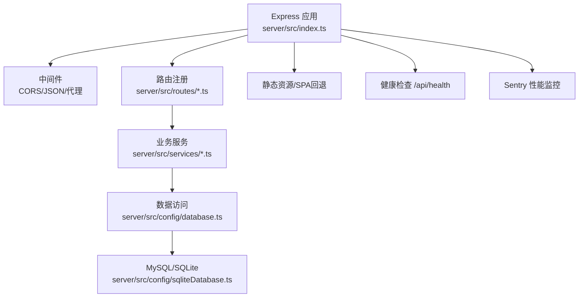
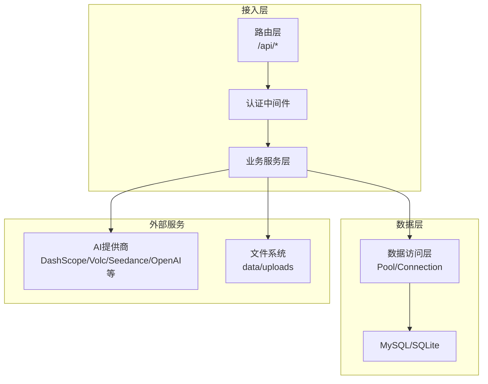
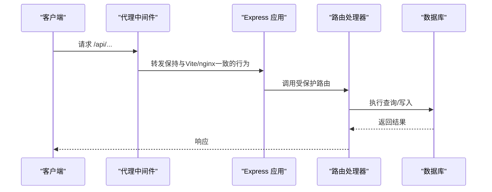
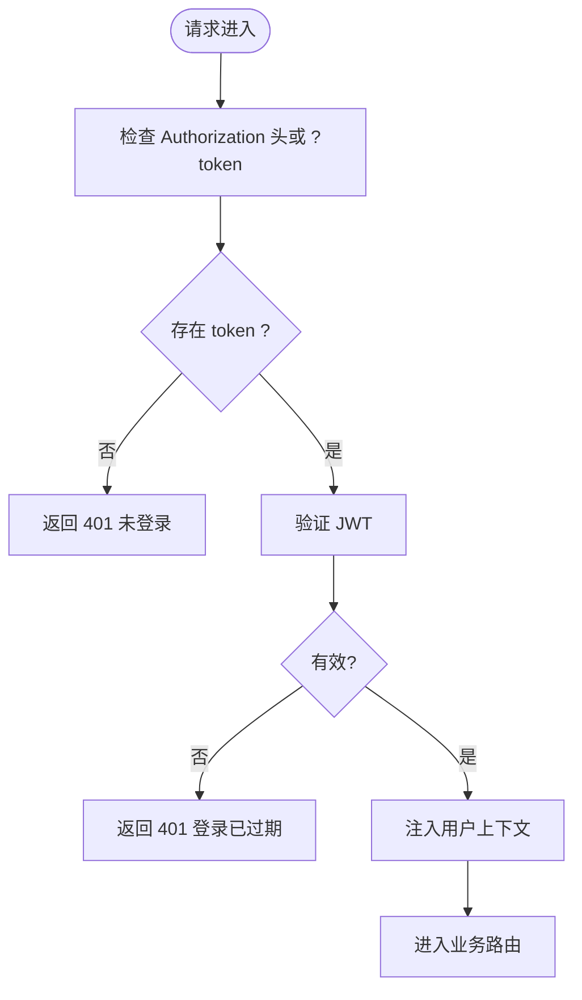
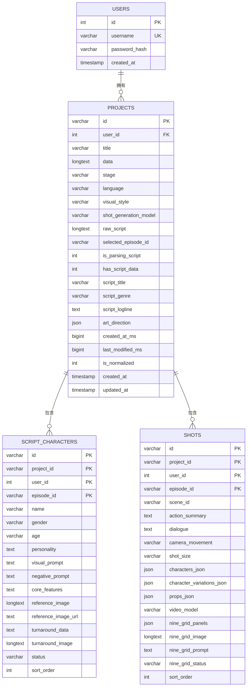
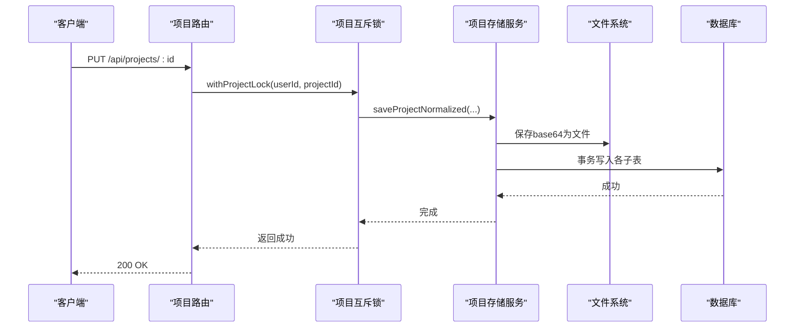
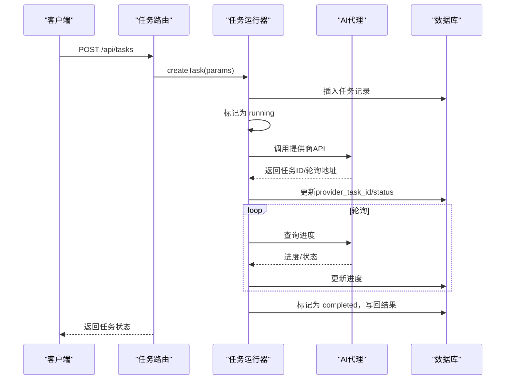
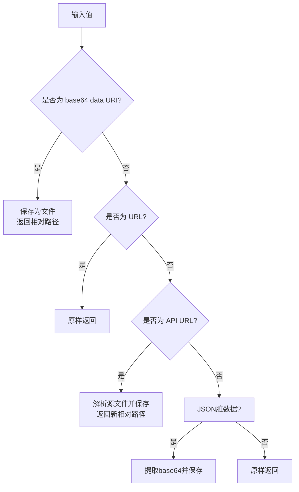
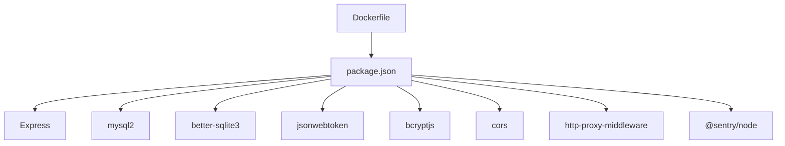

# 后端服务架构

<cite>
**本文档引用的文件**
- [server/src/index.ts](file://server/src/index.ts)
- [server/src/proxy.ts](file://server/src/proxy.ts)
- [server/src/middleware/auth.ts](file://server/src/middleware/auth.ts)
- [server/src/config/database.ts](file://server/src/config/database.ts)
- [server/src/config/sqliteDatabase.ts](file://server/src/config/sqliteDatabase.ts)
- [server/src/routes/auth.ts](file://server/src/routes/auth.ts)
- [server/src/routes/projects.ts](file://server/src/routes/projects.ts)
- [server/src/routes/tasks.ts](file://server/src/routes/tasks.ts)
- [server/src/services/taskRunner.ts](file://server/src/services/taskRunner.ts)
- [server/src/services/fileStorage.ts](file://server/src/services/fileStorage.ts)
- [server/src/services/projectStorage.ts](file://server/src/services/projectStorage.ts)
- [server/src/utils/projectMutex.ts](file://server/src/utils/projectMutex.ts)
- [server/src/services/aiProxy.ts](file://server/src/services/aiProxy.ts)
- [package.json](file://package.json)
- [Dockerfile](file://Dockerfile)
</cite>

## 目录
1. [引言](#引言)
2. [项目结构](#项目结构)
3. [核心组件](#核心组件)
4. [架构总览](#架构总览)
5. [详细组件分析](#详细组件分析)
6. [依赖关系分析](#依赖关系分析)
7. [性能考虑](#性能考虑)
8. [故障排查指南](#故障排查指南)
9. [结论](#结论)
10. [附录](#附录)

## 引言
本文件面向AI Shotlive后端服务，系统性阐述基于Express的后端架构设计，包括服务器初始化、中间件体系、API路由设计原则、业务逻辑层、数据访问层、服务间协调机制、认证授权、数据验证、异常处理、异步任务处理、文件存储管理与性能监控，并提供服务扩展指南与部署最佳实践。

## 项目结构
后端采用模块化分层设计：
- 服务器入口与中间件：Express应用初始化、CORS、JSON解析、代理、健康检查、静态资源与SPA回退
- 路由层：按功能域划分REST API（认证、项目、任务、资产、模型、偏好、数据传输、AI代理等）
- 业务服务层：任务运行器、文件存储、项目存储、AI代理、脚本解析等
- 数据访问层：MySQL/SQLite双栈适配，统一连接池与SQL翻译
- 工具与实用：项目级互斥锁、Sentry监控集成

图表来源
- [server/src/index.ts:48-113](file://server/src/index.ts#L48-L113)
- [server/src/proxy.ts:38-50](file://server/src/proxy.ts#L38-L50)

章节来源
- [server/src/index.ts:1-173](file://server/src/index.ts#L1-L173)
- [server/src/proxy.ts:1-51](file://server/src/proxy.ts#L1-L51)

## 核心组件
- Express服务器与中间件
  - 初始化dotenv、Sentry、数据库连接池
  - 注册CORS、JSON/URL编码解析、第三方API代理
  - 挂载路由前置于代理，保证与开发/生产环境CORS行为一致
  - 提供健康检查与生产环境静态资源与SPA回退
- 认证中间件
  - 基于JWT的认证与鉴权，支持Authorization头与URL参数两种方式
  - 为受保护路由注入用户上下文
- 数据库层
  - MySQL/SQLite双栈支持，自动调整max_allowed_packet，安全DDL迁移
  - SQLite适配器：SQL翻译、WAL模式、外键启用、UPSERT模拟
- 业务服务
  - 任务运行器：统一管理视频/图片/文本/脚本解析任务生命周期
  - 文件存储：base64到磁盘文件的转换与路径管理，支持跨项目/剧本迁移
  - 项目存储：规范化存储与反序列化，支持并发保护与批量导入导出
  - AI代理：统一调用多家AI提供商，封装异步轮询与重试策略
- 路由层
  - 按领域划分REST API，统一使用认证中间件保护
  - 提供图片/视频资源的统一访问接口，支持文件路径与URL回退

章节来源
- [server/src/index.ts:17-31](file://server/src/index.ts#L17-L31)
- [server/src/middleware/auth.ts:1-59](file://server/src/middleware/auth.ts#L1-L59)
- [server/src/config/database.ts:1-712](file://server/src/config/database.ts#L1-L712)
- [server/src/config/sqliteDatabase.ts:1-671](file://server/src/config/sqliteDatabase.ts#L1-L671)
- [server/src/services/taskRunner.ts:1-800](file://server/src/services/taskRunner.ts#L1-L800)
- [server/src/services/fileStorage.ts:1-262](file://server/src/services/fileStorage.ts#L1-L262)
- [server/src/services/projectStorage.ts:1-934](file://server/src/services/projectStorage.ts#L1-L934)
- [server/src/services/aiProxy.ts:1-906](file://server/src/services/aiProxy.ts#L1-L906)

## 架构总览
后端采用“路由-服务-数据访问”的清晰分层，结合Sentry进行性能监控与错误追踪。任务执行通过统一的运行器调度，AI调用通过代理层统一封装，文件与媒体资源通过专用存储服务管理。

图表来源
- [server/src/routes/auth.ts:1-213](file://server/src/routes/auth.ts#L1-L213)
- [server/src/routes/projects.ts:1-425](file://server/src/routes/projects.ts#L1-L425)
- [server/src/routes/tasks.ts:1-223](file://server/src/routes/tasks.ts#L1-L223)
- [server/src/services/taskRunner.ts:118-161](file://server/src/services/taskRunner.ts#L118-L161)
- [server/src/services/aiProxy.ts:115-161](file://server/src/services/aiProxy.ts#L115-L161)
- [server/src/services/fileStorage.ts:93-117](file://server/src/services/fileStorage.ts#L93-L117)

## 详细组件分析

### Express服务器与中间件体系
- 初始化流程
  - 加载环境变量（非Electron模式）
  - 初始化Sentry（性能采样、Express集成）
  - 初始化数据库（MySQL/SQLite）
  - 挂载第三方API代理（与开发/生产环境一致）
  - 注册CORS与JSON解析中间件
  - 注册路由与健康检查
  - 生产环境提供静态资源与SPA回退
- 安全加固
  - 生产环境强制JWT_SECRET配置校验
  - 任务恢复：服务器启动后自动恢复未完成任务
- 中间件职责
  - CORS：允许跨域
  - JSON/URL编码：解析大体积请求（500MB）
  - 代理：统一转发第三方API，解决CORS与跨域问题

图表来源
- [server/src/index.ts:58-59](file://server/src/index.ts#L58-L59)
- [server/src/proxy.ts:38-50](file://server/src/proxy.ts#L38-L50)
- [server/src/index.ts:62-64](file://server/src/index.ts#L62-L64)

章节来源
- [server/src/index.ts:12-173](file://server/src/index.ts#L12-L173)
- [server/src/proxy.ts:1-51](file://server/src/proxy.ts#L1-L51)

### 认证授权机制
- JWT策略
  - 生成：包含userId与username，7天有效期
  - 验证：优先从Authorization头提取，其次从URL参数token
  - 失败处理：401未授权
- 受保护路由
  - 所有业务路由均使用authMiddleware保护
  - 通过中间件注入req.userId与req.username

图表来源
- [server/src/middleware/auth.ts:35-58](file://server/src/middleware/auth.ts#L35-L58)

章节来源
- [server/src/middleware/auth.ts:1-59](file://server/src/middleware/auth.ts#L1-L59)

### 数据库设计与访问层
- MySQL/SQLite双栈
  - 运行时选择：DB_TYPE=sqlite时切换SQLite
  - max_allowed_packet自动调整，必要时重建连接池
  - 安全DDL：列/索引存在性检查与条件创建
- SQLite适配器
  - SQL翻译：ON DUPLICATE KEY UPDATE → ON CONFLICT
  - PRAGMA模拟：foreign_keys、journal_mode、busy_timeout
  - UPSERT：针对特定表的冲突目标映射
- 项目规范化存储
  - projects表承载结构化元数据，其余实体拆分至子表
  - episode_id纳入主键，实现剧本级数据隔离
  - 迁移：历史数据修复、索引补齐、主键重构

图表来源
- [server/src/config/database.ts:256-555](file://server/src/config/database.ts#L256-L555)
- [server/src/config/sqliteDatabase.ts:282-667](file://server/src/config/sqliteDatabase.ts#L282-L667)

章节来源
- [server/src/config/database.ts:1-712](file://server/src/config/database.ts#L1-L712)
- [server/src/config/sqliteDatabase.ts:1-671](file://server/src/config/sqliteDatabase.ts#L1-L671)

### 业务逻辑层：项目存储与并发控制
- 规范化存储
  - 保存：事务内清空旧子表，按实体类型拆分写入
  - 加载：并行查询各子表，按episode_id隔离，组装ProjectState
  - 导入/导出：支持批量写入与完整内容导出
- 并发保护
  - per-project mutex：同一项目保存串行化，避免锁等待超时
  - 重试机制：保存失败按指数退避重试
- 图片/视频处理
  - base64转文件路径，数据库仅存路径
  - 旧版JSON脏数据清洗，统一输出URL或回退API

图表来源
- [server/src/routes/projects.ts:64-78](file://server/src/routes/projects.ts#L64-L78)
- [server/src/utils/projectMutex.ts:19-43](file://server/src/utils/projectMutex.ts#L19-L43)
- [server/src/services/projectStorage.ts:149-472](file://server/src/services/projectStorage.ts#L149-L472)

章节来源
- [server/src/routes/projects.ts:1-425](file://server/src/routes/projects.ts#L1-L425)
- [server/src/utils/projectMutex.ts:1-44](file://server/src/utils/projectMutex.ts#L1-L44)
- [server/src/services/projectStorage.ts:1-934](file://server/src/services/projectStorage.ts#L1-L934)

### 业务逻辑层：任务运行与异步协调
- 任务生命周期
  - 创建：写入generation_tasks，立即执行
  - 执行：根据类型分派到视频/图片/文本/脚本解析
  - 轮询：异步提供商通过轮询获取进度与结果
  - 完成：回写项目数据，更新状态与进度
  - 恢复：服务器重启后恢复轮询中任务
- 任务类型与参数
  - 视频：起止图、宽高比、时长
  - 图片：参考图、变体/转面参数、宽高比
  - 文本：温度、最大令牌数、响应格式
  - 脚本解析：语言、风格、目标时长等
- 参考图归一化
  - 统一为base64 data URL，支持HTTP URL下载与本地文件路径解析
- 结果写回
  - 自动将结果写回到项目对应实体（关键帧/视频片段/角色图等）

图表来源
- [server/src/routes/tasks.ts:33-71](file://server/src/routes/tasks.ts#L33-L71)
- [server/src/services/taskRunner.ts:121-161](file://server/src/services/taskRunner.ts#L121-L161)
- [server/src/services/aiProxy.ts:115-161](file://server/src/services/aiProxy.ts#L115-L161)

章节来源
- [server/src/routes/tasks.ts:1-223](file://server/src/routes/tasks.ts#L1-L223)
- [server/src/services/taskRunner.ts:1-800](file://server/src/services/taskRunner.ts#L1-L800)
- [server/src/services/aiProxy.ts:1-906](file://server/src/services/aiProxy.ts#L1-L906)

### 文件存储与媒体资源管理
- 存储策略
  - base64 data URI → 保存为data/{projectId}/{episodeId}/{entityType}/{filename}
  - 数据库存储文件相对路径，避免大字段
  - 支持文件路径、URL与旧版JSON脏数据的统一解析
- 访问策略
  - /api/projects/:id/image/:type/:eid → 按episode参数隔离
  - /api/projects/:id/video/:videoId → 按episode参数隔离
  - 支持直接URL重定向与文件缓冲返回
- 跨项目/剧本迁移
  - 通过内部API URL解析并复制到新实体路径

图表来源
- [server/src/services/fileStorage.ts:144-193](file://server/src/services/fileStorage.ts#L144-L193)
- [server/src/services/fileStorage.ts:233-251](file://server/src/services/fileStorage.ts#L233-L251)

章节来源
- [server/src/services/fileStorage.ts:1-262](file://server/src/services/fileStorage.ts#L1-L262)
- [server/src/routes/projects.ts:159-264](file://server/src/routes/projects.ts#L159-L264)

### API路由设计原则
- 命名规范
  - 路由前缀按领域划分：/api/auth、/api/projects、/api/tasks、/api/assets、/api/models、/api/preferences、/api/data-transfer、/api/ai
- 认证策略
  - 除公开接口外，所有业务路由均使用authMiddleware
- 数据验证
  - 路由层进行基础参数校验（类型、必填项）
  - 业务层进行更细粒度的约束（长度、范围、格式）
- 错误处理
  - 统一返回JSON错误对象，包含明确的错误信息
  - 服务器启动失败与任务恢复失败进行日志输出与进程退出

章节来源
- [server/src/routes/auth.ts:1-213](file://server/src/routes/auth.ts#L1-L213)
- [server/src/routes/projects.ts:1-425](file://server/src/routes/projects.ts#L1-L425)
- [server/src/routes/tasks.ts:1-223](file://server/src/routes/tasks.ts#L1-L223)

### 服务间协调机制
- 任务运行器与AI代理
  - 任务运行器根据模型配置选择具体适配器（DashScope、Volc、Seedance、通用异步等）
  - 统一轮询与重试策略，失败时记录错误并标记任务失败
- 项目存储与文件存储
  - 项目保存前预读图片备份，缩短事务持锁时间
  - 文件存储负责base64到文件路径的转换与解析
- 互斥锁与重试
  - 项目保存使用per-project mutex串行化
  - 保存失败按指数退避重试，避免MySQL锁等待超时

章节来源
- [server/src/services/taskRunner.ts:355-414](file://server/src/services/taskRunner.ts#L355-L414)
- [server/src/services/aiProxy.ts:57-82](file://server/src/services/aiProxy.ts#L57-L82)
- [server/src/utils/projectMutex.ts:19-43](file://server/src/utils/projectMutex.ts#L19-L43)

### 性能监控与异常处理
- Sentry集成
  - 性能采样率可配置，记录HTTP与Express集成
  - 服务器启动、任务执行、文件读写等关键路径均有日志
- 异常处理
  - 路由层捕获业务异常并返回友好错误
  - 任务运行器捕获AI调用异常，记录并标记失败
  - 数据库层DDL失败与锁冲突进行降级与重试

章节来源
- [server/src/index.ts:17-31](file://server/src/index.ts#L17-L31)
- [server/src/services/taskRunner.ts:404-413](file://server/src/services/taskRunner.ts#L404-L413)

## 依赖关系分析
- 运行时依赖
  - Express、CORS、http-proxy-middleware、mysql2、better-sqlite3、bcryptjs、jsonwebtoken、@sentry/node
- 构建与开发
  - TypeScript、Vite、Electron、Concurrently等
- Docker镜像
  - 多阶段构建，生产镜像仅包含运行所需依赖与构建产物

图表来源
- [package.json:26-59](file://package.json#L26-L59)
- [Dockerfile:3-36](file://Dockerfile#L3-L36)

章节来源
- [package.json:1-83](file://package.json#L1-L83)
- [Dockerfile:1-50](file://Dockerfile#L1-L50)

## 性能考虑
- 数据库
  - max_allowed_packet自动调整，避免大字段传输失败
  - 索引与主键重构，提升按episode_id查询性能
- 任务执行
  - 异步轮询与重试，避免长时间阻塞
  - 进度回调与状态更新，降低前端轮询压力
- 文件存储
  - base64转文件路径，减少数据库体积
  - 服务端回退URL避免传输大数据
- 并发控制
  - per-project mutex串行化保存，降低锁竞争
  - 事务内预读图片备份，缩短持锁时间

## 故障排查指南
- 服务器启动失败
  - 检查JWT_SECRET配置（生产环境必须）
  - 查看数据库连接与Sentry初始化日志
- 任务执行失败
  - 查看任务状态与错误信息
  - 检查AI提供商API Key与网络连通性
- 图片/视频无法访问
  - 确认episode参数正确
  - 检查文件路径是否存在与权限
- 导入/导出异常
  - 确认导入文件格式与字段完整性
  - 检查事务回滚与重试机制

章节来源
- [server/src/index.ts:125-137](file://server/src/index.ts#L125-L137)
- [server/src/routes/tasks.ts:157-160](file://server/src/routes/tasks.ts#L157-L160)
- [server/src/routes/projects.ts:260-263](file://server/src/routes/projects.ts#L260-L263)

## 结论
本后端服务架构以Express为核心，通过清晰的分层设计实现了认证授权、规范化数据存储、统一的任务执行与AI代理、完善的文件存储与访问控制，以及Sentry性能监控与异常处理。其双栈数据库支持、并发保护与重试机制确保了在复杂业务场景下的稳定性与可扩展性。

## 附录
- 环境变量与配置
  - DB_TYPE、DB_HOST、DB_PORT、DB_USER、DB_PASSWORD、DB_NAME
  - JWT_SECRET（生产环境必须）
  - SENTRY_DSN、SENTRY_ENVIRONMENT、SENTRY_TRACES_SAMPLE_RATE
  - UPLOADS_DIR、DATA_DIR、DIST_PATH
- 健康检查
  - /api/health：验证数据库连接并返回数据库类型
- 部署建议
  - 使用Docker多阶段构建，生产镜像最小化
  - 健康检查与容器编排配合，确保服务可用性
  - 为敏感配置使用环境变量与密钥管理

章节来源
- [server/src/index.ts:79-98](file://server/src/index.ts#L79-L98)
- [Dockerfile:38-49](file://Dockerfile#L38-L49)