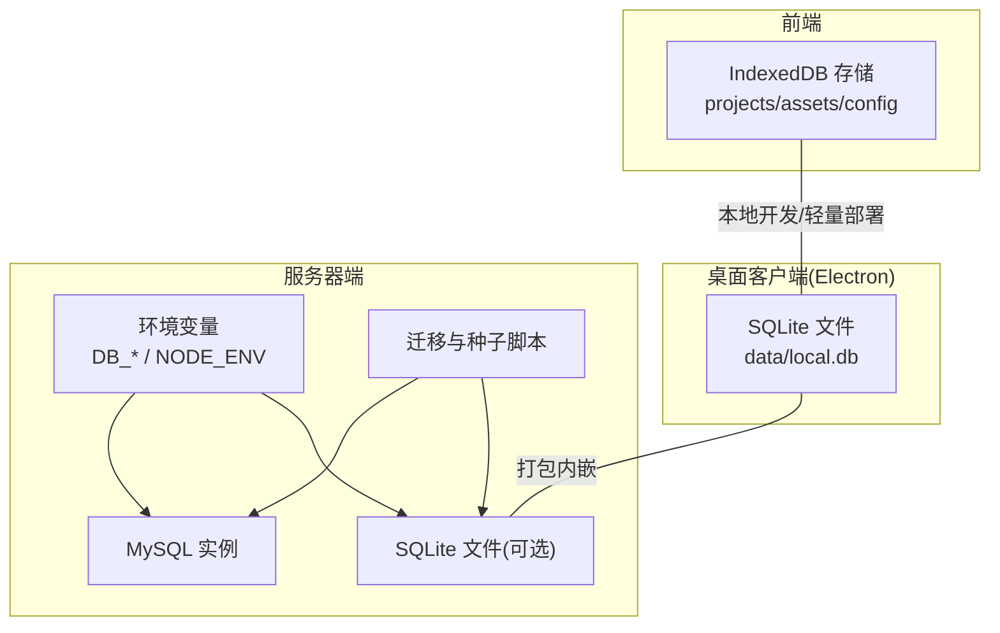
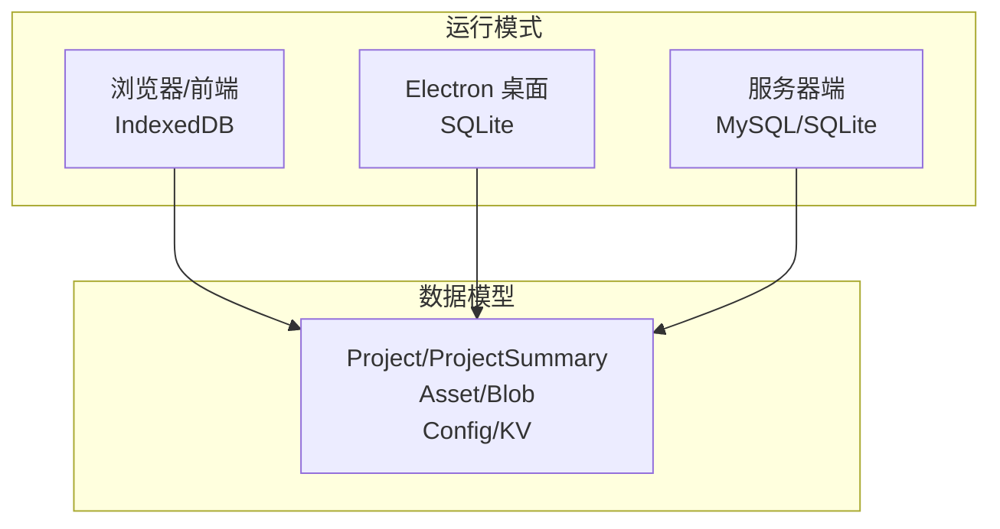
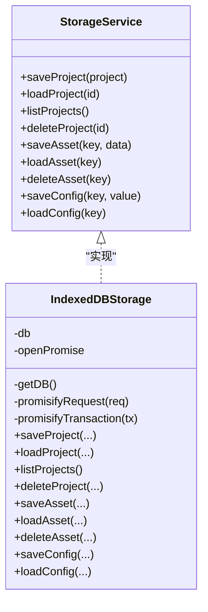
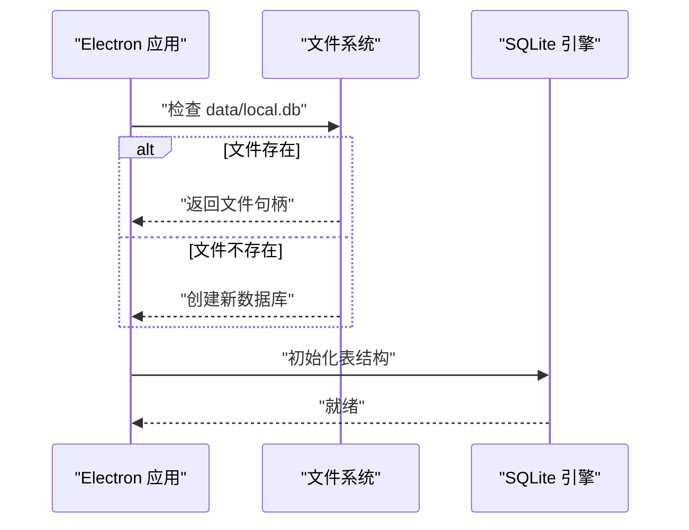
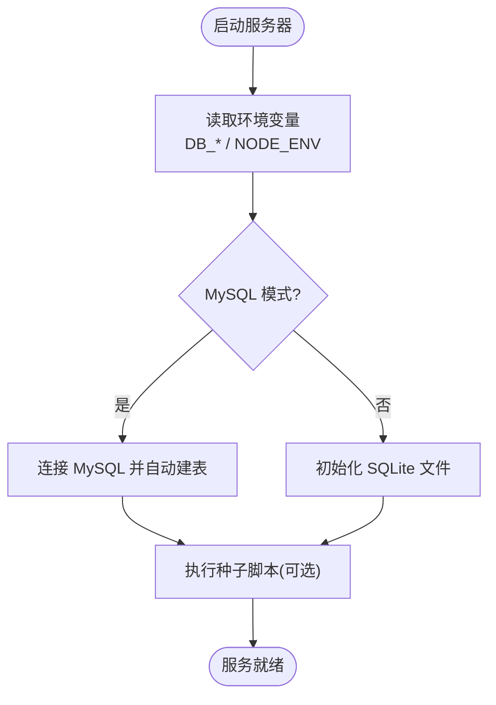
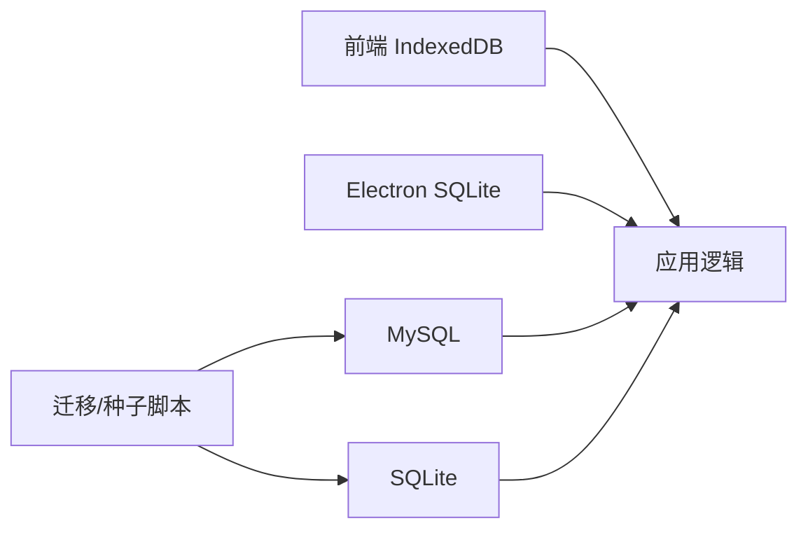

# 数据访问层

<cite>
**本文引用的文件**
- [README_EN.md](file://README_EN.md)
- [indexeddb.ts](file://src/services/storage/indexeddb.ts)
- [types.ts](file://src/services/storage/types.ts)
- [main.ts](file://electron/main.ts)
- [preload.ts](file://electron/preload.ts)
- [seed.ts](file://server/src/scripts/seed.ts)
- [migrateBase64ToFiles.ts](file://server/src/scripts/migrateBase64ToFiles.ts)
- [migrateEpisodeIds.ts](file://server/src/scripts/migrateEpisodeIds.ts)
- [migrateToEpisodePaths.ts](file://server/src/scripts/migrateToEpisodePaths.ts)
- [docker-compose.mysql.yaml](file://docker-compose.mysql.yaml)
- [docker-compose.yaml](file://docker-compose.yaml)
- [Dockerfile](file://Dockerfile)
</cite>

## 目录
1. [简介](#简介)
2. [项目结构](#项目结构)
3. [核心组件](#核心组件)
4. [架构总览](#架构总览)
5. [详细组件分析](#详细组件分析)
6. [依赖关系分析](#依赖关系分析)
7. [性能考量](#性能考量)
8. [故障排除指南](#故障排除指南)
9. [结论](#结论)
10. [附录](#附录)

## 简介
本文件聚焦于 AI Shotlive 的数据访问层，系统性梳理本地 IndexedDB 持久化与后端 MySQL/SQLite 双栈数据库支持、连接与事务管理、SQL 封装策略、用户数据隔离、查询优化与缓存策略，并提供扩展指南、新表设计与迁移方案，以及性能监控与故障排除建议。文档内容严格基于仓库现有实现与部署说明进行归纳总结。

## 项目结构
数据访问层由三层构成：
- 前端本地存储：基于浏览器 IndexedDB 的本地持久化，覆盖项目、资产与配置三类数据。
- 桌面客户端：Electron 打包内嵌 SQLite，无需外部数据库即可运行。
- 服务器端数据库：支持 MySQL 与 SQLite 两种模式，通过环境变量与构建脚本切换；首次启动自动建表；提供种子数据与迁移脚本。

**章节来源**
- [README_EN.md:188-259](file://README_EN.md#L188-L259)

## 核心组件
- IndexedDB 存储服务：提供项目、资产、配置三类数据的增删改查，采用事务封装与 Promise 化请求，确保一致性和错误处理。
- Electron 内嵌 SQLite：桌面应用默认使用 SQLite，无需额外数据库部署。
- 服务器端数据库：通过环境变量选择 MySQL 或 SQLite；首次启动自动建表；提供种子数据与迁移脚本。

**章节来源**
- [indexeddb.ts:1-189](file://src/services/storage/indexeddb.ts#L1-L189)
- [types.ts:1-30](file://src/services/storage/types.ts#L1-L30)
- [README_EN.md:188-259](file://README_EN.md#L188-L259)

## 架构总览
数据访问层在不同运行场景下采用不同的持久化策略，但对外暴露统一的数据模型与接口契约，保证上层业务逻辑的一致性。

**图表来源**
- [indexeddb.ts:103-185](file://src/services/storage/indexeddb.ts#L103-L185)
- [types.ts:7-30](file://src/services/storage/types.ts#L7-L30)

## 详细组件分析

### IndexedDB 存储服务
- 数据库与对象存储：
  - 数据库名与版本固定，首次打开触发升级流程，创建 projects、assets、config 三类对象存储。
  - projects 使用内部键路径 id；assets 与 config 使用外部键。
- 事务与错误处理：
  - 读写操作均在事务中执行，提供事务完成/失败/中止的 Promise 化封装。
  - 版本变更事件中主动关闭数据库，避免跨标签页锁库冲突。
- 接口契约：
  - 项目：保存、加载、列表（仅摘要字段）、删除。
  - 资产：以字符串键存储二进制 Blob。
  - 配置：以键值对存储任意 JSON 兼容值。

**图表来源**
- [types.ts:15-30](file://src/services/storage/types.ts#L15-L30)
- [indexeddb.ts:23-189](file://src/services/storage/indexeddb.ts#L23-L189)

**章节来源**
- [indexeddb.ts:1-189](file://src/services/storage/indexeddb.ts#L1-L189)
- [types.ts:1-30](file://src/services/storage/types.ts#L1-L30)

### 桌面客户端（Electron）与 SQLite
- 运行模式：桌面客户端打包内嵌 SQLite，无需外部数据库或服务器。
- 数据位置：默认数据文件位于 data/local.db。
- 启动流程：通过构建与启动脚本运行，访问本地 SQLite 文件。

**图表来源**
- [README_EN.md:237-244](file://README_EN.md#L237-L244)

**章节来源**
- [README_EN.md:237-244](file://README_EN.md#L237-L244)
- [main.ts:1-200](file://electron/main.ts#L1-L200)
- [preload.ts:1-200](file://electron/preload.ts#L1-L200)

### 服务器端数据库配置与脚本
- 数据库类型选择：
  - MySQL：通过环境变量 DB_HOST/DB_PORT/DB_USER/DB_PASSWORD/DB_NAME 切换。
  - SQLite：本地轻量部署模式，无需外部实例。
- 自动建表与种子数据：
  - 首次启动自动创建所需表结构。
  - 提供种子脚本创建默认管理员账户或导入备份。
- 迁移脚本：
  - 提供多项迁移脚本，涵盖从 Base64 到文件迁移、剧集 ID 迁移、路径迁移等。

**图表来源**
- [README_EN.md:188-212](file://README_EN.md#L188-L212)

**章节来源**
- [README_EN.md:188-212](file://README_EN.md#L188-L212)
- [seed.ts:1-200](file://server/src/scripts/seed.ts#L1-L200)
- [migrateBase64ToFiles.ts:1-200](file://server/src/scripts/migrateBase64ToFiles.ts#L1-L200)
- [migrateEpisodeIds.ts:1-200](file://server/src/scripts/migrateEpisodeIds.ts#L1-L200)
- [migrateToEpisodePaths.ts:1-200](file://server/src/scripts/migrateToEpisodePaths.ts#L1-L200)

### 用户数据隔离机制
- IndexedDB 模式：
  - 数据存储在浏览器本地，不同用户在不同设备/浏览器中隔离。
  - 无跨用户共享，天然具备隔离性。
- 服务器端模式：
  - 通过应用层权限控制与路由中间件实现用户隔离（具体实现位于中间件与路由模块）。
  - 建议在 SQL 查询中显式绑定当前用户标识，避免跨用户数据泄露。

[本节为概念性说明，不直接分析具体文件]

### 事务处理
- IndexedDB：
  - 所有读写均在事务中执行，提供事务完成/失败/中止的 Promise 化封装，确保一致性与可恢复性。
- 服务器端：
  - MySQL/SQLite 支持标准事务，建议在关键写入流程中使用事务包裹，失败回滚。
  - 对批量写入与多表更新，优先使用事务以保证原子性。

**章节来源**
- [indexeddb.ts:93-99](file://src/services/storage/indexeddb.ts#L93-L99)

### SQL 语句封装与查询优化
- 封装策略：
  - 统一使用参数化查询，避免拼接注入风险。
  - 将常用 CRUD 抽象为服务层方法，减少重复 SQL。
- 查询优化：
  - 为高频查询建立必要索引（如用户主键、时间戳、状态字段）。
  - 分页查询使用 LIMIT/OFFSET，避免一次性加载大结果集。
  - 使用 EXPLAIN 分析慢查询，定位瓶颈。
- 缓存策略：
  - 对只读或低频变更数据引入内存缓存（如 LRU），缩短热路径延迟。
  - 对分页列表与统计聚合结果设置 TTL 缓存，定期刷新。

[本节为通用实践说明，不直接分析具体文件]

## 依赖关系分析
- 前端与桌面客户端：
  - IndexedDB 作为本地持久化，不依赖后端。
  - Electron 内嵌 SQLite，独立于 MySQL。
- 服务器端：
  - 通过环境变量选择数据库类型。
  - 迁移与种子脚本依赖数据库连接与表结构定义。

**图表来源**
- [README_EN.md:188-259](file://README_EN.md#L188-L259)

**章节来源**
- [README_EN.md:188-259](file://README_EN.md#L188-L259)

## 性能考量
- 连接池与并发：
  - 服务器端建议使用连接池，限制最大连接数，避免资源耗尽。
  - 对高并发写入场景，采用队列化或批处理降低数据库压力。
- 索引与查询：
  - 为常用过滤与排序字段建立索引。
  - 避免 SELECT *，仅查询必要字段。
- 缓存与异步：
  - 对热点数据引入 Redis/Memory 缓存，设置合理过期策略。
  - 将非关键写入异步化，提升响应速度。
- I/O 优化：
  - 大文件存储建议分离到对象存储或文件系统，数据库仅存元数据。

[本节提供通用指导，不直接分析具体文件]

## 故障排除指南
- IndexedDB 打开失败：
  - 检查浏览器兼容性与存储配额；捕获 onblocked 与 onupgradeneeded 错误，必要时清理旧版本数据库。
- 版本变更冲突：
  - 监听 onversionchange 主动关闭数据库，避免跨标签页锁库。
- 服务器端连接问题：
  - 核对 DB_HOST/DB_PORT/DB_USER/DB_PASSWORD/DB_NAME 环境变量；确认 MySQL/SQLite 文件路径与权限。
- 迁移失败：
  - 查看迁移脚本输出日志，确认目标表结构与数据格式；必要时回滚并修复脚本。
- 种子数据异常：
  - 检查种子脚本执行顺序与依赖；确保默认管理员账户创建成功。

**章节来源**
- [indexeddb.ts:34-42](file://src/services/storage/indexeddb.ts#L34-L42)
- [indexeddb.ts:66-70](file://src/services/storage/indexeddb.ts#L66-L70)
- [README_EN.md:188-212](file://README_EN.md#L188-L212)

## 结论
AI Shotlive 的数据访问层在本地、桌面与服务器三种运行模式下提供了稳健的持久化能力：浏览器 IndexedDB 保障本地隔离与离线可用；Electron 内嵌 SQLite 降低部署复杂度；服务器端支持 MySQL/SQLite 并提供自动化建表与迁移工具。遵循事务、索引、缓存与连接池等最佳实践，可进一步提升性能与可靠性。

## 附录

### 数据访问扩展指南
- 新增实体与表：
  - 在种子脚本中定义初始表结构；在迁移脚本中编写向后兼容的变更。
  - 在服务层新增 CRUD 方法，保持参数化与事务包裹。
- 字段演进：
  - 使用可空字段与默认值，避免破坏既有数据。
  - 通过迁移脚本逐步添加索引与约束。
- 安全与隔离：
  - 在查询中显式绑定用户上下文，防止越权访问。
  - 对敏感字段加密存储，传输与落库均需加密。

[本节为通用指导，不直接分析具体文件]

### 新表结构设计
- 设计原则：
  - 明确主键与外键关系；为高频查询字段建立索引。
  - 控制单表宽度，必要时拆分为关联表。
  - 记录审计字段（创建/更新时间、操作人）。
- 示例流程：
  - 在种子脚本中定义表结构。
  - 在迁移脚本中添加字段或索引。
  - 在服务层增加对应方法并补充单元测试。

[本节为通用指导，不直接分析具体文件]

### 数据迁移方案
- 迁移策略：
  - 使用不可变迁移脚本，按顺序执行；失败时记录日志并回滚。
  - 对大表迁移采用分批处理与增量同步。
- 常见迁移：
  - 二进制数据从内存迁移到文件系统；剧集 ID 重写；路径规范化。
- 回滚与验证：
  - 提供逆向迁移脚本；执行前后校验数据完整性。

**章节来源**
- [migrateBase64ToFiles.ts:1-200](file://server/src/scripts/migrateBase64ToFiles.ts#L1-L200)
- [migrateEpisodeIds.ts:1-200](file://server/src/scripts/migrateEpisodeIds.ts#L1-L200)
- [migrateToEpisodePaths.ts:1-200](file://server/src/scripts/migrateToEpisodePaths.ts#L1-L200)

### 部署与环境配置
- MySQL 模式：
  - 通过 docker-compose 启动 MySQL 服务；配置 DB_* 环境变量。
- SQLite 轻量模式：
  - 本地构建与启动；数据文件位于 data/local.db。
- 生产构建：
  - 使用生产环境变量与容器编排；确保数据库连接与迁移脚本正确执行。

**章节来源**
- [docker-compose.mysql.yaml:1-200](file://docker-compose.mysql.yaml#L1-L200)
- [docker-compose.yaml:1-200](file://docker-compose.yaml#L1-L200)
- [Dockerfile:1-200](file://Dockerfile#L1-L200)
- [README_EN.md:223-259](file://README_EN.md#L223-L259)