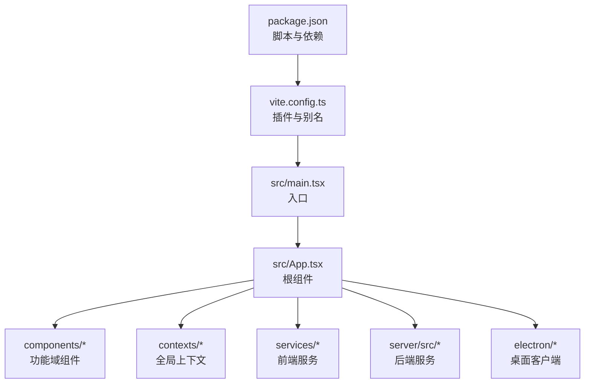
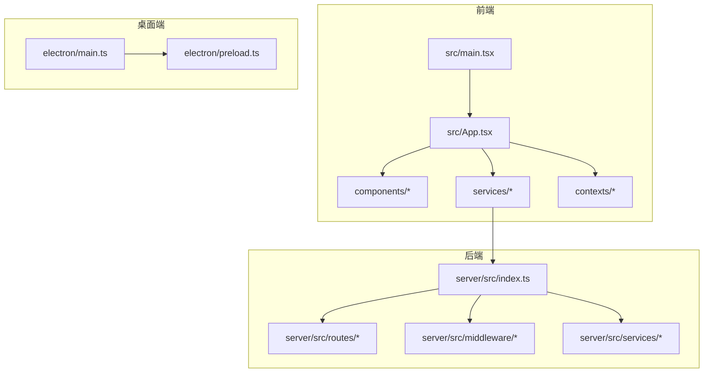
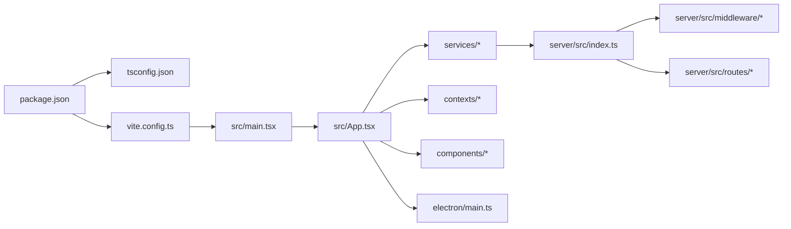

# 代码规范与最佳实践

<cite>
**本文引用的文件**
- [package.json](file://package.json)
- [tsconfig.json](file://tsconfig.json)
- [vite.config.ts](file://vite.config.ts)
- [README.md](file://README.md)
- [src/main.tsx](file://src/main.tsx)
- [src/App.tsx](file://src/App.tsx)
- [src/types.ts](file://src/types.ts)
- [src/config.ts](file://src/config.ts)
- [components/StageScript/index.tsx](file://components/StageScript/index.tsx)
- [components/StageAssets/index.tsx](file://components/StageAssets/index.tsx)
- [contexts/AuthContext.tsx](file://contexts/AuthContext.tsx)
- [contexts/ThemeContext.tsx](file://contexts/ThemeContext.tsx)
- [services/adapters/index.ts](file://services/adapters/index.ts)
- [services/ai/index.ts](file://services/ai/index.ts)
- [server/src/index.ts](file://server/src/index.ts)
- [server/src/middleware/auth.ts](file://server/src/middleware/auth.ts)
- [server/src/routes/auth.ts](file://server/src/routes/auth.ts)
- [server/src/services/taskRunner.ts](file://server/src/services/taskRunner.ts)
- [electron/main.ts](file://electron/main.ts)
- [electron/preload.ts](file://electron/preload.ts)
</cite>

## 目录
1. [引言](#引言)
2. [项目结构](#项目结构)
3. [核心组件](#核心组件)
4. [架构总览](#架构总览)
5. [详细组件分析](#详细组件分析)
6. [依赖关系分析](#依赖关系分析)
7. [性能考虑](#性能考虑)
8. [故障排查指南](#故障排查指南)
9. [结论](#结论)
10. [附录](#附录)

## 引言
本指南面向 AI Shotlive 团队，旨在建立统一的 TypeScript/React 开发规范、文件与目录命名约定、代码组织原则、注释规范、错误处理模式、性能优化建议，以及 Git 提交规范、分支管理策略与代码审查标准。文档以现有工程配置与典型组件为依据，结合实际可落地的最佳实践，帮助团队提升协作效率与代码质量。

## 项目结构
- 前端采用 React 19 + Vite 6 + TypeScript，Tailwind CSS 4 作为样式基础。
- 项目采用按功能域分层的目录组织：components、contexts、services、server、electron 等。
- 构建与运行通过 Vite 与 TypeScript 编译器配合，严格启用严格模式与类型检查。

图表来源
- [package.json:1-26](file://package.json#L1-L26)
- [vite.config.ts:1-13](file://vite.config.ts#L1-L13)
- [src/main.tsx:1-6](file://src/main.tsx#L1-L6)
- [src/App.tsx:1-6](file://src/App.tsx#L1-L6)

章节来源
- [README.md:308-370](file://README.md#L308-L370)
- [package.json:1-26](file://package.json#L1-L26)
- [tsconfig.json:1-21](file://tsconfig.json#L1-L21)
- [vite.config.ts:1-13](file://vite.config.ts#L1-L13)

## 核心组件
- 入口与根组件
  - 入口文件负责挂载根组件，确保 DOM 已就绪后再渲染。
  - 根组件目前承载最小化占位内容，后续应接入路由与布局容器。
- 类型与配置
  - 全局类型与应用配置预留文件，建议逐步完善类型体系与运行时配置。
- 上下文
  - 认证与主题上下文提供全局状态管理能力，建议遵循单一职责与最小暴露原则。

章节来源
- [src/main.tsx:1-6](file://src/main.tsx#L1-L6)
- [src/App.tsx:1-6](file://src/App.tsx#L1-L6)
- [src/types.ts:1-3](file://src/types.ts#L1-L3)
- [src/config.ts:1-3](file://src/config.ts#L1-L3)
- [contexts/AuthContext.tsx](file://contexts/AuthContext.tsx)
- [contexts/ThemeContext.tsx](file://contexts/ThemeContext.tsx)

## 架构总览
整体采用前后端分离架构，前端通过服务层对接后端 API；桌面端通过 Electron 内嵌服务端与数据库，实现“零配置”使用体验。

图表来源
- [src/main.tsx:1-6](file://src/main.tsx#L1-L6)
- [src/App.tsx:1-6](file://src/App.tsx#L1-L6)
- [server/src/index.ts](file://server/src/index.ts)
- [server/src/routes/auth.ts](file://server/src/routes/auth.ts)
- [server/src/middleware/auth.ts](file://server/src/middleware/auth.ts)
- [server/src/services/taskRunner.ts](file://server/src/services/taskRunner.ts)
- [electron/main.ts](file://electron/main.ts)
- [electron/preload.ts](file://electron/preload.ts)

## 详细组件分析

### 组件开发规范
- 命名与导出
  - 功能域组件目录以名词短语命名，如 StageScript、StageAssets、StageDirector、StageExport、StagePrompts。
  - 每个功能域目录下提供 index.tsx 作为聚合导出入口，便于上层按域引用。
- 结构与职责
  - 单一职责：每个组件聚焦一个明确的功能边界，避免“上帝组件”。
  - 可组合性：优先使用 props 注入行为与数据，减少全局状态耦合。
- 类型安全
  - 使用 TypeScript 明确 props、状态与返回值类型，避免 any。
  - 对外接口尽量收敛，必要时通过类型别名或接口抽象。
- 错误处理
  - 组件内部错误通过 React 错误边界捕获；网络错误通过服务层统一处理并回传给 UI。
  - 对不可恢复错误，提供用户可理解的提示与重试机制。

章节来源
- [components/StageScript/index.tsx](file://components/StageScript/index.tsx)
- [components/StageAssets/index.tsx](file://components/StageAssets/index.tsx)

### 上下文与状态管理
- 认证上下文
  - 负责用户登录态、令牌与权限校验；建议与路由守卫配合，未登录跳转至登录页。
- 主题上下文
  - 管理明暗主题切换与样式变量；建议持久化用户偏好的主题设置。
- 最佳实践
  - 避免在多个上下文中重复存储同一状态；通过组合上下文或共享服务降低耦合。
  - 对敏感状态进行细粒度拆分，避免不必要的重渲染。

章节来源
- [contexts/AuthContext.tsx](file://contexts/AuthContext.tsx)
- [contexts/ThemeContext.tsx](file://contexts/ThemeContext.tsx)

### 服务层与适配器
- 服务层
  - 前端服务封装 API 调用、参数序列化、错误映射与缓存策略；建议统一错误码与异常类型。
- 适配器
  - 多厂商 AI 适配器通过统一接口屏蔽差异，便于切换与扩展；建议对请求参数与响应结构做标准化转换。
- 任务与异步
  - 后端任务调度与并发控制通过任务运行器实现；建议对失败重试、超时与限流进行策略化配置。

章节来源
- [services/adapters/index.ts](file://services/adapters/index.ts)
- [services/ai/index.ts](file://services/ai/index.ts)
- [server/src/services/taskRunner.ts](file://server/src/services/taskRunner.ts)

### 桌面端集成
- 主进程
  - 负责启动 Electron 窗口、加载本地资源与桥接 Node 能力；建议最小化主进程职责，将业务逻辑下沉至渲染进程或服务进程。
- 预加载脚本
  - 通过受限 API 暴露给渲染进程，确保 IPC 通信的安全性与可控性。

章节来源
- [electron/main.ts](file://electron/main.ts)
- [electron/preload.ts](file://electron/preload.ts)

## 依赖关系分析
- 前端依赖
  - React 19、Tailwind CSS 4、Vite 6、TypeScript 5；严格模式开启，类型检查跳过第三方库。
- 构建与别名
  - Vite 插件链路包含 React 与 Tailwind；路径别名 @ 指向 src，便于统一导入。
- 后端与桌面端
  - 后端基于 Express，桌面端基于 Electron；两者通过 API 协作，桌面端可内嵌数据库与服务。

图表来源
- [package.json:1-26](file://package.json#L1-L26)
- [tsconfig.json:1-21](file://tsconfig.json#L1-L21)
- [vite.config.ts:1-13](file://vite.config.ts#L1-L13)
- [src/main.tsx:1-6](file://src/main.tsx#L1-L6)
- [src/App.tsx:1-6](file://src/App.tsx#L1-L6)
- [server/src/index.ts](file://server/src/index.ts)

章节来源
- [package.json:1-26](file://package.json#L1-L26)
- [tsconfig.json:1-21](file://tsconfig.json#L1-L21)
- [vite.config.ts:1-13](file://vite.config.ts#L1-L13)

## 性能考虑
- 构建与运行
  - 严格模式与类型检查有助于早期发现性能隐患；建议在 CI 中强制执行类型检查。
- 组件渲染
  - 使用 React.memo、useMemo、useCallback 降低重渲染；避免在渲染期间创建新对象或函数。
- 资源加载
  - 图片与视频懒加载，关键路径资源优先；合理拆分代码块，按需加载功能域组件。
- 网络请求
  - 请求去抖与节流、缓存策略、并发限制；对长耗时任务提供进度反馈与取消能力。
- 桌面端
  - 主进程最小化，IPC 通信批量化；避免在渲染进程执行 CPU 密集操作。

## 故障排查指南
- 常见问题定位
  - 构建失败：检查 tsconfig 严格模式与模块解析；确认 Vite 别名与插件配置。
  - 运行时错误：查看控制台与网络面板，定位具体请求与组件堆栈。
  - 权限与认证：核对认证上下文状态与路由守卫逻辑。
- 错误处理模式
  - 组件层：提供降级 UI 与重试按钮；对网络错误区分可恢复与不可恢复。
  - 服务层：统一错误码与消息映射；记录必要上下文信息以便复现。
  - 后端：中间件统一拦截异常，输出结构化错误响应；对敏感信息脱敏。
- 日志与监控
  - 建议引入轻量日志与错误上报（如 Sentry），在开发与生产环境分别配置采样率。

章节来源
- [server/src/middleware/auth.ts](file://server/src/middleware/auth.ts)
- [server/src/routes/auth.ts](file://server/src/routes/auth.ts)

## 结论
本指南基于现有工程配置与组件实践，提出了可操作的规范与最佳实践。建议团队在迭代过程中持续补充类型体系、完善测试与监控，并通过代码审查与自动化检查保障质量。

## 附录

### TypeScript 编码规范
- 语言特性
  - 启用严格模式，禁用隐式 any；优先使用联合类型与字面量类型表达业务含义。
  - 函数式风格：纯函数优先，副作用集中管理；对可变状态进行显式标注。
- 类型设计
  - 使用接口与类型别名抽象对外契约；对复杂对象拆分为小而专的类型。
  - 对 API 响应与请求参数建立一一对应的类型定义，避免“影子类型”。

章节来源
- [tsconfig.json:1-21](file://tsconfig.json#L1-L21)
- [src/types.ts:1-3](file://src/types.ts#L1-L3)

### React 组件开发规范
- 命名与导出
  - 组件文件以 PascalCase 命名；功能域目录以名词短语命名，提供 index.tsx 聚合导出。
- 结构与职责
  - 单一职责、可组合、可测试；对外暴露稳定 props 接口。
- 样式与主题
  - 使用 Tailwind 类名，避免内联样式；主题切换通过上下文与 CSS 变量协同。
- 事件与副作用
  - 将副作用集中在 useEffect 中，注意清理与依赖数组；避免在渲染期间产生副作用。

章节来源
- [components/StageScript/index.tsx](file://components/StageScript/index.tsx)
- [components/StageAssets/index.tsx](file://components/StageAssets/index.tsx)
- [contexts/ThemeContext.tsx](file://contexts/ThemeContext.tsx)

### 文件命名约定与目录结构规范
- 目录命名
  - 功能域：PascalCase（如 StageScript、StageAssets、StageDirector、StageExport、StagePrompts）。
  - 公共层：shared、services、contexts、hooks 等。
- 文件命名
  - 组件：PascalCase.tsx；纯工具：camelCase.ts；常量：CONSTANT_CASE.ts。
  - 聚合导出：index.tsx；类型定义：types.ts；配置：config.ts。
- 路径别名
  - 使用 @/* 指向 src，统一导入路径，减少相对路径层级。

章节来源
- [vite.config.ts:1-13](file://vite.config.ts#L1-L13)
- [src/config.ts:1-3](file://src/config.ts#L1-L3)

### 注释规范
- 文件头部
  - 说明模块用途、作者与变更历史；对公共 API 提供简要说明。
- 函数与方法
  - 参数与返回值类型明确；对复杂逻辑提供步骤说明与边界条件。
- 类型与接口
  - 对字段含义与取值范围进行注释；对可选字段标注默认行为。
- TODO/NOTE
  - 使用 TODO 标注待办事项；使用 NOTE 标注注意事项与权衡。

### 错误处理模式
- 组件层
  - 包裹错误边界；对用户可操作的错误提供重试与帮助链接。
- 服务层
  - 统一错误映射与日志记录；区分网络错误、业务错误与系统错误。
- 后端
  - 中间件统一捕获异常；对客户端错误返回明确状态码与消息；对服务端错误记录堆栈。

章节来源
- [server/src/middleware/auth.ts](file://server/src/middleware/auth.ts)
- [server/src/routes/auth.ts](file://server/src/routes/auth.ts)

### 性能优化建议
- 构建期
  - 严格类型检查与最小化依赖；按需引入插件与 polyfill。
- 运行期
  - 组件层面：memo 化、拆分渲染、延迟加载；网络层面：缓存、去抖、并发控制。
- 桌面端
  - 主进程最小化、IPC 批量化、资源按需加载。

### Git 提交规范、分支管理与代码审查标准
- 提交规范
  - 类型前缀：feat、fix、docs、style、refactor、test、chore、perf、ci；正文简洁描述动机与影响。
  - 标题不超过 50 字；正文分段说明背景、变更点与风险。
- 分支管理
  - 主干保护：master/main 仅允许合并已审查的 PR；hotfix 分支直连主干。
  - 功能分支：feature/前缀；修复分支：fix/前缀；重构分支：refactor/前缀。
- 代码审查
  - 至少一名 reviewer；关注可读性、健壮性、性能与安全性；CI 通过且无未解决评论方可合并。