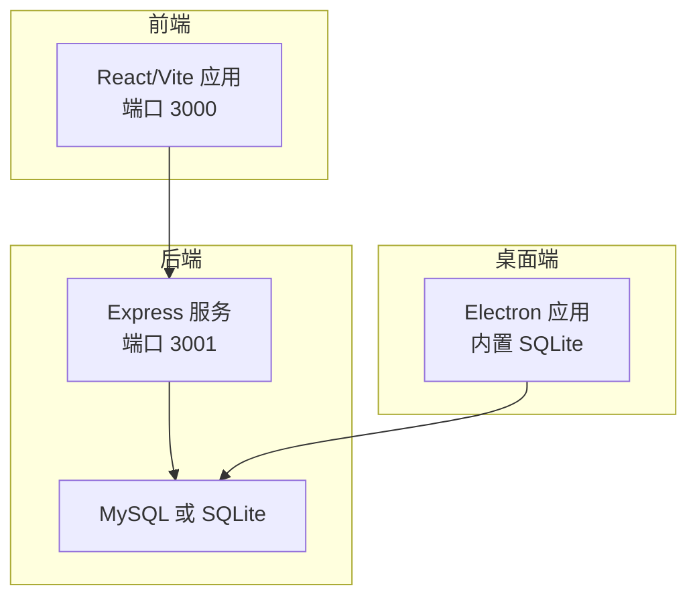
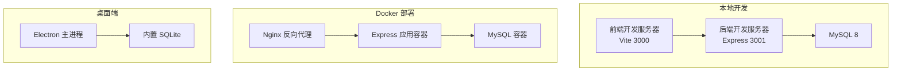
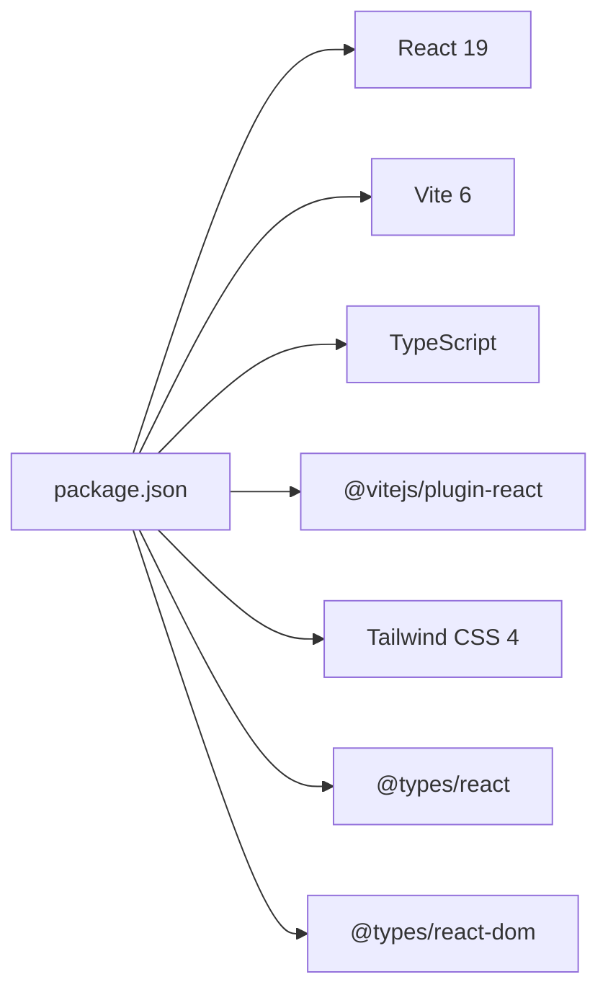

# 开发环境搭建

<cite>
**本文引用的文件**
- [package.json](file://package.json)
- [README.md](file://README.md)
- [README_EN.md](file://README_EN.md)
- [vite.config.ts](file://vite.config.ts)
- [tsconfig.json](file://tsconfig.json)
</cite>

## 目录
1. [简介](#简介)
2. [项目结构](#项目结构)
3. [核心组件](#核心组件)
4. [架构总览](#架构总览)
5. [详细组件分析](#详细组件分析)
6. [依赖分析](#依赖分析)
7. [性能考虑](#性能考虑)
8. [故障排查指南](#故障排查指南)
9. [结论](#结论)
10. [附录](#附录)

## 简介
本指南面向开发者，帮助你快速搭建 AI Shotlive 的本地开发环境，涵盖 Node.js、MySQL、SQLite 等环境要求，提供完整的项目克隆、依赖安装、环境变量配置步骤。同时包含本地开发环境启动、Docker 部署、以及桌面客户端（Electron）打包的完整流程，并提供常见环境问题的排查与解决方案。

## 项目结构
AI Shotlive 采用前后端分离架构：
- 前端：React 19 + Vite 6 + Tailwind CSS 4
- 后端：Express.js，支持 MySQL 8 / SQLite（本地模式）
- 桌面端：Electron 33，内置 SQLite，打包为 macOS DMG / Windows EXE
- 存储：用户数据按 user_id 隔离，媒体文件与上传文件按用户/项目隔离

图表来源
- [README.md:127-138](file://README.md#L127-L138)
- [README_EN.md:87-98](file://README_EN.md#L87-L98)

章节来源
- [README.md:127-138](file://README.md#L127-L138)
- [README_EN.md:87-98](file://README_EN.md#L87-L98)

## 核心组件
- 前端工程
  - 使用 Vite 6 构建，Tailwind CSS 4 样式框架，React 19 组件体系
  - TypeScript 配置严格，路径别名 @ 指向 src
- 后端工程
  - Express 服务，支持 MySQL 8 或 SQLite（本地模式）
  - 自动建表与种子数据脚本，支持数据导出/导入
- 桌面端工程
  - Electron 33 + better-sqlite3，打包为 macOS DMG / Windows EXE
  - 数据目录与应用目录分离，便于用户自定义配置

章节来源
- [package.json:1-26](file://package.json#L1-L26)
- [vite.config.ts:1-13](file://vite.config.ts#L1-L13)
- [tsconfig.json:1-21](file://tsconfig.json#L1-L21)
- [README.md:127-138](file://README.md#L127-L138)
- [README_EN.md:87-98](file://README_EN.md#L87-L98)

## 架构总览
下图展示了本地开发、Docker 部署与桌面端三种运行模式的差异与交互关系：

图表来源
- [README.md:161-240](file://README.md#L161-L240)
- [README_EN.md:167-254](file://README_EN.md#L167-L254)

章节来源
- [README.md:161-240](file://README.md#L161-L240)
- [README_EN.md:167-254](file://README_EN.md#L167-L254)

## 详细组件分析

### 环境要求与准备
- Node.js：>= 20（桌面端打包要求 Node >= 18）
- npm：>= 9
- MySQL：>= 5.7（推荐 8.0+），用于 Web 部署模式
- SQLite：内置，用于本地/桌面端模式，无需额外安装
- Sentry（可选）：错误监控

章节来源
- [README.md:149-156](file://README.md#L149-L156)
- [README_EN.md:167-173](file://README_EN.md#L167-L173)

### 项目克隆与依赖安装
- 克隆仓库并进入目录
- 安装依赖：npm install
- 复制并编辑环境变量文件：cp .env.example .env

章节来源
- [README.md:165-171](file://README.md#L165-L171)
- [README_EN.md:178-187](file://README_EN.md#L178-L187)

### 环境变量配置
- 数据库相关：DB_HOST、DB_PORT、DB_USER、DB_PASSWORD、DB_NAME
- JWT：JWT_SECRET
- 服务器端口：SERVER_PORT
- 运行环境：NODE_ENV

章节来源
- [README.md:173-185](file://README.md#L173-L185)
- [README_EN.md:188-200](file://README_EN.md#L188-L200)

### 数据库初始化与默认用户
- 首次启动后自动建表
- 可选：创建默认管理员并导入备份数据
  - npx tsx server/src/scripts/seed.ts
  - npx tsx server/src/scripts/seed.ts ./your-backup.json

章节来源
- [README.md:187-197](file://README.md#L187-L197)
- [README_EN.md:202-212](file://README_EN.md#L202-L212)

### 本地开发环境启动
- 同时启动前端与后端：npm run dev
  - 前端：http://localhost:3000
  - 后端 API：http://localhost:3001

章节来源
- [README.md:199-206](file://README.md#L199-L206)
- [README_EN.md:214-221](file://README_EN.md#L214-L221)

### Docker 部署
- 使用宿主机 MySQL
  - docker-compose up -d --build
- 应用 + MySQL 同栈（无需外部数据库）
  - docker compose -f docker-compose.mysql.yaml up -d --build

章节来源
- [README.md:208-220](file://README.md#L208-L220)
- [README_EN.md:223-235](file://README_EN.md#L223-L235)

### 本地轻量部署（SQLite，无需 MySQL）
- 生产构建：npm run build
- 启动：NODE_ENV=production npm start
- 或使用 SQLite 本地模式：
  - npm run build:local
  - npm run start:local
  - 数据存储在 data/local.db

章节来源
- [README.md:222-236](file://README.md#L222-L236)
- [README_EN.md:237-244](file://README_EN.md#L237-L244)

### 桌面客户端打包（Electron）
- 环境要求
  - Node.js >= 18
  - macOS：Xcode Command Line Tools
  - Windows：Visual Studio Build Tools
- 打包命令
  - npm install --legacy-peer-deps
  - npm run build:electron（当前平台）
  - npm run build:electron:mac（仅 macOS）
  - npm run build:electron:win（仅 Windows）
- 打包流程
  - npm run build:client → dist/
  - npm run build:server → server/dist/
  - npm run build:electron-main → electron/dist/
  - npx electron-builder → release/
- 产物
  - macOS：AI-ShotLive-{version}-mac-arm64.dmg 或 mac-x64.dmg
  - Windows：AI-ShotLive-Setup-{version}-win.exe
- 数据存储位置
  - macOS：~/Library/Application Support/ai-shotlive-director/
  - Windows：%APPDATA%/ai-shotlive-director/
- 配置覆盖
  - 在数据目录放置 .env 文件以覆盖默认配置（如 API Key、JWT 密钥等）

章节来源
- [README.md:242-306](file://README.md#L242-L306)
- [README_EN.md:257-321](file://README_EN.md#L257-L321)

### 前端构建与配置要点
- Vite 配置：启用 React 插件与 Tailwind CSS 插件，路径别名 @ 指向 src
- TypeScript 配置：严格模式、ES2022 目标、bundler 模式解析、JSX 支持

章节来源
- [vite.config.ts:1-13](file://vite.config.ts#L1-L13)
- [tsconfig.json:1-21](file://tsconfig.json#L1-L21)

## 依赖分析
- 前端依赖
  - React 19、React DOM 19、Lucide React 图标库
- 开发依赖
  - Vite 6、@vitejs/plugin-react、Tailwind CSS 4、TypeScript ~5.8.2、@types/react、@types/react-dom
- 后端与桌面端
  - Express（后端）、Electron 33（桌面端）、better-sqlite3（桌面端本地数据库）

图表来源
- [package.json:11-24](file://package.json#L11-L24)

章节来源
- [package.json:1-26](file://package.json#L1-L26)

## 性能考虑
- 本地开发优先使用 npm run dev，热更新提升迭代效率
- Docker 部署建议使用 --no-cache 重建以避免缓存问题
- SQLite 本地模式适合小规模测试与桌面端，生产环境推荐 MySQL 8
- Electron 打包时注意 better-sqlite3 的原生模块重编译，跨平台打包需在对应平台执行

## 故障排查指南
- 端口占用
  - 前端：确认 3000 端口未被占用；后端：确认 3001 端口未被占用
- 数据库连接失败
  - 检查 .env 中 DB_HOST、DB_PORT、DB_USER、DB_PASSWORD、DB_NAME 是否正确
  - 如使用 Docker，请确认容器已启动且网络连通
- Node.js 版本不匹配
  - 本地开发：Node >= 20
  - 桌面端打包：Node >= 18
- 权限与路径
  - 桌面端数据目录权限需允许读写
  - Windows 环境下打包需具备 Visual Studio Build Tools
- TypeScript/构建错误
  - 清理 node_modules 与缓存后重新安装依赖
  - 检查 tsconfig.json 与 vite.config.ts 的路径别名与模块解析配置

## 结论
通过本指南，你可以完成从零到一的开发环境搭建：安装 Node.js 与 npm，准备 MySQL 或使用 SQLite，克隆项目并安装依赖，配置环境变量，启动本地开发服务器，或选择 Docker 部署与桌面端打包。遇到问题时，可依据“故障排查指南”逐项定位与解决。

## 附录
- 快速命令索引
  - 克隆与安装：git clone ... && cd ... && npm install
  - 复制并编辑 .env
  - 初始化数据库：npx tsx server/src/scripts/seed.ts
  - 本地开发：npm run dev
  - Docker 部署：docker-compose up -d --build
  - 本地轻量部署：npm run build:local && npm run start:local
  - 桌面端打包：npm run build:electron / build:electron:mac / build:electron:win