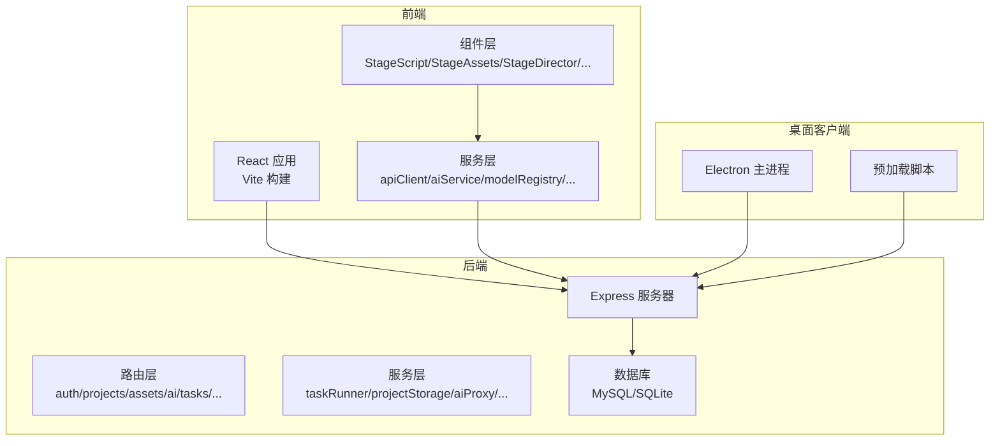
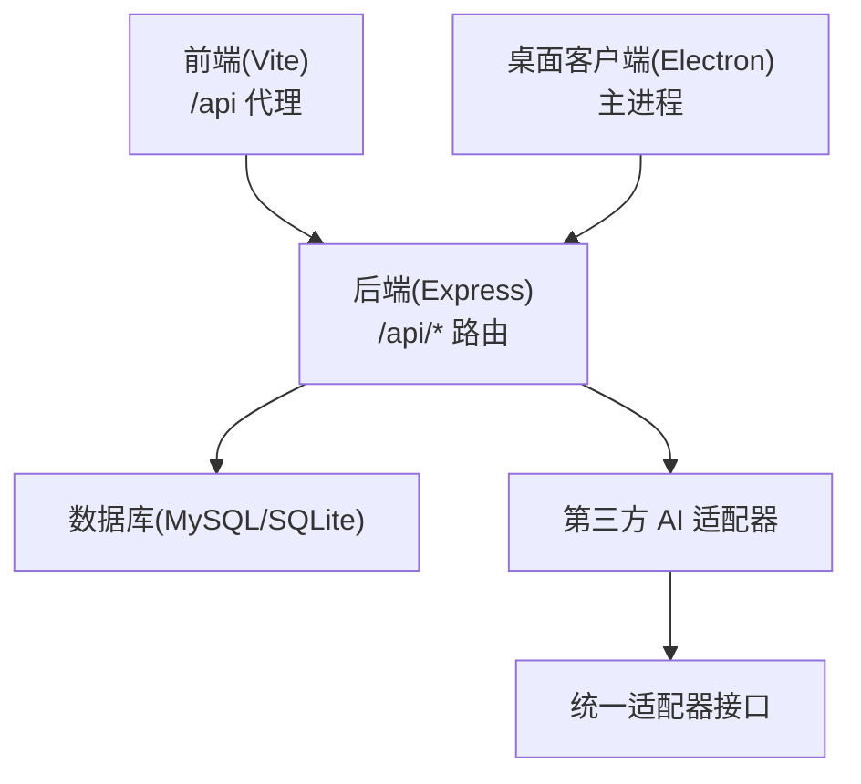
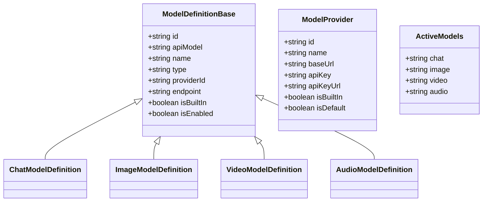
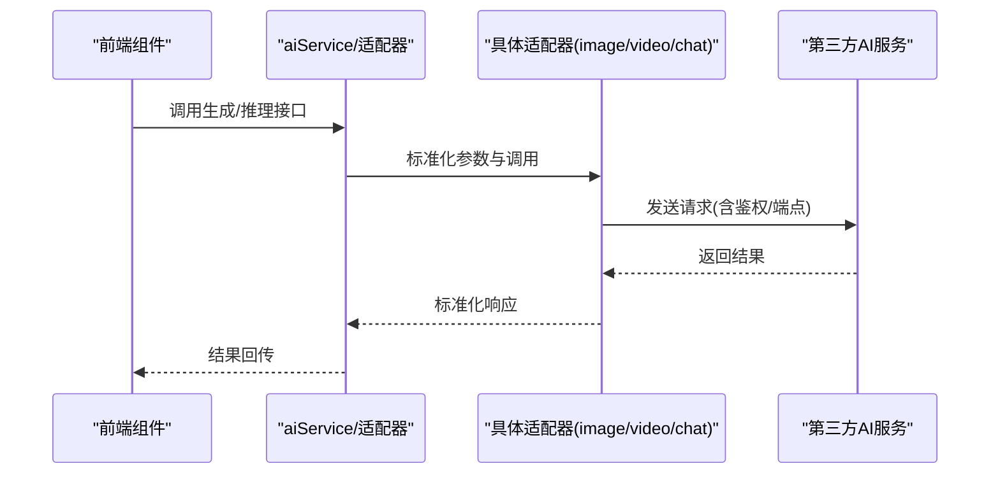
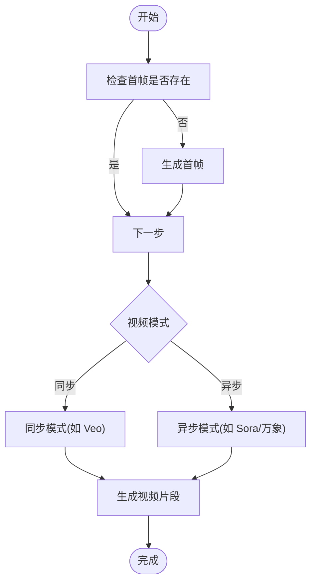
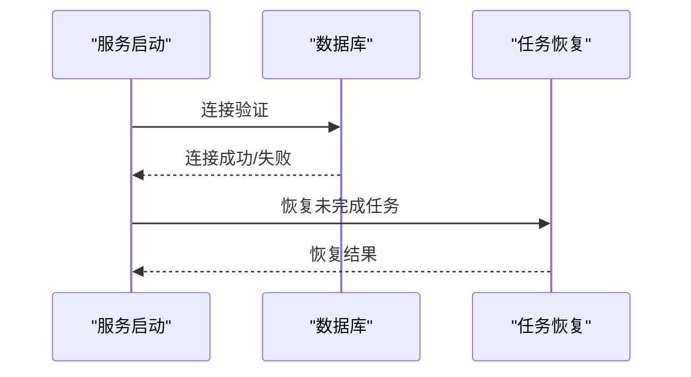
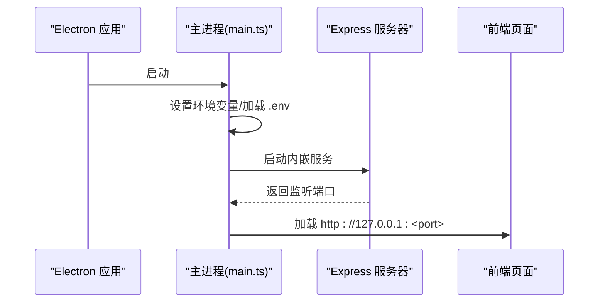
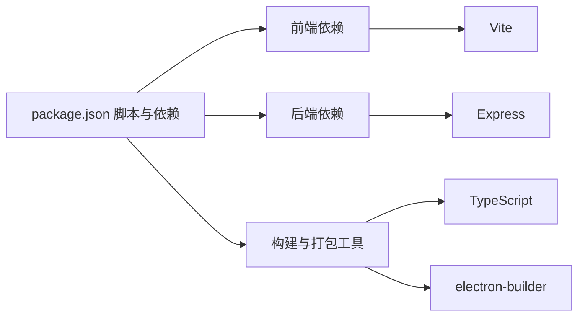

# 开发者指南

<cite>
**本文引用的文件**
- [README.md](file://README.md)
- [package.json](file://package.json)
- [vite.config.ts](file://vite.config.ts)
- [electron/main.ts](file://electron/main.ts)
- [server/src/index.ts](file://server/src/index.ts)
- [services/adapters/index.ts](file://services/adapters/index.ts)
- [types/model.ts](file://types/model.ts)
- [components/StageDirector/index.tsx](file://components/StageDirector/index.tsx)
- [server/src/routes/ai.ts](file://server/src/routes/ai.ts)
- [.gitignore](file://.gitignore)
- [Dockerfile](file://Dockerfile)
- [docker-compose.yaml](file://docker-compose.yaml)
- [scripts/build-electron.sh](file://scripts/build-electron.sh)
</cite>

## 目录
1. [简介](#简介)
2. [项目结构](#项目结构)
3. [核心组件](#核心组件)
4. [架构总览](#架构总览)
5. [详细组件分析](#详细组件分析)
6. [依赖分析](#依赖分析)
7. [性能考虑](#性能考虑)
8. [故障排查指南](#故障排查指南)
9. [结论](#结论)
10. [附录](#附录)

## 简介
本指南面向新加入 AI Shotlive 项目的开发者，提供从环境搭建、代码规范、测试策略到调试技巧、贡献流程与版本发布的完整说明。项目采用前后端分离架构：前端基于 React 19 + Vite 6，后端基于 Express.js，数据库支持 MySQL 8 / SQLite（本地/桌面模式），并通过 Electron 提供桌面客户端。项目支持多模型提供商（文本/图像/视频/音频），通过适配器层统一调用。

## 项目结构
项目采用“功能域 + 层次”混合组织方式，主要目录与职责如下：
- 根目录：构建脚本、Docker 配置、环境变量模板、入口文件与类型定义
- components：前端业务组件，按“阶段”划分（剧本与分镜、资产、导演工作台、导出、提示词、模型配置、视觉风格、引导页等）
- contexts：全局上下文（认证、主题）
- services：前端服务（API 客户端、AI 服务封装、适配器、模型注册中心、任务与导出服务等）
- server：后端 Express 应用，路由、中间件、服务与脚本
- electron：桌面客户端主进程、预加载脚本与打包配置
- types：共享类型定义（模型、提供商、参数等）
- public：静态资源与样式主题
- scripts：构建与打包脚本

图表来源
- [vite.config.ts:1-118](file://vite.config.ts#L1-L118)
- [server/src/index.ts:1-173](file://server/src/index.ts#L1-L173)
- [electron/main.ts:1-129](file://electron/main.ts#L1-L129)

章节来源
- [README.md:308-370](file://README.md#L308-L370)
- [package.json:1-83](file://package.json#L1-L83)

## 核心组件
- 模型与提供商类型系统：统一抽象多厂商模型与参数，便于扩展与切换
- 适配器层：封装不同厂商 API 的差异，提供统一调用接口
- 导演工作台：关键帧驱动的分镜生成与视频生成工作流
- 任务系统：服务端后台任务恢复与持久化，确保生成任务不受前端会话影响
- 桌面客户端：内嵌 SQLite，免安装部署，数据与应用分离

章节来源
- [types/model.ts:1-875](file://types/model.ts#L1-L875)
- [services/adapters/index.ts:1-17](file://services/adapters/index.ts#L1-L17)
- [components/StageDirector/index.tsx:1-800](file://components/StageDirector/index.tsx#L1-L800)
- [server/src/index.ts:119-164](file://server/src/index.ts#L119-L164)

## 架构总览
系统分为三层：前端（React/Vite）、后端（Express）、桌面客户端（Electron）。前端通过代理访问第三方 AI API，同时向后端发起业务请求；后端负责认证、数据持久化与任务调度；桌面客户端内嵌 SQLite，提供离线体验。

图表来源
- [vite.config.ts:26-105](file://vite.config.ts#L26-L105)
- [server/src/index.ts:67-77](file://server/src/index.ts#L67-L77)
- [services/adapters/index.ts:5-17](file://services/adapters/index.ts#L5-L17)
- [electron/main.ts:68-82](file://electron/main.ts#L68-L82)

## 详细组件分析

### 模型与提供商类型系统
- 统一模型类型：chat、image、video、audio
- 参数抽象：温度、最大 token、纵横比、时长、模式（同步/异步）
- 内置提供商与模型：涵盖多家厂商，支持通过 UI 切换与配置
- 激活模型状态：按类型维护当前激活的模型 ID

图表来源
- [types/model.ts:84-179](file://types/model.ts#L84-L179)
- [types/model.ts:148-156](file://types/model.ts#L148-L156)
- [types/model.ts:165-170](file://types/model.ts#L165-L170)

章节来源
- [types/model.ts:1-875](file://types/model.ts#L1-L875)

### 适配器层（多厂商统一调用）
- 统一导出：chatAdapter、imageAdapter、videoAdapter
- 图像/视频适配器导出别名，避免函数名冲突
- 适配器职责：屏蔽厂商差异，提供标准化调用参数与返回

图表来源
- [services/adapters/index.ts:5-17](file://services/adapters/index.ts#L5-L17)

章节来源
- [services/adapters/index.ts:1-17](file://services/adapters/index.ts#L1-L17)

### 导演工作台（关键帧驱动）
- 关键帧生成：支持首帧/尾帧生成，支持 AI 增强与提示词优化
- 视频生成：支持同步/异步模式，按模型与纵横比生成片段
- 九宫格预览：多视角分镜预览与选图
- 批量生成：批量首帧生成与进度反馈
- 任务恢复：页面刷新或重启后恢复未完成任务

图表来源
- [components/StageDirector/index.tsx:233-474](file://components/StageDirector/index.tsx#L233-L474)

章节来源
- [components/StageDirector/index.tsx:1-800](file://components/StageDirector/index.tsx#L1-L800)

### 后端健康检查与任务恢复
- 健康检查：验证数据库连接，返回状态与数据库类型
- 任务恢复：启动时恢复未完成的后台任务，确保生成任务连续性
- 生产安全：强制配置 JWT_SECRET，防止生产环境风险

图表来源
- [server/src/index.ts:80-98](file://server/src/index.ts#L80-L98)
- [server/src/index.ts:152-157](file://server/src/index.ts#L152-L157)
- [server/src/index.ts:125-137](file://server/src/index.ts#L125-L137)

章节来源
- [server/src/index.ts:1-173](file://server/src/index.ts#L1-L173)

### 桌面客户端（Electron）
- 主进程：初始化 Sentry、设置环境变量、加载 .env、启动内嵌 Express、创建 BrowserWindow
- 路径与数据：数据目录与上传目录在用户数据目录下，与系统隔离
- 打包流程：前端/后端/主进程三段式构建，electron-builder 打包

图表来源
- [electron/main.ts:28-82](file://electron/main.ts#L28-L82)
- [electron/main.ts:118-129](file://electron/main.ts#L118-L129)

章节来源
- [electron/main.ts:1-129](file://electron/main.ts#L1-L129)

## 依赖分析
- 前端依赖：React、TailwindCSS、Radix UI、Framer Motion、Sentry、@sentry/vite-plugin（生产上传 Source Map）
- 后端依赖：Express、CORS、Multer、MySQL2、better-sqlite3、Sentry Node/Electron
- 构建与打包：Vite、TypeScript、electron-builder、concurrently
- 开发工具：tsx、@vitejs/plugin-react、autoprefixer、tailwindcss

图表来源
- [package.json:26-81](file://package.json#L26-L81)
- [package.json:7-25](file://package.json#L7-L25)

章节来源
- [package.json:1-83](file://package.json#L1-L83)

## 性能考虑
- 生成任务后台化：关键帧与视频生成通过服务端任务执行，避免前端长时间阻塞
- 代理与缓存：Vite 代理第三方 API，减少 CORS 限制；Sentry 在生产环境上传 Source Map，便于定位性能问题
- 数据库连接：健康检查确保数据库可用性；SQLite 适合轻量部署，MySQL 适合生产
- 批量生成：分批延迟执行，避免瞬时压力过大

章节来源
- [components/StageDirector/index.tsx:555-584](file://components/StageDirector/index.tsx#L555-L584)
- [server/src/index.ts:80-98](file://server/src/index.ts#L80-L98)
- [vite.config.ts:15-22](file://vite.config.ts#L15-L22)

## 故障排查指南
- 环境变量缺失：生产环境必须配置 JWT_SECRET，否则启动失败
- 数据库连接：健康检查返回 degraded 时，检查 DB_HOST/DB_PORT/DB_NAME 与网络连通性
- API 密钥：TTS 等音频功能需在模型配置中启用对应模型，否则返回未实现
- 桌面客户端：检查用户数据目录权限与 .env 覆盖配置
- Docker：确认 uploads/data 挂载与健康检查端口映射

章节来源
- [server/src/index.ts:125-137](file://server/src/index.ts#L125-L137)
- [server/src/index.ts:80-98](file://server/src/index.ts#L80-L98)
- [server/src/routes/ai.ts:16-32](file://server/src/routes/ai.ts#L16-L32)
- [electron/main.ts:40-45](file://electron/main.ts#L40-L45)
- [docker-compose.yaml:16-31](file://docker-compose.yaml#L16-L31)

## 结论
本指南提供了从环境搭建到开发、测试、调试与发布的全流程说明。建议新开发者先完成本地开发环境与数据库准备，熟悉前端代理与后端路由结构，掌握模型配置与适配器使用，再深入理解导演工作台的关键帧驱动流程与任务恢复机制。桌面客户端与 Docker 部署可作为快速上线与离线使用的补充方案。

## 附录

### 开发环境搭建
- 环境要求：Node.js >= 20，可选 MySQL 8 或使用内置 SQLite
- 步骤：克隆仓库、安装依赖、复制并配置 .env、初始化数据库、启动开发服务
- 可选：使用 Docker Compose 或本地 SQLite 模式

章节来源
- [README.md:149-239](file://README.md#L149-L239)

### 代码规范与提交约定
- 代码风格：遵循项目现有命名与目录组织，组件按功能域划分
- 类型安全：优先使用 TypeScript 类型，尤其是模型与适配器参数
- 前端代理：新增第三方 API 时，在 Vite 代理中添加对应规则
- 后端路由：新增接口时，使用鉴权中间件并返回标准错误码

章节来源
- [vite.config.ts:26-105](file://vite.config.ts#L26-L105)
- [server/src/index.ts:67-77](file://server/src/index.ts#L67-L77)

### 测试策略
- 单元测试：建议为适配器与工具函数编写单元测试，覆盖参数转换与边界条件
- 集成测试：验证前端组件与后端路由交互，包括鉴权与错误处理
- 端到端测试：使用桌面客户端或浏览器进行关键流程回归（模型切换、关键帧生成、视频导出）

（本节为通用指导，不直接分析具体文件）

### 调试技巧
- 前端：利用 Vite 代理与 Sentry Source Map 定位问题；在组件中打印关键状态
- 后端：开启健康检查与日志，关注数据库连接与任务恢复
- 桌面客户端：检查用户数据目录与 .env 覆盖配置，确认主进程启动顺序

章节来源
- [vite.config.ts:15-22](file://vite.config.ts#L15-L22)
- [server/src/index.ts:152-157](file://server/src/index.ts#L152-L157)
- [electron/main.ts:40-50](file://electron/main.ts#L40-L50)

### 贡献指南与版本发布
- 贡献流程：分支开发、提交规范、Pull Request 审查、合并后发布
- 版本发布：桌面客户端通过 electron-builder 打包，Docker 镜像多阶段构建，注意健康检查与端口暴露

章节来源
- [scripts/build-electron.sh:1-97](file://scripts/build-electron.sh#L1-L97)
- [Dockerfile:1-50](file://Dockerfile#L1-L50)
- [docker-compose.yaml:1-37](file://docker-compose.yaml#L1-L37)

### 常见问题与解决方案
- 无法启动：检查 .env 配置与数据库连接；生产环境必须设置 JWT_SECRET
- 生成失败：检查模型配置与 API Key；查看任务状态与日志
- 桌面客户端异常：确认用户数据目录权限与 .env 覆盖配置

章节来源
- [server/src/index.ts:125-137](file://server/src/index.ts#L125-L137)
- [server/src/routes/ai.ts:16-32](file://server/src/routes/ai.ts#L16-L32)
- [electron/main.ts:40-50](file://electron/main.ts#L40-L50)