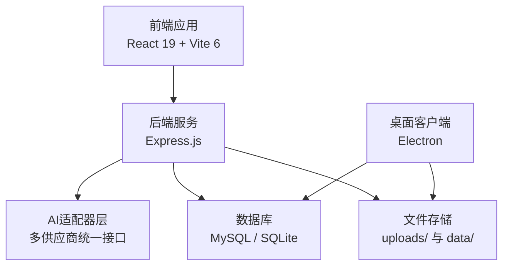
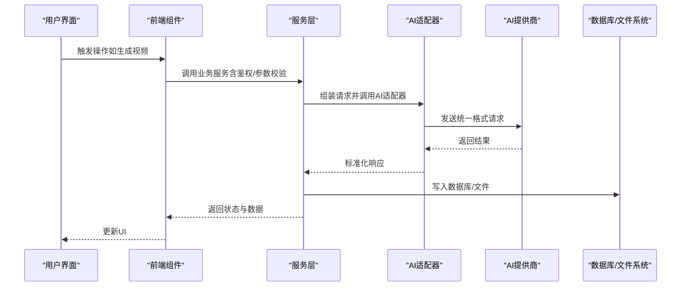
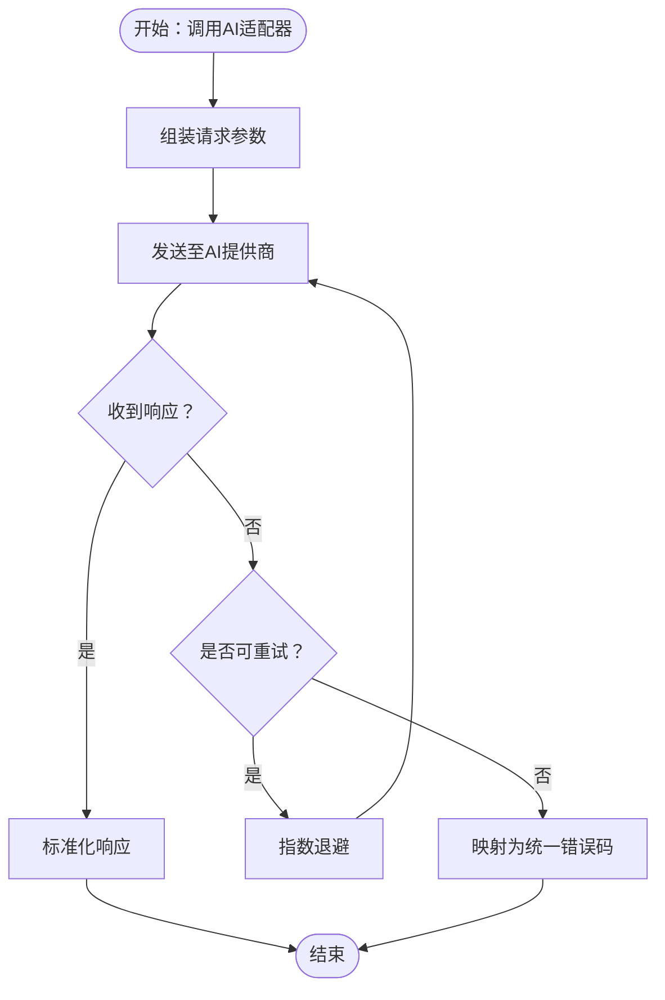
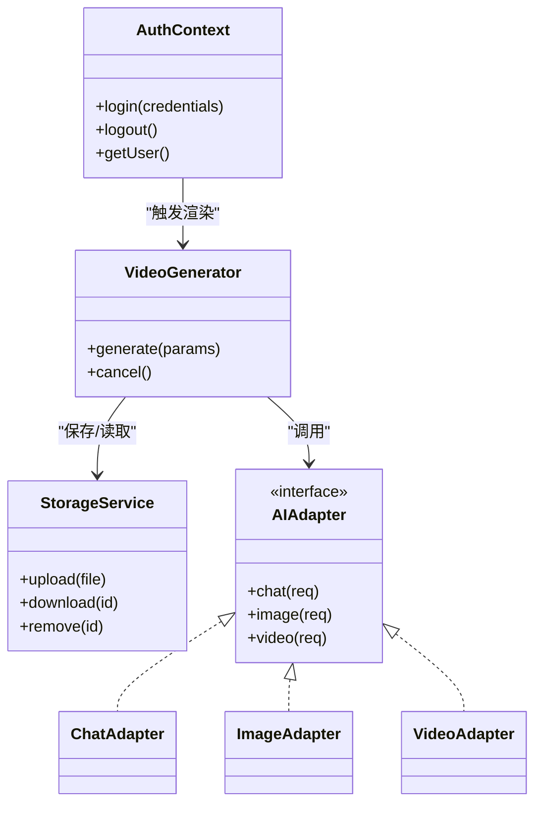
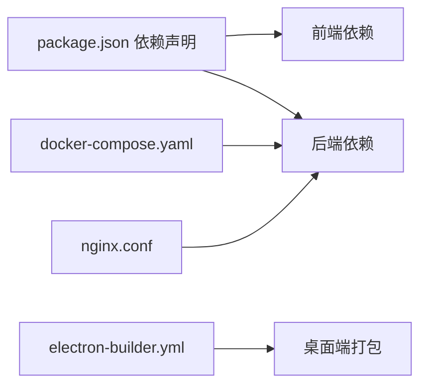
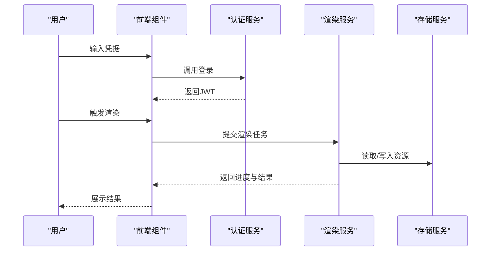

# 测试策略与质量保证

<cite>
**本文引用的文件**
- [package.json](file://package.json)
- [vite.config.ts](file://vite.config.ts)
- [README.md](file://README.md)
- [README_EN.md](file://README_EN.md)
- [tsconfig.json](file://tsconfig.json)
- [electron-builder.yml](file://electron-builder.yml)
- [docker-compose.yaml](file://docker-compose.yaml)
- [docker-compose.mysql.yaml](file://docker-compose.mysql.yaml)
- [Dockerfile](file://Dockerfile)
- [nginx.conf](file://nginx.conf)
- [nginx.docker.conf](file://nginx.docker.conf)
- [App.tsx](file://App.tsx)
- [contexts/AuthContext.tsx](file://contexts/AuthContext.tsx)
- [components/StageDirector/index.tsx](file://components/StageDirector/index.tsx)
- [components/StageDirector/VideoGenerator.tsx](file://components/StageDirector/VideoGenerator.tsx)
- [components/StageAssets/index.tsx](file://components/StageAssets/index.tsx)
- [components/StageAssets/ImageUploadButton.tsx](file://components/StageAssets/ImageUploadButton.tsx)
- [components/StageAssets/PromptEditor.tsx](file://components/StageAssets/PromptEditor.tsx)
- [components/StageExport/index.tsx](file://components/StageExport/index.tsx)
- [components/StageExport/RenderLogsModal.tsx](file://components/StageExport/RenderLogsModal.tsx)
- [components/StagePrompts/index.tsx](file://components/StagePrompts/index.tsx)
- [components/StageScript/index.tsx](file://components/StageScript/index.tsx)
- [services/adapters/index.ts](file://services/adapters/index.ts)
- [services/adapters/chatAdapter.ts](file://services/adapters/chatAdapter.ts)
- [services/adapters/imageAdapter.ts](file://services/adapters/imageAdapter.ts)
- [services/adapters/videoAdapter.ts](file://services/adapters/videoAdapter.ts)
- [services/adapters/dashscopeVideoAdapter.ts](file://services/adapters/dashscopeVideoAdapter.ts)
- [services/adapters/volcengineVideoAdapter.ts](file://services/adapters/volcengineVideoAdapter.ts)
- [services/aiService.ts](file://services/aiService.ts)
- [services/apiClient.ts](file://services/apiClient.ts)
- [services/storageService.ts](file://services/storageService.ts)
- [services/taskService.ts](file://services/taskService.ts)
- [services/modelService.ts](file://services/modelService.ts)
- [services/modelConfigService.ts](file://services/modelConfigService.ts)
- [services/renderLogService.ts](file://services/renderLogService.ts)
- [services/exportService.ts](file://services/exportService.ts)
- [services/assetLibraryService.ts](file://services/assetLibraryService.ts)
- [services/novelParser.ts](file://services/novelParser.ts)
- [services/projectPatchService.ts](file://services/projectPatchService.ts)
- [services/visualStyleService.ts](file://services/visualStyleService.ts)
- [types/model.ts](file://types/model.ts)
- [server/src/index.ts](file://server/src/index.ts)
- [server/src/proxy.ts](file://server/src/proxy.ts)
- [server/src/middleware/auth.ts](file://server/src/middleware/auth.ts)
- [server/src/routes/ai.ts](file://server/src/routes/ai.ts)
- [server/src/routes/assets.ts](file://server/src/routes/assets.ts)
- [server/src/routes/auth.ts](file://server/src/routes/auth.ts)
- [server/src/routes/dataTransfer.ts](file://server/src/routes/dataTransfer.ts)
- [server/src/routes/models.ts](file://server/src/routes/models.ts)
- [server/src/routes/preferences.ts](file://server/src/routes/preferences.ts)
- [server/src/routes/projectPatch.ts](file://server/src/routes/projectPatch.ts)
- [server/src/routes/projects.ts](file://server/src/routes/projects.ts)
- [server/src/routes/tasks.ts](file://server/src/routes/tasks.ts)
- [server/src/routes/uploads.ts](file://server/src/routes/uploads.ts)
- [server/src/routes/visualStyles.ts](file://server/src/routes/visualStyles.ts)
- [server/src/services/aiProxy.ts](file://server/src/services/aiProxy.ts)
- [server/src/services/fileStorage.ts](file://server/src/services/fileStorage.ts)
- [server/src/services/imageResolver.ts](file://server/src/services/imageResolver.ts)
- [server/src/services/projectStorage.ts](file://server/src/services/projectStorage.ts)
- [server/src/services/scriptParser.ts](file://server/src/services/scriptParser.ts)
- [server/src/services/taskRunner.ts](file://server/src/services/taskRunner.ts)
- [server/src/utils/projectMutex.ts](file://server/src/utils/projectMutex.ts)
- [server/src/config/database.ts](file://server/src/config/database.ts)
- [server/src/config/sqliteDatabase.ts](file://server/src/config/sqliteDatabase.ts)
- [server/src/lib/](file://server/src/lib/)
- [server/src/scripts/seed.ts](file://server/src/scripts/seed.ts)
- [server/src/scripts/migrateBase64ToFiles.ts](file://server/src/scripts/migrateBase64ToFiles.ts)
- [server/src/scripts/migrateEpisodeIds.ts](file://server/src/scripts/migrateEpisodeIds.ts)
- [server/src/scripts/migrateToEpisodePaths.ts](file://server/src/scripts/migrateToEpisodePaths.ts)
</cite>

## 目录
1. 引言
2. 项目结构
3. 核心组件
4. 架构总览
5. 详细组件分析
6. 依赖分析
7. 性能考虑
8. 故障排查指南
9. 结论
10. 附录

## 引言
本文件面向AI Shotlive项目，构建一套系统化的测试策略与质量保证体系，覆盖单元测试、集成测试与端到端测试，明确测试框架选择、用例编写规范、Mock策略、持续集成配置，以及AI服务、数据库、文件上传等特殊场景的测试方案，并给出测试覆盖率目标、性能测试方法与缺陷管理流程建议。

## 项目结构
AI Shotlive采用前后端分离架构：前端基于React 19 + Vite 6，后端基于Express.js，AI能力通过适配器层统一接入多家模型供应商，存储层支持MySQL/SQLite，桌面端使用Electron。项目提供Docker与Nginx部署配置，便于在不同环境进行测试与验证。

**图表来源**
- [README.md](file://README.md)
- [README_EN.md](file://README_EN.md)
- [package.json](file://package.json)
- [vite.config.ts](file://vite.config.ts)
- [electron-builder.yml](file://electron-builder.yml)
- [docker-compose.yaml](file://docker-compose.yaml)
- [docker-compose.mysql.yaml](file://docker-compose.mysql.yaml)
- [Dockerfile](file://Dockerfile)
- [nginx.conf](file://nginx.conf)
- [nginx.docker.conf](file://nginx.docker.conf)

**章节来源**
- [README.md](file://README.md)
- [README_EN.md](file://README_EN.md)
- [package.json](file://package.json)
- [vite.config.ts](file://vite.config.ts)
- [electron-builder.yml](file://electron-builder.yml)
- [docker-compose.yaml](file://docker-compose.yaml)
- [docker-compose.mysql.yaml](file://docker-compose.mysql.yaml)
- [Dockerfile](file://Dockerfile)
- [nginx.conf](file://nginx.conf)
- [nginx.docker.conf](file://nginx.docker.conf)

## 核心组件
- 前端核心模块：场景分镜、素材管理、提示词编辑、导出渲染、脚本与剧本管理等。
- AI服务与适配器：统一聊天、图像、视频生成接口，支持多家供应商。
- 后端服务：认证、项目、任务、资产、上传、模型配置、可视化风格等路由与服务。
- 存储与文件：数据库与文件系统双通道，支持本地/桌面与Web部署。
- 桌面端：Electron打包，内嵌SQLite，独立运行。

**章节来源**
- [components/StageDirector/index.tsx](file://components/StageDirector/index.tsx)
- [components/StageAssets/index.tsx](file://components/StageAssets/index.tsx)
- [components/StagePrompts/index.tsx](file://components/StagePrompts/index.tsx)
- [components/StageScript/index.tsx](file://components/StageScript/index.tsx)
- [components/StageExport/index.tsx](file://components/StageExport/index.tsx)
- [services/adapters/index.ts](file://services/adapters/index.ts)
- [services/aiService.ts](file://services/aiService.ts)
- [server/src/routes/](file://server/src/routes/)
- [server/src/services/](file://server/src/services/)
- [services/storageService.ts](file://services/storageService.ts)

## 架构总览
下图展示从UI到AI与存储的关键交互路径，以及测试关注点：

**图表来源**
- [components/StageDirector/VideoGenerator.tsx](file://components/StageDirector/VideoGenerator.tsx)
- [services/adapters/chatAdapter.ts](file://services/adapters/chatAdapter.ts)
- [services/adapters/imageAdapter.ts](file://services/adapters/imageAdapter.ts)
- [services/adapters/videoAdapter.ts](file://services/adapters/videoAdapter.ts)
- [server/src/services/aiProxy.ts](file://server/src/services/aiProxy.ts)
- [server/src/services/fileStorage.ts](file://server/src/services/fileStorage.ts)
- [server/src/config/database.ts](file://server/src/config/database.ts)
- [server/src/config/sqliteDatabase.ts](file://server/src/config/sqliteDatabase.ts)

## 详细组件分析

### 单元测试策略
- 测试范围：纯函数、工具函数、服务层无副作用逻辑、组件内部状态转换。
- 测试框架：优先使用Vitest（与Vite生态契合），或Jest（社区成熟度高）。
- Mock策略：
  - 使用jest.fn()/vi.fn()模拟API调用与第三方SDK。
  - 对AI适配器层进行接口契约测试，确保输入输出格式稳定。
  - 对文件上传/下载进行内存文件流Mock，避免真实IO。
- 用例规范：
  - 每个导出函数至少覆盖正常路径与边界条件。
  - 对错误分支进行异常抛出与降级处理验证。
  - 对异步流程使用超时与重试策略，避免假阳性。
- 覆盖率目标：函数级≥80%，行级≥70%，分支与路径≥60%。

**章节来源**
- [services/adapters/chatAdapter.ts](file://services/adapters/chatAdapter.ts)
- [services/adapters/imageAdapter.ts](file://services/adapters/imageAdapter.ts)
- [services/adapters/videoAdapter.ts](file://services/adapters/videoAdapter.ts)
- [services/adapters/dashscopeVideoAdapter.ts](file://services/adapters/dashscopeVideoAdapter.ts)
- [services/adapters/volcengineVideoAdapter.ts](file://services/adapters/volcengineVideoAdapter.ts)
- [services/apiClient.ts](file://services/apiClient.ts)
- [services/storageService.ts](file://services/storageService.ts)

### 集成测试策略
- 测试范围：组件与服务的组合行为、路由与中间件、数据库事务、文件系统写入。
- 数据库测试：
  - 使用SQLite内存数据库进行快速回滚测试。
  - 对关键写入操作（项目、任务、资产）进行一致性校验。
  - 使用迁移脚本预置测试数据，确保环境一致性。
- 文件上传测试：
  - 使用FormData与Buffer模拟上传，验证解析与持久化。
  - 覆盖文件类型、大小、重名处理与清理策略。
- AI服务测试：
  - 使用适配器层的统一接口进行契约测试，避免直接依赖具体供应商。
  - 对长耗时任务使用定时轮询与超时断言。
- Mock策略：对真实AI提供商使用HTTP拦截或本地代理，返回可控响应。

**章节来源**
- [server/src/routes/ai.ts](file://server/src/routes/ai.ts)
- [server/src/routes/assets.ts](file://server/src/routes/assets.ts)
- [server/src/routes/uploads.ts](file://server/src/routes/uploads.ts)
- [server/src/services/aiProxy.ts](file://server/src/services/aiProxy.ts)
- [server/src/services/fileStorage.ts](file://server/src/services/fileStorage.ts)
- [server/src/config/database.ts](file://server/src/config/database.ts)
- [server/src/config/sqliteDatabase.ts](file://server/src/config/sqliteDatabase.ts)
- [server/src/scripts/seed.ts](file://server/src/scripts/seed.ts)
- [server/src/scripts/migrateBase64ToFiles.ts](file://server/src/scripts/migrateBase64ToFiles.ts)
- [server/src/scripts/migrateEpisodeIds.ts](file://server/src/scripts/migrateEpisodeIds.ts)
- [server/src/scripts/migrateToEpisodePaths.ts](file://server/src/scripts/migrateToEpisodePaths.ts)

### 端到端测试策略
- 测试范围：完整业务流程（登录→创建项目→编辑脚本→生成素材→导出渲染）。
- 工具选择：Playwright（跨浏览器/平台）或Cypress（DOM交互友好）。
- 环境准备：
  - 使用Docker Compose启动后端与数据库，或使用SQLite本地模式。
  - 提前注入测试用户与基础数据。
- 关键场景：
  - 登录与鉴权：JWT过期、刷新、权限校验。
  - 项目与任务：并发写入、冲突解决（项目互斥锁）。
  - 渲染导出：日志读取、进度回调、失败重试。
- 端到端Mock：对AI提供商进行网络层拦截，模拟成功/失败/超时。

**章节来源**
- [server/src/middleware/auth.ts](file://server/src/middleware/auth.ts)
- [server/src/utils/projectMutex.ts](file://server/src/utils/projectMutex.ts)
- [components/StageExport/RenderLogsModal.tsx](file://components/StageExport/RenderLogsModal.tsx)
- [docker-compose.yaml](file://docker-compose.yaml)
- [docker-compose.mysql.yaml](file://docker-compose.mysql.yaml)

### 特殊场景测试方案

#### AI服务测试
- 适配器层契约测试：定义输入参数与期望输出的数据结构，确保不同供应商返回一致。
- 超时与重试：对长链路调用设置合理超时与指数退避。
- 错误码映射：将供应商特定错误标准化为统一错误码，便于上层处理。

**图表来源**
- [services/adapters/chatAdapter.ts](file://services/adapters/chatAdapter.ts)
- [services/adapters/imageAdapter.ts](file://services/adapters/imageAdapter.ts)
- [services/adapters/videoAdapter.ts](file://services/adapters/videoAdapter.ts)
- [services/adapters/dashscopeVideoAdapter.ts](file://services/adapters/dashscopeVideoAdapter.ts)
- [services/adapters/volcengineVideoAdapter.ts](file://services/adapters/volcengineVideoAdapter.ts)

**章节来源**
- [services/adapters/index.ts](file://services/adapters/index.ts)
- [services/aiService.ts](file://services/aiService.ts)
- [types/model.ts](file://types/model.ts)

#### 数据库测试
- 连接池与事务：验证连接复用、事务回滚与并发写入。
- 迁移脚本：对数据迁移进行回归测试，确保向后兼容。
- 互斥锁：对项目级写入加锁，验证并发冲突下的正确性。

**章节来源**
- [server/src/config/database.ts](file://server/src/config/database.ts)
- [server/src/config/sqliteDatabase.ts](file://server/src/config/sqliteDatabase.ts)
- [server/src/utils/projectMutex.ts](file://server/src/utils/projectMutex.ts)
- [server/src/scripts/seed.ts](file://server/src/scripts/seed.ts)
- [server/src/scripts/migrateBase64ToFiles.ts](file://server/src/scripts/migrateBase64ToFiles.ts)
- [server/src/scripts/migrateEpisodeIds.ts](file://server/src/scripts/migrateEpisodeIds.ts)
- [server/src/scripts/migrateToEpisodePaths.ts](file://server/src/scripts/migrateToEpisodePaths.ts)

#### 文件上传测试
- 类型与大小：验证白名单与阈值限制。
- 存储隔离：按用户/项目目录隔离，防止越权访问。
- 清理策略：删除与覆盖逻辑，避免磁盘膨胀。

**章节来源**
- [server/src/routes/uploads.ts](file://server/src/routes/uploads.ts)
- [server/src/services/fileStorage.ts](file://server/src/services/fileStorage.ts)
- [components/StageAssets/ImageUploadButton.tsx](file://components/StageAssets/ImageUploadButton.tsx)

### 组件级测试设计

#### 组件类关系（示意）

**图表来源**
- [contexts/AuthContext.tsx](file://contexts/AuthContext.tsx)
- [components/StageDirector/VideoGenerator.tsx](file://components/StageDirector/VideoGenerator.tsx)
- [services/storageService.ts](file://services/storageService.ts)
- [services/adapters/chatAdapter.ts](file://services/adapters/chatAdapter.ts)
- [services/adapters/imageAdapter.ts](file://services/adapters/imageAdapter.ts)
- [services/adapters/videoAdapter.ts](file://services/adapters/videoAdapter.ts)

## 依赖分析
- 前端依赖：React、TailwindCSS、Vite插件生态，以及AI SDK（ai、@ai-sdk/*）。
- 后端依赖：Express、数据库驱动、JWT、文件处理、任务调度等。
- 桌面端：Electron、better-sqlite3、electron-builder。
- 部署：Docker、Nginx、环境变量与配置文件。

**图表来源**
- [package.json](file://package.json)
- [electron-builder.yml](file://electron-builder.yml)
- [docker-compose.yaml](file://docker-compose.yaml)
- [nginx.conf](file://nginx.conf)

**章节来源**
- [package.json](file://package.json)
- [electron-builder.yml](file://electron-builder.yml)
- [docker-compose.yaml](file://docker-compose.yaml)
- [nginx.conf](file://nginx.conf)

## 性能考虑
- 前端性能：组件懒加载、图片与视频资源压缩、缓存策略。
- 后端性能：连接池配置、查询优化、任务队列与并发控制。
- AI调用：批量请求、结果缓存、超时与重试策略。
- 文件处理：分块上传、断点续传、压缩与去重。
- 压测方法：使用Artillery/JMeter对关键路由进行并发压测，观察响应时间与错误率。

## 故障排查指南
- 日志与追踪：后端统一错误处理与日志记录，前端错误边界捕获。
- 回滚与恢复：数据库迁移脚本与备份导入流程。
- 环境隔离：Docker容器化测试环境，避免污染生产数据。
- 缺陷管理：使用Issue模板记录问题、重现步骤、日志与截图，分配优先级与修复计划。

**章节来源**
- [server/src/services/aiProxy.ts](file://server/src/services/aiProxy.ts)
- [server/src/services/taskRunner.ts](file://server/src/services/taskRunner.ts)
- [server/src/scripts/seed.ts](file://server/src/scripts/seed.ts)

## 结论
通过分层测试策略与自动化流程，AI Shotlive可在多环境（Web、桌面、Docker）下保持高质量交付。建议以单元测试为基础、集成测试为中坚、端到端测试为保障，结合AI适配器契约测试与数据库/文件系统专项测试，形成闭环的质量保证体系。

## 附录

### 测试框架与工具建议
- 单元测试：Vitest 或 Jest
- 集成测试：Supertest + 测试数据库（SQLite内存）
- 端到端测试：Playwright 或 Cypress
- Mock：MSW 或 Jest Mock
- 覆盖率：Istanbul/Vitest 或 Jest内置覆盖率
- CI：GitHub Actions（Docker + Node矩阵）

### 持续集成配置要点
- 分层流水线：单元测试（快速）、集成测试（Docker）、端到端测试（带数据库）。
- 安全扫描：依赖漏洞扫描与密钥泄露检测。
- 构建产物：前端静态资源、后端二进制、Electron安装包、Docker镜像。
- 环境变量：区分测试与生产，敏感信息加密存储。

### 测试覆盖率目标（建议）
- 函数级：≥80%
- 行级：≥70%
- 分支与路径：≥60%

### 关键流程序列图（示例：登录与渲染）

**图表来源**
- [contexts/AuthContext.tsx](file://contexts/AuthContext.tsx)
- [components/StageDirector/VideoGenerator.tsx](file://components/StageDirector/VideoGenerator.tsx)
- [services/storageService.ts](file://services/storageService.ts)