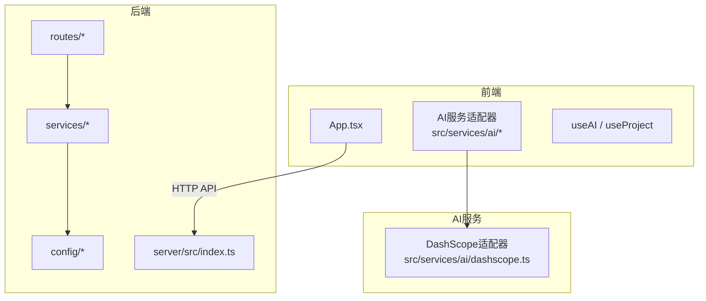
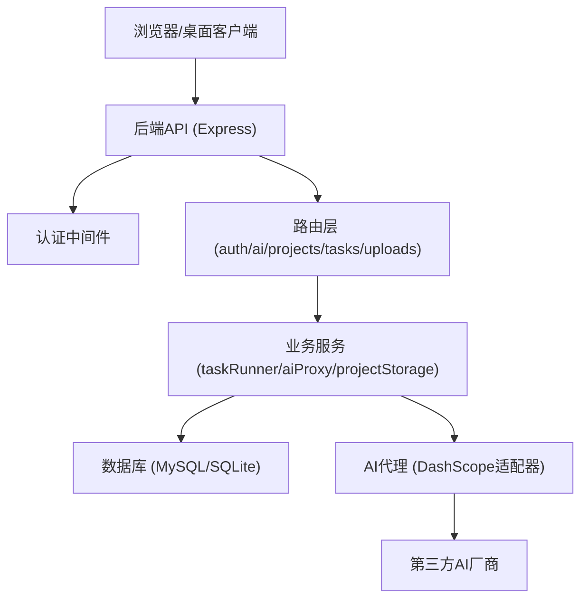
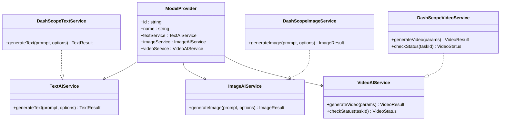
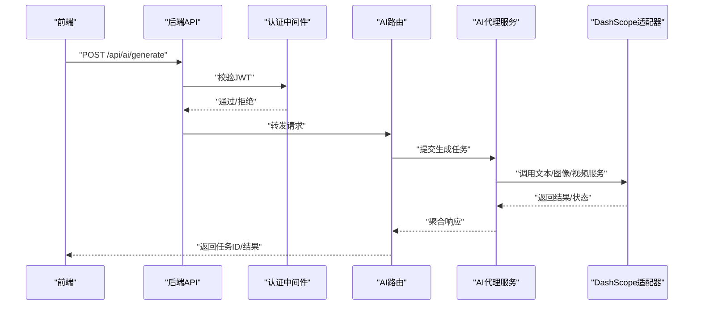
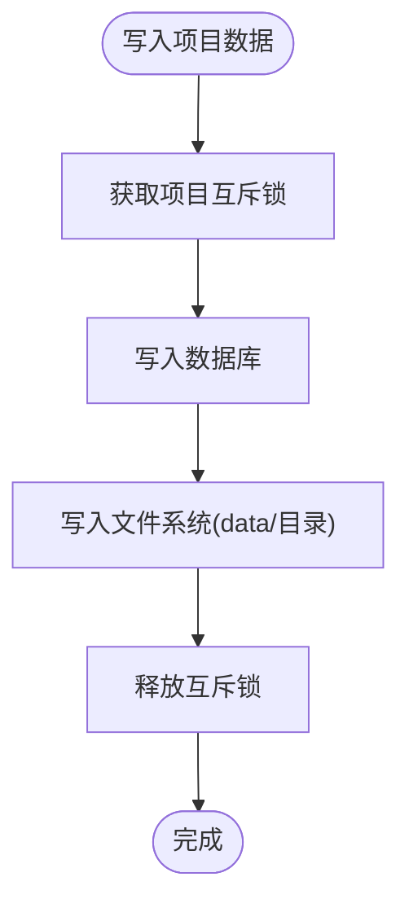
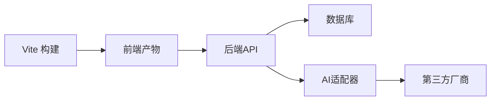
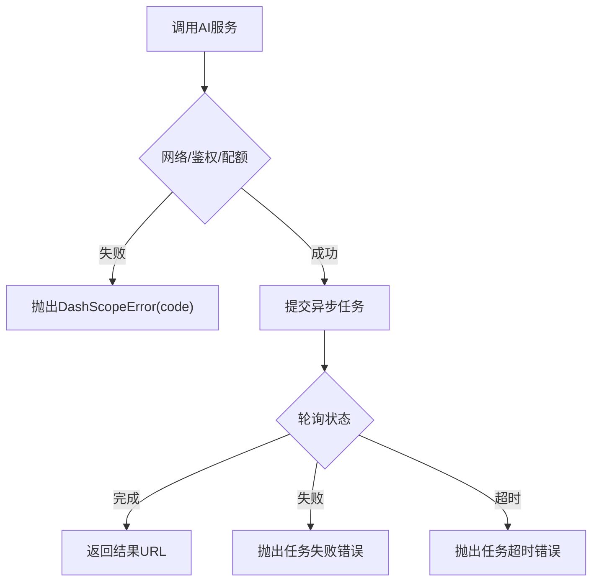

# 调试与故障排除

<cite>
**本文引用的文件**
- [README.md](file://README.md)
- [package.json](file://package.json)
- [src/services/ai/types.ts](file://src/services/ai/types.ts)
- [src/services/ai/dashscope.ts](file://src/services/ai/dashscope.ts)
- [src/services/ai/index.ts](file://src/services/ai/index.ts)
- [src/shared/hooks/useAI.ts](file://src/shared/hooks/useAI.ts)
- [src/shared/hooks/useProject.ts](file://src/shared/hooks/useProject.ts)
- [src/types.ts](file://src/types.ts)
- [vite.config.ts](file://vite.config.ts)
- [server/src/index.ts](file://server/src/index.ts)
- [server/src/proxy.ts](file://server/src/proxy.ts)
- [server/src/middleware/auth.ts](file://server/src/middleware/auth.ts)
- [server/src/routes/ai.ts](file://server/src/routes/ai.ts)
- [server/src/routes/auth.ts](file://server/src/routes/auth.ts)
- [server/src/routes/projects.ts](file://server/src/routes/projects.ts)
- [server/src/routes/tasks.ts](file://server/src/routes/tasks.ts)
- [server/src/routes/uploads.ts](file://server/src/routes/uploads.ts)
- [server/src/services/taskRunner.ts](file://server/src/services/taskRunner.ts)
- [server/src/services/aiProxy.ts](file://server/src/services/aiProxy.ts)
- [server/src/services/projectStorage.ts](file://server/src/services/projectStorage.ts)
- [server/src/utils/projectMutex.ts](file://server/src/utils/projectMutex.ts)
- [server/src/config/database.ts](file://server/src/config/database.ts)
- [server/src/config/sqliteDatabase.ts](file://server/src/config/sqliteDatabase.ts)
- [docker-compose.yaml](file://docker-compose.yaml)
- [docker-compose.mysql.yaml](file://docker-compose.mysql.yaml)
- [Dockerfile](file://Dockerfile)
- [nginx.conf](file://nginx.conf)
- [nginx.docker.conf](file://nginx.docker.conf)
- [electron/main.ts](file://electron/main.ts)
- [electron/preload.ts](file://electron/preload.ts)
- [electron/tsconfig.json](file://electron/tsconfig.json)
- [scripts/build-electron.sh](file://scripts/build-electron.sh)
- [electron-builder.yml](file://electron-builder.yml)
</cite>

## 目录
1. [简介](#简介)
2. [项目结构](#项目结构)
3. [核心组件](#核心组件)
4. [架构总览](#架构总览)
5. [详细组件分析](#详细组件分析)
6. [依赖关系分析](#依赖关系分析)
7. [性能考虑](#性能考虑)
8. [故障排除指南](#故障排除指南)
9. [结论](#结论)
10. [附录](#附录)

## 简介
本指南面向开发者与运维人员，提供AI Shotlive项目的调试与故障排除方法，涵盖前端调试工具、后端服务调试、数据库连接、AI服务调用异常、开发与生产环境排查、跨平台兼容性问题，以及监控与问题上报流程建议。文档结合项目实际代码结构与接口定义，给出可操作的定位策略与解决步骤。

## 项目结构
项目采用前后端分离架构：前端基于React/Vite，后端基于Express，AI服务通过适配器层统一接入多厂商API，数据持久化支持MySQL与SQLite，桌面端基于Electron打包。

图表来源
- [src/App.tsx:1-6](file://src/App.tsx#L1-L6)
- [src/services/ai/index.ts:1-34](file://src/services/ai/index.ts#L1-L34)
- [src/services/ai/dashscope.ts:1-327](file://src/services/ai/dashscope.ts#L1-L327)
- [server/src/index.ts](file://server/src/index.ts)
- [server/src/routes/ai.ts](file://server/src/routes/ai.ts)
- [server/src/services/aiProxy.ts](file://server/src/services/aiProxy.ts)
- [server/src/config/database.ts](file://server/src/config/database.ts)
- [server/src/config/sqliteDatabase.ts](file://server/src/config/sqliteDatabase.ts)

章节来源
- [README.md:127-158](file://README.md#L127-L158)
- [package.json:1-26](file://package.json#L1-L26)

## 核心组件
- AI服务适配器层：定义统一的文本/图像/视频接口，屏蔽厂商差异，当前默认实现为DashScope适配器。
- 前端Hook：useAI与useProject提供AI调用与项目状态的便捷封装。
- 后端路由与服务：提供认证、AI代理、项目管理、任务调度、文件上传等能力。
- 配置与存储：数据库配置支持MySQL与SQLite，桌面端使用better-sqlite3。

章节来源
- [src/services/ai/types.ts:1-73](file://src/services/ai/types.ts#L1-L73)
- [src/services/ai/dashscope.ts:1-327](file://src/services/ai/dashscope.ts#L1-L327)
- [src/shared/hooks/useAI.ts](file://src/shared/hooks/useAI.ts)
- [src/shared/hooks/useProject.ts](file://src/shared/hooks/useProject.ts)
- [server/src/routes/ai.ts](file://server/src/routes/ai.ts)
- [server/src/services/aiProxy.ts](file://server/src/services/aiProxy.ts)
- [server/src/config/database.ts](file://server/src/config/database.ts)
- [server/src/config/sqliteDatabase.ts](file://server/src/config/sqliteDatabase.ts)

## 架构总览
前端通过HTTP API与后端交互，后端通过AI代理服务对接第三方AI厂商。数据库可选MySQL或SQLite，桌面端使用内置SQLite。

图表来源
- [server/src/index.ts](file://server/src/index.ts)
- [server/src/middleware/auth.ts](file://server/src/middleware/auth.ts)
- [server/src/routes/ai.ts](file://server/src/routes/ai.ts)
- [server/src/routes/auth.ts](file://server/src/routes/auth.ts)
- [server/src/routes/projects.ts](file://server/src/routes/projects.ts)
- [server/src/routes/tasks.ts](file://server/src/routes/tasks.ts)
- [server/src/routes/uploads.ts](file://server/src/routes/uploads.ts)
- [server/src/services/aiProxy.ts](file://server/src/services/aiProxy.ts)
- [server/src/services/taskRunner.ts](file://server/src/services/taskRunner.ts)
- [server/src/services/projectStorage.ts](file://server/src/services/projectStorage.ts)
- [server/src/config/database.ts](file://server/src/config/database.ts)
- [server/src/config/sqliteDatabase.ts](file://server/src/config/sqliteDatabase.ts)
- [src/services/ai/dashscope.ts:1-327](file://src/services/ai/dashscope.ts#L1-L327)

## 详细组件分析

### AI服务适配器（DashScope）
- 统一接口：文本、图像、视频三类服务均实现统一接口，便于替换与扩展。
- 错误处理：定义DashScopeError，区分鉴权、配额、网络、服务端错误等。
- 重试机制：对网络错误与5xx进行指数退避重试，4xx直接抛错。
- 异步任务：图像与视频采用异步提交+轮询，支持最大等待时间与轮询间隔配置。

图表来源
- [src/services/ai/types.ts:1-73](file://src/services/ai/types.ts#L1-L73)
- [src/services/ai/dashscope.ts:96-139](file://src/services/ai/dashscope.ts#L96-L139)
- [src/services/ai/dashscope.ts:219-255](file://src/services/ai/dashscope.ts#L219-L255)
- [src/services/ai/dashscope.ts:258-315](file://src/services/ai/dashscope.ts#L258-L315)

章节来源
- [src/services/ai/types.ts:1-73](file://src/services/ai/types.ts#L1-L73)
- [src/services/ai/dashscope.ts:1-327](file://src/services/ai/dashscope.ts#L1-L327)

### 前端Hook与项目状态
- useAI：封装AI调用流程，包括参数准备、错误处理与状态反馈。
- useProject：封装项目相关状态与操作，便于在组件中统一管理。

章节来源
- [src/shared/hooks/useAI.ts](file://src/shared/hooks/useAI.ts)
- [src/shared/hooks/useProject.ts](file://src/shared/hooks/useProject.ts)

### 后端路由与服务
- 认证路由与中间件：提供登录、注册、用户资料修改与JWT校验。
- AI代理路由：转发前端请求至AI适配器，处理异步任务状态查询。
- 项目与任务路由：管理项目、资产、任务队列与文件上传。
- 业务服务：任务运行器、项目存储、AI代理等。

图表来源
- [server/src/routes/ai.ts](file://server/src/routes/ai.ts)
- [server/src/services/aiProxy.ts](file://server/src/services/aiProxy.ts)
- [src/services/ai/dashscope.ts:258-315](file://src/services/ai/dashscope.ts#L258-L315)

章节来源
- [server/src/routes/ai.ts](file://server/src/routes/ai.ts)
- [server/src/middleware/auth.ts](file://server/src/middleware/auth.ts)
- [server/src/services/aiProxy.ts](file://server/src/services/aiProxy.ts)
- [server/src/services/taskRunner.ts](file://server/src/services/taskRunner.ts)

### 数据库与存储
- MySQL/SQLite：支持生产环境MySQL与本地SQLite两种模式。
- 项目互斥锁：避免并发写冲突，保障数据一致性。
- 项目存储：封装文件与数据库的读写操作。

图表来源
- [server/src/utils/projectMutex.ts](file://server/src/utils/projectMutex.ts)
- [server/src/services/projectStorage.ts](file://server/src/services/projectStorage.ts)
- [server/src/config/database.ts](file://server/src/config/database.ts)
- [server/src/config/sqliteDatabase.ts](file://server/src/config/sqliteDatabase.ts)

章节来源
- [server/src/utils/projectMutex.ts](file://server/src/utils/projectMutex.ts)
- [server/src/services/projectStorage.ts](file://server/src/services/projectStorage.ts)
- [server/src/config/database.ts](file://server/src/config/database.ts)
- [server/src/config/sqliteDatabase.ts](file://server/src/config/sqliteDatabase.ts)

## 依赖关系分析
- 前端依赖：React、Vite、TailwindCSS等，构建与开发工具链清晰。
- 后端依赖：Express、数据库驱动、JWT等，路由与服务职责分离。
- AI适配器：通过统一接口屏蔽厂商差异，便于扩展其他提供商。

图表来源
- [package.json:1-26](file://package.json#L1-L26)
- [vite.config.ts](file://vite.config.ts)
- [server/src/index.ts](file://server/src/index.ts)
- [src/services/ai/dashscope.ts:1-327](file://src/services/ai/dashscope.ts#L1-L327)

章节来源
- [package.json:1-26](file://package.json#L1-L26)
- [vite.config.ts](file://vite.config.ts)

## 性能考虑
- 异步任务与轮询：图像/视频生成采用异步提交+轮询，合理设置轮询间隔与最大等待时间，避免阻塞主线程。
- 重试策略：对网络错误与5xx进行指数退避重试，减少瞬时故障影响。
- 前端渲染优化：使用React组件拆分与状态最小化，避免不必要的重渲染。
- 数据库写入：通过互斥锁控制并发写入，减少锁竞争与死锁风险。

章节来源
- [src/services/ai/dashscope.ts:201-216](file://src/services/ai/dashscope.ts#L201-L216)
- [src/services/ai/dashscope.ts:58-93](file://src/services/ai/dashscope.ts#L58-L93)
- [server/src/utils/projectMutex.ts](file://server/src/utils/projectMutex.ts)

## 故障排除指南

### 通用排查步骤
- 确认环境变量与配置：检查数据库连接、JWT密钥、AI厂商API Key是否正确。
- 查看前后端日志：前端控制台错误、后端服务日志、容器日志。
- 验证网络连通性：确保后端可访问AI厂商API，防火墙与代理配置正确。
- 检查任务状态：图像/视频生成任务是否成功提交与完成，轮询是否正常。

章节来源
- [README.md:149-158](file://README.md#L149-L158)
- [src/services/ai/dashscope.ts:39-45](file://src/services/ai/dashscope.ts#L39-L45)

### 前端调试
- 浏览器开发者工具：Network面板观察API请求与响应，Console查看错误堆栈。
- React DevTools：检查组件状态与props传递，定位渲染问题。
- Vite热更新：确认开发服务器正常启动，端口占用情况。
- Hook调试：useAI与useProject中断点调试，验证参数与返回值。

章节来源
- [vite.config.ts](file://vite.config.ts)
- [src/shared/hooks/useAI.ts](file://src/shared/hooks/useAI.ts)
- [src/shared/hooks/useProject.ts](file://src/shared/hooks/useProject.ts)

### 后端服务调试
- 日志级别：开启详细日志，定位认证、路由、服务层错误。
- 路由测试：使用curl或Postman验证认证、AI、项目、任务等路由。
- 中间件检查：确认JWT校验与权限控制逻辑。
- 任务队列：检查任务提交、执行与状态更新流程。

章节来源
- [server/src/index.ts](file://server/src/index.ts)
- [server/src/middleware/auth.ts](file://server/src/middleware/auth.ts)
- [server/src/routes/ai.ts](file://server/src/routes/ai.ts)
- [server/src/services/taskRunner.ts](file://server/src/services/taskRunner.ts)

### 数据库连接问题
- MySQL模式：检查主机、端口、用户名、密码与数据库名，确认网络可达。
- SQLite模式：检查文件路径与权限，确认本地模式启动参数正确。
- 连接池与事务：避免长时间持有事务，合理设置超时与重试。

章节来源
- [server/src/config/database.ts](file://server/src/config/database.ts)
- [server/src/config/sqliteDatabase.ts](file://server/src/config/sqliteDatabase.ts)
- [README.md:229-236](file://README.md#L229-L236)

### AI服务调用异常
- API Key与配额：确认API Key有效且未超配额，检查厂商控制台限额。
- 网络与重试：关注网络错误与5xx，利用重试机制缓解瞬时故障。
- 异步任务：检查任务ID、状态映射与轮询逻辑，避免超时与空结果。
- 错误码与消息：根据DashScopeError的code与message快速定位问题。

图表来源
- [src/services/ai/dashscope.ts:47-52](file://src/services/ai/dashscope.ts#L47-L52)
- [src/services/ai/dashscope.ts:58-93](file://src/services/ai/dashscope.ts#L58-L93)
- [src/services/ai/dashscope.ts:155-174](file://src/services/ai/dashscope.ts#L155-L174)
- [src/services/ai/dashscope.ts:201-216](file://src/services/ai/dashscope.ts#L201-L216)
- [src/services/ai/dashscope.ts:289-315](file://src/services/ai/dashscope.ts#L289-L315)

章节来源
- [src/services/ai/dashscope.ts:1-327](file://src/services/ai/dashscope.ts#L1-L327)

### 开发环境调试
- 本地启动：前端与后端同时启动，确认端口与代理配置。
- 环境变量：复制.env.example为.env并填入必要参数。
- 数据初始化：可选执行种子脚本创建默认管理员与示例数据。

章节来源
- [README.md:161-206](file://README.md#L161-L206)
- [README.md:187-197](file://README.md#L187-L197)

### 生产环境排查
- Docker部署：使用docker-compose或Dockerfile构建镜像，确认端口映射与卷挂载。
- Nginx反向代理：检查nginx.conf与nginx.docker.conf，确保静态资源与API转发正确。
- 日志收集：容器日志与应用日志集中收集，便于问题复现与分析。
- 监控与告警：结合Sentry等监控平台，配置错误上报与性能指标。

章节来源
- [README.md:208-238](file://README.md#L208-L238)
- [docker-compose.yaml](file://docker-compose.yaml)
- [docker-compose.mysql.yaml](file://docker-compose.mysql.yaml)
- [Dockerfile](file://Dockerfile)
- [nginx.conf](file://nginx.conf)
- [nginx.docker.conf](file://nginx.docker.conf)

### 桌面客户端（Electron）调试
- 构建流程：按顺序构建前端、后端与主进程，再使用electron-builder打包。
- 数据目录：确认用户数据目录下的local.db、data/与uploads/路径正确。
- 跨平台：Windows打包需在Windows环境下执行，或使用CI。

章节来源
- [README.md:242-305](file://README.md#L242-L305)
- [electron/main.ts](file://electron/main.ts)
- [electron/preload.ts](file://electron/preload.ts)
- [scripts/build-electron.sh](file://scripts/build-electron.sh)
- [electron-builder.yml](file://electron-builder.yml)

### 跨平台兼容性问题
- Node.js版本：确保满足最低版本要求，避免原生模块编译问题。
- 原生模块：better-sqlite3在打包时会针对Electron版本重新编译，注意平台匹配。
- 图标与资源：按README说明生成.icns/.ico，确保应用图标显示正常。

章节来源
- [README.md:246-305](file://README.md#L246-L305)

### 调试工具与监控建议
- 前端：React DevTools、Redux DevTools（如使用）、浏览器Network面板。
- 后端：Winston或pino日志库、Express中间件记录请求与响应、Sentry错误监控。
- 数据库：MySQL Workbench或SQLite浏览器，查看表结构与数据一致性。
- 容器：Docker logs与Compose日志，结合Kibana/Elastic Stack收集日志。

章节来源
- [README.md:155-156](file://README.md#L155-L156)

### 问题上报流程
- 收集信息：环境、版本、配置、日志片段、复现步骤。
- 分类归档：按前端、后端、数据库、AI服务、桌面端分类。
- 提交渠道：使用Issue模板，附带必要上下文与截图/录屏。
- 跟进与验证：维护者修复后，按步骤验证并关闭问题。

章节来源
- [README.md:426-441](file://README.md#L426-L441)

## 结论
通过明确的组件边界、统一的AI接口、完善的错误处理与重试机制，以及清晰的开发与生产部署流程，AI Shotlive具备良好的可调试性与可维护性。遵循本指南的排查步骤与最佳实践，可高效定位并解决常见问题，保障创作工作流稳定运行。

## 附录
- 快速检查清单
  - 环境变量与配置文件是否存在且正确
  - 数据库连接是否可用（MySQL/SQLite）
  - AI厂商API Key是否有效且未超配额
  - 任务是否成功提交与轮询状态是否正常
  - 前端与后端日志是否包含错误堆栈
  - Docker/Nginx配置是否正确映射端口与路径
  - 桌面端数据目录权限与路径是否正确