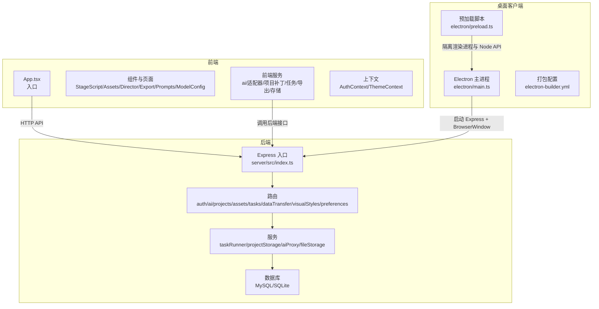
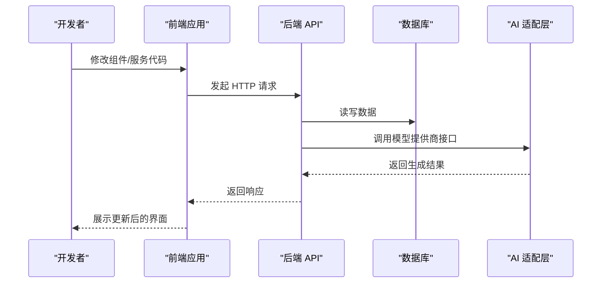
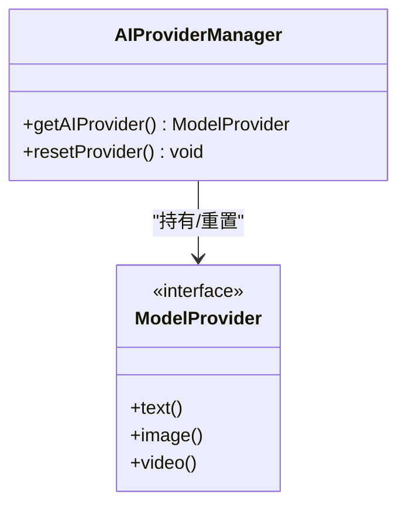
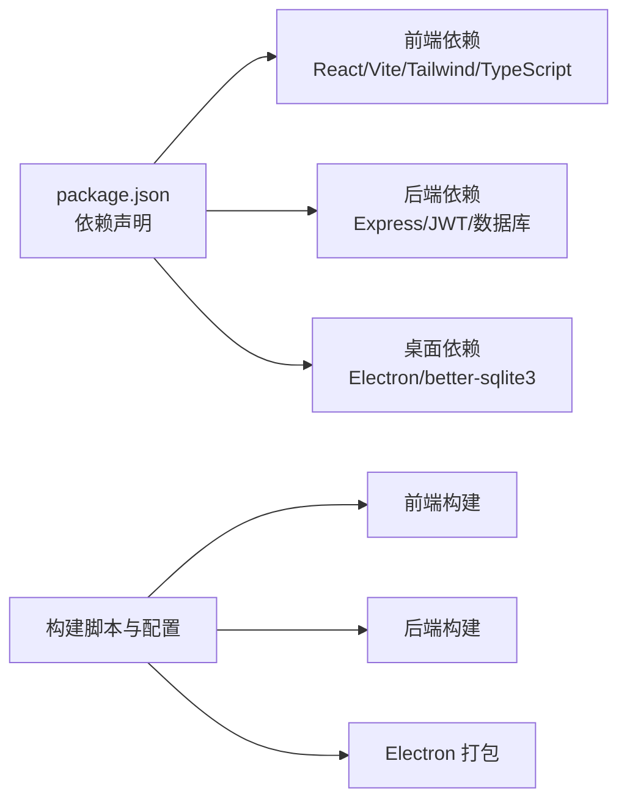

# 贡献指南

<cite>
**本文引用的文件**
- [README.md](file://README.md)
- [package.json](file://package.json)
- [src/services/ai/index.ts](file://src/services/ai/index.ts)
</cite>

## 目录
1. [简介](#简介)
2. [项目结构](#项目结构)
3. [核心组件](#核心组件)
4. [架构总览](#架构总览)
5. [详细组件分析](#详细组件分析)
6. [依赖分析](#依赖分析)
7. [性能考虑](#性能考虑)
8. [故障排查指南](#故障排查指南)
9. [结论](#结论)
10. [附录](#附录)

## 简介
本指南面向希望参与 AI Shotlive 项目的开发者与贡献者，提供从环境准备、开发流程、代码贡献标准、Pull Request 流程、Issue 报告规范、功能请求流程、文档贡献方式，到代码审查与版本发布的完整实践路径。同时给出新贡献者的入门建议与常见贡献场景的操作指引，以及社区交流规范。

## 项目结构
AI Shotlive 采用前后端分离架构：前端基于 React 19 + Vite 6，后端基于 Express.js，数据库支持 MySQL 8 / SQLite（本地/桌面模式）。项目提供 Web 与 Electron 桌面客户端两种运行形态，支持多模型提供商的 AI 适配层，以及完整的项目数据导出/导入能力。

- 前端与核心模块
  - 组件与页面：StageScript、StageAssets、StageDirector、StageExport、StagePrompts、ModelConfig、StageScript 等
  - 服务层：ai 服务、适配器层、项目补丁、任务、导出、存储等
  - 上下文：认证与主题
- 后端
  - 路由与服务：鉴权、AI、项目、资产、任务、数据传输、视觉风格、偏好等
  - 数据库：用户、项目、章节、剧集、角色、场景、道具、镜头、关键帧、视频片段、生成任务、渲染日志、共享资产库、模型注册、用户偏好、视觉风格
- 桌面客户端
  - Electron 主进程、预加载脚本、打包配置与图标
- 工具与脚本
  - 构建脚本、Docker 编排、本地 SQLite 模式

图表来源
- [README.md:308-370](file://README.md#L308-L370)
- [README.md:350-369](file://README.md#L350-L369)

章节来源
- [README.md:127-138](file://README.md#L127-L138)
- [README.md:308-370](file://README.md#L308-L370)

## 核心组件
- AI 适配与提供商管理
  - 前端 AI 管理器负责当前提供商的初始化与重置，支持未来多提供商切换的架构设计
- 模型配置与注册
  - 支持多厂商文本/图像/视频/音频模型配置，API Key 与当前激活模型可在界面中设置
- 项目与数据生命周期
  - 项目、章节、剧集、角色、场景、道具、镜头、关键帧、视频片段、生成任务、渲染日志、共享资产库、模型注册、用户偏好、视觉风格
- 导出与导入
  - 支持 ZIP 归档导出/导入，覆盖数据库记录与媒体文件，便于迁移与备份

章节来源
- [src/services/ai/index.ts:1-34](file://src/services/ai/index.ts#L1-L34)
- [README.md:111-124](file://README.md#L111-L124)
- [README.md:373-397](file://README.md#L373-L397)
- [README.md:103-107](file://README.md#L103-L107)

## 架构总览
AI Shotlive 的工作流遵循“小说 → 剧本 → 分镜 → 资产 → 关键帧 → 成片”的工业流程，前端通过 HTTP 接口与后端交互，后端负责业务逻辑与数据持久化，AI 适配层统一对接多家模型提供商。桌面客户端内嵌 SQLite，提供无需服务器的本地体验。

图表来源
- [README.md:127-138](file://README.md#L127-L138)
- [README.md:350-369](file://README.md#L350-L369)

## 详细组件分析

### 组件 A：AI Provider 管理器
- 设计要点
  - 单例 Provider 管理，延迟初始化与可重置机制，便于测试与切换
  - 类型系统明确文本/图像/视频服务接口，支持未来扩展
- 贡献建议
  - 新增/切换提供商时，遵循现有 Provider 接口契约，确保 resetProvider 可被调用以刷新实例
  - 在前端服务层通过 getAIProvider 获取当前 Provider，避免直接依赖具体实现

图表来源
- [src/services/ai/index.ts:1-34](file://src/services/ai/index.ts#L1-L34)

章节来源
- [src/services/ai/index.ts:1-34](file://src/services/ai/index.ts#L1-L34)

### 组件 B：开发工作流与代码贡献标准
- 本地开发
  - 使用 npm run dev 启动前端与后端联调，访问前端 http://localhost:3000 与后端 http://localhost:3001
  - 首次启动自动建表，可通过种子脚本创建默认管理员与导入备份数据
- 代码风格与质量
  - TypeScript 与 React 19 生态，遵循现有命名与目录组织
  - 建议在提交前运行构建与预览命令，确保前端打包与后端类型检查通过
- 提交规范
  - 使用语义化的提交信息，聚焦单一改动，必要时附带 Issue 编号
  - 遵循“先讨论，后实现”的原则，复杂改动建议先开 Issue 讨论

章节来源
- [README.md:161-239](file://README.md#L161-L239)
- [package.json:1-26](file://package.json#L1-L26)

### 组件 C：Pull Request 流程
- 前提
  - Fork 仓库并在本地创建特性分支
  - 在本地完成开发、测试与构建
- PR 要求
  - PR 描述清晰说明改动动机、影响范围与测试方法
  - 包含必要的截图或演示步骤（UI/工作流）
  - 通过构建与预览检查，确保不破坏现有功能
- 审查与合并
  - 维护者进行代码审查，提出修改意见
  - 修改后重新审查，审查通过后方可合并

章节来源
- [README.md:161-239](file://README.md#L161-L239)

### 组件 D：Issue 报告规范与功能请求流程
- Bug 报告
  - 标题简洁明确，描述复现步骤、期望行为与实际行为
  - 提供环境信息（操作系统、浏览器/桌面客户端版本、Node.js 版本）
  - 如涉及数据，尽量提供最小可复现示例或导出的备份数据
- 功能请求
  - 说明使用场景与收益，简述期望行为
  - 可附带草图或流程图帮助理解
  - 建议先行在 Discussion 或 Issue 中讨论，避免重复劳动

章节来源
- [README.md:149-158](file://README.md#L149-L158)

### 组件 E：文档贡献方式
- 文档范围
  - 功能说明、使用指南、FAQ、最佳实践、架构说明等
- 贡献方式
  - 在 docs/ 目录下新增或修改 Markdown 文件
  - 保持与代码同步更新，必要时附带截图与示例
  - 提交 PR 时说明文档改动对用户的影响与定位

章节来源
- [README.md:308-370](file://README.md#L308-L370)

### 组件 F：代码审查流程
- 自检清单
  - 是否满足需求与测试覆盖
  - 是否引入不必要的依赖或复杂度
  - 是否遵循现有命名与目录约定
- 审查关注点
  - 逻辑正确性与边界处理
  - 性能与资源占用
  - 安全与隐私（敏感信息、API Key 存储）
  - 可维护性与可扩展性

章节来源
- [README.md:127-138](file://README.md#L127-L138)

### 组件 G：版本发布流程
- 版本策略
  - 采用语义化版本（主版本.次版本.修订号），重大变更提升主版本
- 发布步骤
  - 更新版本号与 Changelog
  - 构建并验证前端与后端产物
  - 打包 Electron 客户端（如适用）
  - 推送标签并发布 Release
- 回归测试
  - 在 Web 与桌面客户端上进行回归测试
  - 验证导出/导入与数据迁移流程

章节来源
- [README.md:242-299](file://README.md#L242-L299)

### 组件 H：新贡献者入门指导
- 环境准备
  - Node.js >= 20，npm >= 9，MySQL >= 5.7（Web 模式）或 SQLite（本地/桌面模式）
  - 按 README 步骤克隆、安装依赖、配置 .env
- 快速上手
  - 使用默认账号登录，配置模型提供商 API Key
  - 按照“小说 → 剧本 → 分镜 → 资产 → 关键帧 → 成片”流程体验完整工作流
- 社区参与
  - 加入讨论区，阅读 Issue/PR 讨论，按需认领任务

章节来源
- [README.md:149-158](file://README.md#L149-L158)
- [README.md:401-411](file://README.md#L401-L411)

### 组件 I：常见贡献场景操作指南
- 新增模型提供商
  - 在 AI 适配层新增 Provider 实现，遵循现有接口契约
  - 在前端模型配置页面添加选择项与参数校验
- 修复 UI/交互问题
  - 在对应组件目录下修改，确保不破坏现有布局与交互
  - 提供截图或演示视频
- 优化性能
  - 分析关键帧生成与渲染流程，减少冗余请求与重复计算
  - 对大数据量场景（大量项目/资产）进行分页与懒加载优化
- 文档与测试
  - 补充使用文档与最佳实践
  - 为关键流程补充单元测试或端到端测试

章节来源
- [src/services/ai/index.ts:1-34](file://src/services/ai/index.ts#L1-L34)
- [README.md:111-124](file://README.md#L111-L124)

### 组件 J：社区交流规范
- 尊重与包容
  - 使用礼貌用语，尊重不同观点与背景
- 专注技术
  - 就事论事，避免人身攻击与无关争论
- 透明沟通
  - 在 Issue/PR 中及时回复与跟进
  - 对讨论达成的共识形成文档沉淀

章节来源
- [README.md:426-441](file://README.md#L426-L441)

## 依赖分析
- 前端依赖
  - React 19、Vite 6、Tailwind CSS 4、TypeScript 等，构成现代前端开发栈
- 后端依赖
  - Express.js、JWT 认证、MySQL/SQLite 数据库
- 桌面客户端
  - Electron 33、better-sqlite3、electron-builder
- 构建与脚本
  - 多平台打包、Docker 编排、本地 SQLite 模式

图表来源
- [package.json:1-26](file://package.json#L1-L26)
- [README.md:242-299](file://README.md#L242-L299)

章节来源
- [package.json:1-26](file://package.json#L1-L26)
- [README.md:127-138](file://README.md#L127-L138)

## 性能考虑
- 关键帧生成与视频合成
  - 合理设置分辨率与帧率，避免过高的资源消耗
  - 对长视频采用分段生成与拼接策略
- 数据库与文件存储
  - 对大文件采用分片与压缩，定期清理临时文件
  - 使用索引与查询优化，避免 N+1 查询
- 前端渲染
  - 组件懒加载与虚拟滚动，减少初始渲染压力
  - 图片与视频资源按需加载与缓存

## 故障排查指南
- 环境与依赖
  - 确认 Node.js 与 npm 版本满足要求，清理缓存后重新安装依赖
- 数据库
  - 首次启动自动建表，若异常检查 .env 配置与数据库权限
- 构建与运行
  - 使用 npm run build 与 npm run preview 验证产物
  - 桌面客户端打包需满足平台编译工具链要求
- 导出/导入
  - 导出 ZIP 包含数据库与 media 文件，导入时注意新用户创建与默认密码提示

章节来源
- [README.md:149-158](file://README.md#L149-L158)
- [README.md:187-198](file://README.md#L187-L198)
- [README.md:222-239](file://README.md#L222-L239)
- [README.md:242-299](file://README.md#L242-L299)
- [README.md:103-107](file://README.md#L103-L107)

## 结论
本贡献指南提供了从环境准备到代码贡献、从 Issue 报告到版本发布的全流程实践。我们鼓励贡献者以“先讨论，后实现”的方式参与，共同完善 AI Shotlive 的工业级短剧/漫剧生成工作流，推动多模型提供商与桌面客户端生态的发展。

## 附录
- 快速链接
  - 项目主页与界面展示：[README.md](file://README.md)
  - 项目结构与技术栈：[README.md:127-138](file://README.md#L127-L138)
  - 桌面客户端打包与数据存储：[README.md:242-299](file://README.md#L242-L299)
  - 数据库设计与导出/导入：[README.md:373-397](file://README.md#L373-L397)